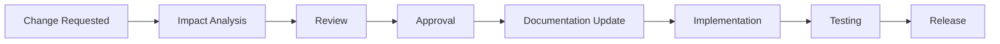

# Change Request Log

> **Document ID:** PM-07  
> **Document Name:** Change Request Log  
> **Version:** 1.0  
> **Status:** Approved  
> **Owner:** Product Team  
> **Last Updated:** July 2026

---

# 1. Purpose

The Change Request Log records all proposed changes to the product after documentation has been approved.

The objective is to ensure that every modification is evaluated, approved, documented, and traceable.

---

# 2. Scope

This document covers:

- Business changes
- Functional changes
- UI changes
- Architecture changes
- Database changes
- API changes
- Security changes
- Documentation updates

---

# 3. Change Workflow

---

# 4. Change Register

| ID | Title | Requested By | Category | Impact | Priority | Affected Docs/IDs | Traceability (DR/DEC) | Status |
|----|-------|--------------|----------|--------|----------|------------------|----------------------|--------|
| CR-001 | Example Change | Product Team | Business | Medium | Medium |  |  | Template |
| CR-002 | Subscription pricing adjustment | Product Team | Commercial | High | High | FR-14, PM-02 |  | Proposed |

---

# 5. Change Categories

- Business
- Functional
- UI / UX
- Technical
- Database
- API
- Security
- Infrastructure
- Documentation

---

# 6. Change Priorities

| Priority | Description |
|----------|-------------|
| Critical | Immediate implementation required |
| High | Important for current release |
| Medium | Planned enhancement |
| Low | Future consideration |

---

# 7. Change Status

Possible statuses:

- Proposed
- Under Review
- Approved
- Rejected
- In Progress
- Implemented
- Verified
- Closed

---

# 8. Impact Assessment

Every change request must include an impact assessment and explicit traceability to affected documentation and decisions. At minimum, a CR must evaluate its impact on:

- Product Vision
- Product Glossary
- Domain Model
- Business Rules
- Functional Requirements (list FR IDs)
- UI Design (list UX/Screen IDs)
- API Specifications (list API IDs)
- Database Design (list DB/DDL impacts)
- Testing (test scope and QA impact)
- Documentation (docs and DOC-GAPs affected)

Required fields for a CR record:

- `Affected Docs/IDs`: list of document IDs (FR-xx, API-xx, DB-xx, PM-xx)
- `Traceability (DR/DEC)`: list any Decision Records (`DR-xxx`) or Decisions (`DEC-xxx`) that justify or waive the change
- `Impact`: low/medium/high (justify with evidence)
- `Approvals`: list approvers per `Decision Log` approval thresholds

No implementation should begin until the impact assessment is complete and required approvals are recorded in the CR entry.

---

# 9. Approval Matrix

| Change Type | Approval Required |
|-------------|------------------|
| Business | Product Owner |
| Functional | Product Owner |
| Technical | CTO |
| Architecture | Solution Architect |
| Security | Security Lead |
| Documentation | Product Team |

## Multi-Category Change Resolution
For change requests spanning multiple approval domains, approvals must include the approver from each affected domain. If approvers conflict, escalate to the CTO + Product Owner for final decision.

---

# 10. Guiding Principles

- Every change must be documented.
- Every change must be reviewed.
- Every change must be approved.
- Documentation must be updated before implementation.
- All changes must remain traceable.

---

# 11. Revision History

| Version | Date | Description |
|----------|------|-------------|
| 1.0 | July 2026 | Initial Change Request Log |