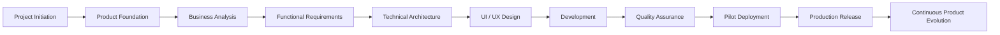
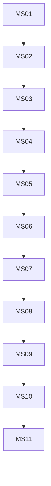

# Milestones

> **Document ID:** PM-03  
> **Document Name:** Milestones  
> **Version:** 1.0  
> **Status:** Approved  
> **Owner:** Product Team  
> **Last Updated:** July 2026

---

# 1. Purpose

This document defines the major milestones for the Digitize by OreeOn Technologies Pvt. Ltd. product journey.

Unlike sprint plans or development schedules, milestones represent significant business and product achievements that indicate progress toward the successful delivery and evolution of the platform.

The purpose of this document is to provide a high-level roadmap that aligns all stakeholders around common goals and measurable outcomes.

---

# 2. Milestone Strategy

The project progresses through a sequence of major milestones.

Each milestone represents the successful completion of a significant phase of the product lifecycle.

A milestone is considered complete only after all defined deliverables have been reviewed and approved.

---

# 3. Milestone Overview

---

# 4. Milestone Details

---

## MS-01 — Project Initiation

### Objective

Establish the project vision, governance structure, documentation repository, and execution strategy.

### Deliverables

- Repository Structure
- Documentation Standards
- Project Plan
- Decision Log
- Initial Milestones

### Success Criteria

The project foundation is established and approved.

---

## MS-02 — Product Foundation

### Objective

Define the product at a business level.

### Deliverables

- Product Glossary
- Domain Model
- Product Vision
- Business Model
- Product Roadmap

### Success Criteria

Core business concepts are finalized and frozen.

---

## MS-03 — Business Analysis

### Objective

Document the business processes, workflows, stakeholders, and operational rules.

### Deliverables

- Business Requirements Document (BRD)
- Business Flows
- Business Rules
- User Journeys
- Stakeholder Matrix

### Success Criteria

Business requirements are complete, consistent, and approved.

---

## MS-04 — Functional Requirements

### Objective

Translate business requirements into functional specifications.

### Deliverables

- Functional Requirement Specification (FRS)
- Role & Permission Matrix
- Screen Specifications
- Validation Rules
- Notification Matrix

### Success Criteria

Application behavior is fully defined for development.

**Owner:** Product Team / Solution Architect
**Acceptance:** Each deliverable must have sign-off from its owner and a corresponding entry in the Documentation Gap Register showing no open blocking gaps.

---

## MS-05 — Technical Architecture

### Objective

Design the technical foundation of the platform.

### Deliverables

- Solution Architecture
- System Architecture
- Database Design
- API Specifications
- Security Architecture
- Deployment Architecture

### Success Criteria

The technical design supports scalability, maintainability, and future expansion.

---

## MS-06 — UI / UX Design

### Objective

Design an intuitive and configurable user experience.

### Deliverables

- User Flows
- Wireframes
- UI Mockups
- Design System
- Interactive Prototype

### Success Criteria

All screens are approved and ready for development.

---

## MS-07 — Product Development

### Objective

Build the platform according to the approved specifications.

### Deliverables

- Backend Services
- Mobile Applications
- Web Portal
- Database
- APIs
- Integrations

### Success Criteria

The complete application is feature-ready for testing.

---

## MS-08 — Quality Assurance

### Objective

Validate the platform against business and functional requirements.

### Deliverables

- Functional Testing
- Integration Testing
- Regression Testing
- User Acceptance Testing
- Performance Testing

### Success Criteria

All critical issues are resolved and the product is approved for deployment.

---

## MS-09 — Pilot Deployment

### Objective

Deploy the platform for selected pilot customers.

### Deliverables

- Production Environment
- Initial Customer Onboarding
- Training Materials
- Operational Monitoring

### Success Criteria

Pilot customers successfully use the platform in a production environment.

---

## MS-10 — Public Release

### Objective

Launch Digitize by OreeOn Technologies Pvt. Ltd. for general availability.

### Deliverables

- Production Release
- Customer Documentation
- Support Readiness
- Release Notes

### Success Criteria

The platform is commercially available and operational.

---

## MS-11 — Platform Expansion

### Objective

Expand the platform beyond Swimming Pool Management.

### Deliverables

- Additional Facility Types
- Configurable Business Modules
- Enhanced Platform Capabilities

### Success Criteria

The platform successfully supports multiple activity and recreation businesses.

---

# 5. Milestone Dependencies

## Dependency Exception Process
If a downstream milestone must start prior to predecessor completion, create a documented waiver: owner, scope of overlap, risks, mitigation, and Decision Log reference. Owner: Product Team.

---

# 6. Milestone Governance

Every milestone shall:

- Have clearly defined objectives.
- Produce measurable deliverables.
- Undergo formal review.
- Receive stakeholder approval before closure.
- Serve as the baseline for the next milestone.

No milestone should begin until its prerequisite milestone has been completed or explicitly approved.

---

# 7. Success Indicators

The overall project will be considered successful when:

- The documentation repository is complete and approved.
- The platform architecture is stable and scalable.
- The MVP is successfully deployed.
- Pilot customers validate the business model.
- The product is commercially launched.
- The platform is ready to expand into additional facility types without architectural redesign.

---

# 8. Revision History

| Version | Date | Description |
|----------|------|-------------|
| 1.0 | July 2026 | Initial Milestones Document |