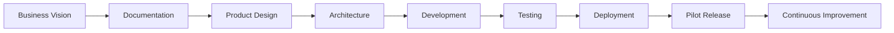

# Project Plan

> **Document ID:** PM-02  
> **Document Name:** Project Plan  
> **Version:** 1.0  
> **Status:** Approved  
> **Owner:** Product Team  
> **Last Updated:** July 2026

---

# 1. Purpose

The Project Plan defines the overall execution strategy for Digitize by OreeOn Technologies Pvt. Ltd.

It provides a structured roadmap covering documentation, product design, engineering, testing, deployment, and product launch.

This document ensures that all teams work toward a common objective using a phased and controlled approach.

---

# 2. Project Overview

## Product Name

**Digitize by OreeOn Technologies Pvt. Ltd.**

## Product Category

Cloud-Based SaaS Platform

## Initial Business Domain

Swimming Pool Management

## Long-Term Vision

A configurable SaaS platform supporting multiple activity and recreation businesses through a shared technology foundation.

---

# 3. Project Objectives

The primary objectives of the project are:

- Build a scalable SaaS platform.
- Digitize facility business operations.
- Minimize manual processes.
- Provide centralized business management.
- Support configurable business modules.
- Enable future expansion without redesign.
- Deliver a secure, maintainable, and enterprise-ready platform.

---

# 4. Product Scope

## Phase 1

Swimming Pool Management Platform

Core capabilities include:

- Organization Management
- Facility Management
- Site Management
- Customer Management
- Membership Management
- Attendance Management
- Billing & Payments
- Staff Management
- Advertisement Campaigns
- Reports & Dashboards
- Notifications
- SaaS Subscription Management

---

## Future Scope

Future releases will support:

- Gyms
- Yoga Centres
- Dance Studios
- Badminton Academies
- Football Academies
- Martial Arts Centres
- Indoor Sports Facilities
- Adventure Parks
- Kids Activity Centres

without requiring a separate application.

---

# 5. Project Phases

## Phase 0 — Foundation

Objectives:

- Finalize business vision.
- Complete documentation.
- Freeze product scope.
- Define architecture.

Deliverables:

- Product Documentation
- Business Documentation
- Technical Documentation

---

## Phase 1 — Product Design

Objectives:

- UI/UX Design
- Wireframes
- Design System
- Clickable Prototype

Deliverables:

- UI Screens
- User Flows
- Design Assets

---

## Phase 2 — Engineering

Objectives:

- Backend Development
- Mobile Application Development
- Admin Portal Development
- Database Development
- API Development

Deliverables:

- Working Product
- API Documentation
- Database Schema

---

## Phase 3 — Quality Assurance

Objectives:

- Functional Testing
- Integration Testing
- User Acceptance Testing
- Security Testing
- Performance Testing

Deliverables:

- Test Reports
- Defect Reports
- UAT Sign-off

---

## Phase 4 — Deployment

Objectives:

- Production Setup
- Deployment
- Monitoring
- Initial Customer Onboarding

Deliverables:

- Production Environment
- Deployment Checklist
- Monitoring Dashboard

---

## Phase 5 — Product Growth

Objectives:

- Customer Feedback
- Feature Improvements
- Multi-Facility Support
- Enterprise Enhancements

Deliverables:

- Product Roadmap Updates
- Enhanced Platform Features

---

# 6. Major Deliverables

| Category | Deliverables |
|-----------|--------------|
| Product | Vision, Roadmap, Glossary, Domain Model |
| Business | BRD, Business Flows, Business Rules |
| Functional | FRS, UI Navigation, Validation Rules |
| Technical | Architecture, ERD, APIs |
| UI/UX | Wireframes, Mockups, Design System |
| Engineering | Coding Standards, Sprint Planning |
| Testing | Test Plan, Test Cases, UAT |
| Release | Release Management, Release Notes, Deployment Checklist |

---

# 7. Key Stakeholders

| Role | Responsibility |
|------|----------------|
| Founders | Product Strategy & Business Direction |
| Product Team | Product Planning & Documentation |
| Solution Architect | System Architecture |
| Development Team | Product Development |
| QA Team | Product Validation |
| UI/UX Team | User Experience |
| DevOps Team | Deployment & Infrastructure |

---

# 8. Success Criteria

The project will be considered successful when:

- Documentation is approved.
- Product architecture is finalized.
- MVP is delivered.
- Pilot customers successfully onboard.
- Platform operates reliably.
- Business workflows are fully digitalized.
- Product is ready for future expansion.

---

# 9. Risks

Potential project risks include:

- Requirement changes
- Scope expansion
- Technical complexity
- Resource availability
- Timeline delays
- Third-party integration dependencies

These risks should be reviewed periodically throughout the project lifecycle.

## Risk Traceability
Project Plan risks are tracked in the Risk Register. Map:
- Requirement changes -> `RSK-001`
- Scope expansion -> `RSK-002`
- Delays in documentation -> `RSK-003`
Owner: Product Team.

---

# 10. Assumptions

The project assumes:

- Business requirements are approved before development.
- Documentation is the source of truth.
- Product scope is controlled through change management.
- Future expansion will be configuration-driven.
- The architecture supports scalability.

---

# 11. Project Governance

The project follows these governance principles:

- Business before technology.
- Documentation before implementation.
- Review before approval.
- Configuration over customization.
- Scalability by design.
- Single source of truth.

---

# 12. High-Level Execution Flow



---

# 13. Document Dependencies

```text
README
      ↓
Decision Log
      ↓
Project Plan
      ↓
Product Foundation
      ↓
Business Analysis
      ↓
Functional Requirements
      ↓
Technical Architecture
      ↓
Development
```

| Document Role | Document Name | Document ID |
|---------------|---------------|-------------|
| Decision Log | Decision Log | PM-01 |
| Project Plan | Project Plan | PM-02 |
| Milestones | Milestones | PM-03 |


---

# 14. Approval Matrix

| Role | Approval |
|------|----------|
| Product Owner | Product Scope |
| Solution Architect | Architecture |
| CTO | Technical Direction |
| Founders | Final Business Approval |

---

# 15. Revision History

| Version | Date | Description |
|----------|------|-------------|
| 1.0 | July 2026 | Initial Project Plan |
