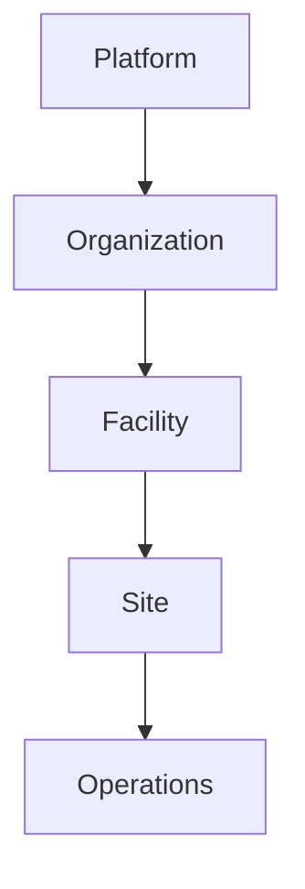
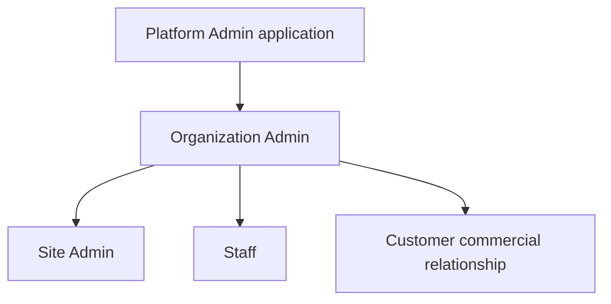

# PF-01 — Product Glossary

| Field              | Value            |
| ------------------ | ---------------- |
| **Document ID**    | PF-01            |
| **Document Name**  | Product Glossary |
| **Version**        | 1.0              |
| **Status**         | Approved         |
| **Owner**          | Product Team     |
| **Reviewer**       | CTO              |
| **Classification** | Internal         |
| **Last Updated**   | July 2026        |

---

# Table of Contents

1. Purpose
2. Scope
3. Intended Audience
4. How to Use This Document
5. Product Hierarchy
6. Business Hierarchy
7. Business Terminology
8. User Roles
9. Business Entities
10. Business Concepts
11. Naming Conventions
12. Guiding Principles
13. Future Expansion
14. Glossary Index
15. Revision History

---

# 1. Purpose

The Product Glossary establishes the official business terminology used throughout the Digitize by OreeOn Technologies Pvt. Ltd. platform.

Its purpose is to ensure that every stakeholder—including founders, business analysts, product managers, architects, developers, QA engineers, UI/UX designers, implementation teams, and support teams—uses a consistent vocabulary when discussing, designing, developing, testing, and maintaining the product.

This document serves as the single source of truth for business terminology. Every subsequent document within this repository, including the Business Requirements Document (BRD), Functional Requirements Specification (FRS), Domain Model, Database Design, API Specification, UI Design, and Test Documentation, shall reference the definitions provided here rather than creating new interpretations.

---

# 2. Scope

This glossary defines the core concepts that form the foundation of the Digitize by OreeOn Technologies Pvt. Ltd. platform.

The scope includes:

* Business hierarchy
* Organizational structure
* User roles
* Business entities
* Membership concepts
* Subscription concepts
* Operational terminology
* Platform terminology
* Naming conventions
* Business principles

This document intentionally excludes implementation details, database design, API specifications, UI behavior, and technical architecture.

---

# 3. Intended Audience

This document is intended for:

* Founders
* Product Owners
* Business Analysts
* Solution Architects
* Software Architects
* Developers
* QA Engineers
* UI/UX Designers
* DevOps Engineers
* Customer Success Teams
* Implementation Teams
* Business Stakeholders

Every stakeholder involved in the product lifecycle should understand and use the terminology defined within this document.

---

# 4. How to Use This Document

Before creating or reviewing any business, functional, or technical documentation, stakeholders should refer to this glossary to understand the official meaning of business terms.

The definitions in this document are authoritative. If a business term changes in the future, the update must be made here first before it is reflected in any dependent document.

This document should always be read together with:

* PF-02 – Domain Model
* PF-03 – Product Vision Document
* PF-04 – Business Model
* PF-05 – Product Roadmap

---

# 5. Document Governance

This Product Glossary is the single source of truth for business terminology used throughout the Digitize by OreeOn Technologies Pvt. Ltd. platform.

All future business, functional, and technical documents must reference this glossary instead of redefining business concepts.

Any modification to business terminology must first be approved by the Product Team and reflected in this document before being adopted elsewhere.

This governance policy ensures consistency across product management, engineering, quality assurance, implementation, and customer support documentation.

# 6. Product Hierarchy

Digitize by OreeOn Technologies Pvt. Ltd. follows a hierarchical business model designed to support multiple organizations, multiple facility types, and multiple operating locations while remaining scalable for future expansion.

The hierarchy is illustrated below.



Each level has a clearly defined business responsibility and ownership.

---

# 7. Business Hierarchy

## 7.1 Platform

### Definition

The Platform represents the complete Digitize by OreeOn Technologies Pvt. Ltd. SaaS ecosystem.

It provides the shared infrastructure, business capabilities, licensing, security, configuration, and operational framework used by every customer organization.

### Purpose

To provide a centralized, configurable, and scalable platform capable of supporting multiple activity and recreation businesses without requiring separate software products.

### Responsibilities

* Platform administration
* Organization onboarding
* Subscription management
* License management
* Global platform configuration
* Security and authentication
* Feature availability
* Product updates
* Platform monitoring

### Characteristics

* Highest level within the hierarchy.
* Shared by all organizations.
* Multi-tenant architecture.
* Managed exclusively by Platform Administrators.

### Example

Digitize by OreeOn Technologies Pvt. Ltd. operates as the platform serving hundreds of organizations across different business categories.

### Related Terms

* Organization
* Subscription
* License
* Platform Admin

---

## 7.2 Organization

### Definition

An Organization represents a legally registered business entity that subscribes to the Digitize by OreeOn Technologies Pvt. Ltd. platform.

An organization owns one or more facilities and is responsible for the overall governance, configuration, and administration of its business operations.

The organization is the primary customer of the platform.

### Purpose

To represent the business owner responsible for operating one or more facilities under a single business identity.

### Responsibilities

* Own facilities
* Own sites
* Manage subscriptions
* Configure business operations
* Manage organization-wide users
* Approve operational changes
* View consolidated reports
* Define organization policies

### Characteristics

* One organization may own multiple facilities.
* One organization may operate facilities across multiple sites.
* Every organization has exactly one Organization Admin.
* The organization maintains centralized governance over all facilities and sites.

### Example

**AquaLife Sports Pvt. Ltd.**

Facilities:

* Swimming Pool
* Gym
* Yoga Centre

Sites:

* HSR Layout
* Whitefield
* Indiranagar

The organization views consolidated business reports across all facilities and sites.

### Related Terms

* Facility
* Site
* Organization Admin

---

## 7.3 Facility

### Definition

A Facility represents a business vertical or service category operated by an organization.

Each facility defines the operational model, business rules, membership structure, activities, user interface, and workflows applicable to that business.

Facilities are independent business domains that share the same technology platform.

### Purpose

To separate business operations according to the type of activity being offered while allowing the platform to dynamically adapt its behavior.

### Responsibilities

* Define operational modules
* Define activities
* Define memberships
* Define pricing rules
* Define business configurations
* Define customer workflows

### Characteristics

* An organization may own multiple facilities.
* Each facility may operate at one or more sites.
* Facilities determine how the application behaves.
* Different facilities expose different screens and workflows.

### Example

Organization:

AquaLife Sports Pvt. Ltd.

Facilities:

* Swimming Pool
* Gym
* Yoga Centre

Although all belong to the same organization, each facility has different memberships, rules, activities, reports, and operational processes.

### Related Terms

* Facility Type
* Site
* Membership Plan
* Activity

---

## 7.4 Facility Type

### Definition

Facility Type classifies the nature of a facility and determines the operational capabilities available within the platform.

Facility Type acts as the configuration driver for dynamic application behavior.

### Purpose

To enable the platform to generate business-specific modules without requiring separate software products.

### Characteristics

Examples include:

* Swimming Pool
* Gym
* Yoga Centre
* Dance Studio
* Badminton Academy
* Football Academy
* Martial Arts Centre
* Indoor Sports Facility

Each facility type activates different business rules and application modules.

### Example

If the Facility Type is **Swimming Pool**, the system enables:

* Memberships
* Swimming Batches
* Lane Management
* Coaches
* Summer Camps

If the Facility Type is **Gym**, the system enables:

* Workout Plans
* Personal Training
* Equipment Management
* Fitness Assessments

### Related Terms

* Facility
* Activity
* Platform Capability

---

## 7.5 Site

### Definition

A Site represents the physical operating location where a facility delivers its services.

A site manages day-to-day operations, customers, staff, attendance, and local activities while remaining under the governance of the parent organization.

A facility may operate from one or many sites.

### Purpose

To provide operational independence for each physical location while maintaining centralized organizational control.

### Responsibilities

* Customer operations
* Attendance
* Local staff management
* Daily business activities
* Site-level reporting
* Operational execution

### Characteristics

* Every site belongs to exactly one facility.
* A facility may have multiple sites.
* Sites operate independently.
* Organization Admin retains final approval authority.

### Example

Facility:

Swimming Pool

Sites:

* HSR Layout
* Whitefield
* Electronic City

Each site has its own staff, customers, operating hours, and daily operations while sharing the same facility configuration.

### Related Terms

* Facility
* Site Admin
* Staff
* Customer

---

## 7.6 Business Hierarchy Principles

The Digitize by OreeOn platform follows a structured business hierarchy designed to support centralized governance, operational independence, and future scalability across multiple facility types.

The following principles govern the hierarchy:

1. Every Organization owns one or more Facilities.
2. Every Facility belongs to exactly one Organization.
3. Every Facility may operate through one or more Sites.
4. Every Site belongs to exactly one Facility.
5. Business configuration is defined at the Facility level.
6. Operational activities are executed at the Site level.
7. Organization Admin provides centralized governance.
8. Assigned Site Admins and Staff manage day-to-day operations. Manager is not a role.
9. Configuration changes follow the Approval Workflow.
10. The hierarchy is designed to support future Facility Types without changing the core architecture.

---

# 8. User Roles

The Digitize by OreeOn platform follows a hierarchical **tenant** model (Platform → Organization → Facility → Site) with **assignment- and permission-based** operational roles.

Authoritative access, Phase-1 mobile personas, and commerce boundaries are frozen in `docs/architecture/ACCESS_MOBILE_COMMERCE_ARCHITECTURE_FREEZE.md` (DR-019). Authoritative roles: Platform Admin, Organization Admin, Site Admin, Staff. There is **no Manager role**. Historical “Facility Manager” labels in FR/UX/API collections are operational titles, not a fifth RBAC role.



---

## 8.1 Platform Admin

### Definition

A Platform Admin is an internal administrator of Digitize by OreeOn responsible for managing the SaaS platform, customer organizations, subscriptions, licenses, and platform-wide operations.

Platform Admins are not employees of customer organizations.

They belong exclusively to the Digitize by OreeOn platform.

---

### Purpose

To administer the platform and ensure reliable operation for all customer organizations.

---

### Responsibilities

* Create and manage Organizations
* View and manage Facilities and Sites
* View and administer Organization users
* View and administer Organization Admins, Site Admins, and Staff across organizations
* Manage platform licenses and SaaS subscriptions
* Suspend, revoke, or administer users where platform administration requires it
* Configure platform capabilities
* Monitor platform health and platform-wide operational/administrative data
* Manage global settings
* Support customer organizations

---

### Characteristics

* Highest platform-wide administrative authority, through the **Platform Admin application**.
* Can manage organization users, Organization Admins, Site Admins, and Staff across organizations according to platform permissions.
* Does not replace Organization Admin as the **normal** business-level administrator of Site Admins and Staff.
* Is not a Phase-1 operational mobile persona.
* Does not perform day-to-day facility reception/operations as a job function.

---

### Example

A new customer purchases Digitize by OreeOn.

The Platform Admin:

* Creates the organization.
* Provisions the initial Organization Admin (credentials emailed per environment policy — temporary password locally / setup link in QA and Production; PA never enters an OA password).
* Does **not** act as a tenant-data superuser and cannot decrypt Organization business data.
* Approves initial Organization detail changes **only when** the Organization Admin changes them during onboarding; otherwise the Organization activates after OA Terms & Conditions acceptance with no initial changes.

See DR-021 / `ORGANIZATION_ONBOARDING_PA_BOUNDARY_FREEZE.md`.

---

### Related Terms

* Platform
* Organization
* Subscription
* License

---

## 8.2 Organization Admin

### Definition

The Organization Admin is the primary administrator representing a customer organization.

This role is responsible for configuring business operations, governing facilities and sites, approving operational changes, and monitoring organization-wide performance.

The Organization Admin is the highest authority within the customer organization.

---

### Purpose

To centrally manage all facilities and sites owned by the organization while maintaining operational consistency.

---

### Responsibilities

Business Administration

* Configure organization settings.
* Create facilities.
* Create sites.
* Configure operational policies.

User Management

* Create Site Admins.
* Assign Site Admin access.
* Create Staff.
* Assign Staff access.
* Suspend or revoke Site Admin and Staff access within the Organization.

Business Configuration

* Configure membership plans.
* Configure activities.
* Configure pricing.
* Configure operational rules.
* Configure working hours.
* Configure notifications.

Approval Management

* Review Site Admin/Staff configuration requests.
* Approve or reject configuration changes.
* Approve operational updates.

Business Monitoring

* View dashboards.
* View reports.
* Monitor facility performance.
* Monitor site performance.
* Review revenue reports.

Subscription Management

* Manage the Organization’s Digitize SaaS subscription (Organization → Digitize/OreeOn).
* View license details.
* SaaS purchasing is not a Staff-mobile checkout flow.

---

### Characteristics

* Highest customer authority.
* Can manage multiple facilities.
* Can manage multiple sites.
* Final approver for business configuration.
* Cannot modify platform-level configuration.

---

### Example

An organization owns:

* Swimming Pool
* Gym
* Yoga Centre

The Organization Admin configures all three facilities, assigns facilities to sites, creates Site Admins and Staff, defines memberships, and monitors business performance from a centralized dashboard.

---

### Related Terms

* Organization
* Facility
* Site
* Site Admin
* Staff
* Membership Plan

---

## 8.3 Site Admin

### Definition

A Site Admin is the **site-level operational administrator**. Access is determined by assigned Site scope and Site-level permissions.

Site Admin is not a separate tenant level. Site Admin is **not** the Manager role (Manager is not a role).

---

### Purpose

To oversee operational activities of the assigned Site under Organization Admin governance, working with Staff assigned to the Site.

---

### Responsibilities

Determined by assigned Site-level permissions already described in product/FR documentation. Typical examples:

* Daily operations within assigned Site scope
* Supervise Staff at the assigned Site where permitted
* Customer operational workflows where permitted
* Attendance and sessions where permitted
* Site-scoped reporting where permitted

Site Admin must not automatically receive platform-wide or organization-wide authority.

---

### Characteristics

* Assignment- and permission-scoped to Site
* Phase-1 operational mobile persona
* Cannot manage Platform Admin accounts
* Cannot redefine platform configuration
* Cannot automatically administer other organizations or unassigned sites

---

### Related Terms

* Organization Admin
* Staff
* Facility
* Site

---

## 8.4 Staff

### Definition

Staff members perform operational activities required for the daily functioning of a site.

Their permissions are limited to the responsibilities assigned by the Organization Admin (or, where permitted, a Site Admin). Platform Admin may also administer Staff across organizations according to platform permissions.

Staff members cannot modify business configuration.

---

### Purpose

To support customer service and operational execution.

---

### Responsibilities

Examples include:

* Customer registration
* Membership enrollment
* Attendance check-in
* Walk-in registration
* Payment collection
* Invoice generation
* Customer assistance
* Daily operational support

Depending on the facility type, additional operational responsibilities may be available.

---

### Characteristics

* Operational role only.
* No administrative privileges.
* No approval authority.
* No configuration authority.

---

### Example

A receptionist registers a new customer, issues an invoice, collects payment, and activates the membership purchased by the customer.

---

### Related Terms

* Customer
* Membership
* Attendance
* Invoice

---

## 8.5 Customer

### Definition

A Customer is an individual who has a **commercial/service relationship with a Facility** (Customer → Facility).

Customers may purchase memberships, single-entry access, training, classes, or other facility services.

**Customer is not the same concept as Participant.** A participant is who takes part in an activity; they may or may not be the Customer.

Customer is **not** a Phase-1 operational mobile persona. Customer mobile is Phase 2. Customer is not an `identity.user_account` in Phase 1.

---

### Purpose

To receive services provided by the organization through its facilities and sites.

---

### Responsibilities

Customers may:

* Purchase memberships.
* Attend scheduled sessions.
* Participate in activities.
* Make payments.
* Renew memberships.
* View invoices.
* Maintain profile information.

---

### Characteristics

* May own multiple memberships.
* May participate in multiple activities.
* Belongs to one or more facilities.
* Access is limited to customer services.

---

### Example

A customer purchases:

* Swimming Membership
* Personal Coaching
* Summer Camp

All three services coexist under the same customer profile.

---

### Related Terms

* Membership
* Membership Plan
* Session
* Payment

---

# 8.6 Role Governance Principles

The following principles govern user roles across the platform.

1. Tenant hierarchy is Platform → Organization → Facility → Site. Roles are not extra tenant levels.

2. Every Organization has at least one Organization Admin.

3. Site Admin is the site-level operational administrator. Manager is not a role.

4. Organization Admin is the normal creator and administrator of Site Admins and Staff within the Organization.

5. Platform Admin can administer organization users, Organization Admins, Site Admins, and Staff across the platform according to platform permissions.

6. Organization Admin cannot manage Platform Admin accounts.

7. Site Admin and Staff permissions are assignment-based and configurable (least privilege).

8. Customers cannot access administrative functions. Customer ≠ Participant.

9. Guardian Relationship is future-ready; detailed guardian/minor UX is deferred.

10. Suspend, revoke, or remove organization assignment is not account deletion.

11. Every user action must be auditable.

---

# 8.7 Business Entity Classification

To improve maintainability and architectural clarity, business entities are classified into five logical categories.

## Core Business Entities

- Organization
- Facility
- Site

These entities define the structural hierarchy of the business.

---

## Operational Entities

- Customer
- Activity
- Session
- Batch/Class
- Membership
- Attendance
- Walk-in Visit

These entities support day-to-day facility operations.

---

## Commercial Entities

- Membership Plan
- Invoice
- Payment

These entities manage customer purchases and financial transactions.

---

## Platform Entities

- Subscription
- License
- Notification
- Advertisement Campaign

These entities support SaaS platform capabilities.

---

## Governance Entities

- Approval Request

These entities enforce business governance and approval workflows.

---


# 9. Business Entities

Business Entities represent the primary business objects managed by the Digitize by OreeOn platform.

Each entity has a clearly defined responsibility within the business domain and participates in one or more business processes.

The relationships between these entities are described in detail in **PF-02 – Domain Model**.

---

# 9.1 Facility

## Definition

A **Facility** represents a business unit or service category operated by an Organization.

A facility defines **what business is being operated**, such as a Swimming Pool, Gym, Yoga Centre, Dance Studio, or Badminton Academy.

A facility contains the business configuration, operational rules, activities, memberships, and services applicable to that business type.

---

## Business Purpose

The Facility serves as the primary business container responsible for defining how a specific business operates within the platform.

It enables the platform to support multiple business types using a common technology foundation.

---

## Ownership

* Owned by one Organization.
* May operate through one or more Sites.
* Managed by the Organization Admin.

---

## Lifecycle

```text
Created
    ↓
Configured
    ↓
Operational
    ↓
Updated
    ↓
Archived
```

---

## Responsibilities

A Facility is responsible for:

* Defining operational rules.
* Defining business activities.
* Defining membership structures.
* Defining pricing models.
* Defining available services.
* Defining business configurations.
* Defining customer workflows.

---

## Characteristics

* Represents a business domain.
* Independent from physical locations.
* Supports multiple Sites.
* Determines application behavior.
* Drives dynamic screen generation.

---

## Example

**Organization**

AquaLife Sports Pvt. Ltd.

**Facilities**

* Swimming Pool
* Gym
* Yoga Centre

Each facility has its own memberships, pricing, activities, reports, and operational workflows.

---

## Business Rules

* Every Facility belongs to exactly one Organization.
* Every Facility must have a Facility Type.
* Every Facility may operate through multiple Sites.
* Every Facility maintains its own business configuration.
* Facility configuration applies across all Sites belonging to that Facility unless explicitly overridden by approved site-level settings.

---

## Related Terms

* Organization
* Facility Type
* Site
* Activity
* Membership Plan

---

## Referenced In

* PF-02 Domain Model
* BRD
* FRS
* Database Design
* API Specification

---

# 9.2 Site

## Definition

A **Site** represents a physical operating location where a Facility delivers its services.

A Site is responsible for day-to-day operations while inheriting the business configuration defined by its parent Facility.

---

## Business Purpose

The Site enables organizations to operate multiple physical locations under the same Facility while maintaining centralized governance.

---

## Ownership

* Belongs to exactly one Facility.
* Operated by assigned Site Admins and Staff.
* Governed by the Organization Admin.

---

## Lifecycle

```text
Created
    ↓
Activated
    ↓
Operational
    ↓
Updated
    ↓
Closed
```

---

## Responsibilities

A Site is responsible for:

* Customer operations.
* Daily attendance.
* Membership execution.
* Staff operations.
* Local scheduling.
* Operational reporting.
* Revenue collection.

---

## Characteristics

* Physical business location.
* Supports daily operations.
* Operates independently.
* Shares Facility configuration.
* Can request operational changes for approval.

---

## Example

**Facility**

Swimming Pool

**Sites**

* HSR Layout
* Whitefield
* Electronic City

Each site has its own staff, customers, attendance records, and operational activities while following the same facility configuration.

---

## Business Rules

* Every Site belongs to one Facility.
* Site access is assignment-scoped to Site Admin and Staff; Manager is not a role.
* Business configuration changes require Organization Admin approval.
* Operational data belongs to the Site.
* Reports may be generated at Site, Facility, or Organization level.

---

## Related Terms

* Facility
* Organization
* Site Admin
* Staff
* Customer

---

## Referenced In

* PF-02 Domain Model
* BRD
* FRS
* Attendance Flow
* Reporting

---

# 9.3 Activity

## Definition

An **Activity** represents a service, program, or operational offering provided by a Facility.

Activities define **what customers participate in**.

The available activities depend on the Facility Type.

---

## Business Purpose

Activities provide flexibility for different business domains while allowing the platform to dynamically configure operational modules.

---

## Ownership

* Belongs to one Facility.
* Available across one or more Sites.
* Managed by the Organization Admin.
* Operated by the Site.

---

## Lifecycle

```text
Created
    ↓
Configured
    ↓
Scheduled
    ↓
Active
    ↓
Completed
```

---

## Responsibilities

Activities define:

* Customer participation.
* Scheduling requirements.
* Capacity limits.
* Trainers or instructors.
* Pricing (where applicable).
* Operational workflows.

---

## Characteristics

Activities vary depending on the Facility Type.

Examples include:

**Swimming Pool**

* General Swimming
* Coaching
* Personal Training
* Summer Camp
* Aqua Fitness

**Gym**

* Personal Training
* Strength Program
* Cardio Assessment
* Nutrition Consultation

**Yoga Centre**

* Beginner Yoga
* Power Yoga
* Meditation
* Prenatal Yoga

---

## Business Rules

* Activities belong to one Facility.
* Activities may be available at multiple Sites.
* Activity configuration is controlled by the Organization Admin.
* Site-specific operational adjustments require approval.

---

## Related Terms

* Facility
* Membership Plan
* Session
* Batch/Class

---

## Referenced In

* BRD
* FRS
* Scheduling
* UI Design

---

# 9.4 Membership Plan

## Definition

A **Membership Plan** defines the commercial offering available to customers.

It specifies the duration, pricing, validity, eligible activities, access rules, and operational conditions under which customers can use facility services.

A Membership Plan is a reusable product offered by a Facility.

---

## Business Purpose

To standardize the services offered by the Facility and provide customers with structured subscription options.

---

## Ownership

* Owned by a Facility.
* Configured by the Organization Admin.
* Available across selected Sites.

---

## Lifecycle

```text
Draft
    ↓
Submitted
    ↓
Approved
    ↓
Published
    ↓
Active
    ↓
Expired
    ↓
Archived
```

---

## Responsibilities

A Membership Plan defines:

* Membership name.
* Duration.
* Pricing.
* Validity.
* Eligible activities.
* Access rules.
* Capacity restrictions.
* Renewal policy.

---

## Characteristics

Examples include:

Swimming Pool

* Monthly Membership
* Quarterly Membership
* Annual Membership
* Family Membership
* Coaching Membership

Gym

* Monthly Fitness Plan
* Personal Training Package
* Premium Membership

---

## Business Rules

* Every Membership Plan belongs to one Facility.
* Plans may be available at one or more Sites.
* Plans are approved by the Organization Admin.
* Historical plans cannot be modified after customer purchases.
* New revisions should be created instead of overwriting active plans.

---

## Related Terms

* Membership
* Activity
* Customer
* Facility

---

## Referenced In

* BRD
* FRS
* Billing
* Membership Purchase Flow

---

# 9.5 Membership

## Definition

A **Membership** represents the active agreement between a Customer and a Membership Plan.

It grants the customer access to the services defined by the purchased Membership Plan for a specified validity period.

---

## Business Purpose

To record and manage customer entitlements throughout their lifecycle.

---

## Ownership

* Belongs to one Customer.
* Created from one Membership Plan.
* Managed by the Facility.

---

## Lifecycle

```text
Created
    ↓
Activated
    ↓
Active
    ↓
Renewed
    ↓
Expired
    ↓
Cancelled
```

---

## Responsibilities

A Membership records:

* Customer.
* Membership Plan.
* Start Date.
* Expiry Date.
* Status.
* Payment Reference.
* Renewal History.
* Access Rights.

---

## Characteristics

* A customer may own multiple active memberships.
* Membership validity is independent of other memberships.
* Memberships control service access.
* Membership history is permanently retained.

---

## Example

Customer:

Rahul Sharma

Active Memberships:

* Annual Swimming Membership
* Personal Coaching Package
* Summer Camp Enrollment

All three memberships remain active simultaneously under the same customer profile.

---

## Business Rules

* Every Membership belongs to one Customer.
* Every Membership is created from one Membership Plan.
* Multiple active memberships are allowed.
* Membership validity is tracked independently.
* Membership history cannot be deleted.

---

## Related Terms

* Customer
* Membership Plan
* Activity
* Payment
* Attendance

---

## Referenced In

* BRD
* FRS
* Billing
* Attendance
* Customer Management

---

# 9.6 Customer

## Definition

A **Customer** is an individual who registers with a Facility to access one or more services offered by the organization.

Customers may purchase memberships, participate in activities, attend scheduled sessions, or use walk-in services depending on the Facility Type.

A single customer profile may have multiple memberships and participate in multiple activities across the same Facility.

---

## Business Purpose

The Customer is the primary consumer of services provided by the Facility.

All operational activities such as membership purchases, attendance, invoices, payments, and activity participation revolve around the customer.

---

## Ownership

* Registered under one Organization.
* Associated with one or more Facilities.
* Served at one or more Sites.
* Managed by Organization Admins, Site Admins, and authorized Staff.

---

## Lifecycle

```text
Registered
    ↓
Verified
    ↓
Active
    ↓
Membership Purchased
    ↓
Operational
    ↓
Inactive
```

---

## Responsibilities

A Customer may:

* Register with the Facility.
* Purchase Membership Plans.
* Participate in Activities.
* Attend Sessions.
* Make Payments.
* Renew Memberships.
* View Invoices.
* Receive Notifications.

---

## Characteristics

* May own multiple active memberships.
* May participate in multiple activities.
* Maintains a single customer profile.
* Customer history is permanently retained.

---

## Example

Rahul registers with AquaLife Sports.

He purchases:

* Annual Swimming Membership
* Personal Coaching
* Summer Camp

All services are linked to a single customer profile.

---

## Business Rules

* A customer profile is unique within an Organization.
* The same individual may be registered in multiple Organizations as separate customer profiles because each Organization operates as an independent tenant.

---

## Related Terms

* Membership
* Membership Plan
* Attendance
* Invoice
* Payment

---

## Referenced In

* BRD
* FRS
* Customer Management
* Billing
* Attendance

---

# 9.7 Session

## Definition

A **Session** represents a scheduled occurrence of an Activity at a specific Site, date, and time.

Sessions define **when** customers consume a service.

---

## Business Purpose

Sessions enable structured scheduling of activities while supporting attendance, trainer allocation, and capacity management.

---

## Ownership

* Belongs to one Activity.
* Conducted at one Site.
* Managed by the Facility.

---

## Lifecycle

```text
Created
    ↓
Scheduled
    ↓
Active
    ↓
Completed
    ↓
Archived
```

---

## Responsibilities

A Session defines:

* Date
* Time
* Duration
* Capacity
* Assigned Trainer
* Location
* Attendance Records

---

## Characteristics

* May belong to a Batch/Class.
* Can have capacity limits.
* Supports attendance tracking.
* May be recurring.

---

## Example

Swimming Coaching

Monday

6:00 PM

Duration: 60 Minutes

Capacity: 20 Students

Coach: John

---

## Business Rules

* Every Session belongs to one Activity.
* Capacity cannot exceed configured limits.
* Attendance is recorded against Sessions.
* Sessions cannot be deleted after attendance has been recorded.

---

## Related Terms

* Activity
* Attendance
* Batch/Class
* Customer

---

## Referenced In

* Scheduling
* BRD
* FRS

---

# 9.8 Batch / Class

## Definition

A **Batch/Class** is a recurring group of Sessions delivered to a defined set of customers.

It provides a structured schedule for ongoing training or instructional programs.

---

## Business Purpose

To organize customers into recurring learning, coaching, or fitness groups.

---

## Ownership

* Belongs to one Activity.
* Conducted at one Site.
* Managed by the Facility.

---

## Lifecycle

```text
Created
    ↓
Published
    ↓
Active
    ↓
Completed
    ↓
Archived
```

---

## Responsibilities

A Batch/Class defines:

* Schedule
* Instructor
* Capacity
* Enrolled Customers
* Recurring Sessions

---

## Characteristics

Examples include:

Swimming

* Beginners Batch
* Intermediate Batch
* Advanced Batch

Gym

* HIIT Group
* Strength Training
* Cardio Bootcamp

Yoga

* Morning Yoga
* Evening Meditation
* Power Yoga

---

## Business Rules

* Every Batch belongs to one Activity.
* A Batch contains one or more Sessions.
* Capacity limits are configurable.
* Enrollment follows business rules defined by the Facility.

---

## Related Terms

* Activity
* Session
* Customer
* Attendance

---

## Referenced In

* BRD
* Scheduling
* FRS

---

# 9.9 Attendance

## Definition

**Attendance** records a customer's participation in a Session, Activity, or authorized Facility visit.

Attendance serves as the official operational record of customer access.

---

## Business Purpose

To monitor customer participation, facility utilization, and operational performance.

---

## Ownership

* Recorded for one Customer.
* Linked to one Session or Walk-in Visit.
* Managed by the Site.

---

## Lifecycle

```text
Pending
    ↓
Checked In
    ↓
Completed
```

---

## Responsibilities

Attendance records include:

* Customer
* Date
* Time
* Site
* Activity
* Session
* Status

---

## Characteristics

* Supports QR Code, RFID, biometric, or manual check-in (future extensibility).
* Supports reporting.
* Supports capacity monitoring.

---

## Business Rules

* Attendance must reference a valid customer.
* Attendance cannot exist without an associated operational event.
* Attendance history is immutable.

---

## Related Terms

* Customer
* Session
* Walk-in Visit

---

## Referenced In

* Attendance Flow
* BRD
* Reports

---

# 9.10 Walk-in Visit

## Definition

A **Walk-in Visit** represents a customer visit without an active membership.

The customer pays for immediate access according to the Facility's pricing rules.

---

## Business Purpose

To support occasional visitors who do not require a long-term membership.

---

## Ownership

* Belongs to one Customer.
* Occurs at one Site.
* Managed by the Facility.

---

## Characteristics

* Independent of Memberships.
* Requires payment before access.
* Recorded for reporting.

---

## Business Rules

* Walk-in pricing is configurable.
* Capacity restrictions still apply.
* Walk-in history must be retained.

---

## Related Terms

* Customer
* Attendance
* Payment

---

# 9.11 Invoice

## Definition

An **Invoice** is the official financial document generated for a customer transaction.

It records charges for memberships, activities, walk-in visits, or other billable services.

---

## Business Purpose

To provide an auditable financial record of customer purchases.

---

## Ownership

* Issued to one Customer.
* Generated by one Site.
* Belongs to one Organization.

---

## Characteristics

Invoices may include:

* Membership Purchases
* Activity Fees
* Walk-in Charges
* Discounts
* Taxes
* Additional Services

---

## Business Rules

* Every Invoice has a unique invoice number.
* Invoices cannot be modified after finalization.
* Credit notes or cancellations must be handled through separate business processes.

---

## Related Terms

* Payment
* Membership
* Customer

---

# 9.12 Payment

## Definition

A **Payment** records the settlement of an Invoice using an approved payment method.

Payments confirm the financial completion of customer transactions.

---

## Business Purpose

To maintain an accurate financial record and activate paid services.

---

## Ownership

* Belongs to one Invoice.
* Made by one Customer.
* Processed at one Site.

---

## Characteristics

Supported payment methods may include:

* UPI
* Credit Card
* Debit Card
* Cash
* Net Banking
* Digital Wallets

Additional payment methods may be introduced as the platform evolves.

---

## Business Rules

* A Payment must reference an Invoice.
* Partial or multiple payments may be supported based on organizational policy.
* Successful payment may trigger automatic membership activation and receipt generation.
* Payment records are immutable and retained for audit purposes.

---

## Related Terms

* Invoice
* Membership
* Customer
* Subscription

---

## Referenced In

* Billing
* Finance
* BRD
* FRS

---

# 9.13 Subscription

## Definition

A **Subscription** represents the commercial agreement between an Organization and the Digitize by OreeOn platform.

It defines the service plan purchased by the Organization, including billing cycle, duration, pricing, and subscribed capabilities.

A Subscription governs the commercial relationship, while Licenses determine how the subscribed capabilities are assigned within the organization.

---

## Business Purpose

To manage the commercial relationship between the customer organization and the platform, including plan selection, billing, renewals, and subscription lifecycle.

---

## Ownership

* Owned by one Organization.
* Managed by the Platform.
* Administered by Platform Administrators.

---

## Lifecycle

```text
Draft
    ↓
Purchased
    ↓
Active
    ↓
Renewed
    ↓
Expired
    ↓
Cancelled
```

---

## Responsibilities

A Subscription defines:

* Subscription Plan
* Billing Cycle
* Subscription Period
* Renewal Status
* Commercial Pricing
* Subscription Status

---

## Characteristics

* One Organization may have multiple active subscriptions if different Facilities are licensed independently.
* Subscription controls commercial entitlement only.
* Feature availability is enforced through Licenses.

---

## Example

AquaLife Sports Pvt. Ltd.

Subscriptions:

* Swimming Pool Subscription
* Gym Subscription

Each subscription is independently billed and managed.

---

## Business Rules

* Every Subscription belongs to one Organization.
* A Subscription must reference one Subscription Plan.
* Subscription renewal extends the subscription period.
* Expired subscriptions may suspend associated licenses based on organizational policy.

---

## Related Terms

* License
* Organization
* Facility
* Platform

---

## Referenced In

* Business Model
* Subscription Management
* Billing
* BRD
* FRS

---

# 9.14 License

## Definition

A **License** represents the operational entitlement assigned to a specific Facility.

It determines which platform capabilities are available for that Facility.

Unlike a Subscription, which defines the commercial agreement, a License defines the operational permissions and enabled modules.

---

## Business Purpose

To control platform capabilities at the Facility level while allowing organizations to operate different facilities with different feature sets.

---

## Ownership

* Belongs to one Subscription.
* Assigned to one Facility.
* Managed by the Platform.

---

## Lifecycle

```text
Generated
    ↓
Assigned
    ↓
Active
    ↓
Renewed
    ↓
Expired
```

---

## Responsibilities

A License controls:

* Enabled Modules
* Operational Features
* Add-on Capabilities
* Usage Limits
* License Validity

---

## Characteristics

Examples of licensed capabilities include:

* Membership Management
* Attendance
* Billing
* Reports
* Advertisement Campaigns
* Personal Training
* Batch Management

Future capabilities may include:

* AI Analytics
* Accounting Integration
* Payroll
* Public APIs
* Marketplace Integrations

---

## Example

Swimming Pool Facility

Enabled Modules:

* Membership Management
* Attendance
* Billing
* Reports

Advertisement Campaign Module

Enabled

AI Analytics

Disabled

---

## Business Rules

* Every License belongs to one Subscription.
* Every Facility must have an active License before becoming operational.
* Capabilities are enforced by the License.
* License history is retained for auditing.

---

## Related Terms

* Subscription
* Facility
* Platform Capability

---

## Referenced In

* Business Model
* Architecture
* FRS
* Security

---

# 9.15 Advertisement Campaign

## Definition

An **Advertisement Campaign** represents a marketing initiative created by an Organization to promote its Facilities, Activities, Membership Plans, or events.

Campaigns may target existing customers, potential customers, or specific customer segments.

---

## Business Purpose

To provide integrated marketing capabilities that help organizations increase customer engagement and business growth.

---

## Ownership

* Created by an Organization.
* Managed at the Facility level.
* Executed across selected Sites.

---

## Lifecycle

```text
Draft
    ↓
Approved
    ↓
Scheduled
    ↓
Running
    ↓
Completed
```

---

## Responsibilities

Campaigns may promote:

* Membership Offers
* Seasonal Packages
* Summer Camps
* Personal Training
* New Activities
* Promotional Events
* Discounts

---

## Characteristics

Campaigns may target:

* Existing Members
* Expired Members
* Walk-in Customers
* Prospective Customers

---

## Business Rules

* Campaigns require Organization Admin approval before publication.
* Campaign performance is measurable.
* Campaign history is retained.

---

## Related Terms

* Customer
* Membership Plan
* Notification

---

## Referenced In

* Marketing Module
* BRD
* Reports

---

# 9.16 Notification

## Definition

A **Notification** is a system-generated or user-initiated communication delivered to users regarding operational, financial, or business events.

Notifications support timely communication between the platform, organizations, staff, and customers.

---

## Business Purpose

To ensure stakeholders receive important information at the appropriate time.

---

## Ownership

* Generated by the Platform or Organization.
* Delivered to one or more recipients.

---

## Characteristics

Notification examples include:

* Membership Expiry Reminder
* Payment Confirmation
* Invoice Generated
* Session Reminder
* Approval Decision
* Subscription Renewal Reminder
* Promotional Campaign

---

## Business Rules

* Notifications may be automated or manual.
* Delivery channels are configurable.
* Delivery history is retained.

---

## Related Terms

* Customer
* Payment
* Membership
* Advertisement Campaign

---

## Referenced In

* Notification Module
* BRD
* FRS

---

# 9.17 Approval Request

## Definition

An **Approval Request** represents a controlled workflow through which Site Admins request business configuration changes that require Organization Admin authorization.

Approval Requests ensure centralized governance while allowing decentralized operations.

---

## Business Purpose

To maintain organizational consistency, auditability, and controlled business configuration across all Sites.

---

## Ownership

* Raised by a Site Admin.
* Reviewed by the Organization Admin.
* Recorded by the Platform.

---

## Lifecycle

```text
Draft
    ↓
Submitted
    ↓
Under Review
    ↓
Approved / Rejected
    ↓
Implemented
    ↓
Closed
```

---

## Responsibilities

Approval Requests may include:

* New Membership Plan
* Pricing Changes
* Activity Changes
* Operating Hours
* Batch Configuration
* Capacity Changes
* Business Rules
* Site Configuration

---

## Characteristics

* Fully auditable.
* Supports comments and review history.
* May require multiple approval steps in future platform versions.

---

## Business Rules

* Site Admins cannot directly publish business configuration.
* Organization Admin approval is mandatory.
* Every approval decision is permanently recorded.
* Rejected requests remain available for audit purposes.

---

## Related Terms

* Organization Admin
* Site Admin
* Membership Plan
* Activity
* Site

---

## Referenced In

* Approval Workflow
* BRD
* FRS
* Audit & Compliance

---
# 9.18 Business Ownership Matrix

| Entity | Owned By | Managed By | Operated By |
|----------|-----------|------------|-------------|
| Organization | Platform | Organization Admin | Organization |
| Facility | Organization | Organization Admin | Organization |
| Site | Facility | Organization Admin | Site Admin |
| Activity | Facility | Organization Admin | Site Admin |
| Membership Plan | Facility | Organization Admin | Site Admin |
| Customer | Organization | Site | Staff |
| Membership | Customer | Facility | Site |
| Session | Activity | Site | Staff |
| Attendance | Site | Staff | Staff |
| Invoice | Organization | Site | Staff |
| Payment | Organization | Site | Staff |
| Subscription | Organization | Platform | Platform |
| License | Platform | Platform | Facility |
| Advertisement Campaign | Organization | Organization Admin | Site |
| Notification | Platform | Platform / Organization | Platform |
| Approval Request | Site | Organization Admin | Platform |

---

# 9.19 Business Approval Matrix

| Business Object | Approval Required | Approver |
|-----------------|-------------------|-----------|
| Facility | No | — |
| Site | No | — |
| Membership Plan | Yes | Organization Admin |
| Activity | Yes | Organization Admin |
| Pricing | Yes | Organization Admin |
| Batch/Class | Yes | Organization Admin |
| Operating Hours | Yes | Organization Admin |
| Customer Registration | No | — |
| Attendance | No | — |
| Walk-in Visit | No | — |
| Invoice | No | — |
| Payment | No | — |
| Advertisement Campaign | Yes | Organization Admin |

---

# 10. Business Concepts

Business Concepts define the fundamental principles that govern how the Digitize by OreeOn platform operates. Unlike Business Entities, which represent tangible business objects, Business Concepts describe the operational philosophies and platform behaviors that enable flexibility, scalability, and governance.

---

## 10.1 Business Configuration

### Definition

Business Configuration is the collection of configurable settings that define how a Facility operates within the platform.

Rather than hard-coding business rules, Digitize by OreeOn allows organizations to configure their business operations according to their specific requirements.

### Examples

* Membership Plans
* Pricing Rules
* Operating Hours
* Activities
* Batch Configuration
* Attendance Rules
* Payment Methods
* Tax Configuration
* Notification Settings

### Purpose

To allow different facilities to operate according to their own business processes without modifying the application.

---

## 10.2 Platform Capability

### Definition

A Platform Capability is a functional module that can be enabled or disabled for a Facility based on its assigned License.

Platform Capabilities determine which features are available within the application.

### Examples

Core Capabilities

* Customer Management
* Membership Management
* Attendance
* Billing
* Reports

Business Capabilities

* Advertisement Campaigns
* Personal Training
* Batch Management
* Notifications

Future Capabilities

* AI Analytics
* Accounting Integration
* Payroll
* Marketplace
* Public APIs

### Purpose

To provide a configurable platform where organizations pay only for the capabilities they require.

---

## 10.3 Dynamic User Interface

### Definition

The Dynamic User Interface automatically generates navigation, screens, workflows, and business modules based on the selected Facility Type and enabled Platform Capabilities.

This allows a single application to support multiple business domains without maintaining separate products.

### Example

**Swimming Pool**

* Memberships
* Swimming Sessions
* Coaching
* Summer Camps
* Lane Management

**Gym**

* Workout Plans
* Personal Training
* Equipment
* Fitness Assessment

**Yoga Centre**

* Yoga Classes
* Meditation
* Instructor Scheduling

### Purpose

To deliver a tailored user experience for every Facility Type while maintaining a single codebase.

---

## 10.4 Approval Workflow

### Definition

The Approval Workflow is the governance mechanism through which business configuration changes proposed by Site Admins are reviewed and approved by the Organization Admin before becoming effective.

### Purpose

To maintain centralized governance while allowing decentralized operational management.

### Examples

* Membership Plan Creation
* Pricing Changes
* Activity Updates
* Batch Configuration
* Operating Hours
* Advertisement Campaigns

---

## 10.5 Operational Governance

### Definition

Operational Governance defines how responsibilities are distributed across the Platform, Organization, Facility, Site, and users to ensure secure, consistent, and auditable business operations.

### Principles

* Centralized configuration.
* Decentralized operations.
* Controlled approvals.
* Complete auditability.
* Role-based access.
* Least privilege principle.

---

# 11. Naming Conventions

To maintain consistency across documentation, development, APIs, databases, and user interfaces, the following naming conventions shall be adopted.

## Business Naming

* Use **Organization** instead of Company.
* Use **Facility** to represent the business type.
* Use **Site** instead of Branch.
* Use **Customer** instead of Member.
* Use **Membership Plan** instead of Package.
* Use **Membership** for purchased customer subscriptions.
* Use **Activity** for business services.
* Use **Session** for scheduled occurrences.
* Use **Batch/Class** for recurring groups of Sessions.

## Technical Naming

* Use **PascalCase** for business entities.
* Use **camelCase** for JSON properties.
* Use **snake_case** for database tables and columns.
* Use **UPPER_CASE** for constants and environment variables.
* Use **kebab-case** for URLs where applicable.

## Documentation Naming

All documents shall follow the standard naming format:

`<Document ID>_<Document Name>.md`

Examples:

* PF-01_Product_Glossary.md
* BRD-01_Business_Requirements.md
* FRS-01_Functional_Requirements.md

---

# 12. Guiding Principles

The following principles guide the design and evolution of the Digitize by OreeOn platform.

### Business First

Technology shall support business requirements rather than dictate them.

### Configuration Over Customization

Organizations should configure the platform instead of requesting custom development wherever possible.

### Single Platform

A single platform shall support multiple Facility Types without requiring separate applications.

### Scalability

The platform shall support growth from a single-site organization to a multi-facility enterprise.

### Extensibility

New Facility Types and business capabilities shall be introduced without redesigning the core platform.

### Governance

Business configuration shall remain under Organization-level control through approval workflows.

### Security

Access to platform resources shall be governed through role-based authorization and auditability.

### User Experience

Interfaces shall remain simple, consistent, and intuitive while adapting dynamically to the selected Facility Type.

---

# 13. Future Expansion

Digitize by OreeOn has been designed as a configurable business operations platform rather than a single-industry application.

The architecture supports future expansion into additional activity and recreation businesses through configuration instead of product duplication.

### Future Facility Types

* Swimming Pools
* Gyms
* Yoga Centres
* Dance Studios
* Badminton Academies
* Football Academies
* Martial Arts Centres
* Indoor Sports Facilities
* Tennis Academies
* Cricket Academies
* Adventure Parks
* Kids Activity Centres
* Wellness Centres

### Future Platform Capabilities

* Artificial Intelligence
* Predictive Analytics
* Marketplace
* Accounting Integrations
* Payroll Management
* Public APIs
* Mobile Ecosystem
* IoT Device Integration
* Business Intelligence
* Enterprise Multi-Facility Management

The long-term vision is to establish Digitize by OreeOn as a unified operating platform for the activity and recreation industry.

---

# 14. Glossary Index

| Term                   | Section            |
| ---------------------- | ------------------ |
| Platform               | Business Hierarchy |
| Organization           | Business Hierarchy |
| Facility               | Business Entities  |
| Facility Type          | Business Hierarchy |
| Site                   | Business Entities  |
| Organization Admin     | User Roles         |
| Site Admin             | User Roles         |
| Staff                  | User Roles         |
| Customer               | Business Entities  |
| Activity               | Business Entities  |
| Membership Plan        | Business Entities  |
| Membership             | Business Entities  |
| Session                | Business Entities  |
| Batch/Class            | Business Entities  |
| Attendance             | Business Entities  |
| Walk-in Visit          | Business Entities  |
| Invoice                | Business Entities  |
| Payment                | Business Entities  |
| Subscription           | Business Entities  |
| License                | Business Entities  |
| Advertisement Campaign | Business Entities  |
| Notification           | Business Entities  |
| Approval Request       | Business Entities  |
| Platform Capability    | Business Concepts  |
| Business Configuration | Business Concepts  |
| Dynamic User Interface | Business Concepts  |
| Approval Workflow      | Business Concepts  |
| Operational Governance | Business Concepts  |

---

# 15. Revision History

| Version | Date      | Author       | Description                                                     |
| ------- | --------- | ------------ | --------------------------------------------------------------- |
| 1.0     | July 2026 | Product Team | Initial release of the Product Glossary for Digitize by OreeOn. |

