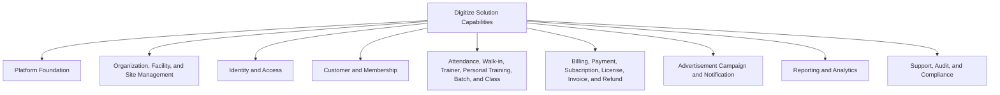
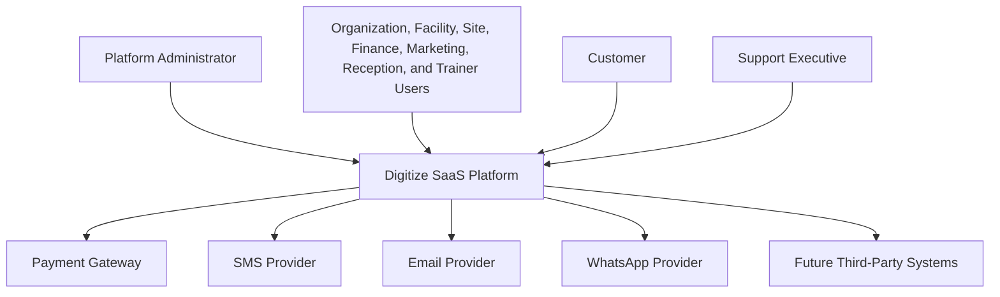
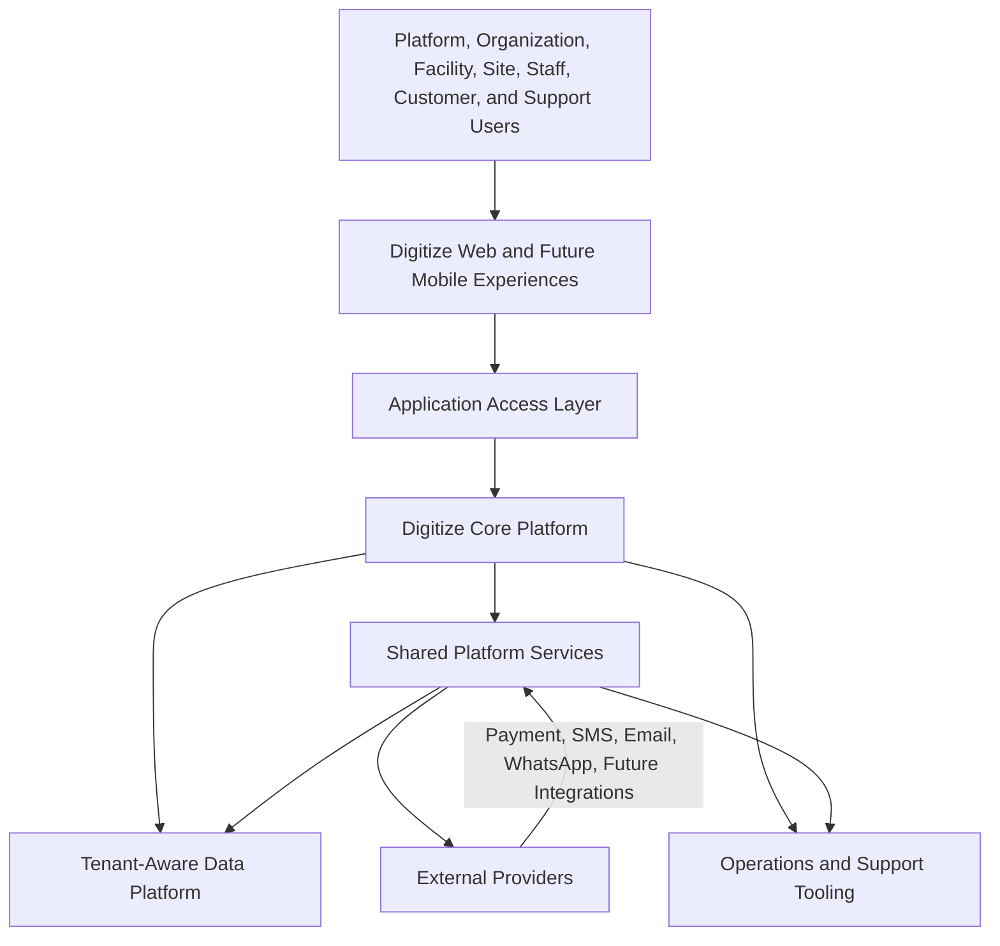
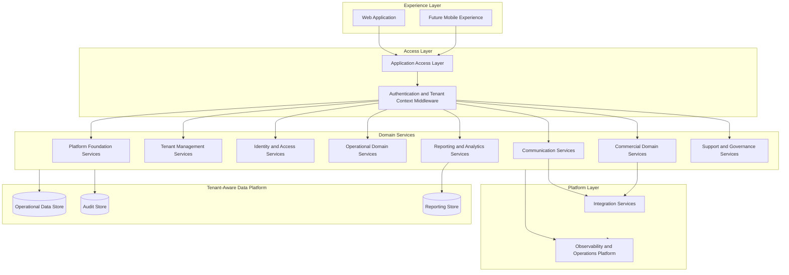
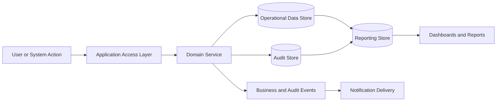
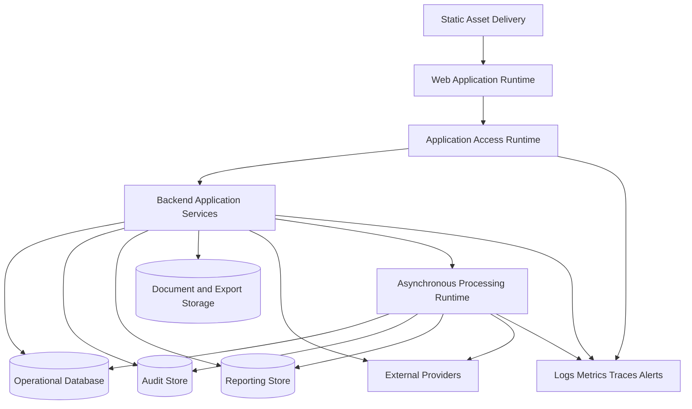

# TA-01 Solution Architecture

**Document ID:** TA-01  
**Document Name:** Solution Architecture  
**Company:** OreeOn Technologies Pvt. Ltd.  
**Product:** Digitize  
**Document Type:** Technical Architecture  
**Version:** 1.0  
**Status:** Frozen  
**Owner:** Solution Architecture  
**Prepared By:** Architecture Team  
**Last Updated:** July 25, 2026  
**Architecture Review:** Passed
**Approved ADRs:** ADR-037
**Frozen Date:** 2026-07-25
**Freeze Approver:** Architecture Lead (to replace placeholder with actual approver name)

---

# Revision History

| Version | Date | Author | Description |
|---|---|---|---|
| 0.1 | July 2026 | Architecture Team | Initial design draft |
| 0.2 | July 2026 | Architecture Team | Enterprise architecture review refinements for technology-neutral solution architecture, architecture viewpoints, architecture domains, quality attribute scenarios, and reduced detailed design content |

---

# 1. Introduction

## 1.1 Purpose

This document defines the Solution Architecture for Digitize, the enterprise multi-tenant SaaS platform developed by OreeOn Technologies Pvt. Ltd.

The Solution Architecture establishes the end-to-end technical design direction for the platform. It defines the major architecture domains, solution boundaries, logical components, system responsibilities, high-level integration model, multi-tenancy approach, security posture, operational architecture, and cross-document traceability.

This document does not restate business requirements or functional requirements. It translates the approved Product Foundation, Business Analysis, Functional Requirements, Commercial Strategy, and Non-Functional Business Requirements into an enterprise solution design baseline.

## 1.2 Objectives

The objectives of this Solution Architecture are to:

- Define the enterprise solution structure for Digitize.
- Establish the architecture baseline for all downstream technical architecture documents.
- Provide a common architectural view for product, engineering, DevOps, QA, implementation, support, and leadership teams.
- Define how platform, organization, facility, site, customer, membership, operations, commercial, communication, reporting, support, and audit capabilities fit into one solution.
- Ensure the solution supports multi-tenancy, tenant isolation, configurability, security, scalability, auditability, maintainability, extensibility, and cloud-native deployment.
- Establish architecture decisions that guide detailed system, data, API, security, deployment, observability, commercial, and platform architecture.
- Provide traceability between architecture areas and approved Functional Requirements.

## 1.3 Scope

This document covers the high-level solution architecture for Digitize, including:

- Solution context and platform boundaries.
- Business capability to architecture domain mapping.
- Major logical components and shared services.
- Multi-tenant SaaS solution model.
- Core user and system interaction patterns.
- Internal module relationships.
- External provider integration boundaries.
- High-level data ownership and data movement.
- High-level API and event architecture.
- Security, identity, audit, observability, deployment, and resilience considerations.
- Architecture decisions that influence the full TA documentation set.

## 1.4 Out of Scope

The following items are outside the scope of this document:

- Detailed database schema, indexes, constraints, and physical database design.
- Detailed REST endpoint request and response schemas.
- Detailed UI screen layouts and wireframes.
- Source code, framework-specific implementation code, and library-level design.
- Test cases and automation scripts.
- Cloud provider-specific infrastructure provisioning scripts.
- Detailed provider-specific payment, SMS, email, WhatsApp, or analytics integration configuration.
- Detailed disaster recovery runbooks and production operating procedures.

These topics are addressed in specialized downstream architecture, database, API, UX, deployment, and testing documents.

## 1.5 Intended Audience

This document is intended for:

- Product Architects
- Solution Architects
- Technical Architects
- Backend Engineers
- Frontend Engineers
- DevOps Engineers
- Security Engineers
- QA Engineers
- Database Architects
- Implementation Teams
- Support Teams
- Product Management
- Business Leadership

## 1.6 Related Documents

| Document Type | Document Reference | Relationship |
|---|---|---|
| Product Foundation | PF-01 Product Glossary | Source of approved Digitize terminology |
| Product Foundation | PF-02 Domain Model | Source of product hierarchy, domain ownership, and future facility type expansion |
| Product Foundation | PF-03 Product Vision Document | Source of strategic product direction and platform philosophy |
| Commercial Strategy | CS-01 Subscription & Licensing Strategy | Source of subscription, license, entitlement, and facility-based commercial model |
| Commercial Strategy | CS-03 Billing & Invoicing Strategy | Source of billing, invoice, payment, tax, and financial execution model |
| Business Analysis | BA-01 Business Requirements Document | Source of business capability map and business module boundaries |
| Business Analysis | BA-02 Business Rules Catalog | Source of approved business rules including multi-tenant isolation, RBAC, audit, and lifecycle controls |
| Business Analysis | BA-03 Business Process Catalog | Source of business process domains and process identifiers |
| Business Analysis | BA-04 Business Process Flows | Source of approved end-to-end business flows |
| Business Analysis | BA-05 User Personas | Source of user personas and role expectations |
| Business Analysis | BA-06 User Journeys | Source of user journey interaction context |
| Business Analysis | BA-08 Requirement Traceability Matrix | Source of traceability model across requirements, processes, APIs, database entities, and tests |
| Business Analysis | BA-09 Non-Functional Business Requirements | Source of business quality attributes |
| Business Analysis | BA-10 Business Assumptions, Constraints & Risks | Source of assumptions, constraints, risks, and mitigation drivers |
| Functional Requirements | FR-01 FRS Standards | Source of frozen functional requirement structure |
| Functional Requirements | FR-02 to FR-21 | Source of approved functional behavior for all Digitize modules |
| UI / UX Design | UX-01 to UX-05 | Source of user experience, screen, navigation, and design system alignment |
| API Specification | API Collections | Downstream detailed API contract alignment |
| Database Design | Database Design Artifacts | Downstream detailed data model and persistence alignment |
| Deployment | Deployment Artifacts | Downstream environment, release, and production readiness alignment |
| Decision Record | TA-10 Architecture Decision Records | Downstream architecture decision index |

---

# 2. Architecture Viewpoints

The Solution Architecture is described through enterprise architecture viewpoints so each stakeholder group can understand the solution from the perspective most relevant to their responsibilities.

| Viewpoint | Purpose | Primary Stakeholders | Architecture Concerns |
|---|---|---|---|
| Business View | Shows how Digitize supports the approved business capability model and operating hierarchy | Product Management, Business Analysis, Leadership, Implementation Teams | Platform, Organization, Facility, Site, Operations, commercial model, governance separation |
| Application View | Shows the major application domains and their responsibilities | Solution Architects, Technical Architects, Backend Engineers, Frontend Engineers | Architecture domains, module boundaries, shared services, domain interaction |
| Data View | Shows ownership and movement of platform, tenant, operational, commercial, reporting, and audit data | Database Architects, Backend Engineers, QA Engineers, Compliance Stakeholders | Tenant-owned data, platform-owned data, financial data, audit records, reporting data |
| Integration View | Shows internal and external system interactions | Integration Engineers, Backend Engineers, DevOps Engineers | Standardized service interfaces, provider boundaries, callbacks, reconciliation, asynchronous processing |
| Security View | Shows identity, access, tenant isolation, and data protection responsibilities | Security Engineers, Solution Architects, QA Engineers, Support Teams | Authentication, authorization, RBAC, scoped access, sensitive data, auditability |
| Deployment View | Shows runtime and environment architecture at solution level | DevOps Engineers, SRE, Technical Architects | Environments, runtime domains, release controls, scaling, availability, rollback readiness |
| Operational View | Shows how the platform is monitored, supported, diagnosed, and governed | DevOps Engineers, Support Teams, Platform Administrators, Compliance Stakeholders | Logs, metrics, traces, alerts, incidents, support diagnostics, audit review |

---

# 3. Architecture Context

Digitize is a configurable enterprise SaaS platform for activity and recreation businesses. The initial release focuses on swimming pools, while the architecture shall support future expansion to gyms, yoga studios, dance studios, sports academies, fitness centers, and other activity-based businesses through configuration rather than separate software products.

The solution architecture is based on a hierarchy of Platform, Organization, Facility, Site, and Operations. The Platform provides shared SaaS governance and infrastructure. Organizations represent subscribing legal business entities. Facilities represent operational business units. Sites represent physical operating locations. Operations represent daily activities such as customer registration, memberships, attendance, billing, payments, training, campaigns, notifications, reporting, support, and audit.

## 3.1 Business Context

Digitize must enable organizations to centralize governance while allowing facilities and sites to execute daily operations independently under controlled policies.

The business context requires the architecture to support:

- Platform administration by OreeOn.
- Organization onboarding and lifecycle management.
- Facility and site configuration.
- Role-based staff access.
- Customer registration and customer lifecycle management.
- Membership lifecycle management.
- Attendance and walk-in operations.
- Trainer, personal training, batch, and class operations.
- Billing, payment, invoice, refund, subscription, and license management.
- Advertisement campaign and notification management.
- Reporting, analytics, support ticket handling, audit, and compliance.

The architecture must preserve the commercial rule that the primary subscription unit is the Facility and that licensed capabilities control operational access.

## 3.2 Product Context

Digitize is intended to become a unified operating platform for activity and recreation businesses.

The product context requires:

- Configurable facility types.
- Reusable business capabilities.
- Shared services for identity, permissions, notifications, audit, reporting, configuration, and integrations.
- Multi-tenant operation without customer-specific code branches.
- Feature availability controlled through subscriptions, licenses, and feature flags.
- Modular architecture that allows future facility types and capabilities to be added without redesigning the platform foundation.

## 3.3 Technical Context

The solution shall be designed as a cloud-native, API-driven, multi-tenant SaaS platform.

The technical context assumes:

- A web application frontend for business users, platform users, support users, and future customer-facing experiences.
- Backend application services organized by domain responsibilities.
- A tenant-aware data persistence layer.
- Shared platform services for identity, authorization, configuration, audit, notification, reporting, and integration.
- Standardized service interfaces for internal and external system interaction.
- Asynchronous coordination patterns for notifications, audit events, reporting updates, and integration callbacks.
- External provider integration for payment gateway, SMS, email, WhatsApp, and future third-party services.

## 3.4 Operational Context

Digitize shall operate as a production SaaS platform used during business operating hours across multiple customer organizations and sites.

The operational context requires:

- High business availability.
- Controlled maintenance mode.
- Health monitoring and operational alerts.
- Audit trails for critical business and security actions.
- Traceable logs with correlation identifiers.
- Backup, restore, and disaster recovery readiness.
- Support workflows for organization, facility, site, staff, customer, billing, payment, notification, reporting, and audit issues.
- Deployment discipline across development, test, staging, and production environments.

---

# 4. Architecture Goals

| Goal ID | Goal | Rationale | Success Indicator |
|---|---|---|---|
| TA-01-GOAL-001 | Establish a unified SaaS solution architecture | Digitize must operate as one configurable platform instead of separate applications per business type | All core domains are represented through shared architecture domains and reusable platform services |
| TA-01-GOAL-002 | Support enterprise multi-tenancy | The platform shall serve many organizations securely and efficiently | Every request, data access, configuration, audit event, and report is tenant-aware |
| TA-01-GOAL-003 | Preserve governance and operational separation | Organizations centrally configure policies while facilities and sites execute daily operations | Architecture separates platform governance, organization configuration, facility operations, and site execution |
| TA-01-GOAL-004 | Enable configuration over customization | Future facility types shall be supported without customer-specific code branches | Facility type, plans, rules, features, notifications, and reports are configurable |
| TA-01-GOAL-005 | Enforce security by design | Digitize handles sensitive business, customer, staff, payment, and operational data | Authentication, RBAC, tenant isolation, data protection, audit logging, and security monitoring are built into shared services |
| TA-01-GOAL-006 | Support commercial scalability | The platform commercial model depends on subscriptions, licenses, plans, entitlements, and billing | Subscription and license architecture integrates with access control, billing, reporting, and audit |
| TA-01-GOAL-007 | Ensure operational observability | Production support requires visibility into user actions, system behavior, provider failures, and performance | Logs, metrics, traces, audit events, alerts, and support diagnostics are defined at solution level |
| TA-01-GOAL-008 | Support future expansion | The platform shall expand beyond swimming pools to additional activity businesses | Core modules are facility-type aware and extension points are documented |

---

# 5. Architecture Principles Applied

| Principle ID | Principle | Application in This Document |
|---|---|---|
| TA-PRN-001 | Multi-tenancy by default | All solution components must resolve tenant context before accessing tenant-owned data or executing tenant-scoped operations |
| TA-PRN-002 | Configuration over customization | Facility types, feature access, rules, policies, templates, and plans are modeled as configurable platform capabilities |
| TA-PRN-003 | Security by design | Identity, RBAC, tenant isolation, audit logging, sensitive data handling, and session controls are shared architecture concerns |
| TA-PRN-004 | Domain-aligned modularity | Solution components align to business domains from BA-01 and functional modules from FR-02 to FR-21 |
| TA-PRN-005 | Interface-first integration | Business capabilities are exposed through standardized service interfaces and integration contracts rather than direct database coupling |
| TA-PRN-006 | Asynchronous coordination | Business events and audit events are produced for non-blocking notifications, analytics, compliance, and integration follow-up |
| TA-PRN-007 | Operational readiness | Monitoring, alerts, maintenance mode, deployment controls, and support diagnostics are part of the solution architecture |
| TA-PRN-008 | Traceability | Architecture components must trace to functional requirements, business processes, APIs, database entities, UI areas, and test areas |

---

# 6. Architecture Scope Model

The Solution Architecture defines the enterprise boundary of Digitize and the major architecture domains required to implement the product as a production SaaS platform.

## 6.1 In-Scope Capabilities

- Multi-tenant platform foundation.
- Organization, facility, and site hierarchy.
- Identity, role, permission, and access enforcement.
- Customer, membership, attendance, walk-in, trainer, personal training, batch, and class operations.
- Billing, invoice, payment, refund, subscription, license, and entitlement capabilities.
- Advertisement campaign and notification capabilities.
- Reporting, analytics, support ticket, audit, and compliance capabilities.
- Shared services for configuration, feature flags, audit, notifications, reporting, and integration.
- External provider integration boundaries.
- High-level deployment, observability, resilience, and operational architecture.

## 6.2 Out-of-Scope Capabilities

- Detailed physical database schema.
- Detailed API payload definitions.
- Detailed UI wireframes.
- Provider-specific implementation configuration.
- Infrastructure-as-code implementation.
- Automated test scripts.
- Customer-specific customizations.
- Detailed analytics warehouse design.

## 6.3 Capability Map



## 6.4 Context Diagram



## 6.5 Boundary Diagram



---

# 7. Logical Architecture

Digitize shall use a modular layered solution architecture. The layers separate user experience, application access, business capabilities, platform capabilities, data persistence, integration, observability, and infrastructure concerns.

The conceptual architecture layers are:

```text
Experience Layer
      |
      v
Access Layer
      |
      v
Business Layer
      |
      v
Platform Layer
      |
      v
Infrastructure Layer
```

## 7.1 Architecture Domains

| Domain ID | Architecture Domain | Purpose | Responsibility |
|---|---|---|---|
| TA-01-DOM-001 | Experience Domain | Provide role-aware user interaction across platform and tenant users | User workflows, navigation, forms, dashboards, responsive behavior |
| TA-01-DOM-002 | Access Domain | Provide controlled entry into application capabilities | Authentication handoff, tenant context propagation, authorization coordination, interface governance |
| TA-01-DOM-003 | Business Domain | Execute tenant-scoped operational and commercial capabilities | Customer, membership, attendance, training, billing, payment, subscription, license, communication, reporting, and support behavior |
| TA-01-DOM-004 | Platform Domain | Provide shared SaaS platform capabilities | Configuration, feature flags, identity, permissions, audit, notifications, reporting foundations, integration abstractions |
| TA-01-DOM-005 | Infrastructure Domain | Provide runtime, persistence, observability, deployment, and operational foundation | Data persistence, telemetry, alerting, environment management, backup, recovery, and runtime scaling |

## 7.2 Logical Relationships

The Experience Layer communicates only through the Access Layer. The Access Layer authenticates requests, resolves tenant context, coordinates authorization, and routes requests to the appropriate business or platform domain.

Domain services do not directly bypass shared platform services for identity, configuration, license validation, audit, notifications, or reporting events. Shared services provide reusable platform behavior to avoid duplicate implementations across modules.

Tenant-owned data is accessed through tenant-aware service boundaries. Platform-owned data, such as global configuration and master data, is separated from organization-owned operational data.

External providers are accessed through integration boundaries to isolate provider-specific behavior from core business domains.

## 7.3 Logical Architecture Diagram



---

# 8. Component Architecture

The Solution Architecture defines major components at enterprise solution level. Detailed component internals are refined in TA-02 through TA-10.

## 8.1 Component Summary

| Component ID | Component Name | Type | Owner | Criticality |
|---|---|---|---|---|
| TA-01-CMP-001 | Experience Layer | Module | Frontend Engineering | High |
| TA-01-CMP-002 | Application Access Layer | Service | Backend Engineering | Critical |
| TA-01-CMP-003 | Platform Foundation Services | Service | Platform Engineering | Critical |
| TA-01-CMP-004 | Tenant Management Services | Service | Platform Engineering | Critical |
| TA-01-CMP-005 | Identity and Access Services | Service | Security Engineering | Critical |
| TA-01-CMP-006 | Operational Domain Services | Service | Backend Engineering | Critical |
| TA-01-CMP-007 | Commercial Domain Services | Service | Backend Engineering and Finance Systems | Critical |
| TA-01-CMP-008 | Communication Services | Service | Backend Engineering | High |
| TA-01-CMP-009 | Reporting and Analytics Services | Service | Data and Analytics Engineering | High |
| TA-01-CMP-010 | Support and Governance Services | Service | Platform Engineering and Support Operations | High |
| TA-01-CMP-011 | Integration Services | Service | Integration Engineering | High |
| TA-01-CMP-012 | Tenant-Aware Data Platform | Database | Database Architecture | Critical |
| TA-01-CMP-013 | Observability and Operations Platform | Service | DevOps and SRE | Critical |

## 8.2 Component Details

| Component ID | Component Name | Purpose | Responsibility | Dependencies | Owned Capabilities |
|---|---|---|---|---|---|
| TA-01-CMP-001 | Experience Layer | Provide role-aware user interaction across platform and tenant users | Presents workflows, navigation, dashboards, and responsive application behavior | Application Access Layer, UX Design, Design System | User interaction, screen orchestration, client-side workflow guidance |
| TA-01-CMP-002 | Application Access Layer | Provide controlled access into application capabilities | Coordinates authentication, tenant context, authorization, interface routing, and access governance | Identity and Access Services, Tenant Management Services, Business Domain Services | Access control boundary, tenant context propagation, interface governance |
| TA-01-CMP-003 | Platform Foundation Services | Provide shared SaaS governance capabilities | Maintains global configuration, feature flags, master data, maintenance state, and platform release controls | Tenant Management Services, Identity and Access Services, Audit capabilities | Platform configuration, feature governance, platform health visibility |
| TA-01-CMP-004 | Tenant Management Services | Maintain the tenant hierarchy and tenant lifecycle | Owns Organization, Facility, Site, tenant state, tenant configuration, and entitlement evaluation boundaries | Platform Foundation Services, Commercial Domain Services, Identity and Access Services | Tenant registry, hierarchy governance, tenant lifecycle, subscription and license alignment |
| TA-01-CMP-005 | Identity and Access Services | Enforce identity, role, permission, and scoped access | Maintains staff identity, roles, permissions, sessions, access scopes, and privileged action enforcement | Tenant Management Services, Platform Foundation Services | Authentication coordination, RBAC, permission evaluation, session governance |
| TA-01-CMP-006 | Operational Domain Services | Execute day-to-day facility and site operations | Owns operational capabilities for customers, memberships, attendance, walk-ins, trainers, personal training, batches, and classes | Tenant Management Services, Identity and Access Services, Commercial Domain Services, Communication Services | Customer operations, membership operations, attendance operations, training operations |
| TA-01-CMP-007 | Commercial Domain Services | Execute financial and commercial platform capabilities | Owns billing, invoices, payments, refunds, subscriptions, licenses, entitlements, and reconciliation boundaries | Tenant Management Services, Integration Services, Communication Services, Audit capabilities | Billing, payment, subscription, license, entitlement, commercial reporting foundations |
| TA-01-CMP-008 | Communication Services | Deliver operational, transactional, and marketing communication capabilities | Maintains notification templates, preferences, campaigns, channel routing, delivery tracking, and retry coordination | Tenant Management Services, Integration Services, Operational Domain Services, Commercial Domain Services | Notification management, campaign communication, delivery tracking |
| TA-01-CMP-009 | Reporting and Analytics Services | Provide operational, commercial, and governance insights | Maintains dashboards, reports, scheduled reports, exports, KPIs, and historical trend views | Domain Services, Tenant-Aware Data Platform, Audit capabilities | Reporting, analytics, export governance, KPI monitoring |
| TA-01-CMP-010 | Support and Governance Services | Provide support, audit review, compliance, and investigation capabilities | Maintains support ticket lifecycle, audit review, compliance reporting, and governance traceability | Identity and Access Services, Tenant Management Services, Observability and Operations Platform | Support lifecycle, audit review, compliance reporting |
| TA-01-CMP-011 | Integration Services | Isolate external provider and third-party integration behavior | Maintains provider boundaries, callback handling, retry coordination, idempotency expectations, and reconciliation support | Commercial Domain Services, Communication Services, External Providers | Payment, SMS, email, WhatsApp, and future integration abstractions |
| TA-01-CMP-012 | Tenant-Aware Data Platform | Provide controlled persistence for platform and tenant data | Maintains persistence boundaries, tenant isolation support, reporting data access, audit retention support, backup, and recovery foundations | All domain services, deployment architecture, observability architecture | Operational data, platform data, commercial data, reporting data, audit data persistence |
| TA-01-CMP-013 | Observability and Operations Platform | Provide production visibility and operational control | Maintains logs, metrics, traces, alerts, diagnostics, health visibility, and operational support signals | All solution components, deployment architecture, support operations | Monitoring, alerting, diagnostics, incident signals, operational traceability |

---

# 9. Data Architecture

The Solution Architecture establishes a tenant-aware data strategy. Detailed logical and physical data models shall be defined in TA-03 Data Architecture and the Database Design artifacts.

## 9.1 Data Ownership

| Data Entity / Data Group | Owner Component | Purpose | Classification | Retention Class |
|---|---|---|---|---|
| Platform Configuration | Platform Foundation Services | Governs global platform behavior | Platform-owned configuration data | Active configuration plus audit history |
| Global Master Data | Platform Foundation Services | Provides shared reference values across tenants | Platform-owned reference data | Active reference data plus version history where applicable |
| Organization | Tenant Management Services | Represents the tenant root and subscribing legal entity | Tenant master data | Active lifecycle plus historical record |
| Facility | Tenant Management Services | Represents operational business unit and primary subscription unit | Tenant operational master data | Active lifecycle plus historical record |
| Site | Tenant Management Services | Represents physical operating location under a Facility | Tenant operational master data | Active lifecycle plus historical record |
| Staff Identity and Access Data | Identity and Access Services | Supports staff identity, roles, permissions, sessions, and access scopes | Sensitive tenant security data | Active access record plus security audit history |
| Customer Data | Operational Domain Services | Supports customer profile, eligibility, communication preference, and service history | Sensitive tenant customer data | Active customer lifecycle plus archival retention |
| Membership Data | Operational Domain Services | Supports customer entitlement, membership lifecycle, and attendance eligibility | Tenant operational data | Active membership lifecycle plus historical record |
| Attendance and Operations Data | Operational Domain Services | Supports daily facility and site operations | Tenant operational transaction data | Operational history plus reporting retention |
| Training and Batch Data | Operational Domain Services | Supports trainer, personal training, activity, batch, and class execution | Tenant operational data | Active operations plus historical reporting |
| Commercial Data | Commercial Domain Services | Supports invoices, payments, refunds, subscriptions, licenses, entitlements, and reconciliation | Financial and commercial data | Financial retention period plus audit history |
| Communication Data | Communication Services | Supports campaigns, notifications, templates, preferences, and delivery history | Tenant communication data | Communication retention plus consent traceability |
| Reporting Data | Reporting and Analytics Services | Supports dashboards, exports, scheduled reports, KPIs, and historical trends | Derived analytical data | Reporting retention based on source data rules |
| Support Data | Support and Governance Services | Supports ticket lifecycle, escalation, resolution, and support traceability | Tenant support data | Support retention plus audit history |
| Audit Data | Support and Governance Services | Supports immutable business, security, financial, configuration, and compliance traceability | Audit and compliance data | Compliance retention and archival policy |

## 9.2 Data Flow

Digitize data flows through controlled service boundaries:

1. User actions originate in the Experience Layer.
2. Requests pass through the Application Access Layer for authentication, tenant context resolution, validation, and authorization.
3. Business and platform domains execute tenant-scoped capabilities.
4. Domain components maintain records through the Tenant-Aware Data Platform.
5. Domain components publish business events and audit events.
6. Communication Services consume eligible events for notifications.
7. Reporting and Analytics Services consume approved operational and commercial data for dashboards and reports.
8. Observability and Operations Platform captures logs, metrics, traces, alerts, and operational diagnostics.

## 9.3 Data Consistency

The solution shall use strong consistency for critical operational and financial transactions such as customer creation, membership activation, attendance recording, invoice generation, payment confirmation, subscription activation, and license validation.

Eventual consistency may be used for notifications, reporting projections, analytics refreshes, provider status reconciliation, and non-critical operational dashboards.

Idempotency shall be required for payment callbacks, notification retries, report schedules, provider callbacks, and any external integration that may deliver duplicate events.

Concurrency control shall be required for capacity-sensitive operations such as batch enrollment, attendance, membership state changes, invoice cancellation, refund processing, subscription changes, and license changes.

## 9.4 Data Retention

The solution shall retain business, financial, audit, and compliance records according to BA-09 data retention requirements and BA-10 compliance assumptions and risks.

Operational records may be archived after active business use while remaining reportable according to retention policies. Audit records and financial records shall not be physically deleted while retention obligations apply.

## 9.5 Data Architecture Diagram



---

# 10. Service Interface and Integration Architecture

The solution shall expose platform capabilities through standardized service interfaces and controlled integration interfaces. Detailed endpoint contracts, methods, payloads, response models, and versioning rules shall be defined in TA-04 API & Integration Architecture and downstream API specification artifacts.

## 10.1 Service Interface Summary

| Interface Area | Interface Type | Trust Model | Producer | Consumer | Purpose |
|---|---|---|---|---|---|
| Platform Administration Interfaces | Administrative service interface | Platform administrator trust boundary | Platform Foundation Services | Platform Administration experience | Provide platform configuration, master data, feature flag, health, release, and policy capabilities |
| Tenant Management Interfaces | Tenant-scoped service interface | Platform and tenant administrator trust boundary | Tenant Management Services | Organization, Facility, and Site experiences | Provide Organization, Facility, Site, tenant status, and hierarchy capabilities |
| Identity and Access Interfaces | Security service interface | Authenticated user and privileged administrator trust boundary | Identity and Access Services | All protected platform experiences and domain services | Provide identity, session, role, permission, and scoped access capabilities |
| Customer and Membership Interfaces | Tenant operational service interface | Tenant staff trust boundary | Operational Domain Services | Customer and Membership experiences | Provide customer lifecycle and membership lifecycle capabilities |
| Attendance and Training Interfaces | Tenant operational service interface | Facility and site operational trust boundary | Operational Domain Services | Attendance, Walk-in, Trainer, Personal Training, Batch, and Class experiences | Provide daily operational execution capabilities |
| Commercial Interfaces | Financial and commercial service interface | Finance, platform, and authorized tenant trust boundary | Commercial Domain Services | Billing, Payment, Subscription, License, and Finance experiences | Provide invoice, payment, refund, subscription, license, entitlement, and reconciliation capabilities |
| Communication Interfaces | Communication service interface | Tenant communication and system event trust boundary | Communication Services | Campaign, Notification, and system event producers | Provide notification, campaign, template, preference, and delivery tracking capabilities |
| Reporting Interfaces | Reporting service interface | Authorized reporting trust boundary | Reporting and Analytics Services | Dashboard, report, export, and scheduled report consumers | Provide dashboards, KPIs, exports, scheduled reports, and historical trends |
| Support and Governance Interfaces | Support and compliance service interface | Support, platform, and compliance trust boundary | Support and Governance Services | Support, audit, compliance, and investigation experiences | Provide support ticket, audit review, compliance report, and investigation capabilities |
| Provider Integration Interfaces | External integration interface | Provider trust boundary with verification controls | Integration Services | External payment, SMS, email, WhatsApp, and future providers | Provide controlled external communication, callbacks, retries, and reconciliation support |

## 10.2 Event Summary

| Event | Producer | Consumer | Purpose | Delivery Pattern |
|---|---|---|---|---|
| OrganizationCreated | Tenant Management Services | Audit, Notification, Reporting | Record organization onboarding | Asynchronous event |
| FacilityActivated | Tenant Management Services | License, Reporting, Audit | Enable facility operations | Asynchronous event |
| LicenseValidated | Commercial Domain Services | Identity, Audit, Reporting | Confirm facility capability access | Synchronous validation with audit event |
| CustomerRegistered | Operational Domain Services | Notification, Reporting, Audit | Trigger customer onboarding communication and reporting | Asynchronous event |
| MembershipActivated | Operational Domain Services | Attendance, Billing, Notification, Reporting, Audit | Enable membership-based access | Asynchronous event |
| AttendanceRecorded | Operational Domain Services | Reporting, Audit | Update operational history and analytics | Asynchronous event |
| InvoiceGenerated | Commercial Domain Services | Payment, Notification, Reporting, Audit | Initiate commercial settlement | Asynchronous event |
| PaymentConfirmed | Commercial Domain Services | Billing, Subscription, License, Notification, Reporting, Audit | Confirm payment settlement | Asynchronous event |
| NotificationDeliveryFailed | Communication Services | Observability, Support, Audit | Enable retry and operational follow-up | Asynchronous event |
| SupportTicketEscalated | Support and Governance Services | Support, Notification, Audit | Escalate unresolved support issue | Asynchronous event |
| SecurityEventDetected | Identity and Access Services | Observability, Support, Audit | Record and monitor security events | Asynchronous event |
| AuditEventCaptured | All domain services | Audit Store, Compliance Reporting | Maintain cross-module traceability | Asynchronous event |

## 10.3 Asynchronous Processing

| Process | Schedule / Trigger | Purpose | Failure Handling |
|---|---|---|---|
| Subscription Renewal Evaluation | Scheduled daily and on renewal trigger | Identify subscriptions due for renewal and initiate renewal billing | Retry with failure alert and audit record |
| License Expiry Evaluation | Scheduled daily and on login validation | Expire or restrict licenses based on validity period | Retry with administrative alert |
| Membership Expiry Evaluation | Scheduled daily | Expire memberships that have reached end date | Retry and log affected memberships |
| Notification Retry Processor | Queue-based retry schedule | Retry failed notifications according to channel rules | Stop after configured retry limit and create failure event |
| Payment Reconciliation Job | Scheduled and provider callback triggered | Reconcile payment status with gateway records | Flag mismatch for finance review |
| Report Schedule Executor | Scheduled by report configuration | Generate and deliver scheduled reports | Mark schedule execution failed and notify owner |
| Audit Archive Job | Scheduled according to retention policy | Archive audit records beyond active access period | Retry and alert compliance owner |

## 10.4 External Interfaces

| External System | Interface Type | Purpose | Failure Handling |
|---|---|---|---|
| Payment Gateway | API and callbacks | Process online payments and receive payment status updates | Idempotent callbacks, retries, reconciliation, finance alert |
| SMS Provider | API | Deliver SMS notifications | Retry, provider failover readiness, delivery failure tracking |
| Email Provider | API | Deliver email notifications and reports | Retry, bounce tracking, delivery failure tracking |
| WhatsApp Provider | API | Deliver WhatsApp notifications where enabled | Consent validation, retry, provider failure tracking |
| Future Third-Party Integrations | API, webhook, or file exchange | Support future ecosystem integrations | Integration-specific contract, retry, reconciliation, observability |

---

# 11. Security Architecture

Digitize shall apply security controls across all solution layers. Detailed controls are refined in TA-05 Security & Identity Architecture.

## 11.1 Authentication

All interactive users shall authenticate before accessing protected platform capabilities. Authentication shall support staff users, platform administrators, support executives, organization administrators, facility managers, site administrators, reception staff, trainers, finance staff, marketing staff, customers, and future external users.

Service-to-service calls shall use authenticated internal communication. External callbacks shall be validated using provider-specific security mechanisms such as signatures, shared secrets, or equivalent verification patterns.

## 11.2 Authorization

Authorization shall be role-based and scope-aware. Access decisions shall consider:

- User role.
- Assigned permissions.
- Organization scope.
- Facility scope.
- Site scope.
- Subscription status.
- License status.
- Feature availability.
- Data sensitivity.

Privileged actions such as platform configuration, organization suspension, license cancellation, refund processing, role assignment, audit export, and security policy changes shall require explicit permission checks and audit logging.

## 11.3 Tenant Isolation

Tenant isolation shall be enforced at API, service, data, reporting, audit, and operational levels.

Every tenant-scoped request shall carry validated tenant context. Services shall not infer tenant identity from user input alone. Tenant context shall be derived from authenticated identity, authorized scope, and validated organization, facility, or site relationships.

Cross-tenant access is prohibited except for authorized platform administration, support, audit, and compliance scenarios. Such access shall be explicitly logged and traceable.

## 11.4 Data Protection

Sensitive data shall be protected through:

- Transport encryption.
- Encryption at rest where supported by the persistence layer.
- Role-based access control.
- Sensitive field masking.
- Secure payment reference handling.
- Restricted audit export permissions.
- Separation of operational, audit, reporting, and integration logs.
- Data retention and archival controls.

Payment card handling shall remain delegated to payment gateway providers wherever possible to minimize direct handling of cardholder data.

## 11.5 Security Events

The solution shall record and monitor the following security events:

- Login success and failure.
- Logout and session expiry.
- Password reset initiation and completion.
- Permission assignment and removal.
- Role creation and modification.
- Tenant context mismatch.
- Unauthorized access attempt.
- Privileged action execution.
- Suspicious request pattern.
- External callback verification failure.
- Audit export.
- Security policy change.

---

# 12. Multi-Tenancy Considerations

Digitize shall be designed as a multi-tenant SaaS platform from the foundation level.

| Consideration | Architecture Approach |
|---|---|
| Tenant Identification | The Organization is the tenant root. Facility and Site are tenant-scoped operational subdivisions. Every tenant request shall resolve organization context before accessing tenant-owned data. |
| Tenant Isolation | Tenant-owned data shall be isolated through service-level tenant context enforcement, data access filters, scoped permissions, reporting controls, and audit validation. |
| Tenant Configuration | Organization, Facility, and Site configuration shall be stored as tenant-scoped configuration and evaluated by domain services during runtime. |
| Tenant Data Access | Users shall access only data within their authorized organization, facility, and site scopes unless explicitly permitted for platform support or governance. |
| Tenant-Level Feature Access | Feature access shall be controlled through subscription plans, licenses, feature flags, and tenant configuration. |
| Tenant-Level Auditability | Critical tenant-scoped actions shall capture actor, tenant, facility, site, action, timestamp, before and after values where applicable, and correlation identifier. |

---

# 13. Configuration and Extensibility

Digitize shall support configuration over customization. Architecture shall allow business variation through configurable entities, policies, rules, templates, feature flags, subscription plans, and licenses.

## 13.1 Configuration Parameters

| Parameter | Scope | Purpose | Default | Owner |
|---|---|---|---|---|
| Platform Settings | Platform | Define global platform behavior and administrative controls | OreeOn-defined baseline | Platform Administrator |
| Feature Flags | Platform / Organization / Facility | Enable or disable controlled platform capabilities | Disabled unless enabled by release or license policy | Platform Administrator |
| Organization Settings | Organization | Control organization-level business configuration | Created during onboarding | Organization Administrator |
| Facility Settings | Facility | Control facility type, operating model, capacity, and operational rules | Based on facility type | Organization Administrator / Facility Manager |
| Site Settings | Site | Control local operating hours, capacity, access, and site operations | Based on facility policy | Site Administrator |
| Business Policies | Organization / Facility / Site | Control operational rules within approved business rules | Organization default inherited by Facility and Site | Organization Administrator |
| Notification Templates | Platform / Organization | Control notification content and channel behavior | Platform default templates | Platform Administrator / Organization Administrator |
| Report Schedules | Organization / Facility / Site | Control automated report delivery | Disabled until configured | Authorized Reporting User |
| Subscription Plan Configuration | Platform | Define commercial plan availability and capability packages | OreeOn-defined commercial baseline | Platform Administrator |
| License Configuration | Facility | Define enabled capability access for a facility | Derived from subscription plan | Platform Administrator |

## 13.2 Feature Toggles

| Feature Toggle | Scope | Purpose | Default State |
|---|---|---|---|
| Facility Type Expansion | Platform | Enable new facility types beyond swimming pools | Disabled for future facility types until approved |
| Online Payment Processing | Platform / Organization | Enable payment gateway integration | Enabled where provider configuration exists |
| WhatsApp Notifications | Platform / Organization | Enable WhatsApp communication channel | Disabled until provider and consent configuration exists |
| Advertisement Campaigns | Organization | Enable campaign management capabilities | Controlled by subscription and license |
| Advanced Reporting | Organization / Facility | Enable advanced analytics and scheduled reports | Controlled by subscription and license |
| Maintenance Mode | Platform | Restrict platform access during controlled maintenance | Disabled by default |
| Multi-Factor Authentication | Platform / Organization | Enable additional authentication verification | Future-ready and disabled until security policy enables it |
| External Integration Access | Platform / Organization | Enable future third-party integration access | Disabled until approved |

## 13.3 Extension Points

- Facility Type configuration for gyms, yoga studios, dance studios, sports academies, fitness centers, and other activity-based businesses.
- Capability packages for premium modules and enterprise subscriptions.
- Notification channel adapters for future providers.
- Payment gateway adapter expansion.
- Reporting datasets and analytical models.
- Integration APIs and webhooks for partner ecosystems.
- Role and permission extensions for future personas.
- Audit policy extensions for jurisdiction-specific compliance.
- Configurable workflows for approvals, campaigns, support, and operational lifecycle changes.

---

# 14. Quality Attribute Scenarios

Quality Attribute Scenarios define how the Solution Architecture shall respond under important business and technical conditions. Detailed measurable targets are refined in downstream architecture and non-functional specifications.

| Quality Attribute | Scenario | Architecture Response | Validation Approach |
|---|---|---|---|
| Availability | A facility performs daily attendance, billing, and customer operations during business operating hours | Core access, tenant management, operational, commercial, and data capabilities shall be treated as high-availability solution areas | Availability review, health monitoring validation, production readiness checks |
| Scalability | An organization grows from one facility to multiple facilities and sites | Tenant hierarchy, facility subscription, site operations, configuration, and reporting shall scale without creating separate product instances | Multi-tenant design review, capacity planning, tenant growth scenario testing |
| Security | A user attempts to access data outside assigned organization, facility, or site scope | Access and data boundaries shall enforce authenticated identity, role, permission, tenant context, and scope validation | RBAC tests, tenant isolation tests, audit review, security testing |
| Performance | Reception staff record attendance or payment during peak operating hours | Peak-sensitive operational and commercial flows shall avoid dependency on non-critical asynchronous workloads | Performance tests for attendance, payment, search, and dashboard scenarios |
| Reliability | External notification or payment provider becomes temporarily unavailable | Core business transaction records shall be preserved and provider-dependent follow-up shall be retried, reconciled, or escalated | Provider failure simulation, retry validation, reconciliation tests |
| Maintainability | A new facility type is introduced after the swimming pool release | Facility-type behavior shall be introduced through configuration, capability packaging, feature flags, and modular domain extension | Configuration review, regression testing, architecture impact assessment |
| Recoverability | Production data or service availability is impacted by operational failure | Tenant-aware backup, restore, audit trails, deployment rollback, and recovery procedures shall support business continuity | Backup restore validation, disaster recovery tests, incident runbook review |

---

# 15. Performance and Scalability

The Solution Architecture shall support growth from a single facility to enterprise organizations operating multiple facilities and sites.

| Area | Expectation | Architecture Approach | Notes |
|---|---|---|---|
| Latency | Business-critical interactions should respond fast enough for reception, attendance, payment, and operational workflows | Stateless API access, optimized domain services, indexed data access, caching for reference data, and asynchronous processing for non-blocking tasks | Detailed targets are refined in TA-17 or performance specifications |
| Throughput | Platform shall handle concurrent tenant operations during peak business hours | Horizontally scalable service layers and workload-specific background processing | Attendance and payment flows are treated as peak-sensitive |
| Concurrency | Capacity-sensitive operations shall prevent conflicting updates | Transaction boundaries, concurrency checks, idempotency, and controlled state transitions | Applies to batch capacity, attendance, membership, billing, and payment flows |
| Data Volume | Platform shall support growth across organizations, facilities, sites, customers, memberships, attendance, billing, notifications, audit, and reports | Tenant-aware partitioning strategy, archival, reporting projections, and storage monitoring | Detailed data volume approach is defined in TA-03 |
| Reporting Load | Dashboards and reports shall not degrade core transactional operations | Read-optimized reporting stores, scheduled report execution, export controls, and background jobs | Detailed reporting architecture is defined in TA-07 |

---

# 16. Availability and Resilience

Digitize shall be designed for high business availability with controlled failure handling and recoverability.

| Scenario | Architecture Response | Recovery Consideration |
|---|---|---|
| Component unavailable | Isolate failure to the affected component where possible and return controlled error responses | Health checks, restart strategy, alerting, and incident response |
| External provider failure | Queue or mark provider-dependent operations for retry where business-safe | Retry policy, provider status monitoring, reconciliation, and user-visible status |
| Database failure | Prevent partial transaction completion and fail safely | Backup, restore, failover readiness, and transaction integrity checks |
| Deployment failure | Prevent unsafe release completion and support rollback | CI/CD gates, staged deployments, version compatibility checks, and rollback plan |
| Notification failure | Preserve business transaction and retry notification asynchronously | Delivery log, retry queue, failure status, and operational alert |
| Payment callback failure | Preserve payment initiation record and reconcile status later | Idempotent callback processing, provider reconciliation job, and finance review queue |
| Tenant misconfiguration | Prevent invalid operational execution and show actionable administrative errors | Configuration validation, audit trail, and administrative correction workflow |

---

# 17. Observability, Logging, and Auditability

The solution shall provide end-to-end visibility into business transactions, technical requests, security events, provider interactions, operational failures, and audit trails.

## 17.1 Logs

Technical logs shall capture:

- Request correlation identifier.
- Tenant context.
- User context where applicable.
- Component name.
- Operation name.
- Success or failure outcome.
- Error code.
- Provider interaction status where applicable.
- Execution timing.

Sensitive customer, staff, financial, authentication, and security data shall not be logged in plain text.

## 17.2 Metrics

Metrics shall include:

- API request rate and latency.
- Authentication success and failure rate.
- Tenant activation and license validation failures.
- Customer registration volume.
- Membership lifecycle activity.
- Attendance transaction volume.
- Billing and payment success rate.
- Notification delivery success and failure rate.
- Report generation duration.
- Support ticket SLA indicators.
- Audit event capture rate.
- Asynchronous processing success and failure rate.

## 17.3 Traces

Distributed tracing shall use correlation identifiers across:

- API request lifecycle.
- Domain service calls.
- Database operations.
- External provider calls.
- Asynchronous processes.
- Notification delivery.
- Payment callbacks.
- Audit event capture.

## 17.4 Audit Events

| Audit Event | Trigger | Actor | Data Captured | Retention |
|---|---|---|---|---|
| PlatformConfigurationChanged | Platform setting updated | Platform Administrator | Setting, previous value, new value, actor, timestamp, correlation ID | Per audit retention policy |
| OrganizationLifecycleChanged | Organization created, activated, suspended, or archived | Platform Administrator / Organization Administrator | Organization ID, status change, reason, actor, timestamp | Per audit retention policy |
| FacilityLifecycleChanged | Facility created, activated, suspended, or archived | Organization Administrator / Facility Manager | Facility ID, status change, actor, timestamp | Per audit retention policy |
| RolePermissionChanged | Role or permission assignment changed | Organization Administrator / Platform Administrator | User ID, role, permission, scope, actor, timestamp | Per audit retention policy |
| CustomerProfileChanged | Customer profile created or updated | Authorized staff | Customer ID, changed fields, actor, timestamp | Per audit retention policy |
| MembershipStateChanged | Membership activated, renewed, frozen, resumed, cancelled, or expired | Authorized staff or system | Membership ID, state change, reason, actor, timestamp | Per audit retention policy |
| AttendanceRecorded | Attendance created, updated, or cancelled | Authorized staff or system | Attendance ID, customer ID, site ID, action, timestamp | Per audit retention policy |
| PaymentStateChanged | Payment initiated, confirmed, failed, cancelled, or reconciled | Authorized staff, system, or provider callback | Payment ID, status, amount reference, actor/source, timestamp | Financial retention policy |
| LicenseStateChanged | License generated, assigned, activated, suspended, cancelled, or expired | Platform Administrator or system | License ID, facility ID, capability change, actor, timestamp | Per audit retention policy |
| SecurityEventCaptured | Login failure, access denial, tenant mismatch, or suspicious activity | User or system | Event type, actor/source, tenant, timestamp, correlation ID | Security retention policy |
| AuditExported | Audit records exported | Authorized audit user | Export scope, filters, actor, timestamp | Compliance retention policy |

## 17.5 Alerts

| Alert | Condition | Severity | Recipient |
|---|---|---|---|
| Platform Health Degradation | Core service health check fails or latency threshold is exceeded | Critical | DevOps and Platform Operations |
| Authentication Failure Spike | Login failures exceed baseline threshold | High | Security Operations |
| Tenant Isolation Violation Attempt | Tenant context mismatch or cross-tenant access attempt detected | Critical | Security Operations and Platform Administrator |
| Payment Provider Failure | Payment gateway errors or callback failures exceed threshold | High | Finance Operations and DevOps |
| Notification Provider Failure | SMS, email, or WhatsApp provider failures exceed threshold | Medium | Operations Support |
| Audit Capture Failure | Audit event persistence fails | Critical | Compliance Owner and DevOps |
| Background Job Failure | Scheduled job fails repeatedly | Medium | DevOps and Owning Module Team |
| Report Generation Failure | Scheduled report fails or exceeds duration threshold | Medium | Reporting Owner and Support |

---

# 18. Deployment and Runtime Architecture

The Solution Architecture assumes cloud-native deployment with independently deployable runtime components where practical. Detailed deployment topology is defined in TA-06 Deployment & DevOps Architecture.

## 18.1 Runtime Components

- Web application runtime.
- Application access runtime.
- Backend application services.
- Asynchronous processing runtime.
- Notification workers.
- Integration callback handlers.
- Operational database runtime.
- Audit store runtime.
- Reporting data runtime.
- Object or document storage where required.
- Observability, logging, monitoring, and alerting services.
- CI/CD and release management services.

## 18.2 Environment Considerations

Digitize shall support separate environments for:

- Development.
- Test.
- Staging.
- Production.
- Future disaster recovery or standby environment.

Environment configuration shall be isolated. Production data shall not be used in lower environments unless anonymized and approved according to data protection controls.

## 18.3 Deployment Considerations

Deployments shall support:

- Version-controlled releases.
- Environment-specific configuration.
- Database migration governance.
- Backward-compatible API evolution where possible.
- Feature flag-controlled rollout.
- Maintenance mode for controlled platform downtime.
- Rollback planning.
- Production smoke testing.
- Deployment audit history.

## 18.4 Runtime Diagram



---

# 19. Integration Considerations

Integration shall be handled through provider adapters and integration boundaries. Core domain services shall not contain provider-specific implementation logic.

| Integration | Purpose | Pattern | Failure Handling | Owner |
|---|---|---|---|---|
| Payment Gateway | Online payment authorization, confirmation, callback processing, and reconciliation | Standardized provider interface, callback, idempotent processing | Retry, callback validation, reconciliation, finance review | Integration Engineering and Finance Operations |
| SMS Provider | Transactional SMS delivery | Provider adapter and asynchronous delivery queue | Retry, delivery tracking, failure alert | Integration Engineering |
| Email Provider | Transactional email, report delivery, and operational communication | Provider adapter and asynchronous delivery queue | Retry, bounce handling, delivery tracking | Integration Engineering |
| WhatsApp Provider | Consent-based WhatsApp notification delivery | Provider adapter and asynchronous delivery queue | Consent validation, retry, failure tracking | Integration Engineering |
| Future Third-Party Systems | Future partner, marketplace, or customer integration use cases | API, webhook, or integration contract | Contract validation, idempotency, retry, reconciliation | Platform Architecture |

---

# 20. Architecture Decisions

| Decision ID | Decision | Alternatives Considered | Rationale | Consequences | Status | Related ADR |
|---|---|---|---|---|---|---|
| ADR-001 | Digitize shall use a multi-tenant SaaS architecture with Organization as the tenant root | Single-tenant deployment per customer; Facility as tenant root | Supports thousands of organizations while preserving tenant isolation and centralized platform governance | Requires tenant context enforcement across access, service, data, reporting, audit, and support boundaries | Proposed | TA-10 |
| ADR-002 | Digitize shall use configuration over customization as the core solution strategy | Customer-specific customizations; separate application per facility type | Supports future facility types without customer-specific code branches | Requires disciplined configuration governance, feature flags, capability packaging, and regression testing | Proposed | TA-10 |
| ADR-003 | Facility shall remain the primary commercial subscription unit | Organization-level subscription only; user-count licensing; transaction-based pricing | Aligns with the approved commercial model and operational business structure | Subscription, license, entitlement, reporting, and billing architecture must remain facility-aware | Proposed | TA-10 |
| ADR-004 | Shared platform services shall provide identity, tenant context, configuration, audit, notification, reporting foundations, and integration abstractions | Duplicate these capabilities inside every business module | Prevents duplicated platform behavior across modules and improves maintainability | Shared services become critical dependencies and require high availability and strong ownership | Proposed | TA-10 |
| ADR-005 | External provider integrations shall be isolated behind provider adapters | Direct provider calls from each domain module | Reduces provider lock-in and isolates failure handling | Requires integration ownership, callback validation, provider diagnostics, and reconciliation controls | Proposed | TA-10 |
| ADR-006 | Standardized service interfaces shall be the primary synchronous interaction pattern | Direct database integration; screen-specific backend coupling | Aligns with functional requirement interface references and supports frontend, integration, and future ecosystem access | Requires interface governance, versioning, authentication, authorization, and contract testing | Proposed | TA-10 |
| ADR-007 | Asynchronous coordination shall be used for notifications, audit, reporting updates, and integration follow-up | Fully synchronous processing for all cross-domain outcomes | Reduces coupling and supports non-blocking workloads | Requires idempotency, retry handling, event traceability, and operational monitoring | Proposed | TA-10 |
| ADR-008 | Core transactional operations shall remain strongly consistent while reporting and notification workloads may be eventually consistent | Eventual consistency for all operations; full synchronous consistency for all workloads | Protects business correctness while supporting scalability | Requires clear transaction boundaries and user-visible status for delayed downstream processing | Proposed | TA-10 |
| ADR-009 | Observability shall be designed as a platform capability rather than an afterthought | Add monitoring only after implementation | Supports production operations, support, auditability, and incident response | Requires consistent logging, metrics, traces, alerts, and operational ownership across domains | Proposed | TA-10 |
| ADR-010 | Payment card handling shall remain delegated to external payment gateways wherever possible | Store or process cardholder data directly within Digitize | Reduces sensitive data exposure and compliance burden | Requires secure payment references, provider callback validation, and reconciliation processes | Proposed | TA-10 |

---

# 21. Assumptions, Constraints, and Risks

## 21.1 Assumptions

| Assumption ID | Assumption | Impact | Source |
|---|---|---|---|
| BA-ASS-001 | Initial product focus is swimming pool businesses | Architecture must support swimming pool depth first while preserving future facility-type extensibility | BA-10 |
| BA-ASS-002 | Digitize will remain a configurable SaaS platform | Architecture must prioritize configuration-driven behavior | BA-10 |
| BA-ASS-007 | Multi-tenant architecture will be used | Tenant context, data isolation, and tenant-aware access are mandatory across the solution | BA-10 |
| BA-ASS-008 | Core integrations will use external providers | Provider adapters, retries, callback validation, and reconciliation are required | BA-10 |
| BA-ASS-009 | Subscription-based pricing will be supported | Commercial services must support subscription lifecycle and billing | BA-10 |
| BA-ASS-010 | Customers will accept tiered feature packaging | License and entitlement architecture must support plan-based capability access | BA-10 |
| BA-ASS-013 | Future verticals will reuse core platform capabilities | Architecture must support new facility types without redesigning the core platform | BA-10 |
| BA-ASS-014 | Future integrations will be added incrementally | Integration architecture must support adapter-based extension | BA-10 |

## 21.2 Constraints

| Constraint ID | Constraint | Impact | Source |
|---|---|---|---|
| BA-CON-002 | Phased product delivery | Architecture must support incremental rollout without compromising long-term design | BA-10 |
| BA-CON-005 | Initial market focus is swimming pools | Domain implementation sequencing shall prioritize swimming pool operations | BA-10 |
| BA-CON-006 | SaaS architecture dependency | Architecture must assume reliable cloud hosting, network access, and operational SaaS controls | BA-10 |
| BA-CON-007 | Dependency on third-party service providers | Integration resilience and provider failure handling are required | BA-10 |

## 21.3 Risks

| Risk ID | Risk | Impact | Likelihood | Mitigation |
|---|---|---|---|---|
| BA-RSK-003 | Over-customization risk | High | Medium | Enforce configuration over customization and route extensions through platform capability design |
| BA-RSK-005 | Multi-tenant data isolation failure | Critical | Low | Enforce tenant context at API, service, data, reporting, and audit layers |
| BA-RSK-006 | Performance degradation during peak hours | High | Medium | Use scalable services, indexed data access, asynchronous processing, monitoring, and performance testing |
| BA-RSK-009 | Unauthorized access to sensitive data | High | Medium | Enforce RBAC, least privilege, tenant isolation, data masking, and audit trails |
| BA-RSK-010 | Weak credential or session controls | High | Medium | Apply password policy, session management, MFA readiness, and suspicious activity monitoring |
| BA-RSK-011 | Payment gateway downtime | Medium | Medium | Use payment status tracking, retries, reconciliation, and provider abstraction |
| BA-RSK-012 | Incorrect billing or tax calculation | High | Low | Separate pricing, billing, tax, payment, and reconciliation responsibilities with audit trails |
| BA-RSK-014 | Inadequate data retention or purging controls | High | Low | Define retention, archival, export, and audit policies in data and compliance architecture |

---

# 22. Traceability Matrix

| Architecture Area | Business Process | Functional Requirement | Service Interface Area | Data Entity / Data Group | UI Area | Test Area | Notes |
|---|---|---|---|---|---|---|---|
| Platform Foundation | Platform Administration Flow | FR-02 | Platform Administration Interfaces | Platform Configuration, Global Master Data | Platform Administration | Platform configuration tests | Detailed in TA-09 |
| Tenant Management | Organization, Facility, and Site Management Flows | FR-03, FR-04, FR-05 | Tenant Management Interfaces | Organization, Facility, Site | Organization, Facility, Site Management | Tenant hierarchy tests | Organization is tenant root |
| Identity and Access | User & Role Management Flow | FR-06 | Identity and Access Interfaces | Staff Identity and Access Data | User & Role Management | RBAC and permission tests | Detailed in TA-05 |
| Customer Operations | Customer Registration & Management Flow | FR-07 | Customer and Membership Interfaces | Customer Data | Customer Management | Customer lifecycle tests | Tenant-scoped customer data |
| Membership Operations | Membership Journey Flow | FR-08 | Customer and Membership Interfaces | Membership Data | Membership Management | Membership lifecycle tests | Drives attendance eligibility |
| Attendance Operations | Attendance Management Flow | FR-09, FR-10 | Attendance and Training Interfaces | Attendance and Operations Data | Attendance, Walk-in | Attendance and walk-in tests | Peak-sensitive workflow |
| Training Operations | Activity, Batch, Trainer, and Personal Training Flows | FR-11, FR-12, FR-13 | Attendance and Training Interfaces | Training and Batch Data | Trainer, Personal Training, Batch / Class | Training operation tests | Facility-type extensible |
| Commercial Operations | Billing, Payment, Subscription, License, and Refund Flows | FR-14, FR-15, FR-16 | Commercial Interfaces | Commercial Data | Billing, Payment, Subscription, License | Commercial workflow tests | Facility subscription model |
| Communication | Advertisement Campaign and Notification Flows | FR-17, FR-18 | Communication Interfaces | Communication Data | Campaign, Notification Center | Communication tests | Provider-backed asynchronous delivery |
| Reporting and Analytics | Reporting & Analytics Flow | FR-19 | Reporting Interfaces | Reporting Data | Dashboards and Reports | Report authorization and export tests | Read-optimized reporting |
| Support and Governance | Support Ticket and Audit & Compliance Flows | FR-20, FR-21 | Support and Governance Interfaces | Support Data, Audit Data | Support, Audit Logs | Support and compliance tests | Cross-module traceability |

---

# 23. Architecture Diagrams

| Diagram ID | Diagram Name | Diagram Type | Location |
|---|---|---|---|
| TA-01-DGM-001 | Capability Map | Capability Map | Section 6.3 |
| TA-01-DGM-002 | Context Diagram | Context Diagram | Section 6.4 |
| TA-01-DGM-003 | Solution Boundary Diagram | Boundary Diagram | Section 6.5 |
| TA-01-DGM-004 | Logical Architecture Diagram | Logical Architecture Diagram | Section 7.3 |
| TA-01-DGM-005 | Data Architecture Diagram | Data Flow Diagram | Section 9.5 |
| TA-01-DGM-006 | Runtime Architecture Diagram | Runtime Diagram | Section 18.4 |

---

# 24. Architecture Review Checklist

| Review Area | Status | Notes |
|---|---|---|
| Business alignment | Passed | Reviewed against PF, BA, FR, and Commercial Strategy at solution architecture level |
| Functional requirement alignment | Passed | Mapped to FR-02 through FR-21 without restating detailed requirements |
| Multi-tenancy readiness | Passed | Tenant context, tenant isolation, tenant configuration, and tenant auditability are consistently represented |
| Security readiness | Passed | Solution-level authentication, authorization, tenant isolation, data protection, and security events are defined |
| Data architecture readiness | Passed | Data ownership is represented as solution-level data groups and classifications |
| API readiness | Passed | Detailed endpoint design removed from TA-01 and retained as downstream TA-04 responsibility |
| Integration readiness | Passed | Provider boundaries, callbacks, retries, and reconciliation responsibilities are represented at solution level |
| Scalability readiness | Passed | Quality attribute scenarios and scalability approach are defined without premature implementation detail |
| Availability readiness | Passed | Availability and resilience scenarios are defined at solution level |
| Observability readiness | Passed | Logs, metrics, traces, audit, and alerts are defined as solution-level capabilities |
| Auditability readiness | Passed | Audit events and compliance traceability are represented at solution level |
| DevOps readiness | Passed | Runtime and deployment considerations are defined without provider-specific infrastructure decisions |
| QA readiness | Passed | Traceability to test areas and quality attribute validation approaches are included |
| Support readiness | Passed | Support and governance services are included as first-class solution capabilities |

---

# 25. Open Questions

The following open questions do not block the TA-01 Design Draft baseline. They are captured to guide downstream architecture documents before their respective Review and Freeze Passes.

| Question ID | Question | Owner | Target Resolution | Status |
|---|---|---|---|---|
| TA-01-QST-001 | Which cloud provider and managed service stack will be selected for production deployment? | Solution Architecture / DevOps | Before TA-06 Freeze | Open |
| TA-01-QST-002 | Which payment gateway, SMS provider, email provider, and WhatsApp provider will be selected for initial production release? | Product Management / Integration Engineering | Before TA-04 Freeze | Open |
| TA-01-QST-003 | What production performance targets will be approved for peak attendance, payment, reporting, and notification workloads? | Product Architecture / Engineering | Before performance validation | Open |
| TA-01-QST-004 | What jurisdiction-specific data retention requirements will apply for initial launch? | Product Management / Compliance Owner | Before TA-03 and TA-07 Freeze | Open |

---

## 25.1 Proposed Options (proposals — require explicit approval)

The following non-binding proposals are provided to accelerate Freeze decision-making. Each proposal is a suggested default and must be approved by the named owners before being applied to downstream TA documents.

1. Cloud provider and managed stack — Decision (approved: ADR-037)
    - Decision: AWS selected for initial production deployment. Implementation stack: EKS for container orchestration, RDS (Postgres) for transactional databases, ElastiCache for caching, SQS/SNS for asynchronous processing, and AWS Secrets Manager + KMS for secrets and key management. Rationale: broad managed service support, mature operational tooling, proven scalability, and straightforward integration with other approved choices (Cognito, SES, Redshift). Impact: teams must align IaC and operational standards (Terraform recommended), implement multi-region failover and blue/green releases as part of deployment runbooks.

2. Communication and payment providers (proposal) — Owner: Product / Integration
    - Payments (Recommended): Use Stripe or Adyen (depending on regional availability) with tokenization and PCI SAQ-A scope. Rationale: reduces PCI burden, offers webhooks, strong reconciliation. Impact: requires provider adapter and reconciliation flows.
    - SMS/WhatsApp/Email (Recommended): Twilio for SMS/WhatsApp; SendGrid or Amazon SES for email. Rationale: provider maturity, delivery SLAs, webhook support, and SDK maturity.

3. Performance targets (proposal) — Owner: Product Architecture / Engineering
    - Proposal baseline: 99.9% availability  P95 request latency targets: API reads <300ms, writes <500ms under expected load; peak concurrent attendance event processing 500 events/sec per region (adjust after load tests). These are placeholders to be refined by performance validation.

4. Jurisdictional retention (proposal) — Owner: Product / Compliance
    - Proposal baseline: Default retention policy 7 years for financial/audit records, 2 years for PII operational data, configurable per tenant per local regulation. Rationale: conservative starting point aligned with many jurisdictions; adjust per legal advice.

All proposals above are marked as "Proposal — requires approval" and will be recorded as candidate ADRs if approved during TA-10 Freeze.

# 26. Summary

This Solution Architecture establishes Digitize as a configurable, multi-tenant, cloud-native SaaS platform organized around reusable platform services and domain-aligned business capabilities.

The architecture defines a layered solution consisting of the Experience Layer, Application Access Layer, Platform Foundation Services, Tenant Management Services, Identity and Access Services, Operational Domain Services, Commercial Domain Services, Communication Services, Reporting and Analytics Services, Support and Governance Services, Integration Services, Tenant-Aware Data Platform, and Observability and Operations Platform.

The solution design supports the approved Digitize hierarchy of Platform, Organization, Facility, Site, and Operations. It preserves the commercial strategy that Facility is the primary subscription unit and License controls facility capability access.

The architecture is intentionally modular so that future facility types can be introduced through configuration, capability packaging, feature flags, workflow extensions, and provider integrations without redesigning the core platform.

TA-01 is currently in Review Draft status. It has completed the enterprise architecture review refinements and shall proceed to the Freeze Pass before being marked as Frozen.
 
