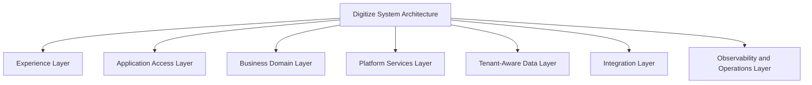
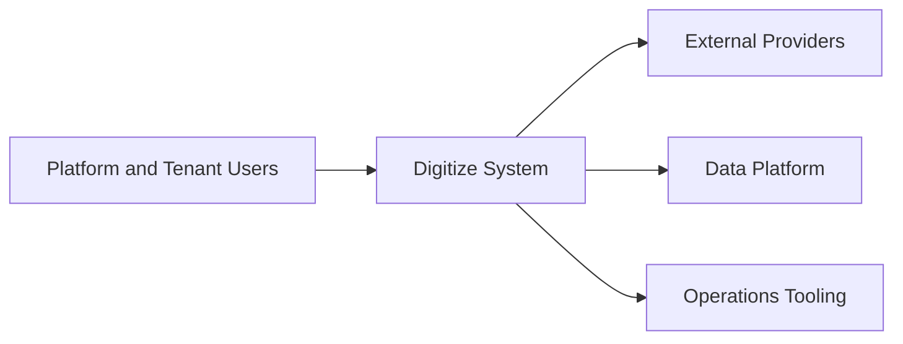
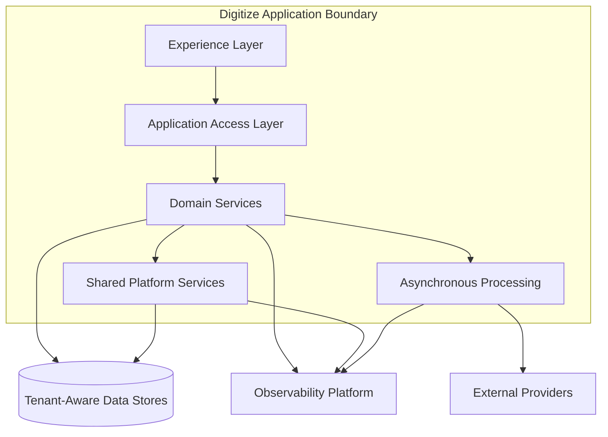
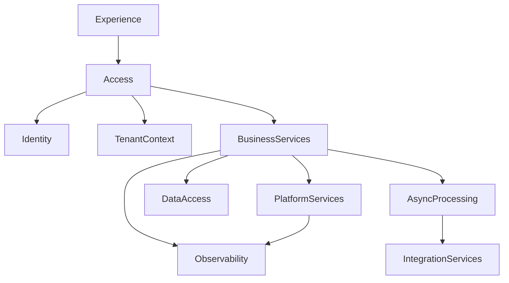
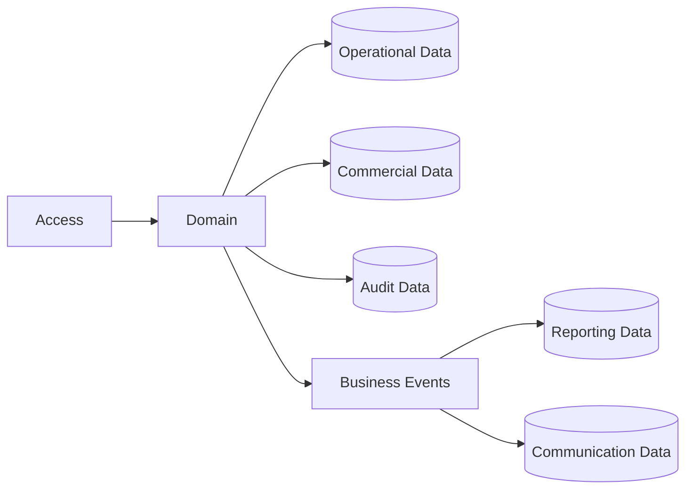
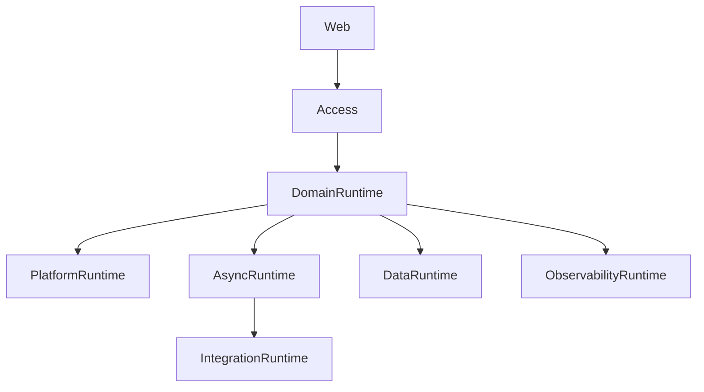

# TA-02 System Architecture

**Document ID:** TA-02  
**Document Name:** System Architecture  
**Company:** OreeOn Technologies Pvt. Ltd.  
**Product:** Digitize  
**Document Type:** Technical Architecture  
**Version:** 1.0  
**Status:** Frozen  
**Owner:** Solution Architecture  
**Prepared By:** Architecture Team  
**Last Updated:** July 25, 2026  
**Architecture Review:** Passed
**Approved ADRs:** ADR-038, ADR-043
**Frozen Date:** 2026-07-25
**Freeze Approver:** Architecture Lead (to replace placeholder with actual approver name)

---

# Revision History

| Version | Date | Author | Description |
|---|---|---|---|
| 0.1 | July 2026 | Architecture Team | Initial design draft |

---

# 1. Introduction

## 1.1 Purpose

This document defines the System Architecture for Digitize. It translates the TA-01 Solution Architecture baseline into system layers, application components, service boundaries, runtime responsibilities, component dependencies, and cross-module interaction rules.

## 1.2 Objectives

- Define the system-level decomposition of Digitize.
- Establish clear boundaries between experience, access, business, platform, data, integration, and operations concerns.
- Define component responsibilities without prescribing implementation code.
- Support multi-tenancy, security, scalability, observability, maintainability, and extensibility.
    - This document provides the system baseline for TA-03 Data Architecture, TA-04 API & Integration Architecture, TA-05 Security & Identity Architecture, and downstream engineering design.

## 1.3 Scope

This document covers application layers, system domains, service boundaries, component responsibilities, internal dependencies, synchronous and asynchronous interaction patterns, runtime responsibilities, failure handling, and system-level traceability.

## 1.4 Out of Scope

Detailed database schema, physical infrastructure, provider-specific integration contracts, UI layouts, test cases, implementation code, and cloud vendor configuration are outside this document.

## 1.5 Intended Audience

Solution Architects, Technical Architects, Backend Engineers, Frontend Engineers, DevOps Engineers, QA Engineers, Security Engineers, Database Architects, Implementation Teams, and Support Teams.

## 1.6 Related Documents

| Document Type | Document Reference | Relationship |
|---|---|---|
| Product Foundation | PF-01, PF-02, PF-03 | Terminology, domain model, and product vision |
| Commercial Strategy | CS-01, CS-03 | Subscription, license, billing, and payment system context |
| Business Analysis | BA-01 to BA-10 | Business processes, rules, journeys, traceability, assumptions, risks, and NFRs |
| Functional Requirements | FR-02 to FR-21 | Functional behavior implemented through system components |
| UI / UX Design | UX-01 to UX-05 | Experience layer alignment |
| API Specification | TA-04 and API Collections | Detailed service interface contracts |
| Database Design | TA-03 and Database Design Artifacts | Data ownership and persistence alignment |
| Deployment | TA-06 | Runtime and deployment alignment |
| Decision Record | TA-10 | System-level ADR traceability |

---

# 2. Architecture Viewpoints

| Viewpoint | Purpose | Primary Stakeholders | Architecture Concerns |
|---|---|---|---|
| Business View | Align system components to Digitize business domains | Product, BA, Architecture | Capability coverage and business ownership |
| Application View | Define application modules and service boundaries | Architects, Engineers | Component responsibility and dependencies |
| Data View | Show system ownership of data groups | Database Architects, Engineers | Tenant data, operational data, audit data |
| Integration View | Define system interaction patterns | Integration Engineers, DevOps | Interface contracts, events, provider boundaries |
| Security View | Define enforcement points | Security, QA | Identity, authorization, tenant isolation |
| Deployment View | Define runtime decomposition | DevOps, SRE | Runtime units, scaling, release boundaries |
| Operational View | Define supportability | Support, DevOps | Logs, metrics, traces, alerts, diagnostics |

---

# 3. Architecture Context

## 3.1 Business Context

Digitize supports multiple organizations, facilities, and sites through shared SaaS capabilities. The system architecture must allow centralized governance while enabling operational execution at facility and site level.

## 3.2 Product Context

The system shall support the full functional scope from FR-02 to FR-21, including platform administration, tenant hierarchy, identity, customers, memberships, attendance, training, commercial operations, communication, analytics, support, and audit.

## 3.3 Technical Context

The system shall be designed as a cloud-native, service-oriented, multi-tenant SaaS platform. Business capabilities shall be exposed through standardized service interfaces, tenant-aware domain services, shared platform services, and asynchronous coordination where appropriate.

## 3.4 Operational Context

The system must support production operation, monitoring, support diagnostics, maintenance mode, audit review, controlled releases, and failure recovery across tenant-scoped workloads.

---

# 4. Architecture Goals

| Goal ID | Goal | Rationale | Success Indicator |
|---|---|---|---|
| TA-02-GOAL-001 | Define system decomposition | Engineering requires clear implementation boundaries | Components have distinct responsibilities and owners |
| TA-02-GOAL-002 | Enforce tenant-aware execution | Multi-tenancy is foundational to Digitize | Tenant context is propagated across all protected operations |
| TA-02-GOAL-003 | Separate domain and platform concerns | Shared capabilities must not be duplicated across modules | Domain services consume platform services through defined interfaces |
| TA-02-GOAL-004 | Support asynchronous workloads | Notifications, reporting, audit, and integrations should not block core transactions unnecessarily | Asynchronous processing responsibilities are defined |
| TA-02-GOAL-005 | Enable operational supportability | Production issues must be diagnosable | Logs, metrics, traces, alerts, and audit events are mapped to system components |

---

# 5. Architecture Principles Applied

| Principle ID | Principle | Application in This Document | Related ADR |
|---|---|---|---|
| TA-PRN-001 | Multi-tenancy by default | Tenant context is enforced across access, business, data, reporting, and audit components | ADR-001 |
| TA-PRN-002 | Configuration over customization | Components consume configuration services instead of embedding tenant-specific logic | ADR-002 |
| TA-PRN-003 | Security by design | Identity and authorization are centralized enforcement responsibilities | ADR-004 |
| TA-PRN-004 | Domain-aligned modularity | System components are aligned to approved functional modules and architecture domains | ADR-004 |
| TA-PRN-005 | Interface-first integration | Components interact through approved service interfaces and events | ADR-006 |
| TA-PRN-006 | Asynchronous coordination | Non-blocking workloads use asynchronous processing boundaries | ADR-007 |

---

# 6. Architecture Scope Model

## 6.1 In-Scope Capabilities

- Experience layer boundary.
- Application access layer.
- Business domain components.
- Shared platform components.
- Tenant-aware data access responsibilities.
- Integration and asynchronous processing responsibilities.
- Observability and operational support responsibilities.

## 6.2 Out-of-Scope Capabilities

- Physical database schema.
- Cloud provider resource topology.
- Endpoint payload contracts.
- UI wireframes.
- Test automation implementation.
- Detailed code structure.

## 6.3 Capability Map

## 6.4 Context Diagram

## 6.5 Boundary Diagram

---

# 7. Logical Architecture

## 7.1 Architecture Domains

| Domain ID | Architecture Domain | Purpose | Responsibility |
|---|---|---|---|
| TA-02-DOM-001 | Experience Domain | Present application capabilities to users | Screen orchestration, workflow entry, user feedback |
| TA-02-DOM-002 | Access Domain | Control entry into application capabilities | Authentication handoff, tenant context, authorization coordination |
| TA-02-DOM-003 | Business Capability Domain | Execute tenant-scoped business behavior | Operational, commercial, communication, reporting, support, and audit capabilities |
| TA-02-DOM-004 | Shared Platform Domain | Provide reusable cross-cutting platform services | Identity, configuration, feature flags, notification foundations, audit foundations |
| TA-02-DOM-005 | Data Domain | Provide tenant-aware persistence and data access | Operational, commercial, reporting, audit, and configuration data access |
| TA-02-DOM-006 | Integration Domain | Isolate provider and third-party interactions | Provider adapters, callbacks, retries, reconciliation |
| TA-02-DOM-007 | Operations Domain | Provide production visibility and operational control | Logs, metrics, traces, alerts, diagnostics |

## 7.2 Logical Relationships

Higher architecture layers may depend on lower layers only through defined interfaces. Lower layers shall remain independent of user experience concerns. Cross-domain interaction shall occur only through approved service interfaces or asynchronous events.

The Access Domain depends on Identity, Tenant Management, and Configuration capabilities to evaluate the request context before routing to business components.

Business components depend on shared platform services for configuration, authorization, audit, notifications, reporting events, and integration boundaries. Business components shall not directly own provider-specific behavior.

The Data Domain shall be accessed through controlled component boundaries. Direct cross-domain database coupling is not allowed.

## 7.3 Logical Architecture Diagram

---

# 8. Component Architecture

## 8.1 Component Summary

| Component ID | Component Name | Type | Owner | Criticality |
|---|---|---|---|---|
| TA-02-CMP-001 | Web Experience Application | Module | Frontend Engineering | High |
| TA-02-CMP-002 | Application Access Layer | Service | Backend Engineering | Critical |
| TA-02-CMP-003 | Tenant Context Resolver | Service | Platform Engineering | Critical |
| TA-02-CMP-004 | Identity and Permission Service | Service | Security Engineering | Critical |
| TA-02-CMP-005 | Configuration Service | Service | Platform Engineering | Critical |
| TA-02-CMP-006 | Business Domain Services | Service | Backend Engineering | Critical |
| TA-02-CMP-007 | Commercial Services | Service | Backend Engineering / Finance Systems | Critical |
| TA-02-CMP-008 | Notification and Campaign Services | Service | Backend Engineering | High |
| TA-02-CMP-009 | Reporting Services | Service | Data Engineering | High |
| TA-02-CMP-010 | Support and Audit Services | Service | Platform Engineering | High |
| TA-02-CMP-011 | Integration Adapter Layer | Service | Integration Engineering | High |
| TA-02-CMP-012 | Asynchronous Processing Layer | Queue / Job | Backend Engineering | High |
| TA-02-CMP-013 | Tenant-Aware Persistence Layer | Database | Database Architecture | Critical |
| TA-02-CMP-014 | Observability Services | Service | DevOps / SRE | Critical |

## 8.2 Component Details

### Component ID

TA-02-CMP-001 to TA-02-CMP-014.

### Component Name

System components listed in Section 8.1.

### Purpose

The components collectively implement the Digitize system architecture by separating user interaction, access control, tenant context, business behavior, shared platform services, persistence, integration, asynchronous execution, and observability.

### Responsibilities

- Maintain clear component ownership.
- Enforce tenant context across protected operations.
- Keep business domains independent of provider-specific logic.
- Route asynchronous work through controlled processing boundaries.
- Preserve operational visibility across all critical flows.

### Provided Capabilities

- Role-aware application access.
- Tenant-scoped domain execution.
- Shared platform governance.
- Commercial, communication, reporting, support, and audit execution.
- Provider integration abstraction.
- Observability and support diagnostics.

### Consumed Capabilities

- Product configuration.
- Tenant hierarchy.
- Identity and permissions.
- Data persistence.
- External provider services.
- Operational monitoring.

### Data Ownership

System components own data by domain responsibility. Tenant-owned operational data remains under tenant-aware domain ownership. Platform configuration remains platform-owned. Financial, audit, and security data receive restricted handling.

### Interfaces

| Interface | Direction | Interface Type | Authentication / Trust Model | Purpose |
|---|---|---|---|---|
| User Interaction Interface | Inbound | Application interface | Authenticated user session | Supports user workflows |
| Domain Service Interface | Internal | Standardized service interface | Tenant-aware service trust | Enables module interaction |
| Platform Service Interface | Internal | Shared service interface | Service trust plus authorization | Provides reusable platform capabilities |
| Event Interface | Internal | Asynchronous event | Signed or trusted internal event | Coordinates non-blocking workflows |
| Provider Interface | Outbound / Inbound | External integration interface | Provider verification controls | Supports payment and communication providers |

### Dependencies

Components depend on identity, tenant context, configuration, persistence, integration, observability, and deployment runtime services.

### Failure Modes

Expected failure modes include tenant resolution failure, authorization denial, validation conflict, component unavailability, provider failure, asynchronous retry exhaustion, data persistence failure, and observability pipeline disruption.

### Security Controls

Authentication, authorization, RBAC, tenant isolation, scoped access, sensitive data masking, secure provider callback validation, and audit logging are mandatory controls.

### Audit and Logging

All critical system actions shall produce technical logs and audit events with actor, tenant, component, operation, timestamp, outcome, and correlation identifier.

### Monitoring

System components shall expose availability, latency, error rate, queue depth, provider status, authentication failures, tenant validation failures, and audit capture health.

### Scalability Considerations

Stateless access and domain services should scale horizontally where feasible. Asynchronous processing shall scale independently for notification, reporting, integration, audit, and reconciliation workloads.

### Notes

Detailed internal component design shall be elaborated in downstream engineering and module architecture documents.

---

# 9. Data Architecture

## 9.1 Data Ownership

| Data Entity / Data Group | Owner Component | Purpose | Classification | Retention Class |
|---|---|---|---|---|
| Tenant Context Data | Tenant Context Resolver | Identify and scope tenant execution | Tenant control data | Active lifecycle plus audit history |
| Identity and Permission Data | Identity and Permission Service | Enforce access | Sensitive security data | Active access plus security audit |
| Configuration Data | Configuration Service | Govern platform and tenant behavior | Configuration data | Active configuration plus change history |
| Operational Data | Business Domain Services | Support customer, membership, attendance, and training operations | Tenant operational data | Operational retention plus archival |
| Commercial Data | Commercial Services | Support billing, payments, subscription, and license operations | Financial data | Financial retention plus audit |
| Communication Data | Notification and Campaign Services | Support notifications and campaigns | Communication data | Communication retention plus consent traceability |
| Reporting Data | Reporting Services | Support analytics and dashboard workloads | Derived reporting data | Reporting retention |
| Audit Data | Support and Audit Services | Maintain compliance traceability | Audit and compliance data | Compliance retention |

## 9.2 Data Flow

Data flows from user interaction through access validation into domain services. Domain services maintain tenant-owned records, publish audit and business events, and provide approved data to reporting and support capabilities.

## 9.3 Data Consistency

Transactional flows such as membership activation, attendance recording, invoice generation, payment confirmation, subscription activation, and license validation require strong consistency. Reporting, notifications, analytics, and support summaries may use eventual consistency.

## 9.4 Data Retention

Retention shall follow BA-09 and BA-10. Financial, audit, and compliance data shall be retained according to applicable policy. Operational data may be archived without breaking reporting or audit traceability.

## 9.5 Data Architecture Diagram

---

# 10. Service Interface and Integration Architecture

## 10.1 Service Interface Summary

| Interface Area | Interface Type | Trust Model | Producer | Consumer | Purpose |
|---|---|---|---|---|---|
| Application Access Interfaces | Inbound service interface | Authenticated user trust | Application Access Layer | Experience Layer | Enter system workflows |
| Domain Interfaces | Internal service interface | Tenant-aware service trust | Business Domain Services | Access and platform components | Execute business capabilities |
| Platform Interfaces | Internal service interface | Authorized service trust | Shared Platform Services | Domain components | Provide shared capabilities |
| Integration Interfaces | External integration interface | Provider verification trust | Integration Adapter Layer | External providers | Exchange provider messages |
| Reporting Interfaces | Read-oriented service interface | Authorized reporting trust | Reporting Services | Dashboards and exports | Provide reporting outputs |

## 10.2 Event Summary

| Event | Producer | Consumer | Purpose | Delivery Pattern |
|---|---|---|---|---|
| TenantContextResolved | Access Layer | Domain Services, Audit | Confirm tenant context | Synchronous context propagation |
| BusinessActionCompleted | Domain Services | Audit, Reporting, Notification | Coordinate downstream outcomes | Asynchronous event |
| CommercialStateChanged | Commercial Services | Reporting, Notification, Audit | Reflect financial or subscription changes | Asynchronous event |
| ProviderCallbackReceived | Integration Adapter Layer | Commercial or Communication Services | Process provider responses | Idempotent event |
| SecurityEventDetected | Identity and Permission Service | Audit, Observability | Monitor security behavior | Asynchronous event |

## 10.3 Asynchronous Processing

| Process | Schedule / Trigger | Purpose | Failure Handling |
|---|---|---|---|
| Notification Dispatch | Business or system event | Deliver communication without blocking core transaction | Retry and mark failed delivery |
| Reporting Projection Update | Business or audit event | Update reporting views | Retry and alert on repeated failure |
| Provider Reconciliation | Schedule or callback | Align external provider status with Digitize records | Flag mismatch for review |
| Audit Persistence | Business or security event | Preserve compliance traceability | Fail critical action where audit capture is mandatory |

## 10.4 External Interfaces

| External System | Interface Type | Purpose | Failure Handling |
|---|---|---|---|
| Payment Gateway | Provider interface | Payment processing and callbacks | Idempotency, retry, reconciliation |
| SMS Provider | Provider interface | SMS delivery | Retry and failure tracking |
| Email Provider | Provider interface | Email delivery | Retry and bounce tracking |
| WhatsApp Provider | Provider interface | WhatsApp communication | Consent validation and retry |

---

# 11. Security Architecture

## 11.1 Authentication

All protected system interactions require authenticated identity or trusted service context.

## 11.2 Authorization

Authorization shall evaluate role, permission, tenant, facility, site, feature access, subscription, and license context.

## 11.3 Tenant Isolation

Tenant isolation shall be enforced by access, domain, data, reporting, audit, and support components.

## 11.4 Data Protection

Sensitive customer, staff, financial, and security data shall be protected through encryption, masking, scoped access, and controlled logging.

## 11.5 Security Events

Login failures, access denials, tenant mismatches, privilege changes, provider verification failures, and audit exports shall be logged and monitored.

---

# 12. Multi-Tenancy Considerations

| Consideration | Architecture Approach |
|---|---|
| Tenant Identification | Organization is the tenant root; Facility and Site are tenant-scoped subdivisions |
| Tenant Isolation | Tenant context is enforced across services and data access |
| Tenant Configuration | Tenant behavior is driven by organization, facility, and site configuration |
| Tenant Data Access | Users access only authorized tenant, facility, and site scope |
| Tenant-Level Feature Access | Subscription, license, and feature flags control capability access |
| Tenant-Level Auditability | All critical tenant actions include tenant, actor, scope, and correlation data |

---

# 13. Configuration and Extensibility

## 13.1 Configuration Parameters

| Parameter | Scope | Purpose | Default | Owner |
|---|---|---|---|---|
| Tenant Context Policy | Platform | Defines tenant resolution behavior | Required | Platform Architecture |
| Module Availability | Platform / Tenant | Controls enabled modules | License-driven | Platform Administrator |
| Domain Configuration | Organization / Facility / Site | Controls operational behavior | Inherited baseline | Organization Administrator |
| Integration Configuration | Platform / Organization | Controls provider connectivity | Disabled until configured | Platform Administrator |

## 13.2 Feature Toggles

| Feature Toggle | Scope | Purpose | Default State |
|---|---|---|---|
| New Facility Type Support | Platform | Enable future facility type capabilities | Disabled |
| Advanced Reporting | Tenant | Enable advanced reporting capability | License-controlled |
| Provider Channel Enablement | Platform / Tenant | Enable provider-backed channels | Disabled until configured |

## 13.3 Extension Points

Extension points include facility type rules, domain modules, service interfaces, asynchronous events, provider adapters, report models, notification channels, and support diagnostics.

---

# 14. Quality Attribute Scenarios

| Quality Attribute | Scenario | Architecture Response | Validation Approach |
|---|---|---|---|
| Availability | Core workflows run during facility operating hours | Critical services are separated and monitored | Availability testing |
| Scalability | Multiple tenants operate concurrently | Stateless services and independent asynchronous processing | Load testing |
| Security | User attempts unauthorized tenant access | Tenant and permission enforcement blocks access | Security testing |
| Performance | Attendance and payment peak occurs | Peak-sensitive flows avoid non-critical blocking work | Performance testing |
| Reliability | Provider fails temporarily | Transaction state is preserved and provider work is retried | Failure simulation |
| Maintainability | Module behavior changes | Changes remain inside owning component boundaries | Architecture review |
| Recoverability | Runtime failure occurs | Restore, retry, and rollback paths are available | Recovery testing |

---

# 15. Performance and Scalability

| Area | Expectation | Architecture Approach | Notes |
|---|---|---|---|
| Latency | Critical workflows remain responsive | Keep access and domain services efficient | Detailed targets later |
| Throughput | Multiple tenants operate concurrently | Scale stateless components | Tenant-aware testing required |
| Concurrency | Conflicting operational updates are controlled | Use transaction and state controls | Applies to capacity and payments |
| Data Volume | Data grows by tenant and facility | Partition, archive, and report separately | Detailed in TA-03 |
| Reporting Load | Reports do not block operations | Use read-oriented reporting | Detailed in TA-07 |

---

# 16. Availability and Resilience

| Scenario | Architecture Response | Recovery Consideration |
|---|---|---|
| Component unavailable | Fail affected capability gracefully | Health checks and restart |
| External provider failure | Retry or reconcile provider work | Provider status monitoring |
| Database failure | Preserve transaction integrity | Backup and restore |
| Deployment failure | Roll back or halt release | Deployment gates |

---

# 17. Observability, Logging, and Auditability

## 17.1 Logs

System logs shall include component, tenant, actor where applicable, operation, outcome, timestamp, and correlation identifier.

## 17.2 Metrics

Metrics shall cover availability, latency, error rate, throughput, queue depth, provider health, authentication failures, and audit capture.

## 17.3 Traces

Traces shall follow user requests and asynchronous processes across access, domain, platform, data, and provider boundaries.

## 17.4 Audit Events

| Audit Event | Trigger | Actor | Data Captured | Retention |
|---|---|---|---|---|
| SystemAccessEvaluated | Protected request evaluated | User or service | Actor, tenant, permission, outcome, timestamp | Security retention |
| BusinessCapabilityExecuted | Domain capability executed | User or system | Capability, tenant, entity reference, outcome | Audit retention |
| ProviderInteractionProcessed | Provider request or callback processed | System or provider | Provider, correlation ID, outcome | Integration retention |

## 17.5 Alerts

| Alert | Condition | Severity | Recipient |
|---|---|---|---|
| Critical Component Failure | Required service unavailable | Critical | DevOps |
| Tenant Isolation Failure Attempt | Tenant mismatch detected | Critical | Security |
| Provider Failure Spike | Provider failures exceed threshold | High | DevOps / Operations |
| Audit Capture Failure | Audit persistence fails | Critical | Compliance / DevOps |

---

# 18. Deployment and Runtime Architecture

## 18.1 Runtime Components

Runtime components include web application runtime, application access runtime, domain service runtime, shared platform service runtime, asynchronous processing runtime, tenant-aware data runtime, provider integration runtime, and observability runtime.

## 18.2 Environment Considerations

The architecture supports development, test, staging, production, and future disaster recovery environments.

## 18.3 Deployment Considerations

Deployments shall support versioned releases, configuration separation, migration governance, feature-flagged rollout, rollback, and smoke validation.

## 18.4 Runtime Diagram

---

# 19. Integration Considerations

| Integration | Purpose | Pattern | Failure Handling | Owner |
|---|---|---|---|---|
| Internal Domain Integration | Cross-module coordination | Service interface and event | Controlled error and retry | Backend Engineering |
| Provider Integration | External service use | Provider adapter | Retry and reconciliation | Integration Engineering |
| Reporting Integration | Analytics update | Asynchronous projection | Retry and alert | Data Engineering |

---

# 20. Architecture Decisions

| Decision ID | Architecture Principle | Decision | Alternatives Considered | Rationale | Consequences | Status | Related ADR |
|---|---|---|---|---|---|---|---|
| ADR-011 | Domain-aligned modularity | System components shall align to architecture domains and functional modules | Single monolithic component boundary | Improves ownership and maintainability | Requires interface discipline | Proposed | TA-10 |
| ADR-012 | Interface-first integration | Cross-component interaction shall use approved service interfaces or events | Direct database coupling | Reduces tight coupling | Requires contract governance | Proposed | TA-10 |
| ADR-013 | Operational readiness | Observability shall be embedded across system components | Add monitoring after implementation | Improves supportability | Requires telemetry standards | Proposed | TA-10 |

---

# 21. Assumptions, Constraints, and Risks

## 21.1 Assumptions

| Assumption ID | Assumption | Impact | Source |
|---|---|---|---|
| BA-ASS-007 | Multi-tenant architecture will be used | Requires tenant-aware system boundaries | BA-10 |
| BA-ASS-013 | Future verticals will reuse core platform capabilities | Requires modular system design | BA-10 |

## 21.2 Constraints

| Constraint ID | Constraint | Impact | Source |
|---|---|---|---|
| BA-CON-002 | Phased product delivery | Requires incremental architecture rollout | BA-10 |
| BA-CON-006 | SaaS architecture dependency | Requires cloud-ready runtime design | BA-10 |

## 21.3 Risks

| Risk ID | Risk | Impact | Likelihood | Mitigation |
|---|---|---|---|---|
| BA-RSK-005 | Multi-tenant data isolation failure | Critical | Low | Enforce tenant context through access, service, and data layers |
| BA-RSK-006 | Performance degradation during peak hours | High | Medium | Isolate peak-sensitive flows and monitor latency |

---

# 22. Traceability Matrix

| Architecture Area | Business Process | Functional Requirement | Service Interface / API Area | Data Entity / Data Group | UI Area | Test Area | Notes |
|---|---|---|---|---|---|---|---|
| Platform Services | Platform Administration | FR-02 | Platform Interfaces | Platform Configuration | Platform Administration | Platform tests | Shared services |
| Tenant Services | Organization, Facility, Site | FR-03, FR-04, FR-05 | Tenant Interfaces | Organization, Facility, Site | Tenant Management | Tenant tests | Tenant hierarchy |
| Identity Services | User & Role Management | FR-06 | Identity Interfaces | Staff Identity and Access Data | User Management | Security tests | RBAC |
| Operational Services | Customer, Membership, Attendance, Training | FR-07 to FR-13 | Domain Interfaces | Operational Data | Operations UI | Functional tests | Facility operations |
| Commercial Services | Billing, Payment, Subscription, License | FR-14 to FR-16 | Commercial Interfaces | Commercial Data | Commercial UI | Commercial tests | Facility subscription model |
| Governance Services | Support, Audit, Reports | FR-19 to FR-21 | Governance Interfaces | Reporting, Support, Audit Data | Support and Reports | Governance tests | Operational traceability |

---

# 23. Architecture Diagrams

| Diagram ID | Diagram Name | Diagram Type | Location |
|---|---|---|---|
| TA-02-DGM-001 | System Capability Map | Capability Map | Section 6.3 |
| TA-02-DGM-002 | System Context Diagram | Context Diagram | Section 6.4 |
| TA-02-DGM-003 | System Boundary Diagram | Boundary Diagram | Section 6.5 |
| TA-02-DGM-004 | Logical Architecture Diagram | Logical Diagram | Section 7.3 |
| TA-02-DGM-005 | Data Flow Diagram | Data Flow Diagram | Section 9.5 |
| TA-02-DGM-006 | Runtime Diagram | Runtime Diagram | Section 18.4 |

---

# 24. Architecture Review Checklist

| Review Area | Status | Notes |
|---|---|---|
| Business alignment | Pending | Review required |
| Functional requirement alignment | Pending | Review required |
| Multi-tenancy readiness | Pending | Review required |
| Security readiness | Pending | Review required |
| Data architecture readiness | Pending | Review required |
| API readiness | Pending | Review required |
| Integration readiness | Pending | Review required |
| Scalability readiness | Pending | Review required |
| Availability readiness | Pending | Review required |
| Observability readiness | Pending | Review required |
| Auditability readiness | Pending | Review required |
| DevOps readiness | Pending | Review required |
| QA readiness | Pending | Review required |
| Support readiness | Pending | Review required |

---

# 25. Open Questions

| Question ID | Question | Owner | Target Resolution | Status |
|---|---|---|---|---|
| TA-02-QST-001 | Which components will be independently deployable in the first release? | Solution Architecture / Engineering | Before TA-02 Review | Open |
| TA-02-QST-002 | Which asynchronous processing technology will be selected? | Technical Architecture | Before TA-06 | Open |

---

## 25.1 Proposed Options (proposals — require explicit approval)

1. Independently deployable components — Decision (approved: ADR-038)
    - Decision: Adopt independently deployable services for platform foundation (Tenant Context, Configuration, Feature Flag, Master Data, Shared Service Gateway) and domain modules (Membership, Attendance, Commercial) as separate services for initial release. Rationale: enables independent scaling, targeted rollouts, and smaller blast radius for changes. Impact: requires CI/CD per service and interface contract testing; use Terraform and GitOps patterns for deployments.

2. Asynchronous processing technology — Decision (approved: ADR-043)
    - Decision: Use AWS managed queueing (SQS + SNS) for asynchronous processing and event distribution in initial release. Rationale: managed durability, scaling, retry semantics, and native integration with the chosen AWS stack. If future requirements necessitate higher-throughput ordering semantics, evaluate Kafka (MSK) as an advanced option.

All proposals are non-binding and require stakeholder sign-off before being applied to downstream design documents.

# 26. Summary

TA-02 defines the Digitize system architecture as a layered, tenant-aware, service-oriented system with clear separation between experience, access, business, platform, data, integration, asynchronous processing, and operations responsibilities.
