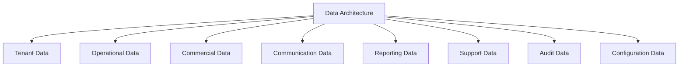
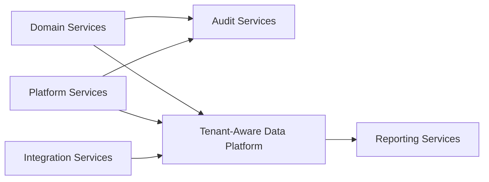
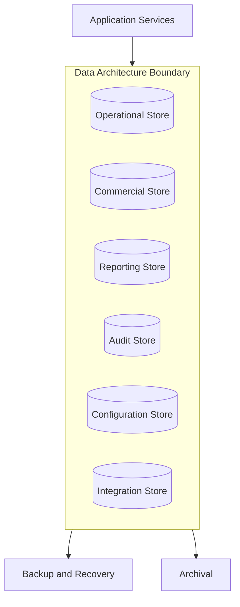
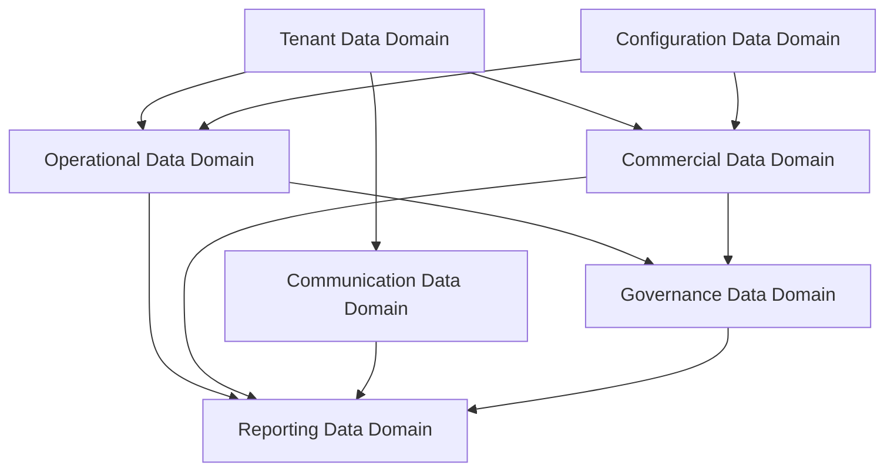
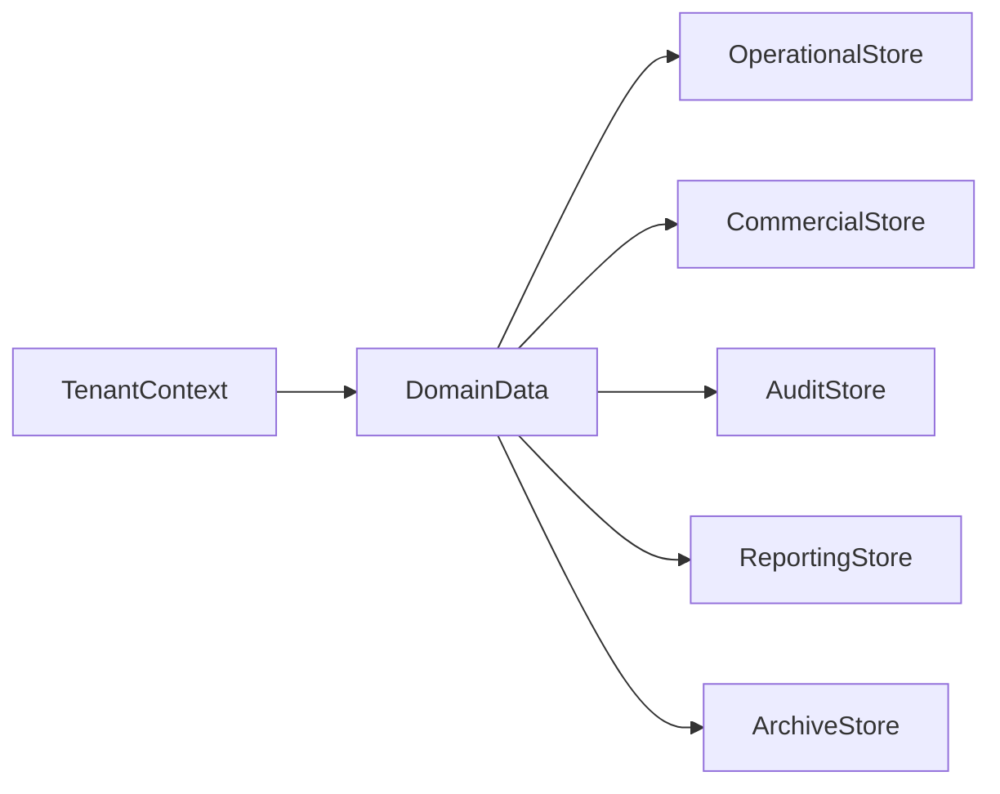

# TA-03 Data Architecture

**Document ID:** TA-03  
**Document Name:** Data Architecture  
**Company:** OreeOn Technologies Pvt. Ltd.  
**Product:** Digitize  
**Document Type:** Technical Architecture  
**Version:** 1.0  
**Status:** Frozen  
**Owner:** Data Architecture  
**Prepared By:** Architecture Team  
**Last Updated:** July 25, 2026  
**Architecture Review:** Passed
**Approved ADRs:** ADR-044, ADR-045, ADR-046
**Frozen Date:** 2026-07-25
**Freeze Approver:** Architecture Lead (to replace placeholder with actual approver name)

---

# Revision History

| Version | Date | Author | Description |
|---|---|---|---|
| 0.1 | July 2026 | Architecture Team | Initial design draft |

---

# 1. Introduction

## 1.1 Purpose

This document defines the Data Architecture for Digitize. It establishes tenant-aware data ownership, data classification, data flow, persistence principles, consistency expectations, reporting data separation, audit retention, archival direction, and recovery considerations.

## 1.2 Objectives

- Define enterprise data ownership across Digitize architecture domains.
- Establish tenant isolation and data access principles.
- Separate operational, commercial, reporting, audit, configuration, and integration data concerns.
- Support scalability, auditability, compliance, recoverability, and future facility-type expansion.
- This document provides the architecture baseline to guide detailed database design.

## 1.3 Scope

This document covers logical data architecture, data groups, ownership, tenant-aware access, data consistency, retention, archival, reporting separation, audit data handling, integration data handling, and recovery expectations.

## 1.4 Out of Scope

Physical schema design, table definitions, column definitions, indexes, migration scripts, stored procedures, data warehouse implementation, and cloud database vendor selection are outside this document.

## 1.5 Intended Audience

Database Architects, Solution Architects, Technical Architects, Backend Engineers, QA Engineers, Security Engineers, DevOps Engineers, Compliance Stakeholders, Implementation Teams, and Support Teams.

## 1.6 Related Documents

| Document Type | Document Reference | Relationship |
|---|---|---|
| Product Foundation | PF-01, PF-02 | Business terminology and domain model |
| Commercial Strategy | CS-01, CS-03 | Commercial and financial data context |
| Business Analysis | BA-01 to BA-10 | Business rules, processes, NFRs, assumptions, constraints, and risks |
| Functional Requirements | FR-02 to FR-21 | Functional data behavior |
| UI / UX Design | UX-01 to UX-05 | Data presentation and interaction context |
| API Specification | TA-04 | Interface data contracts |
| Database Design | Database Design Artifacts | Downstream physical design |
| Deployment | TA-06 | Backup, restore, environment, and runtime alignment |
| Decision Record | TA-10 | Data architecture decisions |

---

# 2. Architecture Viewpoints

| Viewpoint | Purpose | Primary Stakeholders | Architecture Concerns |
|---|---|---|---|
| Business View | Align data to business entities and processes | Product, BA, Implementation | Organization, Facility, Site, Customer, Membership, Billing, Audit |
| Application View | Define data ownership by component | Architects, Engineers | Domain ownership and service boundaries |
| Data View | Define classification, lifecycle, and flow | Database Architects | Tenant data, reporting, audit, retention |
| Integration View | Define integration payload and provider data handling | Integration Engineers | Callback data, provider references, reconciliation |
| Security View | Define data protection | Security, Compliance | Sensitive data, masking, tenant isolation |
| Deployment View | Define storage runtime expectations | DevOps | Backup, restore, migration, environment separation |
| Operational View | Define support and audit visibility | Support, Compliance | Audit lookup, data recovery, diagnostics |

---

# 3. Architecture Context

## 3.1 Business Context

Digitize data supports the complete lifecycle of platform administration, tenant management, facility and site operations, customer management, membership, attendance, commercial transactions, communications, reporting, support, and audit.

## 3.2 Product Context

The product depends on a stable data foundation that supports the initial swimming pool domain and future facility types without redesigning core tenant, customer, membership, commercial, or audit data architecture.

## 3.3 Technical Context

The data architecture shall be tenant-aware, service-owned, auditable, recoverable, and optimized separately for operational transactions, reporting workloads, audit history, and integration records.

## 3.4 Operational Context

Production operations require reliable backup, controlled restore, audit exports, data retention, archival, support diagnostics, and safe migration practices.

---

# 4. Architecture Goals

| Goal ID | Goal | Rationale | Success Indicator |
|---|---|---|---|
| TA-03-GOAL-001 | Establish tenant-aware data ownership | Multi-tenancy requires strict data boundaries | Every tenant-owned data group has an owner and isolation rule |
| TA-03-GOAL-002 | Separate operational and reporting workloads | Reporting must not degrade daily operations | Reporting data access is isolated from core transaction execution |
| TA-03-GOAL-003 | Preserve financial and audit traceability | Billing, payment, and audit records require integrity | Financial and audit data have restricted retention and access controls |
| TA-03-GOAL-004 | Support configurable platform expansion | New facility types must reuse the same data foundation | Facility-type extensions are configuration-driven |
| TA-03-GOAL-005 | Support recovery and compliance | SaaS operations require recoverable and governed data | Backup, restore, archival, retention, and audit policies are defined |

---

# 5. Architecture Principles Applied

| Principle ID | Principle | Application in This Document | Related ADR |
|---|---|---|---|
| TA-PRN-001 | Multi-tenancy by default | Data is classified by platform-owned, tenant-owned, shared, reporting, financial, and audit data groups | ADR-001 |
| TA-PRN-002 | Configuration over customization | Facility-type variation is handled through configurable data structures | ADR-002 |
| TA-PRN-003 | Security by design | Sensitive data requires masking, scoped access, and retention control | ADR-004 |
| TA-PRN-004 | Domain-aligned modularity | Data ownership follows architecture domain ownership | ADR-011 |
| TA-PRN-008 | Traceability | Audit and reporting data preserve cross-module traceability | ADR-009 |

---

# 6. Architecture Scope Model

## 6.1 In-Scope Capabilities

- Tenant-aware data ownership.
- Platform, tenant, operational, commercial, communication, reporting, support, and audit data groups.
- Data classification and retention classes.
- Data flow and consistency patterns.
- Data archival, backup, restore, and recovery expectations.

## 6.2 Out-of-Scope Capabilities

- Physical schema.
- Indexing strategy.
- SQL scripts.
- Database vendor selection.
- Data warehouse implementation.
- ETL tool selection.

## 6.3 Capability Map

## 6.4 Context Diagram

## 6.5 Boundary Diagram

---

# 7. Logical Architecture

## 7.1 Architecture Domains

| Domain ID | Architecture Domain | Purpose | Responsibility |
|---|---|---|---|
| TA-03-DOM-001 | Tenant Data Domain | Own tenant root and hierarchy data | Organization, Facility, Site, tenant status, scope |
| TA-03-DOM-002 | Operational Data Domain | Own daily business operation data | Customer, Membership, Attendance, Training, Batch |
| TA-03-DOM-003 | Commercial Data Domain | Own financial and entitlement data | Invoice, Payment, Refund, Subscription, License |
| TA-03-DOM-004 | Communication Data Domain | Own communication records | Campaign, Notification, Template, Preference, Delivery Log |
| TA-03-DOM-005 | Reporting Data Domain | Own derived analytical data | Dashboards, KPIs, exports, scheduled reports |
| TA-03-DOM-006 | Governance Data Domain | Own support, audit, and compliance data | Support Ticket, Audit Log, Compliance Report |
| TA-03-DOM-007 | Configuration Data Domain | Own platform and tenant configuration | Settings, feature flags, master data, policies |

## 7.2 Logical Relationships

Operational, commercial, communication, reporting, support, and audit data shall always remain associated with tenant context where tenant ownership applies.

Reporting data may derive from operational, commercial, communication, support, and audit records but shall not become the authoritative source for business transactions.

Audit data shall capture critical state changes and shall remain independent enough to support investigation even when operational records are archived.

## 7.3 Logical Architecture Diagram

---

# 8. Component Architecture

## 8.1 Component Summary

| Component ID | Component Name | Type | Owner | Criticality |
|---|---|---|---|---|
| TA-03-CMP-001 | Tenant Data Model | Database | Database Architecture | Critical |
| TA-03-CMP-002 | Operational Data Model | Database | Database Architecture | Critical |
| TA-03-CMP-003 | Commercial Data Model | Database | Database Architecture | Critical |
| TA-03-CMP-004 | Configuration Data Model | Database | Platform Engineering | Critical |
| TA-03-CMP-005 | Audit Data Model | Database | Compliance / Platform Engineering | Critical |
| TA-03-CMP-006 | Reporting Data Model | Database | Data Engineering | High |
| TA-03-CMP-007 | Integration Data Model | Database | Integration Engineering | High |
| TA-03-CMP-008 | Data Retention and Archival Control | Service / Job | Data Architecture | High |

## 8.2 Component Details

### Component ID

TA-03-CMP-001 to TA-03-CMP-008.

### Component Name

Data architecture components listed in Section 8.1.

### Purpose

The components define how Digitize organizes and governs platform, tenant, operational, commercial, reporting, audit, integration, and archival data.

### Responsibilities

- Preserve tenant isolation.
- Maintain data ownership by domain.
- Support transactional integrity.
- Support reporting without degrading operations.
- Protect sensitive data.
- Preserve financial and audit history.

### Provided Capabilities

Tenant-aware persistence, data classification, retention, archival, reporting data derivation, integration traceability, and audit evidence preservation.

### Consumed Capabilities

Tenant context, identity, domain transactions, commercial events, communication events, provider callbacks, and platform configuration.

### Data Ownership

Each data group is owned by the component responsible for business correctness of that data. Reporting and analytics consume derived data and do not own source-of-truth transactions.

### Interfaces

| Interface | Direction | Interface Type | Authentication / Trust Model | Purpose |
|---|---|---|---|---|
| Domain Persistence Interface | Inbound | Data access boundary | Service trust with tenant context | Maintain operational records |
| Reporting Data Interface | Outbound | Read-oriented data interface | Authorized reporting trust | Provide analytical views |
| Audit Data Interface | Inbound / Outbound | Compliance data interface | Privileged compliance trust | Capture and review audit events |
| Archival Interface | Internal | Retention control interface | Operational trust | Move eligible data to archival |

### Dependencies

Data components depend on tenant context resolution, domain services, audit capture, reporting requirements, backup services, migration governance, and retention policies.

### Failure Modes

Failure modes include tenant leakage risk, invalid data ownership, transaction failure, reporting lag, audit persistence failure, archival failure, restore failure, and migration inconsistency.

### Security Controls

Data access shall enforce tenant context, least privilege, sensitive data masking, encryption, audit logging, restricted exports, and production data handling controls.

### Audit and Logging

Data changes to critical business, financial, security, configuration, and compliance records shall produce audit events and technical diagnostics.

### Monitoring

Monitor storage growth, query performance, backup completion, restore validation, audit persistence, archival jobs, reporting refreshes, and migration status.

### Scalability Considerations

The data architecture shall support tenant growth, facility expansion, high-volume attendance, commercial transactions, notification history, audit growth, and reporting workloads through separation of transactional and analytical access patterns.

### Notes

Physical implementation is intentionally deferred to Database Design.

---

# 9. Data Architecture

## 9.1 Data Ownership

| Data Entity / Data Group | Owner Component | Purpose | Classification | Retention Class |
|---|---|---|---|---|
| Organization, Facility, Site | Tenant Data Model | Tenant hierarchy | Tenant master data | Lifecycle plus history |
| Customer, Membership, Attendance | Operational Data Model | Facility and site operations | Sensitive operational data | Active plus archival |
| Trainer, Activity, Batch, Session | Operational Data Model | Training and class operations | Operational data | Active plus historical reporting |
| Invoice, Payment, Refund | Commercial Data Model | Financial execution | Financial data | Financial retention |
| Subscription, License, Entitlement | Commercial Data Model | SaaS access control | Commercial control data | Lifecycle plus audit |
| Platform Settings, Feature Flags | Configuration Data Model | Platform behavior | Configuration data | Active plus change history |
| Campaign, Notification, Delivery Log | Integration Data Model | Communication traceability | Communication data | Communication retention |
| Support Ticket, Audit Log | Audit Data Model | Support and compliance | Support and audit data | Compliance retention |
| Report Views, Exports, Schedules | Reporting Data Model | Analytics and reporting | Derived data | Reporting retention |

## 9.2 Data Flow

Authoritative data is maintained by owning domain components. Derived reporting data is produced from approved operational, commercial, communication, support, and audit sources. Audit data receives events from all critical domains.

## 9.3 Data Consistency

Strong consistency applies to tenant hierarchy, identity, membership eligibility, attendance recording, financial transactions, subscription activation, and license validation. Eventual consistency applies to reporting projections, notification delivery status, and analytics refreshes.

## 9.4 Data Retention

Data retention shall distinguish active operational data, historical operational data, financial records, communication history, support history, audit records, and derived reporting outputs.

## 9.5 Data Architecture Diagram

---

# 10. Service Interface and Integration Architecture

## 10.1 Service Interface Summary

| Interface Area | Interface Type | Trust Model | Producer | Consumer | Purpose |
|---|---|---|---|---|---|
| Data Access Interface | Internal | Tenant-aware service trust | Data Architecture | Domain Services | Controlled persistence |
| Reporting Data Interface | Internal | Authorized reporting trust | Reporting Data Model | Reporting Services | Analytical access |
| Audit Data Interface | Internal | Compliance trust | Audit Data Model | Audit and Compliance Services | Investigation and compliance |
| Archival Interface | Internal | Operational trust | Retention Control | Data Stores | Archival and retention |

## 10.2 Event Summary

| Event | Producer | Consumer | Purpose | Delivery Pattern |
|---|---|---|---|---|
| DataChanged | Domain Services | Reporting, Audit | Update derived records | Asynchronous |
| AuditRecordCaptured | Domain Services | Audit Store | Preserve audit trail | Mandatory event |
| RetentionPolicyApplied | Retention Control | Audit, Compliance | Record archival or retention action | Scheduled event |

## 10.3 Asynchronous Processing

| Process | Schedule / Trigger | Purpose | Failure Handling |
|---|---|---|---|
| Reporting Projection Refresh | Data change event | Refresh reporting views | Retry and alert |
| Audit Archive | Retention schedule | Archive eligible audit data | Retry and compliance alert |
| Data Retention Evaluation | Retention schedule | Identify archival candidates | Log and retry |

## 10.4 External Interfaces

| External System | Interface Type | Purpose | Failure Handling |
|---|---|---|---|
| Backup Storage | Infrastructure interface | Store recoverable backups | Alert on failure |
| Future Analytics Platform | Data interface | Advanced analytics expansion | Contract validation |

---

# 11. Security Architecture

## 11.1 Authentication

Data access requires authenticated user or trusted service context.

## 11.2 Authorization

Data access is governed by tenant scope, role, permission, data classification, and action sensitivity.

## 11.3 Tenant Isolation

Tenant-owned data shall not be accessible across tenants except through explicitly authorized platform, support, audit, or compliance scenarios.

## 11.4 Data Protection

Sensitive data shall be encrypted where applicable, masked in logs and reports, restricted in exports, and protected during backup and restore.

## 11.5 Security Events

Unauthorized data access, tenant mismatch, restricted export, audit access, backup failure, and retention policy violation shall be logged and monitored.

---

# 12. Multi-Tenancy Considerations

| Consideration | Architecture Approach |
|---|---|
| Tenant Identification | Organization is tenant root across tenant-owned data |
| Tenant Isolation | Tenant context is mandatory for operational, commercial, communication, reporting, support, and audit access |
| Tenant Configuration | Tenant configuration influences data validation and lifecycle |
| Tenant Data Access | Scoped by organization, facility, site, role, and permission |
| Tenant-Level Feature Access | Subscription and license determine data capability access |
| Tenant-Level Auditability | Audit data includes tenant and scope references |

---

# 13. Configuration and Extensibility

## 13.1 Configuration Parameters

| Parameter | Scope | Purpose | Default | Owner |
|---|---|---|---|---|
| Data Retention Policy | Platform / Tenant | Controls retention and archival | Platform baseline | Compliance Owner |
| Data Export Policy | Platform / Tenant | Controls export access | Restricted | Security Owner |
| Reporting Refresh Policy | Tenant | Controls reporting update behavior | Standard refresh | Data Engineering |

## 13.2 Feature Toggles

| Feature Toggle | Scope | Purpose | Default State |
|---|---|---|---|
| Advanced Analytics Store | Platform | Enable future analytical data platform | Disabled |
| Data Archival Automation | Platform | Enable automated archival | Enabled after policy approval |
| Data Export Controls | Platform | Enable restricted export governance | Enabled |

## 13.3 Extension Points

Extension points include future facility-type attributes, additional reporting datasets, analytics warehouse, marketplace data exchange, retention policies, archival targets, and compliance-specific data handling.

---

# 14. Quality Attribute Scenarios

| Quality Attribute | Scenario | Architecture Response | Validation Approach |
|---|---|---|---|
| Availability | Operational data must be available during business hours | Use recoverable, monitored data stores | Backup and availability validation |
| Scalability | Attendance and audit records grow rapidly | Separate transactional, audit, and reporting access | Load and volume testing |
| Security | Sensitive data is requested by unauthorized user | Enforce scoped access and masking | Security testing |
| Performance | Dashboard loads during peak hours | Use reporting data structures | Reporting performance tests |
| Reliability | Data write fails mid-transaction | Preserve transaction integrity | Transaction failure tests |
| Maintainability | New facility data requirements emerge | Extend via configuration and controlled model evolution | Migration review |
| Recoverability | Production data is lost or corrupted | Restore from verified backups | Restore testing |

---

# 15. Performance and Scalability

| Area | Expectation | Architecture Approach | Notes |
|---|---|---|---|
| Latency | Operational reads and writes support daily workflows | Optimize tenant-scoped access | Detailed in database design |
| Throughput | High-volume attendance and notifications are supported | Separate write and reporting workloads | Capacity planning required |
| Concurrency | Conflicting changes are controlled | Use transaction and state rules | Applies to capacity and payments |
| Data Volume | Data grows by tenant, facility, and site | Archival and partition-aware design | Physical strategy later |
| Reporting Load | Reporting does not block operations | Derived reporting model | TA-07 alignment required |

---

# 16. Availability and Resilience

| Scenario | Architecture Response | Recovery Consideration |
|---|---|---|
| Component unavailable | Data access fails safely | Health alerts |
| External provider failure | Provider status records preserved | Reconciliation |
| Database failure | Transactions fail safely | Restore procedure |
| Deployment failure | Migrations are controlled | Rollback strategy |

---

# 17. Observability, Logging, and Auditability

## 17.1 Logs

Data operations shall log component, tenant, operation, outcome, duration, and correlation identifier without exposing sensitive values.

## 17.2 Metrics

Metrics shall include query latency, storage growth, backup success, restore validation, audit capture, reporting refresh, and archival status.

## 17.3 Traces

Traces shall connect service requests to data access, audit capture, reporting projection, and provider callback records where applicable.

## 17.4 Audit Events

| Audit Event | Trigger | Actor | Data Captured | Retention |
|---|---|---|---|---|
| SensitiveDataAccessed | Restricted data accessed | User or service | Actor, tenant, data group, purpose | Compliance retention |
| DataExportGenerated | Export generated | Authorized user | Scope, filters, actor, timestamp | Compliance retention |
| RetentionPolicyChanged | Retention configuration changed | Administrator | Policy, previous value, new value | Audit retention |

## 17.5 Alerts

| Alert | Condition | Severity | Recipient |
|---|---|---|---|
| Backup Failure | Backup job fails | Critical | DevOps |
| Audit Persistence Failure | Audit records cannot be stored | Critical | Compliance / DevOps |
| Storage Growth Threshold | Storage exceeds threshold | Medium | Data Engineering |
| Reporting Refresh Failure | Reporting projection fails | Medium | Data Engineering |

---

# 18. Deployment and Runtime Architecture

## 18.1 Runtime Components

Runtime components include operational data store, reporting data store, audit store, configuration store, integration data store, backup storage, migration tooling, and archival processing.

## 18.2 Environment Considerations

Development, test, staging, and production data environments shall remain isolated. Production data shall not be copied to lower environments without approved anonymization.

## 18.3 Deployment Considerations

Data deployments shall include migration review, backward compatibility checks, rollback planning, backup verification, and audit of schema or retention changes.

## 18.4 Runtime Diagram

```mermaid
flowchart TB
    Services --> OperationalStore
    Services --> CommercialStore
    Services --> AuditStore
    Services --> ConfigStore
    OperationalStore --> ReportingStore
    CommercialStore --> ReportingStore
    AuditStore --> ReportingStore
    OperationalStore --> BackupStore
    AuditStore --> ArchiveStore
```

---

# 19. Integration Considerations

| Integration | Purpose | Pattern | Failure Handling | Owner |
|---|---|---|---|---|
| Application Services | Maintain domain data | Tenant-aware data interface | Controlled transaction failure | Backend Engineering |
| Reporting Services | Consume derived data | Read-oriented interface | Refresh retry | Data Engineering |
| Backup Services | Preserve recovery copies | Scheduled backup | Alert and retry | DevOps |
| Archival Services | Apply retention | Scheduled archival | Compliance alert | Data Architecture |

---

# 20. Architecture Decisions

| Decision ID | Architecture Principle | Decision | Alternatives Considered | Rationale | Consequences | Status | Related ADR |
|---|---|---|---|---|---|---|---|
| ADR-014 | Multi-tenancy by default | Data access shall be tenant-aware by default | Application-only tenant checks | Reduces tenant leakage risk | Requires consistent tenant filtering | Proposed | TA-10 |
| ADR-015 | Traceability | Audit data shall be separated from operational data | Store audit only inside operational records | Supports compliance and investigation | Requires audit retention governance | Proposed | TA-10 |
| ADR-016 | Maintainability | Reporting shall use derived read-oriented data | Direct reporting against all operational transactions | Protects operational performance | Requires reporting refresh management | Proposed | TA-10 |

---

# 21. Assumptions, Constraints, and Risks

## 21.1 Assumptions

| Assumption ID | Assumption | Impact | Source |
|---|---|---|---|
| BA-ASS-007 | Multi-tenant architecture will be used | Data model must enforce tenant awareness | BA-10 |
| BA-ASS-011 | Organizations will maintain accurate master data | Data quality controls are required | BA-10 |

## 21.2 Constraints

| Constraint ID | Constraint | Impact | Source |
|---|---|---|---|
| BA-CON-006 | SaaS architecture dependency | Data architecture must support cloud operations | BA-10 |
| BA-CON-007 | Dependency on third-party service providers | Integration data must support provider traceability | BA-10 |

## 21.3 Risks

| Risk ID | Risk | Impact | Likelihood | Mitigation |
|---|---|---|---|---|
| BA-RSK-005 | Multi-tenant data isolation failure | Critical | Low | Tenant-aware data access controls |
| BA-RSK-014 | Inadequate data retention or purging controls | High | Low | Retention and archival governance |

---

# 22. Traceability Matrix

| Architecture Area | Business Process | Functional Requirement | Service Interface / API Area | Data Entity / Data Group | UI Area | Test Area | Notes |
|---|---|---|---|---|---|---|---|
| Tenant Data | Organization, Facility, Site Management | FR-03, FR-04, FR-05 | Tenant Interfaces | Organization, Facility, Site | Tenant Management | Tenant tests | Tenant root |
| Operational Data | Customer, Membership, Attendance, Training | FR-07 to FR-13 | Domain Interfaces | Customer, Membership, Attendance, Batch | Operations UI | Functional tests | Facility operations |
| Commercial Data | Billing, Payment, Subscription, License | FR-14 to FR-16 | Commercial Interfaces | Invoice, Payment, Subscription, License | Commercial UI | Financial tests | Audit-critical |
| Communication Data | Campaign and Notification | FR-17, FR-18 | Communication Interfaces | Campaign, Notification | Communication UI | Notification tests | Consent-aware |
| Reporting Data | Reports and Analytics | FR-19 | Reporting Interfaces | Reporting Data | Reports UI | Reporting tests | Derived data |
| Governance Data | Support, Audit, Compliance | FR-20, FR-21 | Governance Interfaces | Support Ticket, Audit Log | Support and Audit UI | Compliance tests | Retention-critical |

---

# 23. Architecture Diagrams

| Diagram ID | Diagram Name | Diagram Type | Location |
|---|---|---|---|
| TA-03-DGM-001 | Data Capability Map | Capability Map | Section 6.3 |
| TA-03-DGM-002 | Data Context Diagram | Context Diagram | Section 6.4 |
| TA-03-DGM-003 | Data Boundary Diagram | Boundary Diagram | Section 6.5 |
| TA-03-DGM-004 | Logical Data Architecture Diagram | Logical Diagram | Section 7.3 |
| TA-03-DGM-005 | Data Flow Diagram | Data Flow Diagram | Section 9.5 |
| TA-03-DGM-006 | Data Runtime Diagram | Runtime Diagram | Section 18.4 |

---

# 24. Architecture Review Checklist

| Review Area | Status | Notes |
|---|---|---|
| Business alignment | Pending | Review required |
| Functional requirement alignment | Pending | Review required |
| Multi-tenancy readiness | Pending | Review required |
| Security readiness | Pending | Review required |
| Data architecture readiness | Pending | Review required |
| API readiness | Pending | Review required |
| Integration readiness | Pending | Review required |
| Scalability readiness | Pending | Review required |
| Availability readiness | Pending | Review required |
| Observability readiness | Pending | Review required |
| Auditability readiness | Pending | Review required |
| DevOps readiness | Pending | Review required |
| QA readiness | Pending | Review required |
| Support readiness | Pending | Review required |

---

# 25. Open Questions

| Question ID | Question | Owner | Target Resolution | Status |
|---|---|---|---|---|
| TA-03-QST-001 | What physical database engine will be selected? | Data Architecture / DevOps | Before TA-03 Review | Open |
| TA-03-QST-002 | What jurisdiction-specific retention periods apply at launch? | Compliance Owner | Before TA-03 Freeze | Open |

---

## 25.1 Proposed Options (proposals — require explicit approval)

1. Physical database engine — Decision (approved: ADR-044 / ADR-045)
    - Decision: Use managed PostgreSQL (Amazon RDS) for transactional workloads with read replicas for scaling. For analytics/OLAP use Amazon Redshift as the analytics store. Rationale: ACID guarantees, mature ecosystem, managed backups, and integration with AWS analytics services. Impact: requires migration, backup strategy, and ETL pipelines to populate Redshift for reporting.

2. Retention policy baseline — Decision (approved: ADR-046)
    - Decision: Adopt baseline retention policy: Financial/audit data 7 years; Operational PII 2 years; Logs/telemetry 1 year (aggregated summaries stored longer). Retention must be configurable per-tenant to satisfy jurisdictional requirements and will be finalized by Compliance for launch territories.

All proposals above are candidates and must be approved before being used in database design or compliance commitments.

# 26. Summary

TA-03 defines the Digitize Data Architecture baseline for tenant-aware data ownership, data classification, consistency, retention, archival, reporting separation, auditability, and recoverability.
