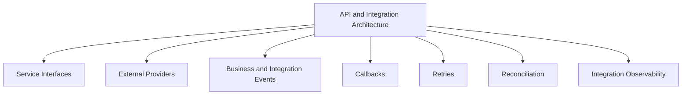
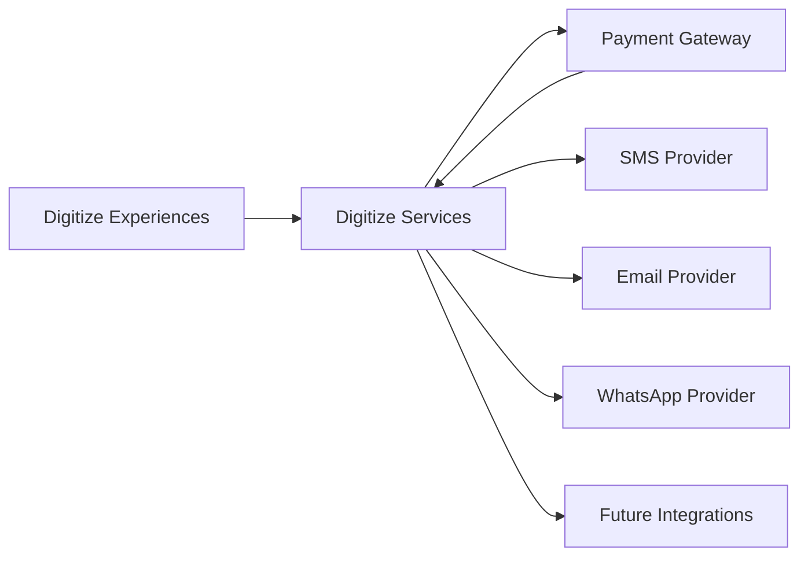
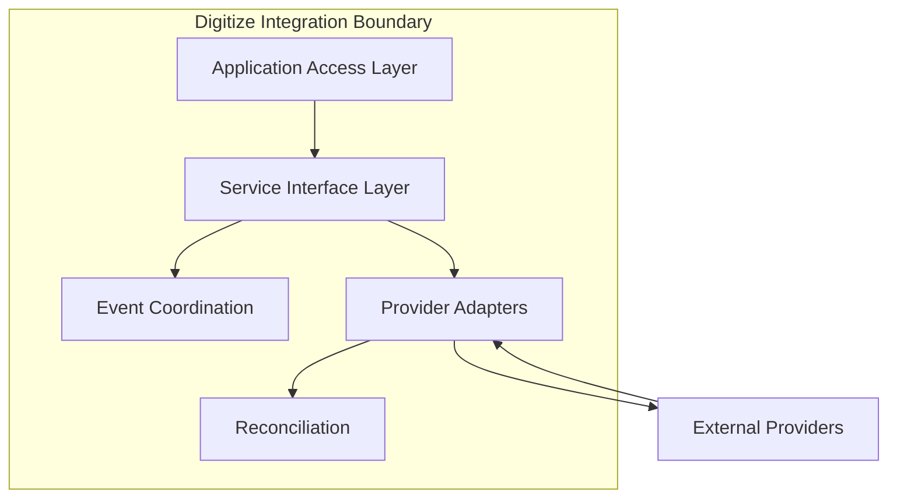
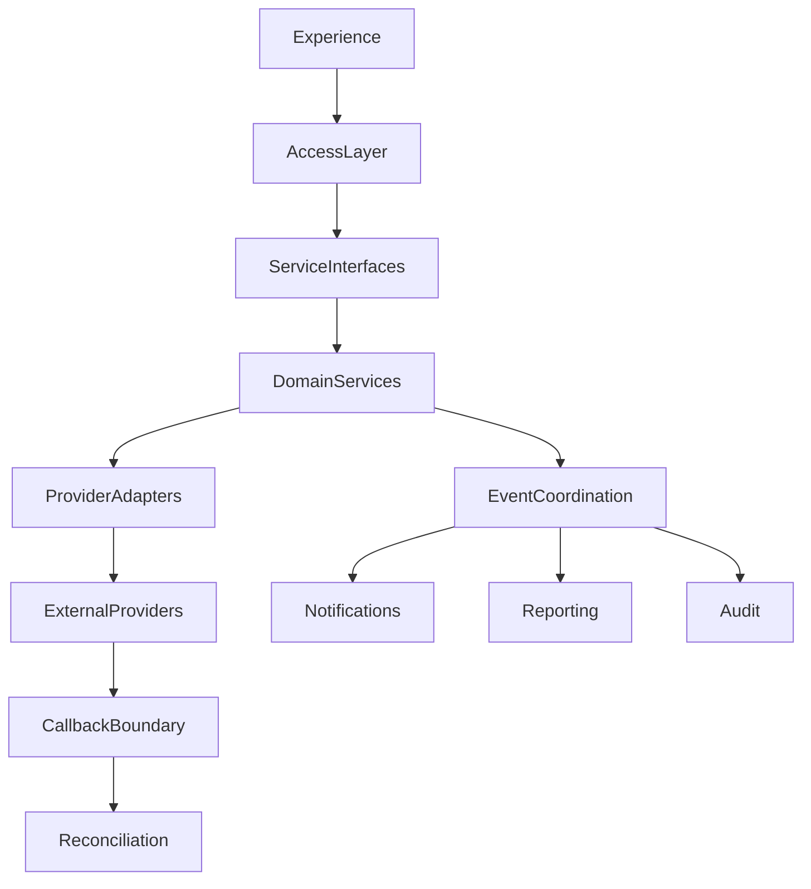
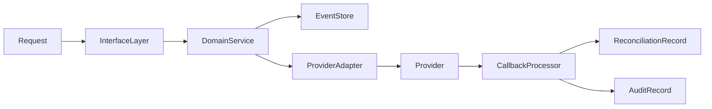
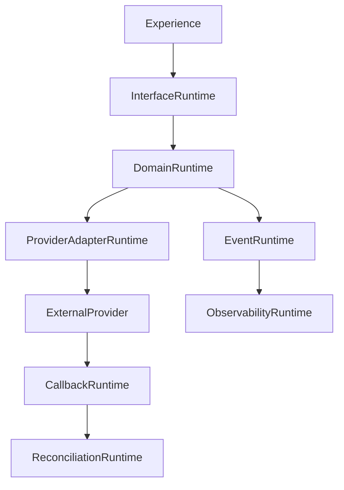

# TA-04 API & Integration Architecture

**Document ID:** TA-04  
**Document Name:** API & Integration Architecture  
**Company:** OreeOn Technologies Pvt. Ltd.  
**Product:** Digitize  
**Document Type:** Technical Architecture  
**Version:** 1.0  
**Status:** Frozen  
**Owner:** Integration Architecture  
**Prepared By:** Architecture Team  
**Last Updated:** July 25, 2026  
**Architecture Review:** Passed
**Approved ADRs:** ADR-040, ADR-041
**Frozen Date:** 2026-07-25
**Freeze Approver:** Architecture Lead (to replace placeholder with actual approver name)

---

# Revision History

| Version | Date | Author | Description |
|---|---|---|---|
| 0.1 | July 2026 | Architecture Team | Initial design draft |

---

# 1. Introduction

## 1.1 Purpose

This document defines the API & Integration Architecture for Digitize. It establishes service interface principles, API governance, integration boundaries, provider adapter strategy, asynchronous integration patterns, idempotency, retry handling, reconciliation, contract ownership, and external system interaction controls.

## 1.2 Objectives

- Define the architecture for internal service interfaces and external integrations.
- Establish REST-aligned API design principles without replacing detailed API specifications.
- Isolate provider-specific behavior from core business domains.
- Support secure, tenant-aware, observable, versioned, and maintainable interfaces.
- Define retry, callback, idempotency, reconciliation, and integration failure handling.

## 1.3 Scope

This document covers service interface areas, API standards, integration patterns, provider adapters, callbacks, asynchronous processing, interface security, tenant context propagation, versioning, observability, and traceability.

## 1.4 Out of Scope

Detailed endpoint payload schemas, Postman collections, SDKs, provider-specific credentials, source code, API implementation code, and exact rate-limit values are outside this document.

## 1.5 Intended Audience

Solution Architects, Technical Architects, Backend Engineers, Integration Engineers, Frontend Engineers, DevOps Engineers, QA Engineers, Security Engineers, Support Teams, and Implementation Teams.

## 1.6 Related Documents

| Document Type | Document Reference | Relationship |
|---|---|---|
| Product Foundation | PF-01, PF-02, PF-03 | Terminology, hierarchy, and product vision |
| Commercial Strategy | CS-01, CS-03 | Payment, subscription, license, billing, and invoice integration context |
| Business Analysis | BA-01 to BA-10 | Business rules, processes, journeys, NFRs, risks |
| Functional Requirements | FR-02 to FR-21 | Source functional interface expectations |
| UI / UX Design | UX-01 to UX-05 | Consumer workflow context |
| API Specification | API Collections | Downstream detailed endpoint contracts |
| Database Design | TA-03 | Data ownership and persistence alignment |
| Deployment | TA-06 | Runtime and environment alignment |
| Decision Record | TA-10 | Interface and integration ADR traceability |

---

# 2. Architecture Viewpoints

| Viewpoint | Purpose | Primary Stakeholders | Architecture Concerns |
|---|---|---|---|
| Business View | Align interfaces to business capabilities | Product, BA | Capability exposure and process enablement |
| Application View | Define service interface ownership | Architects, Engineers | Module interfaces and dependencies |
| Data View | Define payload and data ownership boundaries | Database Architects, Engineers | Tenant context, identifiers, sensitive data |
| Integration View | Define provider and third-party interaction | Integration Engineers | Adapters, callbacks, retries, reconciliation |
| Security View | Define interface protection | Security, QA | Authentication, authorization, signatures, tenant isolation |
| Deployment View | Define interface runtime concerns | DevOps | Versioning, routing, availability, scaling |
| Operational View | Define integration supportability | Support, DevOps | Logs, metrics, traces, provider status |

---

# 3. Architecture Context

## 3.1 Business Context

Digitize business capabilities require interfaces across platform administration, tenant management, identity, operations, commercial, communication, reporting, support, audit, and external providers.

## 3.2 Product Context

The platform shall support current web experiences and future mobile, customer-facing, partner, and marketplace integrations through governed interfaces.

## 3.3 Technical Context

The architecture shall use standardized service interfaces for synchronous interactions and asynchronous events for non-blocking coordination. External providers shall be accessed through adapter boundaries.

## 3.4 Operational Context

Interface operations must be observable, traceable, diagnosable, and recoverable. Provider failures shall not corrupt business state.

---

# 4. Architecture Goals

| Goal ID | Goal | Rationale | Success Indicator |
|---|---|---|---|
| TA-04-GOAL-001 | Define interface governance | APIs must remain consistent and maintainable | Interface areas and ownership are defined |
| TA-04-GOAL-002 | Support secure tenant-aware access | Interfaces expose tenant-owned data | Tenant context and permission rules are enforced |
| TA-04-GOAL-003 | Isolate providers | Provider changes should not affect core domains | Provider adapter boundaries are defined |
| TA-04-GOAL-004 | Support integration resilience | External systems can fail | Retry, callback, and reconciliation patterns are defined |
| TA-04-GOAL-005 | Enable future ecosystem expansion | Digitize may support partner integrations | Versioning and extension principles are defined |

---

# 5. Architecture Principles Applied

| Principle ID | Principle | Application in This Document | Related ADR |
|---|---|---|---|
| TA-PRN-001 | Multi-tenancy by default | Interfaces carry tenant context for tenant-scoped operations | ADR-001 |
| TA-PRN-003 | Security by design | Interfaces enforce authentication, authorization, callback verification, and sensitive data controls | ADR-004 |
| TA-PRN-005 | Interface-first integration | Business capabilities are exposed through governed service interface areas | ADR-006 |
| TA-PRN-006 | Asynchronous coordination | Events coordinate notifications, reporting, audit, callbacks, and reconciliation | ADR-007 |
| TA-PRN-007 | Operational readiness | Interfaces expose diagnostics and provider status | ADR-009 |

---

# 6. Architecture Scope Model

## 6.1 In-Scope Capabilities

- Service interface categories.
- API design principles.
- Tenant context propagation.
- Provider adapter strategy.
- Callback and webhook handling.
- Retry, idempotency, and reconciliation.
- Integration observability.
- Interface security and versioning.

## 6.2 Out-of-Scope Capabilities

- Detailed OpenAPI specification.
- Exact payload schemas.
- Provider credentials.
- SDK implementation.
- Source code.
- Network infrastructure configuration.

## 6.3 Capability Map

## 6.4 Context Diagram

## 6.5 Boundary Diagram

---

# 7. Logical Architecture

## 7.1 Architecture Domains

| Domain ID | Architecture Domain | Purpose | Responsibility |
|---|---|---|---|
| TA-04-DOM-001 | Service Interface Domain | Expose internal and external capabilities | Interface consistency, versioning, request/response governance |
| TA-04-DOM-002 | Event Domain | Coordinate asynchronous outcomes | Business events, audit events, integration events |
| TA-04-DOM-003 | Provider Adapter Domain | Isolate external provider behavior | Payment, SMS, email, WhatsApp, future provider abstractions |
| TA-04-DOM-004 | Callback Domain | Receive provider responses | Verification, idempotency, routing, status capture |
| TA-04-DOM-005 | Reconciliation Domain | Resolve mismatches | Provider status alignment and operational review |
| TA-04-DOM-006 | Interface Observability Domain | Support diagnostics | Logs, metrics, traces, provider health |

## 7.2 Logical Relationships

Application experiences use service interfaces through the Application Access Layer. Business domains publish events for asynchronous consumers. External providers communicate only through provider adapters and callback boundaries.

Core business domains shall not directly embed provider-specific logic. Provider-specific failures shall be contained within the integration boundary and surfaced through status, audit, alerts, and reconciliation.

## 7.3 Logical Architecture Diagram

---

# 8. Component Architecture

## 8.1 Component Summary

| Component ID | Component Name | Type | Owner | Criticality |
|---|---|---|---|---|
| TA-04-CMP-001 | Interface Governance Component | Service | Architecture / Backend Engineering | Critical |
| TA-04-CMP-002 | Application Interface Layer | Service | Backend Engineering | Critical |
| TA-04-CMP-003 | Event Coordination Component | Queue / Service | Backend Engineering | High |
| TA-04-CMP-004 | Payment Provider Adapter | External System Adapter | Integration Engineering | Critical |
| TA-04-CMP-005 | SMS Provider Adapter | External System Adapter | Integration Engineering | High |
| TA-04-CMP-006 | Email Provider Adapter | External System Adapter | Integration Engineering | High |
| TA-04-CMP-007 | WhatsApp Provider Adapter | External System Adapter | Integration Engineering | Medium |
| TA-04-CMP-008 | Callback Processor | Service | Integration Engineering | Critical |
| TA-04-CMP-009 | Reconciliation Processor | Job | Finance / Integration Engineering | High |
| TA-04-CMP-010 | Integration Observability Component | Service | DevOps / Integration Engineering | High |

## 8.2 Component Details

### Component ID

TA-04-CMP-001 to TA-04-CMP-010.

### Component Name

API and integration components listed in Section 8.1.

### Purpose

These components govern how Digitize exposes capabilities, exchanges data, processes provider interactions, handles callbacks, retries failed work, and reconciles integration status.

### Responsibilities

- Standardize interface design.
- Preserve tenant context across interfaces.
- Protect sensitive data.
- Isolate provider-specific behavior.
- Validate callbacks.
- Support idempotency and reconciliation.
- Provide integration diagnostics.

### Provided Capabilities

Service interface governance, provider abstraction, callback handling, retry coordination, reconciliation, event publication, and integration observability.

### Consumed Capabilities

Identity, tenant context, commercial services, communication services, audit services, reporting services, and provider services.

### Data Ownership

Integration components own provider references, callback records, retry history, reconciliation status, and integration diagnostic records. They do not own source-of-truth business transactions.

### Interfaces

| Interface | Direction | Interface Type | Authentication / Trust Model | Purpose |
|---|---|---|---|---|
| Application Interface | Inbound | Service interface | Authenticated user trust | Expose Digitize capabilities |
| Internal Event Interface | Internal | Event interface | Trusted internal event | Coordinate asynchronous outcomes |
| Provider Request Interface | Outbound | External provider interface | Provider credential trust | Send provider requests |
| Provider Callback Interface | Inbound | External callback interface | Signature or provider verification trust | Receive provider outcomes |

### Dependencies

Dependencies include Identity and Access, Tenant Management, Commercial Services, Communication Services, Audit Services, provider availability, network availability, and observability.

### Failure Modes

Failure modes include malformed request, missing tenant context, unauthorized access, provider timeout, duplicate callback, invalid callback verification, retry exhaustion, and reconciliation mismatch.

### Security Controls

All interfaces shall enforce authentication, authorization, tenant context, input validation, provider verification, sensitive data masking, and restricted credential handling.

### Audit and Logging

Interface access, provider requests, callbacks, retries, reconciliation outcomes, and failed integrations shall be logged with correlation identifiers.

### Monitoring

Monitor request volume, latency, error rate, provider availability, callback failures, retry backlog, reconciliation mismatches, and interface rejection rates.

### Scalability Considerations

Provider adapters, callback processors, and asynchronous integration processing shall scale independently from core transactional workloads.

### Notes

Detailed endpoint and payload definitions shall be maintained in API specifications.

---

# 9. Data Architecture

## 9.1 Data Ownership

| Data Entity / Data Group | Owner Component | Purpose | Classification | Retention Class |
|---|---|---|---|---|
| Interface Contract Metadata | Interface Governance Component | Track interface ownership and versioning | Technical metadata | Active plus version history |
| Provider Configuration | Provider Adapter Components | Store provider routing configuration | Sensitive configuration | Active plus audit history |
| Callback Record | Callback Processor | Track external provider responses | Integration data | Integration retention |
| Retry Record | Event Coordination Component | Track failed and retried processing | Operational integration data | Retry retention |
| Reconciliation Record | Reconciliation Processor | Track status mismatches and resolution | Financial / integration data | Financial retention |
| Integration Log | Integration Observability Component | Support diagnostics | Technical log data | Operational retention |

## 9.2 Data Flow

Requests enter through application interfaces, are validated with tenant context, routed to domain services, and may publish events. Provider-bound operations pass through adapters. Provider callbacks return through callback processors and update reconciliation state where needed.

## 9.3 Data Consistency

Business source-of-truth records remain owned by domain services. Integration data supports traceability and reconciliation. Idempotency prevents duplicate processing for callbacks and retries.

## 9.4 Data Retention

Integration records shall be retained long enough to support support diagnostics, financial reconciliation, audit review, and provider dispute investigation.

## 9.5 Data Architecture Diagram

---

# 10. Service Interface and Integration Architecture

## 10.1 Service Interface Summary

| Interface Area | Interface Type | Trust Model | Producer | Consumer | Purpose |
|---|---|---|---|---|---|
| Platform Interfaces | Administrative service interface | Platform administrator trust | Platform Services | Platform UI | Platform administration |
| Tenant Interfaces | Tenant service interface | Tenant administrator trust | Tenant Services | Tenant UI | Organization, facility, and site management |
| Operational Interfaces | Domain service interface | Tenant staff trust | Operational Services | Operations UI | Customer, membership, attendance, training |
| Commercial Interfaces | Financial service interface | Finance and platform trust | Commercial Services | Commercial UI and providers | Billing, payment, subscription, license |
| Communication Interfaces | Communication service interface | Tenant and system trust | Communication Services | Campaign and notification UI | Notifications and campaigns |
| Reporting Interfaces | Reporting service interface | Authorized reporting trust | Reporting Services | Reporting UI | Dashboards and exports |

## 10.2 Event Summary

| Event | Producer | Consumer | Purpose | Delivery Pattern |
|---|---|---|---|---|
| InterfaceRequestAccepted | Application Interface Layer | Observability | Track accepted request | Synchronous log/event |
| ProviderRequestSent | Provider Adapter | Observability, Audit | Track outbound provider request | Asynchronous event |
| ProviderCallbackAccepted | Callback Processor | Domain Services, Audit | Track verified provider callback | Idempotent event |
| IntegrationRetryExhausted | Event Coordination | Support, Observability | Trigger operational review | Asynchronous event |

## 10.3 Asynchronous Processing

| Process | Schedule / Trigger | Purpose | Failure Handling |
|---|---|---|---|
| Provider Retry | Provider failure | Retry provider-dependent action | Retry limit and alert |
| Callback Processing | Provider callback | Update provider-related status | Idempotency and error queue |
| Reconciliation | Scheduled or exception | Resolve status mismatch | Finance/support review |
| Notification Dispatch | Business event | Deliver channel communication | Retry and failure tracking |

## 10.4 External Interfaces

| External System | Interface Type | Purpose | Failure Handling |
|---|---|---|---|
| Payment Gateway | Provider interface and callback | Payment processing | Idempotency, retry, reconciliation |
| SMS Provider | Provider interface | SMS delivery | Retry and delivery tracking |
| Email Provider | Provider interface | Email delivery | Retry and bounce tracking |
| WhatsApp Provider | Provider interface | WhatsApp delivery | Consent validation and retry |
| Future Integrations | API or webhook | Partner expansion | Contract validation and monitoring |

---

# 11. Security Architecture

## 11.1 Authentication

All protected interfaces require authenticated user context, trusted service context, or verified provider context.

## 11.2 Authorization

Interfaces shall enforce role, permission, tenant scope, feature access, and commercial entitlement where applicable.

## 11.3 Tenant Isolation

Tenant context shall be propagated through all tenant-scoped service interfaces and integration events.

## 11.4 Data Protection

Sensitive fields, credentials, payment references, provider tokens, and callback secrets shall be protected and excluded from plain-text logs.

## 11.5 Security Events

Unauthorized interface access, invalid provider callback, tenant mismatch, suspicious retry pattern, and credential configuration changes shall be logged and monitored.

---

# 12. Multi-Tenancy Considerations

| Consideration | Architecture Approach |
|---|---|
| Tenant Identification | Tenant context is required for tenant-scoped interfaces |
| Tenant Isolation | Interface routing and data access enforce tenant scope |
| Tenant Configuration | Tenant configuration controls enabled channels and integrations |
| Tenant Data Access | Interface consumers receive only authorized tenant data |
| Tenant-Level Feature Access | Subscription and license control interface availability |
| Tenant-Level Auditability | Interface events include tenant and correlation context |

---

# 13. Configuration and Extensibility

## 13.1 Configuration Parameters

| Parameter | Scope | Purpose | Default | Owner |
|---|---|---|---|---|
| Interface Version Policy | Platform | Govern compatibility | Current active version | Architecture |
| Provider Configuration | Platform / Tenant | Enable provider connection | Disabled until configured | Platform Administrator |
| Retry Policy | Platform | Control integration retry | Standard retry baseline | Integration Engineering |
| Callback Verification Policy | Platform | Control provider callback trust | Required | Security Engineering |

## 13.2 Feature Toggles

| Feature Toggle | Scope | Purpose | Default State |
|---|---|---|---|
| External API Access | Platform / Tenant | Enable future external consumers | Disabled |
| WhatsApp Channel | Platform / Tenant | Enable WhatsApp integration | Disabled |
| Provider Failover | Platform | Enable future provider failover | Disabled |

## 13.3 Extension Points

Extension points include future public APIs, partner webhooks, provider adapters, marketplace integrations, additional notification providers, reconciliation rules, and integration observability dashboards.

---

# 14. Quality Attribute Scenarios

| Quality Attribute | Scenario | Architecture Response | Validation Approach |
|---|---|---|---|
| Availability | Provider outage occurs | Core transaction state is preserved | Failure simulation |
| Scalability | Campaign sends high notification volume | Asynchronous delivery scales independently | Load testing |
| Security | Invalid callback is received | Callback verification rejects request | Security testing |
| Performance | High request volume during operations | Interface layer scales independently | API performance tests |
| Reliability | Duplicate callback is received | Idempotency prevents duplicate business update | Callback tests |
| Maintainability | Provider changes | Adapter isolates provider impact | Integration review |
| Recoverability | Reconciliation fails | Exception is tracked and escalated | Reconciliation testing |

---

# 15. Performance and Scalability

| Area | Expectation | Architecture Approach | Notes |
|---|---|---|---|
| Latency | Interfaces remain responsive | Validate and route efficiently | Endpoint targets later |
| Throughput | High-volume tenant usage is supported | Scale interface and async layers | Load testing required |
| Concurrency | Duplicate requests are controlled | Idempotency and state checks | Critical for payments |
| Data Volume | Integration logs grow safely | Retention and archival | TA-03 alignment |
| Reporting Load | Integration reporting does not block providers | Derived reporting | TA-07 alignment |

---

# 16. Availability and Resilience

| Scenario | Architecture Response | Recovery Consideration |
|---|---|---|
| Component unavailable | Return controlled error | Health alert |
| External provider failure | Retry and reconcile | Provider monitoring |
| Database failure | Preserve transaction state | Restore |
| Deployment failure | Roll back interface version | Version governance |

---

# 17. Observability, Logging, and Auditability

## 17.1 Logs

Logs shall capture interface area, tenant, correlation identifier, request outcome, provider outcome, callback status, and retry result.

## 17.2 Metrics

Metrics include request rate, latency, error rate, provider availability, callback failures, retry backlog, reconciliation mismatches, and unauthorized access attempts.

## 17.3 Traces

Traces connect incoming requests, domain service execution, provider calls, callbacks, retries, reconciliation, and audit events.

## 17.4 Audit Events

| Audit Event | Trigger | Actor | Data Captured | Retention |
|---|---|---|---|---|
| InterfaceAccessDenied | Unauthorized interface request | User or service | Actor, tenant, interface, reason | Security retention |
| ProviderCallbackRejected | Invalid callback received | Provider / system | Provider, reason, correlation ID | Integration retention |
| ReconciliationCompleted | Reconciliation executed | System or finance user | Scope, result, mismatch count | Financial retention |

## 17.5 Alerts

| Alert | Condition | Severity | Recipient |
|---|---|---|---|
| Provider Outage | Provider failures exceed threshold | High | DevOps / Integration |
| Callback Failure Spike | Callback failures exceed threshold | High | Integration Engineering |
| Retry Backlog Growth | Retry queue exceeds threshold | Medium | DevOps |
| Reconciliation Mismatch | Financial mismatch detected | High | Finance Operations |

---

# 18. Deployment and Runtime Architecture

## 18.1 Runtime Components

Runtime components include application interface runtime, provider adapter runtime, callback processor, asynchronous event processor, reconciliation processor, integration log storage, and monitoring dashboards.

## 18.2 Environment Considerations

Provider integrations shall support environment-specific credentials and sandbox providers where available.

## 18.3 Deployment Considerations

Interface deployments shall preserve backward compatibility where possible and shall include contract validation, provider smoke tests, rollback readiness, and monitoring.

## 18.4 Runtime Diagram

---

# 19. Integration Considerations

| Integration | Purpose | Pattern | Failure Handling | Owner |
|---|---|---|---|---|
| Payment Gateway | Process payments | Provider adapter and callback | Idempotency and reconciliation | Integration / Finance |
| SMS Provider | Deliver SMS | Provider adapter | Retry and failure status | Integration |
| Email Provider | Deliver email | Provider adapter | Retry and bounce tracking | Integration |
| WhatsApp Provider | Deliver WhatsApp | Provider adapter | Consent and retry | Integration |
| Future Partners | Extend platform ecosystem | Governed interface | Contract validation | Platform Architecture |

---

# 20. Architecture Decisions

| Decision ID | Architecture Principle | Decision | Alternatives Considered | Rationale | Consequences | Status | Related ADR |
|---|---|---|---|---|---|---|---|
| ADR-017 | Interface-first integration | Digitize shall expose capabilities through governed service interface areas | Direct module coupling | Improves maintainability and external readiness | Requires interface standards | Proposed | TA-10 |
| ADR-018 | Security by design | Provider callbacks shall be verified before processing | Trust provider payloads without verification | Prevents spoofed callbacks | Requires provider-specific verification rules | Proposed | TA-10 |
| ADR-019 | Asynchronous coordination | Provider-dependent work shall support retry and reconciliation | Fully synchronous provider dependence | Improves resilience | Requires monitoring and exception handling | Proposed | TA-10 |

---

# 21. Assumptions, Constraints, and Risks

## 21.1 Assumptions

| Assumption ID | Assumption | Impact | Source |
|---|---|---|---|
| BA-ASS-008 | Core integrations will use external providers | Provider abstraction is required | BA-10 |
| BA-ASS-014 | Future integrations will be added incrementally | Interface extensibility is required | BA-10 |

## 21.2 Constraints

| Constraint ID | Constraint | Impact | Source |
|---|---|---|---|
| BA-CON-007 | Dependency on third-party service providers | Failure handling and reconciliation are required | BA-10 |

## 21.3 Risks

| Risk ID | Risk | Impact | Likelihood | Mitigation |
|---|---|---|---|---|
| BA-RSK-011 | Payment gateway downtime | Medium | Medium | Retry, reconciliation, and status tracking |
| BA-RSK-009 | Unauthorized access to sensitive data | High | Medium | Interface authorization and sensitive data controls |

---

# 22. Traceability Matrix

| Architecture Area | Business Process | Functional Requirement | Service Interface / API Area | Data Entity / Data Group | UI Area | Test Area | Notes |
|---|---|---|---|---|---|---|---|
| Platform Interfaces | Platform Administration | FR-02 | Platform Administration Interfaces | Platform Configuration | Platform UI | Interface tests | Admin capabilities |
| Tenant Interfaces | Organization, Facility, Site | FR-03 to FR-05 | Tenant Interfaces | Tenant Data | Tenant UI | Tenant interface tests | Tenant hierarchy |
| Operational Interfaces | Customer, Membership, Attendance, Training | FR-07 to FR-13 | Operational Interfaces | Operational Data | Operations UI | Functional API tests | Tenant-scoped |
| Commercial Interfaces | Billing, Payment, Subscription, License | FR-14 to FR-16 | Commercial Interfaces | Commercial Data | Commercial UI | Payment and billing tests | Provider-backed |
| Communication Interfaces | Campaign, Notification | FR-17, FR-18 | Communication Interfaces | Communication Data | Campaign and Notification UI | Notification tests | Channel provider-backed |
| Governance Interfaces | Reports, Support, Audit | FR-19 to FR-21 | Governance Interfaces | Reporting, Support, Audit Data | Reports and Support UI | Governance tests | Restricted access |

---

# 23. Architecture Diagrams

| Diagram ID | Diagram Name | Diagram Type | Location |
|---|---|---|---|
| TA-04-DGM-001 | API and Integration Capability Map | Capability Map | Section 6.3 |
| TA-04-DGM-002 | Integration Context Diagram | Context Diagram | Section 6.4 |
| TA-04-DGM-003 | Integration Boundary Diagram | Boundary Diagram | Section 6.5 |
| TA-04-DGM-004 | Logical Integration Diagram | Logical Diagram | Section 7.3 |
| TA-04-DGM-005 | Integration Data Flow Diagram | Data Flow Diagram | Section 9.5 |
| TA-04-DGM-006 | Integration Runtime Diagram | Runtime Diagram | Section 18.4 |

---

# 24. Architecture Review Checklist

| Review Area | Status | Notes |
|---|---|---|
| Business alignment | Pending | Review required |
| Functional requirement alignment | Pending | Review required |
| Multi-tenancy readiness | Pending | Review required |
| Security readiness | Pending | Review required |
| Data architecture readiness | Pending | Review required |
| API readiness | Pending | Review required |
| Integration readiness | Pending | Review required |
| Scalability readiness | Pending | Review required |
| Availability readiness | Pending | Review required |
| Observability readiness | Pending | Review required |
| Auditability readiness | Pending | Review required |
| DevOps readiness | Pending | Review required |
| QA readiness | Pending | Review required |
| Support readiness | Pending | Review required |

---

# 25. Open Questions

| Question ID | Question | Owner | Target Resolution | Status |
|---|---|---|---|---|
| TA-04-QST-001 | Which payment gateway will be selected for initial launch? | Product / Integration | Before TA-04 Review | Open |
| TA-04-QST-002 | Which communication providers will be selected? | Product / Integration | Before TA-04 Review | Open |

---

## 25.1 Proposed Options (proposals — require explicit approval)

1. Payment gateway — Decision (approved: ADR-040)
    - Decision: Use Stripe as the primary payment gateway for the initial launch. Rationale: comprehensive tokenization, webhook support, reconciliation tools, and broad regional coverage. For regions where Stripe is not supported, evaluate Adyen or appropriate regional providers via an adapter pattern.

2. Communication providers — Decision (approved: ADR-041)
    - Decision: Use Twilio for SMS and WhatsApp messaging and Amazon SES for email in the initial AWS-based deployment. Rationale: Twilio provides robust messaging APIs and SES integrates tightly with AWS for reliability and cost-effectiveness. Implement provider adapters to isolate provider-specific logic.

All proposals are non-binding and require product and integration sign-off before being applied to implementation artifacts.

# 26. Summary

TA-04 defines the Digitize API & Integration Architecture baseline for service interfaces, provider adapters, callbacks, retries, idempotency, reconciliation, interface security, and integration observability.
