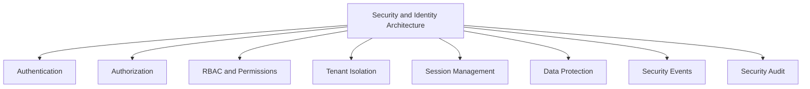
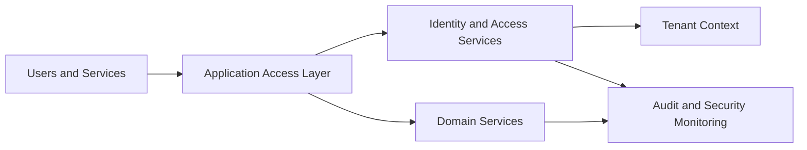
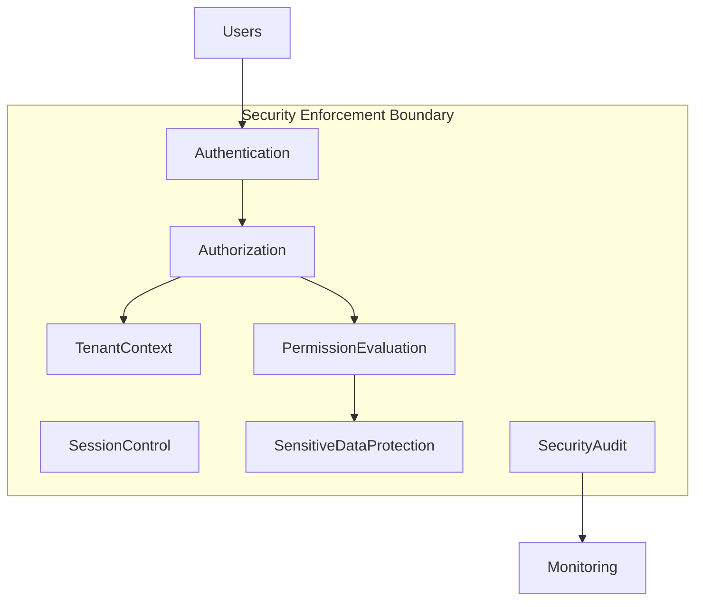
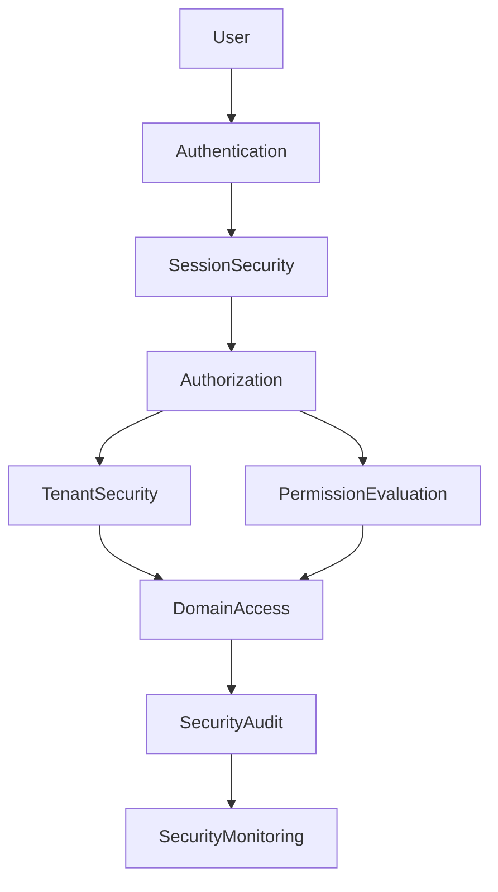
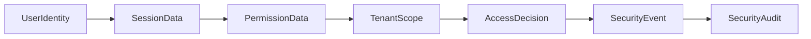
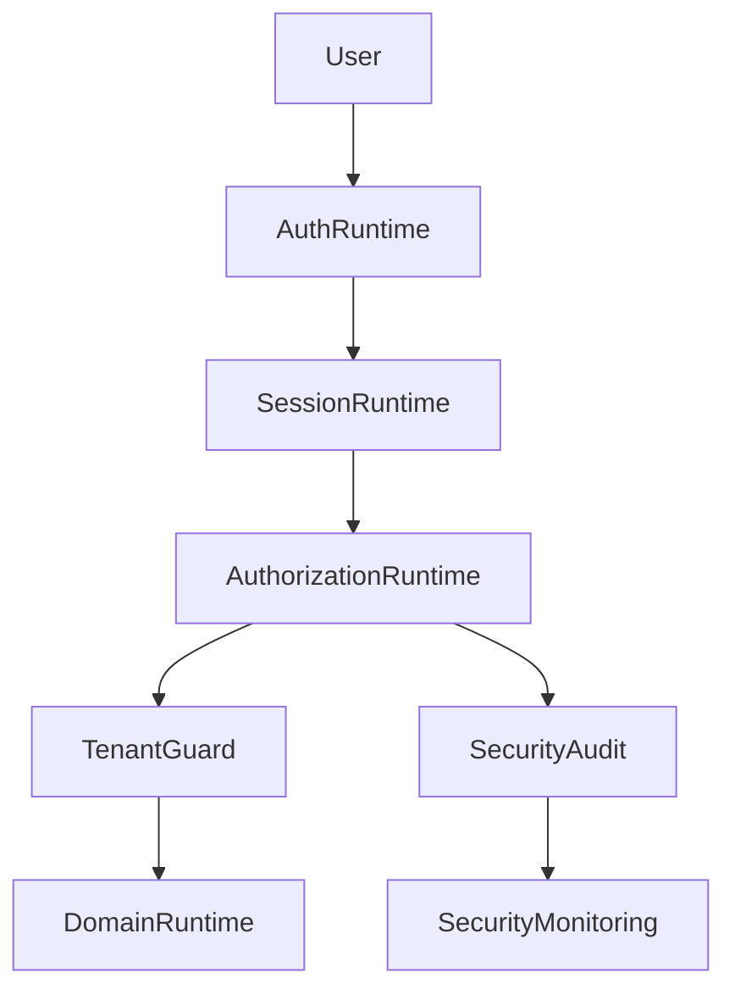

# TA-05 Security & Identity Architecture

**Document ID:** TA-05  
**Document Name:** Security & Identity Architecture  
**Company:** OreeOn Technologies Pvt. Ltd.  
**Product:** Digitize  
**Document Type:** Technical Architecture  
**Version:** 1.0  
**Status:** Frozen  
**Owner:** Security Architecture  
**Prepared By:** Architecture Team  
**Last Updated:** July 25, 2026  
**Architecture Review:** Passed
**Approved ADRs:** ADR-039
**Frozen Date:** 2026-07-25
**Freeze Approver:** Architecture Lead (to replace placeholder with actual approver name)

---

# Revision History

| Version | Date | Author | Description |
|---|---|---|---|
| 0.1 | July 2026 | Architecture Team | Initial design draft |

---

# 1. Introduction

## 1.1 Purpose

This document defines the Security & Identity Architecture for Digitize. It establishes the architecture for authentication, authorization, RBAC, tenant isolation, scoped access, session control, password policy, MFA readiness, sensitive data protection, security monitoring, and auditability.

## 1.2 Objectives

- Define security and identity architecture for a multi-tenant SaaS platform.
- Protect tenant, customer, staff, commercial, and audit data.
- Establish role-based and scope-aware authorization.
- Support platform, organization, facility, site, staff, support, and customer personas.
- Provide security traceability to BA-02, BA-09, BA-10, FR-06, and FR-21.

## 1.3 Scope

This document covers authentication, authorization, RBAC, permissions, tenant isolation, sessions, password policies, MFA readiness, privileged access, support access, audit logging, security events, sensitive data protection, and security observability.

## 1.4 Out of Scope

Security tooling selection, identity provider vendor selection, cryptographic implementation details, penetration test scripts, SOC process design, and infrastructure firewall configuration are outside this document.

## 1.5 Intended Audience

Security Engineers, Solution Architects, Technical Architects, Backend Engineers, Frontend Engineers, QA Engineers, DevOps Engineers, Support Teams, Compliance Stakeholders, and Product Management.

## 1.6 Related Documents

| Document Type | Document Reference | Relationship |
|---|---|---|
| Product Foundation | PF-01, PF-02 | Role, hierarchy, and terminology context |
| Commercial Strategy | CS-01, CS-03 | Subscription, license, and payment security context |
| Business Analysis | BA-02, BA-09, BA-10 | Security rules, NFRs, risks, and assumptions |
| Functional Requirements | FR-06, FR-16, FR-21 | User roles, license validation, and audit compliance |
| UI / UX Design | UX-01 to UX-05 | Secure user interaction alignment |
| API Specification | TA-04 | Interface security alignment |
| Database Design | TA-03 | Data protection and tenant isolation alignment |
| Deployment | TA-06 | Runtime security alignment |
| Decision Record | TA-10 | Security ADR traceability |

---

# 2. Architecture Viewpoints

| Viewpoint | Purpose | Primary Stakeholders | Architecture Concerns |
|---|---|---|---|
| Business View | Protect business operations and tenant trust | Leadership, Product, BA | Access governance and compliance |
| Application View | Define identity and authorization components | Architects, Engineers | RBAC, sessions, scoped access |
| Data View | Protect sensitive data | Database Architects, Security | Masking, encryption, retention |
| Integration View | Secure external interactions | Integration, Security | Callback verification and credentials |
| Security View | Define security controls | Security, QA | Authentication, authorization, tenant isolation |
| Deployment View | Secure runtime environments | DevOps, Security | Secrets, environment isolation, release controls |
| Operational View | Monitor and respond to security events | Support, Security, DevOps | Alerts, audit, incident signals |

---

# 3. Architecture Context

## 3.1 Business Context

Digitize serves multiple organizations and stores sensitive customer, staff, operational, financial, communication, support, and audit data. Trust depends on strict tenant isolation and controlled access.

## 3.2 Product Context

Security must support platform administrators, organization administrators, facility managers, site administrators, reception staff, trainers, finance staff, marketing staff, support executives, customers, and future external users.

## 3.3 Technical Context

Security shall be enforced through authenticated identities, scoped permissions, tenant context, session policies, secure service interfaces, sensitive data protection, audit logging, and security monitoring.

## 3.4 Operational Context

Security operations require visibility into login failures, unauthorized access, tenant mismatch attempts, privilege changes, suspicious activity, provider verification failures, and audit exports.

---

# 4. Architecture Goals

| Goal ID | Goal | Rationale | Success Indicator |
|---|---|---|---|
| TA-05-GOAL-001 | Enforce secure authentication | Protected access requires verified identity | All protected flows require authenticated context |
| TA-05-GOAL-002 | Enforce role-based authorization | Users must access only permitted capabilities | RBAC and scoped access are enforced |
| TA-05-GOAL-003 | Preserve tenant isolation | Multi-tenancy requires strong data boundaries | Tenant mismatch attempts are blocked and audited |
| TA-05-GOAL-004 | Protect sensitive data | Customer, staff, and financial data require protection | Masking, encryption, and restricted access are applied |
| TA-05-GOAL-005 | Provide auditability | Security-sensitive actions require traceability | Security events are logged and monitored |

---

# 5. Architecture Principles Applied

| Principle ID | Principle | Application in This Document | Related ADR |
|---|---|---|---|
| TA-PRN-001 | Multi-tenancy by default | Tenant isolation is a security enforcement requirement | ADR-001 |
| TA-PRN-003 | Security by design | Security controls are built into identity, access, data, and integration boundaries | ADR-004 |
| TA-PRN-005 | Interface-first integration | Interfaces enforce authentication and authorization | ADR-006 |
| TA-PRN-007 | Operational readiness | Security events are observable and actionable | ADR-009 |
| TA-PRN-008 | Traceability | Privileged and sensitive actions produce audit records | ADR-015 |

---

# 6. Architecture Scope Model

## 6.1 In-Scope Capabilities

- Authentication.
- Authorization.
- RBAC.
- Permission evaluation.
- Tenant isolation.
- Session management.
- Password policy.
- MFA readiness.
- Privileged action control.
- Support access governance.
- Sensitive data protection.
- Security events and monitoring.

## 6.2 Out-of-Scope Capabilities

- Identity provider vendor selection.
- Cryptographic implementation details.
- Penetration testing scripts.
- Network firewall implementation.
- SOC runbook details.

## 6.3 Capability Map

## 6.4 Context Diagram

## 6.5 Boundary Diagram

---

# 7. Logical Architecture

## 7.1 Architecture Domains

| Domain ID | Architecture Domain | Purpose | Responsibility |
|---|---|---|---|
| TA-05-DOM-001 | Authentication Domain | Verify identity | Login, logout, password reset, session initiation |
| TA-05-DOM-002 | Authorization Domain | Evaluate access | RBAC, permissions, scope, feature access |
| TA-05-DOM-003 | Tenant Security Domain | Enforce tenant boundaries | Tenant context validation and tenant isolation |
| TA-05-DOM-004 | Session Security Domain | Control authenticated session lifecycle | Session validity, expiry, revocation, policy enforcement |
| TA-05-DOM-005 | Data Protection Domain | Protect sensitive information | Masking, encryption alignment, restricted exports |
| TA-05-DOM-006 | Security Monitoring Domain | Detect and surface security events | Alerts, logs, suspicious activity indicators |
| TA-05-DOM-007 | Audit and Compliance Domain | Preserve evidence | Security audit events and investigation trail |

## 7.2 Logical Relationships

Authentication establishes identity. Authorization evaluates what the identity may do within tenant, facility, and site scope. Tenant security validates that requested data and actions belong to authorized scope.

Security enforcement shall occur before domain execution. Domain services shall not bypass identity, permission, tenant context, or audit controls.

Privileged access and support access shall be explicitly scoped, logged, and reviewable.

## 7.3 Logical Architecture Diagram

---

# 8. Component Architecture

## 8.1 Component Summary

| Component ID | Component Name | Type | Owner | Criticality |
|---|---|---|---|---|
| TA-05-CMP-001 | Authentication Component | Service | Security Engineering | Critical |
| TA-05-CMP-002 | Session Management Component | Service | Security Engineering | Critical |
| TA-05-CMP-003 | RBAC Component | Service | Security Engineering | Critical |
| TA-05-CMP-004 | Permission Evaluation Component | Service | Security Engineering | Critical |
| TA-05-CMP-005 | Tenant Isolation Guard | Service | Platform / Security Engineering | Critical |
| TA-05-CMP-006 | Sensitive Data Protection Component | Service | Security / Data Architecture | Critical |
| TA-05-CMP-007 | Privileged Access Control Component | Service | Security Engineering | High |
| TA-05-CMP-008 | Security Event Monitor | Service | Security / DevOps | High |
| TA-05-CMP-009 | Security Audit Component | Service | Compliance / Security | Critical |

## 8.2 Component Details

### Component ID

TA-05-CMP-001 to TA-05-CMP-009.

### Component Name

Security and identity components listed in Section 8.1.

### Purpose

The components protect Digitize identities, sessions, permissions, tenant boundaries, sensitive data, privileged actions, and security event traceability.

### Responsibilities

- Authenticate users and trusted services.
- Maintain session security.
- Evaluate RBAC and permissions.
- Enforce tenant scope.
- Protect sensitive data.
- Monitor security events.
- Preserve security audit evidence.

### Provided Capabilities

Authentication, session validation, role assignment, permission evaluation, tenant isolation, sensitive data masking, privileged access review, security alerts, and audit capture.

### Consumed Capabilities

Tenant hierarchy, staff accounts, role definitions, platform policies, license state, feature flags, audit store, and observability services.

### Data Ownership

Security components own identity metadata, roles, permissions, session metadata, security event records, and security audit records. Customer, commercial, and operational data remain owned by their domain services.

### Interfaces

| Interface | Direction | Interface Type | Authentication / Trust Model | Purpose |
|---|---|---|---|---|
| Authentication Interface | Inbound | Security service interface | User credential trust | Verify identity |
| Authorization Interface | Internal | Security service interface | Trusted service context | Evaluate access |
| Tenant Validation Interface | Internal | Security service interface | Tenant-aware service trust | Enforce tenant isolation |
| Security Event Interface | Internal | Event interface | Trusted internal event | Publish security events |

### Dependencies

Dependencies include tenant management, staff account data, role and permission data, platform security policies, audit store, observability platform, and provider callback verification rules.

### Failure Modes

Failure modes include invalid credentials, expired session, permission denial, tenant mismatch, privilege escalation attempt, weak password, callback verification failure, audit capture failure, and suspicious access pattern.

### Security Controls

Controls include authentication, password policy, session expiry, RBAC, least privilege, tenant scope validation, sensitive data masking, MFA readiness, secure audit logging, and privileged action review.

### Audit and Logging

Security actions shall log actor, tenant, role, permission, scope, event type, outcome, timestamp, and correlation identifier.

### Monitoring

Monitor login failures, access denials, tenant mismatches, session anomalies, permission changes, privileged actions, callback failures, and audit export activity.

### Scalability Considerations

Authentication and authorization checks must scale with platform usage and avoid becoming a bottleneck for operational workflows.

### Notes

Security architecture shall remain aligned with BA-02 security rules and BA-09 security requirements.

---

# 9. Data Architecture

## 9.1 Data Ownership

| Data Entity / Data Group | Owner Component | Purpose | Classification | Retention Class |
|---|---|---|---|---|
| Staff Account | Authentication Component | Identify platform and tenant users | Sensitive identity data | Active plus security history |
| Session Metadata | Session Management Component | Control authenticated sessions | Sensitive security data | Session retention |
| Role | RBAC Component | Define access grouping | Security configuration | Active plus change history |
| Permission | Permission Evaluation Component | Define capability access | Security configuration | Active plus change history |
| Tenant Scope | Tenant Isolation Guard | Restrict access by organization, facility, and site | Tenant security data | Active plus audit history |
| Security Event | Security Event Monitor | Track security-relevant activity | Security log data | Security retention |
| Security Audit Record | Security Audit Component | Preserve evidence | Audit and compliance data | Compliance retention |

## 9.2 Data Flow

User identity is authenticated, session metadata is established, permissions are evaluated against tenant scope, domain access is permitted or denied, and security-relevant outcomes are sent to audit and monitoring.

## 9.3 Data Consistency

Permission assignments, role changes, session revocations, tenant scope changes, and privileged access updates require strong consistency. Security analytics may be eventually consistent.

## 9.4 Data Retention

Security events and audit records shall be retained according to security and compliance retention policies. Session data shall follow session retention rules.

## 9.5 Data Architecture Diagram

---

# 10. Service Interface and Integration Architecture

## 10.1 Service Interface Summary

| Interface Area | Interface Type | Trust Model | Producer | Consumer | Purpose |
|---|---|---|---|---|---|
| Authentication Interface | Security service interface | User credential trust | Authentication Component | Application Access Layer | Verify user identity |
| Authorization Interface | Security service interface | Trusted service trust | Authorization Components | Domain Services | Evaluate access |
| Tenant Scope Interface | Security service interface | Tenant-aware trust | Tenant Isolation Guard | Domain and Reporting Services | Enforce tenant boundaries |
| Security Event Interface | Event interface | Trusted internal event | Security Components | Audit and Monitoring | Publish security events |

## 10.2 Event Summary

| Event | Producer | Consumer | Purpose | Delivery Pattern |
|---|---|---|---|---|
| LoginSucceeded | Authentication Component | Audit, Monitoring | Record successful login | Security event |
| LoginFailed | Authentication Component | Audit, Monitoring | Detect authentication failure | Security event |
| AccessDenied | Authorization Component | Audit, Monitoring | Track unauthorized attempt | Security event |
| TenantMismatchDetected | Tenant Isolation Guard | Audit, Security Monitoring | Detect isolation violation attempt | Critical security event |
| PermissionChanged | RBAC Component | Audit, Monitoring | Track access change | Audit event |

## 10.3 Asynchronous Processing

| Process | Schedule / Trigger | Purpose | Failure Handling |
|---|---|---|---|
| Security Event Processing | Security event | Persist and evaluate security signals | Retry and alert |
| Suspicious Activity Evaluation | Security threshold | Detect abnormal behavior | Security alert |
| Session Cleanup | Scheduled | Remove expired sessions | Retry and log |

## 10.4 External Interfaces

| External System | Interface Type | Purpose | Failure Handling |
|---|---|---|---|
| Future Identity Provider | Authentication interface | Future external identity support | Fail closed |
| Payment Gateway Callback | Provider callback | Verify payment-related callback trust | Reject invalid callback |

---

# 11. Security Architecture

## 11.1 Authentication

Authentication shall validate user identity before any protected action. The architecture shall support password policy, credential reset, session issuance, session expiry, and MFA readiness.

## 11.2 Authorization

Authorization shall evaluate role, permission, tenant scope, facility scope, site scope, feature entitlement, license state, and action sensitivity.

## 11.3 Tenant Isolation

Tenant isolation is mandatory across access, domain, data, reporting, support, and audit functions. Cross-tenant administrative access shall be explicitly permissioned and audited.

## 11.4 Data Protection

Sensitive data shall be encrypted in transit, protected at rest where applicable, masked in UI and logs, restricted in exports, and accessed only by authorized roles.

## 11.5 Security Events

Security events include login success, login failure, access denial, tenant mismatch, permission change, role assignment, password reset, session expiry, suspicious activity, provider verification failure, and audit export.

---

# 12. Multi-Tenancy Considerations

| Consideration | Architecture Approach |
|---|---|
| Tenant Identification | Tenant context is derived from authenticated identity and authorized scope |
| Tenant Isolation | Tenant access is enforced before domain data access |
| Tenant Configuration | Tenant security policies may extend platform defaults |
| Tenant Data Access | Role and permission checks are evaluated with tenant, facility, and site scope |
| Tenant-Level Feature Access | Feature access uses subscription and license context |
| Tenant-Level Auditability | Security events capture tenant and scope |

---

# 13. Configuration and Extensibility

## 13.1 Configuration Parameters

| Parameter | Scope | Purpose | Default | Owner |
|---|---|---|---|---|
| Password Policy | Platform / Organization | Control credential rules | Platform baseline | Security Owner |
| Session Policy | Platform / Organization | Control session expiry | Platform baseline | Security Owner |
| MFA Policy | Platform / Organization | Enable future MFA | Disabled until approved | Security Owner |
| Support Access Policy | Platform | Control support user access | Restricted | Platform Administrator |

## 13.2 Feature Toggles

| Feature Toggle | Scope | Purpose | Default State |
|---|---|---|---|
| Multi-Factor Authentication | Platform / Organization | Enable MFA | Disabled |
| External Identity Provider | Platform / Organization | Enable future SSO | Disabled |
| Advanced Security Monitoring | Platform | Enable enhanced detection | Planned |

## 13.3 Extension Points

Extension points include MFA, SSO, external identity providers, customer identity, device trust, advanced security analytics, delegated administration, and jurisdiction-specific privacy controls.

---

# 14. Quality Attribute Scenarios

| Quality Attribute | Scenario | Architecture Response | Validation Approach |
|---|---|---|---|
| Availability | Users require secure access during business hours | Identity services are critical and monitored | Availability testing |
| Scalability | Many tenants authenticate concurrently | Authentication and authorization scale horizontally | Load testing |
| Security | User attempts cross-tenant access | Tenant guard blocks and audits action | Tenant isolation testing |
| Performance | Permission check occurs on every protected action | Efficient permission evaluation | Performance testing |
| Reliability | Session expires during workflow | User is safely redirected and state is protected | Session tests |
| Maintainability | New role is introduced | RBAC model supports role expansion | Security review |
| Recoverability | Security event store is temporarily unavailable | Critical security events are preserved or fail closed | Failure testing |

---

# 15. Performance and Scalability

| Area | Expectation | Architecture Approach | Notes |
|---|---|---|---|
| Latency | Permission checks are fast | Centralized and cache-aware evaluation | Detailed later |
| Throughput | Concurrent users authenticate and operate | Scalable identity services | Load tests required |
| Concurrency | Role changes apply consistently | Strong consistency for security changes | Critical |
| Data Volume | Security logs grow safely | Retention and archival | TA-03 alignment |
| Reporting Load | Security reports do not block auth | Separate reporting | TA-07 alignment |

---

# 16. Availability and Resilience

| Scenario | Architecture Response | Recovery Consideration |
|---|---|---|
| Component unavailable | Fail closed for protected actions | Alert and restore |
| External provider failure | External identity fails safely if introduced | Fallback policy |
| Database failure | Prevent unsafe access | Restore |
| Deployment failure | Roll back security changes | Deployment gates |

---

# 17. Observability, Logging, and Auditability

## 17.1 Logs

Security logs shall capture authentication, authorization, tenant validation, session, provider verification, and privileged access events.

## 17.2 Metrics

Metrics include login attempts, failed logins, access denials, permission changes, tenant mismatch events, session expiry, and suspicious activity indicators.

## 17.3 Traces

Security traces shall connect access requests to authentication, authorization, tenant validation, domain access, and audit outcomes.

## 17.4 Audit Events

| Audit Event | Trigger | Actor | Data Captured | Retention |
|---|---|---|---|---|
| LoginAttempted | Login attempt | User | User reference, result, timestamp | Security retention |
| PermissionChanged | Permission update | Administrator | Role, permission, scope, actor | Audit retention |
| TenantAccessDenied | Tenant mismatch | User or service | Tenant, scope, actor, reason | Security retention |
| PrivilegedActionPerformed | Sensitive action | Authorized user | Action, scope, actor, timestamp | Compliance retention |

## 17.5 Alerts

| Alert | Condition | Severity | Recipient |
|---|---|---|---|
| Login Failure Spike | Failed login threshold exceeded | High | Security |
| Tenant Isolation Attempt | Tenant mismatch detected | Critical | Security / Platform |
| Privileged Access Spike | Sensitive actions exceed threshold | High | Security |
| Audit Capture Failure | Security audit cannot persist | Critical | Security / DevOps |

---

# 18. Deployment and Runtime Architecture

## 18.1 Runtime Components

Runtime components include authentication runtime, authorization runtime, permission evaluation runtime, tenant isolation guard, session store, security event processor, security audit store, and monitoring dashboard.

## 18.2 Environment Considerations

Security policies, credentials, secrets, and provider configurations shall be environment-specific and protected.

## 18.3 Deployment Considerations

Security deployments require rollback planning, policy validation, permission migration checks, regression testing, and audit verification.

## 18.4 Runtime Diagram

---

# 19. Integration Considerations

| Integration | Purpose | Pattern | Failure Handling | Owner |
|---|---|---|---|---|
| Application Access Layer | Enforce access | Security service interface | Fail closed | Security Engineering |
| Tenant Management | Resolve scope | Tenant context interface | Deny unresolved scope | Platform Engineering |
| Provider Callbacks | Verify external trust | Callback verification | Reject invalid callback | Integration / Security |
| Audit Services | Preserve evidence | Security event interface | Alert on failure | Compliance / Security |

---

# 20. Architecture Decisions

| Decision ID | Architecture Principle | Decision | Alternatives Considered | Rationale | Consequences | Status | Related ADR |
|---|---|---|---|---|---|---|---|
| ADR-020 | Security by design | RBAC and tenant scope shall be enforced before domain execution | UI-only access control | Prevents unauthorized data and capability access | Requires shared authorization service | Proposed | TA-10 |
| ADR-021 | Multi-tenancy by default | Tenant isolation guard shall apply to all tenant-scoped access | Domain-specific tenant checks only | Reduces inconsistency and leakage risk | Requires tenant context propagation | Proposed | TA-10 |
| ADR-022 | Traceability | Privileged security actions shall always be audited | Audit only failed actions | Supports compliance and investigation | Requires reliable audit capture | Proposed | TA-10 |

---

# 21. Assumptions, Constraints, and Risks

## 21.1 Assumptions

| Assumption ID | Assumption | Impact | Source |
|---|---|---|---|
| BA-ASS-004 | Operational workflows require role-based separation | RBAC is mandatory | BA-10 |
| BA-ASS-007 | Multi-tenant architecture will be used | Tenant isolation is mandatory | BA-10 |

## 21.2 Constraints

| Constraint ID | Constraint | Impact | Source |
|---|---|---|---|
| BA-CON-006 | SaaS architecture dependency | Security must support SaaS runtime | BA-10 |

## 21.3 Risks

| Risk ID | Risk | Impact | Likelihood | Mitigation |
|---|---|---|---|---|
| BA-RSK-009 | Unauthorized access to sensitive data | High | Medium | RBAC, tenant isolation, masking, audit |
| BA-RSK-010 | Weak credential or session controls | High | Medium | Password and session policy, MFA readiness |
| BA-RSK-005 | Multi-tenant data isolation failure | Critical | Low | Tenant isolation guard and audit |

---

# 22. Traceability Matrix

| Architecture Area | Business Process | Functional Requirement | Service Interface / API Area | Data Entity / Data Group | UI Area | Test Area | Notes |
|---|---|---|---|---|---|---|---|
| Authentication | User & Role Management | FR-06 | Authentication Interface | Staff Account, Session Metadata | Login and User Management | Authentication tests | Identity baseline |
| Authorization | User & Role Management | FR-06 | Authorization Interface | Role, Permission | User & Role Management | RBAC tests | Permission enforcement |
| Tenant Isolation | All tenant-scoped processes | FR-02 to FR-21 | Tenant Scope Interface | Tenant Scope Data | All tenant UI areas | Tenant isolation tests | Critical SaaS control |
| License Access | License Management | FR-16 | Authorization / License Interface | License, Entitlement | License UI | Entitlement tests | Commercial access |
| Audit Security | Audit & Compliance | FR-21 | Security Event Interface | Security Audit Record | Audit Logs | Audit tests | Compliance traceability |

---

# 23. Architecture Diagrams

| Diagram ID | Diagram Name | Diagram Type | Location |
|---|---|---|---|
| TA-05-DGM-001 | Security Capability Map | Capability Map | Section 6.3 |
| TA-05-DGM-002 | Security Context Diagram | Context Diagram | Section 6.4 |
| TA-05-DGM-003 | Security Boundary Diagram | Boundary Diagram | Section 6.5 |
| TA-05-DGM-004 | Logical Security Diagram | Logical Diagram | Section 7.3 |
| TA-05-DGM-005 | Security Data Flow Diagram | Data Flow Diagram | Section 9.5 |
| TA-05-DGM-006 | Security Runtime Diagram | Runtime Diagram | Section 18.4 |

---

# 24. Architecture Review Checklist

| Review Area | Status | Notes |
|---|---|---|
| Business alignment | Pending | Review required |
| Functional requirement alignment | Pending | Review required |
| Multi-tenancy readiness | Pending | Review required |
| Security readiness | Pending | Review required |
| Data architecture readiness | Pending | Review required |
| API readiness | Pending | Review required |
| Integration readiness | Pending | Review required |
| Scalability readiness | Pending | Review required |
| Availability readiness | Pending | Review required |
| Observability readiness | Pending | Review required |
| Auditability readiness | Pending | Review required |
| DevOps readiness | Pending | Review required |
| QA readiness | Pending | Review required |
| Support readiness | Pending | Review required |

---

# 25. Open Questions

| Question ID | Question | Owner | Target Resolution | Status |
|---|---|---|---|---|
| TA-05-QST-001 | Will the first production release use an external identity provider or internal authentication service? | Security Architecture | Before TA-05 Review | Open |
| TA-05-QST-002 | Which MFA policy applies to platform administrators at launch? | Security / Product | Before TA-05 Freeze | Open |

---

## 25.1 Proposed Options (proposals — require explicit approval)

1. Identity provider — Decision (approved: ADR-039)
    - Decision: Use AWS Cognito as the initial external IdP (OIDC) for user authentication, with SCIM-compatible provisioning for admin/staff accounts where required. Rationale: integrated AWS service, reduces operational footprint, and aligns with the selected AWS infrastructure. Map claims and roles during TA-05 implementation.

2. MFA policy for platform administrators — Decision (approved: ADR-039)
    - Decision: Enforce MFA (TOTP or U2F) for all platform administrator accounts and require MFA for elevated and production-console access. Rationale: reduces risk of privileged account compromise and meets baseline security posture for initial launch.

All proposals are to be approved by Security and Product before being recorded as ADRs.

# 26. Summary

TA-05 defines the Digitize Security & Identity Architecture baseline for authentication, authorization, RBAC, tenant isolation, session governance, sensitive data protection, privileged access, security events, and auditability.
