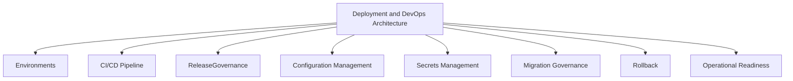
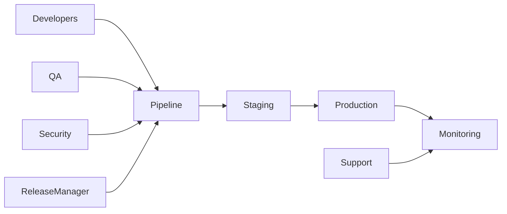
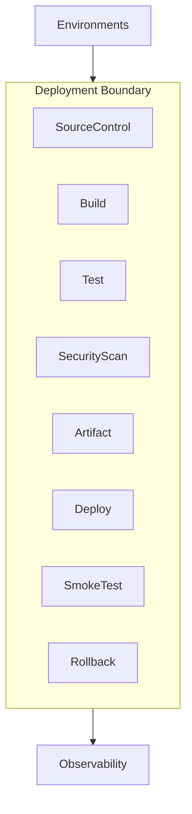
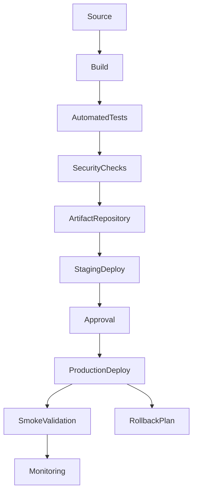
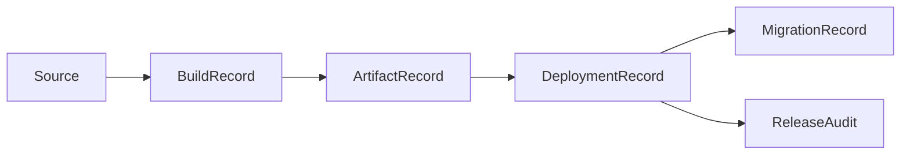
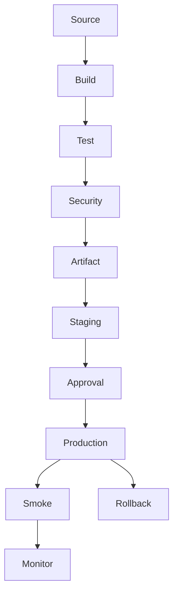

# TA-06 Deployment & DevOps Architecture

**Document ID:** TA-06  
**Document Name:** Deployment & DevOps Architecture  
**Company:** OreeOn Technologies Pvt. Ltd.  
**Product:** Digitize  
**Document Type:** Technical Architecture  
**Version:** 1.0  
**Status:** Frozen  
**Owner:** DevOps Architecture  
**Prepared By:** Architecture Team  
**Last Updated:** July 25, 2026  
**Architecture Review:** Passed
**Approved ADRs:** ADR-037, ADR-046
**Frozen Date:** 2026-07-25
**Freeze Approver:** Architecture Lead (to replace placeholder with actual approver name)

---

# Revision History

| Version | Date | Author | Description |
|---|---|---|---|
| 0.1 | July 2026 | Architecture Team | Initial design draft |

---

# 1. Introduction

## 1.1 Purpose

This document defines the Deployment & DevOps Architecture for Digitize. It establishes environment strategy, deployment topology, release governance, CI/CD principles, rollback approach, runtime configuration, infrastructure readiness, operational controls, and production deployment expectations.

## 1.2 Objectives

- Define deployment and DevOps architecture for a multi-tenant SaaS platform.
- Support controlled releases across development, test, staging, and production environments.
- Establish release quality gates, rollback readiness, migration governance, and operational validation.
- Align deployment architecture with security, observability, data recovery, and business continuity requirements.

## 1.3 Scope

This document covers deployment environments, runtime components, CI/CD architecture, release controls, configuration management, secrets management, migration governance, rollback strategy, operational readiness, backup alignment, and deployment traceability.

## 1.4 Out of Scope

Cloud vendor selection, infrastructure-as-code implementation, exact compute sizing, build scripts, source code, and vendor-specific managed service configuration are outside this document.

## 1.5 Intended Audience

DevOps Engineers, SRE, Solution Architects, Technical Architects, Backend Engineers, Frontend Engineers, QA Engineers, Security Engineers, Release Managers, Support Teams, and Product Management.

## 1.6 Related Documents

| Document Type | Document Reference | Relationship |
|---|---|---|
| Product Foundation | PF-03 | Product scale and SaaS direction |
| Commercial Strategy | CS-01, CS-03 | Commercial availability and release implications |
| Business Analysis | BA-09, BA-10 | NFRs, assumptions, constraints, and risks |
| Functional Requirements | FR-02 to FR-21 | Functional scope deployed through release pipeline |
| UI / UX Design | UX-01 to UX-05 | Frontend release alignment |
| API Specification | TA-04 | API deployment and compatibility alignment |
| Database Design | TA-03 | Migration, backup, restore, and data deployment alignment |
| Deployment | Deployment Artifacts | Downstream deployment execution details |
| Decision Record | TA-10 | Deployment ADR traceability |

---

# 2. Architecture Viewpoints

| Viewpoint | Purpose | Primary Stakeholders | Architecture Concerns |
|---|---|---|---|
| Business View | Protect business continuity during releases | Leadership, Product, Support | Release windows, downtime, rollback |
| Application View | Deploy application components safely | Engineers, Architects | Runtime units, compatibility, dependencies |
| Data View | Govern schema and data changes | Database Architects, DevOps | Migrations, backup, restore |
| Integration View | Coordinate provider-dependent releases | Integration Engineers | Provider configuration and smoke tests |
| Security View | Protect deployment and secrets | Security, DevOps | Secrets, environment access, production controls |
| Deployment View | Define release topology | DevOps, SRE | CI/CD, environments, rollout, rollback |
| Operational View | Validate production readiness | Support, DevOps | Monitoring, alerts, incidents |

---

# 3. Architecture Context

## 3.1 Business Context

Digitize supports business-critical daily operations including attendance, billing, payments, memberships, notifications, reporting, and support. Deployments must protect business continuity and avoid unplanned disruption for tenant organizations.

## 3.2 Product Context

The deployment architecture shall support incremental delivery of platform, operational, commercial, communication, analytics, support, and audit capabilities across phased releases.

## 3.3 Technical Context

The platform shall use controlled environment separation, automated build and deployment gates, versioned releases, runtime configuration, secure secrets handling, database migration governance, and production validation.

## 3.4 Operational Context

Operations teams require clear deployment status, rollback readiness, monitoring, release notes, change logs, incident response triggers, and support communication during releases.

---

# 4. Architecture Goals

| Goal ID | Goal | Rationale | Success Indicator |
|---|---|---|---|
| TA-06-GOAL-001 | Establish controlled deployment pipeline | SaaS releases require repeatable quality gates | Releases pass build, test, security, and smoke checks |
| TA-06-GOAL-002 | Protect production continuity | Organizations depend on Digitize during operating hours | Maintenance and rollback controls are defined |
| TA-06-GOAL-003 | Separate environments | Development and production data must remain isolated | Environment-specific configuration and access controls exist |
| TA-06-GOAL-004 | Govern database migrations | Data changes are high risk in SaaS | Migration review and rollback planning are mandatory |
| TA-06-GOAL-005 | Enable operational readiness | Support teams need release visibility | Release status, monitoring, and deployment audit are available |

---

# 5. Architecture Principles Applied

| Principle ID | Principle | Application in This Document | Related ADR |
|---|---|---|---|
| TA-PRN-003 | Security by design | Deployment access, secrets, and environment controls are restricted | ADR-004 |
| TA-PRN-007 | Operational readiness | Releases include monitoring, smoke checks, rollback, and support readiness | ADR-009 |
| TA-PRN-008 | Traceability | Deployments produce release, migration, and operational audit history | ADR-015 |
| TA-PRN-002 | Configuration over customization | Environment behavior is controlled through configuration and feature flags | ADR-002 |

---

# 6. Architecture Scope Model

## 6.1 In-Scope Capabilities

- Environment architecture.
- CI/CD pipeline.
- Release governance.
- Configuration and secrets management.
- Database migration governance.
- Deployment validation.
- Rollback planning.
- Operational readiness and release audit.

## 6.2 Out-of-Scope Capabilities

- Cloud provider-specific implementation.
- Infrastructure provisioning scripts.
- Exact capacity sizing.
- Source repository branching rules beyond architecture guidance.
- Detailed incident runbooks.

## 6.3 Capability Map

## 6.4 Context Diagram

## 6.5 Boundary Diagram

---

# 7. Logical Architecture

## 7.1 Architecture Domains

| Domain ID | Architecture Domain | Purpose | Responsibility |
|---|---|---|---|
| TA-06-DOM-001 | Environment Domain | Separate development, test, staging, production, and future DR | Environment isolation and configuration |
| TA-06-DOM-002 | Pipeline Domain | Automate build, test, scan, package, and deploy | CI/CD governance |
| TA-06-DOM-003 | Release Governance Domain | Control release approval and rollout | Quality gates and release audit |
| TA-06-DOM-004 | Configuration Domain | Manage runtime configuration | Environment-safe configuration and feature flags |
| TA-06-DOM-005 | Migration Domain | Govern schema and data changes | Migration sequencing and rollback readiness |
| TA-06-DOM-006 | Runtime Operations Domain | Monitor deployed runtime | Health checks, smoke tests, incident signals |

## 7.2 Logical Relationships

Source-controlled changes flow through build, test, security validation, artifact creation, staging deployment, release approval, production deployment, smoke validation, and monitoring.

Production deployment shall not bypass quality gates. Runtime configuration shall remain environment-specific. Database migrations shall be reviewed and executed as controlled release steps.

## 7.3 Logical Architecture Diagram

---

# 8. Component Architecture

## 8.1 Component Summary

| Component ID | Component Name | Type | Owner | Criticality |
|---|---|---|---|---|
| TA-06-CMP-001 | Source Control System | External System | Engineering | Critical |
| TA-06-CMP-002 | Build Pipeline | Job | DevOps | Critical |
| TA-06-CMP-003 | Test Pipeline | Job | QA / DevOps | Critical |
| TA-06-CMP-004 | Security Validation Pipeline | Job | Security / DevOps | Critical |
| TA-06-CMP-005 | Artifact Repository | External System | DevOps | High |
| TA-06-CMP-006 | Deployment Orchestrator | Service | DevOps | Critical |
| TA-06-CMP-007 | Configuration Store | Service | DevOps / Platform | Critical |
| TA-06-CMP-008 | Secrets Store | Service | Security / DevOps | Critical |
| TA-06-CMP-009 | Migration Controller | Job | Database Architecture / DevOps | Critical |
| TA-06-CMP-010 | Release Monitor | Service | DevOps / SRE | High |

## 8.2 Component Details

### Component ID

TA-06-CMP-001 to TA-06-CMP-010.

### Component Name

Deployment and DevOps components listed in Section 8.1.

### Purpose

These components provide a controlled, secure, auditable, and repeatable release path for Digitize.

### Responsibilities

- Build deployable artifacts.
- Run quality and security gates.
- Manage environment-specific configuration.
- Protect secrets.
- Govern deployments and migrations.
- Validate production readiness.
- Support rollback and release auditability.

### Provided Capabilities

Build automation, test automation, security validation, artifact management, deployment orchestration, migration control, release monitoring, and rollback coordination.

### Consumed Capabilities

Source code, functional tests, security policies, environment configuration, secrets, migration scripts, observability services, and release approvals.

### Data Ownership

Deployment components own build metadata, release metadata, deployment logs, environment configuration references, migration execution records, and release audit history.

### Interfaces

| Interface | Direction | Interface Type | Authentication / Trust Model | Purpose |
|---|---|---|---|---|
| Source Interface | Inbound | Repository interface | Engineering trust | Trigger build |
| Artifact Interface | Internal | Artifact promotion interface | DevOps trust | Promote releases |
| Deployment Interface | Internal | Environment deployment interface | Restricted DevOps trust | Deploy runtime components |
| Monitoring Interface | Outbound | Observability interface | Operational trust | Validate deployment health |

### Dependencies

Dependencies include source control, build agents, test suites, security scanners, artifact repositories, configuration store, secrets store, runtime environments, database migration tooling, and monitoring services.

### Failure Modes

Build failure, test failure, security scan failure, artifact corruption, deployment timeout, migration failure, configuration mismatch, secret access failure, smoke test failure, and rollback failure.

### Security Controls

Deployment access shall be restricted. Secrets shall not be embedded in code or logs. Production deployments shall require approved roles and audit trails.

### Audit and Logging

Deployment logs shall capture build ID, artifact version, environment, deployer, approval, migration result, smoke test result, rollback action, and timestamp.

### Monitoring

Monitor build success, test pass rate, deployment duration, failure rate, rollback frequency, migration status, and production health after release.

### Scalability Considerations

Pipeline capacity shall support multiple modules and environments without delaying urgent fixes or controlled releases.

### Notes

Provider-specific deployment implementation is deferred to operational deployment documentation.

---

# 9. Data Architecture

## 9.1 Data Ownership

| Data Entity / Data Group | Owner Component | Purpose | Classification | Retention Class |
|---|---|---|---|---|
| Build Metadata | Build Pipeline | Track build execution | Technical metadata | Release retention |
| Artifact Metadata | Artifact Repository | Track deployable versions | Technical metadata | Release retention |
| Deployment Record | Deployment Orchestrator | Track deployment execution | Operational data | Release audit retention |
| Configuration Record | Configuration Store | Manage environment configuration | Sensitive configuration | Active plus audit history |
| Secret Reference | Secrets Store | Protect credentials and keys | Sensitive security data | Active plus access audit |
| Migration Record | Migration Controller | Track schema/data migrations | Technical audit data | Release retention |

## 9.2 Data Flow

Source changes produce build artifacts. Artifacts move through test, security validation, staging, approval, production deployment, smoke validation, monitoring, and release audit recording.

## 9.3 Data Consistency

Release metadata, artifact versions, configuration references, and migration records must remain consistent across deployment stages.

## 9.4 Data Retention

Deployment records, build history, migration logs, approvals, and rollback events shall be retained for release audit and support diagnostics.

## 9.5 Data Architecture Diagram

---

# 10. Service Interface and Integration Architecture

## 10.1 Service Interface Summary

| Interface Area | Interface Type | Trust Model | Producer | Consumer | Purpose |
|---|---|---|---|---|---|
| Build Interface | Pipeline interface | Engineering trust | Source Control | Build Pipeline | Build artifacts |
| Deployment Interface | Runtime interface | Restricted DevOps trust | Deployment Orchestrator | Runtime Environments | Deploy releases |
| Configuration Interface | Configuration interface | Restricted operational trust | Configuration Store | Runtime Components | Resolve environment configuration |
| Monitoring Interface | Observability interface | Operational trust | Runtime Components | Release Monitor | Validate release health |

## 10.2 Event Summary

| Event | Producer | Consumer | Purpose | Delivery Pattern |
|---|---|---|---|---|
| BuildCompleted | Build Pipeline | Test Pipeline | Start validation | Pipeline event |
| DeploymentCompleted | Deployment Orchestrator | Release Monitor | Validate runtime | Pipeline event |
| MigrationCompleted | Migration Controller | Release Monitor | Track data change | Pipeline event |
| RollbackExecuted | Deployment Orchestrator | Release Audit | Preserve rollback history | Audit event |

## 10.3 Asynchronous Processing

| Process | Schedule / Trigger | Purpose | Failure Handling |
|---|---|---|---|
| Automated Build | Source change | Produce artifact | Stop pipeline |
| Automated Test | Build completion | Validate quality | Stop promotion |
| Security Scan | Build or release candidate | Validate security baseline | Stop promotion |
| Smoke Validation | Deployment completion | Validate runtime health | Rollback or halt |

## 10.4 External Interfaces

| External System | Interface Type | Purpose | Failure Handling |
|---|---|---|---|
| Source Control | Repository interface | Trigger pipeline | Fail pipeline |
| Artifact Repository | Artifact interface | Store release artifacts | Halt deployment |
| Monitoring Platform | Observability interface | Validate runtime | Alert |

---

# 11. Security Architecture

## 11.1 Authentication

Deployment systems require authenticated engineering, DevOps, security, or release manager identity.

## 11.2 Authorization

Production deployment, rollback, secret access, and migration execution require restricted permissions.

## 11.3 Tenant Isolation

Deployment processes shall not mix tenant data across environments. Tenant-specific configuration must remain scoped and controlled.

## 11.4 Data Protection

Secrets, credentials, production configuration, and deployment logs shall be protected from unauthorized access and accidental disclosure.

## 11.5 Security Events

Secret access, production deployment, rollback, migration execution, failed security scan, and unauthorized deployment attempts shall be logged and monitored.

---

# 12. Multi-Tenancy Considerations

| Consideration | Architecture Approach |
|---|---|
| Tenant Identification | Tenant configuration is environment-specific and controlled |
| Tenant Isolation | Production tenant data remains isolated from non-production environments |
| Tenant Configuration | Tenant configuration changes follow deployment and audit controls |
| Tenant Data Access | Deployment processes do not expose tenant data unnecessarily |
| Tenant-Level Feature Access | Feature toggles support tenant-level rollout |
| Tenant-Level Auditability | Tenant-impacting deployments and configuration changes are audited |

---

# 13. Configuration and Extensibility

## 13.1 Configuration Parameters

| Parameter | Scope | Purpose | Default | Owner |
|---|---|---|---|---|
| Environment Configuration | Environment | Control runtime behavior | Environment baseline | DevOps |
| Release Gate Policy | Platform | Control promotion | Required | Release Manager |
| Rollback Policy | Platform | Control rollback readiness | Required | DevOps |
| Migration Policy | Platform | Control data changes | Required | Database Architecture |

## 13.2 Feature Toggles

| Feature Toggle | Scope | Purpose | Default State |
|---|---|---|---|
| Controlled Rollout | Platform / Tenant | Enable phased capability release | Enabled |
| Maintenance Mode | Platform | Restrict access during planned downtime | Disabled |
| Emergency Rollback | Platform | Enable fast rollback workflow | Enabled |

## 13.3 Extension Points

Extension points include additional environments, blue-green deployment, canary deployment, multi-region rollout, automated rollback, policy-as-code, and release analytics.

---

# 14. Quality Attribute Scenarios

| Quality Attribute | Scenario | Architecture Response | Validation Approach |
|---|---|---|---|
| Availability | Release occurs during low-risk window | Maintenance and rollback controls exist | Release rehearsal |
| Scalability | Pipeline handles multiple modules | Artifact and deployment stages are modular | Pipeline load review |
| Security | Unauthorized deployment attempted | Restricted access blocks action | Access control test |
| Performance | Deployment must not degrade runtime | Smoke tests and monitoring validate health | Smoke validation |
| Reliability | Migration fails | Deployment halts or rollback begins | Migration failure test |
| Maintainability | New module added | Pipeline supports modular release | Pipeline review |
| Recoverability | Production release fails | Rollback and restore paths are available | Rollback test |

---

# 15. Performance and Scalability

| Area | Expectation | Architecture Approach | Notes |
|---|---|---|---|
| Latency | Release validation completes predictably | Automated checks | Targets later |
| Throughput | Multiple deployment artifacts supported | Modular pipeline | Scale build agents as needed |
| Concurrency | Parallel work does not corrupt release state | Artifact versioning | Release governance |
| Data Volume | Logs and artifacts retained safely | Retention policy | Storage monitoring |
| Reporting Load | Release reporting is available | Deployment metadata | Operational dashboards |

---

# 16. Availability and Resilience

| Scenario | Architecture Response | Recovery Consideration |
|---|---|---|
| Component unavailable | Deployment halts safely | Retry after recovery |
| External provider failure | Provider smoke tests fail release gate | Retry or defer |
| Database failure | Migration stops safely | Restore |
| Deployment failure | Rollback path is executed | Release audit |

---

# 17. Observability, Logging, and Auditability

## 17.1 Logs

Deployment logs shall capture pipeline stage, artifact, environment, actor, approval, result, duration, and correlation identifier.

## 17.2 Metrics

Metrics include build duration, test pass rate, deployment success, rollback count, migration status, smoke test pass rate, and post-release health.

## 17.3 Traces

Release traces connect source change, build artifact, test execution, approval, deployment, migration, smoke validation, monitoring, and rollback.

## 17.4 Audit Events

| Audit Event | Trigger | Actor | Data Captured | Retention |
|---|---|---|---|---|
| ProductionDeploymentStarted | Deployment begins | Release Manager / DevOps | Version, environment, actor | Release retention |
| ProductionDeploymentCompleted | Deployment completes | System | Version, result, timestamp | Release retention |
| RollbackExecuted | Rollback begins | DevOps | Version, reason, actor | Release retention |
| SecretAccessed | Secret accessed | Authorized user or system | Secret reference, actor, purpose | Security retention |

## 17.5 Alerts

| Alert | Condition | Severity | Recipient |
|---|---|---|---|
| Deployment Failure | Production deployment fails | Critical | DevOps / Release Manager |
| Migration Failure | Migration fails | Critical | DevOps / Database Architecture |
| Smoke Test Failure | Post-release validation fails | High | DevOps / QA |
| Secret Access Anomaly | Unusual secret access | High | Security |

---

# 18. Deployment and Runtime Architecture

## 18.1 Runtime Components

Runtime components include release pipeline, deployment orchestrator, environment runtime, configuration store, secrets store, migration runner, artifact repository, monitoring dashboard, and release audit log.

## 18.2 Environment Considerations

Development, test, staging, production, and future DR environments shall maintain isolated configuration, secrets, data, and access policies.

## 18.3 Deployment Considerations

Deployments shall follow controlled progression from build to test to staging to production with approval gates, migration checks, smoke validation, monitoring, and rollback readiness.

## 18.4 Runtime Diagram

---

# 19. Integration Considerations

| Integration | Purpose | Pattern | Failure Handling | Owner |
|---|---|---|---|---|
| Source Control | Trigger and trace changes | Repository integration | Halt pipeline | Engineering |
| Test Automation | Validate release | Pipeline integration | Stop promotion | QA |
| Security Tooling | Validate security baseline | Pipeline gate | Stop promotion | Security |
| Monitoring | Validate production health | Observability integration | Alert and rollback decision | DevOps |

---

# 20. Architecture Decisions

| Decision ID | Architecture Principle | Decision | Alternatives Considered | Rationale | Consequences | Status | Related ADR |
|---|---|---|---|---|---|---|---|
| ADR-023 | Operational readiness | Production deployment shall require automated quality gates | Manual-only deployment | Reduces release risk | Requires pipeline investment | Proposed | TA-10 |
| ADR-024 | Security by design | Secrets shall be externalized from code and deployment artifacts | Store secrets in configuration files | Reduces credential exposure | Requires secrets management | Proposed | TA-10 |
| ADR-025 | Recoverability | Every production release shall have rollback readiness | Roll forward only | Supports business continuity | Requires rollback validation | Proposed | TA-10 |

---

# 21. Assumptions, Constraints, and Risks

## 21.1 Assumptions

| Assumption ID | Assumption | Impact | Source |
|---|---|---|---|
| BA-ASS-007 | Multi-tenant architecture will be used | Deployment must protect tenant data | BA-10 |
| BA-ASS-012 | Support operations will be required after launch | Deployment must provide operational visibility | BA-10 |

## 21.2 Constraints

| Constraint ID | Constraint | Impact | Source |
|---|---|---|---|
| BA-CON-002 | Phased product delivery | Release pipeline must support incremental delivery | BA-10 |
| BA-CON-006 | SaaS architecture dependency | Deployment must support SaaS environments | BA-10 |

## 21.3 Risks

| Risk ID | Risk | Impact | Likelihood | Mitigation |
|---|---|---|---|---|
| BA-RSK-006 | Performance degradation during peak hours | High | Medium | Post-release monitoring and rollback |
| BA-RSK-007 | Inadequate support readiness | High | Medium | Release notes, monitoring, and support diagnostics |

---

# 22. Traceability Matrix

| Architecture Area | Business Process | Functional Requirement | Service Interface / API Area | Data Entity / Data Group | UI Area | Test Area | Notes |
|---|---|---|---|---|---|---|---|
| Platform Release | Platform Administration | FR-02 | Release Interfaces | Release Metadata | Platform Admin | Release tests | Platform governance |
| Runtime Deployment | All processes | FR-02 to FR-21 | Deployment Interfaces | Deployment Record | All UI areas | Smoke tests | Production readiness |
| Migration Governance | Data-dependent processes | FR-03 to FR-21 | Migration Interface | Migration Record | Admin UI | Migration tests | Data safety |
| Configuration Release | Platform and Tenant Configuration | FR-02 to FR-05 | Configuration Interface | Configuration Record | Admin UI | Configuration tests | Environment isolation |

---

# 23. Architecture Diagrams

| Diagram ID | Diagram Name | Diagram Type | Location |
|---|---|---|---|
| TA-06-DGM-001 | Deployment Capability Map | Capability Map | Section 6.3 |
| TA-06-DGM-002 | Deployment Context Diagram | Context Diagram | Section 6.4 |
| TA-06-DGM-003 | Deployment Boundary Diagram | Boundary Diagram | Section 6.5 |
| TA-06-DGM-004 | Deployment Flow Diagram | Logical Diagram | Section 7.3 |
| TA-06-DGM-005 | Deployment Data Flow Diagram | Data Flow Diagram | Section 9.5 |
| TA-06-DGM-006 | Deployment Runtime Diagram | Runtime Diagram | Section 18.4 |

---

# 24. Architecture Review Checklist

| Review Area | Status | Notes |
|---|---|---|
| Business alignment | Pending | Review required |
| Functional requirement alignment | Pending | Review required |
| Multi-tenancy readiness | Pending | Review required |
| Security readiness | Pending | Review required |
| Data architecture readiness | Pending | Review required |
| API readiness | Pending | Review required |
| Integration readiness | Pending | Review required |
| Scalability readiness | Pending | Review required |
| Availability readiness | Pending | Review required |
| Observability readiness | Pending | Review required |
| Auditability readiness | Pending | Review required |
| DevOps readiness | Pending | Review required |
| QA readiness | Pending | Review required |
| Support readiness | Pending | Review required |

---

# 25. Open Questions

| Question ID | Question | Owner | Target Resolution | Status |
|---|---|---|---|---|
| TA-06-QST-001 | Which cloud provider and deployment platform will be selected? | DevOps / Architecture | Before TA-06 Review | Open |
| TA-06-QST-002 | What release window policy applies to initial launch? | Product / DevOps | Before TA-06 Freeze | Open |

---

## 25.1 Proposed Options (proposals — require explicit approval)

1. Cloud provider and deployment platform — Decision (approved: ADR-037)
    - Decision: Adopt AWS with EKS for orchestration, Terraform for infrastructure-as-code, and GitHub Actions for CI/CD pipelines. Rationale: aligns with cloud selection, broad community support, and fits automation requirements. Implement blue/green or canary deploy patterns and automated smoke tests.

2. Release window policy — Decision (approved: ADR-046)
    - Decision: Use weekday off-peak release windows (local 02:00–04:00) with automated smoke tests, feature-flag gated rollouts, and rollback capability. For initial major releases require manual approval; subsequent patch releases may use automated approvals within defined policies.

These proposals require DevOps and Product approval before inclusion in deployment runbooks.

# 26. Summary

TA-06 defines the Deployment & DevOps Architecture baseline for environments, CI/CD, release governance, configuration, secrets, migrations, rollback, runtime validation, and production operational readiness.
