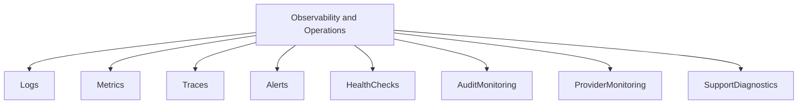
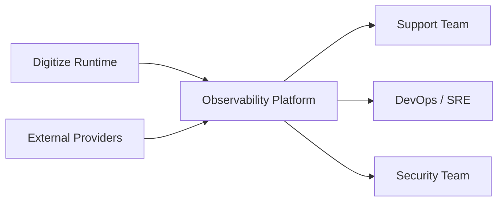
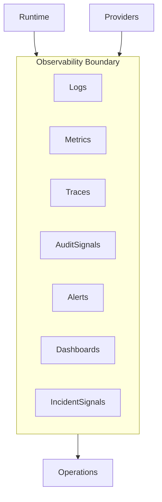
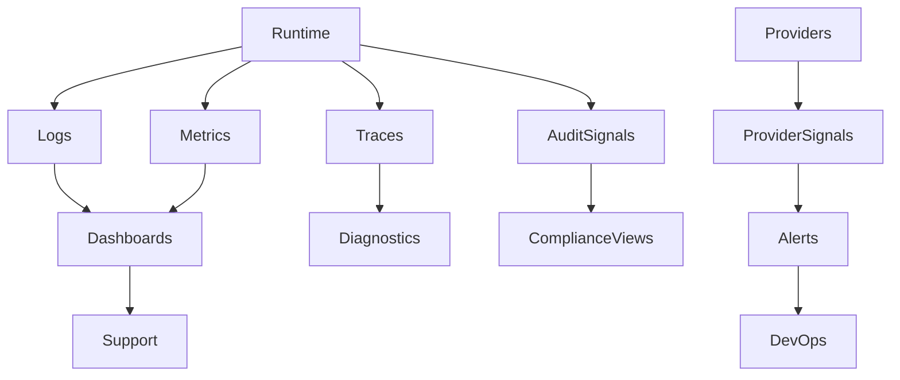
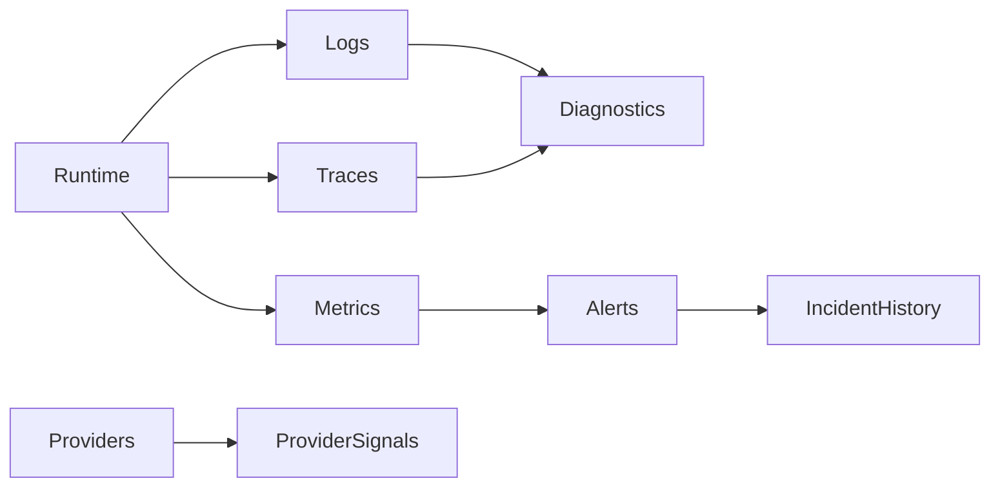
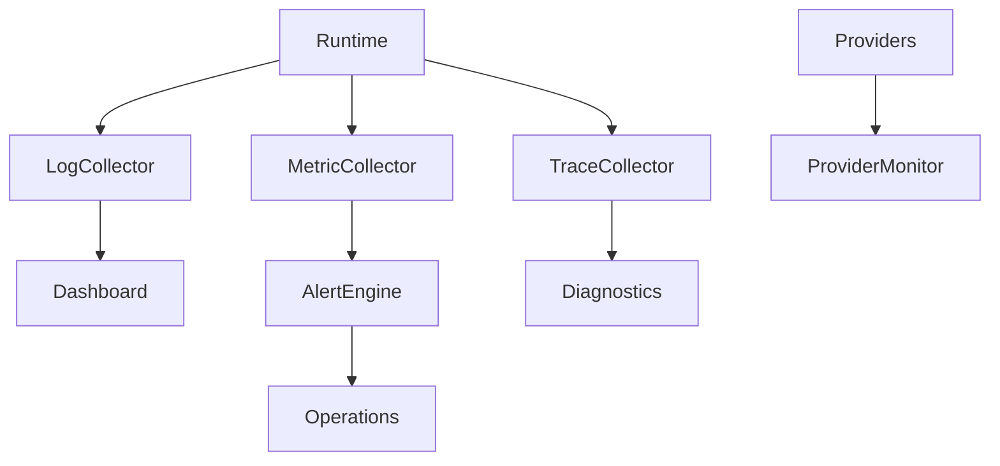

# TA-07 Observability & Operations Architecture

**Document ID:** TA-07  
**Document Name:** Observability & Operations Architecture  
**Company:** OreeOn Technologies Pvt. Ltd.  
**Product:** Digitize  
**Document Type:** Technical Architecture  
**Version:** 1.0  
**Status:** Frozen  
**Owner:** Operations Architecture  
**Prepared By:** Architecture Team  
**Last Updated:** July 25, 2026  
**Architecture Review:** Passed
**Approved ADRs:** ADR-042, ADR-046
**Frozen Date:** 2026-07-25
**Freeze Approver:** Architecture Lead (to replace placeholder with actual approver name)

---

# Revision History

| Version | Date | Author | Description |
|---|---|---|---|
| 0.1 | July 2026 | Architecture Team | Initial design draft |

---

# 1. Introduction

## 1.1 Purpose

This document defines the Observability & Operations Architecture for Digitize. It establishes how the platform shall be monitored, logged, traced, audited, alerted, diagnosed, supported, and operated in production.

## 1.2 Objectives

- Define observability capabilities across application, tenant, provider, data, and operational layers.
- Support support teams with actionable diagnostics.
- Establish monitoring for availability, performance, security, audit, integrations, jobs, and business-critical workflows.
- Define operational event and incident visibility for a multi-tenant SaaS platform.

## 1.3 Scope

This document covers logs, metrics, traces, alerts, health checks, audit observability, provider monitoring, background process monitoring, incident signals, operational dashboards, and support diagnostics.

## 1.4 Out of Scope

Specific observability vendor selection, dashboard implementation, incident runbook detail, alert threshold values, and production support staffing model are outside this document.

## 1.5 Intended Audience

DevOps Engineers, SRE, Support Teams, Platform Administrators, Security Engineers, QA Engineers, Backend Engineers, Product Management, and Compliance Stakeholders.

## 1.6 Related Documents

| Document Type | Document Reference | Relationship |
|---|---|---|
| Product Foundation | PF-03 | Product reliability and SaaS operating vision |
| Commercial Strategy | CS-03 | Payment and billing operational visibility |
| Business Analysis | BA-09, BA-10 | Availability, reliability, monitoring, logging, risks |
| Functional Requirements | FR-02, FR-18, FR-19, FR-20, FR-21 | Monitoring, notifications, reports, support, audit |
| UI / UX Design | UX-05 | Operational screen alignment |
| API Specification | TA-04 | Interface observability |
| Database Design | TA-03 | Data and audit observability |
| Deployment | TA-06 | Release and runtime monitoring |
| Decision Record | TA-10 | Observability ADR traceability |

---

# 2. Architecture Viewpoints

| Viewpoint | Purpose | Primary Stakeholders | Architecture Concerns |
|---|---|---|---|
| Business View | Observe business-critical operations | Product, Support | Attendance, payments, notifications, reports |
| Application View | Monitor application components | Engineers | Health, errors, latency |
| Data View | Monitor data integrity and retention | Database Architects | Backup, audit, reporting refresh |
| Integration View | Monitor providers | Integration, DevOps | Provider health, callbacks, retries |
| Security View | Detect security events | Security | Login failures, access denials |
| Deployment View | Monitor releases | DevOps | Deployment health and rollback signals |
| Operational View | Support incidents | Support, SRE | Alerts, dashboards, diagnostics |

---

# 3. Architecture Context

## 3.1 Business Context

Digitize operations depend on timely detection and diagnosis of issues affecting tenants, facilities, sites, payments, attendance, communication, reporting, support, and audit.

## 3.2 Product Context

Observability must support the SaaS operating model and provide platform-wide and tenant-aware visibility without exposing unauthorized tenant data.

## 3.3 Technical Context

Observability shall collect logs, metrics, traces, audit events, health signals, provider status, asynchronous processing status, deployment status, and business-critical operational indicators.

## 3.4 Operational Context

Support and operations teams require dashboards, alerts, incident context, correlation identifiers, audit references, and service health visibility.

---

# 4. Architecture Goals

| Goal ID | Goal | Rationale | Success Indicator |
|---|---|---|---|
| TA-07-GOAL-001 | Establish platform observability | SaaS operations require visibility | Critical components produce logs, metrics, traces, and alerts |
| TA-07-GOAL-002 | Support tenant-aware diagnostics | Support must troubleshoot tenant issues safely | Diagnostics include tenant context with access controls |
| TA-07-GOAL-003 | Monitor external providers | Provider failures affect payments and notifications | Provider health and callback failures are visible |
| TA-07-GOAL-004 | Preserve audit observability | Compliance requires traceable actions | Audit capture and access are monitored |
| TA-07-GOAL-005 | Enable incident response | Operational failures require fast response | Alerts route to responsible teams |

---

# 5. Architecture Principles Applied

| Principle ID | Principle | Application in This Document | Related ADR |
|---|---|---|---|
| TA-PRN-001 | Multi-tenancy by default | Observability includes tenant context with protected access | ADR-001 |
| TA-PRN-003 | Security by design | Logs and alerts avoid sensitive data exposure | ADR-004 |
| TA-PRN-007 | Operational readiness | Monitoring and diagnostics are first-class architecture capabilities | ADR-009 |
| TA-PRN-008 | Traceability | Correlation IDs connect requests, events, audit, and support diagnostics | ADR-015 |

---

# 6. Architecture Scope Model

## 6.1 In-Scope Capabilities

- Application logs.
- Metrics.
- Distributed traces.
- Audit observability.
- Health checks.
- Alerts.
- Provider monitoring.
- Asynchronous processing monitoring.
- Support diagnostics.
- Operational dashboards.

## 6.2 Out-of-Scope Capabilities

- Tool vendor selection.
- Detailed dashboard UI design.
- Incident staffing model.
- Alert threshold final values.
- SOC runbooks.

## 6.3 Capability Map

## 6.4 Context Diagram

## 6.5 Boundary Diagram

---

# 7. Logical Architecture

## 7.1 Architecture Domains

| Domain ID | Architecture Domain | Purpose | Responsibility |
|---|---|---|---|
| TA-07-DOM-001 | Logging Domain | Capture technical and operational logs | Structured logs and retention |
| TA-07-DOM-002 | Metrics Domain | Capture measurable system indicators | Availability, latency, throughput, failures |
| TA-07-DOM-003 | Tracing Domain | Connect request lifecycle | Correlation and distributed tracing |
| TA-07-DOM-004 | Alerting Domain | Notify responsible teams | Alert rules, severity, routing |
| TA-07-DOM-005 | Audit Observability Domain | Monitor audit capture and access | Audit event health and compliance visibility |
| TA-07-DOM-006 | Support Diagnostics Domain | Provide issue investigation context | Tenant-aware diagnostics and support views |

## 7.2 Logical Relationships

Runtime components emit logs, metrics, traces, and audit signals. Observability components aggregate signals into dashboards and alerts. Support diagnostics consume approved telemetry and audit references without exposing unauthorized tenant data.

## 7.3 Logical Architecture Diagram

---

# 8. Component Architecture

## 8.1 Component Summary

| Component ID | Component Name | Type | Owner | Criticality |
|---|---|---|---|---|
| TA-07-CMP-001 | Log Collection Component | Service | DevOps | Critical |
| TA-07-CMP-002 | Metrics Collection Component | Service | DevOps / SRE | Critical |
| TA-07-CMP-003 | Trace Collection Component | Service | DevOps / SRE | High |
| TA-07-CMP-004 | Alerting Component | Service | DevOps | Critical |
| TA-07-CMP-005 | Health Check Component | Service | DevOps | Critical |
| TA-07-CMP-006 | Audit Observability Component | Service | Compliance / DevOps | Critical |
| TA-07-CMP-007 | Provider Monitoring Component | Service | Integration / DevOps | High |
| TA-07-CMP-008 | Support Diagnostics Component | Module | Support Operations | High |

## 8.2 Component Details

### Component ID

TA-07-CMP-001 to TA-07-CMP-008.

### Component Name

Observability and operations components listed in Section 8.1.

### Purpose

These components provide production visibility, diagnostics, incident signals, audit observability, provider monitoring, and tenant-aware support context.

### Responsibilities

- Collect logs, metrics, and traces.
- Monitor health and providers.
- Route alerts.
- Support issue investigation.
- Monitor audit capture health.
- Protect sensitive telemetry.

### Provided Capabilities

Operational dashboards, alerts, correlation tracing, health checks, support diagnostics, provider status, and audit monitoring.

### Consumed Capabilities

Runtime telemetry, provider responses, audit events, security events, deployment events, business events, and support ticket context.

### Data Ownership

Observability owns telemetry records, alert history, health status, incident signals, diagnostic references, and operational dashboards.

### Interfaces

| Interface | Direction | Interface Type | Authentication / Trust Model | Purpose |
|---|---|---|---|---|
| Telemetry Interface | Inbound | Observability interface | Trusted runtime | Collect logs, metrics, and traces |
| Alert Interface | Outbound | Notification interface | Operational trust | Notify responsible teams |
| Diagnostics Interface | Outbound | Support interface | Restricted support trust | Provide investigation context |

### Dependencies

Dependencies include runtime components, provider integrations, audit store, notification channels, deployment events, and support tooling.

### Failure Modes

Failure modes include missing telemetry, delayed alerts, alert noise, provider monitoring gaps, trace discontinuity, sensitive data leakage in logs, and diagnostic access denial.

### Security Controls

Observability access shall be role-restricted. Sensitive data shall be masked. Cross-tenant diagnostics require explicit support permission and audit logging.

### Audit and Logging

Operational access, alert acknowledgement, diagnostic review, audit search, and incident-related actions shall be logged.

### Monitoring

Monitor telemetry ingestion, alert delivery, dashboard freshness, trace completeness, provider health, audit capture, and incident volume.

### Scalability Considerations

Telemetry processing shall scale with tenant count, request volume, audit volume, provider interactions, and background processing volume.

### Notes

Detailed incident response procedures are maintained separately.

---

# 9. Data Architecture

## 9.1 Data Ownership

| Data Entity / Data Group | Owner Component | Purpose | Classification | Retention Class |
|---|---|---|---|---|
| Technical Logs | Log Collection Component | Diagnose runtime behavior | Operational telemetry | Log retention |
| Metrics | Metrics Collection Component | Measure system health | Operational telemetry | Metrics retention |
| Traces | Trace Collection Component | Follow request lifecycle | Operational telemetry | Trace retention |
| Alerts | Alerting Component | Notify operational issues | Operational data | Incident retention |
| Health Checks | Health Check Component | Track component status | Operational data | Short-term operational retention |
| Provider Signals | Provider Monitoring Component | Monitor external providers | Integration telemetry | Integration retention |
| Diagnostic Records | Support Diagnostics Component | Support investigation | Restricted support data | Support retention |

## 9.2 Data Flow

Runtime components emit telemetry into observability services. Alerts are derived from metrics, logs, traces, health checks, provider status, audit capture, and deployment signals.

## 9.3 Data Consistency

Telemetry may be eventually consistent. Critical audit capture failure and security alert signals require reliable delivery or escalation.

## 9.4 Data Retention

Telemetry retention shall balance operational usefulness, cost, compliance, and privacy. Audit records are retained separately according to compliance policy.

## 9.5 Data Architecture Diagram

---

# 10. Service Interface and Integration Architecture

## 10.1 Service Interface Summary

| Interface Area | Interface Type | Trust Model | Producer | Consumer | Purpose |
|---|---|---|---|---|---|
| Telemetry Interface | Observability interface | Runtime trust | Runtime Components | Observability Services | Collect signals |
| Alert Interface | Notification interface | Operational trust | Alerting Component | DevOps, Security, Support | Notify incidents |
| Diagnostics Interface | Support interface | Restricted support trust | Observability Services | Support Team | Investigate issues |
| Health Interface | Monitoring interface | Operational trust | Runtime Components | Health Check Component | Track health |

## 10.2 Event Summary

| Event | Producer | Consumer | Purpose | Delivery Pattern |
|---|---|---|---|---|
| HealthStatusChanged | Health Check Component | Alerting, Dashboards | Detect runtime status change | Monitoring event |
| AlertRaised | Alerting Component | Operations Teams | Trigger response | Notification event |
| AuditCaptureFailed | Audit Component | Compliance, DevOps | Escalate audit failure | Critical event |
| ProviderHealthChanged | Provider Monitoring | Integration, DevOps | Track provider status | Monitoring event |

## 10.3 Asynchronous Processing

| Process | Schedule / Trigger | Purpose | Failure Handling |
|---|---|---|---|
| Telemetry Aggregation | Continuous | Aggregate logs and metrics | Alert on ingestion gap |
| Alert Evaluation | Continuous | Evaluate alert conditions | Escalate failure |
| Dashboard Refresh | Scheduled / continuous | Refresh operational views | Mark stale dashboard |
| Incident Signal Correlation | Alert event | Correlate related signals | Manual review if incomplete |

## 10.4 External Interfaces

| External System | Interface Type | Purpose | Failure Handling |
|---|---|---|---|
| Notification Channels | Alert delivery | Send operational alerts | Retry and alternate route |
| External Providers | Health signal | Monitor provider availability | Degraded status |
| Future Incident Tool | Incident integration | Create incidents | Retry and manual fallback |

---

# 11. Security Architecture

## 11.1 Authentication

Observability and diagnostics interfaces require authenticated operations, support, security, or platform administrator identity.

## 11.2 Authorization

Access to telemetry, tenant diagnostics, audit signals, and incident history shall be role-restricted.

## 11.3 Tenant Isolation

Tenant-specific diagnostics shall be visible only to authorized platform, support, or tenant-scoped users.

## 11.4 Data Protection

Logs and traces shall not expose sensitive customer, payment, credential, or security data in plain text.

## 11.5 Security Events

Security-relevant observability events include unauthorized diagnostic access, audit capture failure, tenant diagnostic access, alert suppression, and privileged dashboard access.

---

# 12. Multi-Tenancy Considerations

| Consideration | Architecture Approach |
|---|---|
| Tenant Identification | Telemetry includes tenant context where applicable |
| Tenant Isolation | Diagnostics are filtered by authorized tenant scope |
| Tenant Configuration | Tenant-level alerts may support future configuration |
| Tenant Data Access | Support diagnostics require explicit permission |
| Tenant-Level Feature Access | Advanced operational views may be license-controlled |
| Tenant-Level Auditability | Tenant diagnostics access is audited |

---

# 13. Configuration and Extensibility

## 13.1 Configuration Parameters

| Parameter | Scope | Purpose | Default | Owner |
|---|---|---|---|---|
| Log Retention Policy | Platform | Control telemetry retention | Standard baseline | DevOps |
| Alert Routing Policy | Platform | Route alerts to owners | Standard routing | DevOps |
| Diagnostic Access Policy | Platform | Restrict support access | Restricted | Security |
| Provider Health Policy | Platform | Monitor external providers | Enabled for active providers | Integration |

## 13.2 Feature Toggles

| Feature Toggle | Scope | Purpose | Default State |
|---|---|---|---|
| Advanced Diagnostics | Platform | Enable richer support diagnostics | Planned |
| Tenant Health Dashboards | Tenant | Enable tenant-visible health | Disabled |
| Incident Tool Integration | Platform | Enable future incident automation | Disabled |

## 13.3 Extension Points

Extension points include additional telemetry sources, incident tools, tenant health dashboards, anomaly detection, synthetic monitoring, business KPI alerts, and compliance dashboards.

---

# 14. Quality Attribute Scenarios

| Quality Attribute | Scenario | Architecture Response | Validation Approach |
|---|---|---|---|
| Availability | Platform component fails | Health check alerts operations | Failure simulation |
| Scalability | Telemetry volume grows | Observability pipeline scales independently | Telemetry load test |
| Security | Support user opens tenant diagnostics | Access is scoped and audited | Security test |
| Performance | Dashboards refresh during peak usage | Aggregated telemetry is used | Dashboard performance test |
| Reliability | Alert delivery fails | Retry or alternate route | Alert test |
| Maintainability | New component added | Standard telemetry contract applies | Architecture review |
| Recoverability | Incident occurs | Logs, traces, and audit enable diagnosis | Incident simulation |

---

# 15. Performance and Scalability

| Area | Expectation | Architecture Approach | Notes |
|---|---|---|---|
| Latency | Alerts generated promptly | Efficient signal evaluation | Thresholds later |
| Throughput | High telemetry volume supported | Scalable ingestion | Capacity planning |
| Concurrency | Multiple teams use dashboards | Role-aware access | Support readiness |
| Data Volume | Logs and traces grow safely | Retention and archival | Cost monitoring |
| Reporting Load | Operational dashboards remain usable | Aggregated views | TA-09 Platform Architecture alignment |

---

# 16. Availability and Resilience

| Scenario | Architecture Response | Recovery Consideration |
|---|---|---|
| Component unavailable | Alert raised | Restart and incident |
| External provider failure | Provider status degraded | Retry and notify |
| Database failure | Audit and telemetry failure surfaced | Restore |
| Deployment failure | Release monitor detects issue | Rollback signal |

---

# 17. Observability, Logging, and Auditability

## 17.1 Logs

Logs shall be structured, searchable, tenant-aware where applicable, and masked for sensitive values.

## 17.2 Metrics

Metrics shall cover system, business, integration, security, audit, deployment, and support health.

## 17.3 Traces

Traces shall include correlation IDs across access, service, data, event, provider, and audit boundaries.

## 17.4 Audit Events

| Audit Event | Trigger | Actor | Data Captured | Retention |
|---|---|---|---|---|
| DiagnosticAccessed | Support diagnostic opened | Support user | Tenant, scope, actor | Support audit retention |
| AlertAcknowledged | Alert acknowledged | Operations user | Alert, actor, timestamp | Incident retention |
| MonitoringPolicyChanged | Monitoring rule changed | Administrator | Rule, change, actor | Audit retention |

## 17.5 Alerts

| Alert | Condition | Severity | Recipient |
|---|---|---|---|
| Platform Unavailable | Health check failure | Critical | DevOps |
| Audit Capture Failure | Audit write failure | Critical | Compliance / DevOps |
| Provider Degraded | Provider failures increase | High | Integration / DevOps |
| Telemetry Ingestion Gap | Logs or metrics not received | High | DevOps |

---

# 18. Deployment and Runtime Architecture

## 18.1 Runtime Components

Runtime components include log collector, metrics collector, trace collector, alert engine, health monitor, dashboard service, diagnostic service, and notification route for alerts.

## 18.2 Environment Considerations

Observability shall exist for development, test, staging, and production, with production telemetry access restricted.

## 18.3 Deployment Considerations

New runtime components must emit required telemetry before production release.

## 18.4 Runtime Diagram

---

# 19. Integration Considerations

| Integration | Purpose | Pattern | Failure Handling | Owner |
|---|---|---|---|---|
| Runtime Components | Emit telemetry | Observability interface | Alert on missing signal | DevOps |
| Notification Services | Deliver alerts | Alert routing | Retry alternate route | DevOps |
| Provider Adapters | Expose provider health | Monitoring interface | Degraded provider status | Integration |
| Support Ticket System | Future incident linkage | Support interface | Manual fallback | Support |

---

# 20. Architecture Decisions

| Decision ID | Architecture Principle | Decision | Alternatives Considered | Rationale | Consequences | Status | Related ADR |
|---|---|---|---|---|---|---|---|
| ADR-026 | Operational readiness | Observability shall be mandatory for production components | Optional telemetry | Improves supportability | Requires telemetry standards | Proposed | TA-10 |
| ADR-027 | Security by design | Sensitive values shall be masked in telemetry | Log raw payloads | Protects sensitive data | Requires logging standards | Proposed | TA-10 |
| ADR-028 | Traceability | Correlation IDs shall connect logs, traces, audit, and support diagnostics | Isolated logs only | Improves investigation | Requires propagation discipline | Proposed | TA-10 |

---

# 21. Assumptions, Constraints, and Risks

## 21.1 Assumptions

| Assumption ID | Assumption | Impact | Source |
|---|---|---|---|
| BA-ASS-012 | Support operations will be required after launch | Diagnostics and alerts are mandatory | BA-10 |

## 21.2 Constraints

| Constraint ID | Constraint | Impact | Source |
|---|---|---|---|
| BA-CON-006 | SaaS architecture dependency | Observability must support cloud runtime | BA-10 |

## 21.3 Risks

| Risk ID | Risk | Impact | Likelihood | Mitigation |
|---|---|---|---|---|
| BA-RSK-007 | Inadequate support readiness | High | Medium | Support diagnostics and alerts |
| BA-RSK-006 | Performance degradation during peak hours | High | Medium | Metrics and performance monitoring |

---

# 22. Traceability Matrix

| Architecture Area | Business Process | Functional Requirement | Service Interface / API Area | Data Entity / Data Group | UI Area | Test Area | Notes |
|---|---|---|---|---|---|---|---|
| Platform Monitoring | Platform Administration | FR-02 | Monitoring Interfaces | Telemetry | Platform Dashboard | Monitoring tests | Health |
| Notifications | Notification Management | FR-18 | Alert Interface | Notification Data | Notification Center | Alert tests | Alert routing |
| Reporting | Reporting & Analytics | FR-19 | Reporting Interfaces | Metrics and Reports | Reports UI | Reporting tests | KPIs |
| Support | Support Ticket Management | FR-20 | Diagnostics Interface | Support Data | Support UI | Support tests | Investigation |
| Audit | Audit & Compliance | FR-21 | Audit Observability Interface | Audit Data | Audit Logs | Audit tests | Compliance |

---

# 23. Architecture Diagrams

| Diagram ID | Diagram Name | Diagram Type | Location |
|---|---|---|---|
| TA-07-DGM-001 | Observability Capability Map | Capability Map | Section 6.3 |
| TA-07-DGM-002 | Observability Context Diagram | Context Diagram | Section 6.4 |
| TA-07-DGM-003 | Observability Boundary Diagram | Boundary Diagram | Section 6.5 |
| TA-07-DGM-004 | Logical Observability Diagram | Logical Diagram | Section 7.3 |
| TA-07-DGM-005 | Observability Data Flow Diagram | Data Flow Diagram | Section 9.5 |
| TA-07-DGM-006 | Observability Runtime Diagram | Runtime Diagram | Section 18.4 |

---

# 24. Architecture Review Checklist

| Review Area | Status | Notes |
|---|---|---|
| Business alignment | Pending | Review required |
| Functional requirement alignment | Pending | Review required |
| Multi-tenancy readiness | Pending | Review required |
| Security readiness | Pending | Review required |
| Data architecture readiness | Pending | Review required |
| API readiness | Pending | Review required |
| Integration readiness | Pending | Review required |
| Scalability readiness | Pending | Review required |
| Availability readiness | Pending | Review required |
| Observability readiness | Pending | Review required |
| Auditability readiness | Pending | Review required |
| DevOps readiness | Pending | Review required |
| QA readiness | Pending | Review required |
| Support readiness | Pending | Review required |

---

# 25. Open Questions

| Question ID | Question | Owner | Target Resolution | Status |
|---|---|---|---|---|
| TA-07-QST-001 | Which observability platform will be selected? | DevOps | Before TA-07 Review | Open |
| TA-07-QST-002 | What alert thresholds apply for launch? | DevOps / Product | Before TA-07 Freeze | Open |

---

## 25.1 Proposed Options (proposals — require explicit approval)

1. Observability platform — Decision (approved: ADR-042)
    - Decision: Adopt Datadog for integrated metrics, logs, traces, and SLO monitoring with OpenTelemetry instrumentation. Rationale: unified observability suite, strong SaaS support, and rich alerting/monitoring features that complement the AWS deployment.

2. Alert thresholds — Decision (approved: ADR-046)
    - Decision: Implement critical alerts for tenant-context failure spikes, configuration evaluation failures, unauthorized platform changes, and telemetry ingestion gaps. Numeric thresholds will be finalized during staging load tests and UAT but policies and routing are approved.

Approval required from DevOps and Product before configuring alerting policies in production.

# 26. Summary

TA-07 defines the Observability & Operations Architecture baseline for logs, metrics, traces, alerts, health checks, audit observability, provider monitoring, operational dashboards, and support diagnostics.
