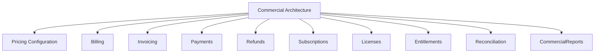
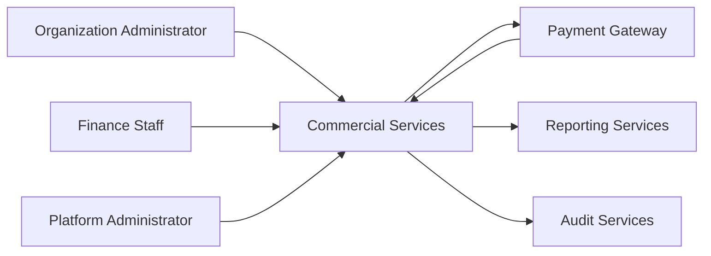
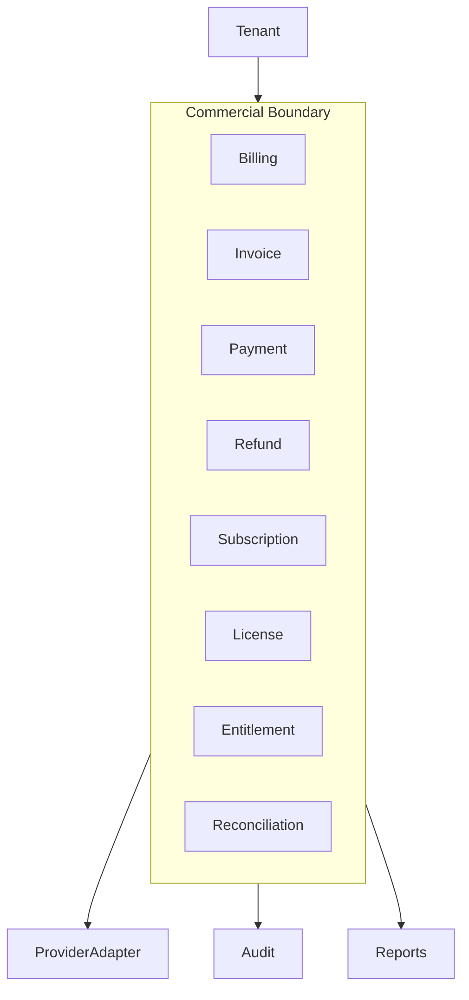
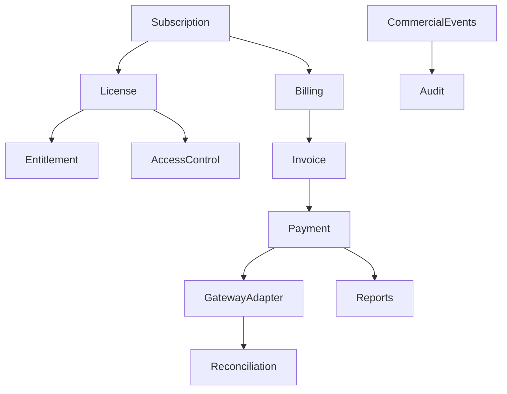
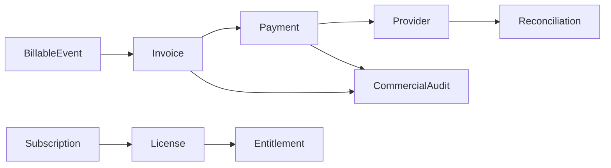
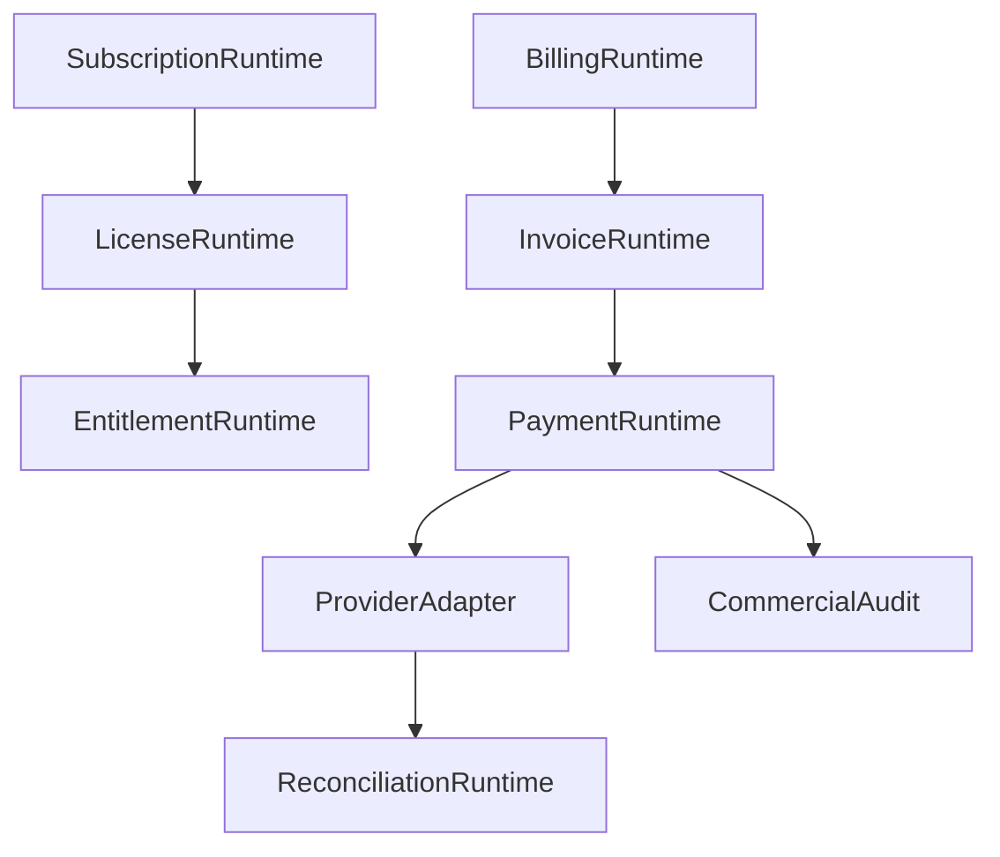

# TA-08 Commercial Architecture

**Document ID:** TA-08  
**Document Name:** Commercial Architecture  
**Company:** OreeOn Technologies Pvt. Ltd.  
**Product:** Digitize  
**Document Type:** Technical Architecture  
**Version:** 1.0  
**Status:** Frozen  
**Owner:** Commercial Architecture  
**Prepared By:** Architecture Team  
**Last Updated:** July 25, 2026  
**Architecture Review:** Passed
**Approved ADRs:** ADR-040, ADR-046
**Frozen Date:** 2026-07-25
**Freeze Approver:** Architecture Lead (to replace placeholder with actual approver name)

---

# Revision History

| Version | Date | Author | Description |
|---|---|---|---|
| 0.1 | July 2026 | Architecture Team | Initial design draft |

---

# 1. Introduction

## 1.1 Purpose

This document defines the Commercial Architecture for Digitize. It establishes the technical architecture for billing, invoices, payments, refunds, subscriptions, licenses, entitlements, commercial configuration, reconciliation, financial auditability, and commercial reporting.

## 1.2 Objectives

- Align commercial architecture with the facility-based subscription and licensing strategy.
- Define boundaries between pricing, billing, payment, subscription, license, and entitlement capabilities.
- Protect financial accuracy, auditability, and reconciliation.
- Support future commercial expansion without redesigning core platform architecture.

## 1.3 Scope

This document covers commercial domains, financial data ownership, subscription and license access model, billing and payment architecture, refund and reconciliation architecture, entitlement evaluation, provider integration boundaries, commercial audit events, and reporting alignment.

## 1.4 Out of Scope

Exact pricing values, tax rates, accounting ledger implementation, payment gateway vendor configuration, invoice PDF layout, and finance policy approval workflows are outside this document.

## 1.5 Intended Audience

Product Management, Finance, Solution Architects, Backend Engineers, Integration Engineers, QA Engineers, DevOps Engineers, Support Teams, and Implementation Teams.

## 1.6 Related Documents

| Document Type | Document Reference | Relationship |
|---|---|---|
| Product Foundation | PF-01, PF-02, PF-03 | Commercial terminology and hierarchy |
| Commercial Strategy | CS-01, CS-02, CS-03, CS-04 | Subscription, pricing, billing, invoicing, discount policy |
| Business Analysis | BA-01 to BA-10 | Commercial requirements, rules, processes, risks |
| Functional Requirements | FR-14, FR-15, FR-16 | Billing, payment, subscription, license behavior |
| UI / UX Design | UX-05 | Commercial screens |
| API Specification | TA-04 | Commercial interfaces and payment integration |
| Database Design | TA-03 | Financial and commercial data ownership |
| Deployment | TA-06 | Release and provider configuration |
| Decision Record | TA-10 | Commercial ADR traceability |

---

# 2. Architecture Viewpoints

| Viewpoint | Purpose | Primary Stakeholders | Architecture Concerns |
|---|---|---|---|
| Business View | Align system to commercial strategy | Product, Finance, Leadership | Facility subscription, license, renewal |
| Application View | Define commercial components | Engineers, Architects | Billing, payment, subscription, license services |
| Data View | Govern financial records | Finance, Database Architects | Invoice, payment, refund, audit |
| Integration View | Integrate payment providers | Integration Engineers | Gateway, callbacks, reconciliation |
| Security View | Protect financial access | Security, QA | Permissions, sensitive data |
| Deployment View | Manage commercial configuration | DevOps, Finance | Provider config, release gates |
| Operational View | Support finance operations | Support, Finance | Failed payments, reconciliation, reports |

---

# 3. Architecture Context

## 3.1 Business Context

Digitize uses a commercial model where Organization is the contractual customer and Facility is the primary subscription unit. Licenses control operational access to subscribed capabilities.

## 3.2 Product Context

Commercial architecture must support subscription creation, renewal, upgrade, downgrade, suspension, cancellation, license generation, license validation, invoice generation, payment collection, refunds, reconciliation, and commercial reports.

## 3.3 Technical Context

Commercial capabilities shall be implemented through dedicated commercial services, tenant-aware data, provider adapters, financial audit events, entitlement evaluation, and reconciliation processes.

## 3.4 Operational Context

Finance and support teams require visibility into invoices, payment status, refunds, subscriptions, licenses, failed payment recovery, reconciliation mismatches, and commercial audit history.

---

# 4. Architecture Goals

| Goal ID | Goal | Rationale | Success Indicator |
|---|---|---|---|
| TA-08-GOAL-001 | Preserve commercial correctness | Billing and payment errors impact trust and revenue | Financial transactions are auditable and reconcilable |
| TA-08-GOAL-002 | Enforce license-based access | Facility capabilities depend on subscription and license state | Entitlement checks are integrated with access decisions |
| TA-08-GOAL-003 | Isolate payment provider behavior | Payment gateways may change or fail | Provider adapters and reconciliation are defined |
| TA-08-GOAL-004 | Support future commercial expansion | Future packs and enterprise plans are expected | Commercial configuration is extensible |
| TA-08-GOAL-005 | Enable finance operations | Finance staff need reports and exception handling | Reports, audit events, and reconciliation queues are defined |

---

# 5. Architecture Principles Applied

| Principle ID | Principle | Application in This Document | Related ADR |
|---|---|---|---|
| TA-PRN-001 | Multi-tenancy by default | Commercial records are tenant and facility scoped | ADR-001 |
| TA-PRN-002 | Configuration over customization | Plans, licenses, and entitlements are configurable | ADR-002 |
| TA-PRN-003 | Security by design | Financial access is permissioned and audited | ADR-004 |
| TA-PRN-005 | Interface-first integration | Payment provider interaction uses integration boundaries | ADR-006 |
| TA-PRN-008 | Traceability | Financial state changes produce audit events | ADR-015 |

---

# 6. Architecture Scope Model

## 6.1 In-Scope Capabilities

- Billing and invoicing.
- Payment processing.
- Refund processing.
- Subscription lifecycle.
- License lifecycle.
- Entitlement evaluation.
- Payment gateway boundary.
- Reconciliation.
- Commercial reporting.
- Commercial audit.

## 6.2 Out-of-Scope Capabilities

- Exact pricing values.
- Accounting ledger implementation.
- Tax authority integration.
- Payment gateway vendor selection.
- Invoice template visual design.

## 6.3 Capability Map

## 6.4 Context Diagram

## 6.5 Boundary Diagram

---

# 7. Logical Architecture

## 7.1 Architecture Domains

| Domain ID | Architecture Domain | Purpose | Responsibility |
|---|---|---|---|
| TA-08-DOM-001 | Pricing Configuration Domain | Govern pricing inputs | Plans, discounts, commercial configuration references |
| TA-08-DOM-002 | Billing Domain | Convert billable events to invoices | Billing schedules and invoice generation |
| TA-08-DOM-003 | Payment Domain | Manage payment lifecycle | Online/offline payment tracking and confirmation |
| TA-08-DOM-004 | Refund Domain | Manage refunds and credit outcomes | Refund processing and financial traceability |
| TA-08-DOM-005 | Subscription Domain | Manage facility subscription lifecycle | Create, renew, change, suspend, cancel, expire |
| TA-08-DOM-006 | License and Entitlement Domain | Control facility capability access | License lifecycle and entitlement evaluation |
| TA-08-DOM-007 | Reconciliation Domain | Resolve financial mismatches | Provider and internal status alignment |

## 7.2 Logical Relationships

Subscriptions define commercial access at Facility level. Licenses translate subscription terms into operational capability access. Billing generates invoices from billable events. Payments settle invoices. Refunds and credit outcomes adjust financial records. Reconciliation compares provider status with Digitize commercial records.

## 7.3 Logical Architecture Diagram

---

# 8. Component Architecture

## 8.1 Component Summary

| Component ID | Component Name | Type | Owner | Criticality |
|---|---|---|---|---|
| TA-08-CMP-001 | Pricing Configuration Component | Service | Product / Finance | High |
| TA-08-CMP-002 | Billing Engine | Service | Finance Systems | Critical |
| TA-08-CMP-003 | Invoice Engine | Service | Finance Systems | Critical |
| TA-08-CMP-004 | Payment Engine | Service | Finance Systems | Critical |
| TA-08-CMP-005 | Refund Processor | Service | Finance Systems | High |
| TA-08-CMP-006 | Subscription Service | Service | Commercial Engineering | Critical |
| TA-08-CMP-007 | License Service | Service | Commercial Engineering | Critical |
| TA-08-CMP-008 | Entitlement Evaluator | Service | Platform / Commercial Engineering | Critical |
| TA-08-CMP-009 | Reconciliation Processor | Job | Finance Operations | High |
| TA-08-CMP-010 | Commercial Reporting Component | Module | Finance / Data Engineering | High |

## 8.2 Component Details

### Component ID

TA-08-CMP-001 to TA-08-CMP-010.

### Component Name

Commercial components listed in Section 8.1.

### Purpose

These components manage commercial correctness, subscription access, licensed capabilities, financial settlement, reconciliation, and commercial reporting.

### Responsibilities

- Maintain commercial configuration.
- Generate invoices.
- Track payments and refunds.
- Manage subscription and license lifecycles.
- Evaluate entitlements.
- Reconcile payment provider status.
- Emit financial audit events.

### Provided Capabilities

Billing, invoicing, payment, refund, subscription, license, entitlement, reconciliation, and commercial analytics.

### Consumed Capabilities

Tenant hierarchy, facility records, payment provider, notification services, audit services, reporting services, and platform configuration.

### Data Ownership

Commercial components own invoice, payment, refund, subscription, license, entitlement, reconciliation, and commercial reporting records.

### Interfaces

| Interface | Direction | Interface Type | Authentication / Trust Model | Purpose |
|---|---|---|---|---|
| Commercial Interface | Inbound | Service interface | Finance and tenant trust | Execute commercial workflows |
| Entitlement Interface | Internal | Access interface | Trusted service context | Validate licensed capabilities |
| Payment Provider Interface | Outbound / Inbound | Provider interface | Provider verification trust | Process and confirm payments |
| Reporting Interface | Outbound | Reporting event/interface | Authorized reporting trust | Provide commercial insights |

### Dependencies

Dependencies include tenant management, facility records, plan configuration, license configuration, payment gateway, notification services, reporting services, and audit services.

### Failure Modes

Failure modes include invoice generation failure, payment provider timeout, duplicate payment callback, refund mismatch, subscription state conflict, license validation failure, and reconciliation discrepancy.

### Security Controls

Financial actions require restricted permissions, tenant scope, sensitive payment reference handling, provider callback verification, and audit logging.

### Audit and Logging

Commercial audit events include invoice generation, payment status change, refund action, subscription lifecycle change, license lifecycle change, entitlement denial, and reconciliation completion.

### Monitoring

Monitor invoice volume, payment success, failed payments, refund volume, subscription renewal status, license validation failures, reconciliation mismatches, and provider health.

### Scalability Considerations

Billing, payment, license validation, and reconciliation workloads shall scale independently where required.

### Notes

Detailed financial rules remain in Commercial Strategy and FRS documents.

---

# 9. Data Architecture

## 9.1 Data Ownership

| Data Entity / Data Group | Owner Component | Purpose | Classification | Retention Class |
|---|---|---|---|---|
| Pricing Configuration | Pricing Configuration Component | Commercial setup | Commercial configuration | Active plus history |
| Invoice | Invoice Engine | Financial demand record | Financial data | Financial retention |
| Payment | Payment Engine | Payment transaction record | Financial data | Financial retention |
| Refund | Refund Processor | Refund record | Financial data | Financial retention |
| Subscription | Subscription Service | Facility commercial lifecycle | Commercial control data | Lifecycle plus audit |
| License | License Service | Facility capability access | Commercial control data | Lifecycle plus audit |
| Entitlement | Entitlement Evaluator | Runtime access control | Access control data | Active plus audit |
| Reconciliation Record | Reconciliation Processor | Provider status alignment | Financial operations data | Financial retention |

## 9.2 Data Flow

Billable events create invoices. Payments settle invoices. Subscriptions and licenses control facility access. Entitlement checks inform access decisions. Provider callbacks update payment state. Reconciliation resolves mismatches. All critical changes emit audit and reporting events.

## 9.3 Data Consistency

Financial state, subscription state, license state, and entitlement decisions require strong consistency. Reporting and notification outcomes may be eventually consistent.

## 9.4 Data Retention

Financial records, subscription records, license records, reconciliation records, and commercial audit records shall follow financial and compliance retention policies.

## 9.5 Data Architecture Diagram

---

# 10. Service Interface and Integration Architecture

## 10.1 Service Interface Summary

| Interface Area | Interface Type | Trust Model | Producer | Consumer | Purpose |
|---|---|---|---|---|---|
| Billing Interface | Commercial service interface | Finance trust | Billing Engine | Commercial UI | Generate billing outcomes |
| Payment Interface | Commercial service interface | Finance and provider trust | Payment Engine | Payment UI and Gateway | Manage payments |
| Subscription Interface | Commercial service interface | Platform and tenant admin trust | Subscription Service | Subscription UI | Manage subscriptions |
| License Interface | Commercial service interface | Platform trust | License Service | License UI and Access Control | Manage license access |
| Entitlement Interface | Internal service interface | Trusted service context | Entitlement Evaluator | Access Layer and Domain Services | Validate capability access |

## 10.2 Event Summary

| Event | Producer | Consumer | Purpose | Delivery Pattern |
|---|---|---|---|---|
| InvoiceGenerated | Invoice Engine | Notification, Reporting, Audit | Track invoice creation | Asynchronous |
| PaymentConfirmed | Payment Engine | Billing, Subscription, License, Reporting, Audit | Confirm settlement | Asynchronous |
| SubscriptionStateChanged | Subscription Service | License, Reporting, Audit | Track lifecycle | Asynchronous |
| LicenseStateChanged | License Service | Access Control, Reporting, Audit | Track access change | Asynchronous |
| ReconciliationMismatchDetected | Reconciliation Processor | Finance, Support, Audit | Trigger review | Asynchronous |

## 10.3 Asynchronous Processing

| Process | Schedule / Trigger | Purpose | Failure Handling |
|---|---|---|---|
| Renewal Billing | Subscription renewal date | Generate renewal invoice | Retry and finance alert |
| Payment Reconciliation | Schedule or callback | Resolve payment status | Review queue |
| License Expiry Evaluation | Schedule or access check | Restrict expired access | Alert and audit |
| Commercial Report Refresh | Commercial event | Update reports | Retry and alert |

## 10.4 External Interfaces

| External System | Interface Type | Purpose | Failure Handling |
|---|---|---|---|
| Payment Gateway | Provider interface | Process online payments | Retry, callback validation, reconciliation |
| Email Provider | Notification interface | Send invoices and receipts | Retry and delivery tracking |
| SMS Provider | Notification interface | Send payment reminders | Retry and delivery tracking |

---

# 11. Security Architecture

## 11.1 Authentication

Commercial interfaces require authenticated users or trusted provider callbacks.

## 11.2 Authorization

Finance actions require role, permission, tenant, facility, and action-specific authorization.

## 11.3 Tenant Isolation

Commercial records are scoped to tenant and facility. Cross-tenant commercial access is restricted to authorized platform or support operations.

## 11.4 Data Protection

Payment references, invoice data, refund data, and financial exports require masking, restricted access, and audit trails.

## 11.5 Security Events

Unauthorized commercial access, payment callback verification failure, refund access denial, financial export, and entitlement denial shall be logged.

---

# 12. Multi-Tenancy Considerations

| Consideration | Architecture Approach |
|---|---|
| Tenant Identification | Organization is contractual tenant; Facility is commercial subscription unit |
| Tenant Isolation | Commercial data is tenant and facility scoped |
| Tenant Configuration | Plans, billing settings, and licenses use tenant-aware configuration |
| Tenant Data Access | Finance users access only authorized tenant/facility financial data |
| Tenant-Level Feature Access | License and entitlement evaluate feature access |
| Tenant-Level Auditability | Financial and entitlement changes are audited |

---

# 13. Configuration and Extensibility

## 13.1 Configuration Parameters

| Parameter | Scope | Purpose | Default | Owner |
|---|---|---|---|---|
| Subscription Plan | Platform | Define commercial package | Platform baseline | Product / Finance |
| License Template | Platform | Define enabled capabilities | Plan-derived | Platform Administrator |
| Billing Policy | Platform / Tenant | Control billing execution | Standard policy | Finance |
| Payment Provider Configuration | Platform | Enable online payments | Disabled until configured | Platform Administrator |

## 13.2 Feature Toggles

| Feature Toggle | Scope | Purpose | Default State |
|---|---|---|---|
| Online Payments | Platform / Tenant | Enable payment gateway | Disabled until configured |
| Advanced Commercial Reports | Tenant | Enable advanced reporting | License-controlled |
| Enterprise Licensing | Platform | Enable enterprise commercial model | Future |

## 13.3 Extension Points

Extension points include new payment providers, premium capability packs, enterprise agreements, marketplace billing, usage analytics, tax integrations, and revenue recognition integrations.

---

# 14. Quality Attribute Scenarios

| Quality Attribute | Scenario | Architecture Response | Validation Approach |
|---|---|---|---|
| Availability | Payment provider is unavailable | Payment state is preserved and reconciled later | Provider failure test |
| Scalability | Many renewals run together | Renewal billing can process asynchronously | Load test |
| Security | Unauthorized refund attempted | Permission check blocks action | Security test |
| Performance | Invoice generated during membership purchase | Commercial flow remains responsive | Performance test |
| Reliability | Duplicate payment callback arrives | Idempotency prevents duplicate settlement | Callback test |
| Maintainability | New pricing plan added | Plan configuration supports extension | Configuration review |
| Recoverability | Reconciliation data missing | Audit and provider records support recovery | Recovery test |

---

# 15. Performance and Scalability

| Area | Expectation | Architecture Approach | Notes |
|---|---|---|---|
| Latency | Payment and invoice flows are responsive | Avoid non-critical blocking work | Critical |
| Throughput | Renewals and payments scale | Asynchronous processing | Capacity planning |
| Concurrency | Duplicate payments controlled | Idempotency and status checks | Critical |
| Data Volume | Financial history retained | Archival and reporting separation | Compliance |
| Reporting Load | Commercial reports do not block payments | Derived reporting data | TA-07 alignment |

---

# 16. Availability and Resilience

| Scenario | Architecture Response | Recovery Consideration |
|---|---|---|
| Component unavailable | Commercial action fails safely | Retry and alert |
| External provider failure | Payment remains pending or failed with reconciliation | Finance review |
| Database failure | Financial transaction not partially completed | Restore |
| Deployment failure | Commercial release rolls back | Release audit |

---

# 17. Observability, Logging, and Auditability

## 17.1 Logs

Commercial logs shall capture invoice, payment, subscription, license, provider, reconciliation, and entitlement outcomes without exposing sensitive payment details.

## 17.2 Metrics

Metrics include invoice volume, payment success rate, failed payment count, refund count, subscription renewals, license validation failures, and reconciliation mismatches.

## 17.3 Traces

Traces connect billable event, invoice, payment, provider callback, reconciliation, subscription update, license update, entitlement evaluation, notification, and audit.

## 17.4 Audit Events

| Audit Event | Trigger | Actor | Data Captured | Retention |
|---|---|---|---|---|
| InvoiceGenerated | Invoice created | User or system | Invoice reference, tenant, facility, amount reference | Financial retention |
| PaymentStateChanged | Payment status changes | User, system, provider | Payment reference, status, source | Financial retention |
| RefundProcessed | Refund processed | Finance user | Refund reference, amount reference, reason | Financial retention |
| LicenseStateChanged | License state changes | Platform admin or system | License, facility, status | Audit retention |

## 17.5 Alerts

| Alert | Condition | Severity | Recipient |
|---|---|---|---|
| Payment Failure Spike | Payment failures exceed threshold | High | Finance / DevOps |
| Reconciliation Mismatch | Provider and internal status differ | High | Finance |
| License Validation Failure Spike | License failures exceed threshold | Medium | Platform Operations |
| Invoice Generation Failure | Invoice creation fails | High | Finance / DevOps |

---

# 18. Deployment and Runtime Architecture

## 18.1 Runtime Components

Runtime components include billing runtime, invoice runtime, payment runtime, subscription runtime, license runtime, entitlement evaluator, reconciliation processor, and commercial reporting projection.

## 18.2 Environment Considerations

Payment provider sandbox and production configurations shall remain separate. Financial testing shall not use production payment credentials in lower environments.

## 18.3 Deployment Considerations

Commercial deployments require regression testing for billing, payment, invoice, refund, subscription, license, and entitlement flows.

## 18.4 Runtime Diagram

---

# 19. Integration Considerations

| Integration | Purpose | Pattern | Failure Handling | Owner |
|---|---|---|---|---|
| Payment Gateway | Online payment | Provider adapter | Retry and reconciliation | Integration / Finance |
| Notification Services | Invoice and payment communication | Event-driven notification | Retry and delivery tracking | Communication |
| Reporting Services | Commercial analytics | Reporting projection | Retry and alert | Data Engineering |
| Audit Services | Financial traceability | Audit event | Critical alert on failure | Compliance |

---

# 20. Architecture Decisions

| Decision ID | Architecture Principle | Decision | Alternatives Considered | Rationale | Consequences | Status | Related ADR |
|---|---|---|---|---|---|---|---|
| ADR-029 | Configuration over customization | Commercial plans and licenses shall be configurable | Hard-coded plans | Supports future commercial expansion | Requires configuration governance | Proposed | TA-10 |
| ADR-030 | Security by design | Payment card handling shall remain delegated to gateway providers where possible | Direct card handling | Reduces sensitive data exposure | Requires provider dependency management | Proposed | TA-10 |
| ADR-031 | Traceability | Commercial state changes shall produce financial audit events | Audit only final payment | Supports compliance and reconciliation | Requires reliable audit capture | Proposed | TA-10 |
| ADR-032 | Interface-first integration | Payment processing shall use provider adapter boundary | Direct gateway calls from payment screens | Reduces coupling | Requires adapter ownership | Proposed | TA-10 |

---

# 21. Assumptions, Constraints, and Risks

## 21.1 Assumptions

| Assumption ID | Assumption | Impact | Source |
|---|---|---|---|
| BA-ASS-009 | Subscription-based pricing will be supported | Subscription architecture is mandatory | BA-10 |
| BA-ASS-010 | Customers will accept tiered feature packaging | License and entitlement model required | BA-10 |

## 21.2 Constraints

| Constraint ID | Constraint | Impact | Source |
|---|---|---|---|
| BA-CON-007 | Dependency on third-party service providers | Payment resilience required | BA-10 |

## 21.3 Risks

| Risk ID | Risk | Impact | Likelihood | Mitigation |
|---|---|---|---|---|
| BA-RSK-011 | Payment gateway downtime | Medium | Medium | Adapter, retries, reconciliation |
| BA-RSK-012 | Incorrect billing or tax calculation | High | Low | Billing validation and audit |

---

# 22. Traceability Matrix

| Architecture Area | Business Process | Functional Requirement | Service Interface / API Area | Data Entity / Data Group | UI Area | Test Area | Notes |
|---|---|---|---|---|---|---|---|
| Billing | Billing Management | FR-14 | Billing Interface | Invoice | Billing UI | Billing tests | Financial correctness |
| Payment | Payment Management | FR-14 | Payment Interface | Payment | Payment UI | Payment tests | Provider backed |
| Refund | Refund Management | FR-14 | Refund Interface | Refund | Refund UI | Refund tests | Finance restricted |
| Subscription | Subscription Management | FR-15 | Subscription Interface | Subscription | Subscription UI | Subscription tests | Facility subscription |
| License | License Management | FR-16 | License Interface | License, Entitlement | License UI | License tests | Access control |

---

# 23. Architecture Diagrams

| Diagram ID | Diagram Name | Diagram Type | Location |
|---|---|---|---|
| TA-08-DGM-001 | Commercial Capability Map | Capability Map | Section 6.3 |
| TA-08-DGM-002 | Commercial Context Diagram | Context Diagram | Section 6.4 |
| TA-08-DGM-003 | Commercial Boundary Diagram | Boundary Diagram | Section 6.5 |
| TA-08-DGM-004 | Logical Commercial Diagram | Logical Diagram | Section 7.3 |
| TA-08-DGM-005 | Commercial Data Flow Diagram | Data Flow Diagram | Section 9.5 |
| TA-08-DGM-006 | Commercial Runtime Diagram | Runtime Diagram | Section 18.4 |

---

# 24. Architecture Review Checklist

| Review Area | Status | Notes |
|---|---|---|
| Business alignment | Pending | Review required |
| Functional requirement alignment | Pending | Review required |
| Multi-tenancy readiness | Pending | Review required |
| Security readiness | Pending | Review required |
| Data architecture readiness | Pending | Review required |
| API readiness | Pending | Review required |
| Integration readiness | Pending | Review required |
| Scalability readiness | Pending | Review required |
| Availability readiness | Pending | Review required |
| Observability readiness | Pending | Review required |
| Auditability readiness | Pending | Review required |
| DevOps readiness | Pending | Review required |
| QA readiness | Pending | Review required |
| Support readiness | Pending | Review required |

---

# 25. Open Questions

| Question ID | Question | Owner | Target Resolution | Status |
|---|---|---|---|---|
| TA-08-QST-001 | Which payment gateway will be used for initial release? | Product / Finance / Integration | Before TA-08 Review | Open |
| TA-08-QST-002 | Which commercial tax handling rules apply at launch? | Finance / Compliance | Before TA-08 Freeze | Open |

---

## 25.1 Proposed Options (proposals — require explicit approval)

1. Payment gateway — Decision (approved: ADR-040)
    - Decision: Use Stripe as the primary payment gateway for initial release with tokenization and webhook-based reconciliation. For unsupported regions, evaluate regional gateways through adapter patterns.

2. Tax handling — Decision (approved: ADR-046)
    - Decision: Implement tax calculations via configurable provider integrations per tenant with manual override capability for initial territories; Finance to finalize provider choices for specific countries.

These proposals require Finance and Product approval before being used in billing and reconciliation designs.

# 26. Summary

TA-08 defines the Commercial Architecture baseline for billing, payments, invoices, refunds, subscriptions, licenses, entitlements, reconciliation, commercial reporting, and financial auditability.
