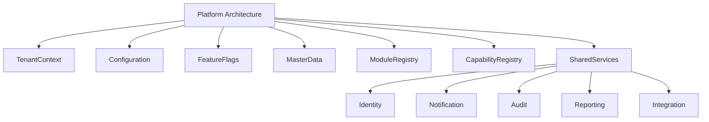
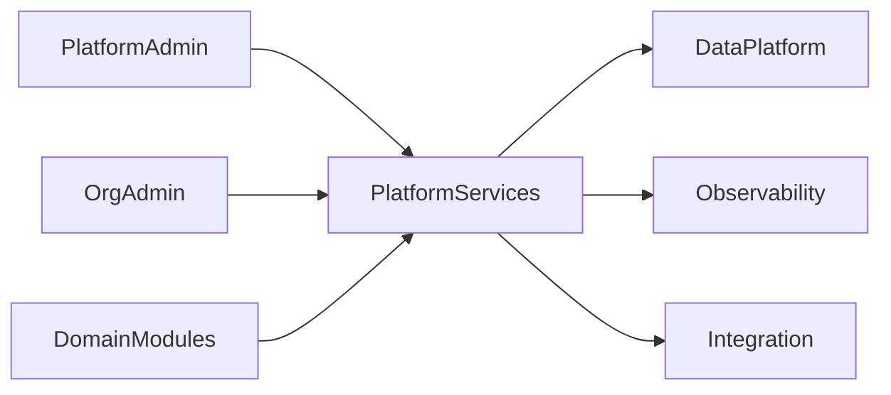
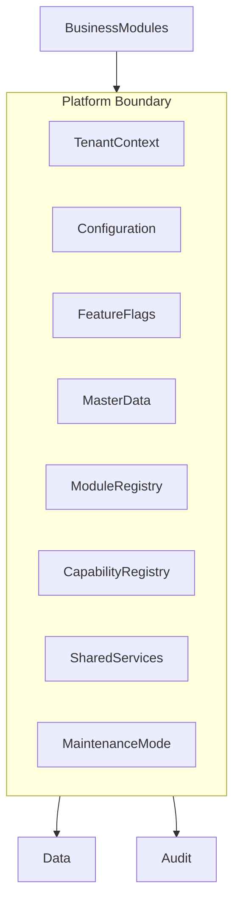
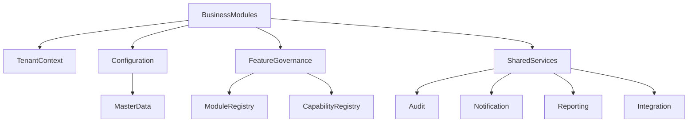
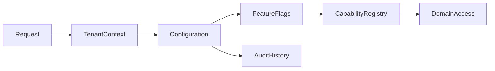
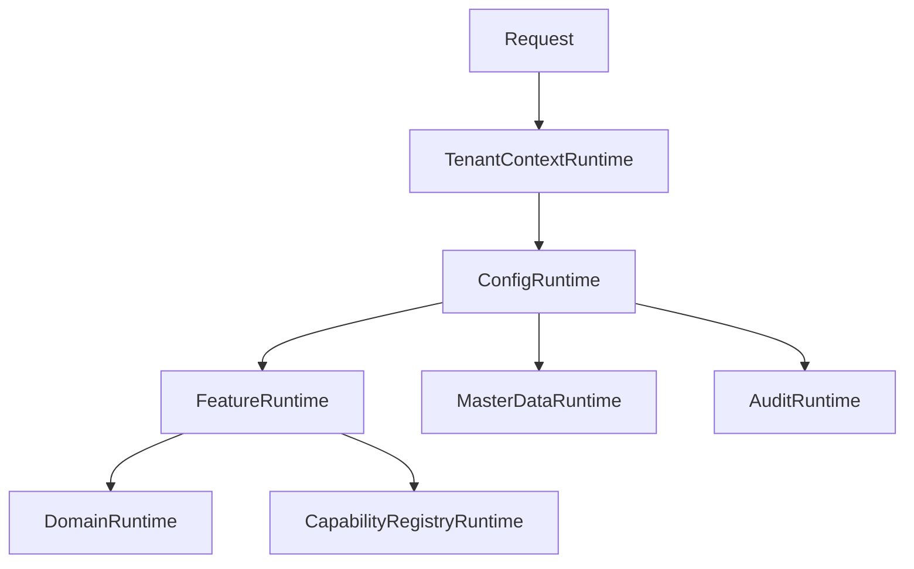

# TA-09 Platform Architecture

**Document ID:** TA-09  
**Document Name:** Platform Architecture  
**Company:** OreeOn Technologies Pvt. Ltd.  
**Product:** Digitize  
**Document Type:** Technical Architecture  
**Version:** 1.0  
**Status:** Frozen  
**Owner:** Platform Architecture  
**Prepared By:** Architecture Team  
**Last Updated:** July 25, 2026  
**Architecture Review:** Passed
**Approved ADRs:** ADR-047, ADR-046
**Frozen Date:** 2026-07-25
**Freeze Approver:** Architecture Lead (to replace placeholder with actual approver name)

---

# Revision History

| Version | Date | Author | Description |
|---|---|---|---|
| 0.1 | July 2026 | Architecture Team | Initial design draft |

---

# 1. Introduction

## 1.1 Purpose

This document defines the Platform Architecture for Digitize. It establishes the shared SaaS foundation for multi-tenancy, platform configuration, feature flags, global master data, shared services, module boundaries, tenant lifecycle support, extensibility, platform governance, and common cross-module capabilities.

## 1.2 Objectives

- Define the shared platform capabilities used by all Digitize modules.
- Establish multi-tenant platform foundations.
- Define configuration, feature flag, master data, and shared service architecture.
- Support future facility types and product expansion through platform extensibility.
- Prevent duplicated cross-cutting capabilities across business modules.

## 1.3 Scope

This document covers platform foundation services, tenant context, organization/facility/site hierarchy support, feature flags, global master data, configuration services, shared notification and audit foundations, module registry, capability registry, extensibility points, and platform governance.

## 1.4 Out of Scope

Detailed domain module internals, physical database schema, endpoint payloads, UI designs, infrastructure implementation, and code-level framework design are outside this document.

## 1.5 Intended Audience

Platform Architects, Solution Architects, Technical Architects, Backend Engineers, Frontend Engineers, DevOps Engineers, QA Engineers, Security Engineers, Product Management, Implementation Teams, and Support Teams.

## 1.6 Related Documents

| Document Type | Document Reference | Relationship |
|---|---|---|
| Product Foundation | PF-01, PF-02, PF-03 | Terminology, domain hierarchy, product philosophy |
| Commercial Strategy | CS-01 | Subscription, license, and capability packaging |
| Business Analysis | BA-01 to BA-10 | Business capabilities, rules, processes, assumptions, risks |
| Functional Requirements | FR-02 to FR-21 | Platform and module functional behavior |
| UI / UX Design | UX-01 to UX-05 | Platform navigation and shared UX patterns |
| API Specification | TA-04 | Platform interface alignment |
| Database Design | TA-03 | Platform data ownership |
| Deployment | TA-06 | Runtime and configuration deployment |
| Decision Record | TA-10 | Platform ADR traceability |

---

# 2. Architecture Viewpoints

| Viewpoint | Purpose | Primary Stakeholders | Architecture Concerns |
|---|---|---|---|
| Business View | Govern reusable platform capabilities | Product, Leadership | Multi-tenancy, configuration, commercial access |
| Application View | Define shared platform services | Architects, Engineers | Module boundaries and dependencies |
| Data View | Own platform-level data | Database Architects | Master data, settings, feature flags |
| Integration View | Enable shared integration abstractions | Integration Engineers | Provider adapters and common events |
| Security View | Enforce shared platform controls | Security | Tenant isolation, admin access |
| Deployment View | Manage platform-wide rollout | DevOps | Feature flags and configuration |
| Operational View | Support platform administration | Support, Platform Admin | Health, maintenance, diagnostics |

---

# 3. Architecture Context

## 3.1 Business Context

Digitize requires a shared SaaS platform foundation to support many organizations while preserving centralized OreeOn governance and tenant-specific operational flexibility.

## 3.2 Product Context

The platform architecture enables configuration over customization, future facility-type expansion, module-level licensing, feature toggles, shared identity, notification, audit, reporting, and integration capabilities.

## 3.3 Technical Context

Platform services shall provide common runtime capabilities consumed by business modules through standardized service interfaces and tenant-aware configuration.

## 3.4 Operational Context

Platform operations require configuration control, maintenance mode, release governance, platform health monitoring, support diagnostics, and auditability of platform-level actions.

---

# 4. Architecture Goals

| Goal ID | Goal | Rationale | Success Indicator |
|---|---|---|---|
| TA-09-GOAL-001 | Establish shared platform foundation | Cross-cutting services must be reusable | Shared services are defined and owned |
| TA-09-GOAL-002 | Support tenant configuration | Tenants require configurable behavior | Configuration hierarchy is defined |
| TA-09-GOAL-003 | Enable feature governance | SaaS capabilities need controlled rollout | Feature flags and licenses are integrated |
| TA-09-GOAL-004 | Support extensibility | Future facility types are expected | Extension points are defined |
| TA-09-GOAL-005 | Preserve platform governance | OreeOn must control platform-level behavior | Platform admin and audit controls exist |

---

# 5. Architecture Principles Applied

| Principle ID | Principle | Application in This Document | Related ADR |
|---|---|---|---|
| TA-PRN-001 | Multi-tenancy by default | Platform services resolve and enforce tenant context | ADR-001 |
| TA-PRN-002 | Configuration over customization | Platform supports settings, policies, feature flags, and facility-type configuration | ADR-002 |
| TA-PRN-004 | Domain-aligned modularity | Modules consume shared services without duplicating platform behavior | ADR-011 |
| TA-PRN-005 | Interface-first integration | Shared services expose governed service interfaces | ADR-006 |
| TA-PRN-008 | Traceability | Platform actions are auditable and mapped to functional modules | ADR-015 |

---

# 6. Architecture Scope Model

## 6.1 In-Scope Capabilities

- Tenant context.
- Platform configuration.
- Organization, Facility, Site hierarchy support.
- Feature flags.
- Global master data.
- Module registry.
- Capability registry.
- Shared notification, audit, reporting, and integration foundations.
- Platform health and maintenance mode.

## 6.2 Out-of-Scope Capabilities

- Detailed module business logic.
- Physical schema.
- Specific cloud services.
- Detailed UI design.
- Provider-specific implementation.

## 6.3 Capability Map

## 6.4 Context Diagram

## 6.5 Boundary Diagram

---

# 7. Logical Architecture

## 7.1 Architecture Domains

| Domain ID | Architecture Domain | Purpose | Responsibility |
|---|---|---|---|
| TA-09-DOM-001 | Tenant Context Domain | Resolve tenant scope | Organization, Facility, Site context |
| TA-09-DOM-002 | Configuration Domain | Govern platform and tenant settings | Settings, policies, inheritance |
| TA-09-DOM-003 | Feature Governance Domain | Control feature rollout | Feature flags and capability access |
| TA-09-DOM-004 | Master Data Domain | Maintain global reference data | Facility types, common reference lists |
| TA-09-DOM-005 | Module Registry Domain | Track platform modules | Module ownership and availability |
| TA-09-DOM-006 | Shared Services Domain | Provide reusable platform capabilities | Identity, notification, audit, reporting, integration foundations |
| TA-09-DOM-007 | Platform Operations Domain | Govern platform runtime | Maintenance mode, health, release readiness |

## 7.2 Logical Relationships

Business modules depend on platform services for tenant context, configuration, feature access, audit, notifications, reporting events, and integration abstractions. Platform services shall not embed module-specific business workflow logic.

Configuration flows downward from platform baseline to organization, facility, and site where allowed by business rules. Feature access is evaluated through feature flags, subscription, license, and entitlement context.

## 7.3 Logical Architecture Diagram

---

# 8. Component Architecture

## 8.1 Component Summary

| Component ID | Component Name | Type | Owner | Criticality |
|---|---|---|---|---|
| TA-09-CMP-001 | Tenant Context Service | Service | Platform Engineering | Critical |
| TA-09-CMP-002 | Platform Configuration Service | Service | Platform Engineering | Critical |
| TA-09-CMP-003 | Feature Flag Service | Service | Platform Engineering | Critical |
| TA-09-CMP-004 | Global Master Data Service | Service | Platform Engineering | High |
| TA-09-CMP-005 | Module Registry Service | Service | Platform Architecture | High |
| TA-09-CMP-006 | Capability Registry Service | Service | Platform Architecture | High |
| TA-09-CMP-007 | Maintenance Mode Controller | Service | Platform Operations | High |
| TA-09-CMP-008 | Shared Service Gateway | Service | Platform Engineering | Critical |

## 8.2 Component Details

### Component ID

TA-09-CMP-001 to TA-09-CMP-008.

### Component Name

Platform components listed in Section 8.1.

### Purpose

These components provide reusable SaaS foundation capabilities consumed by all Digitize modules.

### Responsibilities

- Resolve tenant context.
- Maintain platform and tenant configuration.
- Control feature availability.
- Maintain master data.
- Govern modules and capabilities.
- Support maintenance mode.
- Coordinate shared service access.

### Provided Capabilities

Tenant context, configuration inheritance, feature gating, module availability, capability packaging, master data, maintenance controls, and shared service coordination.

### Consumed Capabilities

Identity, subscription, license, audit, reporting, deployment configuration, and observability.

### Data Ownership

Platform services own platform configuration, feature flags, master data, module registry, capability registry, maintenance state, and tenant context metadata.

### Interfaces

| Interface | Direction | Interface Type | Authentication / Trust Model | Purpose |
|---|---|---|---|---|
| Configuration Interface | Internal | Platform service interface | Trusted service context | Resolve settings |
| Feature Evaluation Interface | Internal | Platform service interface | Tenant-aware trust | Evaluate enabled features |
| Tenant Context Interface | Internal | Platform service interface | Tenant-aware trust | Resolve scope |
| Platform Administration Interface | Inbound | Admin interface | Platform admin trust | Manage platform controls |

### Dependencies

Dependencies include identity, commercial license state, subscription state, audit services, data platform, deployment configuration, and observability.

### Failure Modes

Failure modes include tenant context failure, feature flag inconsistency, configuration conflict, master data invalidity, maintenance mode misconfiguration, and module registry mismatch.

### Security Controls

Platform administration requires privileged permissions. Tenant configuration access is scoped. Feature and license evaluation is audited where access is denied or changed.

### Audit and Logging

Platform configuration changes, feature flag changes, maintenance mode activation, module registry changes, and master data changes shall be audited.

### Monitoring

Monitor configuration changes, tenant resolution failures, feature evaluation failures, maintenance mode status, and shared service health.

### Scalability Considerations

Platform services must handle high-frequency tenant context and feature evaluation without becoming bottlenecks.

### Notes

Platform architecture is the main reusable foundation for future facility-type expansion.

---

# 9. Data Architecture

## 9.1 Data Ownership

| Data Entity / Data Group | Owner Component | Purpose | Classification | Retention Class |
|---|---|---|---|---|
| Tenant Context Metadata | Tenant Context Service | Resolve tenant scope | Platform control data | Active plus audit |
| Platform Settings | Platform Configuration Service | Govern platform behavior | Configuration data | Active plus history |
| Feature Flags | Feature Flag Service | Control capability rollout | Configuration data | Active plus audit |
| Global Master Data | Global Master Data Service | Provide shared references | Reference data | Active plus history |
| Module Registry | Module Registry Service | Track modules | Platform metadata | Active plus history |
| Capability Registry | Capability Registry Service | Track capabilities | Platform metadata | Active plus history |
| Maintenance State | Maintenance Mode Controller | Control platform availability | Operational state | Operational retention |

## 9.2 Data Flow

Tenant-scoped requests resolve tenant context, configuration, feature availability, subscription/license access, and shared service dependencies before domain execution.

## 9.3 Data Consistency

Tenant context, feature flags, active configuration, and license-dependent access require consistent evaluation. Reporting of platform settings may be eventually consistent.

## 9.4 Data Retention

Platform configuration and feature flag history shall be retained for audit and release traceability.

## 9.5 Data Architecture Diagram

---

# 10. Service Interface and Integration Architecture

## 10.1 Service Interface Summary

| Interface Area | Interface Type | Trust Model | Producer | Consumer | Purpose |
|---|---|---|---|---|---|
| Tenant Context Interface | Platform service interface | Trusted tenant-aware context | Tenant Context Service | All domain services | Resolve tenant scope |
| Configuration Interface | Platform service interface | Trusted service context | Configuration Service | Domain services | Resolve configuration |
| Feature Evaluation Interface | Platform service interface | Tenant-aware trust | Feature Flag Service | Access and domain services | Evaluate feature availability |
| Master Data Interface | Reference data interface | Authorized service trust | Master Data Service | Domain services | Provide reference data |

## 10.2 Event Summary

| Event | Producer | Consumer | Purpose | Delivery Pattern |
|---|---|---|---|---|
| PlatformConfigurationChanged | Configuration Service | Audit, Domain Services | Track configuration change | Asynchronous |
| FeatureFlagChanged | Feature Flag Service | Audit, Domain Services | Track feature change | Asynchronous |
| MaintenanceModeChanged | Maintenance Mode Controller | Access Layer, Audit, Notification | Control platform availability | Synchronous plus event |
| MasterDataChanged | Master Data Service | Audit, Reporting | Track reference change | Asynchronous |

## 10.3 Asynchronous Processing

| Process | Schedule / Trigger | Purpose | Failure Handling |
|---|---|---|---|
| Configuration Cache Refresh | Configuration change | Refresh runtime settings | Retry and alert |
| Feature Flag Propagation | Feature flag change | Apply capability changes | Retry and audit |
| Master Data Sync | Master data change | Update dependent views | Retry and alert |

## 10.4 External Interfaces

| External System | Interface Type | Purpose | Failure Handling |
|---|---|---|---|
| Future Marketplace | Platform integration | Capability expansion | Contract validation |
| Future Partner Systems | Platform integration | External ecosystem support | Adapter and audit |

---

# 11. Security Architecture

## 11.1 Authentication

Platform service access requires authenticated user or trusted service context.

## 11.2 Authorization

Platform configuration, feature flags, master data, module registry, and maintenance controls require privileged permissions.

## 11.3 Tenant Isolation

Tenant configuration and feature availability are tenant-scoped where applicable.

## 11.4 Data Protection

Platform configuration and feature flags shall be protected from unauthorized changes because they directly affect tenant capabilities.

## 11.5 Security Events

Unauthorized platform access, feature flag change, maintenance mode activation, configuration change, and tenant context mismatch shall be logged.

---

# 12. Multi-Tenancy Considerations

| Consideration | Architecture Approach |
|---|---|
| Tenant Identification | Organization is tenant root and is resolved by Tenant Context Service |
| Tenant Isolation | Platform services enforce tenant scope for tenant-specific configuration |
| Tenant Configuration | Configuration supports platform, organization, facility, and site levels |
| Tenant Data Access | Shared services return only authorized tenant data |
| Tenant-Level Feature Access | Feature flags, subscription, license, and entitlement determine capability access |
| Tenant-Level Auditability | Platform actions include tenant context where applicable |

---

# 13. Configuration and Extensibility

## 13.1 Configuration Parameters

| Parameter | Scope | Purpose | Default | Owner |
|---|---|---|---|---|
| Platform Baseline Configuration | Platform | Define default behavior | OreeOn baseline | Platform Administrator |
| Organization Configuration | Organization | Define tenant behavior | Platform default | Organization Administrator |
| Facility Type Configuration | Facility Type | Support future verticals | Swimming pool baseline | Product Architecture |
| Capability Package | Platform / Facility | Define enabled capability set | License-driven | Product / Platform |

## 13.2 Feature Toggles

| Feature Toggle | Scope | Purpose | Default State |
|---|---|---|---|
| New Module Enablement | Platform / Tenant | Enable new modules | Disabled until release |
| Future Facility Type | Platform | Enable new facility type | Disabled |
| Advanced Shared Services | Platform | Enable premium platform services | License-controlled |

## 13.3 Extension Points

Extension points include facility types, modules, capability packages, feature flags, global master data, notification channels, reporting datasets, provider adapters, approval workflows, and plugin/marketplace models.

---

# 14. Quality Attribute Scenarios

| Quality Attribute | Scenario | Architecture Response | Validation Approach |
|---|---|---|---|
| Availability | Configuration service is unavailable | Critical access fails safely or uses approved cached state | Failure test |
| Scalability | Tenant count grows | Tenant context and feature evaluation scale independently | Load test |
| Security | Unauthorized feature change attempted | Privileged access blocks and audits action | Security test |
| Performance | Feature check occurs frequently | Efficient evaluation and caching strategy | Performance test |
| Reliability | Configuration changes fail to propagate | Retry and alert | Propagation test |
| Maintainability | New module added | Module registry supports extension | Architecture review |
| Recoverability | Platform configuration is corrupted | Restore from configuration history | Recovery test |

---

# 15. Performance and Scalability

| Area | Expectation | Architecture Approach | Notes |
|---|---|---|---|
| Latency | Tenant and feature evaluation is fast | Cache-aware design | Detailed later |
| Throughput | Many requests resolve configuration | Shared services scale | Critical |
| Concurrency | Configuration changes are controlled | Versioning and audit | Admin-only |
| Data Volume | Configuration history retained | Retention controls | Audit |
| Reporting Load | Platform reports do not affect config evaluation | Reporting separation | TA-07 |

---

# 16. Availability and Resilience

| Scenario | Architecture Response | Recovery Consideration |
|---|---|---|
| Component unavailable | Fail safely or use approved cached data | Restore |
| External provider failure | Shared integration shows degraded state | Retry |
| Database failure | Configuration changes blocked | Restore |
| Deployment failure | Feature rollout can be disabled | Rollback |

---

# 17. Observability, Logging, and Auditability

## 17.1 Logs

Platform logs capture tenant context resolution, configuration lookup, feature evaluation, master data access, and maintenance mode behavior.

## 17.2 Metrics

Metrics include tenant resolution latency, configuration lookup volume, feature evaluation failures, maintenance mode changes, and shared service health.

## 17.3 Traces

Traces connect incoming requests to tenant context, configuration, feature evaluation, domain access, and audit events.

## 17.4 Audit Events

| Audit Event | Trigger | Actor | Data Captured | Retention |
|---|---|---|---|---|
| FeatureFlagChanged | Feature flag updated | Platform Administrator | Flag, scope, previous value, new value | Audit retention |
| PlatformSettingChanged | Platform setting updated | Platform Administrator | Setting, value change, actor | Audit retention |
| MaintenanceModeChanged | Maintenance mode changed | Platform Administrator | State, reason, actor | Operational audit |
| MasterDataChanged | Master data updated | Platform Administrator | Entity, change, actor | Audit retention |

## 17.5 Alerts

| Alert | Condition | Severity | Recipient |
|---|---|---|---|
| Tenant Context Failure Spike | Tenant resolution failures increase | Critical | Platform Operations |
| Configuration Evaluation Failure | Configuration lookup fails | High | Platform Engineering |
| Unauthorized Platform Change Attempt | Restricted action attempted | High | Security |
| Maintenance Mode Activated | Maintenance mode enabled | Medium | Platform Operations / Support |

---

# 18. Deployment and Runtime Architecture

## 18.1 Runtime Components

Runtime components include tenant context runtime, configuration runtime, feature flag runtime, master data runtime, module registry runtime, capability registry runtime, maintenance controller, and shared service gateway.

## 18.2 Environment Considerations

Platform configuration and feature flags shall be environment-specific. Production configuration changes require privileged access and audit.

## 18.3 Deployment Considerations

Platform releases must validate configuration compatibility, feature flag defaults, module registry state, and tenant impact.

## 18.4 Runtime Diagram

---

# 19. Integration Considerations

| Integration | Purpose | Pattern | Failure Handling | Owner |
|---|---|---|---|---|
| Business Modules | Consume platform services | Service interface | Fail safely | Platform Engineering |
| Commercial Services | Evaluate licenses | Internal interface | Deny unavailable capability | Commercial / Platform |
| Notification Services | Use templates and events | Shared service | Retry | Communication |
| Reporting Services | Consume platform metadata | Reporting projection | Retry | Data Engineering |

---

# 20. Architecture Decisions

| Decision ID | Architecture Principle | Decision | Alternatives Considered | Rationale | Consequences | Status | Related ADR |
|---|---|---|---|---|---|---|---|
| ADR-033 | Configuration over customization | Platform behavior shall be configuration-driven | Customer-specific code | Supports future expansion | Requires configuration governance | Proposed | TA-10 |
| ADR-034 | Multi-tenancy by default | Tenant context shall be a shared platform capability | Per-module tenant resolution | Reduces inconsistency | Requires central ownership | Proposed | TA-10 |
| ADR-035 | Domain-aligned modularity | Shared services shall not contain module-specific workflow logic | Centralize all business logic in platform services | Preserves module boundaries | Requires clear ownership | Proposed | TA-10 |
| ADR-036 | Operational readiness | Maintenance mode shall be a platform capability | Manual operational shutdown | Supports controlled downtime | Requires access and communication integration | Proposed | TA-10 |

---

# 21. Assumptions, Constraints, and Risks

## 21.1 Assumptions

| Assumption ID | Assumption | Impact | Source |
|---|---|---|---|
| BA-ASS-002 | Digitize will remain configurable SaaS | Platform configuration is foundational | BA-10 |
| BA-ASS-013 | Future verticals will reuse core capabilities | Platform extensibility is mandatory | BA-10 |

## 21.2 Constraints

| Constraint ID | Constraint | Impact | Source |
|---|---|---|---|
| BA-CON-005 | Initial market focus is swimming pools | Baseline facility configuration begins with swimming pool | BA-10 |
| BA-CON-006 | SaaS architecture dependency | Shared platform services must be cloud-ready | BA-10 |

## 21.3 Risks

| Risk ID | Risk | Impact | Likelihood | Mitigation |
|---|---|---|---|---|
| BA-RSK-003 | Over-customization risk | High | Medium | Enforce configuration governance |
| BA-RSK-005 | Multi-tenant data isolation failure | Critical | Low | Central tenant context |

---

# 22. Traceability Matrix

| Architecture Area | Business Process | Functional Requirement | Service Interface / API Area | Data Entity / Data Group | UI Area | Test Area | Notes |
|---|---|---|---|---|---|---|---|
| Platform Configuration | Platform Administration | FR-02 | Configuration Interface | Platform Settings | Platform Admin | Configuration tests | Shared |
| Tenant Context | Organization, Facility, Site | FR-03 to FR-05 | Tenant Context Interface | Tenant Context Metadata | Tenant UI | Tenant tests | Root scope |
| Feature Flags | Platform Administration, License | FR-02, FR-16 | Feature Evaluation Interface | Feature Flags | Platform Admin | Feature tests | License-aware |
| Master Data | Platform Administration | FR-02 | Master Data Interface | Global Master Data | Platform Admin | Master data tests | Shared references |
| Shared Services | All modules | FR-02 to FR-21 | Shared Service Interfaces | Platform Metadata | All UI areas | Integration tests | Reusable foundation |

---

# 23. Architecture Diagrams

| Diagram ID | Diagram Name | Diagram Type | Location |
|---|---|---|---|
| TA-09-DGM-001 | Platform Capability Map | Capability Map | Section 6.3 |
| TA-09-DGM-002 | Platform Context Diagram | Context Diagram | Section 6.4 |
| TA-09-DGM-003 | Platform Boundary Diagram | Boundary Diagram | Section 6.5 |
| TA-09-DGM-004 | Logical Platform Diagram | Logical Diagram | Section 7.3 |
| TA-09-DGM-005 | Platform Data Flow Diagram | Data Flow Diagram | Section 9.5 |
| TA-09-DGM-006 | Platform Runtime Diagram | Runtime Diagram | Section 18.4 |

---

# 24. Architecture Review Checklist

| Review Area | Status | Notes |
|---|---|---|
| Business alignment | Pending | Review required |
| Functional requirement alignment | Pending | Review required |
| Multi-tenancy readiness | Pending | Review required |
| Security readiness | Pending | Review required |
| Data architecture readiness | Pending | Review required |
| API readiness | Pending | Review required |
| Integration readiness | Pending | Review required |
| Scalability readiness | Pending | Review required |
| Availability readiness | Pending | Review required |
| Observability readiness | Pending | Review required |
| Auditability readiness | Pending | Review required |
| DevOps readiness | Pending | Review required |
| QA readiness | Pending | Review required |
| Support readiness | Pending | Review required |

---

# 25. Open Questions

| Question ID | Question | Owner | Target Resolution | Status |
|---|---|---|---|---|
| TA-09-QST-001 | Which feature flag rollout strategy will be used at launch? | Platform Architecture | Before TA-09 Review | Open |
| TA-09-QST-002 | Which future facility type will be prioritized after swimming pools? | Product Management | Before roadmap refinement | Open |

---

## 25.1 Proposed Options (proposals — require explicit approval)

1. Feature flag rollout strategy — Decision (approved: ADR-046)
    - Decision: Use LaunchDarkly (or equivalent managed feature flag service) for gradual tenant-based rollout with percentage-based gating and canary strategies. Rationale: enables safe rollouts, experimentation, and rapid rollback.

2. Next facility type prioritization — Decision (approved: ADR-046)
    - Decision: Prioritize 'Gym / Fitness Center' as the next facility vertical after swimming pools to maximize reuse of membership and attendance features.

These decisions are approved and recorded as ADRs for traceability.

# 26. Summary

TA-09 defines the Platform Architecture baseline for multi-tenancy, platform configuration, feature flags, master data, module registry, capability registry, shared services, maintenance mode, and future platform extensibility.
