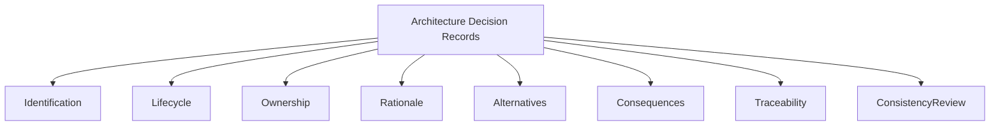
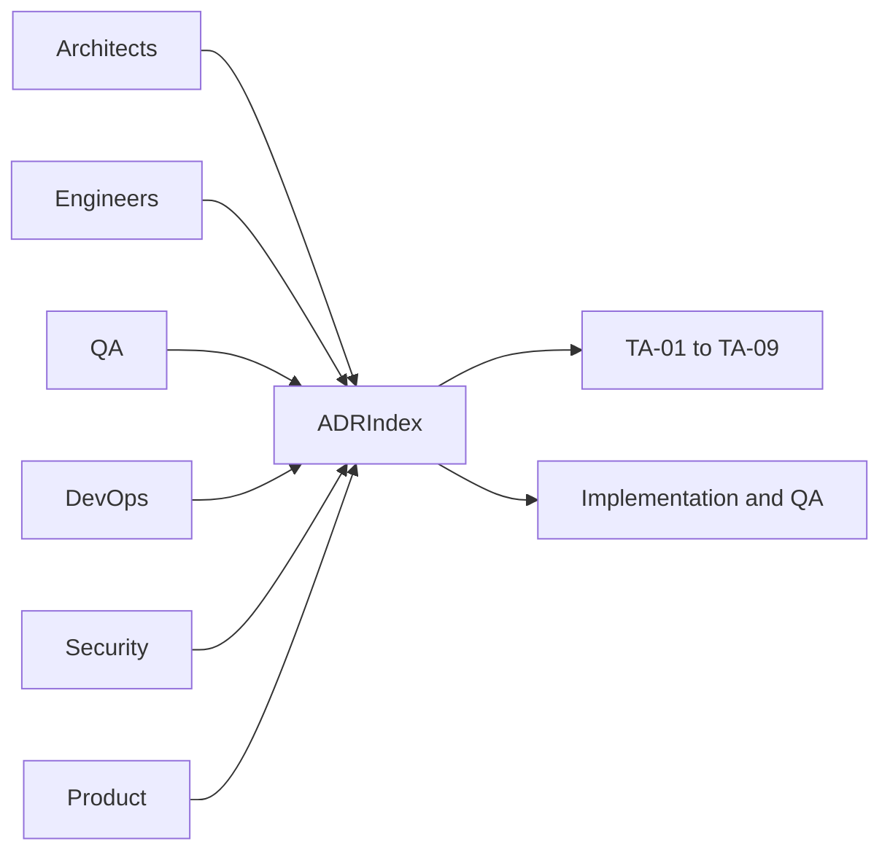
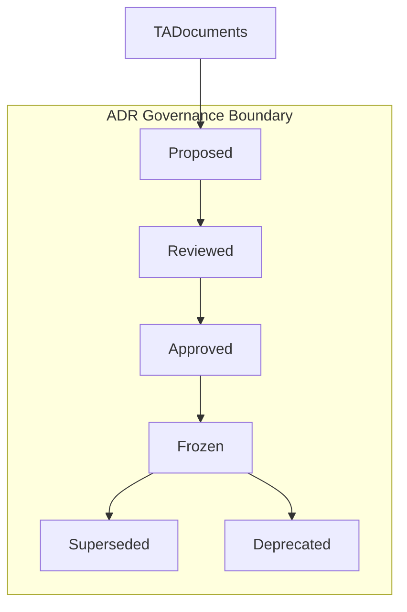
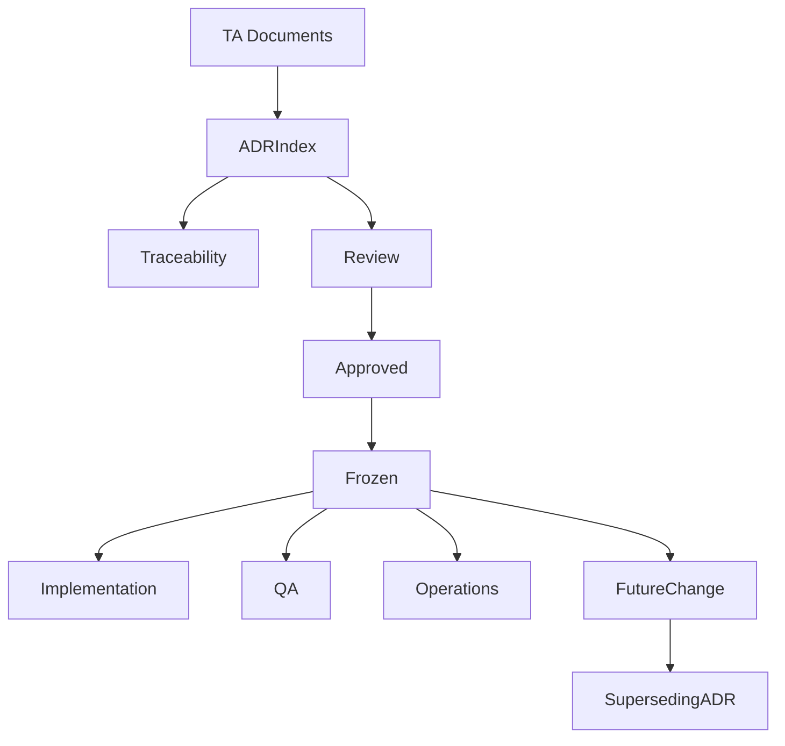
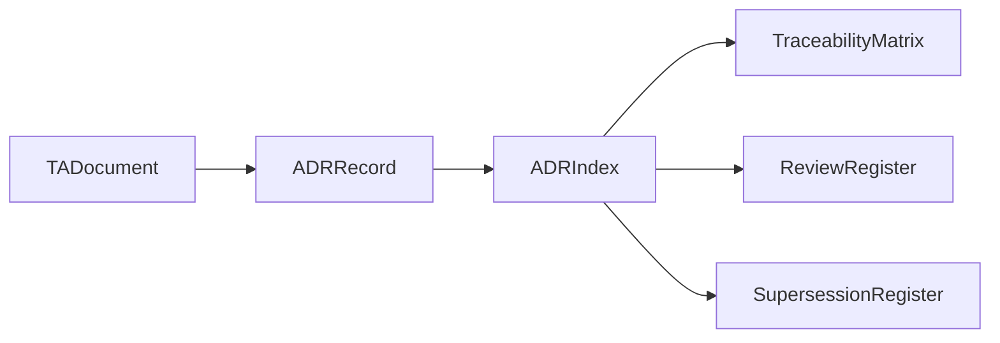
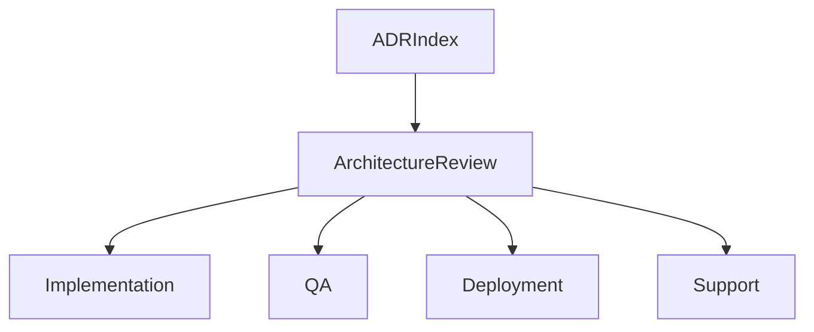

# TA-10 Architecture Decision Records
**Document ID:** TA-10  
**Document Name:** Architecture Decision Records  
## 8. Newly Approved decisions (ADR-037..ADR-047)

The following ADRs were approved during the TA consolidation sweep and are recorded here for traceability. Each ADR includes a short rationale and links back to the source TA documents.

| Decision ID | Decision Summary | Rationale | Alternatives Considered | Status | Source |
|---|---|---|---|---|---|
| ADR-037 | AWS selected for cloud and managed services (EKS, RDS (Postgres), ElastiCache, SQS/SNS, Secrets Manager/KMS) | Aligns managed services and reduces operational overhead for initial launch | GCP/GKE, Azure/AKS | Approved | TA-01 / TA-06 |
| ADR-038 | Independently deployable components for platform and domain services | Supports scaling, targeted rollouts, and smaller blast radius | Monolithic/coarse-grained services | Approved | TA-02 |
| ADR-039 | Identity: AWS Cognito (OIDC) and enforced MFA for admins | Reduces operational footprint and aligns with AWS environment | Auth0/Okta or internal auth | Approved | TA-05 |
| ADR-040 | Payments: Stripe as the primary gateway; regional adapters as needed | Tokenization and reconciliation capabilities reduce PCI scope | Adyen or regional providers | Approved | TA-04 / TA-08 |
| ADR-041 | Communications: Twilio for SMS/WhatsApp; Amazon SES for email | Reliable messaging and AWS integration | Provider alternatives (Twilio alternatives, SendGrid) | Approved | TA-04 |
| ADR-042 | Observability: Datadog + OpenTelemetry instrumentation | Unified observability, SLOs, and SaaS features | CloudWatch/X-Ray only | Approved | TA-07 |
| ADR-043 | Asynchronous processing: AWS SQS + SNS for initial release | Managed durability, scaling, retry semantics | Kafka (MSK) | Approved | TA-02 |
| ADR-044 | Transactional DB: Amazon RDS - PostgreSQL | ACID guarantees, mature ecosystem, managed backups | MySQL | Approved | TA-03 |
| ADR-045 | Analytics: Amazon Redshift for OLAP | Managed analytics with AWS integration | BigQuery, Snowflake | Approved | TA-03 |
| ADR-046 | Operational policies: retention and release/alert baselines (Retention: financial 7y; PII 2y; logs 1y) | Provides baseline operational governance for launch | Jurisdiction-specific policies | Approved | TA-03 / TA-06 / TA-07 |
| ADR-047 | Feature flags: LaunchDarkly (or equivalent) for controlled rollouts | Enables safe rollouts, A/B, canary gating | Manual enablement | Approved | TA-09 |

**Product:** Digitize  
**Document Type:** Technical Architecture  
**Version:** 1.0  
**Status:** Frozen  
**Owner:** Solution Architecture  
**Prepared By:** Architecture Team  
**Last Updated:** July 25, 2026  
**Architecture Review:** Passed  
**Frozen Date:** 2026-07-25  
**Freeze Approver:** Architecture Lead (to replace placeholder with actual approver name)

---

# Revision History

| Version | Date | Author | Description |
|---|---|---|---|
| 0.1 | July 2026 | Architecture Team | Initial design draft |

---

# 1. Introduction

## 1.1 Purpose

This document defines the Architecture Decision Records index for Digitize. It consolidates architecture decisions across TA-01 to TA-09 and establishes the governance model for documenting, reviewing, approving, freezing, superseding, and tracing architecture decisions.

## 1.2 Objectives

- Provide a single ADR index for the Technical Architecture set.
- Preserve decision rationale, alternatives, consequences, ownership, and traceability.
- Support cross-document consistency review.
- Prevent repeated debates over approved architecture decisions.
- Support future architecture evolution through controlled decision lifecycle management.

## 1.3 Scope

This document covers ADR identification, decision lifecycle, decision ownership, decision categories, decision traceability, ADR index, cross-document dependencies, risks, and future decision governance.

## 1.4 Out of Scope

Detailed implementation design, source code decisions, sprint-level engineering choices, vendor procurement decisions, and environment-specific operational runbooks are outside this document unless they materially affect enterprise architecture.

## 1.5 Intended Audience

Product Architects, Solution Architects, Technical Architects, Backend Engineers, Frontend Engineers, DevOps Engineers, Security Engineers, QA Engineers, Database Architects, Product Management, Implementation Teams, and Support Teams.

## 1.6 Related Documents

| Document Type | Document Reference | Relationship |
|---|---|---|
| Product Foundation | PF-01 to PF-05 | Product and terminology source |
| Commercial Strategy | CS-01 to CS-04 | Commercial decision source |
| Business Analysis | BA-01 to BA-10 | Business, process, rule, journey, NFR, risk source |
| Functional Requirements | FR-01 to FR-21 | Functional behavior source |
| UI / UX Design | UX-01 to UX-05 | UI and interaction source |
| API Specification | TA-04 | Interface decision source |
| Database Design | TA-03 | Data decision source |
| Deployment | TA-06 | Runtime and release decision source |
| Decision Record | TA-01 to TA-09 | Source architecture decisions |

---

# 2. Architecture Viewpoints

| Viewpoint | Purpose | Primary Stakeholders | Architecture Concerns |
|---|---|---|---|
| Business View | Explain why decisions support product and business goals | Product, Leadership | Strategic alignment |
| Application View | Trace decisions to application architecture | Architects, Engineers | Components and boundaries |
| Data View | Trace data decisions | Database Architects, Compliance | Ownership, retention, audit |
| Integration View | Trace interface and provider decisions | Integration Engineers | Adapters and contracts |
| Security View | Trace security decisions | Security, QA | Access, isolation, protection |
| Deployment View | Trace runtime decisions | DevOps | Deployment and recovery |
| Operational View | Trace supportability decisions | Support, SRE | Monitoring and operations |

---

# 3. Architecture Context

## 3.1 Business Context

Architecture decisions govern how Digitize will support enterprise SaaS operations, tenant growth, commercial strategy, future facility types, and long-term maintainability.

## 3.2 Product Context

Decisions shall preserve the product philosophy of configuration over customization, multi-tenant SaaS delivery, and future expansion beyond swimming pools.

## 3.3 Technical Context

ADR governance applies to solution, system, data, interface, security, deployment, operations, commercial, and platform architecture decisions.

## 3.4 Operational Context

Architecture decisions must be traceable for implementation, QA, support, onboarding, production operations, compliance review, and future change impact analysis.

---

# 4. Architecture Goals

| Goal ID | Goal | Rationale | Success Indicator |
|---|---|---|---|
| TA-10-GOAL-001 | Centralize architecture decisions | Teams need one decision source | ADR index lists all major decisions |
| TA-10-GOAL-002 | Preserve rationale | Future teams need to understand why decisions exist | Alternatives and consequences are recorded |
| TA-10-GOAL-003 | Support traceability | Decisions affect multiple documents | ADRs map to TA, FR, BA, and NFR sources |
| TA-10-GOAL-004 | Govern decision lifecycle | Decisions may evolve | Status and supersession rules are defined |
| TA-10-GOAL-005 | Support consistency review | Architecture drift must be detected | Cross-document review uses ADR index |

---

# 5. Architecture Principles Applied

| Principle ID | Principle | Application in This Document | Related ADR |
|---|---|---|---|
| TA-PRN-001 | Multi-tenancy by default | ADR index captures tenant architecture decisions | ADR-001, ADR-014, ADR-021, ADR-034 |
| TA-PRN-002 | Configuration over customization | ADR index captures configuration and feature decisions | ADR-002, ADR-029, ADR-033 |
| TA-PRN-003 | Security by design | ADR index captures security and identity decisions | ADR-004, ADR-018, ADR-020, ADR-024, ADR-027 |
| TA-PRN-004 | Domain-aligned modularity | ADR index captures module and component boundary decisions | ADR-011, ADR-035 |
| TA-PRN-005 | Interface-first integration | ADR index captures interface and integration decisions | ADR-006, ADR-012, ADR-017, ADR-032 |
| TA-PRN-006 | Asynchronous coordination | ADR index captures event and retry decisions | ADR-007, ADR-019 |
| TA-PRN-007 | Operational readiness | ADR index captures observability, deployment, and operations decisions | ADR-009, ADR-013, ADR-023, ADR-026, ADR-036 |
| TA-PRN-008 | Traceability | ADR index provides decision traceability | ADR-015, ADR-022, ADR-028, ADR-031 |

---

# 6. Architecture Scope Model

## 6.1 In-Scope Capabilities

- ADR identification and numbering.
- ADR lifecycle.
- ADR index.
- Decision ownership.
- Alternatives and consequences.
- Cross-document decision traceability.
- Supersession and deprecation guidance.

## 6.2 Out-of-Scope Capabilities

- Code-level decisions.
- Sprint task decisions.
- Individual library choices unless enterprise-impacting.
- Vendor procurement contracts.

## 6.3 Capability Map

## 6.4 Context Diagram

## 6.5 Boundary Diagram

---

# 7. Logical Architecture

## 7.1 Architecture Domains

| Domain ID | Architecture Domain | Purpose | Responsibility |
|---|---|---|---|
| TA-10-DOM-001 | Decision Identification Domain | Assign stable decision IDs | ADR numbering and uniqueness |
| TA-10-DOM-002 | Decision Lifecycle Domain | Track decision states | Proposed, Reviewed, Approved, Frozen, Superseded, Deprecated |
| TA-10-DOM-003 | Decision Traceability Domain | Map decisions to artifacts | TA, BA, FR, NFR, API, data, deployment |
| TA-10-DOM-004 | Decision Review Domain | Support architecture governance | Review readiness and consistency |
| TA-10-DOM-005 | Decision Change Domain | Govern future changes | Impact analysis and supersession |

## 7.2 Logical Relationships

Architecture decisions originate in TA documents, are consolidated in TA-10, and are used by downstream implementation, QA, DevOps, security, and support teams. Frozen decisions shall not be changed directly; they shall be superseded through a new decision record.

## 7.3 Logical Architecture Diagram

---

# 8. Component Architecture

## 8.1 Component Summary

| Component ID | Component Name | Type | Owner | Criticality |
|---|---|---|---|---|
| TA-10-CMP-001 | ADR Index | Document | Solution Architecture | Critical |
| TA-10-CMP-002 | ADR Lifecycle Register | Document | Solution Architecture | High |
| TA-10-CMP-003 | Decision Traceability Matrix | Document | Solution Architecture | High |
| TA-10-CMP-004 | Cross-Document Consistency Register | Document | Solution Architecture | High |
| TA-10-CMP-005 | Supersession Register | Document | Solution Architecture | Medium |

## 8.2 Component Details

### Component ID

TA-10-CMP-001 to TA-10-CMP-005.

### Component Name

ADR governance components listed in Section 8.1.

### Purpose

These components preserve architecture decision history and ensure decision consistency across the complete Technical Architecture set.

### Responsibilities

- Maintain decision index.
- Record rationale and alternatives.
- Capture consequences.
- Track decision lifecycle.
- Map decisions to source documents.
- Govern supersession and deprecation.

### Provided Capabilities

Decision lookup, architecture rationale, cross-document consistency review, decision traceability, and change impact support.

### Consumed Capabilities

Architecture documents, business analysis documents, functional requirements, non-functional requirements, commercial strategy, and implementation feedback.

### Data Ownership

TA-10 owns ADR metadata, decision status, rationale, alternatives, consequences, related documents, and supersession references.

### Interfaces

| Interface | Direction | Interface Type | Authentication / Trust Model | Purpose |
|---|---|---|---|---|
| Architecture Review Interface | Inbound | Documentation governance interface | Architecture team trust | Submit or update decision |
| Traceability Interface | Outbound | Documentation reference interface | Project documentation trust | Map decisions to artifacts |
| Change Impact Interface | Outbound | Governance interface | Architecture governance trust | Evaluate decision changes |

### Dependencies

Dependencies include TA-01 to TA-09, Product Foundation, BA-01 to BA-10, FR-01 to FR-21, Commercial Strategy, Deployment, API, Database, and Decision Log artifacts.

### Failure Modes

Failure modes include duplicate decision IDs, conflicting decisions, undocumented alternatives, missing consequences, stale status, and untraceable implementation changes.

### Security Controls

ADR updates require architecture ownership and controlled document review.

### Audit and Logging

Decision changes shall be reflected in revision history and linked to change requests where applicable.

### Monitoring

ADR completeness is monitored through architecture review and cross-document consistency review.

### Scalability Considerations

The ADR index shall scale as the platform expands into future modules, providers, deployment models, and facility types.

### Notes

TA-10 is a governance artifact, not a runtime component.

---

# 9. Data Architecture

## 9.1 Data Ownership

| Data Entity / Data Group | Owner Component | Purpose | Classification | Retention Class |
|---|---|---|---|---|
| ADR Record | ADR Index | Preserve decision | Architecture governance data | Permanent |
| Decision Status | ADR Lifecycle Register | Track lifecycle | Architecture governance data | Permanent |
| Decision Traceability | Decision Traceability Matrix | Map artifacts | Architecture governance data | Permanent |
| Supersession Record | Supersession Register | Preserve decision evolution | Architecture governance data | Permanent |

## 9.2 Data Flow

Architecture decisions are identified during TA document creation, added to the ADR index, reviewed for consistency, referenced by downstream documents, and updated only through controlled supersession.

## 9.3 Data Consistency

ADR identifiers must remain unique and stable. A frozen decision shall not be changed in place; a new ADR shall supersede it.

## 9.4 Data Retention

ADR records are retained permanently for architecture governance and historical traceability.

## 9.5 Data Architecture Diagram

---

# 10. Service Interface and Integration Architecture

## 10.1 Service Interface Summary

| Interface Area | Interface Type | Trust Model | Producer | Consumer | Purpose |
|---|---|---|---|---|---|
| ADR Reference Interface | Documentation interface | Architecture governance trust | TA-10 | TA Documents | Reference decisions |
| Decision Review Interface | Governance interface | Architecture review trust | Architecture Team | Product and Engineering | Review decisions |
| Change Impact Interface | Governance interface | Change control trust | TA-10 | Project Management | Assess changes |

## 10.2 Event Summary

| Event | Producer | Consumer | Purpose | Delivery Pattern |
|---|---|---|---|---|
| ADRProposed | Architecture Team | Reviewers | Start review | Documentation event |
| ADRApproved | Architecture Review | TA Documents | Apply decision | Governance event |
| ADRSuperseded | Architecture Team | Affected stakeholders | Track change | Governance event |

## 10.3 Asynchronous Processing

| Process | Schedule / Trigger | Purpose | Failure Handling |
|---|---|---|---|
| Cross-Document Consistency Review | After TA set review | Detect conflicts | Create correction list |
| ADR Status Review | Release milestone | Confirm decision status | Escalate stale decisions |

## 10.4 External Interfaces

| External System | Interface Type | Purpose | Failure Handling |
|---|---|---|---|
| Project Decision Log | Governance reference | Link business and architecture decisions | Manual reconciliation |
| Change Request Log | Governance reference | Link changes to ADRs | Manual reconciliation |

---

# 11. Security Architecture

## 11.1 Authentication

ADR modification is limited to authorized architecture contributors.

## 11.2 Authorization

Only approved architecture owners may change ADR status or supersede decisions.

## 11.3 Tenant Isolation

Not applicable for this document because ADRs are platform governance artifacts and do not contain tenant-owned operational data.

## 11.4 Data Protection

Sensitive vendor, security, or infrastructure details shall be classified appropriately if added to future ADRs.

## 11.5 Security Events

Unauthorized ADR modification attempts and unapproved decision changes shall be treated as documentation governance violations.

---

# 12. Multi-Tenancy Considerations

| Consideration | Architecture Approach |
|---|---|
| Tenant Identification | ADRs identify tenant-related decisions where applicable |
| Tenant Isolation | Tenant isolation decisions are explicitly tracked |
| Tenant Configuration | Configuration decisions are linked to platform and tenant configuration |
| Tenant Data Access | Data access decisions reference tenant scope |
| Tenant-Level Feature Access | Feature and license decisions reference entitlement model |
| Tenant-Level Auditability | Auditability decisions define tenant audit expectations |

---

# 13. Configuration and Extensibility

## 13.1 Configuration Parameters

| Parameter | Scope | Purpose | Default | Owner |
|---|---|---|---|---|
| ADR Status | ADR | Track decision lifecycle | Proposed | Solution Architecture |
| ADR Owner | ADR | Define accountability | Architecture Team | Solution Architecture |
| ADR Supersession | ADR | Track replacement decision | None | Solution Architecture |

## 13.2 Feature Toggles

| Feature Toggle | Scope | Purpose | Default State |
|---|---|---|---|
| ADR Automation | Documentation | Future validation automation | Disabled |
| Cross-Document Decision Validation | Documentation | Future consistency automation | Planned |

## 13.3 Extension Points

Extension points include detailed ADR files, automated ADR linting, decision graph visualization, implementation traceability, and release-level architecture decision gates.

---

# 14. Quality Attribute Scenarios

| Quality Attribute | Scenario | Architecture Response | Validation Approach |
|---|---|---|---|
| Availability | Teams need decision history during implementation | ADR index remains in repository | Documentation review |
| Scalability | ADR count grows | Stable ID and index model supports expansion | ADR audit |
| Security | Sensitive decision details are added | Classification and access control apply | Security review |
| Performance | Decision lookup should be efficient | Index is consolidated by category and document | Review usability |
| Reliability | Decision is superseded | Supersession preserves history | Governance review |
| Maintainability | Architecture evolves | ADR lifecycle supports change | Change review |
| Recoverability | Decision conflict occurs | ADR index supports reconciliation | Consistency review |

---

# 15. Performance and Scalability

| Area | Expectation | Architecture Approach | Notes |
|---|---|---|---|
| Latency | Decision lookup is easy | Consolidated index | Documentation usability |
| Throughput | Many decisions supported | Stable category structure | Future expansion |
| Concurrency | Multiple teams reference ADRs | Single source of truth | Governance |
| Data Volume | ADR list grows over time | Categorized index | Maintainability |
| Reporting Load | Decision review reports are possible | Traceability table | Future automation |

---

# 16. Availability and Resilience

| Scenario | Architecture Response | Recovery Consideration |
|---|---|---|
| Component unavailable | Documentation remains in repository | Version control recovery |
| External provider failure | Not applicable for this document because ADR index does not depend on runtime providers | None |
| Database failure | Not applicable for this document because ADR index is a documentation artifact | Repository recovery |
| Deployment failure | ADRs support deployment decision review | Review release decision |

---

# 17. Observability, Logging, and Auditability

## 17.1 Logs

ADR changes are tracked through document revision history and repository history.

## 17.2 Metrics

Metrics may include ADR count by status, ADR count by architecture area, superseded ADR count, and open decision count.

## 17.3 Traces

Decision traceability links ADRs to TA documents, BA documents, FR documents, implementation areas, and review outcomes.

## 17.4 Audit Events

| Audit Event | Trigger | Actor | Data Captured | Retention |
|---|---|---|---|---|
| ADRCreated | New ADR added | Architecture Team | ADR ID, decision, owner | Permanent |
| ADRStatusChanged | ADR status updated | Architecture Owner | Previous status, new status | Permanent |
| ADRSuperseded | ADR replaced | Architecture Owner | Old ADR, new ADR, rationale | Permanent |

## 17.5 Alerts

| Alert | Condition | Severity | Recipient |
|---|---|---|---|
| Duplicate ADR ID | Same ADR ID appears more than once | High | Solution Architecture |
| Conflicting Decision | ADR conflicts with existing architecture | High | Architecture Review Board |
| Open Critical Decision | Critical decision remains unresolved | Medium | Product / Architecture |

---

# 18. Deployment and Runtime Architecture

## 18.1 Runtime Components

Not applicable for this document because TA-10 is a documentation governance artifact rather than a runtime architecture component.

## 18.2 Environment Considerations

ADR documents apply across all environments and shall guide environment-specific architecture decisions where relevant.

## 18.3 Deployment Considerations

Deployment decisions shall reference ADRs when they affect production topology, release strategy, rollback, secrets, or operational readiness.

## 18.4 Runtime Diagram

---

# 19. Integration Considerations

| Integration | Purpose | Pattern | Failure Handling | Owner |
|---|---|---|---|---|
| TA Documents | Source decisions | Documentation reference | Manual correction | Solution Architecture |
| Project Decision Log | Align governance | Cross-reference | Reconcile conflict | Product / Architecture |
| Change Request Log | Track decision changes | Cross-reference | Impact review | Project Management |

---

# 20. Architecture Decisions

| Decision ID | Architecture Principle | Decision | Alternatives Considered | Rationale | Consequences | Status | Related ADR |
|---|---|---|---|---|---|---|---|
| ADR-001 | Multi-tenancy by default | Digitize shall use Organization as the tenant root | Single-tenant deployment; Facility as tenant root | Supports SaaS scale and governance | Requires tenant context enforcement | Proposed | TA-01 |
| ADR-002 | Configuration over customization | Digitize shall use configuration over customization | Customer-specific code | Supports future facility types | Requires configuration governance | Proposed | TA-01 |
| ADR-003 | Commercial scalability | Facility shall remain the primary commercial subscription unit | Organization-only subscription; user-count pricing | Aligns with commercial strategy | Requires facility-aware billing and licensing | Proposed | TA-01 |
| ADR-004 | Security by design | Shared platform services shall provide identity, configuration, audit, notification, reporting foundations, and integration abstractions | Duplicate services in modules | Improves consistency | Shared services become critical dependencies | Proposed | TA-01 |
| ADR-005 | Interface-first integration | External provider integrations shall use provider adapters | Direct provider calls | Reduces lock-in | Requires adapter ownership | Proposed | TA-01 |
| ADR-006 | Interface-first integration | Standardized service interfaces shall be the primary synchronous interaction pattern | Direct database integration | Supports maintainability | Requires interface governance | Proposed | TA-01 |
| ADR-007 | Asynchronous coordination | Asynchronous coordination shall support notifications, audit, reporting, and integration follow-up | Fully synchronous processing | Reduces coupling | Requires retry and monitoring | Proposed | TA-01 |
| ADR-008 | Reliability | Core transactions are strongly consistent while reporting and notifications may be eventually consistent | One consistency model for all workloads | Balances correctness and scale | Requires transaction boundaries | Proposed | TA-01 |
| ADR-009 | Operational readiness | Observability shall be a platform capability | Add monitoring later | Supports production operations | Requires telemetry standards | Proposed | TA-01 |
| ADR-010 | Security by design | Payment card handling shall be delegated to payment gateways where possible | Direct card handling | Reduces compliance burden | Requires provider dependency management | Proposed | TA-01 |
| ADR-011 | Domain-aligned modularity | System components shall align to architecture domains and functional modules | Single monolithic boundary | Improves ownership | Requires interface discipline | Proposed | TA-02 |
| ADR-012 | Interface-first integration | Cross-component interaction shall use approved service interfaces or events | Direct database coupling | Reduces tight coupling | Requires contract governance | Proposed | TA-02 |
| ADR-013 | Operational readiness | Observability shall be embedded across system components | Monitoring after implementation | Improves supportability | Requires telemetry standards | Proposed | TA-02 |
| ADR-014 | Multi-tenancy by default | Data access shall be tenant-aware by default | Application-only tenant checks | Reduces leakage risk | Requires consistent tenant filtering | Proposed | TA-03 |
| ADR-015 | Traceability | Audit data shall be separated from operational data | Store audit only inside operational records | Supports compliance | Requires audit retention governance | Proposed | TA-03 |
| ADR-016 | Maintainability | Reporting shall use derived read-oriented data | Direct reporting against operational transactions | Protects operations | Requires reporting refresh management | Proposed | TA-03 |
| ADR-017 | Interface-first integration | Digitize shall expose capabilities through governed service interface areas | Direct module coupling | Improves external readiness | Requires interface standards | Proposed | TA-04 |
| ADR-018 | Security by design | Provider callbacks shall be verified before processing | Trust provider payloads | Prevents spoofed callbacks | Requires provider-specific rules | Proposed | TA-04 |
| ADR-019 | Asynchronous coordination | Provider-dependent work shall support retry and reconciliation | Fully synchronous provider dependence | Improves resilience | Requires exception handling | Proposed | TA-04 |
| ADR-020 | Security by design | RBAC and tenant scope shall be enforced before domain execution | UI-only access control | Prevents unauthorized access | Requires shared authorization | Proposed | TA-05 |
| ADR-021 | Multi-tenancy by default | Tenant isolation guard shall apply to tenant-scoped access | Domain-specific tenant checks | Reduces leakage risk | Requires tenant context propagation | Proposed | TA-05 |
| ADR-022 | Traceability | Privileged security actions shall always be audited | Audit only failed actions | Supports investigation | Requires reliable audit capture | Proposed | TA-05 |
| ADR-023 | Operational readiness | Production deployment shall require automated quality gates | Manual-only deployment | Reduces release risk | Requires pipeline investment | Proposed | TA-06 |
| ADR-024 | Security by design | Secrets shall be externalized from code and deployment artifacts | Store secrets in files | Reduces credential exposure | Requires secrets management | Proposed | TA-06 |
| ADR-025 | Recoverability | Every production release shall have rollback readiness | Roll forward only | Supports continuity | Requires rollback validation | Proposed | TA-06 |
| ADR-026 | Operational readiness | Observability shall be mandatory for production components | Optional telemetry | Improves supportability | Requires telemetry standards | Proposed | TA-07 |
| ADR-027 | Security by design | Sensitive values shall be masked in telemetry | Log raw payloads | Protects sensitive data | Requires logging standards | Proposed | TA-07 |
| ADR-028 | Traceability | Correlation IDs shall connect logs, traces, audit, and support diagnostics | Isolated logs only | Improves investigation | Requires propagation discipline | Proposed | TA-07 |
| ADR-029 | Configuration over customization | Commercial plans and licenses shall be configurable | Hard-coded plans | Supports commercial expansion | Requires configuration governance | Proposed | TA-08 |
| ADR-030 | Security by design | Payment card handling shall remain delegated to gateway providers where possible | Direct card handling | Reduces sensitive data exposure | Requires provider dependency management | Proposed | TA-08 |
| ADR-031 | Traceability | Commercial state changes shall produce financial audit events | Audit only final payment | Supports compliance | Requires reliable audit capture | Proposed | TA-08 |
| ADR-032 | Interface-first integration | Payment processing shall use provider adapter boundary | Direct gateway calls from screens | Reduces coupling | Requires adapter ownership | Proposed | TA-08 |
| ADR-033 | Configuration over customization | Platform behavior shall be configuration-driven | Customer-specific code | Supports future expansion | Requires configuration governance | Proposed | TA-09 |
| ADR-034 | Multi-tenancy by default | Tenant context shall be a shared platform capability | Per-module tenant resolution | Reduces inconsistency | Requires central ownership | Proposed | TA-09 |
| ADR-035 | Domain-aligned modularity | Shared services shall not contain module-specific workflow logic | Centralize all business logic in platform services | Preserves module boundaries | Requires clear ownership | Proposed | TA-09 |
| ADR-036 | Operational readiness | Maintenance mode shall be a platform capability | Manual shutdown | Supports controlled downtime | Requires access and communication integration | Proposed | TA-09 |
| ADR-037 | Cloud provider and managed services | AWS selected: EKS, RDS (Postgres), ElastiCache, SQS/SNS, Secrets Manager/KMS | GCP/GKE alternative | Aligns managed services and reduces operational overhead | Approved | TA-01/TA-06 |
| ADR-038 | Component deployment strategy | Independently deployable platform and domain services | Coarse-grained monolith | Enables independent scaling and targeted rollouts | Approved | TA-02 |
| ADR-039 | Identity and MFA | AWS Cognito (OIDC) for authentication; MFA enforced for platform admins | Internal auth service | Reduces operational footprint and integrates with AWS IAM | Approved | TA-05 |
| ADR-040 | Payment provider | Stripe as primary gateway; adapters for regional providers | Direct card processing | Tokenization reduces PCI scope | Approved | TA-04/TA-08 |
| ADR-041 | Communication providers | Twilio for SMS/WhatsApp and Amazon SES for email | Alternative providers | Reliable messaging and AWS integration | Approved | TA-04 |
| ADR-042 | Observability platform | Datadog + OpenTelemetry | CloudWatch/X-Ray only | Unified observability and better SaaS features | Approved | TA-07 |
| ADR-043 | Asynchronous processing | AWS SQS + SNS for initial release; evaluate Kafka (MSK) for future high-throughput needs | Kafka-first | Managed queues reduce operational overhead | Approved | TA-02 |
| ADR-044 | Transactional DB engine | Amazon RDS (Postgres) for OLTP | MySQL alternatives | ACID guarantees and ecosystem maturity | Approved | TA-03 |
| ADR-045 | Analytics store | Amazon Redshift for OLAP / analytics | BigQuery alternative | Provides managed analytics and integrates with AWS stack | Approved | TA-03 |
| ADR-046 | Operational policies | Retention: Financial/audit 7y; PII 2y; Logs 1y; Release windows off-peak and alerting policies baseline | Jurisdiction-specific exceptions | Baseline operational policy for launch | Approved | TA-03/TA-06/TA-07 |
| ADR-047 | Feature flag tooling | LaunchDarkly (or equivalent) for gradual tenant rollouts | Manual enablement | Supports safe rollouts and experimentation | Approved | TA-09 |

# 21. Assumptions, Constraints, and Risks

## 21.1 Assumptions

| Assumption ID | Assumption | Impact | Source |
|---|---|---|---|
| BA-ASS-007 | Multi-tenant architecture will be used | ADRs must preserve tenant architecture decisions | BA-10 |
| BA-ASS-013 | Future verticals will reuse core capabilities | ADRs must protect extensibility decisions | BA-10 |

## 21.2 Constraints

| Constraint ID | Constraint | Impact | Source |
|---|---|---|---|
| BA-CON-002 | Phased product delivery | ADRs may be proposed before full implementation | BA-10 |

## 21.3 Risks

| Risk ID | Risk | Impact | Likelihood | Mitigation |
|---|---|---|---|---|
| BA-RSK-003 | Over-customization risk | High | Medium | Preserve configuration decisions |
| BA-RSK-005 | Multi-tenant data isolation failure | Critical | Low | Preserve tenant isolation decisions |

---

# 22. Traceability Matrix

| Architecture Area | Business Process | Functional Requirement | Service Interface / API Area | Data Entity / Data Group | UI Area | Test Area | Notes |
|---|---|---|---|---|---|---|---|
| Solution Architecture Decisions | All major process domains | FR-02 to FR-21 | All interface areas | All data groups | All UI areas | Architecture review tests | ADR-001 to ADR-010 |
| System Architecture Decisions | All system-supported processes | FR-02 to FR-21 | Domain and platform interfaces | System data groups | All UI areas | System tests | ADR-011 to ADR-013 |
| Data Architecture Decisions | Data-dependent processes | FR-03 to FR-21 | Data interfaces | Data groups | Reports and operations | Data tests | ADR-014 to ADR-016 |
| API & Integration Decisions | Integration processes | FR-14, FR-17, FR-18 | Integration interfaces | Integration data | Integration UI | Integration tests | ADR-017 to ADR-019 |
| Security Decisions | Security and access processes | FR-06, FR-21 | Security interfaces | Security data | Security UI | Security tests | ADR-020 to ADR-022 |
| Deployment Decisions | Release and operations | FR-02 to FR-21 | Deployment interfaces | Deployment metadata | Platform Admin | Release tests | ADR-023 to ADR-025 |
| Observability Decisions | Support and operations | FR-19 to FR-21 | Observability interfaces | Telemetry | Support dashboards | Monitoring tests | ADR-026 to ADR-028 |
| Commercial Decisions | Commercial processes | FR-14 to FR-16 | Commercial interfaces | Commercial data | Commercial UI | Commercial tests | ADR-029 to ADR-032 |
| Platform Decisions | Platform processes | FR-02 to FR-21 | Platform interfaces | Platform metadata | Platform Admin | Platform tests | ADR-033 to ADR-036 |

---

# 23. Architecture Diagrams

| Diagram ID | Diagram Name | Diagram Type | Location |
|---|---|---|---|
| TA-10-DGM-001 | ADR Capability Map | Capability Map | Section 6.3 |
| TA-10-DGM-002 | ADR Context Diagram | Context Diagram | Section 6.4 |
| TA-10-DGM-003 | ADR Lifecycle Boundary Diagram | Boundary Diagram | Section 6.5 |
| TA-10-DGM-004 | ADR Governance Diagram | Logical Diagram | Section 7.3 |
| TA-10-DGM-005 | ADR Data Flow Diagram | Data Flow Diagram | Section 9.5 |
| TA-10-DGM-006 | ADR Runtime Governance Diagram | Runtime Diagram | Section 18.4 |

---

# 24. Architecture Review Checklist

| Review Area | Status | Notes |
|---|---|---|
| Business alignment | Pending | Review required |
| Functional requirement alignment | Pending | Review required |
| Multi-tenancy readiness | Pending | Review required |
| Security readiness | Pending | Review required |
| Data architecture readiness | Pending | Review required |
| API readiness | Pending | Review required |
| Integration readiness | Pending | Review required |
| Scalability readiness | Pending | Review required |
| Availability readiness | Pending | Review required |
| Observability readiness | Pending | Review required |
| Auditability readiness | Pending | Review required |
| DevOps readiness | Pending | Review required |
| QA readiness | Pending | Review required |
| Support readiness | Pending | Review required |

---

# 25. Open Questions

| Question ID | Question | Owner | Target Resolution | Status |
|---|---|---|---|---|
| TA-10-QST-001 | Which ADRs shall be approved and frozen before implementation begins? | Solution Architecture | Before TA-10 Review | Open |
| TA-10-QST-002 | Will ADRs be split into individual files after baseline approval? | Solution Architecture | Before TA-10 Freeze | Open |

---

# 26. Summary

TA-10 defines the Architecture Decision Records baseline for Digitize. It consolidates major architecture decisions from TA-01 through TA-09 and establishes a governance model for decision traceability, review, approval, freeze, supersession, and future architecture consistency.
