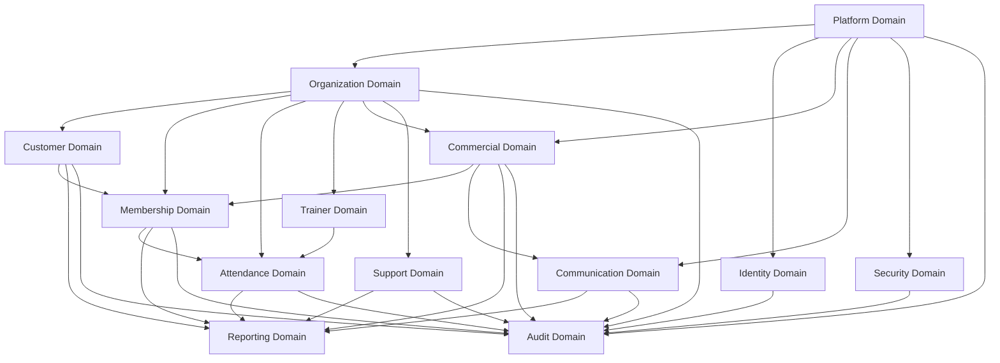
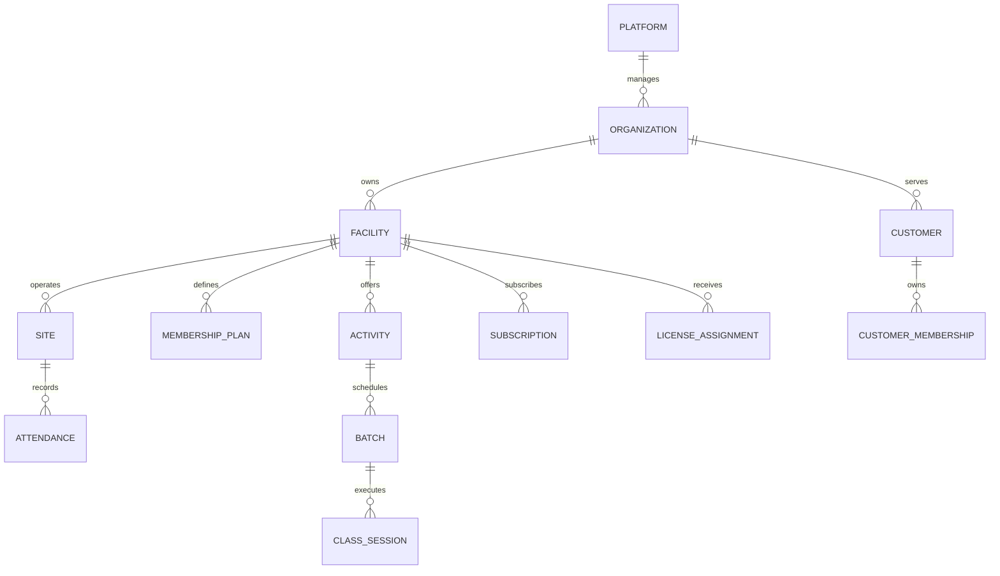
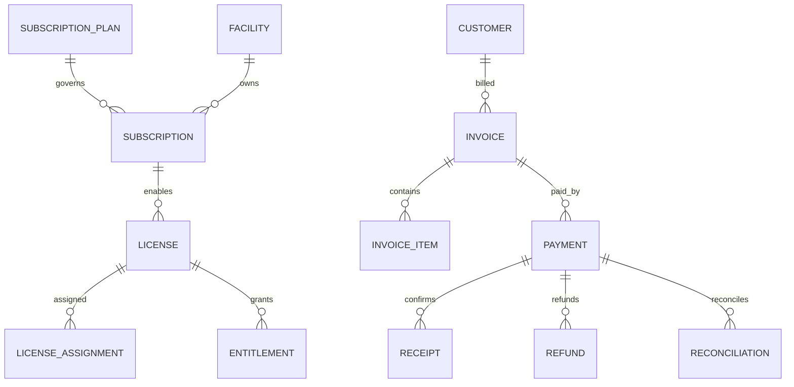
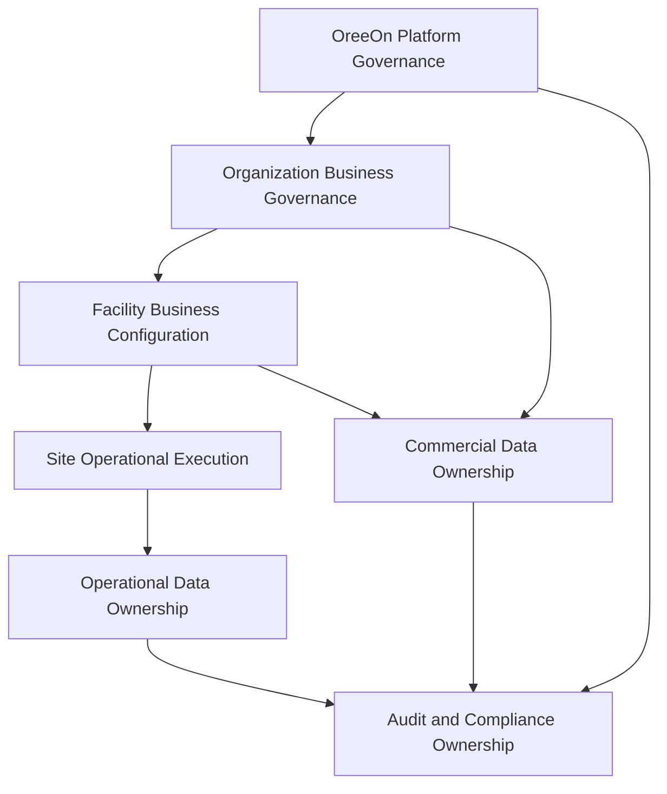
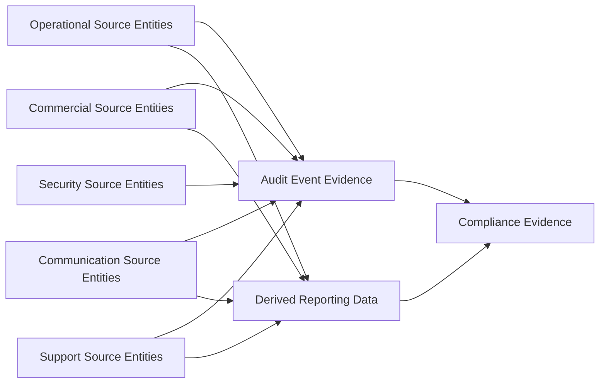

# DB-01 Conceptual Data Model

**Document ID:** DB-01  
**Document Name:** Conceptual Data Model  
**Company:** OreeOn Technologies Pvt. Ltd.  
**Product:** Digitize  
**Document Type:** Database Design  
**Version:** 0.1  
**Status:** Design Draft  
**Business Owner:** Product Architecture  
**Technical Owner:** Data Architecture  
**Prepared By:** Data Architecture Team  
**Reviewed By:** Data Architecture Review Board  
**Approved By:** Product Architecture / Solution Architecture  
**Classification:** Internal  
**Confidentiality:** Confidential  
**Document State:** Design Draft  
**Release:** Foundation Documentation  
**Dependencies:** Product Foundation, Business Analysis, Functional Requirements, Commercial Strategy, Technical Architecture  
**Supersedes:** Not Applicable  
**Superseded By:** Not Applicable  
**Last Updated:** July 2026  
**Database Review:** Ready for Review

---

# Revision History

| Version | Date | Author | Description |
|---|---|---|---|
| 0.1 | July 2026 | Data Architecture Team | Initial conceptual data model draft |
| 0.2 | 2026-07-26 | Data Architecture Team | Freeze preparation edits: standardized review status; traceability updates for core domains; minor corrections |

---

# 1. Introduction

## 1.1 Purpose

This document defines the Conceptual Data Model for Digitize.

The Conceptual Data Model identifies the approved business data domains, conceptual business entities, ownership responsibilities, high-level relationships, tenant hierarchy, lifecycle expectations, domain boundaries, and traceability required to guide downstream Logical Data Model, Multi-Tenancy Data Design, Physical Data Model, API design, UI design, testing, reporting, and audit documentation.

This document intentionally avoids physical database design details. It does not define physical table names, columns, data types, indexes, constraints, SQL, storage design, or database-engine-specific implementation.

## 1.2 Objectives

The objectives of this document are to:

- Establish a common enterprise data language for Digitize.
- Preserve the approved hierarchy of Platform, Organization, Facility, Site, and Operations.
- Define Organization as the tenant root for all tenant-owned data.
- Define Facility as the primary commercial subscription and licensing unit.
- Define Site as the tenant-scoped physical operating location.
- Identify conceptual entities required by approved Product Foundation, Business Analysis, Functional Requirements, Commercial Strategy, and Technical Architecture documents.
- Separate platform-owned, shared reference, tenant-owned, operational, commercial, communication, reporting, support, audit, compliance, and security data.
- Define high-level entity ownership using Business Owner and Technical Owner.
- Identify conceptual relationships, cardinality, optionality, tenant scope, and lifecycle expectations.
- Provide conceptual diagrams that remain readable and suitable for enterprise architecture review.
- Establish traceability to source documents without copying full business or functional requirements.

## 1.3 Scope

This document covers conceptual data design for:

- Platform administration data.
- Organization, Facility, and Site hierarchy data.
- Identity, staff, role, permission, access scope, session, and security event data.
- Customer profile, customer contact, customer consent, customer document, and customer lifecycle data.
- Membership plan, membership purchase, membership lifecycle, freeze, resume, renewal, upgrade, downgrade, cancellation, and history data.
- Attendance, walk-in, activity, batch, class, schedule, trainer, and personal training data.
- Billing, invoice, payment, refund, adjustment, tax, receipt, reconciliation, settlement, subscription, license, entitlement, and commercial audit data.
- Advertisement campaign, notification, template, delivery, preference, consent, and communication history data.
- Reporting, analytics, dashboards, KPIs, report exports, and derived analytical data.
- Support ticket, SLA, escalation, audit event, compliance record, investigation, data export, and administrative access data.
- Data ownership, conceptual cardinality, lifecycle states, traceability, assumptions, constraints, risks, and open questions.

## 1.4 Out of Scope

The following are out of scope for DB-01:

- Physical table names.
- Physical column names.
- Database-specific data types.
- SQL scripts.
- Physical indexes.
- Physical constraints.
- Vendor-specific database implementation.
- Storage design.
- Partitioning implementation.
- Migration scripts.
- API payload schemas.
- UI wireframes.
- Test case implementation.

These topics are addressed in DB-02 through DB-10, API specifications, UI / UX design, testing documentation, deployment documentation, and approved ADRs.

## 1.5 Intended Audience

This document is intended for:

- Product Managers.
- Business Analysts.
- Enterprise Architects.
- Solution Architects.
- Data Architects.
- Database Designers.
- Backend Developers.
- API Designers.
- UI / UX Designers.
- QA Engineers.
- DevOps Engineers.
- Security Engineers.
- Reporting and Analytics Teams.
- Implementation Teams.
- Support Teams.
- Audit and Compliance Stakeholders.

## 1.6 Related Documents

| Document Type | Document Reference | Relationship |
|---|---|---|
| Product Foundation | PF-01 Product Glossary | Source terminology for conceptual entities |
| Product Foundation | PF-02 Domain Model | Source business hierarchy, domains, relationships, aggregates, and lifecycle |
| Product Foundation | PF-03 Product Vision Document | Source product scope and enterprise SaaS vision |
| Commercial Strategy | CS-01 Subscription and Licensing Strategy | Source subscription, license, entitlement, and facility commercial scope |
| Commercial Strategy | CS-02 Pricing Strategy | Source conceptual pricing and discount entities |
| Commercial Strategy | CS-03 Billing and Invoicing Strategy | Source billing, invoice, payment, and financial traceability concepts |
| Commercial Strategy | CS-04 Discount and Promotion Policy | Source discount, promotion, campaign, and commercial policy concepts |
| Business Analysis | BA-01 to BA-10 | Source business requirements, business rules, processes, flows, personas, journeys, traceability, NFRs, assumptions, constraints, and risks |
| Functional Requirements | FR-01 to FR-21 | Source functional data needs and approved related database entity references |
| Technical Architecture | TA-00 to TA-10 | Source technical architecture principles, data architecture, security architecture, integration architecture, and ADR alignment |
| Database Design | DB-00 Database Design Standards | Source database documentation structure and modeling standards |

---

# 2. Data Design Context

## 2.1 Business Context

Digitize is an enterprise multi-tenant SaaS platform for activity, recreation, fitness, training, and experience businesses. The initial domain is swimming pool management, with planned expansion to gyms, yoga studios, dance studios, sports academies, fitness centers, indoor sports facilities, martial arts centers, adventure parks, kids activity centers, football and badminton academies, and other activity-based businesses.

The conceptual data model must therefore support common reusable business concepts rather than industry-specific or customer-specific database structures. Facility Type variation shall be represented conceptually through configuration, activity definitions, rules, licenses, and feature access rather than separate schemas per business type.

The approved platform hierarchy is:

```text
Platform
    ↓
Organization
    ↓
Facility
    ↓
Site
    ↓
Operations
```

Organization is the tenant root. Every tenant-owned record must be traceable to an Organization. Facility-scoped and Site-scoped records must remain traceable to their owning Organization.

## 2.2 Functional Context

The conceptual model supports the approved Functional Requirements modules:

| Functional Requirement Document | Functional Area | Conceptual Data Impact |
|---|---|---|
| FR-02 | Platform Administration | Platform settings, feature flags, reference data, global policies, monitoring, maintenance, platform reporting |
| FR-03 | Organization Management | Organization profile, settings, policies, branding, documents, lifecycle, dashboard |
| FR-04 | Facility Management | Facility profile, facility type, settings, operating hours, capacity, manager assignment, policies, lifecycle |
| FR-05 | Site Management | Site profile, site settings, operating hours, capacity, documents, policies, lifecycle |
| FR-06 | User and Role Management | Staff accounts, roles, permissions, access scope, credentials, staff activity, staff directory |
| FR-07 | Customer Management | Customer profile, identity verification, documents, emergency contacts, customer history |
| FR-08 | Membership Management | Membership creation, activation, renewal, upgrade, downgrade, freeze, resume, cancellation, expiry, transfer, history |
| FR-09 | Attendance Management | Customer check-in, eligibility validation, session attendance, walk-in attendance, check-out, cancellation, attendance audit |
| FR-10 | Walk-in Customer Management | Walk-in identification, eligibility, visit, charges, payment, attendance, history |
| FR-11 | Trainer Management | Trainer profile, assignment, availability, schedule conflict, trainer attendance, status, performance |
| FR-12 | Personal Training | Training package, trainer assignment, booking, reschedule, cancellation, session start, completion, notes, progress |
| FR-13 | Batch and Class Management | Activity, rules, batch, schedule, trainer assignment, capacity, enrollment, session lifecycle, performance |
| FR-14 | Billing and Payment Management | Invoice, charges, discounts, tax, adjustments, payment, receipt, refund, reconciliation, statements, commercial reports |
| FR-15 | Subscription Management | Subscription plan, subscription lifecycle, renewal, upgrade, downgrade, suspension, cancellation, expiry, history |
| FR-16 | License Management | License, license assignment, licensed capabilities, activation, renewal, suspension, expiry, cancellation, validation, history |
| FR-17 | Advertisement Campaign | Campaign, configuration, audience, approval, schedule, launch, pause, completion, cancellation, performance |
| FR-18 | Notification Management | Template, notification rule, notification, schedule, delivery, retry, history, delivery tracking, preferences |
| FR-19 | Reports and Analytics | Dashboards, reports, exports, schedules, KPIs, historical trends |
| FR-20 | Support Ticket | Ticket, classification, assignment, priority, progress, information request, escalation, resolution, closure, reopening |
| FR-21 | Audit and Compliance | Business activity, login activity, configuration changes, security events, audit review, investigation, compliance report, archival, export |

## 2.3 Technical Architecture Context

TA-03 Data Architecture defines tenant-aware data ownership, data classification, reporting data separation, audit retention, archival, backup, restore, and recovery expectations.

TA-10 Architecture Decision Records currently identify relevant proposed decisions including:

| ADR | Decision Area | Conceptual Data Impact |
|---|---|---|
| ADR-001 | Multi-tenancy by default | Organization shall remain the tenant root |
| ADR-003 | Commercial scalability | Facility shall remain the primary commercial subscription unit |
| ADR-014 | Tenant-aware data access | Tenant-owned data must be scoped by tenant context |
| ADR-015 | Audit separation | Audit data shall be conceptually separated from operational data |
| ADR-016 | Reporting data | Reporting shall use derived read-oriented data and not become source of truth |
| ADR-020 | RBAC and tenant scope | Identity and access entities must support authorization before domain execution |
| ADR-021 | Tenant isolation guard | Tenant context propagation is required across tenant-scoped access |
| ADR-030 | Payment card handling | Sensitive payment-card data should remain delegated to gateway providers |
| ADR-031 | Commercial auditability | Commercial state changes shall produce financial audit events |
| ADR-034 | Tenant context | Tenant context shall be a shared platform capability |

These ADRs are not treated as frozen implementation choices unless explicitly approved. DB-01 uses them as architecture alignment references only.

## 2.4 Data Ownership Context

Each conceptual entity has a Business Owner and Technical Owner.

Business Owner identifies the product, business, or operational function accountable for data meaning and lifecycle. Technical Owner identifies the architecture or engineering function accountable for data design, integrity, security, performance, and maintainability.

Ownership in DB-01 is conceptual. Final persistence ownership, service ownership, schema boundaries, physical table responsibility, and integration ownership are refined in DB-02 through DB-10 and the corresponding Technical Architecture documents.

---

# 3. Data Scope Model

## 3.1 In-Scope Data Domains

| Data Domain ID | Data Domain | Scope |
|---|---|---|
| DB-DOM-001 | Platform | Platform settings, global master data, feature flags, global rules, maintenance, release, monitoring, platform reporting |
| DB-DOM-002 | Identity | User accounts, staff identity, roles, permissions, access scopes, sessions, authentication events |
| DB-DOM-003 | Organization | Organization, facility, site, business settings, policies, branding, documents, lifecycle |
| DB-DOM-004 | Customer | Customer profile, contacts, preferences, consent, documents, identity verification, emergency contacts, customer history |
| DB-DOM-005 | Membership | Membership plans, plan rules, membership purchase, customer membership, lifecycle history, freeze, renewal, transfer, cancellation |
| DB-DOM-006 | Attendance | Attendance records, entry, exit, eligibility validation, session attendance, walk-in attendance, capacity usage |
| DB-DOM-007 | Commercial | Pricing, invoice, charge, discount, tax, payment, receipt, refund, reconciliation, settlement, subscription, license, entitlement |
| DB-DOM-008 | Trainer | Trainer profile, assignment, availability, schedule, attendance, personal training package, session, notes, progress |
| DB-DOM-009 | Reporting | Report definitions, dashboards, KPI definitions, snapshots, report exports, reporting projections, analytical aggregates |
| DB-DOM-010 | Communication | Campaigns, audiences, schedules, templates, notifications, recipients, delivery, attempts, failures, preferences, consent |
| DB-DOM-011 | Audit | Audit event, audit entity reference, business activity, configuration change, security investigation, compliance evidence |
| DB-DOM-012 | Security | Security policy, password policy, session policy, security event, privileged access, administrative access record |
| DB-DOM-013 | Support | Support ticket, category, priority, assignment, comment, attachment, escalation, SLA tracking |

## 3.2 Out-of-Scope Data Domains

| Data Domain | Reason |
|---|---|
| Payroll | Not approved in current Functional Requirements or Business Process Catalog |
| Inventory Management | Not approved in current Functional Requirements or Business Process Catalog |
| Procurement | Not approved in current Functional Requirements or Business Process Catalog |
| Accounting Ledger | Financial transaction traceability is in scope, but full general ledger accounting is not approved |
| Offline Mobile Synchronization | Future architecture topic; not approved as a current database capability |
| Marketplace / Plugin Framework | Future architecture topic; not approved as a current database capability |
| Direct Customer Booking | Explicitly excluded unless approved source documents add this capability |

## 3.3 Data Domain Diagram

| Diagram ID | Diagram Name | Diagram Type | Location |
|---|---|---|---|
| DB-01-DGM-001 | Conceptual Data Domain Overview | Data Domain Diagram | Section 3.3 |



---

# 4. Data Domains

Every conceptual entity belongs to one primary data domain. Secondary usage by other domains shall be captured through relationships and traceability rather than duplicate ownership.

| Data Domain | Purpose | Typical Ownership |
|---|---|---|
| Platform | Platform-level configuration, global settings, feature flags, and shared SaaS controls | Platform Administration |
| Identity | Authentication, users, roles, permissions, sessions, and access control | Identity and Access Management |
| Organization | Organization, facility, site, staff context, and tenant hierarchy | Organization Management |
| Customer | Customer profile, customer identity, customer lifecycle, documents, and guardians where applicable | Customer Management |
| Membership | Membership plans, purchases, renewals, upgrades, freezes, cancellations, and lifecycle history | Membership Management |
| Attendance | Check-in, check-out, attendance validation, usage tracking, and walk-in attendance | Operations |
| Commercial | Pricing, billing, invoices, payments, refunds, subscriptions, licenses, taxes, and reconciliation | Finance / Commercial Management |
| Trainer | Trainer assignment, personal training, trainer schedules, batches, classes, and capacity planning | Training Operations |
| Reporting | Derived analytics, KPI snapshots, aggregates, dashboards, and analytical projections | Reporting and Analytics |
| Communication | Campaigns, notification templates, delivery logs, consent, and communication preferences | Communication Management |
| Audit | Audit logs, business events, security events, configuration changes, and compliance evidence | Audit and Compliance |
| Security | Security policies, password policies, session policies, security alerts, and access risk records | Security Governance |

---

# 5. Data Classification

| Data Group | Data Domain | Classification | Sensitivity | Business Owner | Technical Owner | Notes |
|---|---|---|---|---|---|---|
| Platform Configuration | Platform | Internal Platform | Medium | Platform Administration | Platform Architecture | Controls SaaS behavior |
| Global Reference Data | Platform | Public Reference / Internal Platform | Low to Medium | Platform Administration | Data Architecture | Shared across Organizations |
| Tenant Hierarchy | Organization | Tenant Master | Medium | Organization Management | Data Architecture | Includes Organization, Facility, Site |
| Identity and Access | Identity | Authentication / Authorization | High | User and Role Management | Security Architecture | Controls user access and scope |
| Customer Data | Customer | Sensitive Personal | High | Customer Management | Data Architecture | Includes profile, contacts, documents, consent |
| Membership Data | Membership | Tenant Operational | Medium to High | Membership Management | Data Architecture | Supports membership lifecycle and history |
| Attendance Data | Attendance | Tenant Operational | Medium | Operations | Data Architecture | High-volume operational records |
| Training Data | Trainer | Tenant Operational | Medium | Training Operations | Data Architecture | Includes trainer, batch, class, personal training |
| Commercial Data | Commercial | Financial / Payment Reference | High | Finance / Commercial Management | Data Architecture | Financial values require historical preservation |
| Communication Data | Communication | Communication | Medium to High | Communication Management | Integration Architecture | Consent and delivery history require governance |
| Reporting Data | Reporting | Derived Analytical | Medium | Reporting and Analytics | Data Engineering | Derived, not authoritative source |
| Support Data | Support | Tenant Operational / Sensitive Personal | Medium to High | Support Management | Support Architecture | May reference customer, operational, and issue data |
| Audit Data | Audit | Audit / Compliance | High | Audit and Compliance | Security Architecture | Append-only evidence for critical actions |
| Security Data | Security | Security | High | Security Governance | Security Architecture | Includes security events and privileged access |

---

# 6. Entity / Table Design

This section defines conceptual entities only. Physical table names are not defined in DB-01.

## 6.1 Conceptual Entity Catalogue

| Entity / Table | Purpose | Data Domain | Business Owner | Technical Owner | Classification | Notes |
|---|---|---|---|---|---|---|
| Platform | Represents the Digitize SaaS environment governed by OreeOn | Platform | Platform Administration | Platform Architecture | Internal Platform | Platform-level root context |
| Platform Setting | Defines global platform behavior | Platform | Platform Administration | Platform Architecture | Internal Platform | Configuration-driven behavior |
| Global Master Data | Provides shared controlled reference values | Platform | Platform Administration | Data Architecture | Public Reference / Internal Platform | Used across tenant contexts |
| Feature Flag | Controls availability of capabilities | Platform | Platform Administration | Platform Architecture | Internal Platform | Applies globally or by approved scope |
| Maintenance Window | Represents planned platform maintenance | Platform | Platform Administration | DevOps Architecture | Internal Platform | Supports operational continuity |
| Release Record | Represents platform release governance | Platform | Platform Administration | DevOps Architecture | Internal Platform | Supports release traceability |
| Organization | Represents the tenant root and subscribing business entity | Organization | Organization Management | Data Architecture | Tenant Master | Every tenant-owned record traces to Organization |
| Organization Setting | Represents tenant-level configuration | Organization | Organization Management | Data Architecture | Tenant Master | Controls Organization-specific behavior |
| Organization Policy | Represents tenant-level business policy | Organization | Organization Management | Data Architecture | Tenant Master | Governs Facility and Site behavior |
| Organization Branding | Represents tenant brand presentation settings | Organization | Organization Management | Data Architecture | Tenant Master | Supports branded experience |
| Organization Document | Represents Organization-level document records | Organization | Organization Management | Data Architecture | Tenant Master | May include compliance or business documents |
| Facility | Represents an operational business unit and primary commercial subscription unit | Organization | Facility Management | Data Architecture | Tenant Master | Belongs to exactly one Organization |
| Facility Type | Represents configured business type such as swimming pool, gym, yoga studio, or sports academy | Platform | Platform Administration | Data Architecture | Public Reference / Internal Platform | Enables expansion by configuration |
| Facility Setting | Represents Facility-specific configuration | Organization | Facility Management | Data Architecture | Tenant Master | Inherits Organization policy where applicable |
| Facility Policy | Represents Facility-level business policy | Organization | Facility Management | Data Architecture | Tenant Master | Governs Sites unless overridden where allowed |
| Facility Operating Hours | Defines conceptual availability of Facility operations | Organization | Facility Management | Data Architecture | Tenant Operational | Refined logically in DB-02 |
| Facility Capacity Rule | Defines conceptual operating capacity limits | Organization | Facility Management | Data Architecture | Tenant Operational | Supports attendance, batch, and walk-in validation |
| Site | Represents a physical operating location under a Facility | Organization | Site Management | Data Architecture | Tenant Master | Operational execution occurs at Site level |
| Site Setting | Represents Site-level configuration | Organization | Site Management | Data Architecture | Tenant Master | Inherits Facility configuration where applicable |
| Site Policy | Represents local operating policies | Organization | Site Management | Data Architecture | Tenant Master | Must not bypass Organization or Facility governance |
| Site Operating Hours | Defines conceptual branch operating availability | Organization | Site Management | Data Architecture | Tenant Operational | Supports attendance and scheduling |
| Site Capacity Rule | Defines conceptual branch capacity constraints | Organization | Site Management | Data Architecture | Tenant Operational | Supports safe operational usage |
| User Account | Represents an authenticated system user | Identity | User and Role Management | Security Architecture | Authentication | May represent staff, platform user, or future external user |
| Staff Profile | Represents staff business profile | Identity | User and Role Management | Security Architecture | Tenant Master | Scoped by Organization, Facility, and Site access |
| Role | Represents an access role | Identity | User and Role Management | Security Architecture | Authorization | Role definitions may be platform or tenant scoped |
| Permission | Represents an atomic capability permission | Identity | User and Role Management | Security Architecture | Authorization | Drives authorization decisions |
| Role Assignment | Represents assignment of role to user within scope | Identity | User and Role Management | Security Architecture | Authorization | Enforces Organization, Facility, and Site access |
| Access Scope | Represents allowed tenant, Facility, and Site boundary | Identity | User and Role Management | Security Architecture | Authorization | Required for tenant isolation |
| Session | Represents authenticated user session | Identity | User and Role Management | Security Architecture | Security | Governed by session policy |
| Authentication Event | Represents login, logout, reset, failure, or credential event | Security | Security Governance | Security Architecture | Security | Feeds audit and investigation |
| Security Event | Represents security-relevant platform activity | Security | Security Governance | Security Architecture | Security | Includes suspicious access and policy violations |
| Customer | Represents the person consuming services | Customer | Customer Management | Data Architecture | Sensitive Personal | Tenant-owned and Organization traceable |
| Customer Contact | Represents customer communication and emergency contact details | Customer | Customer Management | Data Architecture | Sensitive Personal | Requires privacy controls |
| Customer Preference | Represents customer service or communication preferences | Customer | Customer Management | Data Architecture | Sensitive Personal / Communication | May affect operations and notifications |
| Customer Consent | Represents consent for communication or data usage | Customer | Customer Management | Data Architecture | Compliance / Communication | History preservation may be required |
| Customer Document | Represents customer-provided documents | Customer | Customer Management | Data Architecture | Sensitive Personal | Access controlled and auditable |
| Customer History | Represents immutable customer lifecycle and interaction history | Customer | Customer Management | Data Architecture | Sensitive Personal / Audit | Derived from multiple source events |
| Membership Plan | Represents Facility-defined membership offering | Membership | Membership Management | Data Architecture | Tenant Master | Belongs to Facility |
| Membership Plan Rule | Represents rules governing plan eligibility, usage, freeze, renewal, and cancellation | Membership | Membership Management | Data Architecture | Tenant Master | Supports configurable membership behavior |
| Customer Membership | Represents purchased membership owned by a Customer | Membership | Membership Management | Data Architecture | Tenant Operational | Customer may own multiple memberships where approved |
| Membership Lifecycle History | Represents immutable membership state history | Membership | Membership Management | Data Architecture | Tenant Operational / Audit | Preserves state transitions |
| Membership Freeze | Represents membership freeze interval | Membership | Membership Management | Data Architecture | Tenant Operational | Conceptually separate lifecycle event |
| Membership Renewal | Represents renewal action for a membership | Membership | Membership Management | Data Architecture | Tenant Operational / Commercial | May trigger invoice and payment |
| Attendance | Represents customer or session attendance usage | Attendance | Operations | Data Architecture | Tenant Operational | High-volume operational record |
| Attendance Eligibility | Represents eligibility outcome for attendance | Attendance | Operations | Data Architecture | Tenant Operational | Derived from membership, walk-in, capacity, and rules |
| Entry and Exit | Represents check-in and check-out activity | Attendance | Operations | Data Architecture | Tenant Operational | May be modeled as part of attendance logically |
| Walk-in Customer | Represents customer context for non-membership usage | Attendance | Operations | Data Architecture | Sensitive Personal / Tenant Operational | May reference an existing Customer |
| Walk-in Visit | Represents a paid or tracked visit without active membership usage | Attendance | Operations | Data Architecture | Tenant Operational / Commercial | Links attendance and charges |
| Activity | Represents a Facility-offered activity | Trainer | Training Operations | Data Architecture | Tenant Master | Supports batches, classes, and future facility types |
| Batch | Represents a scheduled group offering | Trainer | Training Operations | Data Architecture | Tenant Operational | Connected to activity, trainer, schedule, and capacity |
| Class Session | Represents an executable scheduled class/session occurrence | Trainer | Training Operations | Data Architecture | Tenant Operational | Supports attendance and trainer assignment |
| Batch Enrollment | Represents customer enrollment into a batch | Trainer | Training Operations | Data Architecture | Tenant Operational | Supports capacity and eligibility validation |
| Trainer | Represents training staff profile and operational assignment | Trainer | Training Operations | Data Architecture | Tenant Master | May also have User Account |
| Trainer Assignment | Represents trainer assignment to Facility, Site, Batch, or Training Session | Trainer | Training Operations | Data Architecture | Tenant Operational | Supports scheduling and responsibility |
| Trainer Availability | Represents trainer availability for scheduling | Trainer | Training Operations | Data Architecture | Tenant Operational | Used for conflict detection |
| Personal Training Package | Represents purchasable personal training package | Trainer | Training Operations | Data Architecture | Tenant Operational / Commercial | May trigger billing and session entitlement |
| Personal Training Session | Represents scheduled personal training execution | Trainer | Training Operations | Data Architecture | Tenant Operational | Links Customer, Trainer, Site, and package |
| Training Note | Represents trainer-recorded session note | Trainer | Training Operations | Data Architecture | Sensitive Personal / Tenant Operational | Requires access control |
| Customer Progress | Represents customer progress tracking in training | Trainer | Training Operations | Data Architecture | Sensitive Personal | Future privacy-sensitive analytical use |
| Pricing | Represents approved commercial pricing context | Commercial | Finance / Commercial Management | Data Architecture | Financial | Historical value preservation required |
| Price Version | Represents a versioned price definition | Commercial | Finance / Commercial Management | Data Architecture | Financial | Prevents dependency on current price only |
| Discount | Represents approved discount | Commercial | Finance / Commercial Management | Data Architecture | Financial | May be manual or policy-driven |
| Promotion | Represents promotional commercial offering | Commercial | Marketing / Finance | Data Architecture | Financial / Communication | May relate to campaigns |
| Tax | Represents applicable tax configuration and tax outcome | Commercial | Finance / Commercial Management | Data Architecture | Financial | Supports compliance and invoice accuracy |
| Billing Account | Represents billing relationship for Organization or Customer | Commercial | Finance / Commercial Management | Data Architecture | Financial | Conceptual billing owner context |
| Invoice | Represents issued commercial document | Commercial | Finance / Commercial Management | Data Architecture | Financial | Historical and audit protected |
| Invoice Item | Represents invoice line-level charge concept | Commercial | Finance / Commercial Management | Data Architecture | Financial | Physical detail deferred |
| Billing Adjustment | Represents credit, debit, or manual commercial adjustment | Commercial | Finance / Commercial Management | Data Architecture | Financial | Requires approval and audit |
| Payment | Represents captured payment transaction | Commercial | Finance / Commercial Management | Data Architecture | Financial / Payment Reference | Gateway-sensitive data excluded |
| Payment Attempt | Represents attempt to collect payment | Commercial | Finance / Commercial Management | Integration Architecture | Payment Reference | Supports retries and callbacks |
| Payment Method Reference | Represents non-sensitive payment method reference | Commercial | Finance / Commercial Management | Integration Architecture | Payment Reference | Must not store raw card data |
| Receipt | Represents payment confirmation document | Commercial | Finance / Commercial Management | Data Architecture | Financial | Links to payment |
| Refund | Represents customer or commercial refund | Commercial | Finance / Commercial Management | Data Architecture | Financial | Requires historical traceability |
| Refund Attempt | Represents attempt to process refund | Commercial | Finance / Commercial Management | Integration Architecture | Payment Reference | Supports provider interaction |
| Reconciliation | Represents matching of payment, invoice, settlement, and provider records | Commercial | Finance / Commercial Management | Data Architecture | Financial | Required for operational financial control |
| Settlement | Represents provider or commercial settlement information | Commercial | Finance / Commercial Management | Integration Architecture | Financial | May be provider-derived |
| Commercial Audit History | Represents immutable commercial state history | Commercial | Finance / Commercial Management | Data Architecture | Financial / Audit | Supports audit and compliance |
| Subscription Plan | Represents SaaS subscription plan definition | Commercial | Platform Administration | Data Architecture | Internal Platform / Commercial | Platform-level commercial configuration |
| Subscription | Represents Facility-level commercial subscription | Commercial | Finance / Commercial Management | Data Architecture | Commercial Control | Facility remains primary subscription unit |
| Subscription Term | Represents subscription term duration and commercial period | Commercial | Finance / Commercial Management | Data Architecture | Commercial Control | Supports different Facility terms |
| Subscription Lifecycle History | Represents subscription state history | Commercial | Finance / Commercial Management | Data Architecture | Commercial Control / Audit | Preserves renewal, suspension, cancellation, expiry |
| License | Represents licensed entitlement bundle | Commercial | License Management | Data Architecture | Commercial Control | Controls Facility capability access |
| License Assignment | Represents license assignment to Facility | Commercial | License Management | Data Architecture | Commercial Control | Facility-scoped capability access |
| Entitlement | Represents feature or capability access right | Commercial | License Management | Data Architecture | Commercial Control | Supports authorization and feature access |
| Advertisement Campaign | Represents marketing campaign | Communication | Marketing Management | Data Architecture | Communication | Requires approval and delivery tracking |
| Campaign Audience | Represents targeted audience criteria or selected recipients | Communication | Marketing Management | Data Architecture | Communication / Sensitive Personal | Must respect consent and tenant scope |
| Campaign Schedule | Represents campaign timing and delivery plan | Communication | Marketing Management | Data Architecture | Communication | Supports scheduled execution |
| Campaign Result | Represents campaign outcome and performance | Communication | Marketing Management | Data Architecture | Communication / Reporting | Feeds analytics |
| Notification Template | Represents reusable notification content pattern | Communication | Communication Management | Data Architecture | Communication | May be platform or tenant scoped |
| Notification Preference | Represents user or customer communication preference | Communication | Communication Management | Data Architecture | Communication / Sensitive Personal | Must respect consent |
| Notification | Represents generated notification instance | Communication | Communication Management | Integration Architecture | Communication | May be manual, scheduled, or system-generated |
| Notification Recipient | Represents recipient context for notification | Communication | Communication Management | Integration Architecture | Communication / Sensitive Personal | Scope and privacy sensitive |
| Notification Delivery | Represents delivery status per channel | Communication | Communication Management | Integration Architecture | Communication | Supports retry and audit |
| Notification Attempt | Represents delivery retry attempt | Communication | Communication Management | Integration Architecture | Communication | Supports provider diagnostics |
| Report Definition | Represents configured report | Reporting | Reporting and Analytics | Data Engineering | Derived Analytical | Not source of truth |
| Report Schedule | Represents scheduled report execution | Reporting | Reporting and Analytics | Data Engineering | Derived Analytical | Supports automated reporting |
| Report Execution | Represents report generation run | Reporting | Reporting and Analytics | Data Engineering | Derived Analytical | Supports export and diagnostics |
| Report Export | Represents exported report artifact metadata | Reporting | Reporting and Analytics | Data Engineering | Derived Analytical / Compliance | Export activity must be auditable |
| Dashboard Configuration | Represents dashboard layout and KPI choices | Reporting | Reporting and Analytics | Data Engineering | Derived Analytical | User or tenant scoped |
| KPI Definition | Represents approved metric definition | Reporting | Reporting and Analytics | Data Engineering | Derived Analytical | Must trace to business meaning |
| KPI Snapshot | Represents periodic KPI value snapshot | Reporting | Reporting and Analytics | Data Engineering | Derived Analytical | Derived from authoritative sources |
| Reporting Projection | Represents read-oriented reporting view concept | Reporting | Reporting and Analytics | Data Engineering | Derived Analytical | Physical projection deferred |
| Support Ticket | Represents user or customer support request | Support | Support Management | Support Architecture | Tenant Operational / Sensitive Personal | May reference multiple domains |
| Ticket Assignment | Represents support ownership assignment | Support | Support Management | Support Architecture | Tenant Operational | Supports support workflow |
| Ticket Comment | Represents support communication | Support | Support Management | Support Architecture | Tenant Operational / Sensitive Personal | Access controlled |
| Ticket Escalation | Represents escalation event | Support | Support Management | Support Architecture | Tenant Operational | Supports SLA and accountability |
| SLA Tracking | Represents support service-level timing | Support | Support Management | Support Architecture | Tenant Operational | Supports support reporting |
| Audit Event | Represents immutable event evidence | Audit | Audit and Compliance | Security Architecture | Audit / Compliance | Receives critical events from all domains |
| Audit Entity Reference | Represents entity affected by audit event | Audit | Audit and Compliance | Security Architecture | Audit / Compliance | Supports investigation and traceability |
| Compliance Record | Represents compliance evidence | Audit | Audit and Compliance | Security Architecture | Compliance | Supports regulatory or governance reporting |
| Data Export Record | Represents export activity and evidence | Audit | Audit and Compliance | Security Architecture | Compliance | Critical for privacy and audit |
| Investigation Record | Represents audit or security investigation | Audit | Audit and Compliance | Security Architecture | Compliance / Security | May reference audit and support data |
| Administrative Access Record | Represents privileged access activity | Audit | Audit and Compliance | Security Architecture | Security / Audit | Required for cross-tenant support and platform access |

---

# 7. Attribute / Column Design

Not applicable for this document because DB-01 is a conceptual data model and shall not define attributes, columns, physical data types, physical nullability, or implementation constraints.

Conceptual attributes and logical identifiers are addressed in DB-02 Logical Data Model.

---

# 8. Relationships

## 8.1 Conceptual Relationship Catalogue

| Relationship | Parent | Child | Cardinality | Optionality | Tenant Scope | Notes |
|---|---|---|---|---|---|---|
| DB-01-REL-001 | Platform | Organization | One-to-Many | Organization mandatory after onboarding | Cross-tenant platform scope | Platform manages many Organizations |
| DB-01-REL-002 | Organization | Facility | One-to-Many | Facility mandatory for commercial operation | Tenant-owned | Organization owns Facilities |
| DB-01-REL-003 | Facility | Site | One-to-Many | Site required for physical operations | Tenant-owned | Facility operates through Sites |
| DB-01-REL-004 | Organization | Organization Setting | One-to-Many | Optional until configured | Tenant-owned | Tenant-level configuration |
| DB-01-REL-005 | Organization | Organization Policy | One-to-Many | Optional until configured | Tenant-owned | Governs Facilities and Sites |
| DB-01-REL-006 | Facility | Facility Setting | One-to-Many | Optional until configured | Tenant-owned | Facility-level configuration |
| DB-01-REL-007 | Facility | Facility Policy | One-to-Many | Optional until configured | Tenant-owned | Governs Sites |
| DB-01-REL-008 | Site | Site Setting | One-to-Many | Optional until configured | Tenant-owned | Site-level local configuration |
| DB-01-REL-009 | Site | Site Policy | One-to-Many | Optional until configured | Tenant-owned | Must respect parent governance |
| DB-01-REL-010 | Facility Type | Facility | One-to-Many | Facility Type mandatory for Facility | Shared reference | Enables configurable facility behavior |
| DB-01-REL-011 | User Account | Staff Profile | One-to-Zero-or-One | Staff profile optional for platform users | Tenant-aware | Some users may be platform-only |
| DB-01-REL-012 | User Account | Role Assignment | One-to-Many | Role assignment required for access | Tenant-aware | Grants scoped capabilities |
| DB-01-REL-013 | Role | Role Assignment | One-to-Many | Mandatory for assigned role | Tenant-aware / platform | Role assignment binds role to user |
| DB-01-REL-014 | Permission | Role | Many-to-Many | Optional until configured | Tenant-aware / platform | Refined through logical associative entity in DB-02 |
| DB-01-REL-015 | Access Scope | Role Assignment | One-to-Many | Mandatory for tenant-scoped roles | Tenant-owned | Enforces Organization, Facility, Site boundaries |
| DB-01-REL-016 | Organization | Customer | One-to-Many | Customer optional until registered | Tenant-owned | Customer is Organization traceable |
| DB-01-REL-017 | Customer | Customer Contact | One-to-Many | Optional | Tenant-owned | Contact and emergency details |
| DB-01-REL-018 | Customer | Customer Consent | One-to-Many | Optional but required for governed communication | Tenant-owned | Consent history may be preserved |
| DB-01-REL-019 | Customer | Customer Document | One-to-Many | Optional | Tenant-owned | Document access requires authorization |
| DB-01-REL-020 | Facility | Membership Plan | One-to-Many | Optional until configured | Tenant-owned | Facility defines membership offerings |
| DB-01-REL-021 | Membership Plan | Membership Plan Rule | One-to-Many | Optional until configured | Tenant-owned | Rules govern membership behavior |
| DB-01-REL-022 | Customer | Customer Membership | One-to-Many | Optional | Tenant-owned | Multiple simultaneous memberships supported where approved |
| DB-01-REL-023 | Membership Plan | Customer Membership | One-to-Many | Mandatory for plan-based membership | Tenant-owned | Membership is purchased from plan |
| DB-01-REL-024 | Customer Membership | Membership Lifecycle History | One-to-Many | Mandatory after lifecycle action | Tenant-owned | Preserves membership state changes |
| DB-01-REL-025 | Customer Membership | Attendance | One-to-Many | Optional | Tenant-owned | Attendance may be membership-based |
| DB-01-REL-026 | Customer | Attendance | One-to-Many | Optional | Tenant-owned | Customer may attend through membership or walk-in |
| DB-01-REL-027 | Site | Attendance | One-to-Many | Optional | Tenant-owned | Attendance is executed at Site |
| DB-01-REL-028 | Walk-in Visit | Attendance | One-to-One-or-Many | Optional | Tenant-owned | Walk-in usage can create attendance |
| DB-01-REL-029 | Customer | Walk-in Visit | One-to-Many | Optional | Tenant-owned | Walk-in may reference existing customer |
| DB-01-REL-030 | Facility | Activity | One-to-Many | Optional | Tenant-owned | Facility offers activities |
| DB-01-REL-031 | Activity | Batch | One-to-Many | Optional | Tenant-owned | Activity may have scheduled batches |
| DB-01-REL-032 | Batch | Class Session | One-to-Many | Optional | Tenant-owned | Batch produces session occurrences |
| DB-01-REL-033 | Batch | Batch Enrollment | One-to-Many | Optional | Tenant-owned | Customers enroll into batches |
| DB-01-REL-034 | Customer | Batch Enrollment | One-to-Many | Optional | Tenant-owned | Customer may enroll into multiple batches |
| DB-01-REL-035 | Trainer | Trainer Assignment | One-to-Many | Optional | Tenant-owned | Trainer assignment to Facility, Site, Batch, or session |
| DB-01-REL-036 | Trainer | Trainer Availability | One-to-Many | Optional | Tenant-owned | Used for scheduling |
| DB-01-REL-037 | Trainer | Personal Training Session | One-to-Many | Optional | Tenant-owned | Trainer conducts sessions |
| DB-01-REL-038 | Customer | Personal Training Session | One-to-Many | Optional | Tenant-owned | Customer attends sessions |
| DB-01-REL-039 | Personal Training Package | Personal Training Session | One-to-Many | Optional | Tenant-owned | Package may entitle sessions |
| DB-01-REL-040 | Customer | Invoice | One-to-Many | Optional | Tenant-owned | Customer commercial charges |
| DB-01-REL-041 | Organization | Invoice | One-to-Many | Optional | Tenant-owned | Organization commercial traceability |
| DB-01-REL-042 | Invoice | Invoice Item | One-to-Many | Mandatory after invoice generation | Tenant-owned | Invoice contains commercial line concepts |
| DB-01-REL-043 | Invoice | Payment | One-to-Many | Optional | Tenant-owned | Invoice may be paid partially or fully |
| DB-01-REL-044 | Payment | Receipt | One-to-One-or-Many | Optional | Tenant-owned | Payment confirmation |
| DB-01-REL-045 | Payment | Refund | One-to-Many | Optional | Tenant-owned | Refund depends on payment |
| DB-01-REL-046 | Payment | Reconciliation | One-to-Many | Optional | Tenant-owned | Payment reconciled with provider or settlement |
| DB-01-REL-047 | Facility | Subscription | One-to-Many | Optional until subscribed | Tenant-owned / commercial | Facility is primary subscription unit |
| DB-01-REL-048 | Subscription Plan | Subscription | One-to-Many | Mandatory for subscription | Platform commercial / tenant commercial | Plan governs subscription |
| DB-01-REL-049 | Subscription | License | One-to-Many | Optional until licensed | Tenant-owned / commercial | Subscription may produce or control licenses |
| DB-01-REL-050 | Facility | License Assignment | One-to-Many | Optional | Tenant-owned / commercial | License assigned to Facility |
| DB-01-REL-051 | License | License Assignment | One-to-Many | Optional | Tenant-owned / commercial | Assignment controls capability access |
| DB-01-REL-052 | License | Entitlement | One-to-Many | Optional | Tenant-owned / commercial | License exposes capabilities |
| DB-01-REL-053 | Advertisement Campaign | Campaign Audience | One-to-Many | Optional until audience selected | Tenant-owned | Audience must respect consent |
| DB-01-REL-054 | Advertisement Campaign | Campaign Schedule | One-to-Many | Optional until scheduled | Tenant-owned | Campaign timing |
| DB-01-REL-055 | Advertisement Campaign | Campaign Result | One-to-Many | Optional | Tenant-owned / reporting | Campaign outcome |
| DB-01-REL-056 | Notification Template | Notification | One-to-Many | Optional | Platform or tenant scope | Notification generated from template where applicable |
| DB-01-REL-057 | Notification | Notification Recipient | One-to-Many | Mandatory for delivery | Tenant-owned | Recipient-scoped delivery |
| DB-01-REL-058 | Notification Recipient | Notification Delivery | One-to-Many | Optional until sent | Tenant-owned | Delivery status |
| DB-01-REL-059 | Notification Delivery | Notification Attempt | One-to-Many | Optional | Tenant-owned | Retry attempts |
| DB-01-REL-060 | Report Definition | Report Execution | One-to-Many | Optional | Tenant-aware | Report runs derive data |
| DB-01-REL-061 | Report Execution | Report Export | One-to-Many | Optional | Tenant-aware | Export activity must be audited |
| DB-01-REL-062 | KPI Definition | KPI Snapshot | One-to-Many | Optional | Tenant-aware | KPI snapshots are derived |
| DB-01-REL-063 | Support Ticket | Ticket Assignment | One-to-Many | Optional | Tenant-owned / support | Ticket ownership |
| DB-01-REL-064 | Support Ticket | Ticket Comment | One-to-Many | Optional | Tenant-owned / support | Support conversation |
| DB-01-REL-065 | Support Ticket | Ticket Escalation | One-to-Many | Optional | Tenant-owned / support | Escalation lifecycle |
| DB-01-REL-066 | Support Ticket | SLA Tracking | One-to-One-or-Many | Optional | Tenant-owned / support | SLA measurement |
| DB-01-REL-067 | Any Critical Business Entity | Audit Event | One-to-Many | Conditional | Tenant-aware / platform | Critical state changes produce audit events |
| DB-01-REL-068 | Audit Event | Audit Entity Reference | One-to-Many | Mandatory for entity-specific events | Tenant-aware / platform | Enables investigation |
| DB-01-REL-069 | Audit Event | Investigation Record | One-to-Many | Optional | Tenant-aware / platform | Audit review and investigation |
| DB-01-REL-070 | Data Export Record | Audit Event | One-to-Many | Mandatory for export events | Tenant-aware / platform | Export traceability |

## 8.2 Conceptual Hierarchy Relationship

| Diagram ID | Diagram Name | Diagram Type | Location |
|---|---|---|---|
| DB-01-DGM-002 | Platform Tenant Hierarchy | Conceptual Entity Relationship Diagram | Section 8.2 |



## 8.3 Commercial Relationship Overview

| Diagram ID | Diagram Name | Diagram Type | Location |
|---|---|---|---|
| DB-01-DGM-003 | Conceptual Commercial Relationships | Conceptual Entity Relationship Diagram | Section 8.3 |



---

# 9. Keys and Identifiers

DB-01 does not define physical primary keys, foreign keys, or database identifiers.

Conceptual identifier principles:

| Key / Identifier | Entity / Table | Purpose | Scope | Notes |
|---|---|---|---|---|
| Conceptual Organization Identifier | Organization | Identifies tenant root | Platform-wide | Logical and physical representation deferred to DB-02 and DB-03 |
| Conceptual Facility Identifier | Facility | Identifies commercial subscription unit | Organization-scoped | Must preserve Organization traceability |
| Conceptual Site Identifier | Site | Identifies physical operating location | Facility-scoped | Must preserve Organization and Facility traceability |
| Conceptual Customer Identifier | Customer | Identifies customer | Organization-scoped | Customer duplication rules refined in DB-02 |
| Conceptual Membership Identifier | Customer Membership | Identifies customer membership | Organization-scoped | Supports multiple memberships where approved |
| Conceptual Attendance Identifier | Attendance | Identifies attendance event | Organization and Site scoped | High-volume operational usage |
| Conceptual Invoice Identifier | Invoice | Identifies commercial document | Organization-scoped | Financial traceability required |
| Conceptual Payment Identifier | Payment | Identifies payment transaction | Organization-scoped | Provider reference separation required |
| Conceptual Subscription Identifier | Subscription | Identifies Facility subscription | Facility-scoped | Facility remains commercial subscription unit |
| Conceptual License Identifier | License | Identifies licensed capability bundle | Facility or subscription scoped | Capability access governance |
| Conceptual Audit Event Identifier | Audit Event | Identifies immutable audit evidence | Platform or tenant scoped | Required for investigation |

---

# 10. Constraints and Validation

DB-01 defines conceptual constraints only. Logical validation rules and physical constraints are deferred to DB-02 and DB-03.

| Constraint | Entity / Table | Rule | Scope | Notes |
|---|---|---|---|---|
| Tenant Root Constraint | Organization | Organization is the tenant root for tenant-owned data | Tenant-owned data | Required by approved hierarchy |
| Facility Ownership Constraint | Facility | Facility belongs to exactly one Organization | Tenant hierarchy | Commercial subscription unit |
| Site Ownership Constraint | Site | Site belongs to exactly one Facility and remains traceable to Organization | Tenant hierarchy | Site executes operations |
| Tenant Traceability Constraint | Tenant-Owned Entities | Tenant-owned entities must trace to Organization | Tenant-owned data | Applies across operational, commercial, communication, support, reporting, and audit data |
| Facility Commercial Scope Constraint | Subscription, License Assignment | Facility remains primary commercial subscription and licensing unit | Commercial data | Supports Commercial Strategy and ADR-003 |
| Historical Financial Constraint | Invoice, Payment, Refund, Subscription, License | Historical commercial values must be preserved | Commercial data | Prevents dependency only on current configuration |
| Audit Immutability Constraint | Audit Event | Audit evidence must not be modified by normal business workflows | Audit data | Supports compliance and investigation |
| Reporting Source Constraint | Reporting Data | Reporting data must identify authoritative source | Reporting data | Reporting is derived, not source of truth |
| Consent Respect Constraint | Campaign, Notification, Customer Consent | Communication must respect consent and preferences where required | Communication data | Supports privacy and customer trust |
| Access Scope Constraint | User Account, Role Assignment, Access Scope | Domain execution requires RBAC and scope validation | Identity and Security | Supports ADR-020 and ADR-021 |

---

# 11. Index and Access Patterns

Not applicable for this document because DB-01 is a conceptual model and shall not define physical indexes, search indexes, composite indexes, or database access paths.

Conceptual access expectations:

| Access Pattern | Entity / Table | Index Need | Query Scope | Notes |
|---|---|---|---|---|
| Tenant-scoped lookup | Organization, Facility, Site, Customer, Membership, Attendance, Commercial Records | Deferred to DB-03 | Organization scope | Physical index strategy deferred |
| Operational search | Customer, Attendance, Membership, Walk-in Visit | Deferred to DB-03 | Organization, Facility, Site | High-volume operational behavior |
| Financial lookup | Invoice, Payment, Refund, Reconciliation | Deferred to DB-03 | Organization and commercial scope | Financial performance and audit critical |
| Audit investigation | Audit Event, Audit Entity Reference, Administrative Access Record | Deferred to DB-03 | Platform and tenant scope | Requires immutable audit access design |
| Reporting consumption | Report Definition, KPI Snapshot, Reporting Projection | Deferred to DB-03 / DB-09 | Authorized reporting scope | Reporting is derived |

---

# 12. Multi-Tenancy Design

| Tenant Concern | Design Approach | Applies To | Notes |
|---|---|---|---|
| Tenant Root | Organization is the approved tenant root | All tenant-owned entities | Facility and Site records must trace to Organization |
| Facility Scope | Facility belongs to Organization and is primary commercial subscription unit | Facility, Membership Plan, Subscription, License Assignment, Activity | Supports commercial and operational boundaries |
| Site Scope | Site belongs to Facility and executes operations | Attendance, Walk-in Visit, Class Session, Personal Training Session | Site-scoped operations remain Organization traceable |
| Platform-Owned Data | Platform settings, global master data, feature flags, facility types, subscription plan templates | Platform domain | Must be separated from tenant-owned data |
| Shared Reference Data | Common reference values available across tenants | Platform / reference domain | Governed by platform administration |
| Tenant-Owned Data | Organization, Facility, Site, Customer, Membership, Attendance, Commercial, Communication, Support, Audit data | Most business domains | Must enforce tenant isolation |
| Cross-Tenant Administration | Platform administrators and authorized support users may require controlled cross-tenant visibility | Platform, Support, Audit, Security | Requires audit and access controls |
| Tenant Reporting Isolation | Tenant reports must not expose other tenant data | Reporting domain | Reporting projections must preserve tenant scope |
| Tenant Audit Isolation | Tenant audit views must be scoped; platform audit views require privileged access | Audit domain | Administrative access must be recorded |
| Tenant Archival and Export | Tenant data may require export or archival while preserving boundaries | All tenant-owned domains | Detailed design deferred to DB-04 and DB-09 |

---

# 13. Audit and History Design

| Audit / History Area | Trigger | Data Captured | Retention | Notes |
|---|---|---|---|---|
| Tenant Hierarchy Changes | Organization, Facility, Site lifecycle or configuration changes | Actor, tenant context, previous state, new state, timestamp, reason | Lifecycle plus history | Supports governance |
| Identity and Access Changes | User, role, permission, scope, session, credential events | Actor, user, scope, event, status, timestamp | Security retention | Supports access investigation |
| Customer Changes | Registration, profile update, document update, consent change, suspension, archive | Actor, customer, change summary, timestamp | Customer retention | Sensitive and privacy-controlled |
| Membership Lifecycle | Create, activate, renew, upgrade, downgrade, freeze, resume, transfer, cancel, expire | Membership reference, state change, reason, effective date | Membership retention | Historical correctness required |
| Attendance Activity | Check-in, eligibility validation, check-out, update, cancellation | Customer, Site, source, time, status, exception | Operational retention | High-volume audit relevance |
| Training Operations | Trainer assignment, package, session, notes, progress | Trainer, customer, session, state, notes metadata | Operational retention | Sensitive records require access control |
| Commercial Activity | Invoice, payment, refund, adjustment, reconciliation, subscription, license changes | Financial values, state, actor, source, correlation | Financial retention | Must preserve historical commercial values |
| Communication Activity | Campaign, notification, delivery, retry, failure, preference, consent | Recipient, channel, status, reason, timestamp | Communication retention | Consent and delivery traceability |
| Reporting Activity | Report execution, export, schedule, dashboard access | Actor, filters, report, export metadata | Reporting retention | Export events require audit |
| Support Activity | Ticket creation, assignment, escalation, resolution, closure, reopening | Ticket state, actor, comments metadata, SLA status | Support retention | May include sensitive context |
| Security Activity | Login, failed login, suspicious access, policy violation, privileged access | Actor, source, event, result, risk, scope | Security retention | Supports investigation |
| Compliance Activity | Audit review, investigation, export, archival, legal hold | Reviewer, evidence, scope, action, outcome | Compliance retention | Protected from unauthorized modification |

---

# 14. Data Lifecycle State Model

Every persistent data group shall define how records move through approved lifecycle states in downstream design.

| Lifecycle State | Meaning | Allowed Usage |
|---|---|---|
| Transient | Data temporarily held before validation, confirmation, or persistence | Draft forms, temporary imports, short-lived processing records |
| Active | Current operational data used in business transactions | Active Organizations, Facilities, Sites, Customers, Memberships, Sessions |
| Inactive | Data no longer operationally active but not yet historical or archived | Suspended users, inactive configuration, paused records |
| Historical | Data retained after operational completion for traceability and reporting | Expired memberships, completed attendance, closed invoices |
| Archived | Data moved out of primary operational access while preserving retention obligations | Aged support tickets, old audit logs, historical reports |
| Anonymized | Data transformed to remove or mask personal identity where approved | Privacy-driven retention or analytics use |
| Purged | Data permanently removed according to approved retention and purging rules | Expired temporary data that has no retention obligation |
| Legally Retained | Data retained due to legal, financial, audit, or compliance obligation | Financial, audit, payment, refund, subscription, license, attendance, membership, security, and compliance records |

Conceptual lifecycle handling:

| Entity Group | Primary Lifecycle States | Notes |
|---|---|---|
| Organization | Draft, Active, Suspended, Archived | Organization lifecycle controls tenant access |
| Facility | Draft, Active, Suspended, Archived | Facility lifecycle affects subscriptions, licenses, and operations |
| Site | Draft, Active, Suspended, Archived | Site lifecycle affects attendance, scheduling, and local operations |
| Customer | Registered, Active, Suspended, Archived | Customer deletion restrictions apply where historical records exist |
| Membership | Draft, Active, Frozen, Expired, Cancelled, Transferred, Archived | Multiple memberships supported where approved |
| Attendance | Pending, Recorded, Cancelled, Historical | Attendance records should preserve usage traceability |
| Invoice | Draft, Issued, Paid, Cancelled, Adjusted, Historical | Financial records require historical preservation |
| Payment | Initiated, Pending, Successful, Failed, Cancelled, Refunded, Reconciled | Gateway references must be traceable |
| Subscription | Draft, Active, Suspended, Cancelled, Expired, Renewed, Historical | Facility subscription terms may differ |
| License | Generated, Assigned, Active, Suspended, Expired, Cancelled, Historical | Controls Facility capability access |
| Campaign | Draft, Submitted, Approved, Scheduled, Launched, Paused, Completed, Cancelled | Campaign approvals and performance tracked |
| Notification | Generated, Scheduled, Sent, Delivered, Failed, Retried, Archived | Delivery attempts may be historical |
| Support Ticket | Open, Assigned, In Progress, Waiting, Escalated, Resolved, Closed, Reopened | SLA and escalation traceability |
| Audit Event | Recorded, Retained, Archived | Append-only and protected |

---

# 15. Retention, Archival, and Purging

DB-01 defines conceptual retention categories only. Detailed retention periods, archival mechanisms, purging rules, anonymization rules, legal hold handling, and backup/recovery behavior are addressed in DB-09 and related compliance documentation.

| Data Group | Lifecycle State | Retention Rule | Archival Approach | Purging Rule | Notes |
|---|---|---|---|---|---|
| Platform Configuration | Active / Historical | Retain current and change history | Archive superseded versions where appropriate | Purge only obsolete non-audit configuration where approved | Configuration change history supports support and audit |
| Tenant Hierarchy | Active / Suspended / Archived | Retain while Organization exists and while obligations apply | Archive inactive tenant records | Purge only through approved tenant purging process | Tenant root impacts all downstream records |
| Identity and Access | Active / Inactive / Historical | Retain access history for security investigation | Archive inactive staff and old sessions | Purge only where no security or audit obligation exists | Privileged access requires stricter governance |
| Customer | Active / Suspended / Archived / Anonymized | Retain based on service, support, privacy, and legal needs | Archive inactive customers | Purge or anonymize only through approved policy | Sensitive personal data |
| Membership | Active / Historical / Archived | Retain lifecycle and entitlement history | Archive expired or cancelled memberships | Do not purge while traceability obligations apply | Supports disputes and customer history |
| Attendance | Recorded / Historical / Archived | Retain operational usage history | Archive aged attendance | Do not purge while usage, safety, dispute, or reporting obligations apply | High-volume operational data |
| Commercial | Active / Historical / Legally Retained | Retain financial records according to financial compliance | Archive historical commercial records | Do not purge while financial obligations apply | Invoices, payments, refunds, taxes |
| Communication | Active / Historical / Archived | Retain consent, delivery, and campaign history where required | Archive aged delivery logs | Purge only where consent and compliance allow | Consent history may be compliance-relevant |
| Reporting | Active / Historical / Archived | Retain derived outputs according to report value and export governance | Archive aged reports and snapshots | Purge derived data if authoritative source and retention allow | Reporting is not source of truth |
| Support | Active / Historical / Archived | Retain ticket lifecycle and support evidence | Archive closed tickets | Purge only when support and compliance obligations expire | May contain sensitive information |
| Audit and Compliance | Recorded / Legally Retained / Archived | Retain immutable evidence according to audit and compliance obligations | Archive with integrity protection | Do not purge without approved compliance process | Highest governance requirement |

---

# 16. Migration and Versioning

| Migration Area | Migration Type | Validation | Rollback Consideration | Notes |
|---|---|---|---|---|
| Conceptual Model Evolution | Documentation versioning | Validate terminology, relationships, domain ownership, and traceability | Previous document version remains reference | No database migration in DB-01 |
| Domain Additions | Conceptual extension | Validate source document approval | Revert by removing unapproved conceptual additions before freeze | New domains require approved source alignment |
| Facility Type Expansion | Configuration-driven concept addition | Validate reuse of Platform, Facility, Activity, Membership, Commercial, and Operations concepts | Revert new conceptual capability if not approved | No customer-specific schema concept |
| Lifecycle State Changes | Conceptual lifecycle revision | Validate BA, FR, TA, and compliance alignment | Requires impact assessment across DB-02 to DB-10 | Do not silently change frozen lifecycle meanings |
| Ownership Changes | Conceptual governance revision | Validate Business Owner and Technical Owner alignment | Requires review by affected owners | Ownership affects downstream architecture |

---

# 17. Backup and Recovery

DB-01 does not define backup schedules, restore procedures, recovery point objectives, recovery time objectives, or database-engine-specific backup configuration.

| Data Group | Backup Need | Recovery Requirement | Notes |
|---|---|---|---|
| Tenant Hierarchy | Critical | Restore must preserve Organization, Facility, and Site relationships | Tenant hierarchy is foundational |
| Operational Data | Critical | Restore must preserve customer, membership, attendance, training, and batch consistency | Daily operations depend on these records |
| Commercial Data | Critical | Restore must preserve financial values, payment traceability, refund traceability, subscription, license, and entitlement state | Financial reconciliation required |
| Communication Data | High | Restore must preserve delivery and consent history where required | Provider retry state may be time-sensitive |
| Reporting Data | Medium to High | Restore may be from authoritative sources where projections are derived | Reporting recovery strategy refined in DB-09 |
| Support Data | High | Restore must preserve support lifecycle and evidence | Customer support continuity |
| Audit and Compliance Data | Critical | Restore must preserve integrity and immutability expectations | Compliance evidence protection |
| Security Data | Critical | Restore must preserve security investigation and access records | Security continuity and investigation |

---

# 18. Security and Privacy

| Security Area | Design Approach | Applies To | Notes |
|---|---|---|---|
| Tenant Isolation | Organization is tenant root and every tenant-owned entity must be Organization traceable | Tenant-owned entities | Detailed tenant design in DB-04 |
| RBAC | User, Role, Permission, Role Assignment, and Access Scope control business access | Identity and Security | Supports FR-06 and TA-05 |
| Sensitive Personal Data | Customer, contact, document, consent, support, and training data require privacy controls | Customer, Support, Trainer | Masking/encryption refined later |
| Financial Data | Invoice, payment, refund, tax, settlement, subscription, and license require restricted access | Commercial | Financial data must preserve historical values |
| Payment Reference Data | Only non-sensitive provider references are conceptually in scope | Payment, Payment Attempt, Refund Attempt | Raw card data is out of scope per security architecture direction |
| Audit Integrity | Audit events must be protected from unauthorized modification | Audit | Append-only behavior refined in logical/physical design |
| Administrative Access | Cross-tenant or privileged access must be recorded | Platform, Support, Audit, Security | Required for support and compliance |
| Export Governance | Report and data exports must be permission-controlled and audited | Reporting, Audit, Customer, Commercial | Supports privacy and compliance |
| Lower Environment Handling | Sensitive data requires approved masking or anonymization before non-production use | Sensitive Personal, Financial, Security | Detailed operational policy deferred |

---

# 19. Reporting and Analytics Considerations

| Reporting Area | Source Data | Derived Data | Refresh / Access Pattern | Notes |
|---|---|---|---|---|
| Organization Dashboard | Organization, Facility, Site, Customer, Membership, Attendance, Commercial | Organization KPI Snapshot | Scheduled or near-real-time depending on approved NFR | Organization-level aggregated reporting |
| Facility Dashboard | Facility, Site, Membership, Attendance, Revenue, Capacity | Facility KPI Snapshot | Tenant and Facility scoped | Facility managers monitor business unit performance |
| Site Dashboard | Site, Attendance, Walk-in, Class Session, Capacity | Site KPI Snapshot | Site scoped | Operational branch monitoring |
| Customer History | Customer, Membership, Attendance, Payment, Training, Notification, Support | Customer History Timeline | On-demand with pagination | Sensitive and access controlled |
| Membership Reports | Membership Plan, Customer Membership, Lifecycle History | Membership Analytics | Scheduled or on-demand | Supports renewal, churn, and activity insights |
| Attendance Reports | Attendance, Eligibility, Walk-in Visit, Session Attendance | Attendance Analytics | High-volume reporting pattern | Source remains operational attendance |
| Commercial Reports | Invoice, Payment, Refund, Subscription, License, Settlement | Revenue, Outstanding, Reconciliation Analytics | Scheduled and on-demand | Must preserve financial correctness |
| Campaign Reports | Campaign, Audience, Delivery, Result | Campaign Performance | Scheduled and post-campaign | Consent and delivery data included |
| Notification Reports | Notification, Recipient, Delivery, Attempt, Failure | Delivery Performance | Scheduled and on-demand | Provider diagnostics may be required |
| Support Reports | Ticket, Assignment, Escalation, SLA Tracking | Support Performance | Scheduled and on-demand | Supports support operations |
| Audit and Compliance Reports | Audit Event, Security Event, Compliance Record, Data Export Record | Compliance Evidence Reports | Controlled access | Must be tamper-resistant and auditable |

Reporting and analytics data shall not become the authoritative source for operational, financial, security, or compliance transactions.

---

# 20. Traceability

## 20.1 Source Traceability

| Source Document | Requirement / Process / Rule | Entity / Table | Attribute / Column | Notes |
|---|---|---|---|---|
| PF-02 | Business hierarchy and domain model | Platform, Organization, Facility, Site, Customer, Membership, Attendance, Billing, Subscription, License, Marketing, Notification, Approval | Not applicable for conceptual model | Source of hierarchy and domain boundaries |
| BA-03 | Platform, Organization, Facility, Site, Identity, Customer, Membership, Attendance, Activity, Training, Billing, Payment, Subscription, License, Campaign, Notification, Reporting, Support, Audit processes | Conceptual entities across all DB-01 domains | Not applicable for conceptual model | Source of business process coverage |
| BA-04 | Business process flows Section 5 through Section 43 | Conceptual entities mapped to process flows | Not applicable for conceptual model | Source of relationship and process participation |
| FR-02 | Platform Administration functional requirements | Platform, Platform Setting, Global Master Data, Feature Flag, Maintenance Window, Release Record | Not applicable for conceptual model | Source of platform conceptual entities |
| FR-03 | Organization Management functional requirements | Organization, Organization Setting, Organization Policy, Organization Branding, Organization Document | Not applicable for conceptual model | Source of Organization conceptual entities |
| FR-04 | Facility Management functional requirements | Facility, Facility Type, Facility Setting, Facility Policy, Operating Hours, Capacity Rule | Not applicable for conceptual model | Source of Facility conceptual entities |
| FR-05 | Site Management functional requirements | Site, Site Setting, Site Policy, Site Operating Hours, Site Capacity Rule | Not applicable for conceptual model | Source of Site conceptual entities |
| FR-06 | User and Role Management functional requirements | User Account, Staff Profile, Role, Permission, Role Assignment, Access Scope, Session | Not applicable for conceptual model | Source of identity conceptual entities |
| FR-07 | Customer Management functional requirements | Customer, Customer Contact, Customer Preference, Customer Consent, Customer Document, Customer History | Not applicable for conceptual model | Source of customer conceptual entities |
| FR-08 | Membership Management functional requirements | Membership Plan, Membership Plan Rule, Customer Membership, Membership Lifecycle History, Membership Freeze, Membership Renewal | Not applicable for conceptual model | Source of membership lifecycle entities |
| FR-09 | Attendance Management functional requirements | Attendance, Attendance Eligibility, Entry and Exit | Not applicable for conceptual model | Source of attendance entities |
| FR-10 | Walk-in Customer Management functional requirements | Walk-in Customer, Walk-in Visit, Attendance, Payment | Not applicable for conceptual model | Source of walk-in entities |
| FR-11 | Trainer Management functional requirements | Trainer, Trainer Assignment, Trainer Availability, Trainer Schedule | Not applicable for conceptual model | Source of trainer entities |
| FR-12 | Personal Training functional requirements | Personal Training Package, Personal Training Session, Training Note, Customer Progress | Not applicable for conceptual model | Source of personal training entities |
| FR-13 | Batch and Class Management functional requirements | Activity, Batch, Class Session, Batch Enrollment | Not applicable for conceptual model | Source of activity and batch entities |
| FR-14 | Billing and Payment Management functional requirements | Pricing, Invoice, Invoice Item, Discount, Tax, Payment, Receipt, Refund, Reconciliation | Not applicable for conceptual model | Source of commercial transaction entities |
| FR-15 | Subscription Management functional requirements | Subscription Plan, Subscription, Subscription Term, Subscription Lifecycle History | Not applicable for conceptual model | Source of SaaS subscription entities |
| FR-16 | License Management functional requirements | License, License Assignment, Entitlement | Not applicable for conceptual model | Source of license and entitlement entities |
| FR-17 | Advertisement Campaign functional requirements | Advertisement Campaign, Campaign Audience, Campaign Schedule, Campaign Result | Not applicable for conceptual model | Source of campaign entities |
| FR-18 | Notification Management functional requirements | Notification Template, Notification Preference, Notification, Notification Recipient, Notification Delivery, Notification Attempt | Not applicable for conceptual model | Source of notification entities |
| FR-19 | Reports and Analytics functional requirements | Report Definition, Report Schedule, Report Execution, Report Export, Dashboard Configuration, KPI Definition, KPI Snapshot | Not applicable for conceptual model | Source of reporting entities |
| FR-20 | Support Ticket functional requirements | Support Ticket, Ticket Assignment, Ticket Comment, Ticket Escalation, SLA Tracking | Not applicable for conceptual model | Source of support entities |
| FR-21 | Audit and Compliance functional requirements | Audit Event, Audit Entity Reference, Compliance Record, Data Export Record, Investigation Record | Not applicable for conceptual model | Source of audit and compliance entities |
| TA-03 | Data ownership, lifecycle, reporting separation, audit separation | Conceptual data groups | Not applicable for conceptual model | Source architecture alignment |
| TA-10 | ADR-001, ADR-003, ADR-014, ADR-015, ADR-016, ADR-020, ADR-021, ADR-030, ADR-031, ADR-034 | Tenant, reporting, audit, commercial, security conceptual areas | Not applicable for conceptual model | ADR status currently Proposed unless approved |

## 20.2 Functional Module Coverage

| Functional Module | Primary Data Domain | Conceptual Coverage |
|---|---|---|
| Platform Administration | Platform | Covered |
| Organization Management | Organization | Covered |
| Facility Management | Organization | Covered |
| Site Management | Organization | Covered |
| User and Role Management | Identity / Security | Covered |
| Customer Management | Customer | Covered |
| Membership Management | Membership | Covered |
| Attendance Management | Attendance | Covered |
| Walk-in Customer Management | Attendance / Customer / Commercial | Covered |
| Trainer Management | Trainer | Covered |
| Personal Training | Trainer / Commercial | Covered |
| Batch and Class Management | Trainer / Attendance | Covered |
| Billing and Payment Management | Commercial | Covered |
| Subscription Management | Commercial | Covered |
| License Management | Commercial | Covered |
| Advertisement Campaign | Communication | Covered |
| Notification Management | Communication | Covered |
| Reports and Analytics | Reporting | Covered |
| Support Ticket | Support | Covered |
| Audit and Compliance | Audit / Security | Covered |

---

# 21. Diagrams

| Diagram ID | Diagram Name | Diagram Type | Location |
|---|---|---|---|
| DB-01-DGM-001 | Conceptual Data Domain Overview | Data Domain Diagram | Section 3.3 |
| DB-01-DGM-002 | Platform Tenant Hierarchy | Conceptual Entity Relationship Diagram | Section 8.2 |
| DB-01-DGM-003 | Conceptual Commercial Relationships | Conceptual Entity Relationship Diagram | Section 8.3 |
| DB-01-DGM-004 | Conceptual Data Ownership Flow | Data Ownership Diagram | Section 21.1 |
| DB-01-DGM-005 | Conceptual Audit and Reporting Flow | Data Flow Diagram | Section 21.2 |

## 21.1 Conceptual Data Ownership Flow



## 21.2 Conceptual Audit and Reporting Flow



---

# 22. Review Checklist

| Review Area | Status | Notes |
|---|---|---|
| Terminology consistency | Pending | Requires database architecture review |
| Entity completeness | Pending | Initial conceptual catalogue created from approved source set |
| Relationship correctness | Pending | Requires review against DB-02 logical modeling |
| Tenant isolation | Pending | Conceptual tenant root defined as Organization |
| Key and constraint completeness | Pending | Conceptual identifiers and constraints defined; logical and physical keys deferred |
| Index and access pattern coverage | Pending | Physical index coverage deferred to DB-03 and DB-09 |
| Data classification | Pending | Conceptual classification applied by data group |
| Auditability | Pending | Audit and history areas identified conceptually |
| Retention and archival alignment | Pending | Conceptual retention groups identified; detailed rules deferred |
| Migration readiness | Pending | Conceptual evolution considerations included |
| Backup and recovery readiness | Pending | Conceptual recovery criticality identified |
| Security and privacy readiness | Pending | Sensitive and security data groups identified |
| Traceability completeness | Pending | Source traceability included; DB-10 will consolidate |

---

# 23. Open Questions

| Question ID | Question | Owner | Target Resolution | Status |
|---|---|---|---|---|
| DB-01-OQ-001 | Should Support data remain a separate DB domain or be formally grouped under Audit / Governance in downstream logical design? | Product Architecture / Data Architecture | Before DB-02 freeze | Open |
| DB-01-OQ-002 | Should Facility Type configuration include Activity templates in the initial release or only define facility classification? | Product Architecture | Before DB-02 freeze | Open |
| DB-01-OQ-003 | What customer data fields require explicit masking, encryption, anonymization, or restricted export handling? | Security Architecture / Product Architecture | Before DB-02 and DB-03 freeze | Open |
| DB-01-OQ-004 | Which reporting projections are required in the first release versus future analytics expansion? | Reporting and Analytics / Product Architecture | Before DB-08 and DB-10 | Open |
| DB-01-OQ-005 | Which data retention periods apply to Customer, Attendance, Membership, Commercial, Communication, Support, Audit, and Security records? | Compliance / Product Architecture | Before DB-09 freeze | Open |
| DB-01-OQ-006 | Should Customer be primarily Organization-scoped or Site-associated with cross-Site visibility under Organization governance? | Product Architecture / Operations | Before DB-02 freeze | Open |
| DB-01-OQ-007 | Which ADRs are approved versus proposed for database implementation decisions, especially tenant isolation and audit separation? | Solution Architecture | Before DB-04 and DB-03 finalization | Open |

---

# 24. Summary

DB-01 establishes the conceptual data foundation for Digitize.

The model confirms that Organization is the tenant root, Facility is the primary commercial subscription and licensing unit, Site is the operational execution location, and Operations data must remain traceable through the approved hierarchy.

The document identifies conceptual data domains, conceptual entities, business and technical ownership, high-level relationships, conceptual constraints, lifecycle states, tenant isolation expectations, audit and history needs, reporting separation, security considerations, and traceability to approved Product Foundation, Business Analysis, Functional Requirements, Commercial Strategy, and Technical Architecture documents.

DB-01 shall be used as the source for DB-02 Logical Data Model, DB-04 Multi-Tenancy Data Design, and downstream physical database design. It shall not be treated as physical implementation design and shall not be used to infer table names, column names, database engine choices, SQL, indexes, or storage configuration.
