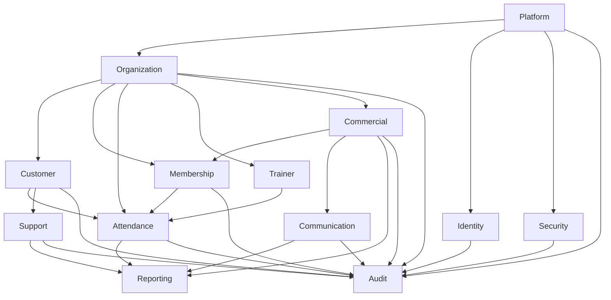
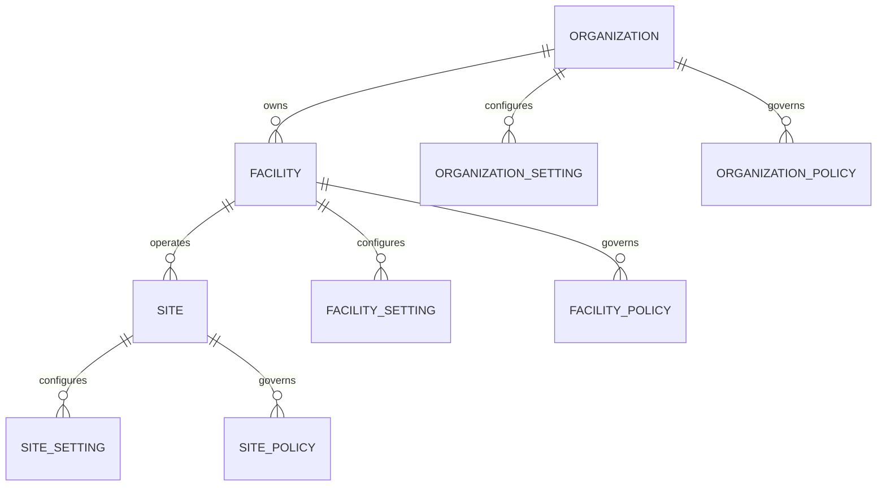
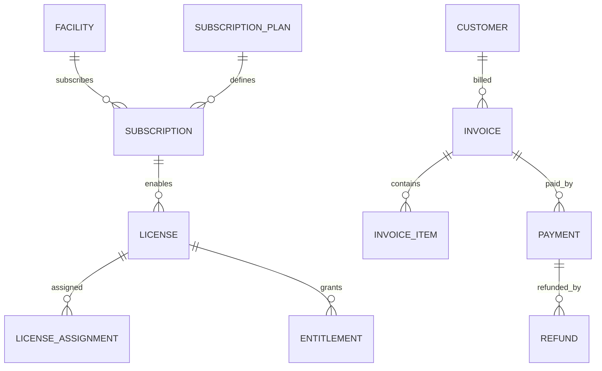
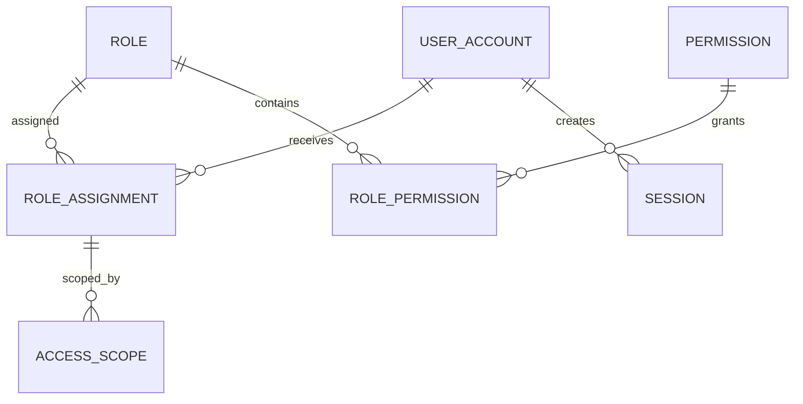

# DB-02 Logical Data Model

**Document ID:** DB-02  
**Document Name:** Logical Data Model  
**Company:** OreeOn Technologies Pvt. Ltd.  
**Product:** Digitize  
**Document Type:** Database Design  
**Version:** 0.1  
**Status:** Design Draft  
**Business Owner:** Product Architecture  
**Technical Owner:** Data Architecture  
**Prepared By:** Data Architecture Team  
**Reviewed By:** Data Architecture Review Board  
**Approved By:** Product Architecture / Solution Architecture  
**Classification:** Internal  
**Confidentiality:** Confidential  
**Document State:** Design Draft  
**Release:** Foundation Documentation  
**Dependencies:** DB-00, DB-01, PF-02, BA-03, BA-04, FR-02 to FR-21, TA-03, TA-10  
**Supersedes:** Not Applicable  
**Superseded By:** Not Applicable  
**Last Updated:** July 2026  
**Database Review:** Ready for Review

---

# Revision History

| Version | Date | Author | Description |
|---|---|---|---|
| 0.1 | July 2026 | Data Architecture Team | Initial logical data model draft |
| 0.2 | 2026-07-26 | Data Architecture Team | Freeze preparation edits: standardized review status; traceability updates for core domains; minor corrections |

---

# 1. Introduction

## 1.1 Purpose

This document translates the DB-01 Conceptual Data Model into a normalized, database-engine-neutral Logical Data Model for Digitize.

The Logical Data Model defines logical entities, logical attributes, logical identifiers, business keys, relationships, cardinality, optionality, tenant scope, data classification, lifecycle states, historical entities, associative entities, integrity expectations, and traceability required before physical database structures are finalized.

## 1.2 Objectives

- Convert approved conceptual business entities into logical data entities.
- Preserve Platform, Organization, Facility, Site, and Operations hierarchy.
- Define Organization as the tenant root across tenant-owned logical entities.
- Establish logical identifiers and business keys without selecting database-specific data types.
- Normalize logical data structures to reduce duplication and preserve data integrity.
- Identify associative and historical logical entities.
- Define logical relationship cardinality, optionality, ownership type, and tenant scope.
- Separate authoritative source entities from derived reporting entities.
- Prepare DB-04 Multi-Tenancy Data Design and DB-03 Physical Data Model.

## 1.3 Scope

This document covers logical modeling for Platform, Identity, Organization, Customer, Membership, Attendance, Trainer, Commercial, Communication, Reporting, Support, Audit, and Security domains.

## 1.4 Out of Scope

- Physical table names beyond logical entity naming.
- Vendor-specific data types.
- SQL statements.
- Physical index definitions.
- Physical storage, partitioning, and database-engine configuration.
- API payload schemas.
- UI layout definitions.
- Test case implementation.

## 1.5 Intended Audience

Product Architects, Solution Architects, Data Architects, Database Designers, Backend Developers, API Designers, QA Engineers, Security Engineers, Reporting Teams, Implementation Teams, and Support Teams.

## 1.6 Related Documents

| Document Type | Document Reference | Relationship |
|---|---|---|
| Database Standard | DB-00 Database Design Standards | Defines mandatory structure and modeling rules |
| Database Design | DB-01 Conceptual Data Model | Source conceptual entities and relationships |
| Product Foundation | PF-02 Domain Model | Source domain hierarchy, aggregates, lifecycles, and ownership |
| Business Analysis | BA-03 Business Process Catalog | Source process coverage |
| Business Analysis | BA-04 Business Process Flows | Source end-to-end process participation |
| Functional Requirements | FR-02 to FR-21 | Source functional data requirements |
| Technical Architecture | TA-03 Data Architecture | Source data ownership, reporting, audit, retention, and recovery direction |
| Technical Architecture | TA-10 Architecture Decision Records | Source ADR references for tenant, audit, reporting, and commercial decisions |

---

# 2. Data Design Context

## 2.1 Business Context

Digitize requires a logical model that supports thousands of Organizations, each operating one or more Facilities and Sites. The model must support swimming pools initially and future activity-based businesses through configurable Facility Types, Activities, Membership Plans, business rules, licenses, and feature access.

## 2.2 Functional Context

The logical model supports all approved functional modules from FR-02 through FR-21. Each logical entity is aligned to one primary domain and may participate in multiple functional flows through defined relationships rather than duplicated entities.

## 2.3 Technical Architecture Context

TA-03 requires tenant-aware data ownership, reporting separation, audit separation, lifecycle governance, and data recovery alignment. TA-10 identifies ADRs for tenant-aware access, audit separation, reporting derivation, RBAC enforcement, and commercial traceability.

## 2.4 Data Ownership Context

Every logical entity has one primary Business Owner and one primary Technical Owner. Cross-domain usage is represented through relationships, events, reports, and traceability.

---

# 3. Data Scope Model

## 3.1 In-Scope Data Domains

| Data Domain ID | Data Domain | In-Scope Logical Entities |
|---|---|---|
| DB-DOM-001 | Platform | Platform, Platform Setting, Global Master Data, Feature Flag, Maintenance Window, Release Record |
| DB-DOM-002 | Identity | User Account, Staff Profile, Role, Permission, Role Permission, Role Assignment, Access Scope, Session |
| DB-DOM-003 | Organization | Organization, Organization Setting, Organization Policy, Organization Branding, Organization Document, Facility, Facility Type, Facility Setting, Facility Policy, Site, Site Setting, Site Policy |
| DB-DOM-004 | Customer | Customer, Customer Contact, Customer Preference, Customer Consent, Customer Document, Customer Emergency Contact, Customer History |
| DB-DOM-005 | Membership | Membership Plan, Membership Plan Rule, Customer Membership, Membership Lifecycle History, Membership Freeze, Membership Renewal |
| DB-DOM-006 | Attendance | Attendance, Attendance Eligibility, Entry Exit Event, Walk-in Visit |
| DB-DOM-007 | Commercial | Pricing, Price Version, Discount, Promotion, Tax, Billing Account, Invoice, Invoice Item, Billing Adjustment, Payment, Payment Attempt, Payment Method Reference, Receipt, Refund, Refund Attempt, Reconciliation, Settlement, Subscription Plan, Subscription, Subscription Term, License, Entitlement |
| DB-DOM-008 | Trainer | Trainer, Trainer Assignment, Trainer Availability, Trainer Schedule, Activity, Activity Rule, Batch, Class Session, Batch Enrollment, Personal Training Package, Personal Training Session, Training Note, Customer Progress |
| DB-DOM-009 | Reporting | Report Definition, Report Parameter, Report Schedule, Report Execution, Report Export, Dashboard Configuration, KPI Definition, KPI Snapshot, Reporting Projection |
| DB-DOM-010 | Communication | Advertisement Campaign, Campaign Audience, Campaign Schedule, Campaign Result, Notification Template, Notification Preference, Notification, Notification Recipient, Notification Delivery, Notification Attempt, Notification Failure |
| DB-DOM-011 | Audit | Audit Event, Audit Entity Reference, Compliance Record, Data Export Record, Investigation Record, Administrative Access Record |
| DB-DOM-012 | Security | Security Policy, Password Policy, Session Policy, Authentication Event, Security Event |
| DB-DOM-013 | Support | Support Ticket, Ticket Category, Ticket Priority, Ticket Assignment, Ticket Comment, Ticket Attachment, Ticket Escalation, SLA Tracking |

## 3.2 Out-of-Scope Data Domains

| Data Domain | Reason |
|---|---|
| Payroll | Not approved in the current Functional Requirements |
| Procurement | Not approved in the current Business Process Catalog |
| Inventory | Not approved in the current Functional Requirements |
| Full Accounting Ledger | Billing and payment traceability is in scope; full ledger accounting is not approved |
| Direct Customer Booking | Explicitly not introduced until approved by source documents |
| Offline Synchronization | Future architecture topic |

## 3.3 Data Domain Diagram

---

# 4. Data Domains

| Data Domain | Purpose | Typical Ownership |
|---|---|---|
| Platform | Global SaaS configuration and shared controls | Platform Administration |
| Identity | User identity, access, role, permission, and session data | Identity and Access Management |
| Organization | Tenant hierarchy and business governance data | Organization Management |
| Customer | Customer lifecycle, profile, contact, consent, and history data | Customer Management |
| Membership | Membership plan and customer membership lifecycle data | Membership Management |
| Attendance | Operational check-in, eligibility, usage, and walk-in records | Operations |
| Commercial | Billing, payment, invoice, refund, subscription, license, and entitlement data | Finance / Commercial Management |
| Trainer | Trainer, activity, batch, class, schedule, and personal training data | Training Operations |
| Reporting | Derived report, dashboard, KPI, export, and analytical data | Reporting and Analytics |
| Communication | Campaign, notification, delivery, preference, and consent execution data | Communication Management |
| Audit | Immutable audit, compliance, investigation, export, and administrative access evidence | Audit and Compliance |
| Security | Security policies and security event records | Security Governance |
| Support | Support ticket lifecycle and SLA data | Support Management |

---

# 5. Data Classification

| Data Group | Data Domain | Classification | Sensitivity | Business Owner | Technical Owner | Notes |
|---|---|---|---|---|---|---|
| Platform Configuration | Platform | Internal Platform | Medium | Platform Administration | Platform Architecture | Change history required |
| Tenant Hierarchy | Organization | Tenant Master | Medium | Organization Management | Data Architecture | Organization, Facility, Site |
| Identity and Access | Identity | Authentication / Authorization | High | User and Role Management | Security Architecture | RBAC and tenant scope |
| Customer Profile | Customer | Sensitive Personal | High | Customer Management | Data Architecture | Privacy and masking required |
| Customer Consent | Customer / Communication | Compliance / Communication | High | Customer Management | Data Architecture | Consent history required |
| Membership Lifecycle | Membership | Tenant Operational | Medium | Membership Management | Data Architecture | Historical lifecycle state required |
| Attendance Usage | Attendance | Tenant Operational | Medium | Operations | Data Architecture | High-volume operational record |
| Training Operations | Trainer | Tenant Operational / Sensitive Personal | Medium to High | Training Operations | Data Architecture | Notes and progress may be sensitive |
| Financial Transactions | Commercial | Financial | High | Finance / Commercial Management | Data Architecture | Historical values must be preserved |
| Payment References | Commercial | Payment Reference | High | Finance / Commercial Management | Integration Architecture | Raw card data excluded |
| Communication Delivery | Communication | Communication | Medium | Communication Management | Integration Architecture | Delivery tracking and retry |
| Reporting Projections | Reporting | Derived Analytical | Medium | Reporting and Analytics | Data Engineering | Must identify authoritative source |
| Support Tickets | Support | Tenant Operational / Sensitive Personal | Medium to High | Support Management | Support Architecture | May contain customer or incident data |
| Audit Events | Audit | Audit / Compliance | High | Audit and Compliance | Security Architecture | Append-only evidence |
| Security Events | Security | Security | High | Security Governance | Security Architecture | Investigation and alerting |

---

# 6. Entity / Table Design

This section defines logical entities. Physical table names are defined in DB-03 and DB-05 through DB-08.

## 6.1 Logical Entity Catalogue

| Entity / Table | Purpose | Data Domain | Business Owner | Technical Owner | Classification | Notes |
|---|---|---|---|---|---|---|
| Platform | Logical root for SaaS governance | Platform | Platform Administration | Platform Architecture | Internal Platform | Platform-owned |
| Platform Setting | Stores logical platform behavior setting | Platform | Platform Administration | Platform Architecture | Internal Platform | Versioned change history required |
| Global Master Data | Stores shared reference values | Platform | Platform Administration | Data Architecture | Public Reference / Internal Platform | Shared across tenants |
| Feature Flag | Controls capability availability | Platform | Platform Administration | Platform Architecture | Internal Platform | Global, tenant, or Facility scoped where approved |
| Maintenance Window | Defines planned maintenance | Platform | Platform Administration | DevOps Architecture | Internal Platform | Notification and audit required |
| Release Record | Tracks platform releases | Platform | Platform Administration | DevOps Architecture | Internal Platform | Supports release governance |
| Organization | Tenant root business entity | Organization | Organization Management | Data Architecture | Tenant Master | Required tenant root |
| Organization Setting | Tenant-level configuration | Organization | Organization Management | Data Architecture | Tenant Master | Inherited by Facility and Site where applicable |
| Organization Policy | Tenant-level policy | Organization | Organization Management | Data Architecture | Tenant Master | Governs lower scopes |
| Organization Document | Organization-owned document metadata | Organization | Organization Management | Data Architecture | Tenant Master | File storage design out of scope |
| Facility | Commercial subscription unit and operational business unit | Organization | Facility Management | Data Architecture | Tenant Master | Owned by Organization |
| Facility Type | Configured business vertical type | Platform | Platform Administration | Data Architecture | Public Reference | Enables future expansion |
| Facility Setting | Facility-level configuration | Organization | Facility Management | Data Architecture | Tenant Master | Inherits Organization setting |
| Facility Policy | Facility-level business policy | Organization | Facility Management | Data Architecture | Tenant Master | Governs Sites |
| Facility Operating Hours | Logical schedule for Facility availability | Organization | Facility Management | Data Architecture | Tenant Operational | Used by Sites and scheduling |
| Facility Capacity Rule | Facility-level capacity rule | Organization | Facility Management | Data Architecture | Tenant Operational | Used by attendance and scheduling |
| Site | Physical operating location | Organization | Site Management | Data Architecture | Tenant Master | Owned by Facility |
| Site Setting | Site-level configuration | Organization | Site Management | Data Architecture | Tenant Master | Local configuration within governance |
| Site Policy | Site-level policy | Organization | Site Management | Data Architecture | Tenant Master | Must respect parent governance |
| Site Operating Hours | Site schedule | Organization | Site Management | Data Architecture | Tenant Operational | Controls daily operations |
| Site Capacity Rule | Site capacity rule | Organization | Site Management | Data Architecture | Tenant Operational | Controls attendance and classes |
| User Account | Authenticated user identity | Identity | User and Role Management | Security Architecture | Authentication | Tenant or platform user |
| Staff Profile | Staff business profile | Identity | User and Role Management | Security Architecture | Tenant Master | May link to User Account |
| Role | Logical role definition | Identity | User and Role Management | Security Architecture | Authorization | Platform or tenant scoped |
| Permission | Atomic capability permission | Identity | User and Role Management | Security Architecture | Authorization | Mapped to FR capabilities |
| Role Permission | Associative entity between Role and Permission | Identity | User and Role Management | Security Architecture | Authorization | Normalizes many-to-many relationship |
| Role Assignment | Assignment of Role to User Account | Identity | User and Role Management | Security Architecture | Authorization | Scope-controlled |
| Access Scope | Authorized Organization, Facility, and Site scope | Identity | User and Role Management | Security Architecture | Authorization | Enforces tenant boundaries |
| Session | Authenticated session | Identity | User and Role Management | Security Architecture | Security | Governed by session policies |
| Customer | Customer master entity | Customer | Customer Management | Data Architecture | Sensitive Personal | Organization traceable |
| Customer Contact | Customer contact detail | Customer | Customer Management | Data Architecture | Sensitive Personal | Includes primary and emergency contact categories |
| Customer Preference | Customer service and communication preference | Customer | Customer Management | Data Architecture | Sensitive Personal / Communication | Supports operations and notification |
| Customer Consent | Consent record | Customer | Customer Management | Data Architecture | Compliance / Communication | Historical consent required |
| Customer Document | Customer document metadata | Customer | Customer Management | Data Architecture | Sensitive Personal | Storage location handled separately |
| Customer History | Immutable customer history entry | Customer | Customer Management | Data Architecture | Sensitive Personal / Audit | Derived from business events |
| Membership Plan | Facility membership offering | Membership | Membership Management | Data Architecture | Tenant Master | Facility scoped |
| Membership Plan Rule | Rule attached to Membership Plan | Membership | Membership Management | Data Architecture | Tenant Master | Eligibility, usage, freeze, renewal |
| Customer Membership | Purchased membership | Membership | Membership Management | Data Architecture | Tenant Operational | Customer may own many |
| Membership Lifecycle History | Membership state transition record | Membership | Membership Management | Data Architecture | Tenant Operational / Audit | Immutable history |
| Membership Freeze | Freeze interval | Membership | Membership Management | Data Architecture | Tenant Operational | Related to Customer Membership |
| Membership Renewal | Renewal transaction context | Membership | Membership Management | Data Architecture | Tenant Operational / Commercial | May generate invoice |
| Attendance | Attendance record | Attendance | Operations | Data Architecture | Tenant Operational | Membership or walk-in |
| Attendance Eligibility | Eligibility decision record | Attendance | Operations | Data Architecture | Tenant Operational | Captures validation outcome |
| Entry Exit Event | Entry and exit activity | Attendance | Operations | Data Architecture | Tenant Operational | May be grouped under Attendance physically |
| Walk-in Visit | Walk-in usage record | Attendance | Operations | Data Architecture | Tenant Operational / Commercial | Links charge and attendance |
| Activity | Facility-offered activity | Trainer | Training Operations | Data Architecture | Tenant Master | Configurable by Facility Type |
| Activity Rule | Rule governing Activity | Trainer | Training Operations | Data Architecture | Tenant Master | Supports capacity and eligibility |
| Batch | Group activity cohort | Trainer | Training Operations | Data Architecture | Tenant Operational | Scheduled offering |
| Class Session | Executable class occurrence | Trainer | Training Operations | Data Architecture | Tenant Operational | Attendance target |
| Batch Enrollment | Customer enrollment into Batch | Trainer | Training Operations | Data Architecture | Tenant Operational | Associative entity |
| Trainer | Trainer master profile | Trainer | Training Operations | Data Architecture | Tenant Master | May link to Staff Profile |
| Trainer Assignment | Trainer assignment to Facility, Site, Batch, or Session | Trainer | Training Operations | Data Architecture | Tenant Operational | Associative entity |
| Trainer Availability | Trainer availability slot | Trainer | Training Operations | Data Architecture | Tenant Operational | Conflict validation |
| Trainer Schedule | Trainer scheduled commitment | Trainer | Training Operations | Data Architecture | Tenant Operational | Derived from assignments and sessions |
| Personal Training Package | Personal training commercial and operational package | Trainer | Training Operations | Data Architecture | Tenant Operational / Commercial | Billing relation possible |
| Personal Training Session | Scheduled personal training session | Trainer | Training Operations | Data Architecture | Tenant Operational | Customer and Trainer scoped |
| Training Note | Session note | Trainer | Training Operations | Data Architecture | Sensitive Personal | Restricted access |
| Customer Progress | Customer training progress | Trainer | Training Operations | Data Architecture | Sensitive Personal | Privacy controlled |
| Pricing | Pricing context | Commercial | Finance / Commercial Management | Data Architecture | Financial | May be platform or tenant scoped |
| Price Version | Versioned price value | Commercial | Finance / Commercial Management | Data Architecture | Financial | Historical value preservation |
| Discount | Discount definition or application | Commercial | Finance / Commercial Management | Data Architecture | Financial | Approval may apply |
| Promotion | Promotion definition | Commercial | Marketing / Finance | Data Architecture | Financial / Communication | Campaign relationship possible |
| Tax | Tax rule or tax outcome | Commercial | Finance / Commercial Management | Data Architecture | Financial | Compliance sensitive |
| Billing Account | Billing ownership context | Commercial | Finance / Commercial Management | Data Architecture | Financial | Customer or Organization context |
| Invoice | Issued invoice | Commercial | Finance / Commercial Management | Data Architecture | Financial | Historical values immutable after issuance except approved adjustment |
| Invoice Item | Invoice line item | Commercial | Finance / Commercial Management | Data Architecture | Financial | Detailed financial line |
| Billing Adjustment | Credit or debit adjustment | Commercial | Finance / Commercial Management | Data Architecture | Financial | Approval and audit required |
| Payment | Payment transaction | Commercial | Finance / Commercial Management | Data Architecture | Financial / Payment Reference | Provider-sensitive data excluded |
| Payment Attempt | Payment processing attempt | Commercial | Finance / Commercial Management | Integration Architecture | Payment Reference | Idempotency required downstream |
| Payment Method Reference | Tokenized or external payment method reference | Commercial | Finance / Commercial Management | Integration Architecture | Payment Reference | Raw card data excluded |
| Receipt | Payment receipt | Commercial | Finance / Commercial Management | Data Architecture | Financial | Linked to Payment |
| Refund | Refund transaction | Commercial | Finance / Commercial Management | Data Architecture | Financial | Payment related |
| Refund Attempt | Refund processing attempt | Commercial | Finance / Commercial Management | Integration Architecture | Payment Reference | Provider callback traceability |
| Reconciliation | Reconciliation record | Commercial | Finance / Commercial Management | Data Architecture | Financial | Payment and settlement matching |
| Settlement | Settlement record | Commercial | Finance / Commercial Management | Integration Architecture | Financial | Provider-derived |
| Subscription Plan | SaaS subscription plan | Commercial | Platform Administration | Data Architecture | Internal Platform / Commercial | Plan definition |
| Subscription | Facility-level subscription | Commercial | Finance / Commercial Management | Data Architecture | Commercial Control | Facility scoped |
| Subscription Term | Subscription commercial term | Commercial | Finance / Commercial Management | Data Architecture | Commercial Control | Supports differing Facility terms |
| Subscription Lifecycle History | Subscription state history | Commercial | Finance / Commercial Management | Data Architecture | Commercial Control / Audit | Immutable |
| License | Licensed capability bundle | Commercial | License Management | Data Architecture | Commercial Control | Linked to subscription and entitlement |
| License Assignment | Facility license assignment | Commercial | License Management | Data Architecture | Commercial Control | Facility scoped |
| Entitlement | Licensed capability access | Commercial | License Management | Data Architecture | Commercial Control | Controls feature access |
| Advertisement Campaign | Campaign entity | Communication | Marketing Management | Data Architecture | Communication | Approval and schedule lifecycle |
| Campaign Audience | Campaign target audience | Communication | Marketing Management | Data Architecture | Communication / Sensitive Personal | Consent aware |
| Campaign Schedule | Campaign schedule | Communication | Marketing Management | Data Architecture | Communication | Launch timing |
| Campaign Result | Campaign performance result | Communication | Marketing Management | Data Architecture | Communication / Reporting | Derived metrics |
| Notification Template | Notification content template | Communication | Communication Management | Data Architecture | Communication | Platform or tenant scoped |
| Notification Preference | Recipient preference | Communication | Communication Management | Data Architecture | Communication / Sensitive Personal | Consent aware |
| Notification | Notification instance | Communication | Communication Management | Integration Architecture | Communication | Generated or manual |
| Notification Recipient | Notification recipient | Communication | Communication Management | Integration Architecture | Communication / Sensitive Personal | Delivery target |
| Notification Delivery | Delivery result | Communication | Communication Management | Integration Architecture | Communication | Channel-level status |
| Notification Attempt | Delivery attempt | Communication | Communication Management | Integration Architecture | Communication | Retry trace |
| Notification Failure | Failure reason | Communication | Communication Management | Integration Architecture | Communication | Diagnostics |
| Report Definition | Report metadata | Reporting | Reporting and Analytics | Data Engineering | Derived Analytical | Defines report meaning |
| Report Parameter | Report input parameter definition | Reporting | Reporting and Analytics | Data Engineering | Derived Analytical | Controls report filters |
| Report Schedule | Report automation schedule | Reporting | Reporting and Analytics | Data Engineering | Derived Analytical | Scheduled delivery |
| Report Execution | Report run | Reporting | Reporting and Analytics | Data Engineering | Derived Analytical | Runtime execution |
| Report Export | Export metadata | Reporting | Reporting and Analytics | Data Engineering | Derived Analytical / Compliance | Export audit required |
| Dashboard Configuration | Dashboard configuration | Reporting | Reporting and Analytics | Data Engineering | Derived Analytical | User or tenant scoped |
| KPI Definition | KPI meaning and calculation definition | Reporting | Reporting and Analytics | Data Engineering | Derived Analytical | Trace to business meaning |
| KPI Snapshot | Periodic KPI result | Reporting | Reporting and Analytics | Data Engineering | Derived Analytical | Derived |
| Reporting Projection | Read-oriented reporting projection | Reporting | Reporting and Analytics | Data Engineering | Derived Analytical | Not authoritative source |
| Support Ticket | Support issue | Support | Support Management | Support Architecture | Tenant Operational / Sensitive Personal | May reference other entities |
| Ticket Category | Support category reference | Support | Support Management | Support Architecture | Tenant Master / Reference | Controls classification |
| Ticket Priority | Support priority reference | Support | Support Management | Support Architecture | Tenant Master / Reference | Controls SLA |
| Ticket Assignment | Ticket responsibility | Support | Support Management | Support Architecture | Tenant Operational | Staff assignment |
| Ticket Comment | Ticket communication | Support | Support Management | Support Architecture | Tenant Operational / Sensitive Personal | Restricted |
| Ticket Attachment | Ticket attachment metadata | Support | Support Management | Support Architecture | Sensitive Personal | File storage externalized |
| Ticket Escalation | Ticket escalation event | Support | Support Management | Support Architecture | Tenant Operational | SLA governance |
| SLA Tracking | SLA measurement | Support | Support Management | Support Architecture | Tenant Operational | Reporting source |
| Audit Event | Immutable audit event | Audit | Audit and Compliance | Security Architecture | Audit / Compliance | Append-only |
| Audit Entity Reference | Reference to affected entity | Audit | Audit and Compliance | Security Architecture | Audit / Compliance | Investigation |
| Compliance Record | Compliance evidence | Audit | Audit and Compliance | Security Architecture | Compliance | Controlled access |
| Data Export Record | Export evidence | Audit | Audit and Compliance | Security Architecture | Compliance | Privacy and audit |
| Investigation Record | Audit or security investigation | Audit | Audit and Compliance | Security Architecture | Compliance / Security | Controlled access |
| Administrative Access Record | Privileged access evidence | Audit | Audit and Compliance | Security Architecture | Security / Audit | Cross-tenant access trace |
| Security Policy | Security policy | Security | Security Governance | Security Architecture | Security | Platform or tenant scope |
| Password Policy | Password rules | Security | Security Governance | Security Architecture | Security | Authentication |
| Session Policy | Session rules | Security | Security Governance | Security Architecture | Security | Session lifecycle |
| Authentication Event | Authentication activity | Security | Security Governance | Security Architecture | Security | Login and credential events |
| Security Event | Security-relevant activity | Security | Security Governance | Security Architecture | Security | Investigation source |

---

# 7. Attribute / Column Design

This section defines logical attribute groups. Physical columns and physical data types are deferred to DB-03 and DB-05 through DB-08.

| Attribute / Column | Description | Data Type / Logical Type | Mandatory | Source | Validation / Constraint | Notes |
|---|---|---|---|---|---|---|
| Logical Identifier | Stable system-generated identifier for entity records | Identifier | Yes | System | Unique within approved scope | Physical strategy deferred |
| Organization Reference | Tenant root reference | Identifier Reference | Conditional | Tenant Context / System | Required for tenant-owned entities | Platform-owned entities may not require it |
| Facility Reference | Facility context reference | Identifier Reference | Conditional | User / System | Must belong to Organization | Required for Facility-scoped entities |
| Site Reference | Site context reference | Identifier Reference | Conditional | User / System | Must belong to Facility and Organization | Required for Site-scoped entities |
| Business Code | Human-readable business identifier | Text / Code | Conditional | User / System | Tenant-scoped uniqueness where applicable | Examples include invoice number, customer code |
| Display Name | Business display name | Text | Conditional | User | Must be meaningful and within length policy | Names Organization, Facility, Site, Customer, Plan, Campaign |
| Description | Business explanation | Text | Optional | User | Must comply with content rules | Used for policies, plans, roles, activities |
| Status | Lifecycle state | Status | Yes for lifecycle entities | System / User | Must be approved state | State transitions defined by domain |
| Type | Classification type | Reference / Code | Conditional | User / System | Must be approved reference value | Facility Type, ticket category, notification channel |
| Effective Date | Date from which value or state applies | Date / DateTime | Conditional | User / System | Must satisfy lifecycle rules | Policies, pricing, subscriptions, licenses |
| Expiry Date | Date on which value or state expires | Date / DateTime | Conditional | User / System | Must be after effective date where applicable | Memberships, subscriptions, licenses |
| Amount | Monetary value | Money | Conditional | System / User | Must satisfy commercial rules | Financial entities only |
| Percentage | Percentage value | Percentage | Conditional | User / System | Must be within allowed bounds | Discounts, tax, capacity usage |
| Quantity | Count or unit quantity | Number | Conditional | User / System | Must be non-negative where applicable | Invoice items, capacity, session counts |
| External Reference | Provider or integration reference | Text / Identifier Reference | Conditional | Integration | Must not expose sensitive secrets | Payment, notification, integration callbacks |
| Correlation Reference | End-to-end transaction correlation | Identifier Reference | Conditional | System | Required for distributed traceability where applicable | Supports audit and diagnostics |
| Reason | Business reason for governed change | Text | Conditional | User / System | Required for overrides, cancellations, suspensions | Supports audit |
| Notes | Business or operational notes | Text | Optional | User | Sensitive notes must be protected | Training, support, operational notes |
| Created Audit Attributes | Creation actor and timestamp | Audit Attribute Group | Yes for mutable records | System | Required for auditability | Physical fields deferred |
| Updated Audit Attributes | Update actor, timestamp, and version | Audit Attribute Group | Conditional | System | Required for mutable records | Not applicable to immutable events |
| Historical Snapshot Attributes | Previous value, new value, source state | History Attribute Group | Conditional | System | Required for lifecycle history | Financial and lifecycle records |

---

# 8. Relationships

| Relationship | Parent | Child | Cardinality | Optionality | Tenant Scope | Notes |
|---|---|---|---|---|---|---|
| DB-02-REL-001 | Platform | Organization | One-to-Many | Organization required after onboarding | Platform to tenant | Organization is tenant root |
| DB-02-REL-002 | Organization | Facility | One-to-Many | Facility required for operations | Tenant-owned | Facility inherits Organization context |
| DB-02-REL-003 | Facility | Site | One-to-Many | Site required for physical operations | Tenant-owned | Site inherits Organization and Facility context |
| DB-02-REL-004 | Facility Type | Facility | One-to-Many | Mandatory for Facility | Shared reference | Facility Type drives configuration |
| DB-02-REL-005 | Organization | User Account | One-to-Many | Optional for platform users | Tenant-aware | Tenant users are Organization-scoped |
| DB-02-REL-006 | User Account | Role Assignment | One-to-Many | Mandatory for authorized access | Tenant-aware | Uses Access Scope |
| DB-02-REL-007 | Role | Role Permission | One-to-Many | Optional until configured | Tenant-aware / platform | Normalized permission mapping |
| DB-02-REL-008 | Permission | Role Permission | One-to-Many | Optional until configured | Tenant-aware / platform | Atomic permission mapping |
| DB-02-REL-009 | Role Assignment | Access Scope | One-to-One-or-Many | Mandatory for tenant roles | Tenant-owned | Enforces Organization, Facility, Site |
| DB-02-REL-010 | Organization | Customer | One-to-Many | Optional | Tenant-owned | Customer tenant traceability |
| DB-02-REL-011 | Customer | Customer Contact | One-to-Many | Optional | Tenant-owned | Contact details |
| DB-02-REL-012 | Customer | Customer Consent | One-to-Many | Conditional | Tenant-owned | Consent history |
| DB-02-REL-013 | Customer | Customer Document | One-to-Many | Optional | Tenant-owned | Sensitive document metadata |
| DB-02-REL-014 | Facility | Membership Plan | One-to-Many | Optional | Tenant-owned | Facility-defined plans |
| DB-02-REL-015 | Membership Plan | Membership Plan Rule | One-to-Many | Optional | Tenant-owned | Plan governance |
| DB-02-REL-016 | Customer | Customer Membership | One-to-Many | Optional | Tenant-owned | Multiple memberships allowed where approved |
| DB-02-REL-017 | Customer Membership | Membership Lifecycle History | One-to-Many | Mandatory after state change | Tenant-owned | Immutable history |
| DB-02-REL-018 | Site | Attendance | One-to-Many | Optional | Tenant-owned | Operational usage |
| DB-02-REL-019 | Customer | Attendance | One-to-Many | Optional | Tenant-owned | Customer attendance |
| DB-02-REL-020 | Customer Membership | Attendance | One-to-Many | Optional | Tenant-owned | Membership-based attendance |
| DB-02-REL-021 | Walk-in Visit | Attendance | One-to-One-or-Many | Optional | Tenant-owned | Walk-in attendance |
| DB-02-REL-022 | Facility | Activity | One-to-Many | Optional | Tenant-owned | Facility offerings |
| DB-02-REL-023 | Activity | Batch | One-to-Many | Optional | Tenant-owned | Group activity |
| DB-02-REL-024 | Batch | Class Session | One-to-Many | Optional | Tenant-owned | Session schedule |
| DB-02-REL-025 | Batch | Batch Enrollment | One-to-Many | Optional | Tenant-owned | Enrollment |
| DB-02-REL-026 | Trainer | Trainer Assignment | One-to-Many | Optional | Tenant-owned | Operational assignment |
| DB-02-REL-027 | Personal Training Package | Personal Training Session | One-to-Many | Optional | Tenant-owned | Package usage |
| DB-02-REL-028 | Invoice | Invoice Item | One-to-Many | Mandatory after invoice issue | Tenant-owned | Financial detail |
| DB-02-REL-029 | Invoice | Payment | One-to-Many | Optional | Tenant-owned | Payment against invoice |
| DB-02-REL-030 | Payment | Refund | One-to-Many | Optional | Tenant-owned | Refund against payment |
| DB-02-REL-031 | Facility | Subscription | One-to-Many | Optional | Tenant-owned / commercial | Facility subscription |
| DB-02-REL-032 | Subscription | License | One-to-Many | Optional | Tenant-owned / commercial | Licensed capabilities |
| DB-02-REL-033 | License | Entitlement | One-to-Many | Optional | Tenant-owned / commercial | Capability access |
| DB-02-REL-034 | Campaign | Notification | One-to-Many | Optional | Tenant-owned | Campaign may generate notifications |
| DB-02-REL-035 | Notification | Notification Delivery | One-to-Many | Optional | Tenant-owned | Delivery tracking |
| DB-02-REL-036 | Report Definition | Report Execution | One-to-Many | Optional | Tenant-aware | Report execution |
| DB-02-REL-037 | Support Ticket | Ticket Comment | One-to-Many | Optional | Tenant-owned | Support communication |
| DB-02-REL-038 | Support Ticket | Ticket Escalation | One-to-Many | Optional | Tenant-owned | SLA escalation |
| DB-02-REL-039 | Any Critical Entity | Audit Event | One-to-Many | Conditional | Tenant-aware / platform | Critical changes audited |
| DB-02-REL-040 | Audit Event | Audit Entity Reference | One-to-Many | Conditional | Tenant-aware / platform | Entity traceability |

---

# 9. Keys and Identifiers

| Key / Identifier | Entity / Table | Purpose | Scope | Notes |
|---|---|---|---|---|
| Surrogate Logical Identifier | All persistent logical entities | Stable system reference | Entity scope | UUID-style logical identifiers unless ADR selects otherwise |
| Organization Business Key | Organization | Tenant business uniqueness | Platform scope | Legal/business identity rules refined later |
| Facility Business Key | Facility | Facility business uniqueness | Organization scope | Tenant-scoped uniqueness required |
| Site Business Key | Site | Site business uniqueness | Facility and Organization scope | Must preserve hierarchy |
| Customer Business Key | Customer | Customer search and duplicate prevention | Organization scope | Final duplication rules require review |
| Membership Business Key | Customer Membership | Membership reference | Organization / Customer scope | Supports lifecycle and history |
| Invoice Business Key | Invoice | Financial document number | Organization scope | Historical and immutable after issuance |
| Payment Correlation Key | Payment Attempt | Idempotent payment processing | Organization and provider scope | Physical idempotency strategy in DB-03 and DB-07 |
| Subscription Business Key | Subscription | Facility subscription reference | Facility scope | Supports multiple terms over time |
| License Business Key | License | Licensed capability reference | Facility / Subscription scope | Supports entitlement validation |
| Audit Correlation Key | Audit Event | Investigation and distributed traceability | Platform or Organization scope | Must support cross-service audit evidence |

---

# 10. Constraints and Validation

| Constraint | Entity / Table | Rule | Scope | Notes |
|---|---|---|---|---|
| Organization Tenant Root | Tenant-owned entities | Tenant-owned logical entities require Organization context | Tenant-owned | Platform-owned reference data excluded |
| Facility Belongs to Organization | Facility | Facility must be owned by exactly one Organization | Tenant hierarchy | No orphan Facility |
| Site Belongs to Facility | Site | Site must belong to one Facility and inherit Organization context | Tenant hierarchy | No orphan Site |
| Facility Type Required | Facility | Facility requires approved Facility Type | Organization domain | Enables configuration-driven behavior |
| Access Scope Required | Role Assignment | Tenant user role assignment requires Organization scope | Identity domain | Facility and Site scope conditional |
| Historical Financial Preservation | Invoice, Payment, Refund, Subscription, License | Financial state and value history must be preserved | Commercial domain | Prevents current-configuration dependency |
| Membership Lifecycle Integrity | Customer Membership | Lifecycle transitions must follow approved state model | Membership domain | History required |
| Attendance Eligibility Integrity | Attendance | Attendance must be supported by membership, walk-in, or approved operational rule | Attendance domain | Rule detail in FR and DB-06 |
| Communication Consent Integrity | Campaign, Notification | Consent and preference must be checked where required | Communication domain | Consent history required |
| Reporting Authority Constraint | Reporting Projection | Derived data must identify authoritative source | Reporting domain | Reporting is not source of truth |
| Audit Immutability | Audit Event | Audit events are append-only and protected | Audit domain | Physical immutability in DB-03 |
| Sensitive Export Control | Report Export, Data Export Record | Export must be permission-controlled and audited | Reporting / Audit | Privacy and compliance |

---

# 11. Index and Access Patterns

Logical access patterns identify expected lookup and query needs. Physical indexes are defined in DB-03 and DB-09.

| Access Pattern | Entity / Table | Index Need | Query Scope | Notes |
|---|---|---|---|---|
| Tenant hierarchy lookup | Organization, Facility, Site | Required in physical model | Platform / Organization | Most tenant operations start with hierarchy |
| Customer search | Customer, Customer Contact | Required in physical model | Organization / Site | Search by approved identifiers and contact fields |
| Membership eligibility | Customer Membership, Membership Plan Rule, Attendance Eligibility | Required in physical model | Organization / Site | Attendance-critical path |
| Attendance recording | Attendance, Entry Exit Event | Required in physical model | Site / Date / Customer | High-volume operational path |
| Trainer scheduling | Trainer Availability, Trainer Schedule, Personal Training Session, Class Session | Required in physical model | Facility / Site / Time | Conflict detection |
| Invoice lookup | Invoice, Invoice Item, Customer, Billing Account | Required in physical model | Organization / Customer / Date | Financial support path |
| Payment reconciliation | Payment, Payment Attempt, Reconciliation, Settlement | Required in physical model | Organization / Provider / Date | Idempotency and provider callback path |
| Subscription and license validation | Subscription, License, License Assignment, Entitlement | Required in physical model | Facility / Capability | Login and feature access path |
| Notification delivery retry | Notification, Notification Delivery, Notification Attempt, Notification Failure | Required in physical model | Channel / Status / Time | Retry and monitoring path |
| Report execution | Report Definition, Report Schedule, Report Execution | Required in physical model | Tenant / User / Time | Reporting operations |
| Audit investigation | Audit Event, Audit Entity Reference, Security Event | Required in physical model | Tenant / Actor / Entity / Time | Audit and compliance path |
| Support queue | Support Ticket, Ticket Priority, Ticket Assignment, SLA Tracking | Required in physical model | Tenant / Status / Priority | Support operations |

---

# 12. Multi-Tenancy Design

| Tenant Concern | Design Approach | Applies To | Notes |
|---|---|---|---|
| Tenant Root | Organization is the logical tenant root | Tenant-owned logical entities | Required by DB-01 |
| Tenant Propagation | Facility and Site inherit Organization context | Facility and Site scoped entities | Enforced in DB-04 and DB-03 |
| Platform-Owned Data | Platform entities may be global and not Organization-owned | Platform Setting, Global Master Data, Feature Flag | Scope must be explicit |
| Shared Reference Data | Shared reference entities are platform governed | Facility Type, common reference values | Tenant override allowed only where approved |
| Tenant-Owned Data | Tenant business records must be Organization traceable | Customer, Membership, Attendance, Commercial, Communication, Support, Audit | Must not leak across tenants |
| Tenant-Aware Uniqueness | Business keys must include tenant scope where uniqueness is tenant-specific | Customer, Facility, Site, Invoice, Membership | Physical constraints deferred |
| Cross-Tenant Access | Privileged access requires explicit authorization and audit | Platform, Support, Audit, Security | Administrative Access Record required |
| Tenant Reporting | Reporting projections must preserve tenant scope | Reporting domain | Derived data must not mix tenants |
| Tenant Archival | Tenant archival must preserve hierarchy and traceability | All tenant-owned data | Detailed in DB-04 and DB-09 |

---

# 13. Audit and History Design

| Audit / History Area | Trigger | Data Captured | Retention | Notes |
|---|---|---|---|---|
| Configuration History | Platform, Organization, Facility, Site setting or policy changes | Actor, scope, previous value, new value, reason, timestamp | Configuration retention | Required for support and governance |
| Identity History | Role, permission, access scope, credential, session changes | Actor, user, scope, result, timestamp | Security retention | Privileged actions audited |
| Customer History | Registration, profile, document, contact, consent lifecycle | Actor, customer, change category, timestamp | Customer retention | Sensitive access |
| Membership History | Membership lifecycle transition | Membership, previous state, new state, reason, effective date | Membership retention | Immutable |
| Attendance Audit | Check-in, check-out, cancellation, eligibility override | Customer, Site, outcome, reason, actor | Operational retention | High-volume |
| Trainer and Session History | Assignment, reschedule, cancellation, notes, progress | Trainer, customer, session, state change | Operational retention | Sensitive notes protected |
| Commercial History | Invoice, payment, refund, subscription, license changes | Financial state, values, actor, correlation | Financial retention | Must preserve historical values |
| Communication History | Campaign, notification, delivery, retry, failure, consent | Recipient, channel, status, provider reference | Communication retention | Consent-aware |
| Support History | Ticket state, assignment, escalation, comments | Ticket, actor, status, SLA | Support retention | May reference sensitive data |
| Audit Event | Critical business, security, financial, configuration, export event | Actor, tenant, entity reference, action, timestamp, correlation | Compliance retention | Append-only |

---

# 14. Data Lifecycle State Model

| Lifecycle State | Meaning | Allowed Usage |
|---|---|---|
| Transient | Data temporarily held before validation, confirmation, or persistence | Draft forms, imports, pending callbacks |
| Active | Current operational data used in business transactions | Active Organizations, Facilities, Sites, Customers, Memberships |
| Inactive | Not operationally active but retained for possible reactivation or reference | Suspended user, inactive configuration |
| Historical | Completed or expired records retained for traceability and reporting | Attendance, expired memberships, closed invoices |
| Archived | Retained outside primary operational usage | Aged support, old reports, historical audit |
| Anonymized | Personal identifiers removed or masked where approved | Privacy-preserving analytics |
| Purged | Permanently removed according to approved policy | Expired temporary data |
| Legally Retained | Retained due to financial, audit, legal, or compliance obligation | Financial, audit, payment, refund, subscription, license, attendance, security records |

---

# 15. Retention, Archival, and Purging

| Data Group | Lifecycle State | Retention Rule | Archival Approach | Purging Rule | Notes |
|---|---|---|---|---|---|
| Platform Configuration | Active / Historical | Retain active and change history | Archive superseded configuration | Purge only approved obsolete non-audit data | Supports governance |
| Tenant Hierarchy | Active / Suspended / Archived | Retain while tenant obligations exist | Archive inactive tenant hierarchy | Purge only after approved tenant purge | Tenant root critical |
| Identity and Access | Active / Inactive / Historical | Retain access history for security | Archive inactive users and old sessions | Purge only after security retention expires | Privileged records protected |
| Customer | Active / Suspended / Archived / Anonymized | Retain according to privacy and business needs | Archive inactive customers | Purge/anonymize through approved policy | Sensitive personal data |
| Membership | Active / Historical / Archived | Retain lifecycle traceability | Archive expired/cancelled memberships | Do not purge while traceability obligations apply | Customer disputes |
| Attendance | Recorded / Historical / Archived | Retain operational history | Archive aged attendance | Do not purge while usage obligations apply | High volume |
| Commercial | Active / Historical / Legally Retained | Retain financial records | Archive historical commercial records | Do not purge while financial obligations apply | Strictest financial governance |
| Communication | Active / Historical / Archived | Retain consent and delivery evidence | Archive aged deliveries | Purge where consent/compliance allow | Provider diagnostics |
| Reporting | Active / Historical / Archived | Retain derived results according to report value | Archive aged reports | Purge derived data when allowed | Source remains authoritative |
| Support | Active / Historical / Archived | Retain ticket lifecycle | Archive closed tickets | Purge after support/compliance obligations expire | Sensitive notes possible |
| Audit and Security | Recorded / Legally Retained / Archived | Retain according to audit and security obligations | Archive with integrity controls | Purge only through compliance approval | Protected evidence |

---

# 16. Migration and Versioning

| Migration Area | Migration Type | Validation | Rollback Consideration | Notes |
|---|---|---|---|---|
| Logical Model Revision | Documentation versioning | Validate entity and relationship changes | Previous version retained | Impacts DB-03 and DB-10 |
| Entity Addition | Logical model extension | Must trace to approved source document | Remove before freeze if not approved | No unapproved domains |
| Entity Split | Normalization change | Validate source meaning and downstream impact | Requires migration assessment | Common between DB-02 and DB-03 |
| Entity Merge | Simplification change | Validate no loss of ownership or lifecycle semantics | Requires impact assessment | Avoid over-consolidation |
| Lifecycle Revision | State model change | Validate BA, FR, TA, and compliance | Requires downstream review | Affects workflows and reporting |
| Classification Revision | Security/privacy change | Validate security and compliance alignment | Requires access-control review | Affects DB-03 to DB-10 |

---

# 17. Backup and Recovery

| Data Group | Backup Need | Recovery Requirement | Notes |
|---|---|---|---|
| Tenant Hierarchy | Critical | Recover Organization, Facility, Site consistency | Foundational to all tenant data |
| Identity and Security | Critical | Recover users, access, policies, sessions, security evidence | Access continuity |
| Customer and Membership | Critical | Recover customer service and membership lifecycle | Operational continuity |
| Attendance and Training | Critical | Recover high-volume operational usage and session records | Daily operations |
| Commercial | Critical | Recover financial values, payments, refunds, subscriptions, licenses | Financial reconciliation |
| Communication | High | Recover delivery and consent traceability | Retry and support |
| Reporting | Medium to High | Recover or rebuild derived data from authoritative sources | Source identified |
| Support | High | Recover support lifecycle and evidence | Support continuity |
| Audit and Compliance | Critical | Recover immutable audit evidence and export history | Compliance requirement |

---

# 18. Security and Privacy

| Security Area | Design Approach | Applies To | Notes |
|---|---|---|---|
| Tenant Isolation | Organization context required for tenant-owned logical entities | Customer, Membership, Attendance, Commercial, Support, Communication, Reporting, Audit | Refined in DB-04 |
| Role-Based Access | User, Role, Permission, Assignment, Access Scope model access boundaries | Identity and Security | Supports FR-06 |
| Sensitive Personal Data | Customer, contact, document, training note, support comment must be protected | Customer, Trainer, Support | Masking/encryption refined physically |
| Financial Protection | Financial entities require restricted access and historical protection | Commercial | Invoice, payment, refund |
| Payment Data Minimization | Store provider references, not raw payment card data | Payment Method Reference, Payment Attempt | Aligns with security architecture |
| Audit Protection | Audit Event and Audit Entity Reference are protected evidence | Audit | Append-only behavior |
| Export Governance | Report Export and Data Export Record must be permissioned and audited | Reporting and Audit | Privacy and compliance |
| Administrative Access | Cross-tenant access requires administrative access record | Platform, Support, Audit | Privileged access auditing |

---

# 19. Reporting and Analytics Considerations

| Reporting Area | Source Data | Derived Data | Refresh / Access Pattern | Notes |
|---|---|---|---|---|
| Organization Dashboard | Organization, Facility, Site, Customer, Membership, Commercial | Organization KPI Snapshot | Scheduled / On-demand | Tenant-scoped |
| Facility Dashboard | Facility, Site, Membership, Attendance, Commercial | Facility KPI Snapshot | Scheduled / On-demand | Facility-scoped |
| Site Dashboard | Site, Attendance, Walk-in Visit, Class Session | Site KPI Snapshot | Operational reporting | Site-scoped |
| Customer History | Customer, Membership, Attendance, Payment, Support, Notification | Customer History | On-demand | Privacy controlled |
| Commercial Analytics | Invoice, Payment, Refund, Subscription, License, Settlement | Revenue and reconciliation projections | Scheduled / On-demand | Financial correctness |
| Campaign Analytics | Campaign, Audience, Delivery, Result | Campaign Performance | Post-campaign and scheduled | Consent-aware |
| Support Analytics | Ticket, Assignment, SLA, Escalation | Support Performance | Scheduled / On-demand | SLA metrics |
| Audit Analytics | Audit Event, Security Event, Compliance Record | Audit and Compliance Metrics | Controlled access | Compliance-sensitive |

---

# 20. Traceability

| Source Document | Requirement / Process / Rule | Entity / Table | Attribute / Column | Notes |
|---|---|---|---|---|
| DB-01 | Conceptual Entity Catalogue | All logical entities | Logical attribute groups | Direct source for logical modeling |
| FR-02 | Platform Administration | Platform, Platform Setting, Global Master Data, Feature Flag, Maintenance Window, Release Record | Scope, status, effective date, audit attributes | Platform domain |
| FR-03 to FR-05 | Organization, Facility, Site Management | Organization, Facility, Site, settings, policies, documents, lifecycle entities | Tenant hierarchy and lifecycle attributes | Tenant hierarchy |
| FR-06 | User and Role Management | User Account, Staff Profile, Role, Permission, Role Assignment, Access Scope, Session | Access and session attributes | Identity and security |
| FR-07 to FR-13 | Customer and Operations | Customer, Membership, Attendance, Walk-in, Trainer, Activity, Batch, Class, Personal Training | Operational attribute groups | Daily operations |
| FR-14 to FR-16 | Commercial modules | Invoice, Payment, Refund, Subscription, License, Entitlement | Financial and lifecycle attributes | Commercial traceability |
| FR-17 to FR-18 | Communication modules | Campaign, Notification, Delivery, Preference, Consent | Communication attributes | Consent-aware delivery |
| FR-19 | Reports and Analytics | Report Definition, Execution, Export, KPI, Projection | Reporting attributes | Derived data |
| FR-20 | Support Ticket | Support Ticket, Assignment, Comment, Escalation, SLA | Support lifecycle attributes | Support operations |
| FR-21 | Audit and Compliance | Audit Event, Entity Reference, Compliance Record, Data Export, Investigation | Audit attributes | Immutable evidence |
| TA-03 | Data architecture principles | All data groups | Ownership, classification, lifecycle | Architecture alignment |
| TA-10 | ADR-001, ADR-014, ADR-015, ADR-016, ADR-020, ADR-021, ADR-031, ADR-034 | Tenant, audit, reporting, identity, commercial entities | Scope, event, audit, access attributes | ADR alignment |

---

# 21. Diagrams

| Diagram ID | Diagram Name | Diagram Type | Location |
|---|---|---|---|
| DB-02-DGM-001 | Logical Domain Relationship Diagram | Logical Entity Relationship Diagram | Section 3.3 |
| DB-02-DGM-002 | Logical Tenant Hierarchy Diagram | Logical Entity Relationship Diagram | Section 21.1 |
| DB-02-DGM-003 | Logical Commercial Model Diagram | Logical Entity Relationship Diagram | Section 21.2 |
| DB-02-DGM-004 | Logical Identity and Access Model Diagram | Logical Entity Relationship Diagram | Section 21.3 |

## 21.1 Logical Tenant Hierarchy Diagram

## 21.2 Logical Commercial Model Diagram

## 21.3 Logical Identity and Access Model Diagram

---

# 22. Review Checklist

| Review Area | Status | Notes |
|---|---|---|
| Terminology consistency | Pending | Requires review against Product Glossary and DB-01 |
| Entity completeness | Pending | Logical entity catalogue generated from DB-01 and FR documents |
| Relationship correctness | Pending | Requires data architecture review |
| Tenant isolation | Pending | Organization context defined; DB-04 expands isolation design |
| Key and constraint completeness | Pending | Logical identifiers and constraints defined |
| Index and access pattern coverage | Pending | Logical access patterns defined; physical indexes deferred |
| Data classification | Pending | Data classification applied |
| Auditability | Pending | Audit and history requirements included |
| Retention and archival alignment | Pending | Conceptual retention carried forward |
| Migration readiness | Pending | Logical model versioning considerations included |
| Backup and recovery readiness | Pending | Recovery criticality identified |
| Security and privacy readiness | Pending | Sensitive data groups identified |
| Traceability completeness | Pending | Source traceability included; DB-10 will consolidate |

---

# 23. Open Questions

| Question ID | Question | Owner | Target Resolution | Status |
|---|---|---|---|---|
| DB-02-OQ-001 | Should Customer uniqueness be Organization-scoped using contact identity, government identity, system customer number, or a configurable matching rule? | Product Architecture / Data Architecture | Before DB-03 | Open |
| DB-02-OQ-002 | Should Staff Profile and Trainer be separate logical entities in all cases, or should Trainer extend Staff Profile through role and capability assignment? | Product Architecture / Training Operations | Before DB-05 and DB-06 | Open |
| DB-02-OQ-003 | Which membership lifecycle states are approved as mandatory for release 1.0 versus future expansion? | Product Architecture / Membership Management | Before DB-06 | Open |
| DB-02-OQ-004 | Which reporting projections are required in the first release and which are deferred? | Reporting and Analytics | Before DB-08 and DB-10 | Open |
| DB-02-OQ-005 | Which ADRs are approved for physical tenant persistence strategy? | Solution Architecture | Before DB-04 and DB-03 finalization | Open |

---

# 24. Summary

DB-02 defines the normalized logical data model for Digitize.

The document converts DB-01 conceptual entities into logical entities, establishes associative entities such as Role Permission, Role Assignment, Access Scope, Batch Enrollment, Trainer Assignment, Payment Attempt, Refund Attempt, Notification Recipient, Notification Delivery, and Audit Entity Reference, and defines logical identifiers, data classification, relationships, tenant scope, lifecycle expectations, audit history, reporting considerations, and traceability.

DB-02 is the primary input to DB-04 Multi-Tenancy Data Design and DB-03 Physical Data Model. It remains database-engine neutral and does not define physical table implementation, SQL, or vendor-specific data types.
