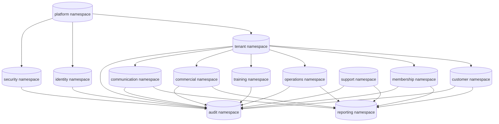
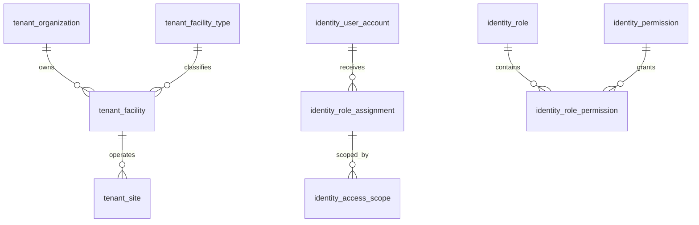
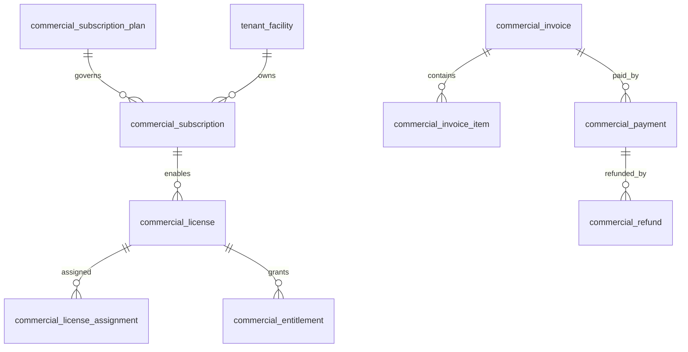

# DB-03 Physical Data Model

**Document ID:** DB-03  
**Document Name:** Physical Data Model  
**Company:** OreeOn Technologies Pvt. Ltd.  
**Product:** Digitize  
**Document Type:** Database Design  
**Version:** 0.1  
**Status:** Design Draft  
**Business Owner:** Product Architecture  
**Technical Owner:** Data Architecture  
**Prepared By:** Data Architecture Team  
**Reviewed By:** Data Architecture Review Board  
**Approved By:** Product Architecture / Solution Architecture  
**Classification:** Internal  
**Confidentiality:** Confidential  
**Document State:** Design Draft  
**Release:** Foundation Documentation  
**Dependencies:** DB-00, DB-01, DB-02, DB-04, FR-02 to FR-21, TA-03, TA-10  
**Supersedes:** Not Applicable  
**Superseded By:** Not Applicable  
**Last Updated:** July 2026  
**Database Review:** Ready for Review

---

# Revision History

| Version | Date | Author | Description |
|---|---|---|---|
| 0.1 | July 2026 | Data Architecture Team | Initial database-neutral physical data model draft |
| 0.2 | 2026-07-26 | Data Architecture Team | Freeze preparation edits: added ADR note for tenancy; standardized review status; minor corrections |

---

# 1. Introduction

## 1.1 Purpose

This document defines the database-neutral Physical Data Model for Digitize.

It translates DB-02 Logical Data Model and DB-04 Multi-Tenancy Data Design into implementation-ready physical database structures using logical database namespaces, lowercase snake_case table names, database-neutral data type categories, primary key strategy, foreign key strategy, uniqueness expectations, check constraints, default value expectations, audit columns, version columns, soft-delete behavior, historical tables, access patterns, tenant-aware indexes, transaction boundaries, concurrency controls, idempotency considerations, estimated data volume, growth patterns, partitioning considerations, diagrams, and traceability.

## 1.2 Objectives

- Define database-neutral physical namespaces for Digitize data domains.
- Define implementation-ready physical table catalogues without selecting a database engine.
- Define physical naming standards using lowercase snake_case.
- Define standard physical column groups and database-neutral data type categories.
- Define tenant-aware physical design rules based on DB-04.
- Define physical key, relationship, uniqueness, validation, audit, history, lifecycle, and reporting expectations.
- Identify access patterns and index needs without vendor-specific syntax.
- Prepare DB-05 through DB-08 detailed domain physical designs and DB-10 data dictionary.

## 1.3 Scope

DB-03 covers platform-wide physical modeling standards and a consolidated physical table baseline for core platform, operational, commercial, communication, reporting, support, audit, compliance, security, and integration tracking data.

## 1.4 Out of Scope

- SQL scripts.
- Vendor-specific data types.
- Database vendor selection.
- Storage engine configuration.
- Cloud provider configuration.
- Physical infrastructure sizing.
- Source code.
- API payload implementation.
- UI implementation.

## 1.5 Intended Audience

Data Architects, Database Designers, Backend Developers, API Designers, Solution Architects, Security Engineers, QA Engineers, DevOps Engineers, Reporting Teams, Implementation Teams, Support Teams, and Audit / Compliance Stakeholders.

## 1.6 Related Documents

| Document Type | Document Reference | Relationship |
|---|---|---|
| Database Design | DB-00 Database Design Standards | Source physical modeling standards |
| Database Design | DB-01 Conceptual Data Model | Source conceptual entities |
| Database Design | DB-02 Logical Data Model | Source logical entities and relationships |
| Database Design | DB-04 Multi-Tenancy Data Design | Source tenancy propagation and isolation |
| Functional Requirements | FR-02 to FR-21 | Source module-level physical data needs |
| Technical Architecture | TA-03 Data Architecture | Source data architecture principles |
| Technical Architecture | TA-10 ADRs | Source proposed physical design decisions |

---

# 2. Data Design Context

## 2.1 Business Context

Digitize requires physical structures that support multi-tenant SaaS operations, configurable Facility Types, tenant hierarchy, customer operations, memberships, attendance, billing, payment, subscription, licensing, communications, reporting, support, audit, and compliance without customer-specific schemas.

## 2.2 Functional Context

The physical model supports FR-02 through FR-21. Domain-specific physical details are expanded in DB-05, DB-06, DB-07, and DB-08.

## 2.3 Technical Architecture Context

The model remains database-engine neutral. It does not choose shared-schema, schema-per-tenant, database-per-tenant, or hybrid tenancy until an ADR approves the strategy. Physical naming, keys, tenant identifiers, lifecycle columns, version fields, audit fields, and data classifications are defined to support later implementation.

**Note (action required):** The implementation draft in `DB-11_Database_DDL_DML_Scripts.md` includes an implementation assumption (`DB-11-ASM-003`) that adopts a shared-database, shared-schema tenancy pattern. That assumption is provisional and must be confirmed by a formal Architecture Decision Record (ADR) before committing migration artifacts or production DDL. Until the ADR is approved, treat DB-11 as an implementation draft and do not proceed with irreversible schema changes that depend on a tenancy model.

See [ADR-048 Tenancy Model](../99_Decision_Records/ADR-048_Tenancy_Model.md) for the proposed tenancy decision, rationale, and next steps. This ADR is currently in *Proposed* state and requires formal approval by Solution and Product Architecture.

## 2.4 Data Ownership Context

Each table belongs to one primary physical namespace and one primary data domain. Cross-domain reads are governed through APIs, services, events, reporting projections, and audit records.

---

# 3. Data Scope Model

## 3.1 In-Scope Data Domains

| Data Domain ID | Data Domain | Physical Namespace | Scope |
|---|---|---|---|
| DB-DOM-001 | Platform | platform | Platform settings, reference data, feature flags, maintenance, releases |
| DB-DOM-002 | Identity | identity | Users, staff, roles, permissions, scopes, sessions |
| DB-DOM-003 | Organization | tenant | Organization, Facility, Site, configuration, policies, documents |
| DB-DOM-004 | Customer | customer | Customer master, contacts, consent, documents, history |
| DB-DOM-005 | Membership | membership | Plans, rules, customer memberships, lifecycle history |
| DB-DOM-006 | Attendance | operations | Attendance, eligibility, entry/exit, walk-in |
| DB-DOM-007 | Commercial | commercial | Pricing, billing, invoices, payments, refunds, subscriptions, licenses |
| DB-DOM-008 | Trainer | training | Trainers, activities, batches, classes, schedules, personal training |
| DB-DOM-009 | Reporting | reporting | Reports, dashboards, KPIs, projections, exports |
| DB-DOM-010 | Communication | communication | Campaigns, templates, notifications, delivery |
| DB-DOM-011 | Audit | audit | Audit events, entity references, compliance, investigations |
| DB-DOM-012 | Security | security | Policies, authentication events, security events |
| DB-DOM-013 | Support | support | Support tickets, comments, assignments, escalations, SLA |

## 3.2 Out-of-Scope Data Domains

| Data Domain | Reason |
|---|---|
| Payroll | Not approved in FR scope |
| Inventory | Not approved in FR scope |
| Procurement | Not approved in FR scope |
| Full Accounting Ledger | Not approved; commercial transaction traceability is in scope |
| Vendor-Specific Warehouse | Deferred until reporting architecture decision |

## 3.3 Data Domain Diagram

---

# 4. Data Domains

| Data Domain | Purpose | Typical Ownership |
|---|---|---|
| Platform | Platform-owned configuration and reference data | Platform Administration |
| Identity | Authentication and authorization data | Identity and Access Management |
| Organization | Tenant hierarchy and governance data | Organization Management |
| Customer | Customer master and sensitive personal data | Customer Management |
| Membership | Membership lifecycle and entitlement-to-use data | Membership Management |
| Attendance | Operational usage data | Operations |
| Commercial | Financial, subscription, license, and entitlement data | Finance / Commercial Management |
| Trainer | Training operations, activity, batch, and session data | Training Operations |
| Reporting | Derived reporting and analytics data | Reporting and Analytics |
| Communication | Campaign and notification execution data | Communication Management |
| Audit | Immutable audit and compliance evidence | Audit and Compliance |
| Security | Security policy and security event data | Security Governance |
| Support | Support case and SLA data | Support Management |

---

# 5. Data Classification

| Data Group | Data Domain | Classification | Sensitivity | Business Owner | Technical Owner | Notes |
|---|---|---|---|---|---|---|
| platform namespace | Platform | Internal Platform | Medium | Platform Administration | Platform Architecture | Platform-owned |
| identity namespace | Identity | Authentication / Authorization | High | User and Role Management | Security Architecture | Tenant-aware |
| tenant namespace | Organization | Tenant Master | Medium | Organization Management | Data Architecture | Tenant hierarchy |
| customer namespace | Customer | Sensitive Personal | High | Customer Management | Data Architecture | Privacy-controlled |
| membership namespace | Membership | Tenant Operational | Medium | Membership Management | Data Architecture | Lifecycle history |
| operations namespace | Attendance | Tenant Operational | Medium | Operations | Data Architecture | High volume |
| training namespace | Trainer | Tenant Operational / Sensitive Personal | Medium to High | Training Operations | Data Architecture | Includes notes and progress |
| commercial namespace | Commercial | Financial / Payment Reference | High | Finance / Commercial Management | Data Architecture | Historical values |
| communication namespace | Communication | Communication | Medium | Communication Management | Integration Architecture | Consent-aware |
| reporting namespace | Reporting | Derived Analytical | Medium | Reporting and Analytics | Data Engineering | Derived, not authoritative |
| support namespace | Support | Tenant Operational / Sensitive Personal | Medium to High | Support Management | Support Architecture | Support-controlled |
| audit namespace | Audit | Audit / Compliance | High | Audit and Compliance | Security Architecture | Append-only evidence |
| security namespace | Security | Security | High | Security Governance | Security Architecture | Security-sensitive |

---

# 6. Entity / Table Design

## 6.1 Physical Namespace Standards

| Namespace | Purpose | Notes |
|---|---|---|
| platform | Platform-owned global data | Global settings, feature flags, reference data |
| identity | Identity and access data | Users, staff, roles, permissions, sessions |
| tenant | Tenant hierarchy and governance | Organization, Facility, Site, policies |
| customer | Customer data | Customer profile, contact, consent, documents |
| membership | Membership data | Plans, memberships, lifecycle |
| operations | Attendance and walk-in data | High-volume operational activity |
| training | Trainer, activity, batch, class, personal training | Operational training structures |
| commercial | Billing, payment, subscription, license | Financial and commercial controls |
| communication | Campaign and notification | Delivery tracking |
| reporting | Derived reporting data | Read-oriented projections |
| support | Support tickets | SLA and support workflow |
| audit | Audit and compliance evidence | Append-only records |
| security | Security events and policies | Security governance |

## 6.2 Physical Table Catalogue

| Entity / Table | Purpose | Data Domain | Business Owner | Technical Owner | Classification | Notes |
|---|---|---|---|---|---|---|
| platform.platform_setting | Platform settings | Platform | Platform Administration | Platform Architecture | Internal Platform | Versioned |
| platform.global_master_data | Global reference data | Platform | Platform Administration | Data Architecture | Public Reference / Internal Platform | Shared |
| platform.feature_flag | Feature flag | Platform | Platform Administration | Platform Architecture | Internal Platform | Scoped applicability |
| platform.maintenance_window | Maintenance schedule | Platform | Platform Administration | DevOps Architecture | Internal Platform | Operational alerts |
| platform.release_record | Release governance | Platform | Platform Administration | DevOps Architecture | Internal Platform | Release trace |
| tenant.organization | Tenant root | Organization | Organization Management | Data Architecture | Tenant Master | organization_id is tenant root |
| tenant.organization_setting | Organization configuration | Organization | Organization Management | Data Architecture | Tenant Master | Tenant-scoped |
| tenant.organization_policy | Organization policy | Organization | Organization Management | Data Architecture | Tenant Master | Governance |
| tenant.organization_document | Organization document metadata | Organization | Organization Management | Data Architecture | Tenant Master | File content externalized |
| tenant.facility | Facility | Organization | Facility Management | Data Architecture | Tenant Master | Commercial unit |
| tenant.facility_type | Facility type reference | Platform | Platform Administration | Data Architecture | Public Reference | Shared reference |
| tenant.facility_setting | Facility configuration | Organization | Facility Management | Data Architecture | Tenant Master | Facility-scoped |
| tenant.facility_policy | Facility policy | Organization | Facility Management | Data Architecture | Tenant Master | Governs Sites |
| tenant.site | Site | Organization | Site Management | Data Architecture | Tenant Master | Physical operation unit |
| tenant.site_setting | Site configuration | Organization | Site Management | Data Architecture | Tenant Master | Site-scoped |
| tenant.site_policy | Site policy | Organization | Site Management | Data Architecture | Tenant Master | Parent governance |
| identity.user_account | User account | Identity | User and Role Management | Security Architecture | Authentication | Platform or tenant user |
| identity.staff_profile | Staff profile | Identity | User and Role Management | Security Architecture | Tenant Master | Staff business record |
| identity.role | Role | Identity | User and Role Management | Security Architecture | Authorization | Platform or tenant role |
| identity.permission | Permission | Identity | User and Role Management | Security Architecture | Authorization | Atomic capability |
| identity.role_permission | Role-permission association | Identity | User and Role Management | Security Architecture | Authorization | Associative |
| identity.role_assignment | User role assignment | Identity | User and Role Management | Security Architecture | Authorization | Scoped |
| identity.access_scope | Access scope | Identity | User and Role Management | Security Architecture | Authorization | Organization/Facility/Site |
| identity.user_session | User session | Identity | User and Role Management | Security Architecture | Security | Session policy |
| customer.customer | Customer master | Customer | Customer Management | Data Architecture | Sensitive Personal | Tenant-owned |
| customer.customer_contact | Customer contact | Customer | Customer Management | Data Architecture | Sensitive Personal | Contact and emergency |
| customer.customer_preference | Customer preference | Customer | Customer Management | Data Architecture | Sensitive Personal / Communication | Preferences |
| customer.customer_consent | Customer consent | Customer | Customer Management | Data Architecture | Compliance / Communication | History |
| customer.customer_document | Customer document metadata | Customer | Customer Management | Data Architecture | Sensitive Personal | Content externalized |
| customer.customer_history | Customer history | Customer | Customer Management | Data Architecture | Sensitive Personal / Audit | Timeline |
| membership.membership_plan | Membership plan | Membership | Membership Management | Data Architecture | Tenant Master | Facility-scoped |
| membership.membership_plan_rule | Plan rule | Membership | Membership Management | Data Architecture | Tenant Master | Configurable |
| membership.customer_membership | Customer membership | Membership | Membership Management | Data Architecture | Tenant Operational | Lifecycle |
| membership.membership_lifecycle_history | Membership history | Membership | Membership Management | Data Architecture | Tenant Operational / Audit | Immutable |
| membership.membership_freeze | Membership freeze | Membership | Membership Management | Data Architecture | Tenant Operational | Freeze interval |
| membership.membership_renewal | Membership renewal | Membership | Membership Management | Data Architecture | Tenant Operational / Commercial | Renewal trace |
| operations.attendance | Attendance record | Attendance | Operations | Data Architecture | Tenant Operational | High-volume |
| operations.attendance_eligibility | Eligibility decision | Attendance | Operations | Data Architecture | Tenant Operational | Validation result |
| operations.entry_exit_event | Entry/exit event | Attendance | Operations | Data Architecture | Tenant Operational | Time events |
| operations.walkin_visit | Walk-in visit | Attendance | Operations | Data Architecture | Tenant Operational / Commercial | Visit and charge |
| training.trainer | Trainer | Trainer | Training Operations | Data Architecture | Tenant Master | Staff relation |
| training.trainer_assignment | Trainer assignment | Trainer | Training Operations | Data Architecture | Tenant Operational | Assignment |
| training.trainer_availability | Availability | Trainer | Training Operations | Data Architecture | Tenant Operational | Scheduling |
| training.trainer_schedule | Schedule | Trainer | Training Operations | Data Architecture | Tenant Operational | Commitments |
| training.activity | Activity | Trainer | Training Operations | Data Architecture | Tenant Master | Facility offering |
| training.activity_rule | Activity rule | Trainer | Training Operations | Data Architecture | Tenant Master | Rule config |
| training.batch | Batch | Trainer | Training Operations | Data Architecture | Tenant Operational | Group cohort |
| training.class_session | Class session | Trainer | Training Operations | Data Architecture | Tenant Operational | Session |
| training.batch_enrollment | Batch enrollment | Trainer | Training Operations | Data Architecture | Tenant Operational | Association |
| training.personal_training_package | Personal training package | Trainer | Training Operations | Data Architecture | Tenant Operational / Commercial | Package |
| training.personal_training_session | Personal training session | Trainer | Training Operations | Data Architecture | Tenant Operational | Session |
| training.training_note | Training note | Trainer | Training Operations | Data Architecture | Sensitive Personal | Restricted |
| training.customer_progress | Customer progress | Trainer | Training Operations | Data Architecture | Sensitive Personal | Restricted |
| commercial.pricing | Pricing | Commercial | Finance / Commercial Management | Data Architecture | Financial | Price context |
| commercial.price_version | Price version | Commercial | Finance / Commercial Management | Data Architecture | Financial | Historical price |
| commercial.discount | Discount | Commercial | Finance / Commercial Management | Data Architecture | Financial | Discount |
| commercial.promotion | Promotion | Commercial | Marketing / Finance | Data Architecture | Financial / Communication | Campaign link |
| commercial.tax | Tax | Commercial | Finance / Commercial Management | Data Architecture | Financial | Tax config/outcome |
| commercial.billing_account | Billing account | Commercial | Finance / Commercial Management | Data Architecture | Financial | Billing owner |
| commercial.invoice | Invoice | Commercial | Finance / Commercial Management | Data Architecture | Financial | Financial document |
| commercial.invoice_item | Invoice item | Commercial | Finance / Commercial Management | Data Architecture | Financial | Line item |
| commercial.billing_adjustment | Adjustment | Commercial | Finance / Commercial Management | Data Architecture | Financial | Credit/debit |
| commercial.payment | Payment | Commercial | Finance / Commercial Management | Data Architecture | Financial / Payment Reference | Transaction |
| commercial.payment_attempt | Payment attempt | Commercial | Finance / Commercial Management | Integration Architecture | Payment Reference | Idempotent |
| commercial.payment_method_reference | Payment method reference | Commercial | Finance / Commercial Management | Integration Architecture | Payment Reference | Token/reference only |
| commercial.receipt | Receipt | Commercial | Finance / Commercial Management | Data Architecture | Financial | Confirmation |
| commercial.refund | Refund | Commercial | Finance / Commercial Management | Data Architecture | Financial | Refund |
| commercial.refund_attempt | Refund attempt | Commercial | Finance / Commercial Management | Integration Architecture | Payment Reference | Provider interaction |
| commercial.reconciliation | Reconciliation | Commercial | Finance / Commercial Management | Data Architecture | Financial | Matching |
| commercial.settlement | Settlement | Commercial | Finance / Commercial Management | Integration Architecture | Financial | Provider settlement |
| commercial.subscription_plan | Subscription plan | Commercial | Platform Administration | Data Architecture | Internal Platform / Commercial | Plan |
| commercial.subscription | Subscription | Commercial | Finance / Commercial Management | Data Architecture | Commercial Control | Facility-scoped |
| commercial.subscription_term | Subscription term | Commercial | Finance / Commercial Management | Data Architecture | Commercial Control | Term |
| commercial.subscription_lifecycle_history | Subscription history | Commercial | Finance / Commercial Management | Data Architecture | Commercial Control / Audit | Immutable |
| commercial.license | License | Commercial | License Management | Data Architecture | Commercial Control | License |
| commercial.license_assignment | License assignment | Commercial | License Management | Data Architecture | Commercial Control | Facility assignment |
| commercial.entitlement | Entitlement | Commercial | License Management | Data Architecture | Commercial Control | Capability |
| communication.advertisement_campaign | Campaign | Communication | Marketing Management | Data Architecture | Communication | Lifecycle |
| communication.campaign_audience | Audience | Communication | Marketing Management | Data Architecture | Communication / Sensitive Personal | Consent-aware |
| communication.campaign_schedule | Campaign schedule | Communication | Marketing Management | Data Architecture | Communication | Schedule |
| communication.campaign_result | Campaign result | Communication | Marketing Management | Data Architecture | Communication / Reporting | Metrics |
| communication.notification_template | Template | Communication | Communication Management | Data Architecture | Communication | Template |
| communication.notification_preference | Preference | Communication | Communication Management | Data Architecture | Communication / Sensitive Personal | Preference |
| communication.notification | Notification | Communication | Communication Management | Integration Architecture | Communication | Instance |
| communication.notification_recipient | Recipient | Communication | Communication Management | Integration Architecture | Communication / Sensitive Personal | Recipient |
| communication.notification_delivery | Delivery | Communication | Communication Management | Integration Architecture | Communication | Status |
| communication.notification_attempt | Attempt | Communication | Communication Management | Integration Architecture | Communication | Retry |
| communication.notification_failure | Failure | Communication | Communication Management | Integration Architecture | Communication | Diagnostics |
| reporting.report_definition | Report definition | Reporting | Reporting and Analytics | Data Engineering | Derived Analytical | Definition |
| reporting.report_parameter | Report parameter | Reporting | Reporting and Analytics | Data Engineering | Derived Analytical | Parameters |
| reporting.report_schedule | Report schedule | Reporting | Reporting and Analytics | Data Engineering | Derived Analytical | Automation |
| reporting.report_execution | Report execution | Reporting | Reporting and Analytics | Data Engineering | Derived Analytical | Runtime |
| reporting.report_export | Report export | Reporting | Reporting and Analytics | Data Engineering | Derived Analytical / Compliance | Export |
| reporting.dashboard_configuration | Dashboard configuration | Reporting | Reporting and Analytics | Data Engineering | Derived Analytical | Dashboard |
| reporting.kpi_definition | KPI definition | Reporting | Reporting and Analytics | Data Engineering | Derived Analytical | KPI meaning |
| reporting.kpi_snapshot | KPI snapshot | Reporting | Reporting and Analytics | Data Engineering | Derived Analytical | Snapshot |
| reporting.reporting_projection | Reporting projection | Reporting | Reporting and Analytics | Data Engineering | Derived Analytical | Read model |
| support.support_ticket | Support ticket | Support | Support Management | Support Architecture | Tenant Operational / Sensitive Personal | Ticket |
| support.ticket_category | Ticket category | Support | Support Management | Support Architecture | Tenant Master / Reference | Category |
| support.ticket_priority | Ticket priority | Support | Support Management | Support Architecture | Tenant Master / Reference | Priority |
| support.ticket_assignment | Ticket assignment | Support | Support Management | Support Architecture | Tenant Operational | Assignment |
| support.ticket_comment | Ticket comment | Support | Support Management | Support Architecture | Tenant Operational / Sensitive Personal | Comment |
| support.ticket_attachment | Ticket attachment | Support | Support Management | Support Architecture | Sensitive Personal | Metadata |
| support.ticket_escalation | Ticket escalation | Support | Support Management | Support Architecture | Tenant Operational | Escalation |
| support.sla_tracking | SLA tracking | Support | Support Management | Support Architecture | Tenant Operational | SLA |
| audit.audit_event | Audit event | Audit | Audit and Compliance | Security Architecture | Audit / Compliance | Append-only |
| audit.audit_entity_reference | Audit entity reference | Audit | Audit and Compliance | Security Architecture | Audit / Compliance | Entity reference |
| audit.compliance_record | Compliance record | Audit | Audit and Compliance | Security Architecture | Compliance | Evidence |
| audit.data_export_record | Data export record | Audit | Audit and Compliance | Security Architecture | Compliance | Export evidence |
| audit.investigation_record | Investigation record | Audit | Audit and Compliance | Security Architecture | Compliance / Security | Investigation |
| audit.administrative_access_record | Administrative access | Audit | Audit and Compliance | Security Architecture | Security / Audit | Privileged access |
| security.security_policy | Security policy | Security | Security Governance | Security Architecture | Security | Policy |
| security.password_policy | Password policy | Security | Security Governance | Security Architecture | Security | Password rules |
| security.session_policy | Session policy | Security | Security Governance | Security Architecture | Security | Session rules |
| security.authentication_event | Authentication event | Security | Security Governance | Security Architecture | Security | Login history |
| security.security_event | Security event | Security | Security Governance | Security Architecture | Security | Security evidence |

---

# 7. Attribute / Column Design

## 7.1 Standard Data Type Categories

| Data Type Category | Usage |
|---|---|
| Identifier | Stable system identifier |
| Identifier Reference | Reference to another entity |
| Text | Human-readable content |
| Code | Controlled business code |
| Status | Lifecycle state |
| Type | Controlled classification |
| Date | Calendar date |
| DateTime | Timestamped business or technical event |
| Boolean | True/false value |
| Number | Count or numeric quantity |
| Money | Monetary amount with currency context |
| Percentage | Percentage value |
| JSON / Structured Data | Controlled flexible configuration where approved |
| External Reference | Provider or integration reference |

## 7.2 Standard Column Groups

| Attribute / Column | Description | Data Type / Logical Type | Mandatory | Source | Validation / Constraint | Notes |
|---|---|---|---|---|---|---|
| record_id | Primary record identifier | Identifier | Yes | System | Unique | Applies to persistent records unless exception approved |
| organization_id | Tenant root identifier | Identifier Reference | Conditional | Tenant Context | Required for tenant-owned data | Use instead of abstract tenant_id where Organization is tenant root |
| facility_id | Facility scope identifier | Identifier Reference | Conditional | User / System | Must belong to organization_id | Required for Facility-scoped data |
| site_id | Site scope identifier | Identifier Reference | Conditional | User / System | Must belong to facility_id and organization_id | Required for Site-scoped data |
| code | Business code | Code | Conditional | User / System | Unique within approved scope | Human-readable identifiers |
| name | Display name | Text | Conditional | User | Required for named master data | Not used for immutable event-only records |
| description | Description | Text | Optional | User | Content rules apply | Business explanation |
| status | Lifecycle state | Status | Conditional | User / System | Must follow approved lifecycle | Required for lifecycle records |
| type | Classification type | Type | Conditional | User / System | Must use approved reference value | Facility Type, notification channel, etc. |
| effective_at | Effective timestamp | DateTime | Conditional | User / System | Must satisfy temporal rule | Policies, pricing, license |
| expires_at | Expiry timestamp | DateTime | Conditional | User / System | Must follow effective_at | Time-bound records |
| created_at | Creation timestamp | DateTime | Yes for mutable records | System | Immutable after create | Audit column |
| created_by | Creator reference | Identifier Reference | Conditional | System | Required where actor known | Audit column |
| updated_at | Last update timestamp | DateTime | Conditional | System | Required for mutable records | Audit column |
| updated_by | Last updater reference | Identifier Reference | Conditional | System | Required where actor known | Audit column |
| version_number | Optimistic concurrency version | Number | Conditional | System | Increments on update | Mutable records |
| is_active | Active flag | Boolean | Conditional | System / User | Must align with status | Convenience only, not lifecycle source where status exists |
| deleted_at | Soft-delete timestamp | DateTime | Conditional | System | Only where soft delete approved | Not for audit/financial immutable records |
| deleted_by | Soft-delete actor | Identifier Reference | Conditional | System | Required when deleted_at populated | Not for audit/financial immutable records |
| correlation_id | Correlation reference | External Reference | Conditional | System | Required for critical cross-domain actions | Audit and diagnostics |
| idempotency_key | Retry-safe operation key | External Reference | Conditional | API / Integration | Unique within operation scope | Payment, refund, notification |

---

# 8. Relationships

| Relationship | Parent | Child | Cardinality | Optionality | Tenant Scope | Notes |
|---|---|---|---|---|---|---|
| DB-03-REL-001 | tenant.organization | tenant.facility | One-to-Many | Mandatory child for operations | Tenant-owned | facility.organization_id |
| DB-03-REL-002 | tenant.facility | tenant.site | One-to-Many | Mandatory child for site operations | Tenant-owned | site.facility_id |
| DB-03-REL-003 | tenant.facility_type | tenant.facility | One-to-Many | Mandatory | Shared reference | facility.facility_type_id |
| DB-03-REL-004 | identity.user_account | identity.role_assignment | One-to-Many | Optional until assigned | Tenant-aware | assignment scope required |
| DB-03-REL-005 | identity.role | identity.role_permission | One-to-Many | Optional | Tenant-aware / platform | Role capability mapping |
| DB-03-REL-006 | identity.permission | identity.role_permission | One-to-Many | Optional | Tenant-aware / platform | Atomic permission |
| DB-03-REL-007 | identity.role_assignment | identity.access_scope | One-to-Many | Mandatory for tenant roles | Tenant-owned | Access scope |
| DB-03-REL-008 | tenant.organization | customer.customer | One-to-Many | Optional | Tenant-owned | customer.organization_id |
| DB-03-REL-009 | customer.customer | membership.customer_membership | One-to-Many | Optional | Tenant-owned | Membership owner |
| DB-03-REL-010 | membership.membership_plan | membership.customer_membership | One-to-Many | Mandatory | Tenant-owned | Plan source |
| DB-03-REL-011 | customer.customer | operations.attendance | One-to-Many | Optional | Tenant-owned | Customer usage |
| DB-03-REL-012 | tenant.site | operations.attendance | One-to-Many | Optional | Tenant-owned | Site operation |
| DB-03-REL-013 | training.activity | training.batch | One-to-Many | Optional | Tenant-owned | Activity schedule |
| DB-03-REL-014 | training.batch | training.class_session | One-to-Many | Optional | Tenant-owned | Class occurrences |
| DB-03-REL-015 | training.batch | training.batch_enrollment | One-to-Many | Optional | Tenant-owned | Enrollment |
| DB-03-REL-016 | commercial.invoice | commercial.invoice_item | One-to-Many | Mandatory after issue | Tenant-owned | Invoice detail |
| DB-03-REL-017 | commercial.invoice | commercial.payment | One-to-Many | Optional | Tenant-owned | Payment |
| DB-03-REL-018 | commercial.payment | commercial.refund | One-to-Many | Optional | Tenant-owned | Refund |
| DB-03-REL-019 | commercial.subscription | commercial.license | One-to-Many | Optional | Tenant-owned / commercial | Subscription enables license |
| DB-03-REL-020 | commercial.license | commercial.entitlement | One-to-Many | Optional | Tenant-owned / commercial | Capability grants |
| DB-03-REL-021 | communication.notification | communication.notification_delivery | One-to-Many | Optional | Tenant-owned | Delivery |
| DB-03-REL-022 | reporting.report_definition | reporting.report_execution | One-to-Many | Optional | Tenant-aware | Report run |
| DB-03-REL-023 | support.support_ticket | support.ticket_comment | One-to-Many | Optional | Tenant-owned | Ticket conversation |
| DB-03-REL-024 | audit.audit_event | audit.audit_entity_reference | One-to-Many | Conditional | Tenant-aware | Entity trace |

---

# 9. Keys and Identifiers

| Key / Identifier | Entity / Table | Purpose | Scope | Notes |
|---|---|---|---|---|
| DB-03-PK-001 | All persistent tables | Primary key | Table scope | Standard `record_id` identifier unless exception approved |
| DB-03-FK-001 | Tenant-owned tables | Tenant root relationship | Organization scope | `organization_id` where applicable |
| DB-03-FK-002 | Facility-scoped tables | Facility relationship | Organization + Facility scope | `facility_id` where applicable |
| DB-03-FK-003 | Site-scoped tables | Site relationship | Organization + Facility + Site scope | `site_id` where applicable |
| DB-03-UQ-001 | Business codes | Tenant-scoped uniqueness | Organization / Facility / Site | Exact constraints defined per domain |
| DB-03-UQ-002 | Provider callback references | Idempotent uniqueness | Provider + tenant scope | Payments, refunds, notifications |
| DB-03-UQ-003 | Role permission mapping | Prevent duplicate permission mapping | Role + permission scope | Identity domain |
| DB-03-UQ-004 | Access scope mapping | Prevent duplicate scope assignment | User + role + scope | Identity domain |
| DB-03-ID-001 | correlation_id | Cross-domain traceability | Platform or tenant scope | Required for critical asynchronous flows |
| DB-03-ID-002 | idempotency_key | Retry-safe processing | Operation scope | Required for external callbacks and payment/refund actions |

---

# 10. Constraints and Validation

| Constraint | Entity / Table | Rule | Scope | Notes |
|---|---|---|---|---|
| DB-03-CK-001 | Tenant-owned tables | organization_id must be present unless table is explicitly platform-owned or shared reference | Tenant-owned | Enforces tenant root |
| DB-03-CK-002 | Facility-scoped tables | facility_id must reference a Facility under same Organization | Facility scope | Tenant consistency |
| DB-03-CK-003 | Site-scoped tables | site_id must reference a Site under same Facility and Organization | Site scope | Tenant consistency |
| DB-03-CK-004 | Status fields | Status must be approved for the entity lifecycle | All lifecycle tables | Domain-specific allowed values |
| DB-03-CK-005 | Temporal fields | expires_at must not precede effective_at where both exist | Time-bound records | Pricing, subscriptions, licenses, policies |
| DB-03-CK-006 | Monetary values | Amount fields must follow commercial rules and currency context | Commercial | Detailed in DB-07 |
| DB-03-CK-007 | Audit immutable tables | Audit and history tables must not use normal update lifecycle | Audit / history | Append-only behavior |
| DB-03-CK-008 | Soft delete | Soft delete is prohibited for immutable financial, audit, payment, refund, security, and compliance evidence unless an approved exception exists | Protected records | Use lifecycle state |
| DB-03-CK-009 | Provider secrets | Provider secrets must not be stored directly in domain tables | Integration configuration | Secret references only |

---

# 11. Index and Access Patterns

This section defines index needs, not vendor-specific index syntax.

| Access Pattern | Entity / Table | Index Need | Query Scope | Notes |
|---|---|---|---|---|
| Tenant hierarchy lookup | tenant.organization, tenant.facility, tenant.site | Tenant and hierarchy indexes | Platform / Organization | Required |
| User login and scope resolution | identity.user_account, identity.role_assignment, identity.access_scope, identity.user_session | Authentication and authorization indexes | Platform / Organization | Critical |
| Customer search | customer.customer, customer.customer_contact | Tenant-scoped search indexes | Organization / Site | Privacy-aware |
| Membership eligibility | membership.customer_membership, membership.membership_plan_rule, operations.attendance_eligibility | Membership and eligibility indexes | Organization / Site | Attendance-critical |
| Attendance recording | operations.attendance, operations.entry_exit_event | Site, customer, date indexes | Site / Date | High volume |
| Batch and class scheduling | training.batch, training.class_session, training.trainer_schedule | Facility, Site, trainer, time indexes | Facility / Site / Time | Conflict detection |
| Invoice and payment lookup | commercial.invoice, commercial.payment, commercial.refund | Customer, invoice, payment, date indexes | Organization / Date | Financial |
| Payment callback idempotency | commercial.payment_attempt, commercial.refund_attempt | Idempotency and provider reference indexes | Provider / Tenant | Critical |
| Subscription and license validation | commercial.subscription, commercial.license_assignment, commercial.entitlement | Facility and capability indexes | Facility / Capability | Login and feature access |
| Notification retry | communication.notification_delivery, communication.notification_attempt, communication.notification_failure | Status, channel, time indexes | Channel / Status | Operational retry |
| Report execution | reporting.report_execution, reporting.report_export | Tenant, user, status, time indexes | Tenant / User | Reporting |
| Support queue | support.support_ticket, support.ticket_assignment, support.sla_tracking | Tenant, priority, status indexes | Tenant / Support queue | Support operations |
| Audit investigation | audit.audit_event, audit.audit_entity_reference, security.security_event | Tenant, actor, entity, action, time indexes | Tenant / Platform | Compliance |

---

# 12. Multi-Tenancy Design

| Tenant Concern | Design Approach | Applies To | Notes |
|---|---|---|---|
| Tenant Identifier | Use organization_id as approved tenant root in tenant-owned physical structures | Tenant-owned tables | Abstract tenant_id avoided unless ADR changes direction |
| Facility Scope | Use facility_id for Facility-scoped records | Facility data and commercial records | Must align with organization_id |
| Site Scope | Use site_id for Site-scoped records | Attendance and local operations | Must align with facility_id and organization_id |
| Platform-Owned Tables | No organization_id required unless scoped overrides are supported | platform namespace | Scope field may be used |
| Shared Reference Tables | Shared reference data governed by platform | facility_type and global reference tables | Tenant override only if approved |
| Tenant-Aware Foreign Keys | Foreign keys must preserve tenant consistency | Tenant-owned relationships | Exact implementation depends on ADR and database capability |
| Tenant-Aware Uniqueness | Business uniqueness must include Organization / Facility / Site boundary | Business codes | Domain-specific |
| Cross-Tenant Access | Privileged reads require Administrative Access Record and Audit Event | Support, Audit, Platform | No silent access |
| Reporting Isolation | Reporting tables must include tenant scope metadata where derived from tenant data | reporting namespace | Prevents mixed tenant outputs |

---

# 13. Audit and History Design

| Audit / History Area | Trigger | Data Captured | Retention | Notes |
|---|---|---|---|---|
| Standard Mutable Audit | Create or update mutable records | created_at, created_by, updated_at, updated_by, version_number | Entity lifecycle | Standard columns |
| Soft Delete Audit | Approved soft deletion | deleted_at, deleted_by, status | Entity lifecycle | Not for immutable records |
| Lifecycle History | Status transition | previous_status, new_status, actor, reason, effective_at | Domain retention | Dedicated history tables |
| Financial History | Commercial state or value change | historical amount, tax, discount, state, correlation | Financial retention | Never depend only on current config |
| Audit Event | Critical action | actor, tenant, entity reference, action, timestamp, correlation | Compliance retention | Append-only |
| Administrative Access | Privileged cross-tenant access | actor, tenant, reason, scope, timestamp | Compliance retention | Required for support/audit |
| Export History | Report or data export | actor, filters, scope, file metadata, timestamp | Compliance retention | Data Export Record |

---

# 14. Data Lifecycle State Model

| Lifecycle State | Meaning | Allowed Usage |
|---|---|---|
| Transient | Temporary processing data | Imports, callbacks, generated drafts |
| Active | Operationally current record | Active master or transaction |
| Inactive | Non-operational but retained | Suspended or inactive records |
| Historical | Completed or superseded record | Completed transactions and history |
| Archived | Moved out of primary access | Aged records |
| Anonymized | De-identified where approved | Privacy-driven retention |
| Purged | Permanently removed | Approved obsolete data |
| Legally Retained | Retained due to obligations | Financial, audit, security, compliance |

---

# 15. Retention, Archival, and Purging

| Data Group | Lifecycle State | Retention Rule | Archival Approach | Purging Rule | Notes |
|---|---|---|---|---|---|
| Platform Data | Active / Historical | Retain current and change history | Archive superseded settings | Purge approved obsolete non-audit records only | Governance |
| Tenant Master | Active / Suspended / Archived | Retain while obligations apply | Archive inactive tenants | Purge only by approved process | Tenant root |
| Identity Data | Active / Inactive / Historical | Retain security history | Archive inactive access records | Purge only after security retention | Security |
| Customer Data | Active / Archived / Anonymized | Retain by privacy and business policy | Archive inactive customer data | Purge/anonymize when approved | Sensitive |
| Operational Data | Active / Historical / Archived | Retain operational traceability | Archive aged operational records | Purge only when allowed | Attendance high volume |
| Financial Data | Active / Historical / Legally Retained | Retain per financial compliance | Archive historical financial records | Do not purge while obligations apply | Strict |
| Communication Data | Active / Historical / Archived | Retain delivery and consent evidence | Archive aged delivery records | Purge when consent/compliance allows | Communication |
| Reporting Data | Active / Historical / Archived | Retain based on report value | Archive aged snapshots | Purge derived data if source and policy allow | Derived |
| Support Data | Active / Historical / Archived | Retain support evidence | Archive closed tickets | Purge after obligations expire | Sensitive possible |
| Audit and Security Data | Recorded / Legally Retained / Archived | Retain per audit and security policy | Archive with integrity protection | Purge only by compliance approval | Protected |

---

# 16. Migration and Versioning

| Migration Area | Migration Type | Validation | Rollback Consideration | Notes |
|---|---|---|---|---|
| Schema Versioning | Physical structure versioning | Validate structure, constraints, indexes, compatibility | Versioned rollback where practical | Vendor-neutral |
| Data Migration | Data movement or transformation | Validate counts, relationships, financial totals, tenant isolation | Reconciliation and rollback plan required | DB-09 expands |
| Tenant Context Backfill | Populate tenant scope in records | Validate Organization, Facility, Site consistency | Requires backup and reconciliation | Critical for tenancy |
| Historical Table Migration | Move lifecycle history to history tables | Validate state sequence and audit references | Preserve source until verified | Audit sensitive |
| Reporting Projection Build | Build derived reporting structures | Validate source totals and tenant scope | Rebuild from source where possible | Reporting |
| Release Migration | Deployment-aligned migration | Validate backward compatibility | Rollback or forward-fix strategy | DevOps coordination |

---

# 17. Backup and Recovery

| Data Group | Backup Need | Recovery Requirement | Notes |
|---|---|---|---|
| Core Tenant and Identity | Critical | Recover tenant hierarchy and access control first | Platform continuity |
| Operational Data | Critical | Recover customer, membership, attendance, training consistency | Daily operations |
| Commercial Data | Critical | Recover financial transaction and entitlement state | Reconciliation required |
| Communication Data | High | Recover delivery state and consent history | Retry aware |
| Reporting Data | Medium to High | Recover or rebuild projections | Source required |
| Support Data | High | Recover tickets and SLA history | Support continuity |
| Audit and Security Data | Critical | Recover immutable evidence and security records | Compliance |

---

# 18. Security and Privacy

| Security Area | Design Approach | Applies To | Notes |
|---|---|---|---|
| Tenant Columns | organization_id, facility_id, site_id where applicable | Tenant-owned tables | Tenant isolation |
| Sensitive Columns | Sensitive fields marked for masking/encryption decisions | Customer, training, support, financial | DB-10 data dictionary |
| Payment Data | Store references and provider metadata only | Payment tables | No raw card storage |
| Audit Integrity | Audit namespace protected from normal modification | audit tables | Append-only behavior |
| Access Control | Reads and writes must validate role and scope | All tenant data | API/service enforcement |
| Export Controls | Report and data exports require audit and masking | reporting, audit | Compliance |
| Secrets | Provider secrets stored outside domain tables | Integration references | Secret management architecture |
| Lower Environment | Sensitive data masked/anonymized for non-production use | Sensitive, financial, security | DB-09 detail |

---

# 19. Reporting and Analytics Considerations

| Reporting Area | Source Data | Derived Data | Refresh / Access Pattern | Notes |
|---|---|---|---|---|
| Operational Reporting | customer, membership, operations, training | reporting_projection, kpi_snapshot | Scheduled / on-demand | Tenant scoped |
| Commercial Reporting | commercial invoice, payment, refund, subscription, license | financial projections | Scheduled / on-demand | Reconciliation |
| Communication Reporting | campaign, notification delivery | campaign_result, delivery projections | Scheduled / event-driven | Consent-aware |
| Support Reporting | support ticket, SLA | support metrics | Scheduled | Support scope |
| Audit Reporting | audit_event, security_event | compliance reports | Controlled | Privileged access |
| Dashboard Reporting | multiple source domains | dashboard configuration and KPI snapshots | Cached / scheduled | Performance |

---

# 20. Traceability

| Source Document | Requirement / Process / Rule | Entity / Table | Attribute / Column | Notes |
|---|---|---|---|---|
| DB-02 | Logical entity catalogue | Physical table catalogue | Standard column groups | Direct source |
| DB-04 | Tenant design | Tenant-owned tables | organization_id, facility_id, site_id | Tenancy source |
| FR-02 | Platform Administration | platform namespace | Settings, flags, reference groups | Detailed in DB-05 |
| FR-03 to FR-06 | Core platform and identity | tenant and identity namespaces | Hierarchy and access columns | Detailed in DB-05 |
| FR-07 to FR-13 | Operations | customer, membership, operations, training namespaces | Operational columns | Detailed in DB-06 |
| FR-14 to FR-16 | Commercial | commercial namespace | Financial, subscription, license columns | Detailed in DB-07 |
| FR-17 to FR-21 | Communication, reporting, support, audit | communication, reporting, support, audit, security namespaces | Delivery, report, ticket, audit columns | Detailed in DB-08 |
| TA-03 | Data architecture | All namespaces | Ownership and classification | Architecture alignment |
| TA-10 | ADRs | Tenant, audit, reporting, security tables | Tenant, audit, idempotency, correlation columns | ADR alignment |

---

# 21. Diagrams

| Diagram ID | Diagram Name | Diagram Type | Location |
|---|---|---|---|
| DB-03-DGM-001 | Physical Namespace Diagram | Physical Entity Relationship Diagram | Section 3.3 |
| DB-03-DGM-002 | Core Physical Hierarchy Diagram | Physical Entity Relationship Diagram | Section 21.1 |
| DB-03-DGM-003 | Commercial Physical Diagram | Physical Entity Relationship Diagram | Section 21.2 |

## 21.1 Core Physical Hierarchy Diagram

## 21.2 Commercial Physical Diagram

---

# 22. Review Checklist

| Review Area | Status | Notes |
|---|---|---|
| Terminology consistency | Pending | Requires review against DB-02 and Product Glossary |
| Entity completeness | Pending | Physical baseline created; domain details continue in DB-05 to DB-08 |
| Relationship correctness | Pending | Primary physical relationships included |
| Tenant isolation | Pending | Physical tenant columns and scope rules defined; ADR pending |
| Key and constraint completeness | Pending | Key and constraint standards defined |
| Index and access pattern coverage | Pending | Access pattern index needs defined; DB-09 expands |
| Data classification | Pending | Namespace classification included |
| Auditability | Pending | Audit columns and append-only audit expectations included |
| Retention and archival alignment | Pending | Retention classes included |
| Migration readiness | Pending | Migration categories included |
| Backup and recovery readiness | Pending | Recovery criticality identified |
| Security and privacy readiness | Pending | Sensitive data and export controls included |
| Traceability completeness | Pending | Traceability included; DB-10 will consolidate |

---

# 23. Open Questions

| Question ID | Question | Owner | Target Resolution | Status |
|---|---|---|---|---|
| DB-03-OQ-001 | Which physical tenancy deployment pattern will be approved by ADR? | Solution Architecture | Before DB-03 freeze | Open |
| DB-03-OQ-002 | Should namespace separation be implemented as physical schemas, logical modules, or service-owned persistence boundaries after database technology selection? | Data Architecture / Solution Architecture | Before implementation | Open |
| DB-03-OQ-003 | Which sensitive fields require encryption versus masking only? | Security Architecture | Before DB-10 and implementation | Open |
| DB-03-OQ-004 | Which high-volume tables require partitioning in release 1.0? | Data Architecture / DevOps | Before DB-09 freeze | Open |
| DB-03-OQ-005 | What are approved retention periods by data class? | Compliance / Product Architecture | Before DB-09 freeze | Open |

---

# 24. Summary

DB-03 defines the database-neutral physical baseline for Digitize.

It establishes physical namespaces, lowercase snake_case table naming, table catalogue, standard column groups, database-neutral type categories, key strategy, tenant-aware relationship strategy, uniqueness expectations, validation rules, access patterns, audit and history requirements, lifecycle treatment, migration concerns, backup and recovery expectations, security and privacy controls, reporting considerations, diagrams, traceability, and open questions.

DB-03 does not include SQL, vendor-specific data types, or database-engine-specific implementation. Detailed domain table and column definitions continue in DB-05, DB-06, DB-07, DB-08, DB-09, and DB-10.
