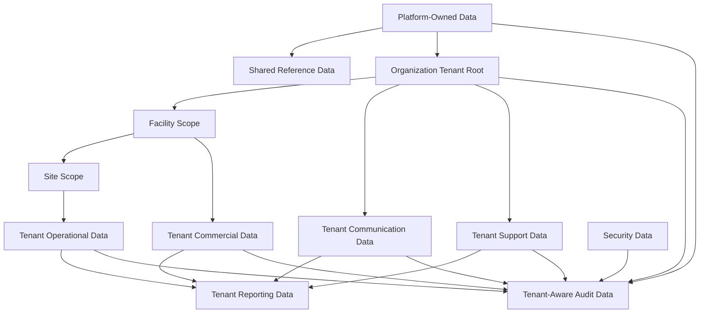
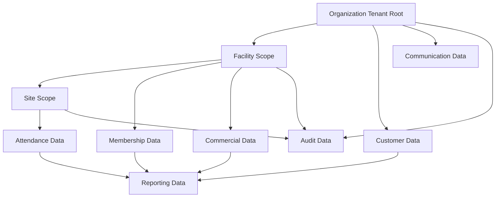
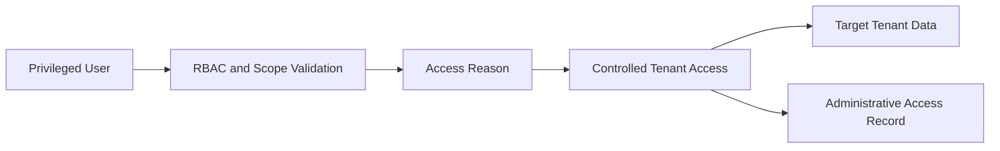

# DB-04 Multi-Tenancy Data Design

**Document ID:** DB-04  
**Document Name:** Multi-Tenancy Data Design  
**Company:** OreeOn Technologies Pvt. Ltd.  
**Product:** Digitize  
**Document Type:** Database Design  
**Version:** 0.1  
**Status:** Design Draft  
**Business Owner:** Product Architecture  
**Technical Owner:** Data Architecture  
**Prepared By:** Data Architecture Team  
**Reviewed By:** Data Architecture Review Board  
**Approved By:** Product Architecture / Solution Architecture  
**Classification:** Internal  
**Confidentiality:** Confidential  
**Document State:** Design Draft  
**Release:** Foundation Documentation  
**Dependencies:** DB-00, DB-01, DB-02, PF-02, BA-09, BA-10, FR-02 to FR-21, TA-03, TA-05, TA-10  
**Supersedes:** Not Applicable  
**Superseded By:** Not Applicable  
**Last Updated:** July 2026  
**Database Review:** Ready for Review

---

# Revision History

| Version | Date | Author | Description |
|---|---|---|---|
| 0.1 | July 2026 | Data Architecture Team | Initial multi-tenancy data design draft |
| 0.2 | 2026-07-26 | Data Architecture Team | Freeze preparation edits: standardized review status; minor clarifications |

---

# 1. Introduction

## 1.1 Purpose

This document defines the multi-tenancy data design for Digitize.

It establishes how Organization acts as the tenant root, how tenant context propagates to Facility and Site, how tenant-owned data is separated from platform-owned and shared reference data, how tenant-scoped relationships and uniqueness must behave, and how cross-tenant administration, support access, audit access, suspension, archival, export, migration, deletion restrictions, reporting isolation, and audit isolation shall be governed.

## 1.2 Objectives

- Define Organization as the approved tenant root.
- Define Facility and Site ownership under Organization.
- Define tenant propagation rules for all tenant-owned logical entities.
- Define tenant-aware relationship and uniqueness requirements.
- Separate platform-owned, shared reference, tenant-owned, derived reporting, audit, support, and security data.
- Define controlled cross-tenant access for platform administration, support, audit, compliance, and security use cases.
- Define tenant suspension, archival, export, migration, and deletion restrictions.
- Identify tenant isolation validation expectations for API, UI, database, reporting, audit, support, and test coverage.
- Document unresolved physical tenancy strategy decisions without prematurely selecting a database implementation pattern.

## 1.3 Scope

This document applies to all Digitize data domains where records are platform-owned, shared, tenant-owned, tenant-derived, tenant-audited, tenant-exported, or tenant-accessed.

## 1.4 Out of Scope

- Final physical tenancy deployment pattern selection.
- Vendor-specific database security features.
- SQL implementation.
- Infrastructure account design.
- Runtime authorization implementation details.
- Source code.
- Tenant billing commercial policy beyond data impact.

Physical implementation is finalized only after approved ADRs and DB-03 physical design.

## 1.5 Intended Audience

Product Architects, Solution Architects, Data Architects, Security Architects, Backend Developers, API Designers, QA Engineers, DevOps Engineers, Support Teams, Implementation Teams, Reporting Teams, and Audit / Compliance Stakeholders.

## 1.6 Related Documents

| Document Type | Document Reference | Relationship |
|---|---|---|
| Database Design | DB-00 Database Design Standards | Defines standards |
| Database Design | DB-01 Conceptual Data Model | Source conceptual hierarchy and domains |
| Database Design | DB-02 Logical Data Model | Source logical entities and relationships |
| Technical Architecture | TA-03 Data Architecture | Source data ownership and isolation principles |
| Technical Architecture | TA-05 Security and Identity Architecture | Source RBAC, tenant scope, and access controls |
| Technical Architecture | TA-10 ADRs | Source proposed tenancy decisions |
| Business Analysis | BA-09 Non-Functional Business Requirements | Source security, auditability, configurability, and data protection expectations |
| Business Analysis | BA-10 Assumptions, Constraints and Risks | Source multi-tenant risk context |
| Functional Requirements | FR-02 to FR-21 | Source tenant-scoped business capabilities |

---

# 2. Data Design Context

## 2.1 Business Context

Digitize must serve many independent Organizations on one configurable SaaS platform. Each Organization owns Facilities, and each Facility operates Sites. Users, customers, memberships, attendance, billing, subscriptions, licenses, notifications, reports, support tickets, and audit records must remain scoped to the correct Organization unless an approved platform, support, audit, compliance, or security use case authorizes cross-tenant access.

## 2.2 Functional Context

Tenant context affects every functional area. Organization, Facility, and Site management create the tenant hierarchy. User and Role Management grants access within that hierarchy. Customer, Membership, Attendance, Trainer, Batch, Billing, Payment, Campaign, Notification, Reporting, Support, Audit, Subscription, and License modules must validate tenant context before reading, creating, updating, exporting, reporting, or auditing data.

## 2.3 Technical Architecture Context

TA-03 requires tenant-aware data ownership and reporting isolation. TA-05 requires RBAC and tenant scope enforcement before domain execution. TA-10 includes proposed ADRs for Organization as tenant root, tenant-aware data access, tenant isolation guard, audit separation, and tenant context as a shared platform capability.

## 2.4 Data Ownership Context

Tenant-owned data is business-owned by the Organization that subscribes to Digitize. OreeOn retains platform governance over the SaaS environment, global configuration, shared reference data, security controls, operational support controls, and audit/compliance capabilities required to operate the platform.

---

# 3. Data Scope Model

## 3.1 In-Scope Data Domains

| Data Domain ID | Data Domain | Tenancy Treatment |
|---|---|---|
| DB-DOM-001 | Platform | Platform-owned; may apply globally or to configured tenant scopes |
| DB-DOM-002 | Identity | Tenant-aware; users may be platform-scoped or Organization-scoped |
| DB-DOM-003 | Organization | Tenant root and hierarchy |
| DB-DOM-004 | Customer | Tenant-owned and Organization traceable |
| DB-DOM-005 | Membership | Tenant-owned and Facility / Customer traceable |
| DB-DOM-006 | Attendance | Tenant-owned and Site traceable |
| DB-DOM-007 | Commercial | Tenant-owned, Facility commercial scope, financial audit obligations |
| DB-DOM-008 | Trainer | Tenant-owned and Facility / Site traceable |
| DB-DOM-009 | Reporting | Tenant-derived and scope-isolated |
| DB-DOM-010 | Communication | Tenant-owned or platform-generated, consent-aware |
| DB-DOM-011 | Audit | Tenant-aware and platform-auditable |
| DB-DOM-012 | Security | Platform-owned or tenant-aware depending on event scope |
| DB-DOM-013 | Support | Tenant-aware with controlled support access |

## 3.2 Out-of-Scope Data Domains

| Data Domain | Reason |
|---|---|
| Payroll | Not approved for current release |
| Procurement | Not approved for current release |
| Inventory | Not approved for current release |
| Customer-specific schemas | Contradicts configuration-over-customization principle |
| Tenant-owned secret storage | Secrets must follow approved secret-management architecture |

## 3.3 Data Domain Diagram

---

# 4. Data Domains

| Data Domain | Purpose | Typical Ownership |
|---|---|---|
| Platform | Global SaaS controls and platform-owned configuration | Platform Administration |
| Identity | Tenant-aware identity, access, role, permission, session | Identity and Access Management |
| Organization | Tenant root, Facility, Site, governance configuration | Organization Management |
| Customer | Tenant-owned customer master and lifecycle data | Customer Management |
| Membership | Tenant-owned membership plan and lifecycle data | Membership Management |
| Attendance | Site-scoped tenant operational usage data | Operations |
| Commercial | Facility-scoped commercial, subscription, license, billing, payment, refund data | Finance / Commercial Management |
| Trainer | Facility and Site-scoped trainer, activity, batch, and personal training data | Training Operations |
| Reporting | Tenant-derived analytical data | Reporting and Analytics |
| Communication | Tenant-aware campaign, notification, consent, delivery data | Communication Management |
| Audit | Tenant-aware and platform audit evidence | Audit and Compliance |
| Security | Security policies and events | Security Governance |
| Support | Tenant-aware ticket and support lifecycle data | Support Management |

---

# 5. Data Classification

| Data Group | Data Domain | Classification | Sensitivity | Business Owner | Technical Owner | Notes |
|---|---|---|---|---|---|---|
| Platform Settings | Platform | Internal Platform | Medium | Platform Administration | Platform Architecture | Platform-owned |
| Shared Reference Data | Platform | Public Reference / Internal Platform | Low to Medium | Platform Administration | Data Architecture | Shared across tenants |
| Organization Hierarchy | Organization | Tenant Master | Medium | Organization Management | Data Architecture | Tenant-owned |
| Identity Scope | Identity | Authentication / Authorization | High | User and Role Management | Security Architecture | Tenant-aware |
| Customer Data | Customer | Sensitive Personal | High | Customer Management | Data Architecture | Tenant-owned |
| Operational Usage | Attendance / Trainer | Tenant Operational | Medium | Operations | Data Architecture | Site-scoped |
| Financial Data | Commercial | Financial | High | Finance / Commercial Management | Data Architecture | Facility and Organization traceable |
| Payment Reference | Commercial | Payment Reference | High | Finance / Commercial Management | Integration Architecture | No raw card data |
| Communication Data | Communication | Communication | Medium | Communication Management | Integration Architecture | Consent-aware |
| Reporting Data | Reporting | Derived Analytical | Medium | Reporting and Analytics | Data Engineering | Tenant-derived |
| Support Data | Support | Tenant Operational / Sensitive Personal | Medium to High | Support Management | Support Architecture | Support access controlled |
| Audit Data | Audit | Audit / Compliance | High | Audit and Compliance | Security Architecture | Protected evidence |
| Security Data | Security | Security | High | Security Governance | Security Architecture | Platform or tenant-aware |

---

# 6. Entity / Table Design

This document defines tenancy behavior for logical entities. Physical tables are defined in DB-03 and detailed domain database design documents.

| Entity / Table | Purpose | Data Domain | Business Owner | Technical Owner | Classification | Notes |
|---|---|---|---|---|---|---|
| Organization | Tenant root | Organization | Organization Management | Data Architecture | Tenant Master | Primary tenant boundary |
| Facility | Commercial and operational business unit | Organization | Facility Management | Data Architecture | Tenant Master | Must inherit Organization |
| Site | Physical operating location | Organization | Site Management | Data Architecture | Tenant Master | Must inherit Facility and Organization |
| User Account | Authenticated user | Identity | User and Role Management | Security Architecture | Authentication | May be platform or tenant scoped |
| Access Scope | Tenant and operational authorization boundary | Identity | User and Role Management | Security Architecture | Authorization | Defines Organization, Facility, Site scope |
| Customer | Tenant-owned service consumer | Customer | Customer Management | Data Architecture | Sensitive Personal | Organization traceable |
| Customer Membership | Tenant-owned membership | Membership | Membership Management | Data Architecture | Tenant Operational | Customer and Facility traceable |
| Attendance | Site operational usage | Attendance | Operations | Data Architecture | Tenant Operational | Site and Organization traceable |
| Invoice | Financial document | Commercial | Finance / Commercial Management | Data Architecture | Financial | Organization and commercial scope |
| Payment | Financial transaction | Commercial | Finance / Commercial Management | Data Architecture | Financial / Payment Reference | Provider references only |
| Subscription | Facility commercial subscription | Commercial | Finance / Commercial Management | Data Architecture | Commercial Control | Facility as primary unit |
| License Assignment | Facility capability assignment | Commercial | License Management | Data Architecture | Commercial Control | Facility scoped |
| Notification | Tenant-aware communication | Communication | Communication Management | Integration Architecture | Communication | Recipient scope required |
| Report Execution | Tenant-derived reporting run | Reporting | Reporting and Analytics | Data Engineering | Derived Analytical | Must preserve tenant filter |
| Support Ticket | Tenant-aware support case | Support | Support Management | Support Architecture | Tenant Operational / Sensitive Personal | Support access controlled |
| Audit Event | Tenant-aware or platform audit evidence | Audit | Audit and Compliance | Security Architecture | Audit / Compliance | Append-only |
| Administrative Access Record | Privileged tenant access evidence | Audit | Audit and Compliance | Security Architecture | Security / Audit | Required for cross-tenant access |
| Security Event | Security-relevant event | Security | Security Governance | Security Architecture | Security | Platform or tenant-aware |

---

# 7. Attribute / Column Design

Logical tenancy attributes are defined below. Physical columns and data types are deferred to DB-03.

| Attribute / Column | Description | Data Type / Logical Type | Mandatory | Source | Validation / Constraint | Notes |
|---|---|---|---|---|---|---|
| Organization Reference | Tenant root reference | Identifier Reference | Mandatory for tenant-owned data | Tenant Context / System | Must identify authorized Organization | Use approved physical representation in DB-03 |
| Facility Reference | Facility scope reference | Identifier Reference | Conditional | User / System | Must belong to Organization | Mandatory for Facility-scoped data |
| Site Reference | Site scope reference | Identifier Reference | Conditional | User / System | Must belong to Facility and Organization | Mandatory for Site-scoped operations |
| Platform Scope Indicator | Identifies platform-owned or global applicability | Scope Value | Conditional | System / Admin | Required for platform-shared controls | Used for global settings and feature flags |
| Tenant Scope Type | Defines Organization, Facility, Site, platform, or shared scope | Scope Value | Mandatory where flexible scope exists | System / Admin | Must be approved scope | Feature flags, roles, templates |
| Access Scope Reference | References authorized user scope | Identifier Reference | Conditional | Authorization Service | Must match user role assignment | Supports RBAC enforcement |
| Correlation Reference | Links operations across services and audit | Identifier Reference | Conditional | System | Required for critical cross-domain actions | Supports traceability |
| Administrative Access Reason | Reason for privileged access | Text | Conditional | Platform / Support User | Required for cross-tenant access | Audit protected |
| Tenant Lifecycle Status | Current tenant lifecycle state | Status | Mandatory for tenant hierarchy | System / User | Must follow approved lifecycle | Affects access and operations |

---

# 8. Relationships

| Relationship | Parent | Child | Cardinality | Optionality | Tenant Scope | Notes |
|---|---|---|---|---|---|---|
| DB-04-REL-001 | Platform | Organization | One-to-Many | Organization required after onboarding | Platform-to-tenant | Platform manages tenants |
| DB-04-REL-002 | Organization | Facility | One-to-Many | Facility required for commercial operation | Tenant-owned | Facility inherits tenant |
| DB-04-REL-003 | Facility | Site | One-to-Many | Site required for physical operations | Tenant-owned | Site inherits tenant |
| DB-04-REL-004 | Organization | Customer | One-to-Many | Optional | Tenant-owned | Customer cannot cross tenant without approved migration |
| DB-04-REL-005 | Facility | Membership Plan | One-to-Many | Optional | Tenant-owned | Facility subscription scope |
| DB-04-REL-006 | Customer | Customer Membership | One-to-Many | Optional | Tenant-owned | Membership remains Organization traceable |
| DB-04-REL-007 | Site | Attendance | One-to-Many | Optional | Tenant-owned | Site operational scope |
| DB-04-REL-008 | Facility | Subscription | One-to-Many | Optional | Tenant-owned / commercial | Primary commercial subscription unit |
| DB-04-REL-009 | Facility | License Assignment | One-to-Many | Optional | Tenant-owned / commercial | Facility capability access |
| DB-04-REL-010 | User Account | Access Scope | One-to-Many | Conditional | Tenant-aware | Defines allowed tenant hierarchy |
| DB-04-REL-011 | Support User | Administrative Access Record | One-to-Many | Conditional | Cross-tenant controlled | Required for tenant support |
| DB-04-REL-012 | Any Tenant Entity | Audit Event | One-to-Many | Conditional | Tenant-aware | Critical events audited |
| DB-04-REL-013 | Tenant Data Export | Data Export Record | One-to-One-or-Many | Conditional | Tenant-owned | Export audit required |

---

# 9. Keys and Identifiers

| Key / Identifier | Entity / Table | Purpose | Scope | Notes |
|---|---|---|---|---|
| Organization Identifier | Organization | Tenant identity | Platform-wide | Tenant root identifier |
| Facility Identifier | Facility | Facility identity | Organization scope | Must be associated with Organization |
| Site Identifier | Site | Site identity | Facility / Organization scope | Must be associated with Facility |
| Tenant-Scoped Business Key | Tenant-owned business entities | Prevent duplicates inside tenant scope | Organization scope | Examples include customer code, invoice number |
| Facility-Scoped Business Key | Facility-owned business entities | Prevent duplicates inside Facility | Organization + Facility scope | Plans, activities, subscriptions |
| Site-Scoped Business Key | Site-owned operational entities | Prevent duplicates inside Site | Organization + Facility + Site scope | Schedules, local operating references |
| Correlation Identifier | Cross-domain processes | End-to-end traceability | Platform or tenant scope | Audit and diagnostics |
| Idempotency Identifier | External callbacks and retry-safe operations | Duplicate prevention | Tenant and provider scope | Payment, refund, notification |
| Administrative Access Identifier | Privileged access event | Cross-tenant access traceability | Platform scope with tenant reference | Required for support and audit |

---

# 10. Constraints and Validation

| Constraint | Entity / Table | Rule | Scope | Notes |
|---|---|---|---|---|
| Tenant Root Required | Tenant-owned entities | Every tenant-owned entity must be traceable to Organization | Tenant-owned | Core tenancy rule |
| Tenant Consistency | Relationships between tenant-owned entities | Parent and child tenant context must match | Tenant-owned | Prevents cross-tenant linkage |
| Facility Consistency | Facility-scoped entities | Facility must belong to the same Organization | Facility scope | Applies to memberships, activities, subscriptions, licenses |
| Site Consistency | Site-scoped entities | Site must belong to Facility and Organization context | Site scope | Applies to attendance and schedule |
| Tenant-Aware Uniqueness | Business keys | Tenant-scoped uniqueness must include Organization boundary | Tenant-owned | Physical constraints in DB-03 |
| Platform Reference Validity | Shared reference usage | Tenant records may reference only active approved reference data | Platform / tenant | Facility Type, status, categories |
| Suspended Tenant Access Control | Organization | Suspended Organization restricts operational access | Tenant-owned | Support and audit access may continue |
| Archived Tenant Restriction | Organization | Archived Organization blocks normal business operations | Tenant-owned | Historical access only |
| Cross-Tenant Access Audit | Administrative access | Privileged access must create audit evidence | Platform / tenant | Administrative Access Record required |
| Tenant Export Audit | Export activity | Tenant export must be permissioned and audited | Tenant-owned | Data Export Record required |
| Tenant Deletion Restriction | Organization | Tenant data cannot be deleted while financial, audit, security, or compliance obligations apply | Tenant-owned | Purging only through approved lifecycle |
| Reporting Isolation | Reporting projections | Reporting data must not combine tenant data unless explicitly authorized for platform analytics | Reporting | Tenant filter mandatory |

---

# 11. Index and Access Patterns

Physical indexes are defined in DB-03 and DB-09. The tenancy model requires these logical access patterns to be supported.

| Access Pattern | Entity / Table | Index Need | Query Scope | Notes |
|---|---|---|---|---|
| Tenant resolution | Organization | Required | Platform scope | Resolve active tenant |
| Facility resolution | Facility | Required | Organization scope | Validate Facility ownership |
| Site resolution | Site | Required | Organization + Facility scope | Validate Site ownership |
| Tenant-scoped customer lookup | Customer | Required | Organization scope | Prevent cross-tenant search leakage |
| Facility-scoped membership plan lookup | Membership Plan | Required | Organization + Facility scope | Plan eligibility |
| Site attendance recording | Attendance | Required | Organization + Facility + Site scope | High-volume path |
| Subscription and license validation | Subscription, License Assignment, Entitlement | Required | Organization + Facility scope | Login and feature access |
| Tenant report filtering | Report Execution, Reporting Projection | Required | Organization / Facility / Site scope | Reporting isolation |
| Audit investigation | Audit Event, Audit Entity Reference | Required | Tenant and platform scope | Privileged filtering |
| Support access | Support Ticket, Administrative Access Record | Required | Tenant and support scope | Controlled support operations |

---

# 12. Multi-Tenancy Design

## 12.1 Tenancy Strategy Status

The approved business tenancy root is Organization. The physical database tenancy strategy is not finalized in this document.

This document does not select shared-database shared-schema, schema-per-tenant, database-per-tenant, or hybrid tenancy. Selection requires an approved ADR.

## 12.2 Candidate Physical Tenancy Approaches

| Approach | Description | Benefits | Risks | Decision Status |
|---|---|---|---|---|
| Shared Database, Shared Schema | Multiple tenants share physical structures with tenant identifiers | Operational simplicity, efficient scaling, easier shared reporting | Strong tenant filtering and constraints required | Not selected |
| Shared Database, Schema per Tenant | Tenants use separate schemas inside one database environment | Stronger structural separation | Migration and operations complexity | Not selected |
| Database per Tenant | Each tenant has independent database | Strong isolation | Higher cost and operational overhead | Not selected |
| Hybrid Tenancy | Tenant strategy varies by tenant scale, data class, or compliance tier | Flexible enterprise growth | Higher design and operational complexity | Not selected |

## 12.3 Tenant Propagation Rules

| Rule ID | Rule | Applies To | Notes |
|---|---|---|---|
| DB-04-TEN-001 | Organization context must be present for all tenant-owned records | Tenant-owned data | Platform-owned records excluded |
| DB-04-TEN-002 | Facility-scoped records must carry or derive Organization context | Facility-owned data | Derived scope must be enforceable |
| DB-04-TEN-003 | Site-scoped records must carry or derive Facility and Organization context | Site operational data | Attendance and schedules |
| DB-04-TEN-004 | Cross-tenant references are prohibited unless explicitly approved | Tenant-owned relationships | Support/audit exceptions require controls |
| DB-04-TEN-005 | Tenant-scoped uniqueness must include tenant boundary | Tenant business keys | Prevents false global uniqueness |
| DB-04-TEN-006 | Reporting projections must preserve source tenant context | Reporting data | Tenant isolation must survive derivation |
| DB-04-TEN-007 | Audit events must include tenant context where applicable | Audit data | Platform events may not have tenant |
| DB-04-TEN-008 | Tenant export must include scope metadata and audit evidence | Data export | Compliance and support |

## 12.4 Tenant Suspension

| Area | Expected Behavior |
|---|---|
| Login | Tenant user login may be restricted according to subscription, license, or Organization status |
| Operations | New operational transactions should be blocked for suspended Organization, Facility, or Site where policy requires |
| Billing | Commercial renewal, outstanding invoices, payment, refund, and reconciliation processes may continue where approved |
| Support | Support and administrative review may continue with audit controls |
| Reporting | Historical reports may remain accessible to authorized users where policy allows |
| Audit | Audit capture remains active for attempted access and privileged actions |

## 12.5 Tenant Archival

| Area | Expected Behavior |
|---|---|
| Tenant Hierarchy | Organization, Facility, and Site lifecycle preserved |
| Operational Data | Historical access only unless reactivation is approved |
| Commercial Data | Financial records preserved according to retention obligations |
| Communication Data | Campaign and delivery history retained where required |
| Support Data | Ticket history retained for support and compliance |
| Reporting Data | Derived data may be archived or rebuilt from authoritative records |
| Audit Data | Audit evidence remains protected |

## 12.6 Tenant Export

Tenant export must be controlled, permissioned, auditable, and scoped.

| Export Concern | Requirement |
|---|---|
| Authorization | Export requires explicit permission and tenant scope validation |
| Scope | Export must identify Organization, Facility, Site, domain, date range, and purpose where applicable |
| Sensitive Data | Sensitive fields must follow masking, encryption, or exclusion policy |
| Audit | Export must create Data Export Record and Audit Event |
| Reconciliation | Export counts and summaries should be available for validation |
| Reporting | Exported reports must identify authoritative source and generation time |

## 12.7 Tenant Migration

| Migration Type | Description | Governance |
|---|---|---|
| Organization Migration | Movement of tenant data between environments or hosting units | Requires architecture decision, validation, reconciliation, and audit |
| Facility Migration | Movement of Facility between Organization contexts | Not allowed unless explicitly approved business process exists |
| Site Transfer | Movement of Site between Facilities | Not allowed unless explicitly approved business process exists |
| Customer Transfer | Transfer customer visibility or association between Sites | Allowed only through approved Customer Transfer process |
| Historical Data Migration | Migration of historical tenant data | Must preserve audit, financial, and compliance traceability |

## 12.8 Tenant Deletion Restrictions

Tenant deletion is restricted while any of the following obligations exist:

- Financial records.
- Payment records.
- Refund records.
- Subscription records.
- License records.
- Membership records.
- Attendance records.
- Audit records.
- Security events.
- Compliance records.
- Support records with retention obligation.
- Data exports under review.
- Legal hold or investigation.

Tenant purging must be handled as a governed lifecycle operation, not as normal delete behavior.

---

# 13. Audit and History Design

| Audit / History Area | Trigger | Data Captured | Retention | Notes |
|---|---|---|---|---|
| Tenant Created | Organization onboarding | Organization reference, creator, source, timestamp | Tenant lifecycle retention | Tenant root birth event |
| Tenant Status Changed | Activation, suspension, archive, reactivation | Previous status, new status, actor, reason | Tenant lifecycle retention | Access-impacting |
| Facility Scope Changed | Facility create, update, suspend, archive | Facility, Organization, actor, reason | Tenant lifecycle retention | Commercial impact |
| Site Scope Changed | Site create, update, suspend, archive | Site, Facility, Organization, actor, reason | Tenant lifecycle retention | Operational impact |
| Access Scope Changed | Role or access scope update | User, role, scope, actor, reason | Security retention | Authorization-impacting |
| Cross-Tenant Access | Platform, support, audit, or security user accesses tenant context | Actor, tenant, purpose, scope, timestamp | Compliance retention | Administrative Access Record required |
| Tenant Export | Tenant data export requested or completed | Actor, tenant, data scope, export status | Compliance retention | Data Export Record required |
| Tenant Migration | Tenant data migration started, validated, completed, failed | Source, target, counts, actor, reconciliation | Compliance retention | Requires formal approval |
| Tenant Purge Attempt | Tenant purging requested or blocked | Actor, tenant, reason, blocking obligations | Compliance retention | Deletion restrictions enforced |

---

# 14. Data Lifecycle State Model

| Lifecycle State | Meaning | Allowed Usage |
|---|---|---|
| Transient | Tenant-scoped data temporarily held before persistence | Draft onboarding, import staging, callback staging |
| Active | Tenant data used in business operations | Active Organization, Facility, Site, Customer, Membership |
| Inactive | Tenant data retained but not operational | Suspended user, inactive setting |
| Historical | Completed or superseded tenant records | Completed attendance, closed invoice, expired membership |
| Archived | Tenant records moved out of active operational use | Archived tenant or aged transactions |
| Anonymized | Personal data de-identified where approved | Privacy and analytical use |
| Purged | Data permanently removed by approved lifecycle process | Obsolete data without retention obligation |
| Legally Retained | Data retained due to legal, financial, audit, or compliance obligation | Financial, audit, security, compliance |

---

# 15. Retention, Archival, and Purging

| Data Group | Lifecycle State | Retention Rule | Archival Approach | Purging Rule | Notes |
|---|---|---|---|---|---|
| Organization | Active / Suspended / Archived / Legally Retained | Retain while tenant exists and obligations apply | Archive inactive tenant hierarchy | Purge only through approved tenant purge | Tenant root |
| Facility | Active / Suspended / Archived | Retain while Organization obligations apply | Archive inactive Facilities | Purge only when no dependent retained records exist | Commercial unit |
| Site | Active / Suspended / Archived | Retain while operational history exists | Archive inactive Sites | Purge only when allowed | Operational unit |
| Customer | Active / Suspended / Archived / Anonymized | Retain per privacy and business rules | Archive inactive customers | Anonymize or purge only when approved | Sensitive |
| Commercial | Historical / Legally Retained | Retain per financial obligations | Archive aged records | Do not purge during obligations | Strict governance |
| Audit and Security | Recorded / Legally Retained / Archived | Retain per compliance and security | Archive with integrity controls | Purge only by compliance approval | Protected evidence |
| Reporting | Active / Historical / Archived | Retain derived outputs per reporting policy | Archive aged projections | Purge if source can rebuild and policy allows | Derived |

---

# 16. Migration and Versioning

| Migration Area | Migration Type | Validation | Rollback Consideration | Notes |
|---|---|---|---|---|
| Tenant Strategy Decision | ADR-controlled architecture decision | Validate against scale, security, cost, operations, and compliance | Decision superseded by ADR process | No strategy selected here |
| Tenant Identifier Propagation | Logical to physical model migration | Validate every tenant-owned table has tenant context | Requires data reconciliation | DB-03 dependency |
| Tenant Data Migration | Environment or physical tenancy migration | Validate counts, checksums, relationships, audit, financial totals | Requires rollback plan and freeze window | DB-09 operational detail |
| Tenant Export | Controlled data movement | Validate scope, masking, counts, and export audit | Export can be revoked where applicable but audit remains | Support and compliance |
| Tenant Archival | Lifecycle transition | Validate dependent records and reporting access | Reactivation requires controlled restore | DB-09 detail |
| Tenant Purging | Permanent data removal | Validate no legal, financial, audit, or security obligation remains | Generally not reversible after purge | Requires approval |

---

# 17. Backup and Recovery

| Data Group | Backup Need | Recovery Requirement | Notes |
|---|---|---|---|
| Tenant Hierarchy | Critical | Restore Organization, Facility, Site consistency | Required for all tenant data |
| Tenant Operational Data | Critical | Restore Customer, Membership, Attendance, Trainer, Batch, Class consistency | Daily operations |
| Tenant Commercial Data | Critical | Restore financial values, payments, refunds, subscriptions, licenses, entitlements | Reconciliation required |
| Tenant Communication Data | High | Restore consent and delivery traceability | Notification retries and history |
| Tenant Reporting Data | Medium to High | Restore or rebuild from authoritative tenant data | Must preserve tenant isolation |
| Tenant Support Data | High | Restore support records and SLA history | Customer support continuity |
| Tenant Audit and Security Data | Critical | Restore immutable evidence and security history | Compliance and investigation |

---

# 18. Security and Privacy

| Security Area | Design Approach | Applies To | Notes |
|---|---|---|---|
| Tenant Context Enforcement | Data access must include approved tenant context | Tenant-owned data | Access without context is denied |
| RBAC and Scope | Role Assignment and Access Scope constrain access | Identity, all tenant domains | UI checks are insufficient alone |
| Cross-Tenant Support Access | Support access requires privileged permission, reason, and audit | Support, Audit, Platform | Administrative Access Record required |
| Audit Isolation | Tenant audit views are tenant-scoped; platform audit requires privilege | Audit | Prevents leakage |
| Reporting Isolation | Reports must filter by tenant scope and source domain | Reporting | Derived data cannot mix tenants without authorization |
| Sensitive Data Handling | Customer, financial, security, support, and training data require privacy controls | Customer, Commercial, Security, Support, Trainer | Physical controls in DB-03 |
| Export Control | Tenant export must be permissioned, classified, masked where required, and audited | Reporting, Audit, Customer, Commercial | Data Export Record required |
| Lower Environment Protection | Tenant data copied to lower environments must follow masking/anonymization policy | All sensitive tenant data | Operational detail in DB-09 |

---

# 19. Reporting and Analytics Considerations

| Reporting Area | Source Data | Derived Data | Refresh / Access Pattern | Notes |
|---|---|---|---|---|
| Tenant Dashboards | Organization, Facility, Site, operations, commercial | Tenant KPI snapshots | Tenant-scoped | Must not leak cross-tenant data |
| Platform Analytics | Aggregated tenant metrics | Platform analytics | Privileged platform scope | Must avoid exposing tenant-sensitive detail unless authorized |
| Facility Reporting | Facility, membership, attendance, commercial | Facility KPI snapshots | Facility-scoped | Facility is commercial unit |
| Site Reporting | Site, attendance, batch, walk-in | Site operational reporting | Site-scoped | Operational managers |
| Audit Reporting | Audit Event and Entity Reference | Audit reports | Tenant or platform privileged scope | Controlled access |
| Export Reporting | Report Export and Data Export Record | Export history | Tenant and privileged scope | Privacy evidence |

---

# 20. Traceability

| Source Document | Requirement / Process / Rule | Entity / Table | Attribute / Column | Notes |
|---|---|---|---|---|
| DB-01 | Tenant hierarchy and conceptual ownership | Organization, Facility, Site, tenant-owned entities | Organization Reference, Facility Reference, Site Reference | Source conceptual tenancy |
| DB-02 | Logical entities and tenant scope | All logical tenant-owned entities | Tenant scope attributes | Source logical tenancy |
| FR-03 to FR-05 | Organization, Facility, Site lifecycle | Organization, Facility, Site | Status, scope, audit attributes | Tenant lifecycle |
| FR-06 | User and Role Management | User Account, Role Assignment, Access Scope | Scope and access attributes | Tenant authorization |
| FR-07 to FR-13 | Customer and Operations | Customer, Membership, Attendance, Trainer, Batch, Class | Organization, Facility, Site context | Tenant operations |
| FR-14 to FR-16 | Commercial | Invoice, Payment, Refund, Subscription, License, Entitlement | Organization, Facility, commercial references | Financial tenant scope |
| FR-17 to FR-18 | Communication | Campaign, Notification, Delivery | Recipient, consent, tenant context | Tenant communication |
| FR-19 | Reporting and Analytics | Report Execution, KPI Snapshot, Reporting Projection | Tenant scope metadata | Reporting isolation |
| FR-20 | Support Ticket | Support Ticket, Ticket Assignment | Tenant and support scope | Controlled support access |
| FR-21 | Audit and Compliance | Audit Event, Administrative Access Record, Data Export Record | Actor, tenant, scope, correlation | Audit isolation |
| TA-03 | Tenant-aware data ownership | All tenant data groups | Tenant context | Architecture alignment |
| TA-05 | RBAC and tenant scope | Identity and tenant data groups | Access scope | Security alignment |
| TA-10 | ADR-001, ADR-014, ADR-021, ADR-034 | Tenant root and tenant access | Tenant context | ADR alignment |

---

# 21. Diagrams

| Diagram ID | Diagram Name | Diagram Type | Location |
|---|---|---|---|
| DB-04-DGM-001 | Tenant Data Scope Diagram | Tenant Isolation Diagram | Section 3.3 |
| DB-04-DGM-002 | Tenant Context Propagation Diagram | Data Flow Diagram | Section 21.1 |
| DB-04-DGM-003 | Cross-Tenant Access Control Diagram | Data Flow Diagram | Section 21.2 |

## 21.1 Tenant Context Propagation Diagram

## 21.2 Cross-Tenant Access Control Diagram

---

# 22. Review Checklist

| Review Area | Status | Notes |
|---|---|---|
| Terminology consistency | Pending | Requires review against DB-01 and TA-03 |
| Entity completeness | Pending | Tenant treatment defined for primary entity groups |
| Relationship correctness | Pending | Tenant propagation relationships included |
| Tenant isolation | Pending | Primary purpose of document; requires security review |
| Key and constraint completeness | Pending | Tenant-aware key strategy defined conceptually |
| Index and access pattern coverage | Pending | Logical access patterns included; physical indexes deferred |
| Data classification | Pending | Classification by tenant data group included |
| Auditability | Pending | Cross-tenant and tenant lifecycle audit included |
| Retention and archival alignment | Pending | Tenant archival and purging constraints included |
| Migration readiness | Pending | Tenant migration considerations included |
| Backup and recovery readiness | Pending | Tenant recovery criticality included |
| Security and privacy readiness | Pending | RBAC, support access, export control, and masking context included |
| Traceability completeness | Pending | Source traceability included; DB-10 will consolidate |

---

# 23. Open Questions

| Question ID | Question | Owner | Target Resolution | Status |
|---|---|---|---|---|
| DB-04-OQ-001 | Which physical tenancy pattern will be approved by ADR: shared schema, schema per tenant, database per tenant, or hybrid? | Solution Architecture | Before DB-03 freeze | Open |
| DB-04-OQ-002 | Which privileged support roles are allowed cross-tenant access in release 1.0? | Security Architecture / Support Management | Before DB-05 and DB-21 | Open |
| DB-04-OQ-003 | What tenant export formats, scopes, and masking rules are required for first release? | Product Architecture / Compliance | Before DB-09 and DB-10 | Open |
| DB-04-OQ-004 | Are Facility or Site transfers between Organizations allowed in any governed scenario? | Product Architecture | Before DB-02 and DB-03 freeze | Open |
| DB-04-OQ-005 | Which tenant lifecycle states block login, billing, reporting, support, and audit access? | Product Architecture / Security Architecture | Before DB-05 and DB-09 | Open |

---

# 24. Summary

DB-04 defines the Digitize multi-tenancy data design baseline.

Organization is the tenant root. Facility and Site inherit Organization context. Facility remains the primary commercial subscription and licensing unit. Tenant-owned records must be Organization traceable, and Facility-scoped or Site-scoped records must preserve the complete hierarchy.

This document does not select a physical tenancy deployment pattern. It defines the business and logical tenancy rules that DB-03 Physical Data Model must enforce after an approved ADR finalizes the implementation approach.
