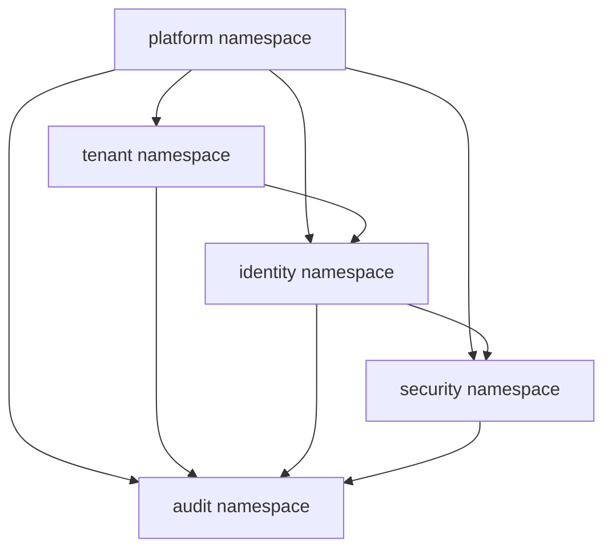
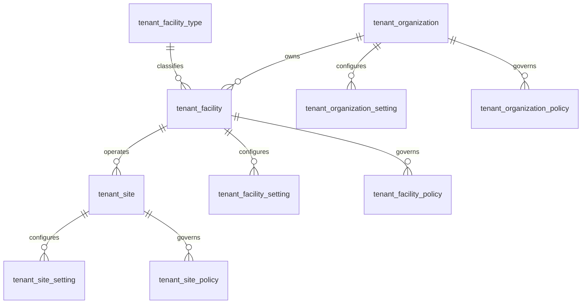
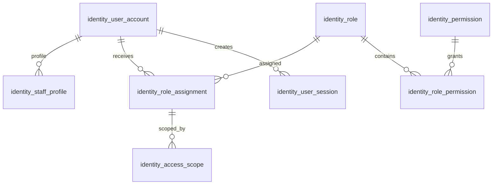
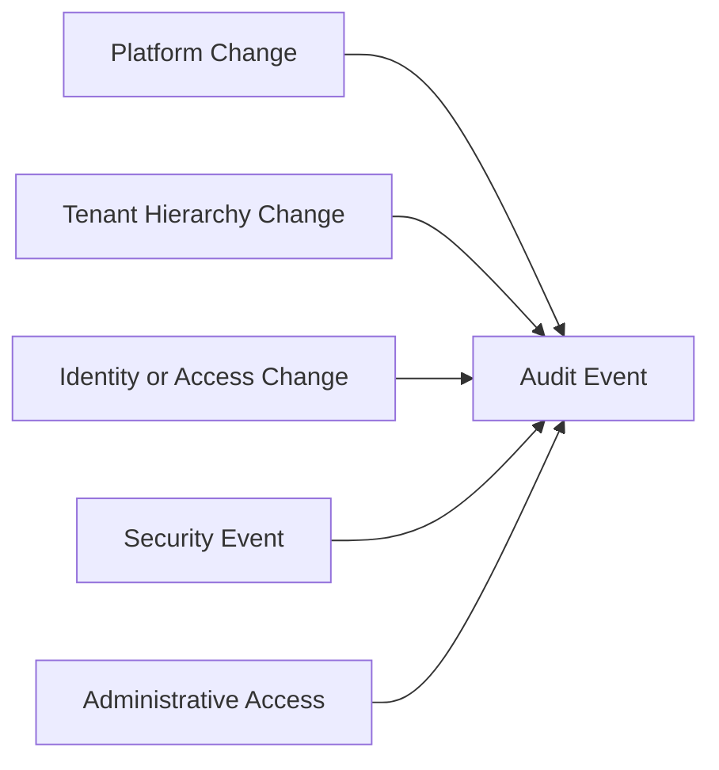

# DB-05 Core Platform Database Design

**Document ID:** DB-05  
**Document Name:** Core Platform Database Design  
**Company:** OreeOn Technologies Pvt. Ltd.  
**Product:** Digitize  
**Document Type:** Database Design  
**Version:** 0.1  
**Status:** Design Draft  
**Business Owner:** Product Architecture  
**Technical Owner:** Data Architecture  
**Prepared By:** Data Architecture Team  
**Reviewed By:** Data Architecture Review Board  
**Approved By:** Product Architecture / Solution Architecture  
**Classification:** Internal  
**Confidentiality:** Confidential  
**Document State:** Design Draft  
**Release:** Foundation Documentation  
**Dependencies:** DB-00, DB-01, DB-02, DB-03, DB-04, FR-02, FR-03, FR-04, FR-05, FR-06, FR-16, FR-21, TA-03, TA-05, TA-09, TA-10  
**Supersedes:** Not Applicable  
**Superseded By:** Not Applicable  
**Last Updated:** July 2026  
**Database Review:** Ready for Review

---

# Revision History

| Version | Date | Author | Description |
|---|---|---|---|
| 0.1 | July 2026 | Data Architecture Team | Initial core platform database design draft |
| 0.2 | 2026-07-26 | Data Architecture Team | Freeze preparation edits: standardized review status; minor clarifications |

---

# 1. Introduction

## 1.1 Purpose

This document defines the Core Platform Database Design for Digitize.

It provides database-neutral physical structures for platform configuration, platform settings, global master data, shared reference data, feature flags, Facility Types, Organization, Facility, Site, Organization / Facility / Site configuration and policies, users, staff identity, roles, permissions, role assignments, access scopes, sessions, authentication events, security events, platform administration, maintenance mode, integration configuration, provider configuration references, audit requirements, security classification, lifecycle governance, diagrams, and traceability.

## 1.2 Objectives

- Define core platform physical table structures using lowercase snake_case names.
- Preserve Organization as tenant root.
- Preserve Facility as primary commercial subscription and licensing unit.
- Preserve Site as tenant-scoped physical operating location.
- Support configuration over customer-specific schema changes.
- Support shared reference data and Facility Type extensibility.
- Support RBAC, access scopes, session governance, and security event tracking.
- Support feature flags, platform settings, maintenance windows, and release governance.
- Avoid storing provider secrets or sensitive credentials directly.
- Provide traceability to FR-02 through FR-06, FR-16, FR-21, TA-03, TA-05, TA-09, and TA-10.

## 1.3 Scope

This document covers the following physical namespaces:

- `platform`
- `tenant`
- `identity`
- `security`
- `audit` where core platform activity is recorded

## 1.4 Out of Scope

- Customer, membership, attendance, trainer, personal training, batch, and class structures. These are covered in DB-06.
- Billing, payment, subscription financial execution, refund, reconciliation, settlement, and commercial detail structures. These are covered in DB-07.
- Advertisement, notification, reporting, support, audit, and compliance detail structures. These are covered in DB-08.
- Database-engine-specific SQL.
- Provider secret storage.
- Authentication provider implementation internals.

## 1.5 Intended Audience

Platform Architects, Solution Architects, Data Architects, Backend Developers, Security Engineers, DevOps Engineers, QA Engineers, Implementation Teams, Support Teams, and Audit / Compliance Stakeholders.

## 1.6 Related Documents

| Document Type | Document Reference | Relationship |
|---|---|---|
| Database Design | DB-00 Database Design Standards | Source standards |
| Database Design | DB-01 Conceptual Data Model | Source conceptual entities |
| Database Design | DB-02 Logical Data Model | Source logical entities |
| Database Design | DB-03 Physical Data Model | Source physical baseline |
| Database Design | DB-04 Multi-Tenancy Data Design | Source tenant scope rules |
| Functional Requirements | FR-02 Platform Administration | Source platform configuration and administration requirements |
| Functional Requirements | FR-03 Organization Management | Source Organization requirements |
| Functional Requirements | FR-04 Facility Management | Source Facility requirements |
| Functional Requirements | FR-05 Site Management | Source Site requirements |
| Functional Requirements | FR-06 User and Role Management | Source identity and RBAC requirements |
| Functional Requirements | FR-16 License Management | Source license validation and capability access dependencies |
| Functional Requirements | FR-21 Audit and Compliance | Source audit event and compliance requirements |
| Technical Architecture | TA-03, TA-05, TA-09, TA-10 | Source data, security, platform, and ADR alignment |

---

# 2. Data Design Context

## 2.1 Business Context

The Core Platform model establishes the SaaS foundation used by every downstream module. Without stable Organization, Facility, Site, Identity, RBAC, configuration, feature flag, reference data, session, and security structures, operational, commercial, communication, reporting, support, and audit modules cannot enforce tenant isolation or configurable business behavior.

## 2.2 Functional Context

Core platform data supports platform administration, onboarding, Organization management, Facility management, Site management, User and Role Management, license validation, audit capture, support access, and reporting access.

## 2.3 Technical Architecture Context

TA-09 identifies tenant context as a shared platform capability. TA-05 requires RBAC and tenant scope enforcement before domain execution. TA-03 requires tenant-aware data ownership. TA-10 includes ADRs for Organization as tenant root, tenant-aware access, RBAC enforcement, and security-by-design.

## 2.4 Data Ownership Context

Platform-owned records are owned by OreeOn Platform Administration. Tenant-owned hierarchy records are owned by the customer Organization but technically governed by Data Architecture. Identity and security structures are owned by User and Role Management and Security Governance.

---

# 3. Data Scope Model

## 3.1 In-Scope Data Domains

| Data Domain ID | Data Domain | Scope |
|---|---|---|
| DB-DOM-001 | Platform | Platform settings, master data, feature flags, maintenance, release, integration configuration references |
| DB-DOM-002 | Identity | User account, staff profile, roles, permissions, assignments, access scopes, sessions |
| DB-DOM-003 | Organization | Organization, Facility, Site, configuration, policies, branding, documents |
| DB-DOM-012 | Security | Security policies, password policies, session policies, authentication events, security events |
| DB-DOM-011 | Audit | Core platform audit events, administrative access evidence |

## 3.2 Out-of-Scope Data Domains

| Data Domain | Reason |
|---|---|
| Customer | Covered in DB-06 |
| Membership | Covered in DB-06 |
| Attendance | Covered in DB-06 |
| Commercial transaction detail | Covered in DB-07 |
| Communication detail | Covered in DB-08 |
| Reporting detail | Covered in DB-08 |
| Support detail | Covered in DB-08 |

## 3.3 Data Domain Diagram

---

# 4. Data Domains

| Data Domain | Purpose | Typical Ownership |
|---|---|---|
| Platform | Platform-level configuration, feature flags, master data, maintenance, releases, and provider references | Platform Administration |
| Identity | Users, staff profiles, roles, permissions, assignments, scopes, and sessions | Identity and Access Management |
| Organization | Organization, Facility, Site, and tenant configuration hierarchy | Organization Management |
| Security | Security policies, authentication events, security events, and security controls | Security Governance |
| Audit | Core platform audit and administrative access evidence | Audit and Compliance |

---

# 5. Data Classification

| Data Group | Data Domain | Classification | Sensitivity | Business Owner | Technical Owner | Notes |
|---|---|---|---|---|---|---|
| Platform Settings | Platform | Internal Platform | Medium | Platform Administration | Platform Architecture | Controls SaaS behavior |
| Global Master Data | Platform | Public Reference / Internal Platform | Low to Medium | Platform Administration | Data Architecture | Shared reference |
| Feature Flags | Platform | Internal Platform | Medium | Platform Administration | Platform Architecture | Controls capability access |
| Facility Types | Platform / Organization | Public Reference | Low | Platform Administration | Data Architecture | Supports expansion |
| Organization | Organization | Tenant Master | Medium | Organization Management | Data Architecture | Tenant root |
| Facility | Organization | Tenant Master | Medium | Facility Management | Data Architecture | Commercial unit |
| Site | Organization | Tenant Master | Medium | Site Management | Data Architecture | Physical operating location |
| Identity | Identity | Authentication / Authorization | High | User and Role Management | Security Architecture | Access control |
| Sessions | Identity / Security | Security | High | Security Governance | Security Architecture | Runtime access |
| Security Events | Security | Security | High | Security Governance | Security Architecture | Investigation source |
| Core Platform Audit | Audit | Audit / Compliance | High | Audit and Compliance | Security Architecture | Protected evidence |

---

# 6. Entity / Table Design

## 6.1 Core Platform Table Catalogue

| Entity / Table | Purpose | Data Domain | Business Owner | Technical Owner | Classification | Notes |
|---|---|---|---|---|---|---|
| platform.platform_setting | Stores platform-level settings | Platform | Platform Administration | Platform Architecture | Internal Platform | Global or scoped setting |
| platform.global_master_data | Stores controlled reference data | Platform | Platform Administration | Data Architecture | Public Reference / Internal Platform | Shared values |
| platform.feature_flag | Stores feature toggle definitions and scope | Platform | Platform Administration | Platform Architecture | Internal Platform | Controls rollout and license behavior |
| platform.maintenance_window | Stores planned maintenance windows | Platform | Platform Administration | DevOps Architecture | Internal Platform | Supports notifications |
| platform.release_record | Stores release metadata | Platform | Platform Administration | DevOps Architecture | Internal Platform | Release traceability |
| platform.integration_configuration | Stores non-secret integration configuration metadata | Platform | Platform Administration | Integration Architecture | Internal Platform | Secret values excluded |
| platform.provider_reference | Stores provider identifiers and capability references | Platform | Platform Administration | Integration Architecture | Internal Platform | No credentials |
| tenant.organization | Stores tenant root record | Organization | Organization Management | Data Architecture | Tenant Master | Core tenancy table |
| tenant.organization_setting | Stores tenant configuration | Organization | Organization Management | Data Architecture | Tenant Master | Key-value or structured configuration |
| tenant.organization_policy | Stores tenant business policy | Organization | Organization Management | Data Architecture | Tenant Master | Versioned policy |
| tenant.organization_branding | Stores tenant branding metadata | Organization | Organization Management | Data Architecture | Tenant Master | UI branding |
| tenant.organization_document | Stores Organization document metadata | Organization | Organization Management | Data Architecture | Tenant Master | File content externalized |
| tenant.facility | Stores Facility record | Organization | Facility Management | Data Architecture | Tenant Master | Commercial unit |
| tenant.facility_type | Stores Facility Type reference | Platform | Platform Administration | Data Architecture | Public Reference | Swimming pool, gym, etc. |
| tenant.facility_setting | Stores Facility configuration | Organization | Facility Management | Data Architecture | Tenant Master | Facility-scoped |
| tenant.facility_policy | Stores Facility policy | Organization | Facility Management | Data Architecture | Tenant Master | Governs Sites |
| tenant.facility_operating_hours | Stores Facility availability patterns | Organization | Facility Management | Data Architecture | Tenant Operational | Scheduling input |
| tenant.facility_capacity_rule | Stores Facility capacity rules | Organization | Facility Management | Data Architecture | Tenant Operational | Validation input |
| tenant.site | Stores Site record | Organization | Site Management | Data Architecture | Tenant Master | Physical location |
| tenant.site_setting | Stores Site configuration | Organization | Site Management | Data Architecture | Tenant Master | Site-scoped |
| tenant.site_policy | Stores Site policy | Organization | Site Management | Data Architecture | Tenant Master | Local policy |
| tenant.site_operating_hours | Stores Site availability patterns | Organization | Site Management | Data Architecture | Tenant Operational | Scheduling input |
| tenant.site_capacity_rule | Stores Site capacity rules | Organization | Site Management | Data Architecture | Tenant Operational | Attendance/class validation |
| tenant.site_document | Stores Site document metadata | Organization | Site Management | Data Architecture | Tenant Master | File content externalized |
| identity.user_account | Stores user authentication profile | Identity | User and Role Management | Security Architecture | Authentication | Platform or tenant user |
| identity.staff_profile | Stores staff business profile | Identity | User and Role Management | Security Architecture | Tenant Master | Staff directory |
| identity.role | Stores role definitions | Identity | User and Role Management | Security Architecture | Authorization | Platform or tenant role |
| identity.permission | Stores atomic permissions | Identity | User and Role Management | Security Architecture | Authorization | Capability permission |
| identity.role_permission | Stores role-permission mapping | Identity | User and Role Management | Security Architecture | Authorization | Associative |
| identity.role_assignment | Stores user-role assignment | Identity | User and Role Management | Security Architecture | Authorization | Assignment lifecycle |
| identity.access_scope | Stores Organization, Facility, and Site access scope | Identity | User and Role Management | Security Architecture | Authorization | Tenant isolation |
| identity.user_session | Stores session metadata | Identity | User and Role Management | Security Architecture | Security | Session governance |
| security.security_policy | Stores platform or tenant security policy metadata | Security | Security Governance | Security Architecture | Security | Policy rules |
| security.password_policy | Stores password policy metadata | Security | Security Governance | Security Architecture | Security | Credential rules |
| security.session_policy | Stores session policy metadata | Security | Security Governance | Security Architecture | Security | Session timeout and control |
| security.authentication_event | Stores authentication events | Security | Security Governance | Security Architecture | Security | Login, failure, reset |
| security.security_event | Stores security events | Security | Security Governance | Security Architecture | Security | Suspicious activity |
| audit.audit_event | Stores core platform audit events | Audit | Audit and Compliance | Security Architecture | Audit / Compliance | Append-only |
| audit.audit_entity_reference | Stores references to affected entities | Audit | Audit and Compliance | Security Architecture | Audit / Compliance | Traceability |
| audit.administrative_access_record | Stores privileged access records | Audit | Audit and Compliance | Security Architecture | Security / Audit | Required for support/platform access |

---

# 7. Attribute / Column Design

## 7.1 Core Standard Columns

| Attribute / Column | Description | Data Type / Logical Type | Mandatory | Source | Validation / Constraint | Notes |
|---|---|---|---|---|---|---|
| record_id | Primary identifier | Identifier | Yes | System | Unique | Standard primary key |
| organization_id | Tenant root identifier | Identifier Reference | Conditional | Tenant Context | Required for tenant-owned records | Not required for platform-owned records |
| facility_id | Facility scope identifier | Identifier Reference | Conditional | User / System | Must belong to organization_id | Required for Facility-scoped records |
| site_id | Site scope identifier | Identifier Reference | Conditional | User / System | Must belong to facility_id | Required for Site-scoped records |
| code | Business code | Code | Conditional | User / System | Unique within approved scope | Useful for lookup |
| name | Display name | Text | Conditional | User | Required for named records | Organization, Facility, Site, role, setting |
| description | Description | Text | Optional | User | Content policy applies | Human-readable |
| status | Lifecycle status | Status | Conditional | User / System | Must be allowed status | Active, Suspended, Archived, etc. |
| type | Classification type | Type | Conditional | User / System | Must reference approved type | Setting type, Facility Type, policy type |
| scope_type | Scope type | Type | Conditional | User / System | Platform, Organization, Facility, Site | Feature flags and settings |
| effective_at | Effective timestamp | DateTime | Conditional | User / System | Required for scheduled rules | Policies and maintenance |
| expires_at | Expiry timestamp | DateTime | Conditional | User / System | Must not precede effective_at | Time-bound records |
| value | Configuration value | Structured Data / Text | Conditional | User / System | Must match setting type | No secrets |
| created_at | Creation timestamp | DateTime | Yes | System | Immutable after create | Audit |
| created_by | Creator identifier | Identifier Reference | Conditional | System | Required where actor exists | Audit |
| updated_at | Update timestamp | DateTime | Conditional | System | Required for mutable records | Audit |
| updated_by | Updater identifier | Identifier Reference | Conditional | System | Required where actor exists | Audit |
| version_number | Version number | Number | Conditional | System | Incremented on update | Concurrency |
| is_active | Active indicator | Boolean | Conditional | System / User | Must align with status | Convenience |
| deleted_at | Soft-delete timestamp | DateTime | Conditional | System | Only where allowed | Not for audit records |
| deleted_by | Soft-delete actor | Identifier Reference | Conditional | System | Required when deleted_at exists | Not for audit records |
| correlation_id | Correlation reference | External Reference | Conditional | System | Required for auditable workflows | Traceability |

## 7.2 Core Table Column Coverage

| Attribute / Column | Description | Data Type / Logical Type | Mandatory | Source | Validation / Constraint | Notes |
|---|---|---|---|---|---|---|
| platform_setting.key | Setting key | Code | Yes | Platform Admin | Unique by scope | No secret values |
| platform_setting.value | Setting value | Structured Data / Text | Yes | Platform Admin | Must match setting definition | Configuration |
| global_master_data.reference_group | Reference group | Code | Yes | Platform Admin | Required | Facility type, status group, etc. |
| global_master_data.reference_code | Reference code | Code | Yes | Platform Admin | Unique within group | Shared value |
| feature_flag.feature_code | Feature code | Code | Yes | Platform Admin | Unique by scope | Capability toggle |
| feature_flag.scope_type | Feature scope | Type | Yes | Platform Admin | Platform, Organization, Facility, Site | Scope-aware |
| integration_configuration.provider_code | Provider code | Code | Yes | Platform Admin | Approved provider reference | No secrets |
| organization.legal_name | Legal name | Text | Yes | Organization Admin | Required | Tenant identity |
| organization.business_status | Organization lifecycle status | Status | Yes | System / Admin | Approved state | Tenant lifecycle |
| facility.facility_type_id | Facility Type reference | Identifier Reference | Yes | Platform / User | Must be active Facility Type | Configurable business type |
| facility.subscription_scope_status | Commercial scope status | Status | Conditional | System | Derived from subscription/license | Used for access |
| site.location_name | Site location name | Text | Yes | Site Admin | Required | Physical location label |
| user_account.login_identifier | Login identifier | Text / Code | Yes | User / System | Unique according to identity policy | Sensitive |
| user_account.account_status | Account status | Status | Yes | System / Admin | Approved lifecycle | Access control |
| role.role_code | Role code | Code | Yes | Admin | Unique by scope | RBAC |
| permission.permission_code | Permission code | Code | Yes | System / Admin | Unique platform capability | Atomic permission |
| access_scope.scope_level | Scope level | Type | Yes | Admin / System | Organization, Facility, Site | Authorization |
| user_session.session_status | Session status | Status | Yes | System | Approved session lifecycle | Security |
| authentication_event.event_type | Authentication event type | Type | Yes | System | Approved event type | Login, logout, failure |
| security_event.severity | Security event severity | Type | Yes | System | Approved severity | Investigation |
| audit_event.action | Audited action | Code | Yes | System | Required | Append-only |
| administrative_access_record.access_reason | Privileged access reason | Text | Yes | Privileged user | Required | Compliance |

---

# 8. Relationships

| Relationship | Parent | Child | Cardinality | Optionality | Tenant Scope | Notes |
|---|---|---|---|---|---|---|
| DB-05-REL-001 | tenant.organization | tenant.facility | One-to-Many | Facility required for operation | Tenant-owned | Organization root |
| DB-05-REL-002 | tenant.facility_type | tenant.facility | One-to-Many | Mandatory | Shared reference | Facility Type |
| DB-05-REL-003 | tenant.facility | tenant.site | One-to-Many | Site required for physical operations | Tenant-owned | Site scope |
| DB-05-REL-004 | tenant.organization | tenant.organization_setting | One-to-Many | Optional | Tenant-owned | Tenant config |
| DB-05-REL-005 | tenant.organization | tenant.organization_policy | One-to-Many | Optional | Tenant-owned | Tenant policy |
| DB-05-REL-006 | tenant.facility | tenant.facility_setting | One-to-Many | Optional | Tenant-owned | Facility config |
| DB-05-REL-007 | tenant.facility | tenant.facility_policy | One-to-Many | Optional | Tenant-owned | Facility policy |
| DB-05-REL-008 | tenant.site | tenant.site_setting | One-to-Many | Optional | Tenant-owned | Site config |
| DB-05-REL-009 | tenant.site | tenant.site_policy | One-to-Many | Optional | Tenant-owned | Site policy |
| DB-05-REL-010 | identity.user_account | identity.staff_profile | One-to-Zero-or-One | Optional | Tenant-aware | Staff profile |
| DB-05-REL-011 | identity.user_account | identity.role_assignment | One-to-Many | Optional until assigned | Tenant-aware | User roles |
| DB-05-REL-012 | identity.role | identity.role_permission | One-to-Many | Optional | Tenant-aware / platform | Role capabilities |
| DB-05-REL-013 | identity.permission | identity.role_permission | One-to-Many | Optional | Platform capability | Atomic permission |
| DB-05-REL-014 | identity.role_assignment | identity.access_scope | One-to-Many | Required for tenant access | Tenant-aware | Scope boundary |
| DB-05-REL-015 | identity.user_account | identity.user_session | One-to-Many | Optional | Tenant-aware | Sessions |
| DB-05-REL-016 | security.security_policy | security.password_policy | One-to-Many | Optional | Platform / tenant | Security rule grouping |
| DB-05-REL-017 | security.security_policy | security.session_policy | One-to-Many | Optional | Platform / tenant | Session rule grouping |
| DB-05-REL-018 | identity.user_account | security.authentication_event | One-to-Many | Optional | Tenant-aware | Auth history |
| DB-05-REL-019 | identity.user_account | security.security_event | One-to-Many | Optional | Tenant-aware | Security events |
| DB-05-REL-020 | audit.audit_event | audit.audit_entity_reference | One-to-Many | Conditional | Tenant-aware / platform | Entity trace |

---

# 9. Keys and Identifiers

| Key / Identifier | Entity / Table | Purpose | Scope | Notes |
|---|---|---|---|---|
| DB-05-PK-001 | All core tables | Primary identifier | Table scope | Standard `record_id` |
| DB-05-FK-001 | tenant.facility.organization_id | Facility-to-Organization | Tenant hierarchy | Required |
| DB-05-FK-002 | tenant.site.facility_id | Site-to-Facility | Tenant hierarchy | Required |
| DB-05-FK-003 | tenant.site.organization_id | Site-to-Organization | Tenant hierarchy | Required for tenant-aware access |
| DB-05-FK-004 | identity.role_assignment.user_account_id | User role assignment | Identity | Required |
| DB-05-FK-005 | identity.role_permission.role_id | Role permission mapping | Identity | Required |
| DB-05-FK-006 | identity.role_permission.permission_id | Permission mapping | Identity | Required |
| DB-05-FK-007 | identity.access_scope.role_assignment_id | Scope mapping | Identity | Required |
| DB-05-UQ-001 | tenant.organization.code | Organization business code | Platform scope | Tenant root uniqueness |
| DB-05-UQ-002 | tenant.facility.code | Facility business code | Organization scope | Tenant-aware uniqueness |
| DB-05-UQ-003 | tenant.site.code | Site business code | Facility scope | Tenant-aware uniqueness |
| DB-05-UQ-004 | identity.user_account.login_identifier | Login uniqueness | Identity policy scope | Sensitive |
| DB-05-UQ-005 | identity.permission.permission_code | Permission uniqueness | Platform scope | Capability code |
| DB-05-UQ-006 | platform.feature_flag.feature_code | Feature code uniqueness | Scope-aware | Controls behavior |

---

# 10. Constraints and Validation

| Constraint | Entity / Table | Rule | Scope | Notes |
|---|---|---|---|---|
| DB-05-CK-001 | tenant.organization | Organization status must follow approved lifecycle | Organization | Draft, Active, Suspended, Archived |
| DB-05-CK-002 | tenant.facility | Facility must belong to one Organization | Facility | Tenant root required |
| DB-05-CK-003 | tenant.site | Site must belong to Facility and Organization | Site | Hierarchy consistency |
| DB-05-CK-004 | tenant.facility | Facility Type must be active when assigned | Facility | Configurability |
| DB-05-CK-005 | identity.role_assignment | Assignment must include valid role, user, and scope | Identity | RBAC |
| DB-05-CK-006 | identity.access_scope | Facility and Site scope must belong to assigned Organization | Identity | Tenant isolation |
| DB-05-CK-007 | identity.user_session | Session status must follow approved session lifecycle | Identity | Security |
| DB-05-CK-008 | platform.integration_configuration | Provider secrets must not be stored directly | Platform | Secret references only |
| DB-05-CK-009 | platform.feature_flag | Feature flag scope must be platform, Organization, Facility, or Site | Platform | Scope control |
| DB-05-CK-010 | audit.audit_event | Audit event is append-only | Audit | Protected evidence |
| DB-05-CK-011 | audit.administrative_access_record | Cross-tenant access reason is mandatory | Audit | Compliance |

---

# 11. Index and Access Patterns

| Access Pattern | Entity / Table | Index Need | Query Scope | Notes |
|---|---|---|---|---|
| Organization lookup | tenant.organization | organization code, status | Platform | Onboarding and administration |
| Facility lookup | tenant.facility | organization_id, facility code, status | Organization | Facility management |
| Site lookup | tenant.site | organization_id, facility_id, site code, status | Facility / Site | Site management |
| Facility Type lookup | tenant.facility_type | type code, status | Platform | Facility configuration |
| Settings resolution | platform.platform_setting, tenant.organization_setting, tenant.facility_setting, tenant.site_setting | scope, key, effective date | Platform / Tenant | Config inheritance |
| Policy resolution | tenant.organization_policy, tenant.facility_policy, tenant.site_policy | scope, policy type, status, effective date | Tenant hierarchy | Governance |
| Feature validation | platform.feature_flag | feature code, scope, status | Platform / Tenant / Facility | Capability access |
| User login | identity.user_account | login identifier, status | Identity | Authentication |
| Role resolution | identity.role_assignment, identity.access_scope | user, role, scope, status | Tenant scope | Authorization |
| Session lookup | identity.user_session | user, status, expiry | Security | Session validation |
| Authentication history | security.authentication_event | user, event, timestamp | Security | Audit and investigation |
| Security investigation | security.security_event | severity, actor, scope, timestamp | Security | Monitoring and review |
| Audit lookup | audit.audit_event, audit.audit_entity_reference | actor, entity, action, timestamp, tenant | Audit | Compliance |

---

# 12. Multi-Tenancy Design

| Tenant Concern | Design Approach | Applies To | Notes |
|---|---|---|---|
| Organization as Tenant Root | tenant.organization is the tenant root | All tenant-owned records | Required |
| Facility Scope | tenant.facility carries organization_id | Facility-scoped data | Commercial unit |
| Site Scope | tenant.site carries organization_id and facility_id | Site-scoped data | Operational unit |
| Settings Scope | Settings may exist at platform, Organization, Facility, or Site scope where approved | platform and tenant settings | Scope precedence required |
| Policy Scope | Policies may exist at Organization, Facility, or Site scope | tenant policy tables | Site policies cannot bypass parent governance |
| Identity Scope | Role assignments use access scopes | identity tables | Enforces Organization, Facility, Site access |
| Feature Scope | Feature flags may be scoped by platform, Organization, Facility, or Site | platform.feature_flag | License checks may further constrain |
| Support/Admin Access | Privileged cross-tenant access creates audit evidence | audit.administrative_access_record | Required |
| Tenant Suspension | Organization, Facility, or Site status restricts access and operations | tenant hierarchy | Rules refined in FR and DB-09 |

---

# 13. Audit and History Design

| Audit / History Area | Trigger | Data Captured | Retention | Notes |
|---|---|---|---|---|
| Platform Setting Change | Setting created, updated, activated, retired | Actor, key, scope, old/new summary, timestamp | Configuration retention | Audit Event |
| Feature Flag Change | Flag created, scoped, enabled, disabled | Actor, feature, scope, old/new state | Configuration retention | Release trace |
| Organization Lifecycle | Organization create, activate, suspend, archive | Actor, tenant, previous/new state, reason | Tenant lifecycle retention | Tenant root |
| Facility Lifecycle | Facility create, activate, suspend, archive | Actor, Organization, Facility, state, reason | Tenant lifecycle retention | Commercial impact |
| Site Lifecycle | Site create, activate, suspend, archive | Actor, Facility, Site, state, reason | Tenant lifecycle retention | Operational impact |
| Role and Permission Change | Role, permission, assignment, or scope modified | Actor, user, role, permission, scope | Security retention | Authorization critical |
| Session Event | Session created, expired, revoked | User, scope, timestamp, source | Security retention | Security |
| Authentication Event | Login, logout, failure, credential reset | User, source, result, reason | Security retention | Security |
| Administrative Access | Privileged access to tenant context | Actor, tenant, purpose, scope, timestamp | Compliance retention | Mandatory |

---

# 14. Data Lifecycle State Model

| Lifecycle State | Meaning | Allowed Usage |
|---|---|---|
| Transient | Temporary core platform data before persistence | Draft setting, import staging |
| Active | Operationally current core record | Active Organization, Facility, Site, user, role |
| Inactive | Not currently operational but retained | Inactive feature, suspended account |
| Historical | Superseded or completed state retained | Previous policy version, old setting |
| Archived | Removed from primary operational use | Archived Organization, Facility, Site |
| Anonymized | De-identified where approved | Limited identity/customer-adjacent use |
| Purged | Permanently removed by approved process | Obsolete non-audit data |
| Legally Retained | Retained due to audit, security, or compliance | Audit and security evidence |

---

# 15. Retention, Archival, and Purging

| Data Group | Lifecycle State | Retention Rule | Archival Approach | Purging Rule | Notes |
|---|---|---|---|---|---|
| Platform Settings | Active / Historical | Retain active and historical versions | Archive superseded settings | Purge only obsolete non-audit records | Governance |
| Feature Flags | Active / Historical | Retain rollout and change history | Archive retired flags | Purge only after no dependency exists | Release trace |
| Organization | Active / Suspended / Archived / Legally Retained | Retain while tenant obligations exist | Archive inactive tenants | Purge only through tenant purge process | Tenant root |
| Facility | Active / Suspended / Archived | Retain while commercial and operational history exists | Archive inactive Facilities | Purge only when allowed | Commercial scope |
| Site | Active / Suspended / Archived | Retain while operational history exists | Archive inactive Sites | Purge only when allowed | Operations |
| Identity | Active / Inactive / Historical | Retain access history | Archive inactive users and sessions | Purge after security retention only | Security |
| Audit and Administrative Access | Recorded / Legally Retained / Archived | Retain per audit policy | Archive with integrity controls | Purge only by compliance approval | Protected evidence |
| Security Events | Recorded / Historical / Archived | Retain per security policy | Archive aged events | Purge only after security retention | Investigation |

---

# 16. Migration and Versioning

| Migration Area | Migration Type | Validation | Rollback Consideration | Notes |
|---|---|---|---|---|
| Core Schema Version | Structure migration | Validate table, key, relationship, and tenant consistency | Versioned rollback where practical | DB-09 expands |
| Settings Migration | Configuration migration | Validate setting keys, scopes, values, effective dates | Restore previous setting version | No secrets |
| Role and Permission Migration | Authorization migration | Validate permission coverage and role mapping | Restore previous role mapping | Security review required |
| Tenant Hierarchy Migration | Organization/Facility/Site migration | Validate hierarchy counts and ownership | Requires backup and reconciliation | Critical |
| Feature Flag Migration | Rollout configuration migration | Validate feature scope and status | Disable flag or restore previous state | Release coordination |
| Security Policy Migration | Policy migration | Validate session/password/access impact | Revert policy where safe | Security approval |

---

# 17. Backup and Recovery

| Data Group | Backup Need | Recovery Requirement | Notes |
|---|---|---|---|
| Organization / Facility / Site | Critical | Restore tenant hierarchy before dependent modules | Foundational |
| Platform Settings / Feature Flags | Critical | Restore configuration before business operations | Platform behavior |
| Identity / RBAC | Critical | Restore access control before tenant operations | Security |
| Sessions | High | Restore active session state where architecture supports it or force secure re-authentication | Security |
| Security Events | Critical | Restore investigation evidence | Compliance |
| Audit Events | Critical | Restore immutable evidence | Compliance |
| Integration Configuration References | High | Restore provider metadata and references | Secrets externalized |

---

# 18. Security and Privacy

| Security Area | Design Approach | Applies To | Notes |
|---|---|---|---|
| Authentication Data | Sensitive login identifiers and session metadata require restricted access | identity.user_account, identity.user_session | No password secrets in plain storage |
| Authorization Data | Roles, permissions, assignments, and access scopes require controlled administration | identity.role, identity.permission, identity.role_assignment, identity.access_scope | Privileged |
| Tenant Isolation | organization_id, facility_id, site_id scope enforced | tenant and identity scope tables | Prevent leakage |
| Provider Secrets | Secrets are not stored in integration configuration tables | platform.integration_configuration | Store references only |
| Audit Protection | audit tables protected from normal modification | audit.audit_event, audit.administrative_access_record | Append-only |
| Administrative Access | Cross-tenant access requires reason and audit | audit.administrative_access_record | Compliance |
| Lower Environment Handling | Identity and tenant data must be masked/anonymized where copied | Core sensitive data | DB-09 detail |

---

# 19. Reporting and Analytics Considerations

| Reporting Area | Source Data | Derived Data | Refresh / Access Pattern | Notes |
|---|---|---|---|---|
| Platform Administration Reports | platform settings, feature flags, releases, maintenance | Platform report snapshots | Scheduled / on-demand | Platform admin |
| Organization Dashboard | tenant.organization, tenant.facility, tenant.site | Organization summary projections | Scheduled / on-demand | Tenant-scoped |
| Facility Dashboard | tenant.facility, tenant.site, facility settings | Facility summary projections | Scheduled / on-demand | Facility-scoped |
| Site Dashboard | tenant.site and site configuration | Site summary projections | Scheduled / on-demand | Site-scoped |
| User Activity Reports | identity.user_account, role assignments, sessions, auth events | Staff and access reports | Controlled access | Security-sensitive |
| Security Reports | authentication_event, security_event, administrative_access_record | Security analytics | Controlled access | Privileged |
| Audit Reports | audit_event and entity references | Audit trail reports | Controlled access | Compliance |

---

# 20. Traceability

| Source Document | Requirement / Process / Rule | Entity / Table | Attribute / Column | Notes |
|---|---|---|---|---|
| FR-02 | Platform Administration | platform.platform_setting, platform.global_master_data, platform.feature_flag, platform.maintenance_window, platform.release_record | Core platform columns | Platform governance |
| FR-03 | Organization Management | tenant.organization, tenant.organization_setting, tenant.organization_policy, tenant.organization_branding, tenant.organization_document | Tenant hierarchy columns | Organization governance |
| FR-04 | Facility Management | tenant.facility, tenant.facility_type, tenant.facility_setting, tenant.facility_policy, tenant.facility_operating_hours, tenant.facility_capacity_rule | Facility columns | Facility management |
| FR-05 | Site Management | tenant.site, tenant.site_setting, tenant.site_policy, tenant.site_operating_hours, tenant.site_capacity_rule, tenant.site_document | Site columns | Site operations |
| FR-06 | User and Role Management | identity.user_account, identity.staff_profile, identity.role, identity.permission, identity.role_permission, identity.role_assignment, identity.access_scope, identity.user_session | Identity and RBAC columns | Access control |
| FR-16 | License Management | platform.feature_flag, identity.access_scope, tenant.facility | Feature and entitlement validation dependencies | License interactions |
| FR-21 | Audit and Compliance | audit.audit_event, audit.audit_entity_reference, audit.administrative_access_record, security.authentication_event, security.security_event | Audit and security columns | Compliance |
| TA-03 | Data Architecture | Core platform tables | Ownership, classification, retention | Data architecture alignment |
| TA-05 | Security and Identity Architecture | identity and security tables | RBAC, session, authentication, security event attributes | Security alignment |
| TA-09 | Platform Architecture | platform and tenant tables | Platform shared capability attributes | Platform alignment |
| TA-10 | ADR-001, ADR-014, ADR-020, ADR-021, ADR-034 | Core tenancy and identity tables | Tenant context and access scope | ADR alignment |

---

# 21. Diagrams

| Diagram ID | Diagram Name | Diagram Type | Location |
|---|---|---|---|
| DB-05-DGM-001 | Core Platform Namespace Diagram | Physical Entity Relationship Diagram | Section 3.3 |
| DB-05-DGM-002 | Tenant Hierarchy Physical Diagram | Physical Entity Relationship Diagram | Section 21.1 |
| DB-05-DGM-003 | Identity and Access Physical Diagram | Physical Entity Relationship Diagram | Section 21.2 |
| DB-05-DGM-004 | Core Audit Flow Diagram | Audit Data Flow | Section 21.3 |

## 21.1 Tenant Hierarchy Physical Diagram

## 21.2 Identity and Access Physical Diagram

## 21.3 Core Audit Flow Diagram

---

# 22. Review Checklist

| Review Area | Status | Notes |
|---|---|---|
| Terminology consistency | Pending | Requires review against Product Glossary and FR-02 to FR-06 |
| Entity completeness | Pending | Core platform table catalogue populated |
| Relationship correctness | Pending | Core hierarchy and RBAC relationships included |
| Tenant isolation | Pending | Organization, Facility, Site scope included |
| Key and constraint completeness | Pending | Core keys and constraints defined |
| Index and access pattern coverage | Pending | Core access patterns listed |
| Data classification | Pending | Classification applied by table group |
| Auditability | Pending | Core audit and administrative access included |
| Retention and archival alignment | Pending | Retention classes included |
| Migration readiness | Pending | Core migration areas included |
| Backup and recovery readiness | Pending | Recovery criticality identified |
| Security and privacy readiness | Pending | Identity, sessions, security, and secrets controls included |
| Traceability completeness | Pending | Source traceability included; DB-10 will consolidate |

---

# 23. Open Questions

| Question ID | Question | Owner | Target Resolution | Status |
|---|---|---|---|---|
| DB-05-OQ-001 | Should platform settings support tenant overrides in release 1.0 or only platform-level defaults? | Product Architecture / Platform Architecture | Before DB-05 freeze | Open |
| DB-05-OQ-002 | Should Facility Type include configurable Activity templates in the initial release? | Product Architecture / Data Architecture | Before DB-06 | Open |
| DB-05-OQ-003 | Which identity provider integration metadata is required in the first release? | Security Architecture | Before API and implementation | Open |
| DB-05-OQ-004 | Which privileged roles may access tenant data for support and audit? | Security Architecture / Support Management | Before DB-08 and DB-21 | Open |
| DB-05-OQ-005 | Which settings, policies, and feature flags require approval workflow before activation? | Product Architecture / Business Analysis | Before implementation | Open |

---

# 24. Summary

DB-05 defines the Core Platform Database Design for Digitize.

It establishes database-neutral structures for platform configuration, master data, feature flags, maintenance, releases, integration configuration references, Organization, Facility, Site, settings, policies, identity, RBAC, access scopes, sessions, security policies, authentication events, security events, audit events, and administrative access records.

The design preserves Organization as the tenant root, Facility as the primary commercial subscription and licensing unit, and Site as the physical operational location. It avoids storing provider secrets directly and keeps physical implementation database-engine neutral.
