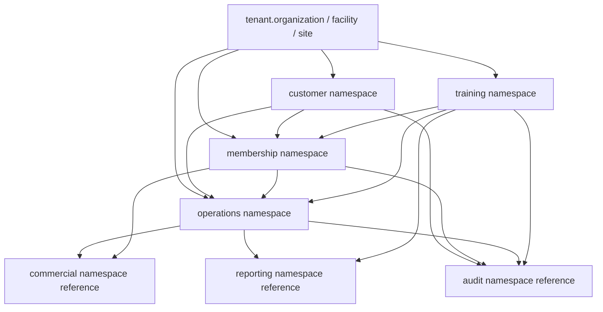
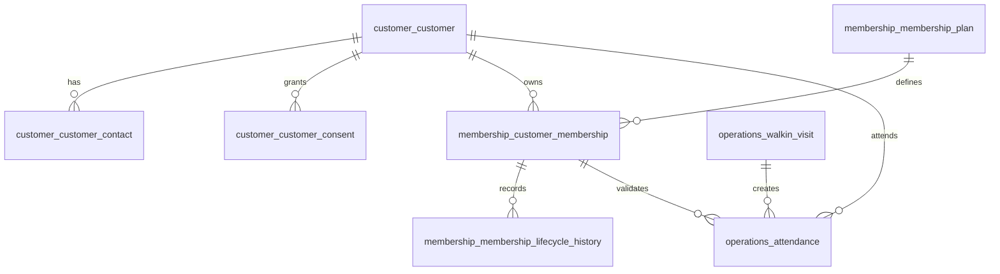
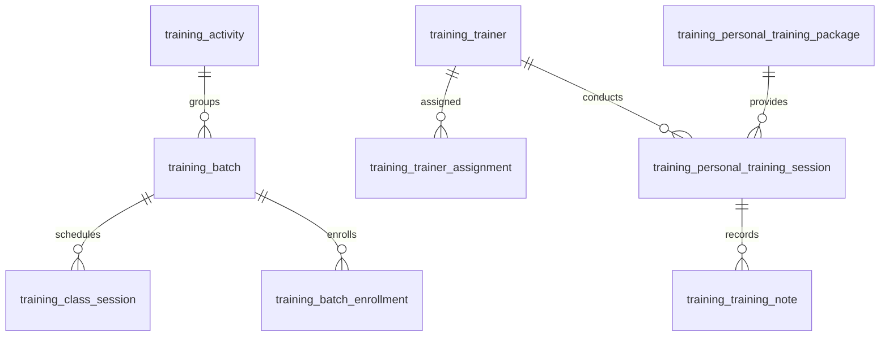

# DB-06 Operational Database Design

**Document ID:** DB-06  
**Document Name:** Operational Database Design  
**Company:** OreeOn Technologies Pvt. Ltd.  
**Product:** Digitize  
**Document Type:** Database Design  
**Version:** 0.1  
**Status:** Design Draft  
**Business Owner:** Product Architecture  
**Technical Owner:** Data Architecture  
**Prepared By:** Data Architecture Team  
**Reviewed By:** Data Architecture Review Board  
**Approved By:** Product Architecture / Solution Architecture  
**Classification:** Internal  
**Confidentiality:** Confidential  
**Document State:** Design Draft  
**Release:** Foundation Documentation  
**Dependencies:** DB-00, DB-01, DB-02, DB-03, DB-04, DB-05, FR-07, FR-08, FR-09, FR-10, FR-11, FR-12, FR-13, TA-03, TA-05, TA-10  
**Supersedes:** Not Applicable  
**Superseded By:** Not Applicable  
**Last Updated:** July 2026  
**Database Review:** Ready for Review

---

# Revision History

| Version | Date | Author | Description |
|---|---|---|---|
| 0.1 | July 2026 | Data Architecture Team | Initial operational database design draft |
| 0.2 | 2026-07-26 | Data Architecture Team | Freeze preparation edits: standardized review status; minor clarifications |

---

# 1. Introduction

## 1.1 Purpose

This document defines the database-neutral Operational Database Design for Digitize.

It covers customer management, membership management, attendance, walk-in customers, trainer management, personal training, activity management, batch management, class management, scheduling, capacity, operational notes, operational attachment metadata, lifecycle history, audit requirements, security classification, tenant scope, diagrams, and traceability.

## 1.2 Objectives

- Define implementation-ready operational table structures without selecting a database engine.
- Preserve Organization, Facility, and Site tenant hierarchy across operational data.
- Support multiple simultaneous active memberships for one Customer where approved.
- Support attendance through membership and walk-in usage.
- Support trainer assignment, availability, schedule conflict validation, batch scheduling, class execution, and personal training.
- Preserve operational history for customer, membership, attendance, trainer, batch, class, and personal training flows.
- Avoid introducing direct customer booking unless approved source documents add that capability.

## 1.3 Scope

This document covers the `customer`, `membership`, `operations`, and `training` physical namespaces.

## 1.4 Out of Scope

- Platform, tenant hierarchy, identity, RBAC, and security baseline structures covered in DB-05.
- Billing, invoice, payment, refund, subscription, license, and entitlement structures covered in DB-07.
- Campaign, notification, reporting, support, audit, and compliance detail structures covered in DB-08.
- SQL, vendor-specific data types, storage configuration, source code, API payload implementation, and UI wireframes.
- Direct customer booking capability.

## 1.5 Intended Audience

Data Architects, Solution Architects, Backend Developers, API Designers, QA Engineers, UI / UX Designers, Operations Teams, Trainers, Support Teams, Implementation Teams, and Audit / Compliance Stakeholders.

## 1.6 Related Documents

| Document Type | Document Reference | Relationship |
|---|---|---|
| Database Design | DB-00 to DB-05 | Source standards, conceptual, logical, physical, tenancy, and core platform design |
| Functional Requirements | FR-07 Customer Management | Source customer structures |
| Functional Requirements | FR-08 Membership Management | Source membership lifecycle structures |
| Functional Requirements | FR-09 Attendance Management | Source attendance structures |
| Functional Requirements | FR-10 Walk-in Customer Management | Source walk-in structures |
| Functional Requirements | FR-11 Trainer Management | Source trainer structures |
| Functional Requirements | FR-12 Personal Training | Source personal training structures |
| Functional Requirements | FR-13 Batch and Class Management | Source activity, batch, class, and scheduling structures |
| Technical Architecture | TA-03, TA-05, TA-10 | Data, security, and ADR alignment |

---

# 2. Data Design Context

## 2.1 Business Context

Operational data represents the daily execution layer of Digitize. Customer registration, membership purchase and lifecycle, attendance, walk-in visits, trainer operations, personal training, activities, batches, classes, and session execution must be accurate, tenant-scoped, auditable, and performant because these records directly affect service delivery, customer experience, capacity control, revenue collection, and dispute handling.

## 2.2 Functional Context

Operational structures support FR-CUS, FR-MEM, FR-ATT, FR-WLK, FR-TRN, FR-PTR, and FR-BAT requirements. Billing and payment references are included only as external relationships to DB-07 commercial structures.

## 2.3 Technical Architecture Context

TA-03 requires operational data to remain tenant-aware and separated from derived reporting. TA-05 requires role and scope enforcement before operational access. DB-04 requires Organization, Facility, and Site propagation throughout tenant-owned operational data.

## 2.4 Data Ownership Context

Customer Management owns Customer data. Membership Management owns membership data. Operations owns attendance and walk-in data. Training Operations owns trainer, activity, batch, class, and personal training data. Data Architecture owns technical integrity, tenant isolation, retention, and downstream physical consistency.

---

# 3. Data Scope Model

## 3.1 In-Scope Data Domains

| Data Domain ID | Data Domain | Physical Namespace | Scope |
|---|---|---|---|
| DB-DOM-004 | Customer | customer | Customer profile, contacts, preferences, consent, documents, history |
| DB-DOM-005 | Membership | membership | Membership plans, rules, customer memberships, lifecycle history, freeze, renewal |
| DB-DOM-006 | Attendance | operations | Attendance, eligibility, entry/exit, walk-in, capacity usage |
| DB-DOM-008 | Trainer | training | Trainer, assignment, availability, schedule, activity, batch, class, personal training |

## 3.2 Out-of-Scope Data Domains

| Data Domain | Reason |
|---|---|
| Commercial Financial Settlement | Covered in DB-07 |
| Subscription and License Management | Covered in DB-07 |
| Notification Delivery | Covered in DB-08 |
| Reporting Projection Implementation | Covered in DB-08 and DB-10 |
| Full Medical Records | Not approved; only operational notes and customer progress are included where approved |
| Direct Customer Booking | Not approved in current scope |

## 3.3 Data Domain Diagram

---

# 4. Data Domains

| Data Domain | Purpose | Typical Ownership |
|---|---|---|
| Customer | Customer profile, documents, consent, contact, emergency contacts, and customer history | Customer Management |
| Membership | Membership plans, plan rules, customer memberships, freeze/resume, renewals, lifecycle history | Membership Management |
| Attendance | Customer and walk-in attendance, eligibility validation, entry and exit tracking | Operations |
| Trainer | Trainer profiles, assignments, availability, schedules, activities, batches, classes, personal training | Training Operations |

---

# 5. Data Classification

| Data Group | Data Domain | Classification | Sensitivity | Business Owner | Technical Owner | Notes |
|---|---|---|---|---|---|---|
| Customer Profile | Customer | Sensitive Personal | High | Customer Management | Data Architecture | Requires masking and export controls |
| Customer Contact | Customer | Sensitive Personal | High | Customer Management | Data Architecture | Includes emergency contact |
| Customer Consent | Customer | Compliance / Communication | High | Customer Management | Data Architecture | Consent history preserved |
| Customer Documents | Customer | Sensitive Personal | High | Customer Management | Data Architecture | Metadata only; file storage externalized |
| Membership Plan | Membership | Tenant Master | Medium | Membership Management | Data Architecture | Facility-scoped |
| Customer Membership | Membership | Tenant Operational | Medium to High | Membership Management | Data Architecture | Lifecycle and entitlement to use |
| Attendance | Attendance | Tenant Operational | Medium | Operations | Data Architecture | High-volume Site-scoped usage |
| Walk-in Visit | Attendance | Tenant Operational / Commercial | Medium | Operations | Data Architecture | Links operational and commercial activity |
| Trainer | Trainer | Tenant Master | Medium | Training Operations | Data Architecture | Staff-related operational profile |
| Training Notes | Trainer | Sensitive Personal | High | Training Operations | Data Architecture | Restricted access |
| Activity / Batch / Class | Trainer | Tenant Operational | Medium | Training Operations | Data Architecture | Capacity and schedule governed |

---

# 6. Entity / Table Design

| Entity / Table | Purpose | Data Domain | Business Owner | Technical Owner | Classification | Notes |
|---|---|---|---|---|---|---|
| customer.customer | Customer master record | Customer | Customer Management | Data Architecture | Sensitive Personal | Organization traceable |
| customer.customer_contact | Customer contact and emergency contacts | Customer | Customer Management | Data Architecture | Sensitive Personal | Supports FR-CUS-011 |
| customer.customer_preference | Customer operational and communication preferences | Customer | Customer Management | Data Architecture | Sensitive Personal / Communication | Consent-aware |
| customer.customer_consent | Customer consent history | Customer | Customer Management | Data Architecture | Compliance / Communication | Historical |
| customer.customer_document | Customer document metadata | Customer | Customer Management | Data Architecture | Sensitive Personal | File content externalized |
| customer.customer_history | Immutable customer timeline | Customer | Customer Management | Data Architecture | Sensitive Personal / Audit | Cross-module summary |
| membership.membership_plan | Facility-defined membership offering | Membership | Membership Management | Data Architecture | Tenant Master | Facility scoped |
| membership.membership_plan_rule | Membership plan business rules | Membership | Membership Management | Data Architecture | Tenant Master | Eligibility, renewal, freeze, cancellation |
| membership.customer_membership | Purchased membership | Membership | Membership Management | Data Architecture | Tenant Operational | Supports multiple active memberships where approved |
| membership.membership_lifecycle_history | Membership state history | Membership | Membership Management | Data Architecture | Tenant Operational / Audit | Append-only lifecycle |
| membership.membership_freeze | Membership freeze interval | Membership | Membership Management | Data Architecture | Tenant Operational | Freeze/resume trace |
| membership.membership_renewal | Renewal transaction context | Membership | Membership Management | Data Architecture | Tenant Operational / Commercial | May reference invoice |
| operations.attendance | Attendance record | Attendance | Operations | Data Architecture | Tenant Operational | Membership or walk-in source |
| operations.attendance_eligibility | Eligibility validation outcome | Attendance | Operations | Data Architecture | Tenant Operational | Rule result |
| operations.entry_exit_event | Check-in and check-out event detail | Attendance | Operations | Data Architecture | Tenant Operational | Time event |
| operations.walkin_visit | Walk-in visit record | Attendance | Operations | Data Architecture | Tenant Operational / Commercial | Payment reference external |
| operations.operational_note | Approved operational note | Attendance | Operations | Data Architecture | Tenant Operational / Sensitive Personal | Scope-controlled |
| operations.operational_attachment | Operational attachment metadata | Attendance | Operations | Data Architecture | Sensitive Personal | Content externalized |
| training.trainer | Trainer profile | Trainer | Training Operations | Data Architecture | Tenant Master | May reference staff_profile |
| training.trainer_assignment | Trainer assignment | Trainer | Training Operations | Data Architecture | Tenant Operational | Facility, Site, Batch, Session |
| training.trainer_availability | Trainer availability | Trainer | Training Operations | Data Architecture | Tenant Operational | Scheduling |
| training.trainer_schedule | Trainer scheduled commitment | Trainer | Training Operations | Data Architecture | Tenant Operational | Conflict checks |
| training.activity | Facility activity | Trainer | Training Operations | Data Architecture | Tenant Master | Configurable |
| training.activity_rule | Activity rules | Trainer | Training Operations | Data Architecture | Tenant Master | Eligibility, capacity, schedule |
| training.batch | Batch or group cohort | Trainer | Training Operations | Data Architecture | Tenant Operational | Activity-based |
| training.class_session | Scheduled class/session | Trainer | Training Operations | Data Architecture | Tenant Operational | Attendance target |
| training.batch_enrollment | Customer enrollment into batch | Trainer | Training Operations | Data Architecture | Tenant Operational | Capacity-controlled |
| training.personal_training_package | Personal training package | Trainer | Training Operations | Data Architecture | Tenant Operational / Commercial | Commercial reference possible |
| training.personal_training_session | Personal training appointment/session | Trainer | Training Operations | Data Architecture | Tenant Operational | No direct customer booking introduced |
| training.training_note | Trainer note | Trainer | Training Operations | Data Architecture | Sensitive Personal | Restricted |
| training.customer_progress | Customer progress record | Trainer | Training Operations | Data Architecture | Sensitive Personal | Restricted |

---

# 7. Attribute / Column Design

| Attribute / Column | Description | Data Type / Logical Type | Mandatory | Source | Validation / Constraint | Notes |
|---|---|---|---|---|---|---|
| record_id | Primary identifier | Identifier | Yes | System | Unique | Standard identifier |
| organization_id | Tenant root | Identifier Reference | Yes | Tenant Context | Must be authorized | Required for all operational tables |
| facility_id | Facility scope | Identifier Reference | Conditional | User / System | Must belong to Organization | Required for Facility-scoped entities |
| site_id | Site scope | Identifier Reference | Conditional | User / System | Must belong to Facility | Required for Site-scoped entities |
| customer_id | Customer reference | Identifier Reference | Conditional | User / System | Must belong to Organization | Required for customer-specific data |
| membership_id | Customer membership reference | Identifier Reference | Conditional | User / System | Must belong to Customer and Organization | Attendance and lifecycle |
| trainer_id | Trainer reference | Identifier Reference | Conditional | User / System | Must belong to Organization and assigned scope | Training operations |
| activity_id | Activity reference | Identifier Reference | Conditional | User / System | Must belong to Facility | Batch/class |
| batch_id | Batch reference | Identifier Reference | Conditional | User / System | Must belong to Activity and Facility | Enrollment/session |
| class_session_id | Session reference | Identifier Reference | Conditional | System / User | Must belong to Batch/Site | Attendance and class execution |
| status | Lifecycle status | Status | Yes for lifecycle tables | System / User | Approved state only | Domain-specific |
| effective_at | Effective timestamp | DateTime | Conditional | System / User | Must satisfy temporal rules | Membership, plan, activity, assignment |
| starts_at | Start timestamp | DateTime | Conditional | System / User | Must be before ends_at where applicable | Sessions, availability |
| ends_at | End timestamp | DateTime | Conditional | System / User | Must be after starts_at | Sessions, freezes, validity |
| source_type | Operational source | Type | Conditional | System / User | Approved source | Membership, walk-in, batch, personal training |
| eligibility_status | Eligibility result | Status | Conditional | System | Approved outcome | Attendance validation |
| amount_reference | Commercial reference marker | Identifier Reference | Conditional | Commercial module | Must reference DB-07 commercial record | No financial duplication unless approved |
| notes | Operational notes | Text | Optional | User | Sensitive access rules apply | Training/support-sensitive |
| created_at | Creation timestamp | DateTime | Yes | System | Immutable | Audit |
| created_by | Creator | Identifier Reference | Conditional | System | Required where actor exists | Audit |
| updated_at | Update timestamp | DateTime | Conditional | System | Mutable records only | Audit |
| updated_by | Updater | Identifier Reference | Conditional | System | Required where actor exists | Audit |
| version_number | Optimistic version | Number | Conditional | System | Incremented on update | Concurrency |
| correlation_id | Correlation reference | External Reference | Conditional | System | Required for cross-domain actions | Audit and diagnostics |

---

# 8. Relationships

| Relationship | Parent | Child | Cardinality | Optionality | Tenant Scope | Notes |
|---|---|---|---|---|---|---|
| DB-06-REL-001 | tenant.organization | customer.customer | One-to-Many | Optional | Tenant-owned | Customer belongs to Organization |
| DB-06-REL-002 | customer.customer | customer.customer_contact | One-to-Many | Optional | Tenant-owned | Contacts and emergency contacts |
| DB-06-REL-003 | customer.customer | customer.customer_consent | One-to-Many | Conditional | Tenant-owned | Consent history |
| DB-06-REL-004 | tenant.facility | membership.membership_plan | One-to-Many | Optional | Tenant-owned | Facility plan |
| DB-06-REL-005 | membership.membership_plan | membership.membership_plan_rule | One-to-Many | Optional | Tenant-owned | Plan rules |
| DB-06-REL-006 | customer.customer | membership.customer_membership | One-to-Many | Optional | Tenant-owned | Multiple active memberships where approved |
| DB-06-REL-007 | membership.customer_membership | membership.membership_lifecycle_history | One-to-Many | Mandatory after transition | Tenant-owned | Immutable lifecycle |
| DB-06-REL-008 | membership.customer_membership | membership.membership_freeze | One-to-Many | Optional | Tenant-owned | Freeze periods |
| DB-06-REL-009 | membership.customer_membership | membership.membership_renewal | One-to-Many | Optional | Tenant-owned | Renewal trace |
| DB-06-REL-010 | customer.customer | operations.attendance | One-to-Many | Optional | Tenant-owned | Attendance |
| DB-06-REL-011 | membership.customer_membership | operations.attendance | One-to-Many | Optional | Tenant-owned | Membership attendance |
| DB-06-REL-012 | operations.walkin_visit | operations.attendance | One-to-One-or-Many | Optional | Tenant-owned | Walk-in attendance |
| DB-06-REL-013 | tenant.site | operations.attendance | One-to-Many | Optional | Tenant-owned | Site execution |
| DB-06-REL-014 | operations.attendance | operations.entry_exit_event | One-to-Many | Optional | Tenant-owned | Check-in/out events |
| DB-06-REL-015 | operations.attendance | operations.attendance_eligibility | One-to-One-or-Many | Conditional | Tenant-owned | Eligibility result |
| DB-06-REL-016 | tenant.facility | training.activity | One-to-Many | Optional | Tenant-owned | Activity offerings |
| DB-06-REL-017 | training.activity | training.batch | One-to-Many | Optional | Tenant-owned | Batch |
| DB-06-REL-018 | training.batch | training.class_session | One-to-Many | Optional | Tenant-owned | Class sessions |
| DB-06-REL-019 | training.batch | training.batch_enrollment | One-to-Many | Optional | Tenant-owned | Enrollment |
| DB-06-REL-020 | customer.customer | training.batch_enrollment | One-to-Many | Optional | Tenant-owned | Customer enrollment |
| DB-06-REL-021 | training.trainer | training.trainer_assignment | One-to-Many | Optional | Tenant-owned | Assignments |
| DB-06-REL-022 | training.trainer | training.trainer_availability | One-to-Many | Optional | Tenant-owned | Availability |
| DB-06-REL-023 | training.personal_training_package | training.personal_training_session | One-to-Many | Optional | Tenant-owned | Package sessions |
| DB-06-REL-024 | customer.customer | training.personal_training_session | One-to-Many | Optional | Tenant-owned | Customer training |
| DB-06-REL-025 | training.trainer | training.personal_training_session | One-to-Many | Optional | Tenant-owned | Trainer training |
| DB-06-REL-026 | training.personal_training_session | training.training_note | One-to-Many | Optional | Tenant-owned | Notes |
| DB-06-REL-027 | customer.customer | training.customer_progress | One-to-Many | Optional | Tenant-owned | Progress |

---

# 9. Keys and Identifiers

| Key / Identifier | Entity / Table | Purpose | Scope | Notes |
|---|---|---|---|---|
| DB-06-PK-001 | All operational tables | Primary identifier | Table scope | Standard `record_id` |
| DB-06-FK-001 | All tenant-owned operational tables | Tenant traceability | Organization scope | `organization_id` mandatory |
| DB-06-FK-002 | Facility-scoped operational tables | Facility context | Facility scope | `facility_id` required |
| DB-06-FK-003 | Site-scoped operational tables | Site context | Site scope | `site_id` required |
| DB-06-UQ-001 | customer.customer | Customer business uniqueness | Organization scope | Final matching rule open |
| DB-06-UQ-002 | membership.membership_plan | Plan code uniqueness | Facility scope | Active plan code |
| DB-06-UQ-003 | membership.customer_membership | Membership reference uniqueness | Organization scope | Customer-facing reference |
| DB-06-UQ-004 | training.activity | Activity code uniqueness | Facility scope | Configurable activity |
| DB-06-UQ-005 | training.batch | Batch code uniqueness | Facility scope | Activity scheduling |
| DB-06-UQ-006 | operations.attendance | Attendance event reference uniqueness | Site / timestamp / source scope | Prevent duplicate check-in |

---

# 10. Constraints and Validation

| Constraint | Entity / Table | Rule | Scope | Notes |
|---|---|---|---|---|
| DB-06-CK-001 | customer.customer | Customer must belong to Organization | Tenant | Required |
| DB-06-CK-002 | membership.membership_plan | Plan must belong to Facility and Organization | Facility | Required |
| DB-06-CK-003 | membership.customer_membership | Membership must belong to Customer and Organization | Tenant | Required |
| DB-06-CK-004 | membership.customer_membership | Multiple active memberships are allowed only where policy permits | Tenant / Facility | Source-approved |
| DB-06-CK-005 | operations.attendance | Attendance must have valid membership, walk-in, class, or personal training context | Site | Source of usage |
| DB-06-CK-006 | operations.attendance | Attendance Site must be active and within Organization | Site | Operational validation |
| DB-06-CK-007 | operations.walkin_visit | Walk-in charge/payment reference required where paid walk-in is configured | Site / Commercial | DB-07 reference |
| DB-06-CK-008 | training.trainer_assignment | Trainer assignment must be within authorized Facility/Site scope | Facility / Site | Schedule governance |
| DB-06-CK-009 | training.trainer_availability | Availability end must be after start | Trainer | Scheduling |
| DB-06-CK-010 | training.class_session | Session must not exceed configured capacity | Site / Batch | Capacity |
| DB-06-CK-011 | training.batch_enrollment | Enrollment must respect capacity and eligibility rules | Batch | Operational control |
| DB-06-CK-012 | training.personal_training_session | Session must reference Customer and Trainer and must not conflict with trainer schedule | Site / Trainer | No direct booking introduced |

---

# 11. Index and Access Patterns

| Access Pattern | Entity / Table | Index Need | Query Scope | Notes |
|---|---|---|---|---|
| Customer search | customer.customer, customer.customer_contact | Organization, status, contact, name | Organization / Site | Privacy-aware |
| Customer profile load | customer.customer and related customer tables | Customer and Organization | Organization | Common UI path |
| Membership eligibility | membership.customer_membership, membership.membership_plan_rule | Customer, status, effective dates | Site / Customer | Attendance-critical |
| Membership history | membership.membership_lifecycle_history | Membership, timestamp | Organization / Customer | Audit/history |
| Attendance check-in | operations.attendance | Site, customer, status, date | Site | High-volume |
| Attendance history | operations.attendance, entry_exit_event | Customer, Site, date | Organization / Site | Reporting |
| Walk-in processing | operations.walkin_visit | Site, date, customer, status | Site | Front desk |
| Trainer schedule | training.trainer_schedule, trainer_availability | Trainer, Site, date/time | Facility / Site | Conflict detection |
| Batch schedule | training.batch, training.class_session | Facility, Site, activity, date/time | Facility / Site | Operations |
| Batch enrollment | training.batch_enrollment | Batch, customer, status | Facility / Site | Capacity |
| Personal training | training.personal_training_session | Customer, Trainer, Site, time | Facility / Site | Scheduling |
| Operational audit | operational tables plus audit references | Correlation, entity, timestamp | Tenant | Investigation |

---

# 12. Multi-Tenancy Design

| Tenant Concern | Design Approach | Applies To | Notes |
|---|---|---|---|
| Organization Context | All operational tables include Organization context | Customer, Membership, Attendance, Training | Tenant isolation |
| Facility Context | Facility-scoped entities include Facility context | Membership Plan, Activity, Batch, Trainer Assignment | Facility governance |
| Site Context | Site-scoped operational records include Site context | Attendance, Walk-in, Class Session, Personal Training Session | Site execution |
| Tenant-Aware Relationships | Parent-child records must share tenant context | All operational relationships | Prevent cross-tenant linkage |
| Site Transfer | Customer transfer between Sites is allowed only through approved process | Customer and operational history | Preserve history |
| Reporting Isolation | Operational reporting must preserve Organization, Facility, and Site scope | Reporting consumers | DB-08 |
| Audit Isolation | Operational audit events must include tenant context | Audit consumers | DB-08 |

---

# 13. Audit and History Design

| Audit / History Area | Trigger | Data Captured | Retention | Notes |
|---|---|---|---|---|
| Customer History | Registration, profile update, contact update, document change, transfer, suspend, archive | Actor, customer, change type, reason, timestamp | Customer retention | Sensitive |
| Membership History | Create, activate, renew, upgrade, downgrade, freeze, resume, transfer, cancel, expire | Previous state, new state, actor, effective date, reason | Membership retention | Immutable |
| Attendance Audit | Check-in, check-out, update, cancellation, eligibility override | Customer, Site, source, actor, timestamp, reason | Operational retention | High volume |
| Walk-in History | Visit created, charge calculated, payment collected, attendance recorded | Customer/visitor, Site, charge reference, status | Operational/commercial retention | Payment reference to DB-07 |
| Trainer History | Profile change, assignment, availability, attendance, status update | Trainer, scope, actor, timestamp | Operational retention | Staff-sensitive |
| Batch/Class History | Activity, batch, schedule, enrollment, session start/completion/cancellation | Entity, state, actor, timestamp | Operational retention | Capacity trace |
| Personal Training History | Package, assignment, booking, reschedule, cancellation, start, completion, note, progress | Customer, Trainer, session, state, notes metadata | Operational retention | Sensitive |

---

# 14. Data Lifecycle State Model

| Lifecycle State | Meaning | Allowed Usage |
|---|---|---|
| Transient | Temporary operational data before confirmation | Draft registration, eligibility calculation, provisional attendance |
| Active | Current operationally usable record | Active customer, active membership, active batch |
| Inactive | Temporarily not operational | Suspended customer, inactive trainer |
| Historical | Completed or expired operational record | Completed attendance, completed session |
| Archived | Aged record removed from primary operational access | Archived customer or membership |
| Anonymized | De-identified personal data where approved | Privacy-driven reporting |
| Purged | Removed according to approved policy | Temporary data only |
| Legally Retained | Retained due to operational, financial, audit, or compliance obligation | Membership, attendance, payment-linked operational records |

---

# 15. Retention, Archival, and Purging

| Data Group | Lifecycle State | Retention Rule | Archival Approach | Purging Rule | Notes |
|---|---|---|---|---|---|
| Customer | Active / Suspended / Archived / Anonymized | Retain while service, support, privacy, or compliance obligations apply | Archive inactive customers | Purge/anonymize only by approved policy | Sensitive |
| Customer Documents | Active / Archived / Purged | Retain based on document type and policy | Archive metadata and external content reference | Purge only by approved process | File storage external |
| Membership | Active / Historical / Archived | Retain lifecycle history | Archive expired/cancelled memberships | Do not purge while traceability obligations apply | Disputes |
| Attendance | Recorded / Historical / Archived | Retain usage history | Archive aged attendance | Purge only after operational/legal retention | High volume |
| Walk-in | Historical / Archived | Retain visit and payment traceability | Archive aged visits | Do not purge while payment link retained | Commercial |
| Trainer | Active / Inactive / Historical | Retain assignments and performance history | Archive inactive trainers | Purge only where no dependent records exist | Staff-sensitive |
| Batch/Class | Active / Historical / Archived | Retain schedule and enrollment history | Archive completed batches/classes | Purge only where allowed | Reporting |
| Personal Training | Active / Historical / Archived | Retain session and progress history | Archive completed sessions | Purge/anonymize sensitive notes by policy | Sensitive |

---

# 16. Migration and Versioning

| Migration Area | Migration Type | Validation | Rollback Consideration | Notes |
|---|---|---|---|---|
| Customer Import | Data migration | Validate duplicates, tenant scope, required fields, consent | Reconciliation and rollback batch | Initial onboarding |
| Membership Migration | Lifecycle migration | Validate plan mapping, customer mapping, dates, status | Preserve source snapshot | Critical |
| Attendance Migration | Historical migration | Validate Site, Customer, Membership or walk-in references | Batch rollback with counts | High volume |
| Trainer Migration | Staff/trainer mapping | Validate staff profile and trainer scope | Revert assignment mappings | Identity dependency |
| Batch/Class Migration | Schedule migration | Validate Activity, Trainer, Site, capacity, time conflicts | Revert schedule batch | Operational |
| Operational History Migration | History migration | Validate state sequence and audit references | Preserve original history until verified | Audit-sensitive |

---

# 17. Backup and Recovery

| Data Group | Backup Need | Recovery Requirement | Notes |
|---|---|---|---|
| Customer | Critical | Recover profile, contact, consent, documents, history | Service continuity |
| Membership | Critical | Recover plan, membership, lifecycle, freeze, renewal | Access and revenue |
| Attendance | Critical | Recover check-in/out and eligibility records | Daily operations |
| Walk-in | Critical | Recover visit and payment references | Front desk and finance |
| Trainer | High | Recover assignments, availability, schedule, history | Operations |
| Batch/Class | High | Recover schedules, enrollment, class sessions | Capacity and attendance |
| Personal Training | High | Recover packages, sessions, notes, progress | Sensitive operational continuity |

---

# 18. Security and Privacy

| Security Area | Design Approach | Applies To | Notes |
|---|---|---|---|
| Customer Privacy | Sensitive fields require scoped access and masking decisions | customer namespace | DB-10 identifies field classification |
| Consent Protection | Consent history protected from unauthorized modification | customer.customer_consent | Compliance |
| Document Protection | Document metadata and content references require restricted access | customer.customer_document | External storage |
| Trainer Notes | Training notes and progress require restricted access | training.training_note, training.customer_progress | Sensitive |
| Attendance Privacy | Attendance access scoped by role, Organization, Facility, Site | operations.attendance | Operational |
| Commercial References | Operational records reference commercial records without duplicating sensitive payment data | walk-in, renewal, training package | DB-07 |
| Audit Capture | Operational state changes emit audit events | All operational domains | DB-08 |

---

# 19. Reporting and Analytics Considerations

| Reporting Area | Source Data | Derived Data | Refresh / Access Pattern | Notes |
|---|---|---|---|---|
| Customer Report | customer.customer, contact, status, history | Customer analytics | Scheduled / on-demand | Sensitive |
| Membership Report | membership plan, customer membership, lifecycle | Membership analytics | Scheduled / on-demand | Renewal/churn |
| Attendance Report | attendance, eligibility, entry_exit_event | Attendance analytics | High-volume scheduled/on-demand | Site-scoped |
| Walk-in Report | walkin_visit, attendance, payment reference | Walk-in analytics | Daily | Commercial reference |
| Trainer Report | trainer, assignment, availability, schedule, attendance | Trainer performance | Scheduled | Staff-sensitive |
| Activity Performance | activity, batch, class_session, enrollment, attendance | Activity analytics | Scheduled | Capacity and utilization |
| Personal Training Report | package, session, progress metadata | Training analytics | Controlled access | Sensitive |

---

# 20. Traceability

| Source Document | Requirement / Process / Rule | Entity / Table | Attribute / Column | Notes |
|---|---|---|---|---|
| FR-07 | FR-CUS-001 to FR-CUS-012 | customer.customer, contact, preference, consent, document, history | Customer scope and history attributes | Customer management |
| FR-08 | FR-MEM-001 to FR-MEM-012 | membership.plan, rule, customer_membership, lifecycle_history, freeze, renewal | Membership lifecycle attributes | Membership management |
| FR-09 | FR-ATT-001 to FR-ATT-010 | operations.attendance, eligibility, entry_exit_event | Attendance source/status/time attributes | Attendance management |
| FR-10 | FR-WLK-001 to FR-WLK-007 | operations.walkin_visit, attendance | Walk-in source and commercial reference | Walk-in management |
| FR-11 | FR-TRN-001 to FR-TRN-010 | training.trainer, assignment, availability, schedule | Trainer attributes | Trainer management |
| FR-12 | FR-PTR-001 to FR-PTR-012 | training.personal_training_package, personal_training_session, note, progress | Training session attributes | Personal training |
| FR-13 | FR-BAT-001 to FR-BAT-015 | training.activity, rule, batch, class_session, enrollment | Activity and schedule attributes | Batch/class |
| DB-04 | Tenant isolation | All operational tables | organization_id, facility_id, site_id | Tenant scope |
| TA-03 | Operational data ownership | Operational table groups | Classification and retention | Architecture alignment |

---

# 21. Diagrams

| Diagram ID | Diagram Name | Diagram Type | Location |
|---|---|---|---|
| DB-06-DGM-001 | Operational Domain Relationship Diagram | Physical Entity Relationship Diagram | Section 3.3 |
| DB-06-DGM-002 | Customer Membership Attendance Diagram | Physical Entity Relationship Diagram | Section 21.1 |
| DB-06-DGM-003 | Training Batch Personal Training Diagram | Physical Entity Relationship Diagram | Section 21.2 |

## 21.1 Customer Membership Attendance Diagram

## 21.2 Training Batch Personal Training Diagram

---

# 22. Review Checklist

| Review Area | Status | Notes |
|---|---|---|
| Terminology consistency | Pending | Requires review against FR-07 to FR-13 |
| Entity completeness | Pending | Operational catalogue populated |
| Relationship correctness | Pending | Operational relationships included |
| Tenant isolation | Pending | Organization, Facility, Site scope included |
| Key and constraint completeness | Pending | Key and validation rules included |
| Index and access pattern coverage | Pending | Operational access patterns listed |
| Data classification | Pending | Sensitive and operational classifications included |
| Auditability | Pending | Operational audit and history included |
| Retention and archival alignment | Pending | Operational retention categories included |
| Migration readiness | Pending | Operational migration areas included |
| Backup and recovery readiness | Pending | Recovery criticality included |
| Security and privacy readiness | Pending | Sensitive customer and training data controls included |
| Traceability completeness | Pending | Source traceability included; DB-10 will consolidate |

---

# 23. Open Questions

| Question ID | Question | Owner | Target Resolution | Status |
|---|---|---|---|---|
| DB-06-OQ-001 | What exact customer duplicate detection rule is approved for release 1.0? | Product Architecture / Customer Management | Before DB-10 freeze | Open |
| DB-06-OQ-002 | Which customer documents are mandatory for swimming pool operations? | Product Architecture / Operations | Before implementation | Open |
| DB-06-OQ-003 | Which attendance eligibility failures require audit event creation versus operational history only? | Product Architecture / Audit and Compliance | Before FR testing | Open |
| DB-06-OQ-004 | Should trainer profile be mandatory for all trainer role users, or only for users assigned to training operations? | Product Architecture / Training Operations | Before implementation | Open |
| DB-06-OQ-005 | Which personal training notes require restricted visibility by role? | Security Architecture / Training Operations | Before DB-10 freeze | Open |

---

# 24. Summary

DB-06 defines the Operational Database Design for Digitize.

It covers customer, membership, attendance, walk-in, trainer, personal training, activity, batch, class, scheduling, capacity, operational notes, operational attachment metadata, lifecycle history, tenant scope, auditability, privacy, reporting, migration, backup, and traceability.

The design preserves Organization as tenant root, Facility as configurable commercial and operational unit, and Site as physical execution location. It does not introduce direct customer booking or vendor-specific implementation.
