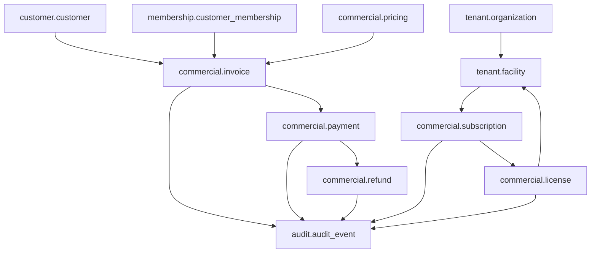
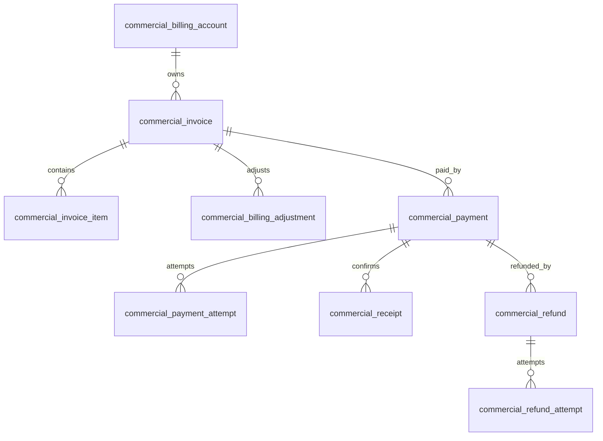
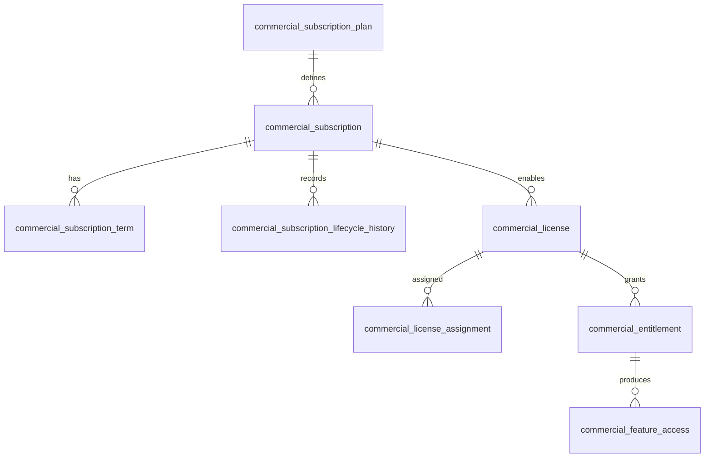

# DB-07 Commercial Database Design

**Document ID:** DB-07  
**Document Name:** Commercial Database Design  
**Company:** OreeOn Technologies Pvt. Ltd.  
**Product:** Digitize  
**Document Type:** Database Design  
**Version:** 0.1  
**Status:** Design Draft  
**Business Owner:** Product Architecture  
**Technical Owner:** Data Architecture  
**Prepared By:** Data Architecture Team  
**Reviewed By:** Data Architecture Review Board  
**Approved By:** Product Architecture / Solution Architecture  
**Classification:** Internal  
**Confidentiality:** Confidential  
**Document State:** Design Draft  
**Release:** Foundation Documentation  
**Dependencies:** DB-00, DB-01, DB-02, DB-03, DB-04, DB-05, FR-14, FR-15, FR-16, TA-03, TA-08, TA-10  
**Supersedes:** Not Applicable  
**Superseded By:** Not Applicable  
**Last Updated:** July 2026  
**Database Review:** Ready for Review

---

# Revision History

| Version | Date | Author | Description |
|---|---|---|---|
| 0.1 | July 2026 | Data Architecture Team | Initial commercial database design draft |
| 0.2 | 2026-07-26 | Data Architecture Team | Freeze preparation edits: standardized review status; minor clarifications |

---

# 1. Introduction

## 1.1 Purpose

This document defines the database-neutral Commercial Database Design for Digitize.

It covers pricing, price versions, discounts, promotions, tax, billing accounts, invoices, invoice items, billing adjustments, payments, payment attempts, payment method references, receipts, refunds, refund attempts, reconciliation, settlement, subscription plans, subscriptions, subscription terms, subscription lifecycle history, licenses, license assignments, entitlements, feature access, and commercial audit history.

## 1.2 Objectives

- Preserve Facility as the primary commercial subscription and licensing unit.
- Support different subscription terms across Facilities belonging to the same Organization.
- Support yearly subscriptions for owned Facilities and short-duration subscriptions for leased Facilities where configured.
- Separate pricing, invoice, payment, refund, settlement, subscription, license, and entitlement responsibilities.
- Preserve historical commercial values without depending only on current configuration.
- Support payment and refund idempotency, callback traceability, reconciliation, receipts, credit notes, debit adjustments, and auditability.
- Avoid storing raw payment card data, provider secrets, or sensitive credentials.

## 1.3 Scope

This document covers the `commercial` namespace and related references to `tenant`, `customer`, `membership`, `training`, `communication`, `reporting`, and `audit` namespaces.

## 1.4 Out of Scope

- Full accounting ledger.
- Payroll, procurement, inventory, and statutory filing implementation.
- Direct payment-card storage.
- Provider secrets.
- Vendor-specific SQL or database implementation.
- Payment gateway API payload details.

## 1.5 Intended Audience

Product Architects, Commercial Architects, Data Architects, Backend Developers, Finance Stakeholders, QA Engineers, Security Engineers, DevOps Engineers, Implementation Teams, Support Teams, and Audit / Compliance Stakeholders.

## 1.6 Related Documents

| Document Type | Document Reference | Relationship |
|---|---|---|
| Database Design | DB-00 to DB-06 | Source standards, logical model, tenancy, physical baseline, and operational references |
| Commercial Strategy | CS-01 to CS-04 | Source subscription, licensing, pricing, billing, invoicing, discount, and promotion strategy |
| Functional Requirements | FR-14 Billing and Payment Management | Source invoice, payment, refund, reconciliation requirements |
| Functional Requirements | FR-15 Subscription Management | Source subscription lifecycle requirements |
| Functional Requirements | FR-16 License Management | Source license and entitlement requirements |
| Technical Architecture | TA-03, TA-08, TA-10 | Source data, commercial, and ADR alignment |

---

# 2. Data Design Context

## 2.1 Business Context

Commercial data controls revenue generation, subscription access, license-based capabilities, financial traceability, invoices, payments, refunds, adjustments, and reconciliation. In Digitize, Facility is the primary commercial subscription and licensing unit, while Organization remains the tenant root.

## 2.2 Functional Context

Commercial structures support FR-BPM-001 through FR-BPM-018, FR-SUB-001 through FR-SUB-012, and FR-LIC-001 through FR-LIC-012.

## 2.3 Technical Architecture Context

TA-08 requires commercial flows to preserve financial traceability, retry-safe integration handling, provider abstraction, auditability, and separation between subscription, license, billing, payment, refund, and reconciliation responsibilities.

## 2.4 Data Ownership Context

Finance / Commercial Management owns billing, invoice, payment, refund, reconciliation, settlement, subscription, and commercial reporting data. License Management owns license and entitlement data. Platform Administration owns subscription plan templates and commercial configuration controlled at platform level.

---

# 3. Data Scope Model

## 3.1 In-Scope Data Domains

| Data Domain ID | Data Domain | Physical Namespace | Scope |
|---|---|---|---|
| DB-DOM-007 | Commercial | commercial | Pricing, invoices, payments, refunds, subscriptions, licenses, entitlements, reconciliation |
| DB-DOM-003 | Organization | tenant | Organization and Facility commercial scope references |
| DB-DOM-004 | Customer | customer | Customer billing references |
| DB-DOM-005 | Membership | membership | Membership purchase and renewal references |
| DB-DOM-008 | Trainer | training | Personal training package commercial references |
| DB-DOM-011 | Audit | audit | Commercial audit evidence |

## 3.2 Out-of-Scope Data Domains

| Data Domain | Reason |
|---|---|
| Full General Ledger | Not approved in current requirements |
| Payroll | Not approved in current requirements |
| Inventory Billing | Not approved in current requirements |
| Direct Card Data | Excluded by security architecture |
| Tax Filing Submission | Tax calculation and invoice tax traceability are in scope; statutory filing integration is not approved |

## 3.3 Data Domain Diagram

---

# 4. Data Domains

| Data Domain | Purpose | Typical Ownership |
|---|---|---|
| Commercial | Pricing, billing, invoice, payment, refund, reconciliation, subscription, license, and entitlement data | Finance / Commercial Management |
| Organization | Tenant and Facility commercial ownership | Organization Management |
| Customer | Customer billing subject | Customer Management |
| Membership | Membership purchase and renewal commercial reference | Membership Management |
| Audit | Commercial audit evidence | Audit and Compliance |

---

# 5. Data Classification

| Data Group | Data Domain | Classification | Sensitivity | Business Owner | Technical Owner | Notes |
|---|---|---|---|---|---|---|
| Pricing | Commercial | Financial | Medium | Finance / Commercial Management | Data Architecture | Versioned |
| Invoice | Commercial | Financial | High | Finance / Commercial Management | Data Architecture | Historical values |
| Payment | Commercial | Financial / Payment Reference | High | Finance / Commercial Management | Integration Architecture | No raw card data |
| Refund | Commercial | Financial | High | Finance / Commercial Management | Integration Architecture | Payment-linked |
| Reconciliation | Commercial | Financial | High | Finance / Commercial Management | Data Architecture | Settlement matching |
| Subscription | Commercial | Commercial Control | High | Finance / Commercial Management | Data Architecture | Facility-scoped |
| License | Commercial | Commercial Control | High | License Management | Data Architecture | Capability access |
| Entitlement | Commercial | Commercial Control | High | License Management | Data Architecture | Feature access |
| Commercial Audit | Commercial / Audit | Financial / Audit | High | Audit and Compliance | Security Architecture | Protected |

---

# 6. Entity / Table Design

| Entity / Table | Purpose | Data Domain | Business Owner | Technical Owner | Classification | Notes |
|---|---|---|---|---|---|---|
| commercial.pricing | Pricing context | Commercial | Finance / Commercial Management | Data Architecture | Financial | Platform or tenant configurable |
| commercial.price_version | Historical price version | Commercial | Finance / Commercial Management | Data Architecture | Financial | Preserves pricing over time |
| commercial.discount | Discount definition/application | Commercial | Finance / Commercial Management | Data Architecture | Financial | Approval may apply |
| commercial.promotion | Promotion definition | Commercial | Marketing / Finance | Data Architecture | Financial / Communication | May relate to campaign |
| commercial.tax | Tax rule or tax outcome | Commercial | Finance / Commercial Management | Data Architecture | Financial | Historical invoice tax preserved |
| commercial.billing_account | Billing relationship | Commercial | Finance / Commercial Management | Data Architecture | Financial | Organization or Customer context |
| commercial.invoice | Issued invoice | Commercial | Finance / Commercial Management | Data Architecture | Financial | Historical values protected |
| commercial.invoice_item | Invoice line item | Commercial | Finance / Commercial Management | Data Architecture | Financial | Charge details |
| commercial.billing_adjustment | Credit/debit adjustment | Commercial | Finance / Commercial Management | Data Architecture | Financial | Approval and audit |
| commercial.payment | Payment transaction | Commercial | Finance / Commercial Management | Data Architecture | Financial / Payment Reference | Provider references only |
| commercial.payment_attempt | Payment attempt | Commercial | Finance / Commercial Management | Integration Architecture | Payment Reference | Idempotency |
| commercial.payment_method_reference | Tokenized payment method reference | Commercial | Finance / Commercial Management | Integration Architecture | Payment Reference | Raw payment data excluded |
| commercial.receipt | Payment receipt | Commercial | Finance / Commercial Management | Data Architecture | Financial | Payment confirmation |
| commercial.refund | Refund transaction | Commercial | Finance / Commercial Management | Data Architecture | Financial | Payment-linked |
| commercial.refund_attempt | Refund processing attempt | Commercial | Finance / Commercial Management | Integration Architecture | Payment Reference | Callback trace |
| commercial.reconciliation | Reconciliation record | Commercial | Finance / Commercial Management | Data Architecture | Financial | Invoice/payment/settlement matching |
| commercial.settlement | Provider settlement record | Commercial | Finance / Commercial Management | Integration Architecture | Financial | Provider-derived |
| commercial.subscription_plan | SaaS subscription plan | Commercial | Platform Administration | Data Architecture | Internal Platform / Commercial | Plan definition |
| commercial.subscription | Facility subscription | Commercial | Finance / Commercial Management | Data Architecture | Commercial Control | Facility is subscription unit |
| commercial.subscription_term | Subscription term | Commercial | Finance / Commercial Management | Data Architecture | Commercial Control | Owned/leased Facility duration |
| commercial.subscription_lifecycle_history | Subscription lifecycle history | Commercial | Finance / Commercial Management | Data Architecture | Commercial Control / Audit | Immutable |
| commercial.license | License record | Commercial | License Management | Data Architecture | Commercial Control | Capability bundle |
| commercial.license_assignment | Facility license assignment | Commercial | License Management | Data Architecture | Commercial Control | Facility-scoped |
| commercial.license_capability | Licensed capability | Commercial | License Management | Data Architecture | Commercial Control | Capability definition |
| commercial.entitlement | Entitlement record | Commercial | License Management | Data Architecture | Commercial Control | Feature access |
| commercial.feature_access | Effective feature access result | Commercial | License Management | Data Architecture | Commercial Control | Used by authorization |
| commercial.commercial_audit_history | Commercial state history | Commercial | Finance / Commercial Management | Data Architecture | Financial / Audit | Financial trace |

---

# 7. Attribute / Column Design

| Attribute / Column | Description | Data Type / Logical Type | Mandatory | Source | Validation / Constraint | Notes |
|---|---|---|---|---|---|---|
| record_id | Primary identifier | Identifier | Yes | System | Unique | Standard |
| organization_id | Tenant root | Identifier Reference | Yes for tenant-owned commercial records | Tenant Context | Authorized Organization | Required except platform plan templates |
| facility_id | Facility commercial scope | Identifier Reference | Conditional | System / User | Must belong to Organization | Required for subscriptions/licenses |
| customer_id | Customer billing subject | Identifier Reference | Conditional | User / System | Must belong to Organization | Customer invoice/payment |
| invoice_id | Invoice reference | Identifier Reference | Conditional | System | Must belong to Organization | Payment/refund linkage |
| payment_id | Payment reference | Identifier Reference | Conditional | System / Provider | Must belong to Organization | Refund/reconciliation |
| subscription_id | Subscription reference | Identifier Reference | Conditional | System | Facility scoped | License relation |
| license_id | License reference | Identifier Reference | Conditional | System | Facility scoped | Entitlements |
| amount | Monetary amount | Money | Conditional | System / User | Must be non-negative unless adjustment type allows | Financial values |
| currency_code | Currency | Code | Conditional | System / User | Approved currency | Required for money |
| tax_amount | Tax amount | Money | Conditional | System | Must match tax calculation record | Invoice trace |
| discount_amount | Discount amount | Money | Conditional | System / User | Must follow discount policy | Invoice trace |
| status | Lifecycle status | Status | Yes | System / User / Provider | Approved lifecycle | Commercial state |
| provider_reference | External provider reference | External Reference | Conditional | Provider | Must not contain secrets | Payment/refund/settlement |
| idempotency_key | Retry-safe operation key | External Reference | Conditional | API / Integration | Unique per operation scope | Payment/refund callbacks |
| effective_at | Effective timestamp | DateTime | Conditional | System / User | Required for price/subscription/license | Commercial lifecycle |
| expires_at | Expiry timestamp | DateTime | Conditional | System / User | Must follow effective_at | Terms/licenses |
| created_at | Creation timestamp | DateTime | Yes | System | Immutable | Audit |
| created_by | Creator | Identifier Reference | Conditional | System | Actor where available | Audit |
| updated_at | Update timestamp | DateTime | Conditional | System | Mutable records only | Audit |
| updated_by | Updater | Identifier Reference | Conditional | System | Actor where available | Audit |
| version_number | Version number | Number | Conditional | System | Optimistic concurrency | Mutable records |
| correlation_id | Correlation reference | External Reference | Conditional | System | Required for critical flows | Audit/reconciliation |

---

# 8. Relationships

| Relationship | Parent | Child | Cardinality | Optionality | Tenant Scope | Notes |
|---|---|---|---|---|---|---|
| DB-07-REL-001 | tenant.facility | commercial.subscription | One-to-Many | Optional | Tenant-owned / Facility | Facility subscription |
| DB-07-REL-002 | commercial.subscription_plan | commercial.subscription | One-to-Many | Mandatory | Platform to tenant | Plan source |
| DB-07-REL-003 | commercial.subscription | commercial.subscription_term | One-to-Many | Mandatory | Facility | Term history |
| DB-07-REL-004 | commercial.subscription | commercial.subscription_lifecycle_history | One-to-Many | Mandatory after state change | Facility | Immutable |
| DB-07-REL-005 | commercial.subscription | commercial.license | One-to-Many | Optional | Facility | License issuance |
| DB-07-REL-006 | commercial.license | commercial.license_assignment | One-to-Many | Optional | Facility | Facility assignment |
| DB-07-REL-007 | commercial.license | commercial.entitlement | One-to-Many | Optional | Facility | Capability grants |
| DB-07-REL-008 | commercial.entitlement | commercial.feature_access | One-to-Many | Optional | Facility | Effective access |
| DB-07-REL-009 | commercial.pricing | commercial.price_version | One-to-Many | Mandatory | Platform / Tenant | Historical price |
| DB-07-REL-010 | customer.customer | commercial.billing_account | One-to-Many | Optional | Tenant | Customer billing |
| DB-07-REL-011 | commercial.billing_account | commercial.invoice | One-to-Many | Optional | Tenant | Invoice owner |
| DB-07-REL-012 | commercial.invoice | commercial.invoice_item | One-to-Many | Mandatory | Tenant | Line items |
| DB-07-REL-013 | commercial.invoice | commercial.billing_adjustment | One-to-Many | Optional | Tenant | Adjustments |
| DB-07-REL-014 | commercial.invoice | commercial.payment | One-to-Many | Optional | Tenant | Payment collection |
| DB-07-REL-015 | commercial.payment | commercial.payment_attempt | One-to-Many | Optional | Tenant / Provider | Attempts |
| DB-07-REL-016 | commercial.payment | commercial.receipt | One-to-One-or-Many | Optional | Tenant | Receipt |
| DB-07-REL-017 | commercial.payment | commercial.refund | One-to-Many | Optional | Tenant | Refund |
| DB-07-REL-018 | commercial.refund | commercial.refund_attempt | One-to-Many | Optional | Tenant / Provider | Attempts |
| DB-07-REL-019 | commercial.payment | commercial.reconciliation | One-to-Many | Optional | Tenant | Matching |
| DB-07-REL-020 | commercial.settlement | commercial.reconciliation | One-to-Many | Optional | Tenant / Provider | Settlement matching |

---

# 9. Keys and Identifiers

| Key / Identifier | Entity / Table | Purpose | Scope | Notes |
|---|---|---|---|---|
| DB-07-PK-001 | All commercial tables | Primary identifier | Table scope | Standard `record_id` |
| DB-07-FK-001 | Tenant-owned commercial tables | Organization reference | Organization scope | Mandatory |
| DB-07-FK-002 | Facility commercial tables | Facility reference | Facility scope | Subscription and license |
| DB-07-UQ-001 | commercial.invoice | Invoice number uniqueness | Organization scope | Historical |
| DB-07-UQ-002 | commercial.payment_attempt | Payment idempotency key uniqueness | Organization + provider + operation | Retry-safe |
| DB-07-UQ-003 | commercial.refund_attempt | Refund idempotency key uniqueness | Organization + provider + operation | Retry-safe |
| DB-07-UQ-004 | commercial.subscription | Active subscription uniqueness | Facility + plan + effective period | Configurable |
| DB-07-UQ-005 | commercial.license_assignment | Active license assignment uniqueness | Facility + license + capability | Prevent duplicate access |
| DB-07-ID-001 | provider_reference | External provider traceability | Provider scope | No secrets |
| DB-07-ID-002 | correlation_id | Cross-domain commercial traceability | Tenant scope | Invoice/payment/refund/reconciliation |

---

# 10. Constraints and Validation

| Constraint | Entity / Table | Rule | Scope | Notes |
|---|---|---|---|---|
| DB-07-CK-001 | commercial.invoice | Issued invoice must preserve historical totals and tax values | Tenant | No dependency on current config only |
| DB-07-CK-002 | commercial.invoice_item | Invoice item amount must be valid for charge type | Tenant | Commercial rule |
| DB-07-CK-003 | commercial.payment | Payment must reference valid invoice, billing account, or approved commercial context | Tenant | Prevent orphan payments |
| DB-07-CK-004 | commercial.payment_attempt | Payment attempt must be idempotent | Provider / Tenant | Retry-safe |
| DB-07-CK-005 | commercial.refund | Refund must not exceed refundable payment amount unless approved adjustment exists | Tenant | Financial control |
| DB-07-CK-006 | commercial.reconciliation | Reconciliation must preserve provider and internal references | Tenant / Provider | Matching |
| DB-07-CK-007 | commercial.subscription | Subscription must be Facility-scoped | Facility | Approved commercial unit |
| DB-07-CK-008 | commercial.subscription_term | Subscription term dates must be valid and non-overlapping where active | Facility | Term integrity |
| DB-07-CK-009 | commercial.license_assignment | License assignment must reference Facility under same Organization | Facility | Tenant consistency |
| DB-07-CK-010 | commercial.entitlement | Entitlement must be tied to active license or approved grace state | Facility | Capability access |
| DB-07-CK-011 | commercial.payment_method_reference | Raw payment-card data must not be stored | Payment Reference | Security |

---

# 11. Index and Access Patterns

| Access Pattern | Entity / Table | Index Need | Query Scope | Notes |
|---|---|---|---|---|
| Invoice lookup | commercial.invoice | Organization, customer, invoice number, status, date | Tenant | Finance and support |
| Payment processing | commercial.payment, payment_attempt | Organization, provider reference, idempotency key, status | Tenant / Provider | Critical |
| Refund processing | commercial.refund, refund_attempt | Payment, status, provider reference | Tenant / Provider | Critical |
| Reconciliation | commercial.payment, settlement, reconciliation | Provider, date, status, amount | Tenant / Provider | Finance |
| Subscription validation | commercial.subscription, subscription_term | Facility, status, effective period | Facility | Access control |
| License validation | commercial.license, license_assignment, entitlement, feature_access | Facility, capability, status | Facility | Login/capability |
| Commercial reporting | invoice, payment, refund, subscription, license | Organization, Facility, date, status | Tenant | Reporting |
| Audit investigation | commercial_audit_history, audit references | Entity, actor, timestamp, correlation | Tenant | Compliance |

---

# 12. Multi-Tenancy Design

| Tenant Concern | Design Approach | Applies To | Notes |
|---|---|---|---|
| Organization Scope | All tenant commercial records include Organization context | Commercial tables | Tenant root |
| Facility Commercial Scope | Subscriptions and licenses are Facility-scoped | subscription, license_assignment, entitlement | Approved unit |
| Customer Billing Scope | Customer invoices and payments remain Organization traceable | billing_account, invoice, payment | Customer may have Site associations |
| Platform Plan Scope | Subscription plans may be platform-owned | subscription_plan | Tenant-specific overrides require approval |
| Tenant-Aware Uniqueness | Invoice numbers, subscriptions, provider references use tenant scope | Commercial records | Prevent collision |
| Cross-Tenant Access | Commercial support or audit access requires privileged record | Commercial / Audit | Administrative Access Record |
| Reporting Isolation | Commercial reports preserve tenant and Facility scope | Reporting | DB-08 |

---

# 13. Audit and History Design

| Audit / History Area | Trigger | Data Captured | Retention | Notes |
|---|---|---|---|---|
| Invoice History | Invoice generation, cancellation, adjustment | Financial totals, tax, discount, actor, state | Financial retention | Historical values |
| Payment History | Payment initiated, succeeded, failed, cancelled | Provider reference, amount, status, correlation | Financial retention | No raw card data |
| Refund History | Refund requested, approved, processed, failed | Payment, amount, reason, provider result | Financial retention | Traceable |
| Reconciliation History | Match, mismatch, settlement, adjustment | Internal and provider references, totals, status | Financial retention | Finance audit |
| Subscription History | Create, activate, renew, upgrade, downgrade, suspend, cancel, expire | Facility, plan, term, state, actor | Commercial retention | Immutable |
| License History | Generate, assign, activate, renew, modify, suspend, expire, cancel | Facility, license, capability, state | Commercial retention | Capability trace |
| Commercial Audit | Any financial or entitlement state change | Actor, entity, previous/new state, correlation | Compliance retention | Protected |

---

# 14. Data Lifecycle State Model

| Lifecycle State | Meaning | Allowed Usage |
|---|---|---|
| Transient | Temporary commercial processing | Draft invoice, payment callback staging |
| Active | Current usable commercial record | Active subscription, active license |
| Inactive | Not operational but retained | Inactive plan, suspended subscription |
| Historical | Completed commercial transaction | Paid invoice, reconciled payment |
| Archived | Aged financial/commercial record | Archived invoices/payments |
| Anonymized | De-identified where approved | Limited reporting only |
| Purged | Permanently removed by approved process | Temporary provider payloads only |
| Legally Retained | Retained by financial, audit, or legal obligation | Invoice, payment, refund, tax, subscription, license |

---

# 15. Retention, Archival, and Purging

| Data Group | Lifecycle State | Retention Rule | Archival Approach | Purging Rule | Notes |
|---|---|---|---|---|---|
| Pricing | Active / Historical | Retain price versions | Archive retired prices | Purge only when no dependent records exist | Historical values |
| Invoices | Active / Historical / Legally Retained | Retain per financial compliance | Archive aged invoices | Do not purge while obligations apply | Strict |
| Payments | Historical / Legally Retained | Retain provider references and result | Archive aged payments | Do not purge while obligations apply | Strict |
| Refunds | Historical / Legally Retained | Retain refund traceability | Archive aged refunds | Do not purge while obligations apply | Strict |
| Reconciliation | Historical / Legally Retained | Retain settlement matching evidence | Archive aged reconciliation | Do not purge while obligations apply | Finance |
| Subscriptions | Active / Historical / Archived | Retain lifecycle and commercial terms | Archive expired/cancelled subscriptions | Do not purge while dependent license/financial records exist | Facility |
| Licenses | Active / Historical / Archived | Retain capability access history | Archive expired/cancelled licenses | Do not purge while audit obligations exist | Access control |

---

# 16. Migration and Versioning

| Migration Area | Migration Type | Validation | Rollback Consideration | Notes |
|---|---|---|---|---|
| Price Migration | Commercial configuration migration | Validate versions, effective dates, dependent invoices | Restore previous active price version | No historical loss |
| Invoice Migration | Financial migration | Validate totals, tax, discount, customer, tenant | Reconciliation required | Critical |
| Payment Migration | Provider reference migration | Validate provider references, status, idempotency | Requires provider reconciliation | Critical |
| Subscription Migration | Commercial lifecycle migration | Validate Facility, plan, term, status | Preserve history | Facility unit |
| License Migration | Capability migration | Validate assignment, entitlement, feature access | Revert capability mapping | Access impact |
| Reconciliation Migration | Settlement migration | Validate internal/provider totals | Finance approval | Critical |

---

# 17. Backup and Recovery

| Data Group | Backup Need | Recovery Requirement | Notes |
|---|---|---|---|
| Invoice / Invoice Item | Critical | Restore financial documents and historical values | Compliance |
| Payment / Payment Attempt | Critical | Restore provider traceability and idempotency state | Provider reconciliation |
| Refund / Refund Attempt | Critical | Restore refund traceability | Finance |
| Reconciliation / Settlement | Critical | Restore matching state | Finance control |
| Subscription / Term | Critical | Restore Facility subscription access | Commercial access |
| License / Entitlement | Critical | Restore feature access accurately | Platform access |
| Pricing / Discount / Tax | High | Restore historical commercial configuration | Invoice accuracy |

---

# 18. Security and Privacy

| Security Area | Design Approach | Applies To | Notes |
|---|---|---|---|
| Financial Access | Restrict invoice, payment, refund, reconciliation access | Commercial namespace | Finance roles |
| Payment Data Minimization | Store provider references only | payment_method_reference, payment_attempt | No raw card data |
| Idempotency Protection | Payment/refund attempts require idempotency identifiers | payment_attempt, refund_attempt | Retry-safe |
| Provider Secrets | Never store provider secrets in commercial tables | Commercial integrations | Secret manager required |
| Tenant Isolation | Organization and Facility scope required | Tenant commercial records | Prevent leakage |
| Audit Protection | Commercial audit history protected | commercial_audit_history, audit_event | Compliance |
| Export Control | Commercial exports require permission and audit | Reports and exports | Sensitive |

---

# 19. Reporting and Analytics Considerations

| Reporting Area | Source Data | Derived Data | Refresh / Access Pattern | Notes |
|---|---|---|---|---|
| Revenue Report | invoice, invoice_item, payment | Revenue projection | Scheduled/on-demand | Tenant/Facility scope |
| Outstanding Statement | invoice, payment, adjustment | Outstanding balance projection | On-demand | Finance |
| Refund Report | refund, payment | Refund analytics | Scheduled/on-demand | Finance |
| Reconciliation Report | payment, settlement, reconciliation | Reconciliation summary | Scheduled | Finance |
| Subscription Report | subscription, term, lifecycle | Subscription analytics | Scheduled/on-demand | Facility |
| License Report | license, assignment, entitlement | License access report | Scheduled/on-demand | Facility capability |
| Commercial Audit Report | commercial_audit_history, audit_event | Audit evidence | Controlled | Compliance |

---

# 20. Traceability

| Source Document | Requirement / Process / Rule | Entity / Table | Attribute / Column | Notes |
|---|---|---|---|---|
| FR-14 | FR-BPM-001 to FR-BPM-018 | pricing, invoice, invoice_item, adjustment, payment, receipt, refund, reconciliation | Financial and state attributes | Billing and payment |
| FR-15 | FR-SUB-001 to FR-SUB-012 | subscription_plan, subscription, subscription_term, subscription_lifecycle_history | Subscription lifecycle attributes | Subscription |
| FR-16 | FR-LIC-001 to FR-LIC-012 | license, license_assignment, license_capability, entitlement, feature_access | License and capability attributes | License |
| CS-01 | Subscription and Licensing Strategy | subscription, license, entitlement | Facility scope and term | Commercial strategy |
| CS-02 | Pricing Strategy | pricing, price_version, discount, promotion | Price and discount attributes | Pricing |
| CS-03 | Billing and Invoicing Strategy | invoice, invoice_item, payment, receipt | Financial traceability | Billing |
| CS-04 | Discount and Promotion Policy | discount, promotion | Discount/promotion attributes | Commercial policy |
| TA-08 | Commercial Architecture | All commercial tables | Idempotency, provider reference, audit | Architecture alignment |
| DB-04 | Multi-Tenancy Design | All tenant commercial tables | organization_id, facility_id | Tenant scope |

---

# 21. Diagrams

| Diagram ID | Diagram Name | Diagram Type | Location |
|---|---|---|---|
| DB-07-DGM-001 | Commercial Domain Diagram | Physical Entity Relationship Diagram | Section 3.3 |
| DB-07-DGM-002 | Billing Payment Refund Diagram | Physical Entity Relationship Diagram | Section 21.1 |
| DB-07-DGM-003 | Subscription License Entitlement Diagram | Physical Entity Relationship Diagram | Section 21.2 |

## 21.1 Billing Payment Refund Diagram

## 21.2 Subscription License Entitlement Diagram

---

# 22. Review Checklist

| Review Area | Status | Notes |
|---|---|---|
| Terminology consistency | Pending | Requires review against Commercial Strategy and FR-14 to FR-16 |
| Entity completeness | Pending | Commercial table catalogue populated |
| Relationship correctness | Pending | Billing, payment, refund, subscription, license relationships included |
| Tenant isolation | Pending | Organization and Facility scope defined |
| Key and constraint completeness | Pending | Key and financial validation rules included |
| Index and access pattern coverage | Pending | Commercial access patterns included |
| Data classification | Pending | Financial and payment reference classifications included |
| Auditability | Pending | Commercial audit history included |
| Retention and archival alignment | Pending | Financial retention included |
| Migration readiness | Pending | Commercial migration areas included |
| Backup and recovery readiness | Pending | Commercial recovery criticality included |
| Security and privacy readiness | Pending | Payment minimization and provider secret rules included |
| Traceability completeness | Pending | Source traceability included; DB-10 will consolidate |

---

# 23. Open Questions

| Question ID | Question | Owner | Target Resolution | Status |
|---|---|---|---|---|
| DB-07-OQ-001 | What invoice numbering strategy is approved for Organization and Facility scope? | Finance / Product Architecture | Before implementation | Open |
| DB-07-OQ-002 | Which payment gateway provider references are mandatory for release 1.0? | Integration Architecture | Before API implementation | Open |
| DB-07-OQ-003 | Which refund approval thresholds are required? | Finance / Product Architecture | Before implementation | Open |
| DB-07-OQ-004 | Which subscription term rules apply to owned versus leased Facilities in release 1.0? | Commercial Strategy / Product Architecture | Before implementation | Open |
| DB-07-OQ-005 | Which licensed capabilities are mandatory for initial swimming pool release? | Product Architecture / License Management | Before implementation | Open |

---

# 24. Summary

DB-07 defines the Commercial Database Design for Digitize.

It establishes database-neutral commercial structures for pricing, billing, invoice, invoice item, adjustment, payment, payment attempt, receipt, refund, refund attempt, reconciliation, settlement, subscription, subscription term, subscription lifecycle history, license, license assignment, license capability, entitlement, feature access, and commercial audit history.

The design preserves Facility as the primary commercial subscription and licensing unit, protects financial history, supports retry-safe payment processing, avoids raw card data storage, and remains database-engine neutral.
