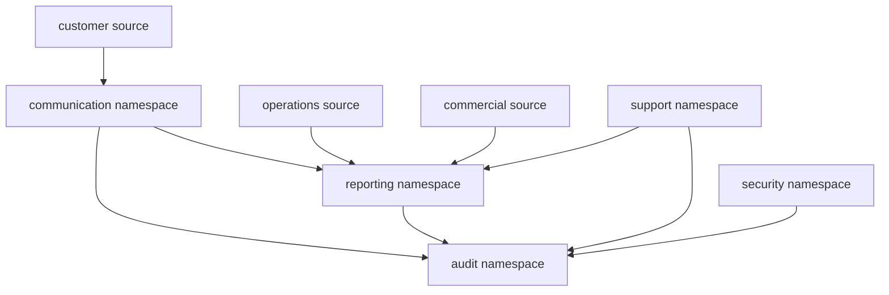
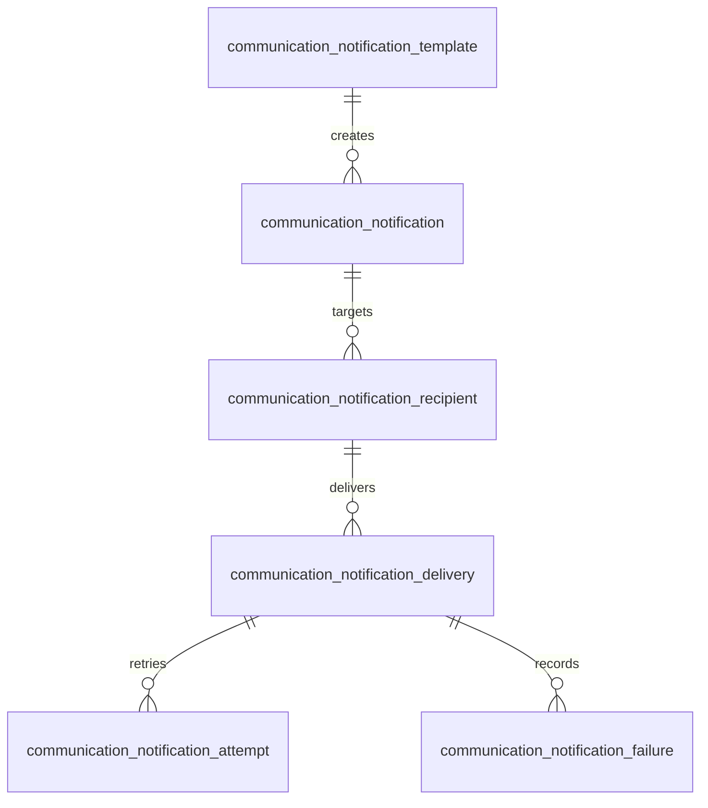
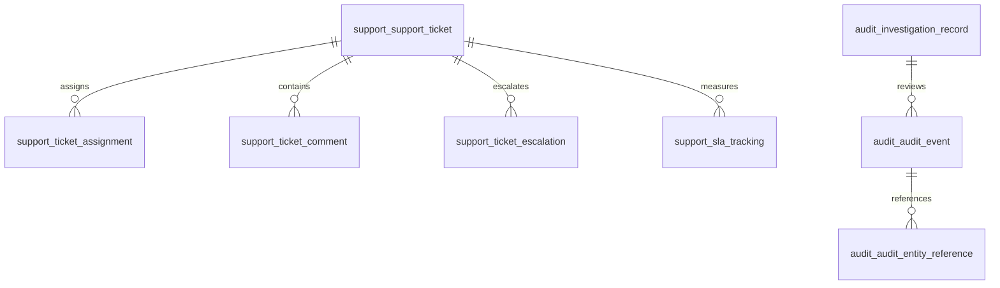

# DB-08 Communication, Reporting & Governance Data Design

**Document ID:** DB-08  
**Document Name:** Communication, Reporting & Governance Data Design  
**Company:** OreeOn Technologies Pvt. Ltd.  
**Product:** Digitize  
**Document Type:** Database Design  
**Version:** 0.1  
**Status:** Design Draft  
**Business Owner:** Product Architecture  
**Technical Owner:** Data Architecture  
**Prepared By:** Data Architecture Team  
**Reviewed By:** Data Architecture Review Board  
**Approved By:** Product Architecture / Solution Architecture  
**Classification:** Internal  
**Confidentiality:** Confidential  
**Document State:** Design Draft  
**Release:** Foundation Documentation  
**Dependencies:** DB-00, DB-01, DB-02, DB-03, DB-04, DB-05, DB-06, DB-07, FR-17, FR-18, FR-19, FR-20, FR-21, TA-03, TA-04, TA-05, TA-07, TA-10  
**Supersedes:** Not Applicable  
**Superseded By:** Not Applicable  
**Last Updated:** July 2026  
**Database Review:** Ready for Review

---

# Revision History

| Version | Date | Author | Description |
|---|---|---|---|
| 0.1 | July 2026 | Data Architecture Team | Initial communication, reporting, and governance data design draft |
| 0.2 | 2026-07-26 | Data Architecture Team | Freeze preparation edits: standardized review status; minor clarifications |

---

# 1. Introduction

## 1.1 Purpose

This document defines database-neutral structures for Communication, Reporting, Support, Audit, Compliance, Security Investigation, and Governance data in Digitize.

It covers advertisement campaigns, audiences, schedules, results, notification templates, preferences, generated notifications, recipients, deliveries, attempts, failures, report definitions, report parameters, report schedules, report executions, exports, dashboards, KPIs, reporting projections, support tickets, support lifecycle, SLA tracking, audit events, compliance records, data export records, investigation records, security investigation, and administrative access records.

## 1.2 Objectives

- Define communication data structures with consent and delivery traceability.
- Define reporting data structures that identify authoritative sources.
- Define support ticket structures with SLA, escalation, comments, and attachments metadata.
- Define audit and compliance structures that protect immutable evidence.
- Define security investigation and administrative access structures.
- Support tenant isolation across communication, reporting, support, audit, and governance data.
- Avoid making reporting projections authoritative for business transactions.

## 1.3 Scope

This document covers the `communication`, `reporting`, `support`, `audit`, and related `security` namespace structures.

## 1.4 Out of Scope

- Physical implementation of data warehouse technology.
- BI tool selection.
- Email, SMS, or WhatsApp provider API payloads.
- Provider credentials or secrets.
- File storage implementation for exports and attachments.
- Legal policy drafting.
- SQL or database-vendor configuration.

## 1.5 Intended Audience

Data Architects, Reporting Teams, Marketing Teams, Support Teams, Security Engineers, Compliance Stakeholders, Backend Developers, QA Engineers, DevOps Engineers, and Implementation Teams.

## 1.6 Related Documents

| Document Type | Document Reference | Relationship |
|---|---|---|
| Database Design | DB-00 to DB-07 | Source standards and upstream entities |
| Functional Requirements | FR-17 Advertisement Campaign | Source campaign requirements |
| Functional Requirements | FR-18 Notification Management | Source notification requirements |
| Functional Requirements | FR-19 Reports and Analytics | Source reporting requirements |
| Functional Requirements | FR-20 Support Ticket | Source support requirements |
| Functional Requirements | FR-21 Audit and Compliance | Source audit and compliance requirements |
| Technical Architecture | TA-03, TA-04, TA-05, TA-07, TA-10 | Source data, integration, security, observability, and ADR alignment |

---

# 2. Data Design Context

## 2.1 Business Context

Communication, reporting, support, audit, and governance data provide visibility, accountability, customer engagement, operational support, regulatory readiness, and management insights. These records frequently reference operational and commercial source entities but must not replace those authoritative sources.

## 2.2 Functional Context

This design supports FR-CMP-001 through FR-CMP-012, FR-NOT-001 through FR-NOT-012, FR-RPT-001 through FR-RPT-012, FR-TKT-001 through FR-TKT-012, and FR-AUD-001 through FR-AUD-012.

## 2.3 Technical Architecture Context

TA-03 requires reporting data separation and audit data separation. TA-04 requires provider callback and integration traceability. TA-05 requires access control and sensitive data protection. TA-07 requires observability-safe records. TA-10 includes ADRs for audit separation, reporting projections, security by design, tenant isolation, and masked telemetry.

## 2.4 Data Ownership Context

Marketing Management owns campaign data. Communication Management owns notification execution data. Reporting and Analytics owns derived reporting definitions and projections. Support Management owns support ticket data. Audit and Compliance owns audit, compliance, export, investigation, and administrative access evidence. Security Governance owns security event and security investigation data.

---

# 3. Data Scope Model

## 3.1 In-Scope Data Domains

| Data Domain ID | Data Domain | Physical Namespace | Scope |
|---|---|---|---|
| DB-DOM-010 | Communication | communication | Campaigns, notification templates, preferences, notifications, delivery tracking |
| DB-DOM-009 | Reporting | reporting | Reports, dashboards, KPIs, projections, exports |
| DB-DOM-013 | Support | support | Tickets, categories, priorities, assignments, comments, attachments, escalations, SLA |
| DB-DOM-011 | Audit | audit | Audit events, compliance, data exports, investigations, administrative access |
| DB-DOM-012 | Security | security | Security events and security investigation references |

## 3.2 Out-of-Scope Data Domains

| Data Domain | Reason |
|---|---|
| Campaign Creative Asset Storage | File or asset storage implementation is not defined here |
| BI Warehouse Technology | Vendor/tool selection deferred |
| Notification Provider Credentials | Secrets must not be stored in domain tables |
| Legal Policy Drafting | Compliance data records are in scope; legal policy text approval is external |

## 3.3 Data Domain Diagram

---

# 4. Data Domains

| Data Domain | Purpose | Typical Ownership |
|---|---|---|
| Communication | Campaign, notification, preference, consent-aware delivery, and provider traceability | Communication Management |
| Reporting | Reports, dashboards, KPIs, snapshots, exports, and read-oriented projections | Reporting and Analytics |
| Support | Ticket lifecycle, comments, assignments, escalations, attachments metadata, and SLA tracking | Support Management |
| Audit | Immutable audit, compliance, export, investigation, and administrative access evidence | Audit and Compliance |
| Security | Security events and security investigation data | Security Governance |

---

# 5. Data Classification

| Data Group | Data Domain | Classification | Sensitivity | Business Owner | Technical Owner | Notes |
|---|---|---|---|---|---|---|
| Campaign | Communication | Communication | Medium | Marketing Management | Data Architecture | Audience may be sensitive |
| Notification | Communication | Communication | Medium | Communication Management | Integration Architecture | Delivery status |
| Notification Recipient | Communication | Communication / Sensitive Personal | High | Communication Management | Integration Architecture | Recipient data protected |
| Report Definition | Reporting | Derived Analytical | Medium | Reporting and Analytics | Data Engineering | Not source of truth |
| Report Export | Reporting | Derived Analytical / Compliance | High | Reporting and Analytics | Data Engineering | Export audited |
| Support Ticket | Support | Tenant Operational / Sensitive Personal | Medium to High | Support Management | Support Architecture | May include sensitive data |
| Audit Event | Audit | Audit / Compliance | High | Audit and Compliance | Security Architecture | Append-only |
| Compliance Record | Audit | Compliance | High | Audit and Compliance | Security Architecture | Controlled access |
| Investigation | Audit / Security | Compliance / Security | High | Audit and Compliance | Security Architecture | Restricted |
| Administrative Access | Audit | Security / Audit | High | Audit and Compliance | Security Architecture | Privileged |

---

# 6. Entity / Table Design

| Entity / Table | Purpose | Data Domain | Business Owner | Technical Owner | Classification | Notes |
|---|---|---|---|---|---|---|
| communication.advertisement_campaign | Campaign lifecycle | Communication | Marketing Management | Data Architecture | Communication | Approval-aware |
| communication.campaign_audience | Campaign target audience | Communication | Marketing Management | Data Architecture | Communication / Sensitive Personal | Consent-aware |
| communication.campaign_schedule | Campaign schedule | Communication | Marketing Management | Data Architecture | Communication | Launch timing |
| communication.campaign_delivery | Campaign delivery batch | Communication | Marketing Management | Integration Architecture | Communication | Execution tracking |
| communication.campaign_result | Campaign performance result | Communication | Marketing Management | Data Architecture | Communication / Reporting | Derived |
| communication.notification_template | Notification template | Communication | Communication Management | Data Architecture | Communication | Platform or tenant scoped |
| communication.notification_preference | Recipient preference | Communication | Communication Management | Data Architecture | Communication / Sensitive Personal | Preference |
| communication.communication_consent | Communication consent history | Communication | Communication Management | Data Architecture | Compliance / Communication | Historical |
| communication.notification | Notification instance | Communication | Communication Management | Integration Architecture | Communication | System/manual/scheduled |
| communication.notification_recipient | Recipient record | Communication | Communication Management | Integration Architecture | Communication / Sensitive Personal | Recipient scoped |
| communication.notification_delivery | Delivery status | Communication | Communication Management | Integration Architecture | Communication | Channel result |
| communication.notification_attempt | Delivery attempt | Communication | Communication Management | Integration Architecture | Communication | Retry trace |
| communication.notification_failure | Failure reason | Communication | Communication Management | Integration Architecture | Communication | Diagnostics |
| reporting.report_definition | Report metadata | Reporting | Reporting and Analytics | Data Engineering | Derived Analytical | Report catalog |
| reporting.report_parameter | Report parameter | Reporting | Reporting and Analytics | Data Engineering | Derived Analytical | Filters |
| reporting.report_schedule | Automated report schedule | Reporting | Reporting and Analytics | Data Engineering | Derived Analytical | Scheduling |
| reporting.report_execution | Report run | Reporting | Reporting and Analytics | Data Engineering | Derived Analytical | Execution trace |
| reporting.report_export | Export metadata | Reporting | Reporting and Analytics | Data Engineering | Derived Analytical / Compliance | Export audited |
| reporting.dashboard_configuration | Dashboard config | Reporting | Reporting and Analytics | Data Engineering | Derived Analytical | Tenant/user scoped |
| reporting.kpi_definition | KPI definition | Reporting | Reporting and Analytics | Data Engineering | Derived Analytical | Business meaning |
| reporting.kpi_snapshot | KPI value snapshot | Reporting | Reporting and Analytics | Data Engineering | Derived Analytical | Historical trend |
| reporting.reporting_projection | Read-oriented projection | Reporting | Reporting and Analytics | Data Engineering | Derived Analytical | Source identified |
| reporting.analytical_aggregate | Aggregated analytics | Reporting | Reporting and Analytics | Data Engineering | Derived Analytical | Derived |
| reporting.historical_snapshot | Historical reporting snapshot | Reporting | Reporting and Analytics | Data Engineering | Derived Analytical | Time series |
| support.support_ticket | Support ticket | Support | Support Management | Support Architecture | Tenant Operational / Sensitive Personal | Ticket lifecycle |
| support.ticket_category | Ticket category | Support | Support Management | Support Architecture | Tenant Master / Reference | Classification |
| support.ticket_priority | Ticket priority | Support | Support Management | Support Architecture | Tenant Master / Reference | SLA input |
| support.ticket_assignment | Ticket assignment | Support | Support Management | Support Architecture | Tenant Operational | Ownership |
| support.ticket_comment | Ticket comment | Support | Support Management | Support Architecture | Sensitive Personal | Restricted |
| support.ticket_attachment | Attachment metadata | Support | Support Management | Support Architecture | Sensitive Personal | File external |
| support.ticket_escalation | Escalation event | Support | Support Management | Support Architecture | Tenant Operational | SLA |
| support.sla_tracking | SLA tracking | Support | Support Management | Support Architecture | Tenant Operational | Metrics |
| audit.audit_event | Immutable audit event | Audit | Audit and Compliance | Security Architecture | Audit / Compliance | Append-only |
| audit.audit_entity_reference | Affected entity reference | Audit | Audit and Compliance | Security Architecture | Audit / Compliance | Traceability |
| audit.compliance_record | Compliance evidence | Audit | Audit and Compliance | Security Architecture | Compliance | Controlled |
| audit.data_export_record | Data export evidence | Audit | Audit and Compliance | Security Architecture | Compliance | Export audit |
| audit.investigation_record | Investigation record | Audit | Audit and Compliance | Security Architecture | Compliance / Security | Restricted |
| audit.security_investigation | Security investigation | Audit / Security | Security Governance | Security Architecture | Security / Compliance | Security review |
| audit.administrative_access_record | Privileged access record | Audit | Audit and Compliance | Security Architecture | Security / Audit | Cross-tenant |

---

# 7. Attribute / Column Design

| Attribute / Column | Description | Data Type / Logical Type | Mandatory | Source | Validation / Constraint | Notes |
|---|---|---|---|---|---|---|
| record_id | Primary identifier | Identifier | Yes | System | Unique | Standard |
| organization_id | Tenant root | Identifier Reference | Conditional | Tenant Context | Required for tenant-derived data | Platform reports/templates may be global |
| facility_id | Facility scope | Identifier Reference | Conditional | User / System | Must belong to Organization | Facility reports/campaigns |
| site_id | Site scope | Identifier Reference | Conditional | User / System | Must belong to Facility | Site reports/support |
| customer_id | Customer reference | Identifier Reference | Conditional | User / System | Must belong to Organization | Recipient/support context |
| source_entity_type | Authoritative source type | Type | Conditional | System | Required for derived/report/audit records | Traceability |
| source_entity_id | Authoritative source identifier | Identifier Reference | Conditional | System | Required for source-specific records | Traceability |
| channel_type | Communication channel | Type | Conditional | System / User | Approved channel | Email/SMS/WhatsApp/in-app conceptually |
| delivery_status | Delivery status | Status | Conditional | Provider / System | Approved lifecycle | Notification |
| report_status | Report execution status | Status | Conditional | System | Approved lifecycle | Reporting |
| ticket_status | Ticket status | Status | Conditional | User / System | Approved lifecycle | Support |
| severity | Severity | Type | Conditional | User / System | Approved severity | Support/security |
| consent_status | Consent state | Status | Conditional | Customer / User | Approved consent state | Consent history |
| export_scope | Export scope | Structured Data / Text | Conditional | User / System | Must be authorized | Export audit |
| actor_id | Actor reference | Identifier Reference | Conditional | System | Required for audit where actor exists | Audit |
| correlation_id | Correlation reference | External Reference | Conditional | System | Required for critical workflows | Traceability |
| created_at | Creation timestamp | DateTime | Yes | System | Immutable | Audit |
| created_by | Creator | Identifier Reference | Conditional | System | Required where actor exists | Audit |
| updated_at | Update timestamp | DateTime | Conditional | System | Mutable records only | Audit |
| updated_by | Updater | Identifier Reference | Conditional | System | Actor where available | Audit |

---

# 8. Relationships

| Relationship | Parent | Child | Cardinality | Optionality | Tenant Scope | Notes |
|---|---|---|---|---|---|---|
| DB-08-REL-001 | communication.advertisement_campaign | communication.campaign_audience | One-to-Many | Optional | Tenant-owned | Audience |
| DB-08-REL-002 | communication.advertisement_campaign | communication.campaign_schedule | One-to-Many | Optional | Tenant-owned | Schedule |
| DB-08-REL-003 | communication.advertisement_campaign | communication.campaign_delivery | One-to-Many | Optional | Tenant-owned | Delivery batch |
| DB-08-REL-004 | communication.advertisement_campaign | communication.campaign_result | One-to-Many | Optional | Tenant-owned | Results |
| DB-08-REL-005 | communication.notification_template | communication.notification | One-to-Many | Optional | Platform / Tenant | Template source |
| DB-08-REL-006 | communication.notification | communication.notification_recipient | One-to-Many | Mandatory | Tenant-aware | Recipient |
| DB-08-REL-007 | communication.notification_recipient | communication.notification_delivery | One-to-Many | Optional | Tenant-aware | Channel delivery |
| DB-08-REL-008 | communication.notification_delivery | communication.notification_attempt | One-to-Many | Optional | Tenant-aware | Retry |
| DB-08-REL-009 | communication.notification_delivery | communication.notification_failure | One-to-Many | Optional | Tenant-aware | Failure |
| DB-08-REL-010 | reporting.report_definition | reporting.report_parameter | One-to-Many | Optional | Tenant-aware | Parameters |
| DB-08-REL-011 | reporting.report_definition | reporting.report_schedule | One-to-Many | Optional | Tenant-aware | Schedule |
| DB-08-REL-012 | reporting.report_definition | reporting.report_execution | One-to-Many | Optional | Tenant-aware | Run |
| DB-08-REL-013 | reporting.report_execution | reporting.report_export | One-to-Many | Optional | Tenant-aware | Export |
| DB-08-REL-014 | reporting.kpi_definition | reporting.kpi_snapshot | One-to-Many | Optional | Tenant-aware | KPI history |
| DB-08-REL-015 | support.support_ticket | support.ticket_assignment | One-to-Many | Optional | Tenant-owned | Assignment |
| DB-08-REL-016 | support.support_ticket | support.ticket_comment | One-to-Many | Optional | Tenant-owned | Comments |
| DB-08-REL-017 | support.support_ticket | support.ticket_attachment | One-to-Many | Optional | Tenant-owned | Attachment metadata |
| DB-08-REL-018 | support.support_ticket | support.ticket_escalation | One-to-Many | Optional | Tenant-owned | Escalation |
| DB-08-REL-019 | support.support_ticket | support.sla_tracking | One-to-One-or-Many | Optional | Tenant-owned | SLA |
| DB-08-REL-020 | audit.audit_event | audit.audit_entity_reference | One-to-Many | Conditional | Tenant-aware | Entity trace |
| DB-08-REL-021 | audit.investigation_record | audit.audit_event | Many-to-Many | Optional | Tenant-aware | Investigation evidence |
| DB-08-REL-022 | audit.data_export_record | audit.audit_event | One-to-Many | Mandatory | Tenant-aware | Export audit |

---

# 9. Keys and Identifiers

| Key / Identifier | Entity / Table | Purpose | Scope | Notes |
|---|---|---|---|---|
| DB-08-PK-001 | All DB-08 tables | Primary identifier | Table scope | Standard `record_id` |
| DB-08-FK-001 | Tenant-derived tables | Organization reference | Tenant scope | Required where tenant-specific |
| DB-08-UQ-001 | notification_template | Template code uniqueness | Scope-aware | Platform or tenant |
| DB-08-UQ-002 | report_definition | Report code uniqueness | Scope-aware | Report catalog |
| DB-08-UQ-003 | kpi_definition | KPI code uniqueness | Scope-aware | Business metric |
| DB-08-UQ-004 | support_ticket | Ticket number uniqueness | Organization scope | Support reference |
| DB-08-ID-001 | correlation_id | Cross-domain traceability | Platform / Tenant | Audit and diagnostics |
| DB-08-ID-002 | provider_reference | Communication provider trace | Provider scope | No secrets |

---

# 10. Constraints and Validation

| Constraint | Entity / Table | Rule | Scope | Notes |
|---|---|---|---|---|
| DB-08-CK-001 | communication.campaign_audience | Audience selection must respect consent and tenant scope | Tenant | Privacy |
| DB-08-CK-002 | communication.notification_recipient | Recipient must be authorized for selected channel where consent applies | Tenant | Consent |
| DB-08-CK-003 | communication.notification_attempt | Retry attempts must be traceable to delivery | Tenant / Provider | Diagnostics |
| DB-08-CK-004 | reporting.reporting_projection | Projection must identify authoritative source | Reporting | Not source of truth |
| DB-08-CK-005 | reporting.report_export | Export must create audit evidence | Reporting / Audit | Compliance |
| DB-08-CK-006 | support.support_ticket | Ticket must be tenant-scoped unless platform ticket | Support | Tenant isolation |
| DB-08-CK-007 | support.ticket_attachment | Attachment metadata must not store file content directly | Support | External file storage |
| DB-08-CK-008 | audit.audit_event | Audit event must be append-only | Audit | Protected evidence |
| DB-08-CK-009 | audit.administrative_access_record | Privileged access reason required | Audit | Cross-tenant access |
| DB-08-CK-010 | audit.data_export_record | Export scope and actor required | Audit | Compliance |

---

# 11. Index and Access Patterns

| Access Pattern | Entity / Table | Index Need | Query Scope | Notes |
|---|---|---|---|---|
| Campaign dashboard | campaign, result | Organization, status, schedule | Tenant | Marketing |
| Notification retry | delivery, attempt, failure | status, channel, next retry time | Tenant / Provider | Operational |
| Notification history | notification, recipient, delivery | recipient, customer, date | Tenant | Support |
| Report execution | report_execution, report_export | tenant, user, status, date | Tenant | Reporting |
| KPI dashboard | kpi_snapshot | tenant, KPI, period | Tenant / Facility / Site | Analytics |
| Support queue | support_ticket, assignment, SLA | tenant, priority, status, owner | Tenant / Support | Support ops |
| Audit investigation | audit_event, entity_reference | tenant, actor, entity, action, time | Tenant / Platform | Compliance |
| Export history | data_export_record | actor, scope, time | Tenant / Platform | Privacy |

---

# 12. Multi-Tenancy Design

| Tenant Concern | Design Approach | Applies To | Notes |
|---|---|---|---|
| Tenant Communication | Campaigns and notifications preserve Organization scope | Communication | Tenant isolation |
| Consent Scope | Consent and preferences are tenant/customer scoped | Communication / Customer | Privacy |
| Reporting Scope | Reporting projections carry Organization, Facility, and Site scope where derived | Reporting | Prevent leakage |
| Support Scope | Tickets are tenant-scoped unless platform support ticket | Support | Controlled access |
| Audit Scope | Audit events carry tenant scope where applicable | Audit | Platform events may be global |
| Administrative Access | Cross-tenant support/audit access creates privileged access record | Audit | Mandatory |

---

# 13. Audit and History Design

| Audit / History Area | Trigger | Data Captured | Retention | Notes |
|---|---|---|---|---|
| Campaign History | Create, approve, schedule, launch, pause, complete, cancel | Actor, campaign, status, audience summary | Communication retention | Marketing |
| Notification History | Generate, send, deliver, fail, retry, archive | Recipient, channel, status, provider reference | Communication retention | Delivery |
| Report History | Execute, export, schedule, fail | Actor, report, filters, scope, status | Reporting retention | Export audited |
| Support History | Ticket create, assign, update, escalate, resolve, close, reopen | Actor, ticket, state, SLA | Support retention | Sensitive |
| Audit Event | Critical business/security/export/config action | Actor, tenant, action, entity, correlation | Compliance retention | Append-only |
| Investigation History | Investigation opened, updated, closed | Investigator, scope, evidence, outcome | Compliance retention | Restricted |
| Administrative Access | Privileged access used | Actor, tenant, reason, scope, timestamp | Compliance retention | Mandatory |

---

# 14. Data Lifecycle State Model

| Lifecycle State | Meaning | Allowed Usage |
|---|---|---|
| Transient | Temporary communication/reporting/support processing | Pending notification, report generation |
| Active | Current usable record | Active campaign, open ticket, scheduled report |
| Inactive | Disabled but retained | Disabled template, inactive dashboard |
| Historical | Completed or closed record | Delivered notification, closed ticket |
| Archived | Aged record moved out of primary use | Old notifications, reports, audit logs |
| Anonymized | De-identified where approved | Reporting analytics |
| Purged | Removed by approved policy | Temporary delivery payloads |
| Legally Retained | Retained for audit/compliance/security | Audit, export, investigation |

---

# 15. Retention, Archival, and Purging

| Data Group | Lifecycle State | Retention Rule | Archival Approach | Purging Rule | Notes |
|---|---|---|---|---|---|
| Campaign | Active / Historical / Archived | Retain campaign lifecycle and results | Archive completed campaigns | Purge when policy allows | Marketing |
| Notification | Active / Historical / Archived | Retain delivery evidence | Archive aged notifications | Purge according to communication policy | Delivery |
| Reporting | Active / Historical / Archived | Retain report executions and exports by policy | Archive aged reports | Purge derived data when allowed | Not source |
| Support | Active / Historical / Archived | Retain ticket lifecycle and SLA | Archive closed tickets | Purge after support/compliance obligations expire | Sensitive |
| Audit | Recorded / Legally Retained / Archived | Retain immutable evidence | Archive with integrity controls | Purge only by compliance approval | Protected |
| Security Investigation | Active / Historical / Archived / Legally Retained | Retain investigation evidence | Archive closed investigations | Purge only by compliance approval | Restricted |

---

# 16. Migration and Versioning

| Migration Area | Migration Type | Validation | Rollback Consideration | Notes |
|---|---|---|---|---|
| Template Migration | Communication configuration migration | Validate template keys, channel, scope | Restore previous template | No provider secrets |
| Campaign Migration | Marketing data migration | Validate audience and consent scope | Preserve source snapshot | Sensitive |
| Report Migration | Reporting definition migration | Validate source mapping and parameters | Restore previous report version | Reporting |
| Support Migration | Ticket data migration | Validate tenant, status, comments, SLA | Reconcile ticket counts | Support |
| Audit Migration | Evidence migration | Validate immutability, entity references, counts | Requires compliance approval | Critical |
| Export History Migration | Export metadata migration | Validate actor, scope, file metadata | Preserve source until verified | Compliance |

---

# 17. Backup and Recovery

| Data Group | Backup Need | Recovery Requirement | Notes |
|---|---|---|---|
| Communication | High | Restore campaigns, templates, notifications, deliveries | Customer communication |
| Reporting | Medium to High | Restore definitions, schedules, executions, exports or rebuild projections | Reporting continuity |
| Support | High | Restore tickets, comments, attachments metadata, SLA | Support operations |
| Audit | Critical | Restore immutable audit evidence | Compliance |
| Compliance | Critical | Restore compliance and export records | Legal / governance |
| Security Investigation | Critical | Restore investigation records | Security |

---

# 18. Security and Privacy

| Security Area | Design Approach | Applies To | Notes |
|---|---|---|---|
| Recipient Privacy | Recipient identity and contact data protected | Notification recipient, campaign audience | Sensitive |
| Consent Enforcement | Consent history used before governed communication | Campaign, notification | Compliance |
| Export Control | Report and data exports audited and permissioned | report_export, data_export_record | Privacy |
| Support Sensitivity | Ticket comments and attachments restricted | support tables | Customer/support |
| Audit Immutability | Audit records protected from normal modification | audit tables | Compliance |
| Privileged Access | Administrative access requires reason and audit | administrative_access_record | Cross-tenant |
| Provider Secrets | Not stored in communication records | communication tables | Secret references only |

---

# 19. Reporting and Analytics Considerations

| Reporting Area | Source Data | Derived Data | Refresh / Access Pattern | Notes |
|---|---|---|---|---|
| Campaign Report | campaign, delivery, result | Campaign analytics | Scheduled/post-campaign | Marketing |
| Notification Report | notification, delivery, attempt, failure | Delivery analytics | Scheduled/on-demand | Provider diagnostics |
| Operational Dashboard | operational and commercial sources | Dashboard projections | Scheduled/on-demand | Tenant-scoped |
| KPI Trends | KPI snapshot | Historical trends | Scheduled | Time series |
| Support Report | support ticket, SLA, escalation | Support analytics | Scheduled/on-demand | SLA |
| Audit Report | audit_event, entity_reference | Audit reports | Controlled | Compliance |
| Compliance Report | compliance_record, export, investigation | Compliance evidence | Controlled | Restricted |

---

# 20. Traceability

| Source Document | Requirement / Process / Rule | Entity / Table | Attribute / Column | Notes |
|---|---|---|---|---|
| FR-17 | FR-CMP-001 to FR-CMP-012 | campaign, audience, schedule, delivery, result | Campaign lifecycle attributes | Advertisement |
| FR-18 | FR-NOT-001 to FR-NOT-012 | template, preference, consent, notification, recipient, delivery, attempt, failure | Notification attributes | Notification |
| FR-19 | FR-RPT-001 to FR-RPT-012 | report_definition, parameter, schedule, execution, export, dashboard, KPI, projection | Reporting attributes | Reporting |
| FR-20 | FR-TKT-001 to FR-TKT-012 | support_ticket, category, priority, assignment, comment, attachment, escalation, SLA | Support attributes | Support |
| FR-21 | FR-AUD-001 to FR-AUD-012 | audit_event, entity_reference, compliance_record, data_export, investigation, administrative_access | Audit attributes | Audit/compliance |
| TA-03 | Reporting and audit separation | reporting and audit namespaces | Source and audit attributes | Architecture |
| TA-04 | Provider integration tracking | notification_delivery, notification_attempt | Provider reference | Integration |
| TA-05 | Security and privacy | audit, support, communication, reporting | Access and sensitivity attributes | Security |
| TA-07 | Observability | failure, event, report execution | Safe diagnostics | Operations |

---

# 21. Diagrams

| Diagram ID | Diagram Name | Diagram Type | Location |
|---|---|---|---|
| DB-08-DGM-001 | Communication Reporting Governance Diagram | Data Domain Diagram | Section 3.3 |
| DB-08-DGM-002 | Notification Delivery Diagram | Physical Entity Relationship Diagram | Section 21.1 |
| DB-08-DGM-003 | Support Audit Governance Diagram | Physical Entity Relationship Diagram | Section 21.2 |

## 21.1 Notification Delivery Diagram

## 21.2 Support Audit Governance Diagram

---

# 22. Review Checklist

| Review Area | Status | Notes |
|---|---|---|
| Terminology consistency | Pending | Requires review against FR-17 to FR-21 |
| Entity completeness | Pending | Communication, reporting, support, audit, governance entities included |
| Relationship correctness | Pending | Core relationships included |
| Tenant isolation | Pending | Tenant-derived scope included |
| Key and constraint completeness | Pending | Key and validation rules included |
| Index and access pattern coverage | Pending | Access patterns listed |
| Data classification | Pending | Sensitive, derived, audit, and compliance classification included |
| Auditability | Pending | Audit and export evidence included |
| Retention and archival alignment | Pending | Retention categories included |
| Migration readiness | Pending | Migration areas included |
| Backup and recovery readiness | Pending | Recovery criticality included |
| Security and privacy readiness | Pending | Consent, export, support sensitivity, and privileged access controls included |
| Traceability completeness | Pending | Source traceability included; DB-10 will consolidate |

---

# 23. Open Questions

| Question ID | Question | Owner | Target Resolution | Status |
|---|---|---|---|---|
| DB-08-OQ-001 | Which notification channels are supported in release 1.0? | Product Architecture / Communication Management | Before implementation | Open |
| DB-08-OQ-002 | What report export formats are approved? | Reporting and Analytics | Before implementation | Open |
| DB-08-OQ-003 | Which support attachment types and retention rules are approved? | Support Management / Compliance | Before implementation | Open |
| DB-08-OQ-004 | Which audit events require immutable legal retention? | Audit and Compliance | Before DB-09 freeze | Open |
| DB-08-OQ-005 | Which campaign audience rules require approval workflow? | Marketing / Product Architecture | Before implementation | Open |

---

# 24. Summary

DB-08 defines the Communication, Reporting, Support, Audit, Compliance, Security Investigation, and Governance data design for Digitize.

The design preserves tenant isolation, consent history, reporting source traceability, export auditing, support lifecycle evidence, immutable audit records, administrative access traceability, and database-engine neutrality.
