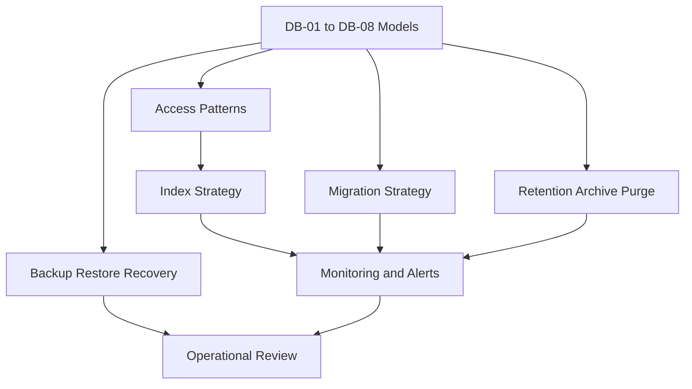
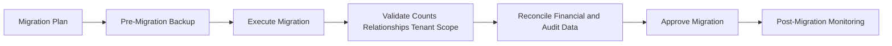

# DB-09 Database Operations, Performance & Lifecycle

**Document ID:** DB-09  
**Document Name:** Database Operations, Performance & Lifecycle  
**Company:** OreeOn Technologies Pvt. Ltd.  
**Product:** Digitize  
**Document Type:** Database Design  
**Version:** 0.1  
**Status:** Design Draft  
**Business Owner:** Product Architecture  
**Technical Owner:** Data Architecture  
**Prepared By:** Data Architecture Team  
**Reviewed By:** Data Architecture Review Board  
**Approved By:** Product Architecture / Solution Architecture  
**Classification:** Internal  
**Confidentiality:** Confidential  
**Document State:** Design Draft  
**Release:** Foundation Documentation  
**Dependencies:** DB-00 to DB-08, BA-09, BA-10, TA-03, TA-06, TA-07, TA-10  
**Supersedes:** Not Applicable  
**Superseded By:** Not Applicable  
**Last Updated:** July 2026  
**Database Review:** Ready for Review

---

# Revision History

| Version | Date | Author | Description |
|---|---|---|---|
| 0.1 | July 2026 | Data Architecture Team | Initial database operations, performance, and lifecycle draft |
| 0.2 | 2026-07-26 | Data Architecture Team | Freeze preparation edits: standardized review status; minor clarifications |

---

# 1. Introduction

## 1.1 Purpose

This document defines the database operations, performance, and lifecycle strategy for Digitize.

It establishes access patterns, high-volume table expectations, indexing strategy, capacity planning, transaction volume assumptions, monitoring, slow-query monitoring, lock and contention monitoring, connection management, transaction boundaries, concurrency controls, idempotency support, schema migration, data migration, retention, archival, purging, anonymization, legal hold, backup, restore, recovery validation, business continuity, disaster recovery alignment, operational risks, and review expectations.

## 1.2 Objectives

- Define operational expectations for database reliability, scalability, maintainability, and auditability.
- Define performance-sensitive access patterns without selecting a database vendor.
- Identify high-volume and high-criticality data groups.
- Define tenant-aware indexing and access-pattern expectations.
- Define migration, rollback, reconciliation, deployment sequencing, and backward compatibility principles.
- Define retention, archival, purging, anonymization, legal hold, backup, restore, and recovery strategy.
- Support DevOps, QA, support, audit, and implementation readiness.

## 1.3 Scope

This document applies to all DB-01 through DB-08 domains and database structures.

## 1.4 Out of Scope

- Vendor-specific database tuning commands.
- Cloud provider implementation details.
- Specific RPO/RTO contractual values unless defined by approved SLA.
- SQL scripts.
- Infrastructure-as-code implementation.
- Runtime source code.

## 1.5 Intended Audience

Data Architects, DevOps Engineers, Backend Engineers, QA Engineers, Security Engineers, Support Teams, Implementation Teams, Product Architects, Solution Architects, and Audit / Compliance Stakeholders.

## 1.6 Related Documents

| Document Type | Document Reference | Relationship |
|---|---|---|
| Database Design | DB-00 to DB-08 | Source model, domains, tables, and tenancy rules |
| Business Analysis | BA-09 Non-Functional Business Requirements | Source availability, performance, security, configurability, audit, retention expectations |
| Business Analysis | BA-10 Assumptions, Constraints and Risks | Source operational risks and constraints |
| Technical Architecture | TA-03 Data Architecture | Source data operations direction |
| Technical Architecture | TA-06 Deployment and DevOps Architecture | Source deployment and migration alignment |
| Technical Architecture | TA-07 Observability and Operations Architecture | Source monitoring, logging, alerting, diagnostics |
| Technical Architecture | TA-10 ADRs | Source architecture decisions |

---

# 2. Data Design Context

## 2.1 Business Context

Digitize supports daily operational workflows such as customer registration, attendance, membership lifecycle, billing, payment, notifications, reporting, support, and audit. Database operations must support business continuity, tenant isolation, financial correctness, high-volume attendance, retry-safe commercial processing, secure access, and recoverability.

## 2.2 Functional Context

All FR-02 through FR-21 modules rely on database lifecycle and performance controls. Attendance, payment, notification delivery, reporting exports, and audit investigation are especially sensitive to performance, consistency, and operational recovery.

## 2.3 Technical Architecture Context

TA-06 and TA-07 guide deployment sequencing, monitoring, alerting, diagnostics, and operational readiness. TA-03 guides data lifecycle and retention. TA-10 identifies ADRs that must be resolved before implementation-specific database operations are finalized.

## 2.4 Data Ownership Context

Data Architecture owns database design governance. DevOps owns operational execution of deployment, monitoring, backup, and recovery. Security Architecture owns sensitive data controls. Product Architecture owns business lifecycle and retention decisions. Compliance owns legal hold and audit retention requirements.

---

# 3. Data Scope Model

## 3.1 In-Scope Data Domains

| Data Domain ID | Data Domain | Operational Concern |
|---|---|---|
| DB-DOM-001 | Platform | Configuration availability and release-safe change |
| DB-DOM-002 | Identity | Authentication and authorization performance |
| DB-DOM-003 | Organization | Tenant hierarchy consistency |
| DB-DOM-004 | Customer | Search, privacy, archival, export |
| DB-DOM-005 | Membership | Lifecycle history and eligibility |
| DB-DOM-006 | Attendance | High-volume operational writes and reporting |
| DB-DOM-007 | Commercial | Financial integrity, payment idempotency, reconciliation |
| DB-DOM-008 | Trainer | Scheduling and conflict validation |
| DB-DOM-009 | Reporting | Derived projections and export governance |
| DB-DOM-010 | Communication | Delivery retry and provider diagnostics |
| DB-DOM-011 | Audit | Append-only evidence and investigation |
| DB-DOM-012 | Security | Security event monitoring |
| DB-DOM-013 | Support | Support queue and SLA performance |

## 3.2 Out-of-Scope Data Domains

| Data Domain | Reason |
|---|---|
| Vendor-Specific Database Administration | Requires approved database technology |
| Cloud Provider Backup Configuration | Belongs to deployment implementation |
| SQL-Level Query Plans | Requires physical technology and production workload data |

## 3.3 Data Domain Diagram

---

# 4. Data Domains

| Data Domain | Purpose | Typical Ownership |
|---|---|---|
| Operations and Performance | Query, indexing, volume, transactions, concurrency, capacity, and monitoring | Data Architecture / DevOps |
| Lifecycle Governance | Retention, archival, purging, anonymization, legal hold | Product Architecture / Compliance |
| Migration Governance | Schema migration, data migration, sequencing, rollback, reconciliation | Data Architecture / DevOps |
| Recovery Governance | Backup, restore, recovery validation, continuity, disaster recovery alignment | DevOps / Data Architecture |

---

# 5. Data Classification

| Data Group | Data Domain | Classification | Sensitivity | Business Owner | Technical Owner | Notes |
|---|---|---|---|---|---|---|
| High-Volume Operational | Attendance | Tenant Operational | Medium | Operations | Data Architecture | Performance critical |
| Financial Critical | Commercial | Financial | High | Finance / Commercial Management | Data Architecture | Recovery critical |
| Security Critical | Security | Security | High | Security Governance | Security Architecture | Monitoring critical |
| Audit Critical | Audit | Audit / Compliance | High | Audit and Compliance | Security Architecture | Append-only |
| Sensitive Personal | Customer / Support / Trainer | Sensitive Personal | High | Domain Owners | Data Architecture | Privacy controls |
| Derived Reporting | Reporting | Derived Analytical | Medium | Reporting and Analytics | Data Engineering | Rebuildable where source retained |
| Configuration Critical | Platform / Tenant | Internal Platform / Tenant Master | Medium | Platform / Organization Management | Platform Architecture | Operational dependency |

---

# 6. Entity / Table Design

This document does not introduce new business tables. It classifies operational behavior for tables defined in DB-03 through DB-08.

| Entity / Table | Purpose | Data Domain | Business Owner | Technical Owner | Classification | Notes |
|---|---|---|---|---|---|---|
| operations.attendance | High-volume attendance writes and history | Attendance | Operations | Data Architecture | Tenant Operational | High write/read volume |
| operations.entry_exit_event | Check-in/out event detail | Attendance | Operations | Data Architecture | Tenant Operational | Time-series-like |
| commercial.payment_attempt | Retry-safe provider payment processing | Commercial | Finance / Commercial Management | Integration Architecture | Payment Reference | Idempotency critical |
| commercial.refund_attempt | Retry-safe provider refund processing | Commercial | Finance / Commercial Management | Integration Architecture | Payment Reference | Idempotency critical |
| communication.notification_delivery | Delivery status tracking | Communication | Communication Management | Integration Architecture | Communication | Retry and monitoring |
| communication.notification_attempt | Notification retry attempts | Communication | Communication Management | Integration Architecture | Communication | Potential high volume |
| reporting.reporting_projection | Derived read-oriented data | Reporting | Reporting and Analytics | Data Engineering | Derived Analytical | Rebuild strategy needed |
| reporting.kpi_snapshot | Historical KPI values | Reporting | Reporting and Analytics | Data Engineering | Derived Analytical | Time-series growth |
| audit.audit_event | Immutable audit evidence | Audit | Audit and Compliance | Security Architecture | Audit / Compliance | Append-only high criticality |
| security.security_event | Security event evidence | Security | Security Governance | Security Architecture | Security | Monitoring critical |
| support.support_ticket | Support lifecycle and queue | Support | Support Management | Support Architecture | Sensitive Personal | SLA performance |

---

# 7. Attribute / Column Design

| Attribute / Column | Description | Data Type / Logical Type | Mandatory | Source | Validation / Constraint | Notes |
|---|---|---|---|---|---|---|
| organization_id | Tenant root | Identifier Reference | Conditional | Tenant Context | Required for tenant-owned records | Tenant-aware access |
| facility_id | Facility scope | Identifier Reference | Conditional | System/User | Required for Facility-scoped records | Commercial/operations |
| site_id | Site scope | Identifier Reference | Conditional | System/User | Required for Site-scoped records | Attendance |
| status | Lifecycle status | Status | Conditional | System/User | Approved values | Access patterns |
| effective_at | Effective timestamp | DateTime | Conditional | System/User | Temporal validation | Policies/pricing |
| expires_at | Expiry timestamp | DateTime | Conditional | System/User | Must follow effective_at | Lifecycle |
| created_at | Creation timestamp | DateTime | Yes | System | Immutable | Common index candidate |
| updated_at | Update timestamp | DateTime | Conditional | System | Mutable records only | Operational |
| version_number | Optimistic concurrency version | Number | Conditional | System | Increment on update | Concurrency |
| correlation_id | Cross-domain correlation | External Reference | Conditional | System | Critical workflows | Observability |
| idempotency_key | Retry-safe key | External Reference | Conditional | API/Integration | Unique by operation scope | Payment/refund/notification |
| archival_status | Archival lifecycle status | Status | Conditional | System | Approved lifecycle | Archive operations |
| legal_hold_status | Legal hold indicator | Status | Conditional | Compliance | Prevent purge | Compliance |

---

# 8. Relationships

| Relationship | Parent | Child | Cardinality | Optionality | Tenant Scope | Notes |
|---|---|---|---|---|---|---|
| DB-09-REL-001 | Source Tables | Reporting Projections | One-to-Many | Optional | Tenant-aware | Derived data source tracking |
| DB-09-REL-002 | Source Tables | Audit Event | One-to-Many | Conditional | Tenant-aware | Critical events |
| DB-09-REL-003 | Migration Batch | Migration Validation Result | One-to-Many | Conditional | Operational | Conceptual operational artifact |
| DB-09-REL-004 | Archive Job | Archived Data Group | One-to-Many | Conditional | Tenant-aware | Lifecycle tracking |
| DB-09-REL-005 | Backup Run | Recovery Validation | One-to-Many | Conditional | Platform / Tenant | Recovery proof |

---

# 9. Keys and Identifiers

| Key / Identifier | Entity / Table | Purpose | Scope | Notes |
|---|---|---|---|---|
| Tenant Scope Key | Tenant-owned tables | Tenant filtering | Organization / Facility / Site | Required access pattern |
| Time-Based Access Key | High-volume tables | Date/time lookup | Tenant + time | Attendance, audit, reporting |
| Idempotency Key | Payment, refund, notification attempts | Retry-safe processing | Operation scope | Prevent duplicate effects |
| Correlation Identifier | Critical workflows | Traceability | Platform / Tenant | Observability and audit |
| Migration Version Identifier | Migration records | Version tracking | Environment / release | Vendor-neutral |
| Archive Batch Identifier | Archive operations | Archive traceability | Data group / tenant | Audit required |
| Backup Run Identifier | Backup operations | Recovery traceability | Environment | DevOps |

---

# 10. Constraints and Validation

| Constraint | Entity / Table | Rule | Scope | Notes |
|---|---|---|---|---|
| DB-09-CK-001 | High-volume tenant tables | Tenant scope must be queryable | Tenant | Performance and isolation |
| DB-09-CK-002 | Payment/refund callbacks | Idempotency must prevent duplicate processing | Commercial | Critical |
| DB-09-CK-003 | Reporting projections | Authoritative source must be identifiable | Reporting | Not source of truth |
| DB-09-CK-004 | Audit events | Append-only behavior required | Audit | Compliance |
| DB-09-CK-005 | Purging | Legal hold blocks purge | All retained data | Compliance |
| DB-09-CK-006 | Migrations | Data migration requires validation and reconciliation | All domains | Release safety |
| DB-09-CK-007 | Backup | Restore must be validated before production reliance | All critical data | Business continuity |
| DB-09-CK-008 | Sensitive lower-environment data | Masking/anonymization required where copied | Sensitive data | Privacy |

---

# 11. Index and Access Patterns

| Access Pattern | Entity / Table | Index Need | Query Scope | Notes |
|---|---|---|---|---|
| Tenant hierarchy lookup | organization, facility, site | Tenant hierarchy indexes | Platform / Tenant | Core dependency |
| Authentication and authorization | user_account, role_assignment, access_scope, session | Login/scope indexes | Identity | Critical |
| Customer search | customer, customer_contact | Tenant-scoped search indexes | Organization / Site | Privacy |
| Attendance operations | attendance, entry_exit_event | Site/date/customer indexes | Site | High volume |
| Payment idempotency | payment_attempt, refund_attempt | Provider/idempotency indexes | Tenant / Provider | Critical |
| License validation | license_assignment, entitlement, feature_access | Facility/capability indexes | Facility | Runtime access |
| Notification retry | notification_delivery, notification_attempt | Status/channel/time indexes | Communication | Retry |
| Reporting execution | report_execution, kpi_snapshot, projection | Tenant/report/time indexes | Reporting | Derived |
| Support queue | support_ticket, assignment, SLA | Tenant/status/priority indexes | Support | SLA |
| Audit investigation | audit_event, entity_reference, security_event | Tenant/entity/action/time indexes | Audit/Security | Compliance |

---

# 12. Multi-Tenancy Design

| Tenant Concern | Design Approach | Applies To | Notes |
|---|---|---|---|
| Tenant-aware indexing | Access paths must include tenant scope for tenant-owned high-volume data | Operational, commercial, reporting, audit | Prevent slow and unsafe scans |
| Tenant migration | Tenant data movement requires full hierarchy and relationship validation | All tenant data | DB-04 dependency |
| Tenant archival | Archive jobs preserve Organization, Facility, Site context | All tenant data | Reporting/audit |
| Tenant purge | Purge is blocked by legal, financial, audit, security, or compliance retention | All tenant data | Compliance |
| Tenant recovery | Restore must preserve tenant isolation | Backup/recovery | Critical |

---

# 13. Audit and History Design

| Audit / History Area | Trigger | Data Captured | Retention | Notes |
|---|---|---|---|---|
| Schema Migration | Structure changed | Version, change, owner, status | Release retention | DevOps trace |
| Data Migration | Data moved/transformed | Counts, checks, scope, status | Migration retention | Reconciliation |
| Archive Job | Data archived | Data group, tenant scope, counts, actor/job | Lifecycle retention | Audit |
| Purge Job | Data purged | Approval, scope, counts, reason | Compliance retention | Sensitive |
| Legal Hold | Hold applied/removed | Scope, reason, approver, timestamp | Compliance retention | Blocks purge |
| Backup Run | Backup completed/failed | Scope, status, timestamp | Operations retention | DevOps |
| Restore Test | Restore validated | Dataset, status, errors, evidence | Operations retention | Continuity |
| Performance Incident | Slow query/contention incident | Scope, query class, impact, resolution | Operations retention | Observability |

---

# 14. Data Lifecycle State Model

| Lifecycle State | Meaning | Allowed Usage |
|---|---|---|
| Transient | Temporary processing or staging | Imports, callbacks, reports |
| Active | Current operational data | Day-to-day records |
| Inactive | Disabled but retained | Suspended entities |
| Historical | Completed or superseded | Old transactions |
| Archived | Removed from primary operational use | Aged records |
| Anonymized | De-identified where approved | Privacy analytics |
| Purged | Permanently removed | Approved obsolete data |
| Legally Retained | Retained because obligations apply | Financial, audit, security, compliance |

---

# 15. Retention, Archival, and Purging

| Data Group | Lifecycle State | Retention Rule | Archival Approach | Purging Rule | Notes |
|---|---|---|---|---|---|
| Configuration | Active / Historical | Retain version history | Archive superseded config | Purge only obsolete non-audit | Governance |
| Customer | Active / Archived / Anonymized | Retain per privacy/business need | Archive inactive | Purge/anonymize by policy | Sensitive |
| Operational | Active / Historical / Archived | Retain usage trace | Archive aged records | Purge after obligations expire | High volume |
| Commercial | Historical / Legally Retained | Retain financial records | Archive aged financial | Do not purge during obligations | Strict |
| Communication | Historical / Archived | Retain consent/delivery evidence | Archive aged delivery | Purge where allowed | Provider |
| Reporting | Historical / Archived | Retain reports/exports by policy | Archive aged projections | Purge derived where source permits | Not source |
| Support | Historical / Archived | Retain support evidence | Archive closed tickets | Purge after support retention | Sensitive |
| Audit/Security | Recorded / Legally Retained / Archived | Retain evidence | Archive with integrity | Purge only by compliance approval | Critical |

---

# 16. Migration and Versioning

| Migration Area | Migration Type | Validation | Rollback Consideration | Notes |
|---|---|---|---|---|
| Schema Migration | Structural versioning | Validate compatibility and constraints | Rollback where practical | No vendor syntax |
| Data Migration | Transformation/loading | Validate counts, relationships, tenant scope | Reconciliation and rollback batch | Critical |
| Backward Compatibility | Release migration | Validate old/new application compatibility | Forward-fix or rollback plan | Deployment |
| Tenant Migration | Tenant data movement | Validate hierarchy, counts, financial, audit | Controlled rollback | ADR dependent |
| Reporting Rebuild | Projection migration | Validate source totals | Rebuild from source | Reporting |
| Audit Migration | Evidence migration | Validate immutability and references | Compliance approval | Critical |

---

# 17. Backup and Recovery

| Data Group | Backup Need | Recovery Requirement | Notes |
|---|---|---|---|
| Tenant Hierarchy | Critical | Restore first | Dependency root |
| Identity/Security | Critical | Restore access controls and security evidence | Authentication |
| Operational | Critical | Restore customer, membership, attendance, training consistency | Daily business |
| Commercial | Critical | Restore financial and entitlement state | Reconciliation |
| Communication | High | Restore delivery and consent traceability | Customer communication |
| Reporting | Medium to High | Restore or rebuild derived data | Source identified |
| Support | High | Restore support lifecycle and SLA | Support continuity |
| Audit/Compliance | Critical | Restore immutable evidence | Compliance |

---

# 18. Security and Privacy

| Security Area | Design Approach | Applies To | Notes |
|---|---|---|---|
| Monitoring Masking | Sensitive values must be masked in operational logs | All sensitive data | TA-07 alignment |
| Lower Environment | Sensitive data must be masked/anonymized | Customer, commercial, support, security | Privacy |
| Backup Protection | Backups inherit source data classification | All data | Encryption decision deferred |
| Restore Authorization | Restore operations require privileged approval | Backup/restore | Audit required |
| Legal Hold | Purging blocked while legal hold exists | Retained data | Compliance |
| Migration Audit | Migrations are auditable | All domains | Release governance |

---

# 19. Reporting and Analytics Considerations

| Reporting Area | Source Data | Derived Data | Refresh / Access Pattern | Notes |
|---|---|---|---|---|
| Performance Reporting | Query and operation metrics | Operational performance reports | Scheduled | TA-07 |
| Capacity Reporting | Growth and storage trends | Capacity projections | Scheduled | Planning |
| Migration Reporting | Migration validation results | Migration report | Per migration | Release |
| Backup Reporting | Backup and restore validation | Recovery readiness report | Scheduled | DevOps |
| Retention Reporting | Archive/purge/legal hold records | Lifecycle compliance report | Scheduled | Compliance |
| Audit Reporting | Audit and security events | Audit operations report | Controlled | Compliance |

---

# 20. Traceability

| Source Document | Requirement / Process / Rule | Entity / Table | Attribute / Column | Notes |
|---|---|---|---|---|
| BA-09 | Availability, performance, scalability, auditability, data management | All database domains | Lifecycle, backup, monitoring attributes | NFR alignment |
| BA-10 | Business risks and constraints | All database domains | Risk, migration, backup, legal hold metadata | Risk alignment |
| TA-03 | Data architecture | All data groups | Ownership, retention, reporting, audit | Architecture |
| TA-06 | Deployment and DevOps | Migration and release operations | Migration version, rollback, deployment sequencing | DevOps |
| TA-07 | Observability and Operations | Monitoring and diagnostics | Correlation, incident, metrics | Operations |
| DB-03 | Physical Data Model | All physical structures | Standard columns and access patterns | Physical baseline |
| DB-04 | Multi-Tenancy | Tenant-owned structures | Organization, Facility, Site scope | Tenant isolation |

---

# 21. Diagrams

| Diagram ID | Diagram Name | Diagram Type | Location |
|---|---|---|---|
| DB-09-DGM-001 | Database Operations Lifecycle Diagram | Data Lifecycle Diagram | Section 3.3 |
| DB-09-DGM-002 | Migration Validation Flow | Migration Flow | Section 21.1 |
| DB-09-DGM-003 | Backup Restore Validation Flow | Data Flow Diagram | Section 21.2 |

## 21.1 Migration Validation Flow

## 21.2 Backup Restore Validation Flow

---

# 22. Review Checklist

| Review Area | Status | Notes |
|---|---|---|
| Terminology consistency | Pending | Requires review against TA-06 and TA-07 |
| Entity completeness | Pending | Operational data groups classified |
| Relationship correctness | Pending | Lifecycle operational relationships included |
| Tenant isolation | Pending | Tenant-aware operations included |
| Key and constraint completeness | Pending | Operational keys and constraints included |
| Index and access pattern coverage | Pending | Performance access patterns included |
| Data classification | Pending | Operational classifications included |
| Auditability | Pending | Migration, backup, purge, legal hold audit included |
| Retention and archival alignment | Pending | Lifecycle strategy included |
| Migration readiness | Pending | Migration principles included |
| Backup and recovery readiness | Pending | Recovery strategy included |
| Security and privacy readiness | Pending | Masking, legal hold, backup controls included |
| Traceability completeness | Pending | Source traceability included |

---

# 23. Open Questions

| Question ID | Question | Owner | Target Resolution | Status |
|---|---|---|---|---|
| DB-09-OQ-001 | What production RPO and RTO targets are approved? | Product Architecture / DevOps | Before production readiness | Open |
| DB-09-OQ-002 | Which exact retention periods apply by data classification? | Compliance / Product Architecture | Before freeze | Open |
| DB-09-OQ-003 | Which high-volume tables require partitioning in release 1.0? | Data Architecture / DevOps | Before implementation | Open |
| DB-09-OQ-004 | What lower-environment data masking rules are mandatory? | Security Architecture | Before implementation | Open |
| DB-09-OQ-005 | What migration approval workflow is required for production? | DevOps / Solution Architecture | Before release process freeze | Open |

---

# 24. Summary

DB-09 defines database operations, performance, and lifecycle governance for Digitize.

It covers query access patterns, indexing expectations, capacity planning, monitoring, transaction boundaries, concurrency, idempotency, schema and data migration, backward compatibility, reconciliation, retention, archival, purging, anonymization, legal hold, backup, restore, recovery validation, business continuity, disaster recovery alignment, operational risks, and review requirements without selecting a database vendor or generating SQL.
