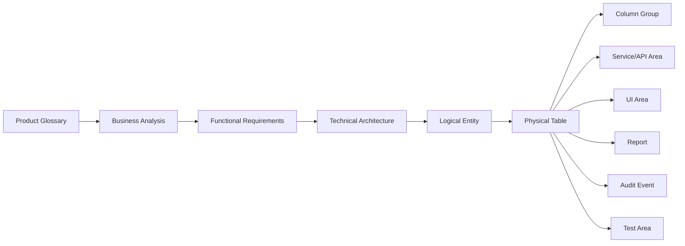
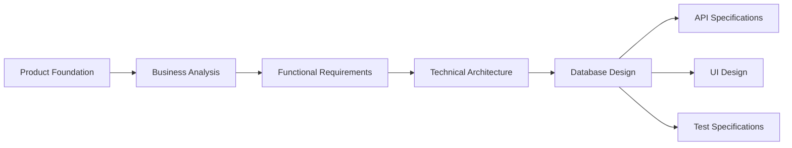

# DB-10 Database Traceability & Data Dictionary

**Document ID:** DB-10  
**Document Name:** Database Traceability & Data Dictionary  
**Company:** OreeOn Technologies Pvt. Ltd.  
**Product:** Digitize  
**Document Type:** Database Design  
**Version:** 0.1  
**Status:** Design Draft  
**Business Owner:** Product Architecture  
**Technical Owner:** Data Architecture  
**Prepared By:** Data Architecture Team  
**Reviewed By:** Data Architecture Review Board  
**Approved By:** Product Architecture / Solution Architecture  
**Classification:** Internal  
**Confidentiality:** Confidential  
**Document State:** Design Draft  
**Release:** Foundation Documentation  
**Dependencies:** DB-00 to DB-09, PF-01, PF-02, BA-03, BA-04, BA-08, FR-02 to FR-21, TA-03, TA-04, TA-05, TA-08, TA-10  
**Supersedes:** Not Applicable  
**Superseded By:** Not Applicable  
**Last Updated:** July 2026  
**Database Review:** Ready for Review

---

# Revision History

| Version | Date | Author | Description |
|---|---|---|---|
| 0.1 | July 2026 | Data Architecture Team | Initial database traceability and data dictionary draft |
| 0.2 | 2026-07-26 | Data Architecture Team | Freeze preparation edits: populated core domain traceability entries; standardized review status |

---

# 1. Introduction

## 1.1 Purpose

This document provides the consolidated Database Traceability Matrix and enterprise Data Dictionary for Digitize.

It bridges Product Glossary terms, business capabilities, business rules, business processes, functional requirements, architecture domains, logical entities, physical tables, key column groups, service/API areas, events, UI areas, reports, audit events, and test areas.

## 1.2 Objectives

- Consolidate traceability across Product Foundation, BA, FR, TA, API, UI, reporting, audit, and testing artifacts.
- Provide a data dictionary baseline for approved database tables and common column groups.
- Identify authoritative source, classification, tenant scope, sensitivity, retention class, related APIs, related UI areas, related reports, related events, and related audit events.
- Avoid introducing entities or columns not defined in DB-01 through DB-09.
- Support developers, QA engineers, implementation teams, support teams, security reviewers, and auditors.

## 1.3 Scope

This document covers database traceability and dictionary entries for DB-01 through DB-09.

## 1.4 Out of Scope

- New entity creation.
- New column creation outside approved DB documents.
- SQL scripts.
- Vendor-specific data types.
- API payload implementation.
- UI wireframes.
- Test case step implementation.

## 1.5 Intended Audience

Product Managers, Business Analysts, Data Architects, Database Designers, Backend Developers, API Designers, UI / UX Designers, QA Engineers, DevOps Engineers, Security Engineers, Implementation Teams, Support Teams, and Audit / Compliance Stakeholders.

## 1.6 Related Documents

| Document Type | Document Reference | Relationship |
|---|---|---|
| Product Foundation | PF-01, PF-02 | Source terminology and domain model |
| Business Analysis | BA-03, BA-04, BA-08 | Source process and requirement traceability |
| Functional Requirements | FR-02 to FR-21 | Source functional requirements and entity usage |
| Technical Architecture | TA-03, TA-04, TA-05, TA-08, TA-10 | Source architecture domain and ADR alignment |
| Database Design | DB-00 to DB-09 | Source database model and table definitions |

---

# 2. Data Design Context

## 2.1 Business Context

Traceability is required so Digitize can be implemented, tested, audited, maintained, and extended without losing the relationship between business intent and database structures.

## 2.2 Functional Context

Each functional module must map to database structures that support its records, validations, lifecycle states, audit events, reports, APIs, UI screens, and test coverage.

## 2.3 Technical Architecture Context

TA-03 requires source-of-truth clarity, reporting separation, tenant-aware ownership, auditability, and retention. DB-10 provides the reference matrix used by database implementation, API design, QA coverage, and release validation.

## 2.4 Data Ownership Context

Data ownership follows the Business Owner and Technical Owner model established in DB-00 and applied across DB-01 through DB-09.

---

# 3. Data Scope Model

## 3.1 In-Scope Data Domains

| Data Domain ID | Data Domain | Dictionary Coverage |
|---|---|---|
| DB-DOM-001 | Platform | Covered |
| DB-DOM-002 | Identity | Covered |
| DB-DOM-003 | Organization | Covered |
| DB-DOM-004 | Customer | Covered |
| DB-DOM-005 | Membership | Covered |
| DB-DOM-006 | Attendance | Covered |
| DB-DOM-007 | Commercial | Covered |
| DB-DOM-008 | Trainer | Covered |
| DB-DOM-009 | Reporting | Covered |
| DB-DOM-010 | Communication | Covered |
| DB-DOM-011 | Audit | Covered |
| DB-DOM-012 | Security | Covered |
| DB-DOM-013 | Support | Covered |

## 3.2 Out-of-Scope Data Domains

| Data Domain | Reason |
|---|---|
| Payroll | Not defined in DB-01 through DB-09 |
| Procurement | Not defined in DB-01 through DB-09 |
| Inventory | Not defined in DB-01 through DB-09 |
| Full Accounting Ledger | Not defined in DB-01 through DB-09 |

## 3.3 Data Domain Diagram

---

# 4. Data Domains

| Data Domain | Purpose | Typical Ownership |
|---|---|---|
| Platform | Platform settings, reference data, feature flags, maintenance, release records | Platform Administration |
| Identity | Users, roles, permissions, access scopes, sessions | User and Role Management |
| Organization | Organization, Facility, Site, settings, policies, documents | Organization / Facility / Site Management |
| Customer | Customer profile, contact, consent, documents, history | Customer Management |
| Membership | Membership plans, customer memberships, lifecycle history | Membership Management |
| Attendance | Attendance, eligibility, entry/exit, walk-in | Operations |
| Commercial | Pricing, invoices, payments, refunds, subscriptions, licenses, entitlements | Finance / Commercial Management |
| Trainer | Trainer, activity, batch, class, personal training | Training Operations |
| Communication | Campaigns, notification templates, delivery, preferences, consent | Communication Management |
| Reporting | Reports, dashboards, KPIs, exports, projections | Reporting and Analytics |
| Support | Tickets, assignments, comments, escalations, SLA | Support Management |
| Audit | Audit events, compliance records, exports, investigations, administrative access | Audit and Compliance |
| Security | Security policies, authentication events, security events | Security Governance |

---

# 5. Data Classification

| Data Group | Data Domain | Classification | Sensitivity | Business Owner | Technical Owner | Notes |
|---|---|---|---|---|---|---|
| Platform Reference | Platform | Public Reference / Internal Platform | Low to Medium | Platform Administration | Data Architecture | Shared |
| Tenant Master | Organization | Tenant Master | Medium | Organization Management | Data Architecture | Tenant hierarchy |
| Identity Access | Identity | Authentication / Authorization | High | User and Role Management | Security Architecture | RBAC |
| Sensitive Personal | Customer / Trainer / Support | Sensitive Personal | High | Domain Owners | Data Architecture | Mask/export controls |
| Tenant Operational | Membership / Attendance / Trainer | Tenant Operational | Medium | Operations | Data Architecture | Daily business |
| Financial | Commercial | Financial | High | Finance / Commercial Management | Data Architecture | Strict retention |
| Payment Reference | Commercial | Payment Reference | High | Finance / Commercial Management | Integration Architecture | Provider reference only |
| Communication | Communication | Communication | Medium | Communication Management | Integration Architecture | Consent-aware |
| Derived Analytical | Reporting | Derived Analytical | Medium | Reporting and Analytics | Data Engineering | Not source of truth |
| Audit Compliance | Audit | Audit / Compliance | High | Audit and Compliance | Security Architecture | Protected |
| Security | Security | Security | High | Security Governance | Security Architecture | Restricted |

---

# 6. Entity / Table Design

| Entity / Table | Purpose | Data Domain | Business Owner | Technical Owner | Classification | Notes |
|---|---|---|---|---|---|---|
| DB-05 Core Platform Tables | Platform, tenant hierarchy, identity, RBAC, security baseline | Platform / Identity / Organization / Security | Platform and Organization Management | Data / Security Architecture | Mixed | Full detail in DB-05 |
| DB-06 Operational Tables | Customer, membership, attendance, trainer, activity, batch, personal training | Customer / Membership / Attendance / Trainer | Domain Owners | Data Architecture | Mixed | Full detail in DB-06 |
| DB-07 Commercial Tables | Pricing, billing, invoice, payment, refund, subscription, license, entitlement | Commercial | Finance / Commercial Management | Data Architecture | Financial | Full detail in DB-07 |
| DB-08 Communication Tables | Campaign, notification, consent, delivery tracking | Communication | Communication Management | Integration Architecture | Communication | Full detail in DB-08 |
| DB-08 Reporting Tables | Report, dashboard, KPI, projection, export | Reporting | Reporting and Analytics | Data Engineering | Derived Analytical | Full detail in DB-08 |
| DB-08 Support Tables | Tickets, comments, assignments, SLA | Support | Support Management | Support Architecture | Sensitive Personal | Full detail in DB-08 |
| DB-08 Audit Tables | Audit, compliance, export, investigation, administrative access | Audit | Audit and Compliance | Security Architecture | Audit / Compliance | Full detail in DB-08 |
| DB-08 Security Governance Tables | Security investigation references | Security | Security Governance | Security Architecture | Security | Full detail in DB-08 |

---

# 7. Attribute / Column Design

## 7.1 Enterprise Data Dictionary Column Groups

| Attribute / Column | Description | Data Type / Logical Type | Mandatory | Source | Validation / Constraint | Notes |
|---|---|---|---|---|---|---|
| record_id | Primary identifier | Identifier | Yes | System | Unique | Standard persistent identifier |
| organization_id | Tenant root reference | Identifier Reference | Conditional | Tenant Context | Required for tenant-owned records | Organization is tenant root |
| facility_id | Facility reference | Identifier Reference | Conditional | User/System | Must belong to Organization | Facility-scoped records |
| site_id | Site reference | Identifier Reference | Conditional | User/System | Must belong to Facility | Site-scoped records |
| customer_id | Customer reference | Identifier Reference | Conditional | User/System | Must belong to Organization | Customer-related records |
| status | Lifecycle status | Status | Conditional | User/System | Approved lifecycle values | Entity lifecycle |
| type | Classification type | Type | Conditional | User/System | Approved reference value | Entity category |
| code | Business code | Code | Conditional | User/System | Unique by approved scope | Human-readable reference |
| name | Display name | Text | Conditional | User | Required for named master records | UI/search |
| description | Description | Text | Optional | User | Content rules | Business context |
| amount | Monetary amount | Money | Conditional | System/User | Commercial rules | Financial |
| currency_code | Currency code | Code | Conditional | System/User | Approved currency | Financial |
| effective_at | Effective timestamp | DateTime | Conditional | User/System | Temporal validation | Time-bound records |
| expires_at | Expiry timestamp | DateTime | Conditional | User/System | Must not precede effective_at | Time-bound records |
| source_entity_type | Source entity type | Type | Conditional | System | Required for audit/reporting references | Traceability |
| source_entity_id | Source entity identifier | Identifier Reference | Conditional | System | Required for source-specific references | Traceability |
| provider_reference | External provider reference | External Reference | Conditional | Provider/System | No secrets | Integration |
| idempotency_key | Retry-safe key | External Reference | Conditional | API/Integration | Unique by operation scope | Payment/refund/notification |
| correlation_id | Cross-domain correlation | External Reference | Conditional | System | Required for critical workflows | Observability/audit |
| created_at | Creation timestamp | DateTime | Yes | System | Immutable | Audit |
| created_by | Creator reference | Identifier Reference | Conditional | System | Actor where available | Audit |
| updated_at | Update timestamp | DateTime | Conditional | System | Mutable records only | Audit |
| updated_by | Updater reference | Identifier Reference | Conditional | System | Actor where available | Audit |
| version_number | Version number | Number | Conditional | System | Increment on update | Concurrency |
| deleted_at | Soft-delete timestamp | DateTime | Conditional | System | Only where allowed | Not for immutable evidence |
| deleted_by | Soft-delete actor | Identifier Reference | Conditional | System | Required when deleted_at populated | Not for immutable evidence |

## 7.2 Data Dictionary Matrix

| Document ID | Domain | Logical Entity | Physical Table | Column | Business Meaning | Data Type Category | Mandatory or Optional | Primary Key | Foreign Key | Unique | Classification | Sensitive | Encrypted | Masked | Tenant Scope | Authoritative Source | Related API | Related UI | Related Event | Related Report | Related Audit Event | Retention Class | Example Value | Notes |
|---|---|---|---|---|---|---|---|---|---|---|---|---|---|---|---|---|---|---|---|---|---|---|---|---|
| DB-05 | Organization | Organization | tenant.organization | record_id | Organization record identifier | Identifier | Mandatory | Yes | No | Yes | Tenant Master | No | Security Architecture Review | No | Platform | Organization Management (FR-03) | Organization Management APIs (FR-03) | Organization Profile | OrganizationCreated | Organization Dashboard | Organization Created | Lifecycle plus history | ORG-001 | Tenant root |
| DB-05 | Organization | Organization | tenant.organization | organization_id | Tenant root self-reference / tenant context | Identifier Reference | Mandatory | No | Conditional | Yes | Tenant Master | No | Security Architecture Review | No | Organization | Organization Management (FR-03) | Organization Management APIs (FR-03) | Organization Profile | OrganizationUpdated | Organization Report | Organization Updated | Lifecycle plus history | ORG-001 | Physical strategy may use record_id as tenant root |
| DB-05 | Organization | Facility | tenant.facility | facility_id | Facility commercial and operational unit reference | Identifier Reference | Mandatory | No | Yes | Tenant-scoped | Tenant Master | No | Security Architecture Review | No | Facility | Facility Management (FR-04) | Facility Management APIs (FR-04) | Facility Profile | FacilityCreated | Facility Dashboard | Facility Changed | Lifecycle plus history | FAC-001 | Primary commercial unit |
| DB-05 | Organization | Site | tenant.site | site_id | Physical operating location reference | Identifier Reference | Mandatory | No | Yes | Facility-scoped | Tenant Master | No | Security Architecture Review | No | Site | Site Management (FR-05) | Site Management APIs (FR-05) | Site Profile | SiteCreated | Site Dashboard | Site Changed | Lifecycle plus history | SIT-001 | Site execution |
| DB-05 | Identity | User Account | identity.user_account | login_identifier | Login identity | Text | Mandatory | No | No | Yes | Authentication | Yes | Security Architecture Review | Yes | Platform / Organization | User and Role Management (FR-06) | User and Role Management APIs (FR-06) | Staff Account | UserCreated | User Activity Report | Login / User Updated | Security retention | user@example.com | Sensitive |
| DB-05 | Identity | Role Assignment | identity.role_assignment | access_scope_id | Authorized scope reference | Identifier Reference | Mandatory | No | Yes | No | Authorization | No | Security Architecture Review | No | Organization / Facility / Site | User and Role Management (FR-06) | Role APIs (FR-06) | Role Assignment | RoleAssigned | Staff Access Report | Role Assignment Changed | Security retention | SCOPE-001 | RBAC scope |
| DB-06 | Customer | Customer | customer.customer | customer_id | Customer reference | Identifier Reference | Mandatory | No | Conditional | Tenant-scoped | Sensitive Personal | Yes | Security Architecture Review | Yes | Organization | Customer Management (FR-07) | Customer Management APIs (FR-07) | Customer Profile | CustomerRegistered | Customer Report | Customer Changed | Customer retention | CUS-001 | Customer master |
| DB-06 | Membership | Customer Membership | membership.customer_membership | membership_id | Membership reference | Identifier Reference | Mandatory | No | Conditional | Tenant-scoped | Tenant Operational | No | Security Architecture Review | No | Organization / Facility | Membership Management (FR-08) | Membership Management APIs (FR-08) | Membership Details | MembershipActivated | Membership Report | Membership Changed | Membership retention | MEM-001 | Lifecycle |
| DB-06 | Attendance | Attendance | operations.attendance | attendance_id | Attendance event reference | Identifier Reference | Mandatory | No | Conditional | Site-scoped | Tenant Operational | No | Security Architecture Review | No | Site | Attendance Management (FR-09) | Attendance Management APIs (FR-09) | Attendance Screen | AttendanceRecorded | Attendance Report | Attendance Recorded | Operational retention | ATT-001 | High-volume |
| DB-06 | Trainer | Personal Training Session | training.personal_training_session | trainer_id | Trainer conducting session | Identifier Reference | Mandatory | No | Yes | No | Tenant Operational | No | Security Architecture Review | No | Facility / Site | Personal Training (FR-12) | Training APIs (FR-12) | Training Session | TrainingSessionBooked | Trainer Report | Training Session Changed | Operational retention | TRN-001 | Schedule-sensitive |
| DB-07 | Commercial | Invoice | commercial.invoice | invoice_id | Invoice reference | Identifier Reference | Mandatory | No | Conditional | Tenant-scoped | Financial | No | Security Architecture Review | No | Organization | Billing & Invoicing (FR-14) | Invoice APIs (FR-14) | Invoice Details | InvoiceGenerated | Revenue Report | Invoice Generated | Financial retention | INV-001 | Historical |
| DB-07 | Commercial | Payment | commercial.payment | payment_id | Payment reference | Identifier Reference | Mandatory | No | Conditional | Tenant/provider-scoped | Financial / Payment Reference | Yes | Security Architecture Review | Yes | Organization | Billing & Invoicing (FR-14) | Payment APIs (FR-14) | Payment Screen | PaymentCompleted | Payment Report | Payment Completed | Financial retention | PAY-001 | Provider reference |
| DB-07 | Commercial | Refund | commercial.refund | refund_id | Refund reference | Identifier Reference | Mandatory | No | Conditional | Tenant/provider-scoped | Financial | No | Security Architecture Review | No | Organization | Billing & Invoicing (FR-14) | Refund APIs (FR-14) | Refund Screen | RefundProcessed | Refund Report | Refund Processed | Financial retention | REF-001 | Payment-linked |
| DB-07 | Commercial | Subscription | commercial.subscription | subscription_id | Facility subscription reference | Identifier Reference | Mandatory | No | Conditional | Facility-scoped | Commercial Control | No | Security Architecture Review | No | Facility | Subscription Management (FR-15) | Subscription APIs (FR-15) | Subscription Details | SubscriptionActivated | Subscription Report | Subscription Changed | Commercial retention | SUB-001 | Facility unit |
| DB-07 | Commercial | License | commercial.license | license_id | License reference | Identifier Reference | Mandatory | No | Conditional | Facility-scoped | Commercial Control | No | Security Architecture Review | No | Facility | License Management (FR-16) | License APIs (FR-16) | License Details | LicenseActivated | License Report | License Changed | Commercial retention | LIC-001 | Capability |
| DB-08 | Communication | Notification | communication.notification | notification_id | Notification reference | Identifier Reference | Mandatory | No | Conditional | Tenant-aware | Communication | No | Security Architecture Review | No | Organization | Notification Management | Notification APIs | Notification History | NotificationGenerated | Notification Report | Notification Event | Communication retention | NOT-001 | Delivery |
| DB-08 | Reporting | Report Execution | reporting.report_execution | report_execution_id | Report run reference | Identifier Reference | Mandatory | No | Conditional | Tenant-aware | Derived Analytical | No | Security Architecture Review | No | Organization / Facility / Site | Reporting and Analytics | Report APIs | Report Viewer | ReportExecuted | Report Execution Report | Report Executed | Reporting retention | RPT-EXEC-001 | Derived |
| DB-08 | Support | Support Ticket | support.support_ticket | ticket_id | Support ticket reference | Identifier Reference | Mandatory | No | Conditional | Tenant-scoped | Sensitive Personal | Yes | Security Architecture Review | Yes | Organization | Support Ticket Management | Support APIs | Support Ticket | TicketCreated | Support Report | Ticket Changed | Support retention | TKT-001 | May contain sensitive context |
| DB-08 | Audit | Audit Event | audit.audit_event | audit_event_id | Audit event reference | Identifier Reference | Mandatory | No | Conditional | Tenant-aware / Platform | Audit / Compliance | High | Security Architecture Review | No | Platform / Organization | Audit and Compliance | Audit APIs | Audit Viewer | AuditEventCaptured | Audit Report | Audit Event Captured | Compliance retention | AUD-001 | Append-only |
| DB-08 | Security | Security Event | security.security_event | security_event_id | Security event reference | Identifier Reference | Mandatory | No | Conditional | Tenant-aware / Platform | Security | High | Security Architecture Review | Yes | Platform / Organization | Security Governance | Security APIs | Security Monitor | SecurityEventCaptured | Security Report | Security Event Captured | Security retention | SEC-001 | Restricted |

---

# 8. Relationships

| Relationship | Parent | Child | Cardinality | Optionality | Tenant Scope | Notes |
|---|---|---|---|---|---|---|
| DB-10-REL-001 | Product Glossary | Logical Entity | One-to-Many | Mandatory for approved terms | Documentation | Terminology trace |
| DB-10-REL-002 | Business Process | Functional Requirement | One-to-Many | Mandatory | Documentation | BA to FR |
| DB-10-REL-003 | Functional Requirement | Logical Entity | One-to-Many | Mandatory where data is used | Documentation | FR to DB |
| DB-10-REL-004 | Logical Entity | Physical Table | One-to-One-or-Many | Mandatory | Database | DB-02 to DB-03 |
| DB-10-REL-005 | Physical Table | Column Group | One-to-Many | Mandatory | Database | Data dictionary |
| DB-10-REL-006 | Physical Table | API Area | One-to-Many | Conditional | Service | API mapping |
| DB-10-REL-007 | Physical Table | UI Area | One-to-Many | Conditional | UI | Screen mapping |
| DB-10-REL-008 | Physical Table | Report | One-to-Many | Conditional | Reporting | Report mapping |
| DB-10-REL-009 | Physical Table | Audit Event | One-to-Many | Conditional | Audit | Audit mapping |
| DB-10-REL-010 | Physical Table | Test Area | One-to-Many | Mandatory for implemented modules | QA | Test coverage |

---

# 9. Keys and Identifiers

| Key / Identifier | Entity / Table | Purpose | Scope | Notes |
|---|---|---|---|---|
| DB-10-ID-001 | Traceability Matrix Row | Stable trace entry | Document scope | Assigned during final traceability freeze |
| DB-10-ID-002 | Data Dictionary Entry | Stable dictionary entry | Table/column scope | Assigned during DB-10 freeze |
| DB-10-ID-003 | Source Document Reference | Source artifact mapping | Project scope | PF, BA, FR, TA, DB |
| DB-10-ID-004 | Requirement Reference | Functional/business mapping | Requirement scope | FR and BA references |
| DB-10-ID-005 | Table Reference | Physical table mapping | Database scope | From DB-03 to DB-08 |
| DB-10-ID-006 | Column Reference | Column group or column mapping | Table scope | Expanded during implementation |

---

# 10. Constraints and Validation

| Constraint | Entity / Table | Rule | Scope | Notes |
|---|---|---|---|---|
| DB-10-CK-001 | Traceability Matrix | Every implemented table must trace to logical entity and source requirement | Database documentation | Completeness |
| DB-10-CK-002 | Data Dictionary | DB-10 must not introduce new tables absent from DB-03 to DB-08 | Database documentation | Governance |
| DB-10-CK-003 | Data Dictionary | Sensitive columns must identify classification and masking/encryption decision status | Security | Security review |
| DB-10-CK-004 | Reporting Mapping | Derived reporting data must identify authoritative source | Reporting | Source clarity |
| DB-10-CK-005 | Audit Mapping | Critical entities must identify audit events | Audit | Compliance |
| DB-10-CK-006 | Tenant Scope | Tenant-owned tables must identify tenant scope | Multi-tenancy | Isolation |
| DB-10-CK-007 | Test Mapping | Implemented database structures must map to test areas | QA | Coverage |

---

# 11. Index and Access Patterns

| Access Pattern | Entity / Table | Index Need | Query Scope | Notes |
|---|---|---|---|---|
| Traceability lookup | Traceability matrix | Source document, requirement, table | Documentation | Impact analysis |
| Data dictionary lookup | Data dictionary | Domain, table, column | Documentation | Developer/QA |
| Sensitive data review | Data dictionary | Classification, sensitive, masked, encrypted | Security | Privacy review |
| Tenant scope review | Data dictionary | Tenant scope, table | Multi-tenancy | Isolation review |
| API impact review | Traceability matrix | API area, table | Integration | Change impact |
| Test coverage review | Traceability matrix | Test area, requirement, table | QA | Coverage |

---

# 12. Multi-Tenancy Design

| Tenant Concern | Design Approach | Applies To | Notes |
|---|---|---|---|
| Tenant Scope Documentation | Every tenant-owned dictionary entry identifies tenant scope | Data dictionary | Required |
| Organization Root | Organization is the tenant root | Tenant-owned tables | DB-04 |
| Facility Scope | Facility-scoped records identify Facility scope | Commercial and operations | Facility unit |
| Site Scope | Site-scoped records identify Site scope | Attendance and operations | Site execution |
| Reporting Scope | Derived reporting entries identify source tenant scope | Reporting dictionary entries | Prevent leakage |
| Audit Scope | Audit dictionary entries identify platform or tenant scope | Audit dictionary entries | Compliance |

---

# 13. Audit and History Design

| Audit / History Area | Trigger | Data Captured | Retention | Notes |
|---|---|---|---|---|
| Dictionary Revision | Data dictionary updated | Version, author, affected domains, reason | Documentation retention | Controlled |
| Traceability Revision | Trace matrix updated | Source, target, change summary | Documentation retention | Impact analysis |
| Sensitive Classification Change | Classification/masking/encryption changed | Old/new classification, approver | Security retention | Security review |
| Tenant Scope Change | Tenant scope mapping changed | Old/new scope, reason | Architecture retention | Tenancy review |
| Deprecated Table Mapping | Table deprecated or superseded | Table, replacement, reason | Documentation retention | Maintainability |

---

# 14. Data Lifecycle State Model

| Lifecycle State | Meaning | Allowed Usage |
|---|---|---|
| Transient | Draft mapping before review | Initial trace entries |
| Active | Current approved dictionary or trace mapping | Current documentation |
| Historical | Previous version retained for traceability | Old mappings |
| Archived | Superseded documentation retained | Old releases |
| Purged | Removed only if invalid and not part of approved history | Erroneous draft records |

---

# 15. Retention, Archival, and Purging

| Data Group | Lifecycle State | Retention Rule | Archival Approach | Purging Rule | Notes |
|---|---|---|---|---|---|
| Traceability Matrix | Active / Historical / Archived | Retain across releases | Archive prior versions | Purge only erroneous drafts | Implementation trace |
| Data Dictionary | Active / Historical / Archived | Retain across releases | Archive prior versions | Purge only erroneous drafts | Developer/QA |
| Sensitive Classification | Active / Historical | Retain changes for security review | Archive old classifications | Do not purge approved history | Security |
| Test Mapping | Active / Historical | Retain release coverage evidence | Archive release-specific mapping | Purge draft errors only | QA |

---

# 16. Migration and Versioning

| Migration Area | Migration Type | Validation | Rollback Consideration | Notes |
|---|---|---|---|---|
| Dictionary Version | Documentation versioning | Validate against DB-03 to DB-08 | Restore previous document version | Controlled |
| Traceability Update | Mapping versioning | Validate source and target references | Revert incorrect mapping | Impact analysis |
| Column Expansion | Dictionary detail expansion | Validate physical design approval | Revert before freeze if unapproved | Implementation |
| Classification Update | Security metadata update | Validate security approval | Restore previous classification | Security |
| Release Baseline | Release traceability freeze | Validate completeness | Supersede in next version | Release governance |

---

# 17. Backup and Recovery

| Data Group | Backup Need | Recovery Requirement | Notes |
|---|---|---|---|
| Traceability Matrix | High | Recover latest and prior baselines | Project governance |
| Data Dictionary | High | Recover approved dictionary | Developer/QA dependency |
| Classification Metadata | High | Recover security decisions | Security review |
| Release Baselines | High | Recover frozen mappings | Audit and release |

---

# 18. Critical Table Column-Level Traceability (starter set)

The following rows provide column-level traceability for the highest-priority tables required for initial implementation and verification. This is a starter set for review — additional columns and domains will be added until DB-10 is complete.

| Document ID | Domain | Logical Entity | Physical Table | Column | Business Meaning | Data Type Category | Mandatory or Optional | Primary Key | Foreign Key | Unique | Classification | Sensitive | Encrypted | Masked | Tenant Scope | Authoritative Source | Related API | Notes |
|---|---|---|---|---|---|---|---|---|---|---|---|---|---|---|---|---|---|---|
| DB-05-COL-001 | Organization | Organization | tenant.organization | record_id | Natural PK (system UUID) | UUID | Mandatory | Yes | No | Yes | Tenant Master | No | No | No | Platform | DB-05 / DB-11 | Organization APIs | System-generated UUID primary key |
| DB-05-COL-002 | Organization | Organization | tenant.organization | organization_code | Business tenant code | VARCHAR | Mandatory | No | No | Yes | Tenant Master | No | No | No | Platform | BA-01 / FR-03 | Organization APIs | Natural tenant identifier (unique) |
| DB-05-COL-003 | Organization | Organization | tenant.organization | primary_email | Primary contact email (tenant) | CITEXT | Optional | No | No | No | Tenant Master | Yes | No | Yes (UI) | Platform | BA-01 | Organization APIs | Personal data: treat as sensitive for masking in exports |

| DB-05-COL-010 | Identity | User Account | identity.user_account | record_id | System user id | UUID | Mandatory | Yes | No | Yes | Authentication | No | No | No | Organization | DB-05 / DB-11 | Auth APIs | PK used by FKs across domain |
| DB-05-COL-011 | Identity | User Account | identity.user_account | login_identifier | Login identifier (email/username) | CITEXT | Mandatory | No | No | Yes | Authentication | Yes | No | Yes | Organization | FR-06 | Auth APIs | Sensitive: apply masking in logs and exports |
| DB-05-COL-012 | Identity | User Account | identity.user_account | password_hash | Password hash (bcrypt/argon2) | TEXT | Optional | No | No | No | Authentication | High | Yes | Yes | Organization | Security Policy | Auth APIs | Must be stored hashed; encryption not required if hashed correctly |

| DB-06-COL-001 | Customer | Customer | customer.customer | record_id | Customer PK | UUID | Mandatory | Yes | No | Yes | Sensitive Personal | Yes | No | Yes | Organization | DB-06 / DB-11 | Customer APIs | PII: apply masking and access controls |
| DB-06-COL-002 | Customer | Customer | customer.customer | primary_email | Customer primary email | CITEXT | Optional | No | No | No | Sensitive Personal | Yes | No | Yes | Organization | FR-07 | Customer APIs | Consent required for marketing usage |
| DB-06-COL-003 | Customer | Customer | customer.customer | primary_phone | Customer phone | VARCHAR | Optional | No | No | No | Sensitive Personal | Yes | No | Yes | Organization | FR-07 | Customer APIs | Phone number format rules apply |

| DB-06-COL-020 | Attendance | Attendance | operations.attendance | record_id | Attendance event PK | UUID | Mandatory | Yes | No | Yes | Tenant Operational | No | No | No | Site | DB-06 / FR-09 | Attendance APIs | High volume event records |
| DB-06-COL-021 | Attendance | Attendance | operations.attendance | customer_id | Customer who attended | UUID | Optional | No | Yes | No | Tenant Operational | Yes | No | Yes | Site | FR-09 | Attendance APIs | FK -> customer.customer(record_id)
| DB-06-COL-022 | Attendance | Attendance | operations.attendance | check_in_at | Check-in timestamp | TIMESTAMPTZ | Mandatory | No | No | No | Tenant Operational | No | No | No | Site | FR-09 | Attendance APIs | Critical for attendance reporting

| DB-07-COL-100 | Commercial | Invoice | commercial.invoice | record_id | Invoice PK | UUID | Mandatory | Yes | No | Yes | Financial | No | No | No | Organization | DB-07 / FR-14 | Billing APIs | Financial records: retention and immutability concerns
| DB-07-COL-101 | Commercial | Invoice | commercial.invoice | billing_account_id | Billing account FK | UUID | Mandatory | No | Yes | No | Financial | No | No | No | Organization | FR-14 | Billing APIs | FK -> commercial.billing_account(record_id)
| DB-07-COL-102 | Commercial | Invoice | commercial.invoice | total_amount | Invoice total | NUMERIC(14,2) | Mandatory | No | No | No | Financial | No | No | No | Organization | FR-14 | Billing APIs | Currency-aware financial numeric

| DB-07-COL-200 | Commercial | Payment | commercial.payment | record_id | Payment PK | UUID | Mandatory | Yes | No | Yes | Financial | No | No | No | Organization | DB-07 / FR-14 | Payment APIs | Payment lifecycle tracked here
| DB-07-COL-201 | Commercial | Payment | commercial.payment | invoice_id | Linked invoice | UUID | Optional | No | Yes | No | Financial | No | No | No | Organization | FR-14 | Payment APIs | FK -> commercial.invoice(record_id)
| DB-07-COL-202 | Commercial | Payment | commercial.payment | amount | Paid amount | NUMERIC(14,2) | Mandatory | No | No | No | Financial | No | No | No | Organization | FR-14 | Payment APIs | Reconciled against provider references

> Next steps: expand this matrix to cover all columns for each table in DB-11, annotate sensitivity/classification for each column, and produce a CSV export for reviewers and security team.

# 18. Security and Privacy

| Security Area | Design Approach | Applies To | Notes |
|---|---|---|---|
| Sensitive Data Identification | Sensitive dictionary entries marked | Data dictionary | Required |
| Masking Decision | Masked field status captured | Sensitive fields | Final values need security review |
| Encryption Decision | Encryption status captured | Sensitive/financial/security fields | Final values need security review |
| Export Risk | Exportable data identified through traceability | Reports and exports | Compliance |
| Access Control | Dictionary itself is internal confidential documentation | DB-10 | Controlled distribution |

---

# 19. Reporting and Analytics Considerations

| Reporting Area | Source Data | Derived Data | Refresh / Access Pattern | Notes |
|---|---|---|---|---|
| Requirement Coverage Report | Traceability matrix | Coverage summary | Per release | QA/Product |
| Data Classification Report | Data dictionary | Sensitive data inventory | Per security review | Security |
| API Impact Report | Traceability matrix | API/table impact summary | Change request | Architects |
| Test Coverage Report | Traceability matrix | Test mapping coverage | Test planning | QA |
| Audit Coverage Report | Traceability matrix | Audit event coverage | Compliance review | Audit |

---

# 20. Traceability

## 20.1 Master Traceability Matrix

| Product Glossary | Business Capability | Business Rule | Business Process | Functional Requirement | Architecture Domain | Logical Entity | Physical Table | Column | Service Interface or API | Event | UI Area | Report | Audit Event | Test Area |
|---|---|---|---|---|---|---|---|---|---|---|---|---|---|---|
| Organization | Organization Management | BA-02 BR-ORG | BA-03 Organization Processes | FR-03 | Tenant Data Domain | Organization | tenant.organization | id, organization_id, status | Organization APIs | OrganizationCreated | Organization Profile | Organization Dashboard | Organization Created | Organization tests |
| Facility | Facility Management | BA-02 BR-FAC | BA-03 Facility Processes | FR-04 | Tenant Data Domain | Facility | tenant.facility | facility_id, organization_id, facility_type_id, status | Facility APIs | FacilityCreated | Facility Profile | Facility Dashboard | Facility Changed | Facility tests |
| Site | Site Management | BA-02 BR-SIT | BA-03 Site Processes | FR-05 | Tenant Data Domain | Site | tenant.site | site_id, facility_id, organization_id, status | Site APIs | SiteCreated | Site Profile | Site Dashboard | Site Changed | Site tests |
| User | User and Role Management | BA-02 BR-USR | BA-03 Staff Identity Processes | FR-06 | Identity Domain | User Account | identity.user_account | id, login_identifier, account_status | User APIs | UserCreated | Staff Account | Staff Activity Report | User Updated | Identity tests |
| Role | User and Role Management | BA-02 BR-USR | BA-03 Staff Identity Processes | FR-06 | Identity Domain | Role Assignment | identity.role_assignment | user_account_id, role_id, access_scope_id | Role APIs | RoleAssigned | Role Assignment | Staff Access Report | Role Changed | RBAC tests |
| Customer | Customer Management | BA-02 BR-CUS | BA-03 Customer Processes | FR-07 | Operational Data Domain | Customer | customer.customer | customer_id, organization_id, status | Customer APIs | CustomerRegistered | Customer Profile | Customer Report | Customer Changed | Customer tests |
| Membership | Membership Management | BA-02 BR-MEM | BA-03 Membership Processes | FR-08 | Operational Data Domain | Customer Membership | membership.customer_membership | membership_id, customer_id, status | Membership APIs | MembershipActivated | Membership Details | Membership Report | Membership Changed | Membership tests |
| Attendance | Attendance Management | BA-02 BR-ATT | BA-03 Attendance Processes | FR-09 | Operational Data Domain | Attendance | operations.attendance | attendance_id, site_id, customer_id, status | Attendance APIs | AttendanceRecorded | Attendance Screen | Attendance Report | Attendance Recorded | Attendance tests |
| Walk-in | Walk-in Management | BA-02 BR-WLK | BA-03 Attendance / Walk-in Processes | FR-10 | Operational Data Domain | Walk-in Visit | operations.walkin_visit | walkin_visit_id, site_id, customer_id, status | Walk-in APIs | WalkInVisitCreated | Walk-in Screen | Walk-in Report | Walk-in Recorded | Walk-in tests |
| Trainer | Trainer Management | BA-02 BR-TRN | BA-03 Personal Training Processes | FR-11 | Training Domain | Trainer | training.trainer | trainer_id, organization_id, status | Trainer APIs | TrainerRegistered | Trainer Profile | Trainer Report | Trainer Changed | Trainer tests |
| Personal Training | Personal Training | BA-02 BR-PTR | BA-03 Personal Training Processes | FR-12 | Training Domain | Personal Training Session | training.personal_training_session | session_id, trainer_id, customer_id, status | Personal Training APIs | TrainingSessionBooked | Training Session | Training Report | Training Changed | Personal training tests |
| Batch | Batch and Class Management | BA-02 BR-BAT | BA-03 Activity and Batch Processes | FR-13 | Training Domain | Batch / Class Session | training.batch, training.class_session | batch_id, class_session_id, status | Batch APIs | ClassSessionStarted | Batch Schedule | Activity Report | Batch Changed | Batch tests |
| Invoice | Billing Management | BA-02 BR-BIL | BA-03 Billing Processes | FR-14 | Commercial Domain | Invoice | commercial.invoice | invoice_id, amount, status | Invoice APIs | InvoiceGenerated | Invoice Details | Revenue Report | Invoice Generated | Billing tests |
| Payment | Payment Management | BA-02 BR-PAY | BA-03 Payment Processes | FR-14 | Commercial Domain | Payment | commercial.payment | payment_id, provider_reference, status | Payment APIs | PaymentCompleted | Payment Screen | Payment Report | Payment Completed | Payment tests |
| Refund | Refund Management | BA-02 BR-REF | BA-03 Payment Processes | FR-14 | Commercial Domain | Refund | commercial.refund | refund_id, payment_id, status | Refund APIs | RefundProcessed | Refund Screen | Refund Report | Refund Processed | Refund tests |
| Subscription | Subscription Management | BA-02 BR-SUB | BA-03 Subscription Processes | FR-15 | Commercial Domain | Subscription | commercial.subscription | subscription_id, facility_id, status | Subscription APIs | SubscriptionActivated | Subscription Details | Subscription Report | Subscription Changed | Subscription tests |
| License | License Management | BA-02 BR-LIC | BA-03 License Processes | FR-16 | Commercial Domain | License | commercial.license | license_id, status | License APIs | LicenseActivated | License Details | License Report | License Changed | License tests |
| Campaign | Advertisement Campaign | BA-02 BR-CMP | BA-03 Advertisement Campaign Processes | FR-17 | Communication Domain | Advertisement Campaign | communication.advertisement_campaign | campaign_id, status | Campaign APIs | CampaignLaunched | Campaign Manager | Campaign Report | Campaign Changed | Campaign tests |
| Notification | Notification Management | BA-02 BR-NOT | BA-03 Notification Processes | FR-18 | Communication Domain | Notification Delivery | communication.notification_delivery | notification_id, delivery_status | Notification APIs | NotificationDelivered | Notification History | Notification Report | Notification Delivered | Notification tests |
| Report | Reporting and Analytics | BA-02 BR-RPT | BA-03 Reporting Processes | FR-19 | Reporting Domain | Report Execution | reporting.report_execution | report_execution_id, status | Report APIs | ReportExecuted | Report Viewer | Report Execution Report | Report Exported | Reporting tests |
| Support Ticket | Support Ticket Management | BA-02 BR-TKT | BA-03 Support Ticket Processes | FR-20 | Support Domain | Support Ticket | support.support_ticket | ticket_id, ticket_status | Support APIs | TicketCreated | Support Ticket | Support Report | Ticket Changed | Support tests |
| Audit Event | Audit and Compliance | BA-02 BR-AUD | BA-03 Audit and Compliance Processes | FR-21 | Audit Domain | Audit Event | audit.audit_event | audit_event_id, action, actor_id | Audit APIs | AuditEventCaptured | Audit Viewer | Audit Report | Audit Event Captured | Audit tests |

---

# 21. Diagrams

| Diagram ID | Diagram Name | Diagram Type | Location |
|---|---|---|---|
| DB-10-DGM-001 | Traceability Chain Diagram | Traceability Diagram | Section 3.3 |
| DB-10-DGM-002 | Documentation Coverage Diagram | Traceability Diagram | Section 21.1 |

## 21.1 Documentation Coverage Diagram

---

# 22. Review Checklist

| Review Area | Status | Notes |
|---|---|---|
| Terminology consistency | Pending | Requires review against Product Glossary |
| Entity completeness | Pending | Consolidated from DB-03 to DB-08 |
| Relationship correctness | Pending | Trace relationships included |
| Tenant isolation | Pending | Tenant scope columns represented |
| Key and constraint completeness | Pending | Key and dictionary baseline included |
| Index and access pattern coverage | Pending | Traceability lookup patterns included |
| Data classification | Pending | Classification matrix included |
| Auditability | Pending | Audit mapping included |
| Retention and archival alignment | Pending | Retention class included |
| Migration readiness | Pending | Versioning rules included |
| Backup and recovery readiness | Pending | Documentation recovery included |
| Security and privacy readiness | Pending | Sensitive field review markers included |
| Traceability completeness | Pending | Requires final review after API/UI/test docs mature |

---

# 23. Open Questions

| Question ID | Question | Owner | Target Resolution | Status |
|---|---|---|---|---|
| DB-10-OQ-001 | Which final API specification document IDs should be used in the traceability matrix? | API Architecture | Before DB-10 freeze | Open |
| DB-10-OQ-002 | Which final UI screen IDs should be used in the traceability matrix? | UI / UX Team | Before DB-10 freeze | Open |
| DB-10-OQ-003 | Which final test case IDs should be mapped to each table and requirement? | QA Team | Before test documentation freeze | Open |
| DB-10-OQ-004 | Which fields require confirmed encryption versus masking only? | Security Architecture | Before implementation | Open |
| DB-10-OQ-005 | Which data retention classes map to exact retention periods? | Compliance / Product Architecture | Before DB-09 and DB-10 freeze | Open |

---

# 24. Summary

DB-10 provides the consolidated Database Traceability Matrix and Data Dictionary baseline for Digitize.

It maps approved source terminology, business processes, functional requirements, architecture domains, logical entities, physical tables, common column groups, service/API areas, events, UI areas, reports, audit events, and test areas.

DB-10 does not introduce new business entities or physical tables. It consolidates the database documentation set and provides the bridge required for implementation, QA coverage, API alignment, UI alignment, security review, reporting validation, support readiness, and auditability.
