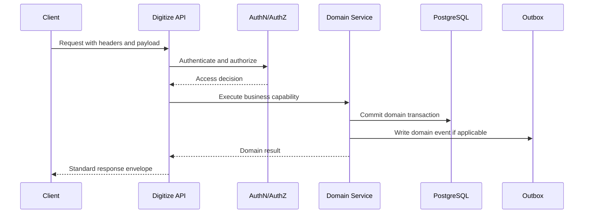
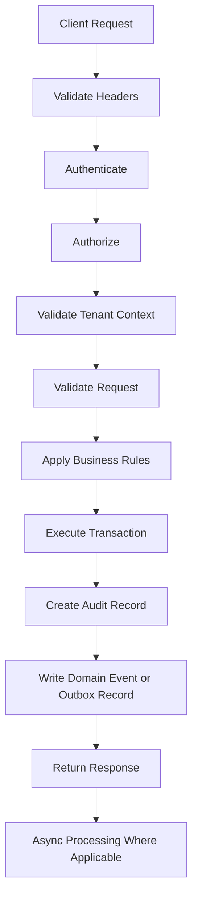

# (status banner removed to preserve metadata `Status: Design Draft`)
# API-00 API Collection Standards

**Document ID:** API-00  
**Document Name:** API Collection Standards  
**Company:** OreeOn Technologies Pvt. Ltd.  
**Product:** Digitize  
**Document Type:** API Documentation Standard  
**Backend Technology:** FastAPI  
**Database Engine:** PostgreSQL  
**Authentication:** JWT  
**API Version:** v1  
**Document Version:** 0.1  
**Status:** Design Draft  
**Owner:** API Architecture  
**Reviewer:** Solution Architecture / Security Architecture / Backend Engineering  
**Dependencies:** Product Foundation, BA-01 to BA-10, FR-01 to FR-21, TA-00 to TA-10, DB-00 to DB-22, UI/UX, Testing  
**Last Updated:** 2026-07-26

---

# 1. Document Metadata

This document is the governing API documentation standard for Digitize.

| Attribute | Value |
|---|---|
| Document ID | API-00 |
| Document Name | API Collection Standards |
| Document Type | API Documentation Standard |
| API Style | REST |
| Backend Technology | FastAPI |
| Database Engine | PostgreSQL |
| Authentication | JWT |
| API Version | v1 |
| Document Version | 0.1 |
| Document Status | Design Draft |

---

# 2. Purpose

The purpose of this document is to define the enterprise API documentation standard for all Digitize API Collection documents.

It establishes the universal contract for URL design, naming, authentication, authorization, tenant-context validation, response envelopes, error handling, pagination, filtering, sorting, search, rate limiting, caching, idempotency, optimistic concurrency, asynchronous processing, bulk operations, file handling, audit, logging, domain events, notifications, security, observability, lifecycle governance, endpoint documentation, module documentation, traceability, and acceptance criteria.

---

# 3. Scope

This standard applies to all API documentation in `07_API_Collections`.

The standard applies to:

- Platform Administration APIs.
- Organization, Facility, and Site APIs.
- Identity, User, Role, Permission, Access Scope, and Session APIs.
- Customer APIs.
- Membership APIs.
- Attendance and Walk-in APIs.
- Trainer, Activity, Batch, Class, and Personal Training APIs.
- Billing, Payment, Invoice, Refund, Settlement, and Reconciliation APIs.
- Subscription, License, Entitlement, and Feature Access APIs.
- Notification, Campaign, and Communication APIs.
- Reporting and Analytics APIs.
- Support Ticket APIs.
- Audit, Security, Compliance, and Investigation APIs.
- Common Reference APIs.
- Environment, test, traceability, webhook, error catalog, and change-log API documents.

Out of scope:

- FastAPI controller source code.
- Python service implementation.
- PostgreSQL DDL/DML scripts.
- OpenAPI JSON.
- Swagger YAML.
- Postman collection JSON unless explicitly requested.
- Infrastructure deployment configuration.

---

# 4. Business Context

Digitize is a cloud-native, configurable, multi-tenant SaaS platform for activity-based and experience-based businesses.

The first supported business domain is Swimming Pool Management. The platform must remain extensible for Gyms, Yoga Centres, Dance Studios, Sports Academies, Indoor Sports, Recreation Businesses, Martial Arts Centres, Football Academies, Badminton Centres, Adventure Parks, Kids Activity Centres, Fitness Chains, and future activity-based businesses.

The platform hierarchy is:

```text
Platform
└── Organization
    └── Facility
        └── Site
```

Every tenant-scoped API shall preserve this hierarchy and enforce tenant isolation.

---

# 5. API Design Principles

| Principle | Standard |
|---|---|
| Resource-oriented | APIs shall expose business resources and approved business actions |
| RESTful | APIs shall use HTTP methods according to resource semantics |
| Versioned | APIs shall use `/api/v1` URL versioning |
| Stateless | APIs shall not depend on server-side request session state |
| Secure by default | APIs shall require authentication and authorization unless explicitly classified otherwise |
| Tenant-aware | APIs shall validate Organization, Facility, and Site scope where applicable |
| Authorization first | Authorization shall be evaluated before domain execution |
| Consistent contract | APIs shall use consistent naming, request, response, error, status, and header standards |
| Idempotent where required | Retry-prone critical operations shall support idempotency keys |
| Concurrency-safe | Mutable business resources shall protect against lost updates where applicable |
| Auditable | Sensitive, lifecycle, commercial, administrative, and security actions shall create audit evidence |
| Event-ready | Domain events and outbox records shall be used where asynchronous processing is required |
| Traceable | Endpoints shall map to source requirements, processes, UI screens, database tables, events, and tests |

---

# 6. API Classification

Every endpoint shall identify one API classification.

| Classification | Meaning | Authentication Standard |
|---|---|---|
| Public | No user JWT; protected by validation and strict rate limits | No JWT |
| Authentication | Login, refresh, logout, recovery, verification, or token lifecycle | Credential, refresh token, OTP, or approved authentication flow |
| Tenant | Operates within an Organization context | JWT plus validated tenant context |
| Platform | Restricted to platform administration | JWT plus platform-level permission |
| Internal | Used between trusted internal services | Service identity or workload authentication |
| Integration | Used by approved external systems | Approved integration authentication |
| Webhook | Callback endpoint authenticated through signature validation | Provider signature validation |

---

# 7. API URL Standards

All APIs shall use:

```text
/api/v1/{resource}
```

Examples:

```text
GET /api/v1/customers
POST /api/v1/customers
GET /api/v1/customers/{customer_id}
PATCH /api/v1/customers/{customer_id}
POST /api/v1/memberships/{membership_id}/freeze
POST /api/v1/payments/{payment_id}/refund
```

URL rules:

- Collection resources shall use plural nouns.
- URLs shall use lowercase kebab-case.
- APIs shall use nouns rather than CRUD verbs.
- Lifecycle transitions may use approved business-action endpoints.
- Internal database implementation details shall not be exposed to API consumers.

---

# 8. API Naming Standards

| API Element | Standard | Example |
|---|---|---|
| URL resources | lowercase kebab-case | `/api/v1/support-tickets` |
| Path parameters | snake_case | `{customer_id}` |
| Query parameters | snake_case | `page_size` |
| Request JSON fields | snake_case | `customer_id` |
| Response JSON fields | snake_case | `customer_id` |
| Error codes | uppercase snake case | `CUSTOMER_VALIDATION_001` |
| HTTP headers | Standard HTTP header casing | `X-Correlation-ID` |
| Database columns | snake_case | `customer_id` |
| Event names | lowercase dot-separated names unless source architecture defines otherwise | `platform.setting.updated` |

Do not mix camelCase and snake_case.

---

# 9. HTTP Method Standards

| Method | Standard Usage |
|---|---|
| GET | Retrieve resources without changing business state |
| POST | Create a resource or execute an explicit business action |
| PUT | Fully replace a resource when replacement semantics are valid |
| PATCH | Partially update mutable fields |
| DELETE | Deactivate or soft-delete a resource where permitted |

PATCH rules:

- Omitted fields remain unchanged.
- Explicit `null` clears a nullable field.
- Immutable fields cannot be modified.
- Lifecycle transitions requiring domain validation shall use action endpoints.
- Concurrency checks shall be enforced where applicable.

DELETE shall not physically remove data subject to audit, financial, legal, retention, or compliance obligations.

---

# 10. Authentication

Digitize authenticated APIs shall use JWT authentication.

JWT validation shall include:

- Signature.
- Issuer.
- Audience.
- Expiry.
- Not-before value where applicable.
- Token type.
- Session state where applicable.
- Revocation status where applicable.
- Subject identity.
- Security context.

Access tokens shall not be logged. Refresh tokens shall be protected, revocable, and rotated where approved by security architecture.

Authentication endpoints shall apply strict rate limiting, secure error messages, lockout rules where applicable, audit logging, and replay protection where applicable.

---

# 11. Authorization

Authorization shall be evaluated before domain execution.

Authorization may include:

- Platform scope.
- Organization scope.
- Facility scope.
- Site scope.
- Role.
- Permission.
- Staff ownership.
- Customer ownership.
- Subscription status.
- License status.
- Capability entitlement.
- Feature access.
- Resource lifecycle status.
- Data classification.
- Administrative access policy.

Authorization failures shall return standard error responses and shall avoid leaking sensitive resource existence details.

---

# 12. Tenant Context and Trust Rules

Tenant context headers indicate the client's requested operating context. They do not grant access.

Context headers:

```text
X-Organization-ID
X-Facility-ID
X-Site-ID
```

For every tenant-scoped request, the API shall:

1. Authenticate the JWT.
2. Resolve the user's permitted Organization, Facility, and Site scopes.
3. Validate requested context against authenticated access.
4. Validate hierarchy ownership.
5. Reject inaccessible or mismatched contexts.
6. Prevent horizontal and vertical privilege escalation.
7. Never authorize a request solely from client-supplied headers.

`X-Organization-ID` shall be required for tenant-scoped APIs unless the Organization is unambiguously established through an approved resource or authentication workflow. Facility and Site context shall be required only when applicable.

For cross-tenant access attempts, APIs may return `404 Not Found` instead of `403 Forbidden` where revealing resource existence creates an information-disclosure risk.

---

# 13. Resource Scoping Rules

Digitize shall use flat domain endpoints with validated context headers:

```text
/api/v1/customers
/api/v1/memberships
/api/v1/invoices
/api/v1/attendance-records
```

Nested endpoints shall be used only when the child resource has a meaningful subordinate relationship:

```text
/api/v1/customers/{customer_id}/contacts
/api/v1/invoices/{invoice_id}/items
/api/v1/support-tickets/{ticket_id}/comments
```

Do not inconsistently expose the same resource through both deeply nested tenant URLs and flat context-header URLs without a documented exception.

---

# 14. Header Standards

## 14.1 Common Request Headers

| Header | Requirement |
|---|---|
| Authorization | Required for authenticated endpoints |
| Content-Type | `application/json` for JSON request bodies |
| Accept | `application/json` unless another media type is documented |
| X-Correlation-ID | Required or generated by the platform |
| X-Organization-ID | Required for tenant-scoped APIs where context is not otherwise established |
| X-Facility-ID | Required for facility-scoped APIs |
| X-Site-ID | Required for site-scoped APIs |
| Idempotency-Key | Required for identified critical operations |
| Accept-Language | Optional localization preference |
| X-Timezone | Optional operating timezone context |
| If-Match | Required for protected concurrent updates |

## 14.2 Common Response Headers

Applicable response headers shall be documented per endpoint:

- X-Correlation-ID.
- Location.
- ETag.
- Retry-After.
- RateLimit-Limit.
- RateLimit-Remaining.
- RateLimit-Reset.
- Deprecation.
- Sunset.
- Link.
- Content-Disposition.
- Cache-Control.

---

# 15. Request Parameter Standards

Every endpoint shall document path parameters, query parameters, body parameters, and header parameters.

Parameter documentation shall include:

- Name.
- Type.
- Required status.
- Default value where applicable.
- Validation.
- Business meaning.
- Example.

APIs shall not support arbitrary database-column filtering or unrestricted query parameters.

---

# 16. Data Format and Localization Standards

| Data Type | Required Format |
|---|---|
| Date | ISO 8601 `YYYY-MM-DD` |
| Date-time | RFC 3339 with timezone |
| Canonical timestamp | UTC using `Z` |
| Timezone | IANA identifier, such as `Asia/Kolkata` |
| Currency | ISO 4217, such as `INR` |
| Country | ISO 3166 |
| Language | BCP 47, such as `en-IN` |
| UUID | Canonical lowercase UUID string |
| Boolean | JSON `true` or `false` |
| Money | Fixed-scale decimal representation |
| Percentage | Decimal with documented scale and range |
| Phone number | E.164 where applicable |
| Email | Normalized and case-insensitive according to domain rules |

Never use binary floating-point calculations for financial values internally. API documents shall define the scale and rounding rule for all monetary fields.

---

# 17. Standard Response Models

## 17.1 Success Envelope

```json
{
  "success": true,
  "data": {},
  "message": "Operation completed successfully.",
  "metadata": {},
  "correlation_id": "uuid",
  "timestamp": "2026-07-23T16:30:00Z"
}
```

Rules:

- `success` shall always be `true`.
- `data` may contain an object, array, or approved operation representation.
- `message` is optional and shall not be the only representation of a result.
- `metadata` is optional for non-list responses.
- `correlation_id` is mandatory.
- `timestamp` is mandatory and shall use UTC RFC 3339 format.

## 17.2 Error Envelope

```json
{
  "success": false,
  "error": {
    "code": "MEMBERSHIP_BUSINESS_001",
    "message": "The membership is not eligible for this operation.",
    "category": "Business",
    "details": []
  },
  "correlation_id": "uuid",
  "timestamp": "2026-07-23T16:30:00Z"
}
```

Rules:

- `success` shall always be `false`.
- Error codes shall remain stable.
- Error messages shall be safe for API consumers.
- Sensitive implementation details shall not be returned.
- Field-level validation details may be included.
- Stack traces shall never be exposed.

## 17.3 HTTP 204 Exception

HTTP `204 No Content` shall not contain a response body.

The correlation identifier shall remain available through:

```text
X-Correlation-ID
```

Prefer `200 OK` for lifecycle actions that return resulting state.

## 17.4 List Response Structure

List endpoints shall return `data` as an array and pagination details under `metadata.pagination`.

Offset pagination metadata shall include `page`, `page_size`, `total_records`, and `total_pages`.

Cursor pagination metadata shall include `next_cursor`, `has_next`, and `limit`.

---

# 18. HTTP Status Codes

Use status codes according to actual API semantics.

| Code | Usage |
|---|---|
| 200 | Successful read, update, or synchronous business action |
| 201 | Resource successfully created |
| 202 | Accepted for asynchronous processing |
| 204 | Successful operation with no response body |
| 207 | Approved non-atomic bulk operation with per-item results |
| 400 | Malformed request |
| 401 | Authentication missing or invalid |
| 403 | Authenticated but not authorized |
| 404 | Resource unavailable, not found, or intentionally undisclosed |
| 409 | Duplicate, state conflict, idempotency conflict, or business conflict |
| 410 | Permanently unavailable resource where disclosure is approved |
| 412 | Optimistic concurrency or precondition failure |
| 413 | Request payload exceeds approved limit |
| 415 | Unsupported content type |
| 422 | Semantically valid request with validation failure |
| 428 | Required precondition missing |
| 429 | Rate limit exceeded |
| 500 | Unexpected internal error |
| 502 | Approved upstream service failure |
| 503 | Service unavailable or maintenance |
| 504 | Approved upstream timeout |

---

# 19. Error Code Standards

Error codes shall use stable uppercase snake case.

Format:

```text
{DOMAIN}_{CATEGORY}_{NNN}
```

Examples:

| Error Code | Meaning |
|---|---|
| AUTH_AUTHENTICATION_001 | Authentication token is missing or invalid |
| AUTH_AUTHORIZATION_001 | User lacks required permission |
| TENANT_VALIDATION_001 | Organization context is missing or invalid |
| PLATFORM_VALIDATION_001 | Platform configuration request is invalid |
| PAYMENT_CONFLICT_001 | Idempotency key conflicts with an existing transaction |

Detailed error ownership and domain-specific catalogs shall be maintained in `API-19_API_Error_Code_Catalog.md`.

---

# 20. Pagination Standards

Each list endpoint shall implement one approved pagination profile.

Do not expose both offset and cursor pagination on the same endpoint unless formally approved.

## 20.1 Offset Pagination

Use for administrative lists, configuration data, master data, small or medium datasets, and lists requiring page numbers and total counts.

Parameters:

```text
page
page_size
```

Defaults:

```text
Default page: 1
Default page_size: 20
Maximum page_size: 100
```

## 20.2 Cursor Pagination

Use for attendance, audit events, notification attempts, payment attempts, authentication events, security events, large histories, and continuously changing datasets.

Parameters:

```text
cursor
limit
```

Defaults:

```text
Default limit: 50
Maximum limit: 200
```

Cursors shall be opaque. Pagination shall use stable and deterministic ordering.

---

# 21. Filtering Standards

Each endpoint shall explicitly define supported filters, validation, tenant filtering, date-range constraints, and indexing expectations.

Filtering rules:

- Do not support arbitrary database-column filtering.
- Do not allow unbounded filters.
- Validate filter values before query execution.
- Preserve tenant, Facility, and Site scope.
- Avoid filtering on sensitive fields unless explicitly authorized.

---

# 22. Sorting Standards

Each endpoint shall explicitly define supported sort fields and default ordering.

Sorting rules:

- Sorting shall use approved fields only.
- Sorting shall be deterministic.
- Sorting shall preserve pagination stability.
- Sorting on large unindexed text fields shall not be supported unless approved.

---

# 23. Search Standards

Each search endpoint shall define searchable fields, minimum search length, maximum search length, tenant filtering, indexing expectations, and sensitive-data restrictions.

Search rules:

- Do not allow unbounded wildcard searches.
- Do not expose sensitive values through suggestions or projections.
- Search shall preserve tenant isolation.
- High-volume search shall use approved indexed fields or projections.

---

# 24. Rate Limiting

Rate limiting shall apply based on API classification and risk.

Protect at minimum:

- Authentication.
- Password recovery.
- OTP verification.
- Search.
- Reporting.
- Payment.
- Refund.
- Notification.
- Export.
- Public APIs.
- Integration endpoints.
- Webhook endpoints.

Rate-limited responses shall use:

```text
429 Too Many Requests
Retry-After
RateLimit-Limit
RateLimit-Remaining
RateLimit-Reset
```

Exact thresholds shall be defined in security or deployment configuration and may be referenced rather than exposed as hard-coded business rules.

---

# 25. Caching

Caching may be approved for common reference data, facility types, currency lists, country lists, localization references, permission catalogs, static platform configuration, and approved report projections.

Caching shall not be used without an invalidation strategy for permission decisions, entitlements, subscription state, license state, payment state, refund state, customer-sensitive data, security events, and audit data.

Each cached endpoint shall define cache scope, cache key, TTL, invalidation event, tenant isolation, and stale-data tolerance.

---

# 26. Idempotency Processing Standard

Idempotency keys shall be mandatory for retry-prone critical operations, including payment initiation, refund initiation, membership purchase, subscription purchase, subscription renewal, invoice finalization, walk-in commercial transactions, and approved external integration commands.

Rules:

1. The key shall be scoped to the authenticated tenant, client, and operation.
2. The server shall retain a request fingerprint.
3. Same key and same request shall return the original result.
4. Same key and different request shall return `409 Conflict`.
5. Concurrent requests with the same key shall not execute twice.
6. Validation failures should not reserve the key unless architecture explicitly requires it.
7. Key retention shall be documented.
8. Idempotency records shall not expose sensitive payloads.

---

# 27. Optimistic Concurrency Control

Mutable business resources shall use optimistic concurrency where lost updates are possible.

Preferred mechanism:

```text
ETag
If-Match
```

Rules:

- GET responses may return an `ETag`.
- Protected PATCH, PUT, DELETE, or action requests shall provide `If-Match`.
- A stale version shall return `412 Precondition Failed`.
- A missing required precondition may return `428 Precondition Required`.
- Database `version_number` may be used internally to generate the ETag.
- Clients shall not be allowed to silently overwrite newer data.

---

# 28. Asynchronous Operation Standard

Use `202 Accepted` for long-running operations.

A `202` response shall provide operation ID, current status, status URL, submission timestamp, and retry guidance where applicable.

Applicable operations may include large report generation, data export, bulk import, campaign audience processing, bulk notification processing, settlement processing, reconciliation, large data backfills, and approved integration jobs.

The asynchronous operation shall define accepted states, terminal states, failure representation, cancellation behavior, retention period, polling limits, and notification or callback behavior.

---

# 29. Bulk Operation Standard

Bulk APIs shall define maximum number of items, maximum payload size, atomic or non-atomic behavior, per-item validation, per-item response, partial-success behavior, idempotency, tenant validation for every item, asynchronous processing threshold, audit behavior, and error handling.

Use `207 Multi-Status` only for formally approved non-atomic operations.

Do not permit unbounded bulk requests.

---

# 30. File Upload and Download Standard

File APIs shall define allowed MIME types, allowed file extensions, maximum file size, maximum number of files, malware scanning, object-storage approach, upload authorization, download authorization, temporary URL expiry, data classification, retention, audit requirements, filename sanitization, and `Content-Disposition` behavior.

Do not store raw file content directly in API logs. Do not trust MIME type or extension supplied by the client without validation.

---

# 31. Audit Requirements

Audit events shall be generated for sensitive, lifecycle, commercial, financial, platform administration, security, compliance, export, override, and data-access actions.

Audit records shall include actor, action, entity, tenant context, timestamp, correlation ID, request source where approved, before/after values where approved, and security sensitivity.

Audit records shall not expose secrets, raw credentials, raw card data, access tokens, refresh tokens, or internal stack traces.

---

# 32. Logging Requirements

API logs shall include correlation ID, request method, request path, response status, duration, authenticated user reference where safe, tenant context where safe, endpoint ID where available, and error code where applicable.

API logs shall not include passwords, password hashes, access tokens, refresh tokens, secrets, encryption keys, raw card data, sensitive document contents, internal service credentials, or SQL details.

---

# 33. Domain Event and Outbox Standard

Business transaction processing shall be separated from notification and integration delivery where asynchronous processing is appropriate.

Preferred flow:

```text
API Request
→ Domain Validation
→ Database Transaction
→ Audit Record
→ Domain Event or Outbox Record
→ Transaction Commit
→ Asynchronous Consumer
→ Notification or Integration Delivery
```

Each endpoint shall specify audit event, domain event, outbox event where applicable, notification eligibility, delivery channel, synchronous or asynchronous processing, and failure-handling expectations.

---

# 34. Notification Processing Standard

External notification failures shall not normally roll back a successfully committed core business transaction.

Endpoint documents shall distinguish:

- Business transaction.
- Domain event production.
- Outbox persistence.
- Notification eligibility.
- Notification template or channel selection.
- Asynchronous delivery.
- Retry and failure handling.

Synchronous notification processing requires explicit business justification.

---

# 35. Security Considerations

Every API document shall address authentication, authorization, tenant isolation, input validation, output filtering, object-level authorization, function-level authorization, mass-assignment prevention, sensitive-data masking, injection prevention, rate limiting, replay protection, idempotency, CSRF considerations where browser authentication applies, secure file handling, logging redaction, auditability, security events, error-message safety, webhook signature validation, and administrative access controls.

Never expose passwords, password hashes, access tokens, refresh tokens, secrets, encryption keys, raw card data, internal stack traces, SQL details, or internal service credentials.

---

# 36. Performance Considerations

API documents shall address expected volume, pagination, filtering, sorting, search, database indexes, reporting projections, caching eligibility, N+1 avoidance, maximum response size, timeout expectations, asynchronous thresholds, and retry behavior.

High-volume endpoints shall avoid unbounded synchronous responses.

---

# 37. Observability

Every API document shall define endpoint-specific logs, metrics, traces, alert conditions, error-code recording, correlation ID behavior, latency measurement, failure-rate monitoring, and sensitive-data redaction.

Observability shall support operational troubleshooting without exposing confidential, restricted, or tenant-sensitive data.

---

# 38. API Lifecycle and Deprecation Policy

Endpoint lifecycle states:

- Planned.
- Design Draft.
- Frozen — 2026-07-26.
- Approved.
- Implemented.
- Active.
- Deprecated.
- Retired.

Breaking changes require impact assessment, new API version where necessary, migration guidance, deprecation notice, defined transition period, consumer communication, change-log entry, and retirement approval.

Use approved lifecycle headers where applicable:

```text
Deprecation
Sunset
Link
```

Non-breaking additive changes may remain within the current version when they preserve backward compatibility.

---

# 39. Webhook and Callback Security Standard

Webhook specifications shall distinguish inbound provider callbacks from outbound Digitize webhooks.

Webhook and callback APIs shall address endpoint registration, endpoint verification, event naming, event envelope, payload versioning, signature validation, timestamp validation, replay protection, secret rotation, delivery processing, retry policy, exponential backoff, dead-letter handling, idempotency, ordering expectations, duplicate handling, failure responses, timeout standards, payload data classification, tenant isolation, audit, and observability.

---

# 40. API Sequence Diagram Standard

Every module API collection shall include Mermaid sequence diagrams where flows are non-trivial.



---

# 41. Request Flow Diagram Standard

Every module API collection shall include request flow diagrams where they clarify security, tenancy, transaction, audit, or asynchronous behavior.



---

# 42. Database Mapping Standard

Every endpoint shall map database usage using approved database tables only.

Mapping format:

| Usage | Schema.Table | Operation | Purpose |
|---|---|---|---|
| Read | Approved table | Read operation | Business purpose |
| Write | Approved table | Write operation | Business purpose |
| Audit | Approved audit table | Insert | Audit evidence |
| Reporting | Approved reporting table | Read/Insert | Reporting or projection purpose |
| Integration | Approved integration/outbox table | Insert/Read | Integration purpose |

If an approved table is unavailable, use `TBD — Owner: API Architecture; Action: provide authoritative BA/FR/API/DB/event/test mapping and update API-17.` and identify the missing database source.

---

# 43. Functional Requirement Mapping Standard

Every endpoint shall map to approved Functional Requirement IDs where available.

Mapping format:

| Endpoint | Functional Requirement |
|---|---|
| Method and URL | FR reference |

Do not fabricate FR IDs.

---

# 44. Business Process Mapping Standard

Every endpoint shall map to approved Business Process IDs where available.

Mapping format:

| Endpoint | Business Process |
|---|---|
| Method and URL | BA-03 or BA-04 process reference |

Do not fabricate process IDs.

---

# 45. UI Screen Mapping Standard

Every endpoint shall map to approved UI screens where available.

Mapping format:

| Endpoint | UI Screen | Usage |
|---|---|---|
| Method and URL | Approved screen reference | Create, view, update, list, action, export |

[OWNER ACTION REQUIRED — BA/API owners: provide authoritative source mapping (DB table / API endpoint / FR ID) or 'Not Applicable'. See docs/07_API_Collections/issues/ and CHG API-CHG-0008 for context.]

---

# 46. Test Scenario Standard

Every endpoint shall define applicable test scenarios:

- Positive.
- Negative.
- Validation.
- Boundary.
- Authorization.
- Tenant isolation.
- Idempotency.
- Concurrency.
- Performance.
- Security.
- Failure recovery.

Endpoint test scenarios shall be traceable to `API-16_API_Test_Scenarios.md` when available.

---

# 47. Common Endpoint Documentation Template

Every endpoint in API-01 through API-14 and API-18 shall use the following frozen structure.

```text
## <Endpoint ID> — <Endpoint Name>

### 1. Endpoint Metadata
### 2. Business Purpose
### 3. Actors
### 4. Preconditions
### 5. Authentication
### 6. Authorization
### 7. Request Headers
### 8. Path Parameters
### 9. Query Parameters
### 10. Request Body
### 11. Request Example
### 12. Processing Flow
### 13. Success Response
### 14. Success Response Example
### 15. Error Responses
### 16. Validation Rules
### 17. Business Rules
### 18. State Transition Rules
### 19. Idempotency Behaviour
### 20. Concurrency Behaviour
### 21. Transaction Boundary
### 22. Database Mapping
### 23. Domain Events and Outbox Events
### 24. Audit Event
### 25. Notification Trigger
### 26. Performance Considerations
### 27. Security Considerations
### 28. Functional Requirement Mapping
### 29. Business Process Mapping
### 30. UI Screen Mapping
### 31. Test Scenarios
### 32. Observability
### 33. Future Considerations
```

[DOCUMENTATION CLARIFICATION — leave as-is until owner provides mapping; owners: confirm or replace with authoritative mapping. See CHG API-CHG-0008.]

Do not add, remove, rename, merge, or reorder endpoint sections.

---

# 48. Module API Document Template

API-01 through API-14 shall use the following frozen structure:

```text
1. Document Metadata
2. Purpose
3. Scope
4. Business Context
5. Domain Overview
6. Actors and Access Model
7. API Classification
8. Resource Model
9. API Endpoint Catalogue
10. Common Authentication Requirements
11. Common Authorization Requirements
12. Tenant and Resource Scope Rules
13. Common Header Requirements
14. Request and Data Format Rules
15. Standard Response Usage
16. Module Error Codes
17. Pagination Profile
18. Filtering Rules
19. Sorting Rules
20. Search Rules
21. Rate Limiting
22. Caching
23. Idempotency
24. Optimistic Concurrency
25. Transaction Boundaries
26. Asynchronous Operations
27. Bulk Operations
28. File Handling
29. API Endpoints
30. Module Sequence Diagrams
31. Request Flow Diagrams
32. Database Mapping Summary
33. Domain Event and Outbox Mapping
34. Audit Mapping
35. Notification Mapping
36. Functional Requirement Mapping
37. Business Process Mapping
38. UI Screen Mapping
39. Security Considerations
40. Performance and Scalability
41. Observability
42. Test Coverage Summary
43. Assumptions and Constraints
44. Dependencies
45. Future Enhancements
46. Document Acceptance Criteria
47. Summary
```

Module documents shall inherit API-00. Do not duplicate the full API-00 content. State inherited standards and document only module-specific interpretations, constraints, exceptions, and endpoint contracts.

---

# 49. Freeze Rule

After API-00 is frozen, API collection documents shall not add, remove, rename, merge, split, or reorder mandatory sections without formal Architecture Review.

The following standards shall not change without formal review:

- URL versioning.
- Naming standards.
- Tenant-context trust rules.
- Response envelopes.
- Error contract.
- Pagination profiles.
- Idempotency processing.
- Optimistic concurrency.
- Asynchronous operation contract.
- Bulk operation contract.
- File handling contract.
- Audit requirements.
- Domain event and outbox standards.
- Notification processing.
- Webhook and callback security.
- Endpoint template.
- Module document template.
- Traceability expectations.

---

# 50. Acceptance Criteria

API-00 is acceptable when:

- It follows the frozen API-00 structure.
- It defines consistent REST API governance.
- It enforces tenant-context security.
- It distinguishes authentication, authorization, and tenant validation.
- It defines snake_case API payload standards.
- It defines standard response and error envelopes.
- It defines status-code usage.
- It defines pagination profiles.
- It defines filtering, sorting, and search constraints.
- It defines idempotency and optimistic concurrency.
- It defines asynchronous, bulk, and file-handling standards.
- It defines audit, logging, domain event, outbox, notification, security, performance, and observability standards.
- It defines lifecycle and deprecation governance.
- It defines webhook and callback security standards.
- It defines endpoint and module documentation templates.
- It prevents unsupported source-reference invention.
- It is usable by API architects, developers, QA engineers, security engineers, DevOps engineers, and implementation teams.

---

# 51. Summary

API-00 defines the governing API documentation standard for Digitize.

It shall be used as the authoritative source for API-01 through API-26 and API support artifacts and shall control endpoint structure, module structure, API behavior standards, security expectations, tenant isolation, traceability, testing coverage, lifecycle governance, and implementation-readiness expectations across the complete API documentation set.
