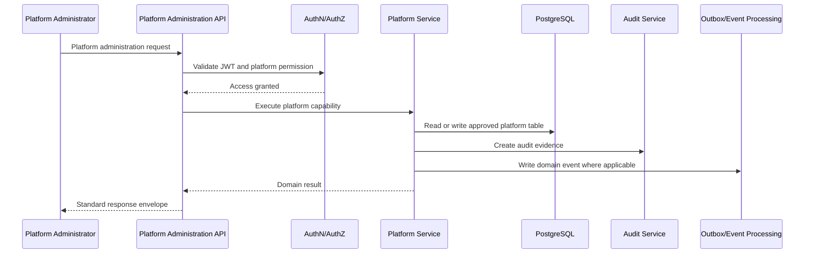
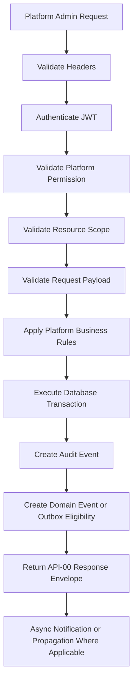

# (status banner removed to preserve metadata `Status: Design Draft`)
# API-01 Platform Administration Collection

**Document ID:** API-01  
**Document Name:** Platform Administration Collection  
**Company:** OreeOn Technologies Pvt. Ltd.  
**Product:** Digitize  
**Document Type:** API Collection Documentation  
**Backend Technology:** FastAPI  
**Database Engine:** PostgreSQL  
**Authentication:** JWT  
**API Version:** v1  
**Document Version:** 0.1  
**Status:** Design Draft  
**Owner:** API Architecture  
**Reviewer:** Solution Architecture / Security Architecture / Backend Engineering  
**Dependencies:** API-00, FR-02, BA-03, BA-04, TA-04, DB-11  
**Last Updated:** 2026-07-26

---

# 1. Document Metadata

| Attribute | Value |
|---|---|
| Document ID | API-01 |
| Document Name | Platform Administration Collection |
| Output File | API-01_Platform_Administration_Collection.md |
| API Version | v1 |
| Document Version | 0.1 |
| Status | Design Draft |
| Governing Standard | API-00_API_Collection_Standards.md |

---

# 2. Purpose

This document defines the Platform Administration API Collection for Digitize.

The collection provides implementation-ready REST API contracts for platform-owned administrative capabilities including platform settings, global master data, feature flags, maintenance windows, release records, platform health visibility, security policies, and platform reports.

---

# 3. Scope

In scope:

- Platform configuration.
- Global system parameters.
- Platform master data.
- Facility-type and system-owned lookup administration.
- Global feature definitions and feature flags.
- Localization, currency, country, and region reference configuration where represented as platform master data.
- Maintenance mode and scheduled maintenance.
- Release configuration.
- Platform health visibility where exposed.
- Platform security policy administration.
- Platform report generation and export initiation.
- Audit, domain event, notification eligibility, and observability mapping for platform administration actions.

Out of scope:

- Organization operational management. This is owned by API-02.
- Subscription and license commercial lifecycle APIs. These are owned by API-09.
- Billing, payment, invoice, refund, settlement, and reconciliation APIs. These are owned by API-08.
- Identity, user, role, permission, and session administration APIs. These are owned by API-03.
- OpenAPI, Swagger, Postman collection JSON, FastAPI source code, and PostgreSQL DDL.

---

# 4. Business Context

Platform Administration governs the global operating behavior of Digitize across all tenants.

Unlike Organization Administration, which manages a specific tenant organization, Platform Administration controls platform-wide configuration, master data, feature exposure, maintenance communication, release visibility, security policy governance, and operational monitoring.

The Platform Administrator is responsible for ensuring that Digitize remains secure, configurable, auditable, scalable, and operationally stable for thousands of organizations and millions of users.

---

# 5. Domain Overview

Platform Administration includes the following domain capabilities:

| Capability | Description | Source |
|---|---|---|
| Platform Settings | Manage global configuration values and system parameters | FR-PLT-001 |
| Global Master Data | Manage system-owned reference values | FR-PLT-002 |
| Feature Flags | Enable, disable, and schedule global or scoped feature behavior | FR-PLT-005 |
| Global Business Rules | Configure approved platform-level rule parameters | FR-PLT-006 |
| Platform Health | View health indicators, alerts, service status, and operational metrics | FR-PLT-007 |
| System Maintenance | Schedule, publish, update, and cancel maintenance windows | FR-PLT-008 |
| Platform Releases | Record, publish, and archive platform release information | FR-PLT-009 |
| Platform Usage | Review platform-wide usage metrics | FR-PLT-010 |
| Security Policies | Configure and activate platform security policies | FR-PLT-011 |
| Platform Reports | Generate and export platform-level reports | FR-PLT-012 |

---

# 6. Actors and Access Model

| Actor | Access Model | Description |
|---|---|---|
| Platform Administrator | Platform JWT plus platform permissions | Primary actor for platform administration APIs |
| Platform Operations | Platform JWT plus operational permissions | Supports health, maintenance, release, and monitoring activities |
| Security Administrator | Platform JWT plus security-policy permissions | Supports security policy governance where separated from general platform administration |
| Reporting Administrator | Platform JWT plus platform report permissions | Supports platform report generation and export |
| System Service | Internal workload identity | Supports asynchronous report execution, notification processing, audit ingestion, and monitoring integration |

Tenant users, Organization Administrators, Facility Managers, Site Administrators, Reception Staff, Trainers, Finance Staff, Marketing Staff, and Customers shall not execute Platform Administration APIs.

---

# 7. API Classification

| Endpoint Group | API Classification | Data Classification |
|---|---|---|
| Platform settings | Platform | Restricted |
| Global master data | Platform | Internal |
| Feature flags | Platform | Restricted |
| Maintenance windows | Platform | Internal |
| Release records | Platform | Internal |
| Platform health | Platform | Restricted |
| Security policies | Platform | Restricted |
| Platform reports | Platform | Confidential |

---

# 8. Resource Model

| Resource | URL Base | Approved Database Mapping |
|---|---|---|
| Platform Settings | `/api/v1/platform/settings` | `platform.platform_setting` |
| Global Master Data | `/api/v1/platform/global-master-data` | `platform.global_master_data` |
| Feature Flags | `/api/v1/platform/feature-flags` | `platform.feature_flag` |
| Maintenance Windows | `/api/v1/platform/maintenance-windows` | `platform.maintenance_window` |
| Release Records | `/api/v1/platform/releases` | `platform.release_record` |
| Platform Health | `/api/v1/platform/health` | TBD — Owner: Platform Owners; Action: provide FR/API/DB IDs (platform health, events) and link evidence. |
| Security Policies | `/api/v1/platform/security-policies` | `security.security_policy` |
| Platform Reports | `/api/v1/platform/reports` | `reporting.report_definition`, `reporting.report_execution`, `reporting.report_export` |

---

# 9. API Endpoint Catalogue

| Endpoint ID | Method | URL | Endpoint Name | FR Mapping |
|---|---|---|---|---|
| API-01-001 | GET | `/api/v1/platform/settings` | Retrieve Platform Settings | FR-PLT-001 |
| API-01-002 | PATCH | `/api/v1/platform/settings/{setting_key}` | Update Platform Setting | FR-PLT-001 |
| API-01-003 | GET | `/api/v1/platform/global-master-data` | Retrieve Global Master Data | FR-PLT-002 |
| API-01-004 | POST | `/api/v1/platform/global-master-data` | Create Global Master Data Record | FR-PLT-002 |
| API-01-005 | PATCH | `/api/v1/platform/global-master-data/{record_id}` | Update Global Master Data Record | FR-PLT-002 |
| API-01-006 | PATCH | `/api/v1/platform/feature-flags/{feature_code}` | Update Feature Flag State | FR-PLT-005 |
| API-01-007 | POST | `/api/v1/platform/maintenance-windows` | Schedule Maintenance Window | FR-PLT-008 |
| API-01-008 | POST | `/api/v1/platform/releases/{record_id}/publish` | Publish Platform Release | FR-PLT-009 |
| API-01-009 | GET | `/api/v1/platform/health` | Retrieve Platform Health Summary | FR-PLT-007 |
| API-01-010 | PATCH | `/api/v1/platform/security-policies/{record_id}` | Update Platform Security Policy | FR-PLT-011 |
| API-01-011 | POST | `/api/v1/platform/reports/executions` | Generate Platform Report | FR-PLT-012 |

---

# 10. Common Authentication Requirements

All endpoints in this collection require JWT authentication.

Authentication rules:

- Access token shall be supplied using `Authorization: Bearer {access_token}`.
- JWT signature, issuer, audience, expiry, token type, session state, revocation status, subject, and security context shall be validated.
- Platform Administration APIs shall not accept anonymous access.
- Access tokens and refresh tokens shall not be logged.

---

# 11. Common Authorization Requirements

Authorization shall be evaluated before domain execution.

Common authorization requirements:

- Authenticated user shall have Platform Administrator, Platform Operations, Security Administrator, or Reporting Administrator access as required by endpoint.
- Required platform permission shall be validated per endpoint.
- Tenant context headers shall not grant access.
- Organization-scoped access shall not be sufficient for platform administration.
- Administrative access shall be recorded in audit logs where required.

---

# 12. Tenant and Resource Scope Rules

Platform Administration APIs are platform-scoped.

Rules:

- `X-Organization-ID`, `X-Facility-ID`, and `X-Site-ID` are not required for platform-scoped endpoints unless the endpoint explicitly filters by tenant, Facility, or Site.
- If tenant context headers are supplied, they shall be validated against the Platform Administrator's permitted scope and shall not grant additional access.
- Platform APIs shall not expose tenant-sensitive personal data unless explicitly authorized and required by a platform report or platform support process.
- Cross-tenant existence disclosure shall be avoided.

---

# 13. Common Header Requirements

| Header | Type | Required | Validation | Purpose | Example |
|---|---|---|---|---|---|
| Authorization | String | Yes | Bearer JWT | Authenticate platform user | `Bearer eyJ...` |
| Accept | String | Yes | `application/json` | Response format | `application/json` |
| Content-Type | String | Conditional | `application/json` where body exists | Request format | `application/json` |
| X-Correlation-ID | UUID | Required or generated | Canonical UUID | Trace request | `7dc36db8-7f22-4d0e-9a42-a20756917b49` |
| If-Match | String | Conditional | Must match current ETag | Concurrency protection | `"7"` |
| Idempotency-Key | String | Conditional | Unique per critical create/action | Retry safety | `maint-20260723-001` |
| Accept-Language | String | Optional | BCP 47 | Localization preference | `en-IN` |
| X-Timezone | String | Optional | IANA timezone | Display timezone | `Asia/Kolkata` |

---

# 14. Request and Data Format Rules

This collection inherits API-00 data format standards.

Module-specific rules:

- Configuration payloads shall use JSON objects with snake_case fields.
- Date-time values shall use UTC RFC 3339 format.
- Platform setting values shall be validated against setting type and schema where defined.
- Currency values shall use ISO 4217 codes.
- Country and region values shall use approved master data or ISO-aligned references.
- Monetary fields are not directly processed by this collection.
- Metadata fields shall not bypass normalized fields or approved validation rules.

---

# 15. Standard Response Usage

All endpoints shall return API-00 response envelopes.

Success responses shall include:

- `success`.
- `data`.
- `message`.
- `metadata` where required.
- `correlation_id`.
- `timestamp`.

Error responses shall include:

- `success`.
- `error`.
- `correlation_id`.
- `timestamp`.

HTTP `204 No Content` shall not include a response body.

---

# 16. Module Error Codes

| Error Code | HTTP Status | Category | Safe Message | Retryable |
|---|---|---|---|---|
| PLATFORM_AUTHORIZATION_001 | 403 | Authorization | User is not authorized to perform this platform administration action. | No |
| PLATFORM_VALIDATION_001 | 422 | Validation | Platform administration request validation failed. | No |
| PLATFORM_CONFLICT_001 | 409 | Conflict | The requested platform change conflicts with the current resource state. | No |
| PLATFORM_CONCURRENCY_001 | 412 | Conflict | The resource was changed by another user. Refresh and retry. | Yes |
| PLATFORM_IDEMPOTENCY_001 | 409 | Conflict | The idempotency key was previously used with a different request. | No |
| PLATFORM_NOT_FOUND_001 | 404 | NotFound | The requested platform resource is unavailable. | No |
| PLATFORM_HEALTH_001 | 503 | ServiceUnavailable | Platform health information is temporarily unavailable. | Yes |
| PLATFORM_REPORT_001 | 422 | Validation | The requested platform report parameters are invalid. | No |

---

# 17. Pagination Profile

Offset pagination shall be used for platform settings, global master data, feature flags, maintenance windows, release records, security policies, and report lists.

Default values:

```text
page: 1
page_size: 20
maximum page_size: 100
```

Cursor pagination may be used only for high-volume operational health history, audit history, or event histories when approved by the relevant API collection.

---

# 18. Filtering Rules

Supported common filters:

| Filter | Description | Applies To |
|---|---|---|
| status | Lifecycle state | Master data, maintenance, releases, reports |
| is_active | Active flag | Settings, master data |
| setting_type | Platform setting category | Settings |
| reference_group | Master data category | Global master data |
| feature_code | Feature identifier | Feature flags |
| scope_type | Scope classification | Settings, feature flags |
| from_date | Start date | Maintenance, releases, reports |
| to_date | End date | Maintenance, releases, reports |

Arbitrary database-column filtering is not allowed.

---

# 19. Sorting Rules

Supported common sort fields:

| Sort Field | Applies To |
|---|---|
| created_at | All mutable platform resources |
| updated_at | All mutable platform resources |
| setting_key | Platform settings |
| reference_group | Global master data |
| reference_code | Global master data |
| feature_code | Feature flags |
| starts_at | Maintenance windows |
| release_version | Release records |

Default sorting shall be deterministic and documented per endpoint.

---

# 20. Search Rules

Search is supported only on documented text fields.

| Search Field | Applies To |
|---|---|
| setting_key | Platform settings |
| reference_code | Global master data |
| name | Global master data |
| feature_code | Feature flags |
| feature_name | Feature flags |
| release_code | Release records |
| release_name | Release records |

Minimum search length shall be 2 characters. Maximum search length shall be 100 characters.

---

# 21. Rate Limiting

Platform Administration APIs shall be rate-limited according to API-00 and security configuration.

Higher protection shall apply to:

- Platform setting mutations.
- Feature flag mutations.
- Security policy mutations.
- Maintenance publishing.
- Report generation and exports.

Rate-limit responses shall use `429 Too Many Requests` with `Retry-After`, `RateLimit-Limit`, `RateLimit-Remaining`, and `RateLimit-Reset` where applicable.

---

# 22. Caching

Caching may be used for:

- Read-only global master data.
- Active facility type lookups.
- Active currency and country lookups.
- Published release notes.

Caching shall not be used without invalidation for:

- Platform setting write responses.
- Feature flag state.
- Security policies.
- Maintenance status.
- Platform health status.
- Report execution status.

---

# 23. Idempotency

Idempotency is required for:

- Scheduling maintenance windows.
- Publishing platform releases where duplicate action has business impact.
- Generating asynchronous platform reports.

Idempotency is supported but not required for:

- Create global master data record where client-generated retry keys are used.

Idempotency is not applicable for read-only endpoints.

---

# 24. Optimistic Concurrency

Optimistic concurrency is required for mutable platform configuration resources.

Protected resources:

- Platform settings.
- Global master data records.
- Feature flags.
- Maintenance windows.
- Release records.
- Security policies.

Protected mutation endpoints shall require `If-Match` and shall return `412 Precondition Failed` for stale versions.

---

# 25. Transaction Boundaries

Transaction rules:

- Platform setting update shall atomically update setting data and create audit evidence.
- Global master data create/update shall atomically persist the record and audit event.
- Feature flag update shall atomically persist the state change and domain event/outbox record where applicable.
- Maintenance scheduling shall atomically persist the window, audit event, and notification eligibility event.
- Release publishing shall atomically update release state and audit evidence.
- Security policy update shall atomically persist policy changes and audit evidence.
- Report generation request shall atomically create the report execution record and asynchronous processing trigger where applicable.

---

# 26. Asynchronous Operations

Asynchronous processing may be used for:

- Platform report generation.
- Platform report export generation.
- Maintenance notifications.
- Release notifications.
- Feature flag propagation.

Asynchronous APIs shall return `202 Accepted` with operation state or report execution state where immediate completion is not guaranteed.

---

# 27. Bulk Operations

Bulk operations are not approved for Platform Administration v1 except future controlled imports of global master data.

Current status:

Not Applicable — No approved bulk Platform Administration endpoint is defined in FR-02 or DB-11 for this collection.

---

# 28. File Handling

File handling is not directly supported by current Platform Administration endpoints.

Not Applicable — Platform Administration v1 does not define upload/download endpoints. Platform report exports may produce downloadable artifacts through reporting export APIs where approved in API-11.

---

# 29. API Endpoints

## API-01-001 — Retrieve Platform Settings

### 1. Endpoint Metadata

| Attribute | Value |
|---|---|
| Endpoint ID | API-01-001 |
| Endpoint Name | Retrieve Platform Settings |
| Method | GET |
| URL | `/api/v1/platform/settings` |
| API Collection | API-01 Platform Administration |
| Functional Module | Platform Administration |
| Owning Domain or Service | Platform Administration Service |
| API Classification | Platform |
| Data Classification | Restricted |
| Lifecycle Status | Design Draft |
| Priority | Critical |
| Consistency Model | Strong |
| Transaction Boundary | Read-only |
| Idempotency | Not applicable |
| Concurrency Control | Supported through ETag on individual resources |

### 2. Business Purpose

Retrieve platform settings so authorized Platform Administrators can review global platform behavior before making governed configuration changes.

### 3. Actors

- Platform Administrator.
- Platform Operations.

### 4. Preconditions

- Platform Administrator is authenticated.
- User has `platform.settings.view`.
- Platform Administration service is available.

### 5. Authentication

JWT authentication is required.

### 6. Authorization

Requires `platform.settings.view` permission and platform-level scope.

### 7. Request Headers

| Header | Type | Required | Validation | Purpose | Example |
|---|---|---|---|---|---|
| Authorization | String | Yes | Bearer JWT | Authenticate user | `Bearer eyJ...` |
| Accept | String | Yes | `application/json` | Response format | `application/json` |
| X-Correlation-ID | UUID | Required or generated | Canonical UUID | Traceability | `7dc36db8-7f22-4d0e-9a42-a20756917b49` |

### 8. Path Parameters

Not Applicable — This endpoint has no path parameters.

### 9. Query Parameters

| Parameter | Type | Required | Default | Validation | Description | Example |
|---|---|---|---|---|---|---|
| page | Integer | No | 1 | Minimum 1 | Page number | `1` |
| page_size | Integer | No | 20 | 1 to 100 | Page size | `20` |
| setting_type | String | No | None | Approved setting type | Filter by category | `SECURITY` |
| is_active | Boolean | No | None | Boolean | Filter active settings | `true` |
| search | String | No | None | 2 to 100 chars | Search setting key | `currency` |

### 10. Request Body

Not Applicable — GET endpoint.

### 11. Request Example

```text
GET /api/v1/platform/settings?page=1&page_size=20&setting_type=CONFIGURATION
Accept: application/json
X-Correlation-ID: 7dc36db8-7f22-4d0e-9a42-a20756917b49
```

### 12. Processing Flow

1. Validate headers.
2. Authenticate JWT.
3. Authorize `platform.settings.view`.
4. Validate query parameters.
5. Retrieve settings using approved filters.
6. Apply pagination and deterministic sorting.
7. Return standard response envelope.

### 13. Success Response

| Attribute | Value |
|---|---|
| Status Code | 200 |
| Response Headers | `X-Correlation-ID` |
| Response Schema | Standard success envelope with settings array |
| Business Meaning | Platform settings retrieved successfully |

### 14. Success Response Example

```json
{
  "success": true,
  "data": [
    {
      "record_id": "5d40b40e-e646-4f9e-860f-2d5b047a36c8",
      "setting_key": "DEFAULT_CURRENCY",
      "setting_type": "COMMERCIAL",
      "scope_type": "PLATFORM",
      "setting_value": {
        "currency": "INR"
      },
      "is_active": true
    }
  ],
  "message": "Platform settings retrieved successfully.",
  "metadata": {
    "pagination": {
      "page": 1,
      "page_size": 20,
      "total_records": 1,
      "total_pages": 1
    }
  },
  "correlation_id": "7dc36db8-7f22-4d0e-9a42-a20756917b49",
  "timestamp": "2026-07-23T16:30:00Z"
}
```

### 15. Error Responses

| HTTP Status | Error Code | Condition | Consumer Action | Retry Behavior |
|---|---|---|---|---|
| 401 | AUTH_AUTHENTICATION_001 | Missing or invalid JWT | Re-authenticate | Yes |
| 403 | PLATFORM_AUTHORIZATION_001 | Missing permission | Request access | No |
| 422 | PLATFORM_VALIDATION_001 | Invalid filters | Correct request | No |

### 16. Validation Rules

- `page` shall be greater than or equal to 1.
- `page_size` shall not exceed 100.
- `setting_type` shall match an approved platform setting type.
- `search` shall be between 2 and 100 characters.

### 17. Business Rules

- BA-02 BR-PLT-006 Platform Audit Logging.
- BA-02 BR-PLT-007 Platform Configuration Authority.

### 18. State Transition Rules

Not Applicable — Read-only endpoint.

### 19. Idempotency Behaviour

Not Applicable — Read-only endpoint.

### 20. Concurrency Behaviour

Read responses may include ETag values for individual setting resources where supported.

### 21. Transaction Boundary

Read-only transaction.

### 22. Database Mapping

| Usage | Schema.Table | Operation | Purpose |
|---|---|---|---|
| Read | `platform.platform_setting` | SELECT | Retrieve platform settings |
| Audit | `audit.audit_event` | INSERT where configured | Record sensitive platform setting access |

### 23. Domain Events and Outbox Events

Not Applicable — Read-only endpoint does not produce domain events.

### 24. Audit Event

| Attribute | Value |
|---|---|
| Event name | PLATFORM_SETTING_VIEWED |
| Actor | Platform Administrator |
| Entity | Platform Setting |
| Tenant context | Platform |
| Security sensitivity | Restricted |

### 25. Notification Trigger

Not Applicable — No notification is triggered by viewing settings.

### 26. Performance Considerations

- Offset pagination required.
- Index dependency: `idx_platform_setting_active`.
- Maximum `page_size` is 100.
- Avoid returning unrestricted setting payloads to unauthorized users.

### 27. Security Considerations

- Platform-only permission required.
- Sensitive setting values may require masking.
- Response shall not expose secrets, credentials, tokens, or encryption keys.

### 28. Functional Requirement Mapping

| Endpoint | Functional Requirement |
|---|---|
| GET `/api/v1/platform/settings` | FR-PLT-001 |

### 29. Business Process Mapping

| Endpoint | Business Process |
|---|---|
| GET `/api/v1/platform/settings` | BA-03 BP-ADM-001 Configure Platform Settings |

### 30. UI Screen Mapping

| Endpoint | UI Screen | Usage |
|---|---|---|
| GET `/api/v1/platform/settings` | Platform Configuration | List and view settings |

### 31. Test Scenarios

- Positive: Authorized Platform Administrator retrieves settings.
- Authorization: Non-platform user receives 403.
- Validation: Invalid `page_size` receives 422.
- Security: Sensitive values are masked where required.
- Performance: Pagination prevents unbounded response.

### 32. Observability

- Log endpoint ID, status, duration, correlation ID, actor ID, and error code.
- Metric: `platform_settings_retrieve_count`.
- Trace: API to repository query.
- Alert: repeated 403 attempts against platform settings.

### 33. Future Considerations

Future versions may support setting schema discovery and category-specific projections.

## API-01-002 — Update Platform Setting

### 1. Endpoint Metadata

| Attribute | Value |
|---|---|
| Endpoint ID | API-01-002 |
| Endpoint Name | Update Platform Setting |
| Method | PATCH |
| URL | `/api/v1/platform/settings/{setting_key}` |
| API Collection | API-01 Platform Administration |
| Functional Module | Platform Administration |
| Owning Domain or Service | Platform Administration Service |
| API Classification | Platform |
| Data Classification | Restricted |
| Lifecycle Status | Design Draft |
| Priority | Critical |
| Consistency Model | Strong |
| Transaction Boundary | Atomic setting update and audit event |
| Idempotency | Supported |
| Concurrency Control | Required |

### 2. Business Purpose

Update a platform setting while enforcing validation, authorization, concurrency protection, auditability, and configuration governance.

### 3. Actors

- Platform Administrator.

### 4. Preconditions

- Platform Administrator is authenticated.
- User has `platform.settings.update`.
- Setting exists and is mutable.
- Current ETag is available.

### 5. Authentication

JWT authentication is required.

### 6. Authorization

Requires `platform.settings.update`. High-risk settings may require `platform.settings.approve`.

### 7. Request Headers

| Header | Type | Required | Validation | Purpose | Example |
|---|---|---|---|---|---|
| Authorization | String | Yes | Bearer JWT | Authenticate user | `Bearer eyJ...` |
| Content-Type | String | Yes | `application/json` | Request payload | `application/json` |
| Accept | String | Yes | `application/json` | Response format | `application/json` |
| X-Correlation-ID | UUID | Required or generated | Canonical UUID | Traceability | `7dc36db8-7f22-4d0e-9a42-a20756917b49` |
| If-Match | String | Yes | Matches current ETag | Lost update protection | `"7"` |
| Idempotency-Key | String | Optional | Unique for retry scope | Retry safety | `setting-default-currency-001` |

### 8. Path Parameters

| Parameter | Type | Required | Validation | Description | Example |
|---|---|---|---|---|---|
| setting_key | String | Yes | Existing setting key | Platform setting identifier | `DEFAULT_CURRENCY` |

### 9. Query Parameters

Not Applicable — This endpoint has no query parameters.

### 10. Request Body

| Field | Type | Required | Nullable | Validation | Business Meaning | Example |
|---|---|---|---|---|---|---|
| setting_value | Object | Yes | No | Must match setting schema/type | New setting value | `{"currency":"INR"}` |
| effective_at | String | No | Yes | RFC 3339 UTC | Future activation | `2026-07-24T00:00:00Z` |
| change_reason | String | Yes | No | 10 to 500 chars | Audit reason | `Default currency alignment` |

### 11. Request Example

```json
{
  "setting_value": {
    "currency": "INR"
  },
  "effective_at": "2026-07-24T00:00:00Z",
  "change_reason": "Default currency alignment for India rollout."
}
```

### 12. Processing Flow

1. Validate headers and `If-Match`.
2. Authenticate JWT.
3. Authorize platform setting update permission.
4. Validate setting existence and mutability.
5. Validate payload against setting type/schema.
6. Validate concurrency token.
7. Update setting within transaction.
8. Insert audit event.
9. Produce source-defined business event where applicable.
10. Return updated setting.

### 13. Success Response

| Attribute | Value |
|---|---|
| Status Code | 200 |
| Response Headers | `X-Correlation-ID`, `ETag` |
| Response Schema | Standard success envelope with updated setting |
| Business Meaning | Platform setting updated successfully |

### 14. Success Response Example

```json
{
  "success": true,
  "data": {
    "setting_key": "DEFAULT_CURRENCY",
    "setting_value": {
      "currency": "INR"
    },
    "effective_at": "2026-07-24T00:00:00Z",
    "version_number": 8
  },
  "message": "Platform setting updated successfully.",
  "metadata": {},
  "correlation_id": "7dc36db8-7f22-4d0e-9a42-a20756917b49",
  "timestamp": "2026-07-23T16:30:00Z"
}
```

### 15. Error Responses

| HTTP Status | Error Code | Condition | Consumer Action | Retry Behavior |
|---|---|---|---|---|
| 401 | AUTH_AUTHENTICATION_001 | Missing or invalid JWT | Re-authenticate | Yes |
| 403 | PLATFORM_AUTHORIZATION_001 | Missing update permission | Request access | No |
| 404 | PLATFORM_NOT_FOUND_001 | Setting unavailable | Refresh screen | No |
| 409 | PLATFORM_CONFLICT_001 | Setting immutable or conflicting | Review setting state | No |
| 412 | PLATFORM_CONCURRENCY_001 | Stale ETag | Refresh and retry | Yes |
| 422 | PLATFORM_VALIDATION_001 | Invalid payload | Correct request | No |

### 16. Validation Rules

- `setting_value` shall match setting type and schema.
- `change_reason` is mandatory.
- `effective_at` shall be valid UTC RFC 3339 when supplied.
- Immutable settings shall not be modified.
- High-risk settings shall require configured approval permission where applicable.

### 17. Business Rules

- BA-02 BR-PLT-006 Platform Audit Logging.
- BA-02 BR-PLT-007 Platform Configuration Authority.
- BA-02 BR-PLT-008 Platform Version Compatibility.

### 18. State Transition Rules

| Source State | Target State | Condition |
|---|---|---|
| Active | Active | Setting value changed and validation passed |
| Draft | Active | Future setting activated by effective date |
| Active | Inactive | Only where setting supports deactivation |

### 19. Idempotency Behaviour

If `Idempotency-Key` is provided, the same key and same payload shall return the original result. Same key with different payload shall return `409 Conflict`.

### 20. Concurrency Behaviour

`If-Match` is required. Stale versions shall return `412 Precondition Failed`.

### 21. Transaction Boundary

The setting update and audit event shall succeed or fail atomically. Domain event/outbox handling shall follow API-00 transaction standards where implemented.

### 22. Database Mapping

| Usage | Schema.Table | Operation | Purpose |
|---|---|---|---|
| Read | `platform.platform_setting` | SELECT | Validate current setting |
| Write | `platform.platform_setting` | UPDATE | Persist setting value |
| Audit | `audit.audit_event` | INSERT | Record configuration change |
| Integration | integration.outbox_event | INSERT | Durable event publication state |

### 23. Domain Events and Outbox Events

| Event | Trigger | Consumer Expectation |
|---|---|---|
| PlatformSettingUpdated | Setting updated | Audit Service and Monitoring Service consume change evidence where implemented |

### 24. Audit Event

| Attribute | Value |
|---|---|
| Event name | PLATFORM_SETTING_UPDATED |
| Actor | Platform Administrator |
| Entity | Platform Setting |
| Before/after values | Required where approved |
| Tenant context | Platform |
| Correlation ID | Required |
| Security sensitivity | Restricted |

### 25. Notification Trigger

Critical setting changes may trigger in-app or email notification to Platform Operations asynchronously.

### 26. Performance Considerations

- Single-resource update.
- Uses unique constraint `uq_platform_setting_key_scope`.
- Avoid expensive downstream propagation inside request transaction.

### 27. Security Considerations

- Prevent mass assignment.
- Mask sensitive values in logs and audit payloads where required.
- Validate high-risk configuration authority.

### 28. Functional Requirement Mapping

| Endpoint | Functional Requirement |
|---|---|
| PATCH `/api/v1/platform/settings/{setting_key}` | FR-PLT-001 |

### 29. Business Process Mapping

| Endpoint | Business Process |
|---|---|
| PATCH `/api/v1/platform/settings/{setting_key}` | BA-03 BP-ADM-001 Configure Platform Settings |

### 30. UI Screen Mapping

| Endpoint | UI Screen | Usage |
|---|---|---|
| PATCH `/api/v1/platform/settings/{setting_key}` | Platform Configuration | Update setting |

### 31. Test Scenarios

- Positive: Authorized update succeeds.
- Validation: Invalid setting value returns 422.
- Authorization: Missing update permission returns 403.
- Concurrency: Stale `If-Match` returns 412.
- Audit: Audit event is created.
- Security: Sensitive value is not logged.

### 32. Observability

- Metric: `platform_setting_update_count`.
- Trace: API to database update and audit insert.
- Alert: repeated failed updates for restricted settings.

### 33. Future Considerations

Future versions may support approval workflows for high-risk configuration changes.

## API-01-003 — Retrieve Global Master Data

### 1. Endpoint Metadata

| Attribute | Value |
|---|---|
| Endpoint ID | API-01-003 |
| Endpoint Name | Retrieve Global Master Data |
| Method | GET |
| URL | `/api/v1/platform/global-master-data` |
| API Collection | API-01 Platform Administration |
| Functional Module | Platform Administration |
| Owning Domain or Service | Platform Administration Service |
| API Classification | Platform |
| Data Classification | Internal |
| Lifecycle Status | Design Draft |
| Priority | High |
| Consistency Model | Strong |
| Transaction Boundary | Read-only |
| Idempotency | Not applicable |
| Concurrency Control | Supported through ETag on individual resources |

### 2. Business Purpose

Retrieve platform-owned reference data such as facility types, currency values, country/region values, supported channels, and system lookup values.

### 3. Actors

- Platform Administrator.
- Platform Operations.

### 4. Preconditions

- User is authenticated.
- User has `platform.masterdata.view`.

### 5. Authentication

JWT authentication is required.

### 6. Authorization

Requires `platform.masterdata.view`.

### 7. Request Headers

| Header | Type | Required | Validation | Purpose | Example |
|---|---|---|---|---|---|
| Authorization | String | Yes | Bearer JWT | Authenticate user | `Bearer eyJ...` |
| Accept | String | Yes | `application/json` | Response format | `application/json` |
| X-Correlation-ID | UUID | Required or generated | Canonical UUID | Traceability | `7dc36db8-7f22-4d0e-9a42-a20756917b49` |

### 8. Path Parameters

Not Applicable — This endpoint has no path parameters.

### 9. Query Parameters

| Parameter | Type | Required | Default | Validation | Description | Example |
|---|---|---|---|---|---|---|
| page | Integer | No | 1 | Minimum 1 | Page number | `1` |
| page_size | Integer | No | 20 | 1 to 100 | Page size | `20` |
| reference_group | String | No | None | Approved group | Filter lookup group | `CURRENCY` |
| is_active | Boolean | No | None | Boolean | Active records | `true` |
| search | String | No | None | 2 to 100 chars | Search code/name | `rupee` |

### 10. Request Body

Not Applicable — GET endpoint.

### 11. Request Example

```text
GET /api/v1/platform/global-master-data?reference_group=CURRENCY&page=1&page_size=20
Accept: application/json
X-Correlation-ID: 7dc36db8-7f22-4d0e-9a42-a20756917b49
```

### 12. Processing Flow

1. Validate headers.
2. Authenticate JWT.
3. Authorize master data view permission.
4. Validate filters.
5. Retrieve global master data.
6. Apply pagination and sorting.
7. Return response.

### 13. Success Response

| Attribute | Value |
|---|---|
| Status Code | 200 |
| Response Headers | `X-Correlation-ID` |
| Response Schema | Standard success envelope with master data array |
| Business Meaning | Global master data retrieved |

### 14. Success Response Example

```json
{
  "success": true,
  "data": [
    {
      "record_id": "c4d40313-0dcc-47ed-a8f6-620a54bb10f3",
      "reference_group": "CURRENCY",
      "reference_code": "INR",
      "name": "Indian Rupee",
      "is_active": true
    }
  ],
  "message": "Global master data retrieved successfully.",
  "metadata": {
    "pagination": {
      "page": 1,
      "page_size": 20,
      "total_records": 1,
      "total_pages": 1
    }
  },
  "correlation_id": "7dc36db8-7f22-4d0e-9a42-a20756917b49",
  "timestamp": "2026-07-23T16:30:00Z"
}
```

### 15. Error Responses

| HTTP Status | Error Code | Condition | Consumer Action | Retry Behavior |
|---|---|---|---|---|
| 401 | AUTH_AUTHENTICATION_001 | Missing or invalid JWT | Re-authenticate | Yes |
| 403 | PLATFORM_AUTHORIZATION_001 | Missing permission | Request access | No |
| 422 | PLATFORM_VALIDATION_001 | Invalid filters | Correct request | No |

### 16. Validation Rules

- `page_size` shall not exceed 100.
- `reference_group` shall be an approved group when supplied.
- Search text shall be 2 to 100 characters.

### 17. Business Rules

- BA-02 BR-PLT-006 Platform Audit Logging.
- BA-02 BR-PLT-007 Platform Configuration Authority.

### 18. State Transition Rules

Not Applicable — Read-only endpoint.

### 19. Idempotency Behaviour

Not Applicable — Read-only endpoint.

### 20. Concurrency Behaviour

Individual records may expose ETag values where update operations are supported.

### 21. Transaction Boundary

Read-only transaction.

### 22. Database Mapping

| Usage | Schema.Table | Operation | Purpose |
|---|---|---|---|
| Read | `platform.global_master_data` | SELECT | Retrieve global reference data |

### 23. Domain Events and Outbox Events

Not Applicable — Read-only endpoint.

### 24. Audit Event

Global master data read audit is not required unless configured for sensitive reference groups.

### 25. Notification Trigger

Not Applicable — No notification is triggered.

### 26. Performance Considerations

- Offset pagination required.
- Uses unique reference group/code constraint.
- Cache eligible for active, non-sensitive reference groups.

### 27. Security Considerations

- Prevent unauthorized mutation through read endpoint.
- Do not expose inactive or restricted values unless authorized.

### 28. Functional Requirement Mapping

| Endpoint | Functional Requirement |
|---|---|
| GET `/api/v1/platform/global-master-data` | FR-PLT-002 |

### 29. Business Process Mapping

| Endpoint | Business Process |
|---|---|
| GET `/api/v1/platform/global-master-data` | BA-03 BP-ADM-002 Manage Global Master Data |

### 30. UI Screen Mapping

| Endpoint | UI Screen | Usage |
|---|---|---|
| GET `/api/v1/platform/global-master-data` | Master Data Management | List and filter reference data |

### 31. Test Scenarios

- Positive: Authorized user retrieves master data.
- Validation: Invalid `reference_group` receives 422.
- Authorization: Missing permission receives 403.
- Performance: Pagination enforced.

### 32. Observability

- Metric: `global_master_data_retrieve_count`.
- Log filters without sensitive values.
- Alert not required for normal reads.

### 33. Future Considerations

Future versions may expose localized projections of reference data.

## API-01-004 — Create Global Master Data Record

### 1. Endpoint Metadata

| Attribute | Value |
|---|---|
| Endpoint ID | API-01-004 |
| Endpoint Name | Create Global Master Data Record |
| Method | POST |
| URL | `/api/v1/platform/global-master-data` |
| API Collection | API-01 Platform Administration |
| Functional Module | Platform Administration |
| Owning Domain or Service | Platform Administration Service |
| API Classification | Platform |
| Data Classification | Internal |
| Lifecycle Status | Design Draft |
| Priority | High |
| Consistency Model | Strong |
| Transaction Boundary | Atomic create and audit event |
| Idempotency | Supported |
| Concurrency Control | Not applicable for create |

### 2. Business Purpose

Create a governed global reference value used by platform and tenant modules.

### 3. Actors

- Platform Administrator.

### 4. Preconditions

- User has `platform.masterdata.create`.
- Reference group is approved.
- Code does not already exist in the same group.

### 5. Authentication

JWT authentication is required.

### 6. Authorization

Requires `platform.masterdata.create`.

### 7. Request Headers

| Header | Type | Required | Validation | Purpose | Example |
|---|---|---|---|---|---|
| Authorization | String | Yes | Bearer JWT | Authenticate user | `Bearer eyJ...` |
| Content-Type | String | Yes | `application/json` | Request payload | `application/json` |
| Accept | String | Yes | `application/json` | Response format | `application/json` |
| X-Correlation-ID | UUID | Required or generated | Canonical UUID | Traceability | `7dc36db8-7f22-4d0e-9a42-a20756917b49` |
| Idempotency-Key | String | Optional | Unique per create intent | Retry safety | `gmd-currency-inr-001` |

### 8. Path Parameters

Not Applicable — This endpoint has no path parameters.

### 9. Query Parameters

Not Applicable — This endpoint has no query parameters.

### 10. Request Body

| Field | Type | Required | Nullable | Validation | Business Meaning | Example |
|---|---|---|---|---|---|---|
| reference_group | String | Yes | No | Approved group | Lookup category | `CURRENCY` |
| reference_code | String | Yes | No | Unique within group | Stable code | `INR` |
| name | String | Yes | No | Required | Display name | `Indian Rupee` |
| description | String | No | Yes | Max length per DB policy | Explanation | `Default currency for India` |
| display_order | Integer | No | Yes | Positive number | Sorting | `1` |
| metadata | Object | No | No | JSON object | Extensible metadata | `{}` |

### 11. Request Example

```json
{
  "reference_group": "CURRENCY",
  "reference_code": "INR",
  "name": "Indian Rupee",
  "description": "Default commercial currency for India.",
  "display_order": 1,
  "metadata": {}
}
```

### 12. Processing Flow

1. Validate headers.
2. Authenticate and authorize.
3. Validate reference group and code uniqueness.
4. Insert master data record.
5. Insert audit event.
6. Publish source-defined event where applicable.
7. Return created record with `Location`.

### 13. Success Response

| Attribute | Value |
|---|---|
| Status Code | 201 |
| Response Headers | `X-Correlation-ID`, `Location`, `ETag` |
| Response Schema | Standard success envelope with created record |
| Business Meaning | Global master data record created |

### 14. Success Response Example

```json
{
  "success": true,
  "data": {
    "record_id": "c4d40313-0dcc-47ed-a8f6-620a54bb10f3",
    "reference_group": "CURRENCY",
    "reference_code": "INR",
    "name": "Indian Rupee",
    "is_active": true
  },
  "message": "Global master data record created successfully.",
  "metadata": {},
  "correlation_id": "7dc36db8-7f22-4d0e-9a42-a20756917b49",
  "timestamp": "2026-07-23T16:30:00Z"
}
```

### 15. Error Responses

| HTTP Status | Error Code | Condition | Consumer Action | Retry Behavior |
|---|---|---|---|---|
| 401 | AUTH_AUTHENTICATION_001 | Missing or invalid JWT | Re-authenticate | Yes |
| 403 | PLATFORM_AUTHORIZATION_001 | Missing create permission | Request access | No |
| 409 | PLATFORM_CONFLICT_001 | Duplicate group/code | Use unique code | No |
| 422 | PLATFORM_VALIDATION_001 | Invalid payload | Correct request | No |

### 16. Validation Rules

- `reference_group`, `reference_code`, and `name` are required.
- `reference_code` shall be unique within `reference_group`.
- `metadata` shall be a JSON object.
- `display_order` shall be positive when supplied.

### 17. Business Rules

- BA-02 BR-PLT-006 Platform Audit Logging.
- BA-02 BR-PLT-007 Platform Configuration Authority.

### 18. State Transition Rules

| Source State | Target State | Condition |
|---|---|---|
| Not Created | Active | Required fields are valid |

### 19. Idempotency Behaviour

Supported when `Idempotency-Key` is supplied. Same key and same payload returns original created result.

### 20. Concurrency Behaviour

Not Applicable — Create operation.

### 21. Transaction Boundary

Record creation and audit event creation shall succeed or fail atomically.

### 22. Database Mapping

| Usage | Schema.Table | Operation | Purpose |
|---|---|---|---|
| Write | `platform.global_master_data` | INSERT | Create reference data |
| Audit | `audit.audit_event` | INSERT | Record creation event |

### 23. Domain Events and Outbox Events

| Event | Trigger | Consumer Expectation |
|---|---|---|
| MasterDataCreated | Record created | Dependent modules may refresh reference data |

### 24. Audit Event

| Attribute | Value |
|---|---|
| Event name | MASTER_DATA_CREATED |
| Actor | Platform Administrator |
| Entity | Global Master Data |
| Tenant context | Platform |
| Security sensitivity | Internal |

### 25. Notification Trigger

Not Applicable — Master data creation does not notify end users.

### 26. Performance Considerations

- Single-row insert.
- Unique constraint `uq_global_master_data_group_code` prevents duplicates.
- Cache invalidation required for affected reference group.

### 27. Security Considerations

- Prevent unauthorized creation of unsupported reference groups.
- Prevent mass assignment of system fields.

### 28. Functional Requirement Mapping

| Endpoint | Functional Requirement |
|---|---|
| POST `/api/v1/platform/global-master-data` | FR-PLT-002 |

### 29. Business Process Mapping

| Endpoint | Business Process |
|---|---|
| POST `/api/v1/platform/global-master-data` | BA-03 BP-ADM-002 Manage Global Master Data |

### 30. UI Screen Mapping

| Endpoint | UI Screen | Usage |
|---|---|---|
| POST `/api/v1/platform/global-master-data` | Master Data Management | Create reference data |

### 31. Test Scenarios

- Positive: Valid record created.
- Conflict: Duplicate code returns 409.
- Validation: Missing required field returns 422.
- Audit: Creation audit event generated.
- Cache: Reference cache invalidated.

### 32. Observability

- Metric: `global_master_data_create_count`.
- Trace database insert and audit insert.
- Alert on repeated duplicate creation attempts.

### 33. Future Considerations

Future versions may support localization-specific child records.

## API-01-005 — Update Global Master Data Record

### 1. Endpoint Metadata

| Attribute | Value |
|---|---|
| Endpoint ID | API-01-005 |
| Endpoint Name | Update Global Master Data Record |
| Method | PATCH |
| URL | `/api/v1/platform/global-master-data/{record_id}` |
| API Collection | API-01 Platform Administration |
| Functional Module | Platform Administration |
| Owning Domain or Service | Platform Administration Service |
| API Classification | Platform |
| Data Classification | Internal |
| Lifecycle Status | Design Draft |
| Priority | High |
| Consistency Model | Strong |
| Transaction Boundary | Atomic update and audit event |
| Idempotency | Supported |
| Concurrency Control | Required |

### 2. Business Purpose

Update an existing global reference data record while preserving code governance, dependency safety, and auditability.

### 3. Actors

- Platform Administrator.

### 4. Preconditions

- Record exists.
- User has `platform.masterdata.update`.
- Current ETag is available.

### 5. Authentication

JWT authentication is required.

### 6. Authorization

Requires `platform.masterdata.update`; deactivation requires `platform.masterdata.deactivate`.

### 7. Request Headers

| Header | Type | Required | Validation | Purpose | Example |
|---|---|---|---|---|---|
| Authorization | String | Yes | Bearer JWT | Authenticate user | `Bearer eyJ...` |
| Content-Type | String | Yes | `application/json` | Request payload | `application/json` |
| Accept | String | Yes | `application/json` | Response format | `application/json` |
| X-Correlation-ID | UUID | Required or generated | Canonical UUID | Traceability | `7dc36db8-7f22-4d0e-9a42-a20756917b49` |
| If-Match | String | Yes | Matches current ETag | Concurrency | `"3"` |

### 8. Path Parameters

| Parameter | Type | Required | Validation | Description | Example |
|---|---|---|---|---|---|
| record_id | UUID | Yes | Existing record ID | Global master data record | `c4d40313-0dcc-47ed-a8f6-620a54bb10f3` |

### 9. Query Parameters

Not Applicable — This endpoint has no query parameters.

### 10. Request Body

| Field | Type | Required | Nullable | Validation | Business Meaning | Example |
|---|---|---|---|---|---|---|
| name | String | No | No | Non-empty when supplied | Display name | `Indian Rupee` |
| description | String | No | Yes | Max length | Description | `Updated description` |
| display_order | Integer | No | Yes | Positive number | Sorting | `1` |
| is_active | Boolean | No | No | Boolean | Activate/deactivate | `true` |
| change_reason | String | Yes | No | 10 to 500 chars | Audit reason | `Display name correction` |

### 11. Request Example

```json
{
  "name": "Indian Rupee",
  "description": "Default commercial currency for India.",
  "is_active": true,
  "change_reason": "Description correction for platform reference data."
}
```

### 12. Processing Flow

1. Validate headers and path parameter.
2. Authenticate and authorize.
3. Load current record.
4. Validate concurrency token.
5. Validate immutable fields are not modified.
6. Apply update.
7. Insert audit event.
8. Invalidate reference cache.
9. Return updated record.

### 13. Success Response

| Attribute | Value |
|---|---|
| Status Code | 200 |
| Response Headers | `X-Correlation-ID`, `ETag` |
| Response Schema | Standard success envelope |
| Business Meaning | Global master data updated |

### 14. Success Response Example

```json
{
  "success": true,
  "data": {
    "record_id": "c4d40313-0dcc-47ed-a8f6-620a54bb10f3",
    "reference_group": "CURRENCY",
    "reference_code": "INR",
    "name": "Indian Rupee",
    "is_active": true
  },
  "message": "Global master data record updated successfully.",
  "metadata": {},
  "correlation_id": "7dc36db8-7f22-4d0e-9a42-a20756917b49",
  "timestamp": "2026-07-23T16:30:00Z"
}
```

### 15. Error Responses

| HTTP Status | Error Code | Condition | Consumer Action | Retry Behavior |
|---|---|---|---|---|
| 403 | PLATFORM_AUTHORIZATION_001 | Missing permission | Request access | No |
| 404 | PLATFORM_NOT_FOUND_001 | Record unavailable | Refresh list | No |
| 409 | PLATFORM_CONFLICT_001 | Dependency blocks deactivation | Review dependencies | No |
| 412 | PLATFORM_CONCURRENCY_001 | Stale ETag | Refresh and retry | Yes |
| 422 | PLATFORM_VALIDATION_001 | Invalid payload | Correct request | No |

### 16. Validation Rules

- `reference_group` and `reference_code` are immutable after creation.
- `change_reason` is mandatory.
- Deactivation shall validate dependent usage where supported.

### 17. Business Rules

- BA-02 BR-PLT-006 Platform Audit Logging.
- BA-02 BR-PLT-007 Platform Configuration Authority.

### 18. State Transition Rules

| Source State | Target State | Condition |
|---|---|---|
| Active | Inactive | No blocking dependency |
| Inactive | Active | Dependency validation passed |
| Active | Active | Editable fields updated |

### 19. Idempotency Behaviour

Supported where `Idempotency-Key` is provided.

### 20. Concurrency Behaviour

`If-Match` is required and stale values return 412.

### 21. Transaction Boundary

Update, audit event, and cache invalidation event eligibility are handled as one governed operation.

### 22. Database Mapping

| Usage | Schema.Table | Operation | Purpose |
|---|---|---|---|
| Read | `platform.global_master_data` | SELECT | Load existing record |
| Write | `platform.global_master_data` | UPDATE | Persist changes |
| Audit | `audit.audit_event` | INSERT | Record update/deactivation |

### 23. Domain Events and Outbox Events

| Event | Trigger | Consumer Expectation |
|---|---|---|
| MasterDataUpdated | Record updated | Dependent modules refresh reference data |
| MasterDataDeactivated | Record deactivated | Dependent modules block future selection |

### 24. Audit Event

| Attribute | Value |
|---|---|
| Event name | MASTER_DATA_UPDATED |
| Actor | Platform Administrator |
| Entity | Global Master Data |
| Before/after values | Required where approved |
| Tenant context | Platform |
| Security sensitivity | Internal |

### 25. Notification Trigger

Not Applicable — No user notification is triggered.

### 26. Performance Considerations

- Single-resource update.
- Cache invalidation required for affected reference group.

### 27. Security Considerations

- Prevent modification of immutable codes.
- Prevent unauthorized deactivation of dependent reference values.

### 28. Functional Requirement Mapping

| Endpoint | Functional Requirement |
|---|---|
| PATCH `/api/v1/platform/global-master-data/{record_id}` | FR-PLT-002 |

### 29. Business Process Mapping

| Endpoint | Business Process |
|---|---|
| PATCH `/api/v1/platform/global-master-data/{record_id}` | BA-03 BP-ADM-002 Manage Global Master Data |

### 30. UI Screen Mapping

| Endpoint | UI Screen | Usage |
|---|---|---|
| PATCH `/api/v1/platform/global-master-data/{record_id}` | Master Data Management | Update reference data |

### 31. Test Scenarios

- Positive update succeeds.
- Immutable code update rejected.
- Stale ETag returns 412.
- Deactivation with dependency returns 409.
- Audit event generated.

### 32. Observability

- Metric: `global_master_data_update_count`.
- Trace update, audit, and cache invalidation.

### 33. Future Considerations

Future versions may support approval workflows for critical reference groups.

## API-01-006 — Update Feature Flag State

### 1. Endpoint Metadata

| Attribute | Value |
|---|---|
| Endpoint ID | API-01-006 |
| Endpoint Name | Update Feature Flag State |
| Method | PATCH |
| URL | `/api/v1/platform/feature-flags/{feature_code}` |
| API Collection | API-01 Platform Administration |
| Functional Module | Platform Administration |
| Owning Domain or Service | Feature Management Service |
| API Classification | Platform |
| Data Classification | Restricted |
| Lifecycle Status | Design Draft |
| Priority | Critical |
| Consistency Model | Eventual for downstream propagation |
| Transaction Boundary | Atomic flag update and audit event |
| Idempotency | Supported |
| Concurrency Control | Required |

### 2. Business Purpose

Enable, disable, or schedule feature flag behavior while preserving controlled rollout, auditability, and safe downstream propagation.

### 3. Actors

- Platform Administrator.
- Platform Operations.

### 4. Preconditions

- Feature flag exists.
- User has `platform.featureFlags.update`.
- Scope is valid.

### 5. Authentication

JWT authentication is required.

### 6. Authorization

Requires `platform.featureFlags.update`.

### 7. Request Headers

| Header | Type | Required | Validation | Purpose | Example |
|---|---|---|---|---|---|
| Authorization | String | Yes | Bearer JWT | Authenticate user | `Bearer eyJ...` |
| Content-Type | String | Yes | `application/json` | Payload | `application/json` |
| Accept | String | Yes | `application/json` | Response | `application/json` |
| X-Correlation-ID | UUID | Required or generated | UUID | Traceability | `7dc36db8-7f22-4d0e-9a42-a20756917b49` |
| If-Match | String | Yes | Current ETag | Concurrency | `"4"` |

### 8. Path Parameters

| Parameter | Type | Required | Validation | Description | Example |
|---|---|---|---|---|---|
| feature_code | String | Yes | Existing feature code | Feature identifier | `REPORT_EXPORT` |

### 9. Query Parameters

Not Applicable — This endpoint has no query parameters.

### 10. Request Body

| Field | Type | Required | Nullable | Validation | Business Meaning | Example |
|---|---|---|---|---|---|---|
| is_enabled | Boolean | Yes | No | Boolean | Feature state | `true` |
| scope_type | String | Yes | No | Approved scope | Global/tenant/release/environment scope | `GLOBAL` |
| scope_id | UUID | No | Yes | Required for scoped rollout | Scoped entity | `null` |
| rollout_percentage | Number | No | No | 0 to 100 | Controlled rollout | `100` |
| effective_at | String | No | Yes | RFC 3339 UTC | Activation time | `2026-07-24T00:00:00Z` |
| change_reason | String | Yes | No | 10 to 500 chars | Audit reason | `Enable report export` |

### 11. Request Example

```json
{
  "is_enabled": true,
  "scope_type": "GLOBAL",
  "scope_id": null,
  "rollout_percentage": 100,
  "effective_at": "2026-07-24T00:00:00Z",
  "change_reason": "Enable controlled report export capability."
}
```

### 12. Processing Flow

1. Validate headers and path.
2. Authenticate and authorize.
3. Validate feature flag and scope.
4. Validate rollout percentage.
5. Validate concurrency token.
6. Update feature flag.
7. Insert audit event.
8. Produce feature event/outbox eligibility.
9. Return updated flag.

### 13. Success Response

| Attribute | Value |
|---|---|
| Status Code | 200 |
| Response Headers | `X-Correlation-ID`, `ETag` |
| Response Schema | Standard success envelope |
| Business Meaning | Feature flag state updated |

### 14. Success Response Example

```json
{
  "success": true,
  "data": {
    "feature_code": "REPORT_EXPORT",
    "is_enabled": true,
    "scope_type": "GLOBAL",
    "rollout_percentage": 100
  },
  "message": "Feature flag updated successfully.",
  "metadata": {},
  "correlation_id": "7dc36db8-7f22-4d0e-9a42-a20756917b49",
  "timestamp": "2026-07-23T16:30:00Z"
}
```

### 15. Error Responses

| HTTP Status | Error Code | Condition | Consumer Action | Retry Behavior |
|---|---|---|---|---|
| 403 | PLATFORM_AUTHORIZATION_001 | Missing permission | Request access | No |
| 404 | PLATFORM_NOT_FOUND_001 | Feature unavailable | Refresh list | No |
| 409 | PLATFORM_CONFLICT_001 | Scope conflict | Review scope | No |
| 412 | PLATFORM_CONCURRENCY_001 | Stale ETag | Refresh and retry | Yes |
| 422 | PLATFORM_VALIDATION_001 | Invalid rollout | Correct payload | No |

### 16. Validation Rules

- `rollout_percentage` shall be between 0 and 100.
- `scope_id` is required when `scope_type` requires scoped targeting.
- `change_reason` is mandatory.
- Feature compatibility shall be validated.

### 17. Business Rules

- BA-02 BR-PLT-006 Platform Audit Logging.
- BA-02 BR-PLT-008 Platform Version Compatibility.

### 18. State Transition Rules

| Source State | Target State | Condition |
|---|---|---|
| Disabled | Enabled | Scope valid |
| Enabled | Disabled | Feature is not mandatory |
| Enabled | Scheduled | Future effective date supplied |

### 19. Idempotency Behaviour

Supported where `Idempotency-Key` is supplied.

### 20. Concurrency Behaviour

`If-Match` required. Stale versions return 412.

### 21. Transaction Boundary

Feature flag update and audit event shall commit atomically. Downstream propagation is asynchronous where implemented.

### 22. Database Mapping

| Usage | Schema.Table | Operation | Purpose |
|---|---|---|---|
| Read | `platform.feature_flag` | SELECT | Load current feature flag |
| Write | `platform.feature_flag` | UPDATE | Persist feature state |
| Audit | `audit.audit_event` | INSERT | Record state change |
| Integration | integration.outbox_event | INSERT | Durable event publication state |

### 23. Domain Events and Outbox Events

| Event | Trigger | Consumer Expectation |
|---|---|---|
| FeatureFlagEnabled | Feature enabled | Application services refresh feature access |
| FeatureFlagDisabled | Feature disabled | Application services restrict feature access |
| FeatureRolloutScheduled | Rollout scheduled | Monitoring service tracks activation |

### 24. Audit Event

| Attribute | Value |
|---|---|
| Event name | FEATURE_FLAG_ENABLED or FEATURE_FLAG_DISABLED |
| Actor | Platform Administrator |
| Entity | Feature Flag |
| Before/after values | Required |
| Tenant context | Platform |
| Security sensitivity | Restricted |

### 25. Notification Trigger

Platform Operations may receive asynchronous notification for feature enablement, disablement, or scheduled rollout.

### 26. Performance Considerations

- Single-resource update.
- Index dependency: `idx_feature_flag_scope`.
- Downstream cache invalidation shall not block response.

### 27. Security Considerations

- Prevent unauthorized feature activation.
- Validate feature compatibility before activation.
- Do not expose hidden feature metadata to unauthorized users.

### 28. Functional Requirement Mapping

| Endpoint | Functional Requirement |
|---|---|
| PATCH `/api/v1/platform/feature-flags/{feature_code}` | FR-PLT-005 |

### 29. Business Process Mapping

| Endpoint | Business Process |
|---|---|
| PATCH `/api/v1/platform/feature-flags/{feature_code}` | BA-03 BP-ADM-005 Manage Feature Flags |

### 30. UI Screen Mapping

| Endpoint | UI Screen | Usage |
|---|---|---|
| PATCH `/api/v1/platform/feature-flags/{feature_code}` | Feature Flag Management | Enable, disable, or schedule rollout |

### 31. Test Scenarios

- Positive enable succeeds.
- Validation rejects rollout greater than 100.
- Authorization rejects non-platform user.
- Concurrency rejects stale ETag.
- Event generated for downstream propagation.

### 32. Observability

- Metric: `feature_flag_update_count`.
- Alert: critical feature disabled.
- Trace: flag update and audit event.

### 33. Future Considerations

Future versions may support staged rollout analytics.

## API-01-007 — Schedule Maintenance Window

### 1. Endpoint Metadata

| Attribute | Value |
|---|---|
| Endpoint ID | API-01-007 |
| Endpoint Name | Schedule Maintenance Window |
| Method | POST |
| URL | `/api/v1/platform/maintenance-windows` |
| API Collection | API-01 Platform Administration |
| Functional Module | Platform Administration |
| Owning Domain or Service | Platform Operations Service |
| API Classification | Platform |
| Data Classification | Internal |
| Lifecycle Status | Design Draft |
| Priority | High |
| Consistency Model | Strong for schedule, asynchronous for notifications |
| Transaction Boundary | Atomic schedule and audit event |
| Idempotency | Required |
| Concurrency Control | Not applicable for create |

### 2. Business Purpose

Create a scheduled maintenance window so platform operations can communicate planned service impact and support business continuity.

### 3. Actors

- Platform Administrator.
- Platform Operations.

### 4. Preconditions

- User has `platform.maintenance.schedule`.
- Maintenance window dates are valid.
- Impacted services are registered.

### 5. Authentication

JWT authentication is required.

### 6. Authorization

Requires `platform.maintenance.schedule`; publishing notifications may require `platform.maintenance.publish`.

### 7. Request Headers

| Header | Type | Required | Validation | Purpose | Example |
|---|---|---|---|---|---|
| Authorization | String | Yes | Bearer JWT | Authenticate | `Bearer eyJ...` |
| Content-Type | String | Yes | `application/json` | Payload | `application/json` |
| Accept | String | Yes | `application/json` | Response | `application/json` |
| X-Correlation-ID | UUID | Required or generated | UUID | Traceability | `7dc36db8-7f22-4d0e-9a42-a20756917b49` |
| Idempotency-Key | String | Yes | Unique per maintenance intent | Retry safety | `maint-july-2026-001` |

### 8. Path Parameters

Not Applicable — This endpoint has no path parameters.

### 9. Query Parameters

Not Applicable — This endpoint has no query parameters.

### 10. Request Body

| Field | Type | Required | Nullable | Validation | Business Meaning | Example |
|---|---|---|---|---|---|---|
| window_code | String | Yes | No | Unique | Maintenance identifier | `MW-2026-07-001` |
| title | String | Yes | No | Required | Maintenance title | `Scheduled platform maintenance` |
| starts_at | String | Yes | No | RFC 3339 UTC | Window start | `2026-07-25T18:00:00Z` |
| ends_at | String | Yes | No | After `starts_at` | Window end | `2026-07-25T20:00:00Z` |
| impact_level | String | Yes | No | Approved value | Impact classification | `LOW` |
| impacted_services | Array | Yes | No | Non-empty | Affected services | `["API","REPORTING"]` |
| notification_payload | Object | No | No | JSON object | Notification metadata | `{}` |

### 11. Request Example

```json
{
  "window_code": "MW-2026-07-001",
  "title": "Scheduled platform maintenance",
  "starts_at": "2026-07-25T18:00:00Z",
  "ends_at": "2026-07-25T20:00:00Z",
  "impact_level": "LOW",
  "impacted_services": ["API", "REPORTING"],
  "notification_payload": {}
}
```

### 12. Processing Flow

1. Validate headers and idempotency key.
2. Authenticate and authorize.
3. Validate maintenance dates and impacted services.
4. Insert maintenance window.
5. Insert audit event.
6. Record notification eligibility event.
7. Return created maintenance window.

### 13. Success Response

| Attribute | Value |
|---|---|
| Status Code | 201 |
| Response Headers | `X-Correlation-ID`, `Location`, `ETag` |
| Response Schema | Standard success envelope |
| Business Meaning | Maintenance window scheduled |

### 14. Success Response Example

```json
{
  "success": true,
  "data": {
    "record_id": "6abfe457-f583-4cf9-8568-9c990572b2ae",
    "window_code": "MW-2026-07-001",
    "title": "Scheduled platform maintenance",
    "status": "DRAFT",
    "starts_at": "2026-07-25T18:00:00Z",
    "ends_at": "2026-07-25T20:00:00Z"
  },
  "message": "Maintenance window scheduled successfully.",
  "metadata": {},
  "correlation_id": "7dc36db8-7f22-4d0e-9a42-a20756917b49",
  "timestamp": "2026-07-23T16:30:00Z"
}
```

### 15. Error Responses

| HTTP Status | Error Code | Condition | Consumer Action | Retry Behavior |
|---|---|---|---|---|
| 403 | PLATFORM_AUTHORIZATION_001 | Missing schedule permission | Request access | No |
| 409 | PLATFORM_IDEMPOTENCY_001 | Idempotency conflict | Use correct key | No |
| 422 | PLATFORM_VALIDATION_001 | Invalid dates or services | Correct payload | No |

### 16. Validation Rules

- `ends_at` shall be after `starts_at`.
- `window_code` shall be unique.
- `impacted_services` shall be non-empty.
- `impact_level` shall be approved.

### 17. Business Rules

- BA-02 BR-PLT-006 Platform Audit Logging.

### 18. State Transition Rules

| Source State | Target State | Condition |
|---|---|---|
| Not Created | Draft | Valid window created |
| Draft | Published | Publish permission and notification rules satisfied |
| Published | Cancelled | Cancellation reason supplied |

### 19. Idempotency Behaviour

Required. Same key and same payload returns original result. Same key with different payload returns 409.

### 20. Concurrency Behaviour

Not Applicable — Create operation. Future update/cancel endpoints shall require ETag.

### 21. Transaction Boundary

Maintenance window creation and audit event shall commit atomically. Notification delivery shall be asynchronous.

### 22. Database Mapping

| Usage | Schema.Table | Operation | Purpose |
|---|---|---|---|
| Write | `platform.maintenance_window` | INSERT | Create maintenance window |
| Audit | `audit.audit_event` | INSERT | Record schedule action |
| Integration | integration.outbox_event | INSERT | Durable event publication state |

### 23. Domain Events and Outbox Events

| Event | Trigger | Consumer Expectation |
|---|---|---|
| MaintenanceScheduled | Maintenance window created | Notification Service prepares communication |

### 24. Audit Event

| Attribute | Value |
|---|---|
| Event name | MAINTENANCE_SCHEDULED |
| Actor | Platform Administrator |
| Entity | Maintenance Schedule |
| Tenant context | Platform |
| Security sensitivity | Internal |

### 25. Notification Trigger

Maintenance notification eligibility is recorded. Delivery is asynchronous and shall not roll back schedule creation.

### 26. Performance Considerations

- Single create transaction.
- Unique constraint `uq_maintenance_window_code`.
- Notification fan-out shall be asynchronous.

### 27. Security Considerations

- Prevent unauthorized public maintenance communication.
- Do not expose internal incident details in customer-visible payload.

### 28. Functional Requirement Mapping

| Endpoint | Functional Requirement |
|---|---|
| POST `/api/v1/platform/maintenance-windows` | FR-PLT-008 |

### 29. Business Process Mapping

| Endpoint | Business Process |
|---|---|
| POST `/api/v1/platform/maintenance-windows` | BA-03 BP-ADM-008 Schedule System Maintenance |

### 30. UI Screen Mapping

| Endpoint | UI Screen | Usage |
|---|---|---|
| POST `/api/v1/platform/maintenance-windows` | System Maintenance | Create maintenance window |

### 31. Test Scenarios

- Positive schedule succeeds.
- Invalid date range returns 422.
- Duplicate window code returns 409.
- Idempotent retry returns original result.
- Notification provider failure does not roll back creation.

### 32. Observability

- Metric: `maintenance_window_schedule_count`.
- Trace: schedule insert, audit insert, notification eligibility.
- Alert: high-impact maintenance scheduled.

### 33. Future Considerations

Future endpoints may separately publish, update, and cancel maintenance windows.

## API-01-008 — Publish Platform Release

### 1. Endpoint Metadata

| Attribute | Value |
|---|---|
| Endpoint ID | API-01-008 |
| Endpoint Name | Publish Platform Release |
| Method | POST |
| URL | `/api/v1/platform/releases/{record_id}/publish` |
| API Collection | API-01 Platform Administration |
| Functional Module | Platform Administration |
| Owning Domain or Service | Release Management Service |
| API Classification | Platform |
| Data Classification | Internal |
| Lifecycle Status | Design Draft |
| Priority | High |
| Consistency Model | Strong for release state, asynchronous for notification |
| Transaction Boundary | Atomic release state update and audit event |
| Idempotency | Required |
| Concurrency Control | Required |

### 2. Business Purpose

Publish a platform release record so administrators and downstream stakeholders can view approved release information.

### 3. Actors

- Platform Administrator.
- Platform Operations.

### 4. Preconditions

- Release record exists in draft/planned state.
- User has `platform.releases.publish`.
- Required release fields are complete.

### 5. Authentication

JWT authentication is required.

### 6. Authorization

Requires `platform.releases.publish`.

### 7. Request Headers

| Header | Type | Required | Validation | Purpose | Example |
|---|---|---|---|---|---|
| Authorization | String | Yes | Bearer JWT | Authenticate | `Bearer eyJ...` |
| Content-Type | String | Yes | `application/json` | Payload | `application/json` |
| Accept | String | Yes | `application/json` | Response | `application/json` |
| X-Correlation-ID | UUID | Required or generated | UUID | Traceability | `7dc36db8-7f22-4d0e-9a42-a20756917b49` |
| If-Match | String | Yes | Current ETag | Concurrency | `"2"` |
| Idempotency-Key | String | Yes | Unique per publish action | Retry safety | `release-publish-2026-07` |

### 8. Path Parameters

| Parameter | Type | Required | Validation | Description | Example |
|---|---|---|---|---|---|
| record_id | UUID | Yes | Existing release record | Release identifier | `d3258e51-5234-4811-8bb0-40b5060db63f` |

### 9. Query Parameters

Not Applicable — This endpoint has no query parameters.

### 10. Request Body

| Field | Type | Required | Nullable | Validation | Business Meaning | Example |
|---|---|---|---|---|---|---|
| publish_notes | String | No | Yes | Safe text | Optional publication note | `Release approved for publication.` |
| notify_platform_users | Boolean | No | No | Boolean | Notification eligibility | `true` |

### 11. Request Example

```json
{
  "publish_notes": "Release approved for publication.",
  "notify_platform_users": true
}
```

### 12. Processing Flow

1. Validate headers and path.
2. Authenticate and authorize.
3. Load release record.
4. Validate state and required fields.
5. Validate concurrency token.
6. Update release status to published.
7. Insert audit event.
8. Record notification eligibility where requested.
9. Return published release.

### 13. Success Response

| Attribute | Value |
|---|---|
| Status Code | 200 |
| Response Headers | `X-Correlation-ID`, `ETag` |
| Response Schema | Standard success envelope |
| Business Meaning | Platform release published |

### 14. Success Response Example

```json
{
  "success": true,
  "data": {
    "record_id": "d3258e51-5234-4811-8bb0-40b5060db63f",
    "release_code": "REL-2026-07",
    "release_version": "1.0.0",
    "release_status": "PUBLISHED"
  },
  "message": "Platform release published successfully.",
  "metadata": {},
  "correlation_id": "7dc36db8-7f22-4d0e-9a42-a20756917b49",
  "timestamp": "2026-07-23T16:30:00Z"
}
```

### 15. Error Responses

| HTTP Status | Error Code | Condition | Consumer Action | Retry Behavior |
|---|---|---|---|---|
| 403 | PLATFORM_AUTHORIZATION_001 | Missing publish permission | Request access | No |
| 404 | PLATFORM_NOT_FOUND_001 | Release unavailable | Refresh list | No |
| 409 | PLATFORM_CONFLICT_001 | Release state invalid | Review release state | No |
| 412 | PLATFORM_CONCURRENCY_001 | Stale ETag | Refresh and retry | Yes |

### 16. Validation Rules

- Release must be in publishable state.
- Required release metadata must be complete.
- `notify_platform_users` defaults to false where omitted.

### 17. Business Rules

- BA-02 BR-PLT-006 Platform Audit Logging.
- BA-02 BR-PLT-008 Platform Version Compatibility.

### 18. State Transition Rules

| Source State | Target State | Condition |
|---|---|---|
| Draft | Published | Required fields complete and permission valid |
| Published | Published | Idempotent replay only |

### 19. Idempotency Behaviour

Required. Same publish action with same key returns original published result.

### 20. Concurrency Behaviour

`If-Match` is required. Stale releases return 412.

### 21. Transaction Boundary

Release publication and audit event shall commit atomically. Notifications are asynchronous.

### 22. Database Mapping

| Usage | Schema.Table | Operation | Purpose |
|---|---|---|---|
| Read | `platform.release_record` | SELECT | Load release |
| Write | `platform.release_record` | UPDATE | Publish release |
| Audit | `audit.audit_event` | INSERT | Record publication |
| Integration | integration.outbox_event | INSERT | Durable event publication state |

### 23. Domain Events and Outbox Events

| Event | Trigger | Consumer Expectation |
|---|---|---|
| PlatformReleasePublished | Release published | Notification Service may notify platform users |

### 24. Audit Event

| Attribute | Value |
|---|---|
| Event name | PLATFORM_RELEASE_PUBLISHED |
| Actor | Platform Administrator |
| Entity | Platform Release |
| Tenant context | Platform |
| Security sensitivity | Internal |

### 25. Notification Trigger

If `notify_platform_users` is true, release notification eligibility is recorded and processed asynchronously.

### 26. Performance Considerations

- Single release update.
- Notification delivery shall not block response.

### 27. Security Considerations

- Prevent publication of unapproved internal release notes.
- Do not expose sensitive vulnerability or infrastructure details.

### 28. Functional Requirement Mapping

| Endpoint | Functional Requirement |
|---|---|
| POST `/api/v1/platform/releases/{record_id}/publish` | FR-PLT-009 |

### 29. Business Process Mapping

| Endpoint | Business Process |
|---|---|
| POST `/api/v1/platform/releases/{record_id}/publish` | BA-03 BP-ADM-009 Manage Platform Releases |

### 30. UI Screen Mapping

| Endpoint | UI Screen | Usage |
|---|---|---|
| POST `/api/v1/platform/releases/{record_id}/publish` | Platform Releases | Publish release |

### 31. Test Scenarios

- Positive publish succeeds.
- Invalid state returns 409.
- Stale ETag returns 412.
- Duplicate idempotent replay returns original result.
- Sensitive notes are not exposed.

### 32. Observability

- Metric: `platform_release_publish_count`.
- Alert: release publication failure.
- Trace: release state update and audit insert.

### 33. Future Considerations

Future versions may support release channels and staged release visibility.

## API-01-009 — Retrieve Platform Health Summary

### 1. Endpoint Metadata

| Attribute | Value |
|---|---|
| Endpoint ID | API-01-009 |
| Endpoint Name | Retrieve Platform Health Summary |
| Method | GET |
| URL | `/api/v1/platform/health` |
| API Collection | API-01 Platform Administration |
| Functional Module | Platform Administration |
| Owning Domain or Service | Platform Monitoring Service |
| API Classification | Platform |
| Data Classification | Restricted |
| Lifecycle Status | Design Draft |
| Priority | High |
| Consistency Model | Eventual |
| Transaction Boundary | Read-only |
| Idempotency | Not applicable |
| Concurrency Control | Not applicable |

### 2. Business Purpose

Provide authorized platform users with operational health indicators, alert status, and service visibility.

### 3. Actors

- Platform Administrator.
- Platform Operations.

### 4. Preconditions

- User has `platform.health.view`.
- Monitoring source is available.

### 5. Authentication

JWT authentication is required.

### 6. Authorization

Requires `platform.health.view`.

### 7. Request Headers

| Header | Type | Required | Validation | Purpose | Example |
|---|---|---|---|---|---|
| Authorization | String | Yes | Bearer JWT | Authenticate | `Bearer eyJ...` |
| Accept | String | Yes | `application/json` | Response | `application/json` |
| X-Correlation-ID | UUID | Required or generated | UUID | Traceability | `7dc36db8-7f22-4d0e-9a42-a20756917b49` |

### 8. Path Parameters

Not Applicable — This endpoint has no path parameters.

### 9. Query Parameters

| Parameter | Type | Required | Default | Validation | Description | Example |
|---|---|---|---|---|---|---|
| service | String | No | None | Approved service key | Filter service health | `api` |

### 10. Request Body

Not Applicable — GET endpoint.

### 11. Request Example

```text
GET /api/v1/platform/health
Accept: application/json
X-Correlation-ID: 7dc36db8-7f22-4d0e-9a42-a20756917b49
```

### 12. Processing Flow

1. Validate headers.
2. Authenticate and authorize.
3. Validate service filter.
4. Retrieve health summary from approved monitoring source.
5. Apply output filtering.
6. Return response.

### 13. Success Response

| Attribute | Value |
|---|---|
| Status Code | 200 |
| Response Headers | `X-Correlation-ID`, `Cache-Control` |
| Response Schema | Standard success envelope |
| Business Meaning | Health summary retrieved |

### 14. Success Response Example

```json
{
  "success": true,
  "data": {
    "overall_status": "HEALTHY",
    "services": [
      {
        "service": "api",
        "status": "HEALTHY",
        "last_checked_at": "2026-07-23T16:29:30Z"
      }
    ]
  },
  "message": "Platform health summary retrieved successfully.",
  "metadata": {},
  "correlation_id": "7dc36db8-7f22-4d0e-9a42-a20756917b49",
  "timestamp": "2026-07-23T16:30:00Z"
}
```

### 15. Error Responses

| HTTP Status | Error Code | Condition | Consumer Action | Retry Behavior |
|---|---|---|---|---|
| 403 | PLATFORM_AUTHORIZATION_001 | Missing permission | Request access | No |
| 503 | PLATFORM_HEALTH_001 | Monitoring unavailable | Retry later | Yes |
| 422 | PLATFORM_VALIDATION_001 | Invalid service filter | Correct request | No |

### 16. Validation Rules

- `service` filter shall match approved service identifiers.
- Response shall not expose internal infrastructure secrets.

### 17. Business Rules

- BA-02 BR-PLT-006 Platform Audit Logging.

### 18. State Transition Rules

Not Applicable — Read-only endpoint.

### 19. Idempotency Behaviour

Not Applicable — Read-only endpoint.

### 20. Concurrency Behaviour

Not Applicable — Read-only endpoint.

### 21. Transaction Boundary

Read-only operation against monitoring source.

### 22. Database Mapping

| Usage | Schema.Table | Operation | Purpose |
|---|---|---|---|
| Read | Runtime health dependencies | Read | Health is derived from runtime readiness, database connectivity, cache readiness, and worker dependency checks rather than a dedicated DB table |
| Audit | `audit.audit_event` | INSERT where configured | Record dashboard access |

### 23. Domain Events and Outbox Events

Not Applicable — Read-only endpoint.

### 24. Audit Event

| Attribute | Value |
|---|---|
| Event name | PLATFORM_HEALTH_VIEWED |
| Actor | Platform Administrator |
| Entity | Platform Health |
| Tenant context | Platform |
| Security sensitivity | Restricted |

### 25. Notification Trigger

Not Applicable — Health retrieval does not trigger notifications.

### 26. Performance Considerations

- Short-lived caching may be applied.
- Monitoring query timeout shall be controlled.
- Endpoint shall not block on slow external provider calls.

### 27. Security Considerations

- Restrict infrastructure detail exposure.
- Mask internal hostnames, secrets, provider credentials, and stack details.

### 28. Functional Requirement Mapping

| Endpoint | Functional Requirement |
|---|---|
| GET `/api/v1/platform/health` | FR-PLT-007 |

### 29. Business Process Mapping

| Endpoint | Business Process |
|---|---|
| GET `/api/v1/platform/health` | BA-03 BP-ADM-007 Monitor Platform Health |

### 30. UI Screen Mapping

| Endpoint | UI Screen | Usage |
|---|---|---|
| GET `/api/v1/platform/health` | Platform Dashboard | Health summary |
| GET `/api/v1/platform/health` | Platform Monitoring | Service drill-down |

### 31. Test Scenarios

- Positive health retrieval succeeds.
- Authorization rejects unauthorized user.
- Monitoring unavailable returns 503.
- Security verifies no secrets are exposed.

### 32. Observability

- Metric: `platform_health_retrieve_count`.
- Alert: monitoring source unavailable.
- Trace monitoring adapter latency.

### 33. Future Considerations

Future versions may support service-specific health history using cursor pagination.

## API-01-010 — Update Platform Security Policy

### 1. Endpoint Metadata

| Attribute | Value |
|---|---|
| Endpoint ID | API-01-010 |
| Endpoint Name | Update Platform Security Policy |
| Method | PATCH |
| URL | `/api/v1/platform/security-policies/{record_id}` |
| API Collection | API-01 Platform Administration |
| Functional Module | Platform Administration |
| Owning Domain or Service | Security Policy Service |
| API Classification | Platform |
| Data Classification | Restricted |
| Lifecycle Status | Design Draft |
| Priority | Critical |
| Consistency Model | Strong for policy update, eventual for enforcement propagation |
| Transaction Boundary | Atomic policy update and audit event |
| Idempotency | Supported |
| Concurrency Control | Required |

### 2. Business Purpose

Update platform security policy parameters governing authentication, session, password, and MFA-ready controls.

### 3. Actors

- Platform Administrator.
- Security Administrator.

### 4. Preconditions

- Security policy exists.
- User has `platform.securityPolicies.update`.
- Current ETag is available.

### 5. Authentication

JWT authentication is required.

### 6. Authorization

Requires `platform.securityPolicies.update`; activation may require `platform.securityPolicies.activate`.

### 7. Request Headers

| Header | Type | Required | Validation | Purpose | Example |
|---|---|---|---|---|---|
| Authorization | String | Yes | Bearer JWT | Authenticate | `Bearer eyJ...` |
| Content-Type | String | Yes | `application/json` | Payload | `application/json` |
| Accept | String | Yes | `application/json` | Response | `application/json` |
| X-Correlation-ID | UUID | Required or generated | UUID | Traceability | `7dc36db8-7f22-4d0e-9a42-a20756917b49` |
| If-Match | String | Yes | Current ETag | Concurrency | `"5"` |

### 8. Path Parameters

| Parameter | Type | Required | Validation | Description | Example |
|---|---|---|---|---|---|
| record_id | UUID | Yes | Existing security policy | Policy identifier | `96e4b676-ec08-4f9a-bbc7-c0b5a90e16bd` |

### 9. Query Parameters

Not Applicable — This endpoint has no query parameters.

### 10. Request Body

| Field | Type | Required | Nullable | Validation | Business Meaning | Example |
|---|---|---|---|---|---|---|
| policy_name | String | No | No | Required when supplied | Display name | `Platform Password Policy` |
| policy_type | String | No | No | Approved type | Security category | `PASSWORD` |
| policy_payload | Object | Yes | No | Must match policy schema | Policy parameters | `{"min_length":12}` |
| effective_at | String | No | Yes | RFC 3339 UTC | Activation time | `2026-07-24T00:00:00Z` |
| change_reason | String | Yes | No | 10 to 500 chars | Audit reason | `Increase password length` |

### 11. Request Example

```json
{
  "policy_payload": {
    "min_length": 12,
    "require_special_character": true
  },
  "effective_at": "2026-07-24T00:00:00Z",
  "change_reason": "Strengthen platform administrator password policy."
}
```

### 12. Processing Flow

1. Validate headers and path.
2. Authenticate and authorize.
3. Load current policy.
4. Validate policy payload schema.
5. Validate concurrency token.
6. Persist policy update.
7. Insert audit event.
8. Produce security policy event where applicable.
9. Return updated policy.

### 13. Success Response

| Attribute | Value |
|---|---|
| Status Code | 200 |
| Response Headers | `X-Correlation-ID`, `ETag` |
| Response Schema | Standard success envelope |
| Business Meaning | Security policy updated |

### 14. Success Response Example

```json
{
  "success": true,
  "data": {
    "record_id": "96e4b676-ec08-4f9a-bbc7-c0b5a90e16bd",
    "policy_type": "PASSWORD",
    "policy_status": "ACTIVE",
    "effective_at": "2026-07-24T00:00:00Z"
  },
  "message": "Platform security policy updated successfully.",
  "metadata": {},
  "correlation_id": "7dc36db8-7f22-4d0e-9a42-a20756917b49",
  "timestamp": "2026-07-23T16:30:00Z"
}
```

### 15. Error Responses

| HTTP Status | Error Code | Condition | Consumer Action | Retry Behavior |
|---|---|---|---|---|
| 403 | PLATFORM_AUTHORIZATION_001 | Missing security permission | Request access | No |
| 404 | PLATFORM_NOT_FOUND_001 | Policy unavailable | Refresh list | No |
| 409 | PLATFORM_CONFLICT_001 | Policy lifecycle conflict | Review policy state | No |
| 412 | PLATFORM_CONCURRENCY_001 | Stale ETag | Refresh and retry | Yes |
| 422 | PLATFORM_VALIDATION_001 | Invalid policy payload | Correct request | No |

### 16. Validation Rules

- `policy_payload` shall match the policy schema.
- `change_reason` is mandatory.
- Platform minimum security thresholds shall not be weakened.
- Effective date shall be valid when supplied.

### 17. Business Rules

- BA-02 BR-PLT-006 Platform Audit Logging.
- BA-02 BR-PLT-007 Platform Configuration Authority.

### 18. State Transition Rules

| Source State | Target State | Condition |
|---|---|---|
| Draft | Active | Policy validation passed |
| Active | Inactive | Alternative active policy exists where required |
| Inactive | Active | Validation passed |

### 19. Idempotency Behaviour

Supported where `Idempotency-Key` is provided.

### 20. Concurrency Behaviour

`If-Match` required. Stale versions return 412.

### 21. Transaction Boundary

Policy update and audit event shall commit atomically. Enforcement propagation may be asynchronous.

### 22. Database Mapping

| Usage | Schema.Table | Operation | Purpose |
|---|---|---|---|
| Read | `security.security_policy` | SELECT | Load current policy |
| Write | `security.security_policy` | UPDATE | Persist policy |
| Audit | `audit.audit_event` | INSERT | Record security policy change |
| Integration | integration.outbox_event | INSERT | Durable event publication state |

### 23. Domain Events and Outbox Events

| Event | Trigger | Consumer Expectation |
|---|---|---|
| SecurityPolicyUpdated | Policy updated | Authentication and Authorization services refresh policy |
| SecurityPolicyActivated | Policy activated | Enforcement services apply new rules |

### 24. Audit Event

| Attribute | Value |
|---|---|
| Event name | SECURITY_POLICY_UPDATED |
| Actor | Platform Administrator or Security Administrator |
| Entity | Security Policy |
| Before/after values | Required where approved |
| Tenant context | Platform |
| Security sensitivity | Restricted |

### 25. Notification Trigger

Security policy update may trigger asynchronous notification to Platform Operations or Security Administrators.

### 26. Performance Considerations

- Single policy update.
- Enforcement propagation shall not block response.

### 27. Security Considerations

- Prevent weakening below platform minimums.
- Restrict visibility of sensitive security parameters.
- Full audit evidence required.

### 28. Functional Requirement Mapping

| Endpoint | Functional Requirement |
|---|---|
| PATCH `/api/v1/platform/security-policies/{record_id}` | FR-PLT-011 |

### 29. Business Process Mapping

| Endpoint | Business Process |
|---|---|
| PATCH `/api/v1/platform/security-policies/{record_id}` | BA-03 BP-ADM-011 Manage Platform Security Policies |

### 30. UI Screen Mapping

| Endpoint | UI Screen | Usage |
|---|---|---|
| PATCH `/api/v1/platform/security-policies/{record_id}` | Platform Security Policies | Update security policy |

### 31. Test Scenarios

- Positive security policy update succeeds.
- Validation rejects weak policy.
- Authorization rejects non-security user.
- Concurrency rejects stale ETag.
- Audit event includes approved before/after values.

### 32. Observability

- Metric: `security_policy_update_count`.
- Alert: failed attempts to weaken security policy.
- Trace policy update and audit event.

### 33. Future Considerations

Future versions may include MFA-specific policy endpoints after MFA scope is approved.

## API-01-011 — Generate Platform Report

### 1. Endpoint Metadata

| Attribute | Value |
|---|---|
| Endpoint ID | API-01-011 |
| Endpoint Name | Generate Platform Report |
| Method | POST |
| URL | `/api/v1/platform/reports/executions` |
| API Collection | API-01 Platform Administration |
| Functional Module | Platform Administration |
| Owning Domain or Service | Reporting Service |
| API Classification | Platform |
| Data Classification | Confidential |
| Lifecycle Status | Design Draft |
| Priority | High |
| Consistency Model | Asynchronous |
| Transaction Boundary | Atomic report execution request |
| Idempotency | Required |
| Concurrency Control | Not applicable |

### 2. Business Purpose

Create a platform report execution request for usage, availability, governance, subscription activity, license utilization, or platform administration reporting.

### 3. Actors

- Platform Administrator.
- Reporting Administrator.

### 4. Preconditions

- User has `platform.reports.view` or `platform.reports.export` depending on output.
- Report definition exists.
- Report parameters are valid.

### 5. Authentication

JWT authentication is required.

### 6. Authorization

Requires platform report permission. Export requires `platform.reports.export`.

### 7. Request Headers

| Header | Type | Required | Validation | Purpose | Example |
|---|---|---|---|---|---|
| Authorization | String | Yes | Bearer JWT | Authenticate | `Bearer eyJ...` |
| Content-Type | String | Yes | `application/json` | Payload | `application/json` |
| Accept | String | Yes | `application/json` | Response | `application/json` |
| X-Correlation-ID | UUID | Required or generated | UUID | Traceability | `7dc36db8-7f22-4d0e-9a42-a20756917b49` |
| Idempotency-Key | String | Yes | Unique per report request | Retry safety | `platform-report-usage-20260723` |

### 8. Path Parameters

Not Applicable — This endpoint has no path parameters.

### 9. Query Parameters

Not Applicable — This endpoint has no query parameters.

### 10. Request Body

| Field | Type | Required | Nullable | Validation | Business Meaning | Example |
|---|---|---|---|---|---|---|
| report_code | String | Yes | No | Existing report definition | Report type | `PLATFORM_USAGE` |
| parameters | Object | Yes | No | Must match report schema | Report criteria | `{"from_date":"2026-07-01","to_date":"2026-07-23"}` |
| export_format | String | No | Yes | Approved format | Export type | `CSV` |
| run_async | Boolean | No | No | Boolean | Async execution | `true` |

### 11. Request Example

```json
{
  "report_code": "PLATFORM_USAGE",
  "parameters": {
    "from_date": "2026-07-01",
    "to_date": "2026-07-23"
  },
  "export_format": "CSV",
  "run_async": true
}
```

### 12. Processing Flow

1. Validate headers and idempotency key.
2. Authenticate and authorize.
3. Validate report definition.
4. Validate report parameters.
5. Create report execution record.
6. Insert audit event.
7. Queue asynchronous report processing where required.
8. Return accepted execution state.

### 13. Success Response

| Attribute | Value |
|---|---|
| Status Code | 202 |
| Response Headers | `X-Correlation-ID`, `Location`, `Retry-After` where applicable |
| Response Schema | Standard success envelope with execution state |
| Business Meaning | Report execution accepted |

### 14. Success Response Example

```json
{
  "success": true,
  "data": {
    "report_execution_id": "abebbe10-3424-4236-8488-72e82260fbf7",
    "execution_status": "QUEUED",
    "status_url": "/api/v1/platform/reports/executions/abebbe10-3424-4236-8488-72e82260fbf7"
  },
  "message": "Platform report execution accepted.",
  "metadata": {},
  "correlation_id": "7dc36db8-7f22-4d0e-9a42-a20756917b49",
  "timestamp": "2026-07-23T16:30:00Z"
}
```

### 15. Error Responses

| HTTP Status | Error Code | Condition | Consumer Action | Retry Behavior |
|---|---|---|---|---|
| 403 | PLATFORM_AUTHORIZATION_001 | Missing report permission | Request access | No |
| 404 | PLATFORM_NOT_FOUND_001 | Report definition unavailable | Refresh list | No |
| 409 | PLATFORM_IDEMPOTENCY_001 | Idempotency conflict | Use correct key | No |
| 422 | PLATFORM_REPORT_001 | Invalid report parameters | Correct request | No |
| 429 | PLATFORM_VALIDATION_001 | Rate limit exceeded | Retry after header | Yes |

### 16. Validation Rules

- `report_code` shall reference an approved report definition.
- Date range shall be valid.
- Export format shall be approved.
- Report shall not expose tenant-sensitive personal data unless explicitly permitted.

### 17. Business Rules

- BA-02 BR-PLT-006 Platform Audit Logging.

### 18. State Transition Rules

| Source State | Target State | Condition |
|---|---|---|
| Requested | Queued | Parameters valid |
| Queued | Processing | Worker starts |
| Processing | Completed | Report generated |
| Processing | Failed | Processing error |

### 19. Idempotency Behaviour

Required. Same key and same request returns the original report execution state.

### 20. Concurrency Behaviour

Not Applicable — Report execution request does not update an existing mutable resource.

### 21. Transaction Boundary

Report execution record and audit event shall be created atomically. Report generation is asynchronous.

### 22. Database Mapping

| Usage | Schema.Table | Operation | Purpose |
|---|---|---|---|
| Read | `reporting.report_definition` | SELECT | Validate report |
| Write | `reporting.report_execution` | INSERT | Create execution |
| Write | `reporting.report_export` | INSERT where export requested | Track export |
| Audit | `audit.audit_event` | INSERT | Record report request |

### 23. Domain Events and Outbox Events

| Event | Trigger | Consumer Expectation |
|---|---|---|
| PlatformReportGenerated | Report execution requested/completed | Reporting engine and audit service track execution |
| PlatformReportExported | Export generated | Notification eligibility and audit tracking |

### 24. Audit Event

| Attribute | Value |
|---|---|
| Event name | PLATFORM_REPORT_VIEWED or PLATFORM_REPORT_EXPORTED |
| Actor | Platform Administrator |
| Entity | Platform Report |
| Tenant context | Platform |
| Security sensitivity | Confidential |

### 25. Notification Trigger

Asynchronous notification may be generated when export is ready.

### 26. Performance Considerations

- Large reports shall not execute unbounded synchronous queries.
- Asynchronous execution required for exports or long-running reports.
- Query shall use approved reporting projections where available.

### 27. Security Considerations

- Restrict platform report access.
- Mask or aggregate tenant-sensitive data.
- Export authorization required.

### 28. Functional Requirement Mapping

| Endpoint | Functional Requirement |
|---|---|
| POST `/api/v1/platform/reports/executions` | FR-PLT-012 |

### 29. Business Process Mapping

| Endpoint | Business Process |
|---|---|
| POST `/api/v1/platform/reports/executions` | BA-03 BP-ADM-012 Generate Platform Reports |

### 30. UI Screen Mapping

| Endpoint | UI Screen | Usage |
|---|---|---|
| POST `/api/v1/platform/reports/executions` | Platform Reports | Generate report |
| POST `/api/v1/platform/reports/executions` | Platform Usage | Generate usage report |

### 31. Test Scenarios

- Positive report request accepted.
- Invalid parameter returns 422.
- Unauthorized export returns 403.
- Idempotent retry returns same execution.
- Large report uses async status.
- Audit event is generated.

### 32. Observability

- Metric: `platform_report_execution_requested_count`.
- Trace report validation, execution insert, queue publish.
- Alert on repeated report failures.

### 33. Future Considerations

Future versions may support report scheduling through API-11 Reports and Analytics.

---

# 30. Module Sequence Diagrams



---

# 31. Request Flow Diagrams



---

# 32. Database Mapping Summary

| Resource | Approved Tables |
|---|---|
| Platform Settings | `platform.platform_setting`, `audit.audit_event` |
| Global Master Data | `platform.global_master_data`, `audit.audit_event` |
| Feature Flags | `platform.feature_flag`, `audit.audit_event` |
| Maintenance Windows | `platform.maintenance_window`, `audit.audit_event` |
| Release Records | `platform.release_record`, `audit.audit_event` |
| Platform Health | [OWNER ACTION REQUIRED — BA/API owners: provide authoritative source mapping or 'Not Applicable'; see CHG API-CHG-0009] |
| Security Policies | `security.security_policy`, `audit.audit_event` |
| Platform Reports | `reporting.report_definition`, `reporting.report_execution`, `reporting.report_export`, `audit.audit_event` |

---

# 33. Domain Event and Outbox Mapping

| Business Event | Source FR | Outbox Mapping |
|---|---|---|
| PlatformSettingUpdated | FR-PLT-001 | [OWNER ACTION REQUIRED — provide API/DB mapping; CHG API-CHG-0009] |
| MasterDataCreated | FR-PLT-002 | [OWNER ACTION REQUIRED — provide API/DB mapping; CHG API-CHG-0009] |
| MasterDataUpdated | FR-PLT-002 | [OWNER ACTION REQUIRED — provide API/DB mapping; CHG API-CHG-0009] |
| FeatureFlagEnabled | FR-PLT-005 | [OWNER ACTION REQUIRED — provide API/DB mapping; CHG API-CHG-0009] |
| FeatureFlagDisabled | FR-PLT-005 | [OWNER ACTION REQUIRED — provide API/DB mapping; CHG API-CHG-0009] |
| MaintenanceScheduled | FR-PLT-008 | [OWNER ACTION REQUIRED — provide API/DB mapping; CHG API-CHG-0009] |
| PlatformReleasePublished | FR-PLT-009 | [OWNER ACTION REQUIRED — provide API/DB mapping; CHG API-CHG-0009] |
| SecurityPolicyUpdated | FR-PLT-011 | [OWNER ACTION REQUIRED — provide API/DB mapping; CHG API-CHG-0009] |
| PlatformReportGenerated | FR-PLT-012 | [OWNER ACTION REQUIRED — provide API/DB mapping; CHG API-CHG-0009] |

DB-11 now defines `integration.outbox_event` as the approved outbox table for durable event publication state.

---

# 34. Audit Mapping

| Audit Event | Endpoint |
|---|---|
| PLATFORM_SETTING_VIEWED | API-01-001 |
| PLATFORM_SETTING_UPDATED | API-01-002 |
| MASTER_DATA_CREATED | API-01-004 |
| MASTER_DATA_UPDATED | API-01-005 |
| FEATURE_FLAG_ENABLED / FEATURE_FLAG_DISABLED | API-01-006 |
| MAINTENANCE_SCHEDULED | API-01-007 |
| PLATFORM_RELEASE_PUBLISHED | API-01-008 |
| PLATFORM_HEALTH_VIEWED | API-01-009 |
| SECURITY_POLICY_UPDATED | API-01-010 |
| PLATFORM_REPORT_VIEWED / PLATFORM_REPORT_EXPORTED | API-01-011 |

---

# 35. Notification Mapping

| Notification | Trigger | Processing |
|---|---|---|
| Platform Configuration Updated | Critical setting update | Asynchronous |
| Feature Enabled / Disabled | Feature flag state changed | Asynchronous |
| Maintenance Scheduled | Maintenance window created | Asynchronous |
| Platform Release Published | Release published with notification enabled | Asynchronous |
| Security Policy Updated | Security policy changed | Asynchronous |
| Platform Report Export Ready | Report export completed | Asynchronous |

---

# 36. Functional Requirement Mapping

| FR ID | API Coverage |
|---|---|
| FR-PLT-001 | API-01-001, API-01-002 |
| FR-PLT-002 | API-01-003, API-01-004, API-01-005 |
| FR-PLT-003 | Covered by API-09 Subscription and License Collection |
| FR-PLT-004 | Covered by API-09 Subscription and License Collection |
| FR-PLT-005 | API-01-006 |
| FR-PLT-006 | [OWNER ACTION REQUIRED — provide platform business rule API endpoint mapping; CHG API-CHG-0009] |
| FR-PLT-007 | API-01-009 |
| FR-PLT-008 | API-01-007 |
| FR-PLT-009 | API-01-008 |
| FR-PLT-010 | [OWNER ACTION REQUIRED — provide platform usage API endpoint mapping; CHG API-CHG-0009] |
| FR-PLT-011 | API-01-010 |
| FR-PLT-012 | API-01-011 |

---

# 37. Business Process Mapping

| Business Process | API Coverage |
|---|---|
| BA-03 BP-ADM-001 Configure Platform Settings | API-01-001, API-01-002 |
| BA-03 BP-ADM-002 Manage Global Master Data | API-01-003, API-01-004, API-01-005 |
| BA-03 BP-ADM-005 Manage Feature Flags | API-01-006 |
| BA-03 BP-ADM-006 Configure Global Business Rules | [OWNER ACTION REQUIRED — map to authoritative API/FR/DB identifier; CHG API-CHG-0009] |
| BA-03 BP-ADM-007 Monitor Platform Health | API-01-009 |
| BA-03 BP-ADM-008 Schedule System Maintenance | API-01-007 |
| BA-03 BP-ADM-009 Manage Platform Releases | API-01-008 |
| BA-03 BP-ADM-010 Review Platform Usage | [OWNER ACTION REQUIRED — map to authoritative API/FR/DB identifier; CHG API-CHG-0009] |
| BA-03 BP-ADM-011 Manage Platform Security Policies | API-01-010 |
| BA-03 BP-ADM-012 Generate Platform Reports | API-01-011 |

---

# 38. UI Screen Mapping

| Screen | API Usage |
|---|---|
| Platform Dashboard | Health, usage, release, and report entry points |
| Platform Configuration | Platform setting view/update |
| Master Data Management | Global master data list/create/update |
| Feature Flag Management | Feature flag state updates |
| System Maintenance | Maintenance window scheduling |
| Platform Releases | Release publishing |
| Platform Monitoring | Health summary and service drill-down |
| Platform Security Policies | Security policy update |
| Platform Reports | Platform report execution |
| Platform Usage | Platform usage report execution |

UI screen IDs are unavailable in the current source set; screen mappings use approved screen names from FR-02.

---

# 39. Security Considerations

- Platform Administration APIs are restricted to platform-scoped users.
- Context headers shall not grant platform access.
- Security-sensitive configuration values shall be masked in responses, logs, and audit payloads where required.
- Mutations require permission checks and audit events.
- High-risk mutations require concurrency control.
- Platform health shall not expose infrastructure secrets.
- Report APIs shall not expose tenant-sensitive personal data unless explicitly authorized.
- Feature flag APIs shall prevent unauthorized feature exposure.
- Security policy APIs shall not allow weakening below platform minimums.

---

# 40. Performance and Scalability

- Offset pagination is required for administrative list APIs.
- Feature flag propagation shall not block request completion.
- Maintenance and release notifications shall be asynchronous.
- Report generation shall use asynchronous processing for large reports.
- Cached reference data shall have defined invalidation.
- Platform settings and feature flags shall use indexed lookup paths.
- No endpoint shall return unbounded platform data.

---

# 41. Observability

Module-level observability shall include:

- Endpoint invocation count.
- Success and failure rate.
- Authorization failure count.
- Validation failure count.
- Latency percentiles.
- Database query duration.
- Audit insert failures.
- Domain event/outbox creation failures where implemented.
- Report execution queue time.
- Correlation ID propagation.
- Sensitive-data redaction verification.

---

# 42. Test Coverage Summary

| Test Area | Required Coverage |
|---|---|
| Positive | Authorized platform operations succeed |
| Negative | Invalid state and invalid payload fail correctly |
| Validation | Field validation, date validation, enum validation |
| Boundary | Pagination limits, rollout percentage, date ranges |
| Authorization | Non-platform users rejected |
| Tenant Isolation | Tenant users cannot access platform endpoints |
| Idempotency | Retry-prone create/action endpoints do not duplicate |
| Concurrency | Stale ETag rejected |
| Performance | Administrative lists remain paginated |
| Security | Secrets are masked and restricted data is protected |
| Failure Recovery | Async/report/notification failures do not corrupt transactions |

---

# 43. Assumptions and Constraints

Assumptions:

- API-00 is the governing standard.
- FR-02 is the source for Platform Administration functional behavior.
- DB-11 is the source for approved database table names.
- BA-03 and BA-04 are the sources for process references.

Constraints:

- Outbox table name is not available in DB-11.
- UI screen IDs are not available in the current source set.
- Platform notice and administrative override persistence mappings are not available in DB-11.
- Subscription plan and license template commercial APIs are assigned to API-09 and are not duplicated in API-01.

---

# 44. Dependencies

| Dependency | Description |
|---|---|
| API-00 | Governing API standard |
| FR-02 | Platform Administration functional requirements |
| BA-03 | Platform Administration business process catalog |
| BA-04 | Platform Administration business process flow |
| TA-04 | API and integration architecture alignment |
| DB-11 | Approved PostgreSQL DDL/DML table names |
| API-03 | Identity, authentication, authorization, and user/role APIs |
| API-09 | Subscription and license commercial APIs |
| API-11 | Reports and analytics APIs |
| API-13 | Audit and security APIs |
| API-18 | Webhook specifications |
| API-19 | Error code catalog |
| API-20 | API change log |

---

# 45. Future Enhancements

- Dedicated platform notice APIs after approved persistence mapping is available.
- Administrative override APIs after governance workflow and database mapping are approved.
- Global business rule parameter APIs after approved DB mapping is available.
- Platform usage metrics APIs after approved analytics source mapping is available.
- Staged feature rollout analytics.
- Approval workflow integration for high-risk configuration changes.

---

# 46. Document Acceptance Criteria

This document is acceptable when:

- It follows the frozen API-01 module structure.
- It inherits API-00 without changing the standard.
- It defines platform-scoped API contracts.
- It avoids Organization operational management duplication.
- It avoids Subscription and License API duplication.
- It uses `/api/v1` REST URLs.
- It uses snake_case fields and parameters.
- It maps endpoints to approved FR, BA, and DB sources where available.
[NOTE — left intentionally: owners must replace occurrences with authoritative mappings before freeze; see CHG API-CHG-0009]
- It defines security, audit, event, notification, performance, observability, and test considerations.

---

# 47. Summary

API-01 defines the Platform Administration API Collection for Digitize.

It provides platform-scoped API contracts for global settings, master data, feature flags, maintenance windows, release publishing, platform health visibility, security policy updates, and platform report execution while preserving tenant isolation, platform authorization, auditability, traceability, idempotency, concurrency, and asynchronous processing standards defined in API-00.
