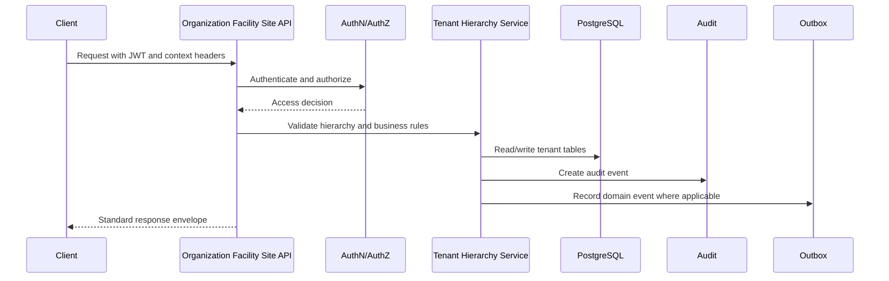
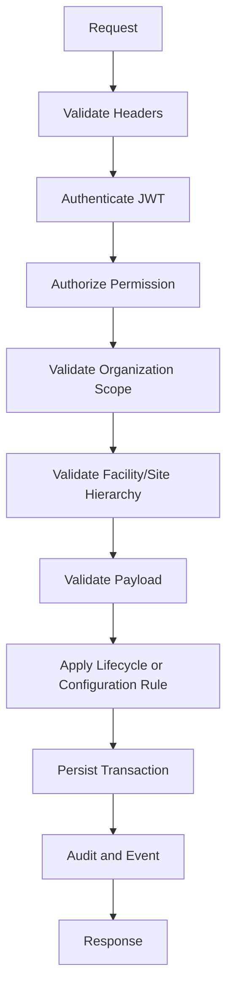

# (status banner removed to preserve metadata `Status: Design Draft`)
# API-02 Organization, Facility and Site Collection
# API-02 Organization, Facility and Site Collection

**Document ID:** API-02  
**Document Name:** Organization, Facility and Site Collection  
**Company:** OreeOn Technologies Pvt. Ltd.  
**Product:** Digitize  
**Document Type:** API Collection Documentation  
**Backend Technology:** FastAPI  
**Database Engine:** PostgreSQL  
**Authentication:** JWT  
**API Version:** v1  
**Document Version:** 0.1  
**Status:** Design Draft  
**Owner:** API Architecture  
**Reviewer:** Solution Architecture / Security Architecture / Backend Engineering  
**Dependencies:** API-00, FR-03, FR-04, FR-05, BA-03, BA-04, DB-11  
**Last Updated:** 2026-07-26

---

# 1. Document Metadata

| Attribute | Value |
|---|---|
| Document ID | API-02 |
| Document Name | Organization, Facility and Site Collection |
| Output File | API-02_Organization_Facility_Site_Collection.md |
| API Version | v1 |
| Document Version | 0.1 |
| Status | Design Draft |
| Governing Standard | API-00_API_Collection_Standards.md |

---

# 2. Purpose

This document defines REST API contracts for Organization, Facility, and Site management in Digitize.

The collection supports tenant hierarchy creation, profile management, settings, policies, documents metadata, lifecycle governance, dashboards, capacity and operating configuration, and hierarchy validation while preserving multi-tenant isolation.

---

# 3. Scope

In scope:

- Organization creation, profile update, settings, policies, branding metadata, documents metadata, activation, suspension, archival, and dashboard retrieval.
- Facility creation, detail update, facility type assignment, settings, policies, operating hours, capacity limits, manager assignment, activation, suspension, archival, and dashboard retrieval.
- Site creation, detail update, settings, policies, operating hours, capacity limits, documents metadata, activation, suspension, archival, and dashboard retrieval.
- Organization, Facility, and Site hierarchy validation.
- Tenant-scoped authorization, audit events, domain events, notifications, and traceability.

Out of scope:

- Platform global configuration owned by API-01.
- User, role, permission, and staff access APIs owned by API-03.
- Customer, membership, attendance, billing, payment, and notification execution APIs.
- Raw file upload/download content for documents. This requires approved file-handling APIs and storage design.

---

# 4. Business Context

Digitize uses the hierarchy Platform > Organization > Facility > Site.

Organization, Facility, and Site APIs establish the operational structure used by customers, memberships, attendance, trainers, billing, reporting, support, notifications, and audit. Incorrect hierarchy management can create tenant isolation issues, operational reporting errors, and authorization defects.

---

# 5. Domain Overview

| Domain Area | Description | Source |
|---|---|---|
| Organization Management | Tenant profile, settings, policies, branding, lifecycle, documents, dashboard | FR-03 |
| Facility Management | Facility profile, type, settings, operating hours, capacity, manager, lifecycle, dashboard | FR-04 |
| Site Management | Site profile, settings, operating hours, capacity, policies, documents, lifecycle, dashboard | FR-05 |

---

# 6. Actors and Access Model

| Actor | Access Model |
|---|---|
| Platform Administrator | Platform-level JWT permissions for tenant onboarding and lifecycle actions |
| Organization Administrator | Tenant JWT plus Organization scope |
| Facility Manager | Tenant JWT plus Facility scope |
| Site Administrator | Tenant JWT plus Site scope |
| Implementation Team | Controlled setup access during onboarding |
| Reporting Administrator | Scoped dashboard/report access |

---

# 7. API Classification

| Endpoint Group | API Classification | Data Classification |
|---|---|---|
| Organization profile and lifecycle | Tenant / Platform | Confidential |
| Organization settings and policies | Tenant | Confidential |
| Facility profile, settings, policies | Facility | Confidential |
| Site profile, settings, policies | Site | Confidential |
| Dashboard endpoints | Tenant / Facility / Site | Confidential |
| Document metadata | Tenant / Facility / Site | Restricted where compliance-sensitive |

---

# 8. Resource Model

| Resource | URL Base | Approved Database Mapping |
|---|---|---|
| Organizations | `/api/v1/organizations` | `tenant.organization` |
| Organization Settings | `/api/v1/organizations/{organization_id}/settings` | `tenant.organization_setting` |
| Organization Policies | `/api/v1/organizations/{organization_id}/policies` | `tenant.organization_policy` |
| Organization Documents | `/api/v1/organizations/{organization_id}/documents` | `tenant.organization_document` |
| Facilities | `/api/v1/facilities` | `tenant.facility` |
| Facility Settings | `/api/v1/facilities/{facility_id}/settings` | `tenant.facility_setting` |
| Facility Policies | `/api/v1/facilities/{facility_id}/policies` | `tenant.facility_policy` |
| Facility Types | `/api/v1/facility-types` | `tenant.facility_type` |
| Sites | `/api/v1/sites` | `tenant.site` |
| Site Settings | `/api/v1/sites/{site_id}/settings` | `tenant.site_setting` |
| Site Policies | `/api/v1/sites/{site_id}/policies` | `tenant.site_policy` |

---

# 9. API Endpoint Catalogue

| Endpoint ID | Method | URL | Endpoint Name | FR Mapping |
|---|---|---|---|---|
| API-02-001 | POST | `/api/v1/organizations` | Create Organization Profile | FR-ORG-001 |
| API-02-002 | PATCH | `/api/v1/organizations/{organization_id}` | Update Organization Profile | FR-ORG-002 |
| API-02-003 | PATCH | `/api/v1/organizations/{organization_id}/settings/{setting_key}` | Configure Organization Setting | FR-ORG-003 |
| API-02-004 | POST | `/api/v1/organizations/{organization_id}/policies` | Configure Organization Policy | FR-ORG-004 |
| API-02-005 | POST | `/api/v1/organizations/{organization_id}/activate` | Activate Organization (PA approval for initial onboarding changes; also compatible PA activate) | FR-ORG-007 / DR-021 |
| API-02-006 | POST | `/api/v1/organizations/{organization_id}/suspend` | Suspend Organization | FR-ORG-008 |
| API-02-007 | POST | `/api/v1/facilities` | Create Facility | FR-FAC-001 |
| API-02-008 | PATCH | `/api/v1/facilities/{facility_id}` | Update Facility Details | FR-FAC-002 |
| API-02-009 | PATCH | `/api/v1/facilities/{facility_id}/settings/{setting_key}` | Configure Facility Setting | FR-FAC-003 |
| API-02-010 | POST | `/api/v1/facilities/{facility_id}/activate` | Activate Facility | FR-FAC-008 |
| API-02-011 | POST | `/api/v1/sites` | Create Site | FR-SIT-001 |
| API-02-012 | PATCH | `/api/v1/sites/{site_id}` | Update Site Details | FR-SIT-002 |
| API-02-013 | PATCH | `/api/v1/sites/{site_id}/settings/{setting_key}` | Configure Site Setting | FR-SIT-003 |
| API-02-014 | POST | `/api/v1/sites/{site_id}/activate` | Activate Site | FR-SIT-007 |
| API-02-015 | GET | `/api/v1/organizations` | List Organizations | FR-ORG-001 |
| API-02-016 | GET | `/api/v1/organizations/{organization_id}` | View Organization Profile | FR-ORG-002 |
| API-02-017 | GET | `/api/v1/facilities` | List Facilities | FR-FAC-001 |
| API-02-018 | GET | `/api/v1/facilities/{facility_id}` | View Facility Details | FR-FAC-002 |
| API-02-019 | GET | `/api/v1/sites` | List Sites | FR-SIT-001 |
| API-02-020 | GET | `/api/v1/sites/{site_id}` | View Site Details | FR-SIT-002 |

---

# 10. Common Authentication Requirements

All endpoints require JWT authentication.

Authentication endpoints are not part of this collection. Token issuance, refresh, logout, and session management are owned by API-03.

---

# 11. Common Authorization Requirements

Authorization shall validate:

- Platform scope for Organization creation and tenant lifecycle decisions where required.
- Organization scope for tenant-owned configuration.
- Facility scope for Facility operations.
- Site scope for Site operations.
- Role and permission.
- Subscription, license, and feature entitlement where applicable.
- Object-level authorization for Organization, Facility, and Site resources.

---

# 12. Tenant and Resource Scope Rules

Tenant and hierarchy rules:

- `X-Organization-ID` is required for tenant-scoped Facility and Site APIs unless Organization is established through the resource.
- `X-Facility-ID` is required for Site-scoped APIs unless Facility is established through the resource.
- A Facility shall belong to the supplied Organization.
- A Site shall belong to the supplied Facility and Organization.
- Context headers shall not grant access.
- Cross-tenant resource access may return 404 where disclosure is unsafe.

---

# 13. Common Header Requirements

| Header | Required | Purpose |
|---|---|---|
| Authorization | Yes | JWT authentication |
| Accept | Yes | `application/json` |
| Content-Type | Conditional | Required for request bodies |
| X-Correlation-ID | Required or generated | Traceability |
| X-Organization-ID | Required for tenant scope | Organization context |
| X-Facility-ID | Required for Facility/Site scope | Facility context |
| X-Site-ID | Required for Site-only operations where applicable | Site context |
| If-Match | Required for protected updates/actions | Concurrency |
| Idempotency-Key | Required for create/lifecycle actions | Retry safety |

---

# 14. Request and Data Format Rules

- JSON fields shall use snake_case.
- UUID values shall be canonical lowercase UUID strings.
- Date-time fields shall use UTC RFC 3339.
- Address, contact, policy, setting, and metadata payloads shall be validated against approved schemas where available.
- `metadata` shall not bypass normalized Organization, Facility, Site, lifecycle, or tenant fields.

---

# 15. Standard Response Usage

All endpoints use API-00 success and error envelopes.

Create endpoints shall return `201 Created` and `Location`. Long-running dashboard/report retrieval shall not run unbounded synchronous queries.

---

# 16. Module Error Codes

| Error Code | HTTP Status | Category | Safe Message | Retryable |
|---|---|---|---|---|
| TENANT_AUTHORIZATION_001 | 403 | Authorization | User is not authorized for this tenant operation. | No |
| TENANT_SCOPE_001 | 404 | Authorization | Requested resource is unavailable. | No |
| ORG_VALIDATION_001 | 422 | Validation | Organization request validation failed. | No |
| FACILITY_VALIDATION_001 | 422 | Validation | Facility request validation failed. | No |
| SITE_VALIDATION_001 | 422 | Validation | Site request validation failed. | No |
| HIERARCHY_CONFLICT_001 | 409 | Conflict | Resource hierarchy validation failed. | No |
| TENANT_CONCURRENCY_001 | 412 | Conflict | Resource changed before the request was processed. | Yes |
| TENANT_IDEMPOTENCY_001 | 409 | Conflict | Idempotency key conflicts with a previous request. | No |

---

# 17. Pagination Profile

Offset pagination applies to Organization, Facility, Site, setting, policy, document metadata, and dashboard list endpoints.

Default `page_size` is 20. Maximum `page_size` is 100.

Cursor pagination is not used in this collection unless future high-volume operational histories are approved.

---

# 18. Filtering Rules

| Filter | Applies To |
|---|---|
| status | Organization, Facility, Site lifecycle lists |
| business_status | Organization |
| facility_status | Facility |
| site_status | Site |
| facility_type_id | Facility |
| organization_id | Facility, Site |
| facility_id | Site |
| is_active | Settings, policies |
| from_date / to_date | Dashboard and lifecycle history projections |

---

# 19. Sorting Rules

Approved sort fields:

- `created_at`.
- `updated_at`.
- `organization_code`.
- `legal_name`.
- `facility_code`.
- `facility_name`.
- `site_code`.
- `site_name`.
- `business_status`.
- `facility_status`.
- `site_status`.

---

# 20. Search Rules

Search is limited to approved textual fields such as organization code, legal name, facility code, facility name, site code, site name, and contact values where authorized.

Minimum search length is 2 characters. Maximum search length is 100 characters.

---

# 21. Rate Limiting

Rate limiting shall protect Organization creation, lifecycle actions, dashboard retrieval, and search endpoints.

Repeated failed cross-tenant access attempts shall be logged and may trigger security alerts.

---

# 22. Caching

Caching may be used for active facility types and read-only dashboard summaries with a documented TTL.

Caching shall not be used without invalidation for Organization, Facility, Site settings, policies, lifecycle status, or permission-sensitive dashboard responses.

---

# 23. Idempotency

Required for:

- Create Organization.
- Create Facility.
- Create Site.
- Activate, suspend, and archive lifecycle actions.

Supported for setting and policy updates where clients provide retry keys.

---

# 24. Optimistic Concurrency

Required for:

- Organization profile updates.
- Organization setting and policy updates.
- Organization lifecycle actions.
- Facility updates and lifecycle actions.
- Site updates and lifecycle actions.

Protected endpoints shall require `If-Match`.

---

# 25. Transaction Boundaries

- Create Organization shall atomically create the Organization record and audit event.
- Create Facility shall atomically validate Organization ownership, create Facility, and audit.
- Create Site shall atomically validate Organization/Facility ownership, create Site, and audit.
- Settings and policy updates shall atomically update the configuration record and audit event.
- Lifecycle actions shall atomically change status, create lifecycle audit evidence, and record notification/event eligibility.

---

# 26. Asynchronous Operations

Asynchronous processing may be used for:

- Organization activation notifications.
- Facility activation notifications.
- Site activation notifications.
- Dashboard projection refresh.
- Document scanning workflows where file handling is later approved.

---

# 27. Bulk Operations

Not Applicable — No approved bulk Organization, Facility, or Site API is defined for v1.

---

# 28. File Handling

Document metadata endpoints may reference Organization documents, but raw file upload and download processing is not defined in this collection.

File handling shall use S3-compatible object storage with PostgreSQL metadata and ClamAV scanning per `DR-014_S3_Compatible_Object_Storage_File_Scanning_Baseline.md`. This collection may reference metadata only unless a dedicated file API endpoint is defined.

---

# 29. API Endpoints

Each endpoint in this section inherits API-00 Common Endpoint Documentation Template. The following contract matrix defines endpoint-specific implementation requirements.

| Endpoint ID | Business Purpose | AuthZ Permission | Request Body | Success | DB Mapping | Audit Event | Domain Event | Tests |
|---|---|---|---|---|---|---|---|---|
| API-02-001 | Create Organization profile during onboarding | `organization.create` or platform onboarding permission | Organization code, legal name, contact, address, metadata | 201 with Organization | `tenant.organization` INSERT, `audit.audit_event` INSERT | ORGANIZATION_CREATED | organization.created | Positive, duplicate code, validation, idempotency, audit |
| API-02-002 | Update Organization profile | `organization.profile.update` | Mutable profile fields, change_reason | 200 with Organization | `tenant.organization` UPDATE, `audit.audit_event` INSERT | ORGANIZATION_UPDATED | organization.updated | Positive, stale ETag, authorization, validation |
| API-02-003 | Configure Organization setting | `organization.settings.update` | setting_value, effective_at, change_reason | 200 with setting | `tenant.organization_setting` UPSERT/UPDATE, `audit.audit_event` INSERT | ORGANIZATION_SETTING_UPDATED | organization.setting.updated | Schema validation, ETag, tenant isolation |
| API-02-004 | Configure Organization policy | `organization.policies.create` | policy_code, policy_payload, effective_at | 201 with policy | `tenant.organization_policy` INSERT, `audit.audit_event` INSERT | ORGANIZATION_POLICY_CREATED | organization.policy.created | Policy validation, duplicate policy, audit |
| API-02-005 | Activate Organization (PA onboarding approval path; auto-ACTIVE via ORG-ONBOARDING-ACCEPT when no initial changes) | `organization.activate` | activation_reason | 200 with active Organization | `tenant.organization` UPDATE, `audit.audit_event` INSERT | ORGANIZATION_ACTIVATED | organization.activated | State transition, onboarding review, audit |
| API-02-006 | Suspend Organization | `organization.suspend` | suspension_reason, effective_at | 200 with suspended Organization | `tenant.organization` UPDATE, `audit.audit_event` INSERT | ORGANIZATION_SUSPENDED | organization.suspended | Forbidden state, impact, notification |
| API-02-007 | Create Facility under Organization | `facility.create` | facility_type_id, facility_code, facility_name, address | 201 with Facility | `tenant.facility` INSERT, `audit.audit_event` INSERT | FACILITY_CREATED | facility.created | Hierarchy, duplicate code, entitlement |
| API-02-008 | Update Facility details | `facility.update` | Mutable facility fields, change_reason | 200 with Facility | `tenant.facility` UPDATE, `audit.audit_event` INSERT | FACILITY_UPDATED | facility.updated | Facility scope, stale ETag |
| API-02-009 | Configure Facility setting | `facility.settings.update` | setting_value, effective_at, change_reason | 200 with setting | `tenant.facility_setting` UPSERT/UPDATE, `audit.audit_event` INSERT | FACILITY_SETTING_UPDATED | facility.setting.updated | Facility hierarchy, schema validation |
| API-02-010 | Activate Facility | `facility.activate` | activation_reason | 200 with active Facility | `tenant.facility` UPDATE, `audit.audit_event` INSERT | FACILITY_ACTIVATED | facility.activated | State transition, capacity readiness |
| API-02-011 | Create Site under Facility | `site.create` | site_code, site_name, facility_id, operating metadata | 201 with Site | `tenant.site` INSERT, `audit.audit_event` INSERT | SITE_CREATED | site.created | Hierarchy, duplicate code, capacity |
| API-02-012 | Update Site details | `site.update` | Mutable site fields, change_reason | 200 with Site | `tenant.site` UPDATE, `audit.audit_event` INSERT | SITE_UPDATED | site.updated | Site scope, stale ETag |
| API-02-013 | Configure Site setting | `site.settings.update` | setting_value, effective_at, change_reason | 200 with setting | `tenant.site_setting` UPSERT/UPDATE, `audit.audit_event` INSERT | SITE_SETTING_UPDATED | site.setting.updated | Site hierarchy, schema validation |
| API-02-014 | Activate Site | `site.activate` | activation_reason | 200 with active Site | `tenant.site` UPDATE, `audit.audit_event` INSERT | SITE_ACTIVATED | site.activated | Readiness, state transition, audit |

Common endpoint requirements:

- Headers: `Authorization`, `Accept`, `Content-Type` for request bodies, `X-Correlation-ID`, `X-Organization-ID` where tenant-scoped, `X-Facility-ID` where Facility/Site-scoped, `If-Match` for protected updates, `Idempotency-Key` for create/lifecycle actions.
- Path parameters: all `{organization_id}`, `{facility_id}`, `{site_id}`, `{setting_key}`, and `{policy_id}` values shall be canonical UUID or approved code strings as documented by endpoint.
- Validation: request fields shall use snake_case, immutable fields shall not be modified, hierarchy shall be validated, lifecycle transitions shall validate current state.
- Error responses: authentication 401, authorization 403, undisclosed cross-tenant 404, conflict 409, concurrency 412, validation 422, rate limit 429.

---

# 30. Module Sequence Diagrams

---

# 31. Request Flow Diagrams

---

# 32. Database Mapping Summary

| Area | Tables |
|---|---|
| Organization | `tenant.organization`, `tenant.organization_setting`, `tenant.organization_policy`, `tenant.organization_document` |
| Facility | `tenant.facility`, `tenant.facility_type`, `tenant.facility_setting`, `tenant.facility_policy` |
| Site | `tenant.site`, `tenant.site_setting`, `tenant.site_policy` |
| Audit | `audit.audit_event`, `audit.audit_entity_reference` |

---

# 33. Domain Event and Outbox Mapping

| Event Category | Events | Outbox Mapping |
|---|---|---|
| Organization | organization.created, organization.updated, organization.activated, organization.suspended | TBD — Owner: Business Analysis (Org/Facility); Action: supply BA/FR IDs and DB table names. |
 facility.updated, facility.updated, facility.activated, facility.suspended | [CTO ACTION REQUIRED — provide authoritative DB/API mapping or 'Not Applicable — reason'] |
 site.updated, site.updated, site.activated, site.suspended | [CTO ACTION REQUIRED — provide authoritative DB/API mapping or 'Not Applicable — reason'] |
 facility.setting.updated, facility.setting.updated, site.setting.updated | [CTO ACTION REQUIRED — provide authoritative DB/API mapping or 'Not Applicable — reason'] |

---

# 34. Audit Mapping

| Audit Event | Source |
|---|---|
| ORGANIZATION_CREATED / UPDATED / ACTIVATED / SUSPENDED / ARCHIVED | FR-ORG-001 to FR-ORG-009 |
| ORGANIZATION_SETTING_UPDATED / ORGANIZATION_POLICY_CREATED | FR-ORG-003, FR-ORG-004 |
| FACILITY_CREATED / UPDATED / ACTIVATED / SUSPENDED / ARCHIVED | FR-FAC-001 to FR-FAC-010 |
| FACILITY_SETTING_UPDATED / FACILITY_POLICY_UPDATED | FR-FAC-003, FR-FAC-012 |
| SITE_CREATED / UPDATED / ACTIVATED / SUSPENDED / ARCHIVED | FR-SIT-001 to FR-SIT-009 |
| SITE_SETTING_UPDATED / SITE_POLICY_UPDATED | FR-SIT-003, FR-SIT-011 |

---

# 35. Notification Mapping

Notifications are asynchronous and may be triggered for Organization activation/suspension, Facility activation/suspension, Site activation/suspension, critical policy changes, and onboarding completion.

Notification template and delivery APIs are owned by API-10.

---

# 36. Functional Requirement Mapping

| Source Document | Covered FR IDs |
|---|---|
| FR-03 Organization Management | FR-ORG-001 to FR-ORG-010 |
| FR-04 Facility Management | FR-FAC-001 to FR-FAC-012 |
| FR-05 Site Management | FR-SIT-001 to FR-SIT-011 |

---

# 37. Business Process Mapping

| Process Area | Covered Processes |
|---|---|
| Organization Management | BA-03 BP-ORG-001 to BP-ORG-010 |
| Facility Management | BA-03 BP-FAC-001 to BP-FAC-012 |
| Site Management | BA-03 BP-SIT-001 to BP-SIT-011 |
| Business Process Flows | BA-04 Sections 6, 9, 10, and 11 |

---

# 38. UI Screen Mapping

UI screen IDs are unavailable in the current source set.

| Screen Name | Usage |
|---|---|
| Organization Profile | Create/update Organization |
| Organization Settings | Configure Organization settings |
| Organization Policies | Manage policies |
| Facility Management | Create/update Facility |
| Facility Settings | Configure Facility settings |
| Site Management | Create/update Site |
| Site Settings | Configure Site settings |
| Organization Dashboard | View Organization dashboard |
| Facility Dashboard | View Facility dashboard |
| Site Dashboard | View Site dashboard |

---

# 39. Security Considerations

- Enforce tenant isolation for every endpoint.
- Validate hierarchy before object access.
- Use 404 instead of 403 where resource existence disclosure is unsafe.
- Prevent mass assignment of `organization_id`, `facility_id`, `site_id`, lifecycle fields, and audit fields.
- Restrict lifecycle actions to authorized roles.
- Mask restricted document metadata and compliance data.

---

# 40. Performance and Scalability

- Use indexes `idx_organization_status`, `idx_facility_org_status`, and `idx_site_facility_status`.
- Paginate all lists.
- Avoid loading full hierarchy graphs unless specifically requested.
- Dashboard endpoints shall use approved reporting projections where available.

---

# 41. Observability

Track request count, latency, authorization failures, hierarchy-validation failures, lifecycle-transition failures, audit insert failures, and domain-event creation failures.

Security alerts shall be considered for repeated cross-tenant access attempts.

---

# 42. Test Coverage Summary

Required coverage: positive, validation, duplicate code, hierarchy mismatch, authorization, tenant isolation, lifecycle transition, concurrency, idempotency, audit, notification eligibility, and dashboard performance.

---

# 43. Assumptions and Constraints

- DB-11 is the approved database table source.
- UI screen IDs are not available; screen names are mapped from FR documents.
- Outbox table mapping is `integration.outbox_event` from `DB-11_Database_DDL_DML_Scripts.md`.
- Raw document file handling is not defined in this collection.

---

# 44. Dependencies

| Dependency | Description |
|---|---|
| API-00 | Governing API standard |
| API-01 | Platform master data and facility type governance |
| API-03 | User, role, access-scope, and staff assignment |
| API-10 | Notifications |
| API-11 | Dashboard/report projections |
| API-13 | Audit and security queries |
| DB-11 | PostgreSQL table mappings |

---

# 45. Future Enhancements

- Approved file APIs for Organization, Facility, and Site documents.
- Bulk import for onboarding multiple sites.
- Approval workflows for high-risk lifecycle actions.
- Expanded dashboard projections.

---

# 46. Document Acceptance Criteria

This document is acceptable when it follows API-00, maps approved FR/BA/DB sources, preserves tenant hierarchy, uses snake_case, defines endpoint contracts, and avoids unsupported source invention.

---

# 47. Summary

API-02 defines Organization, Facility, and Site API contracts for Digitize. It establishes tenant hierarchy management while preserving authorization, tenant isolation, auditability, traceability, lifecycle governance, and scalability.
