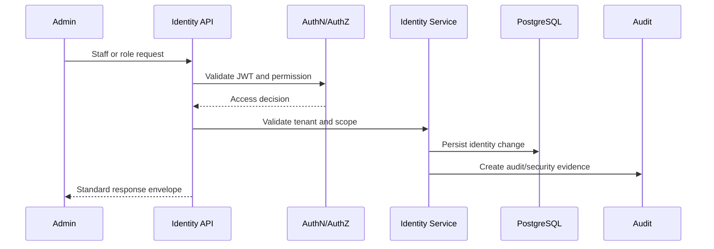
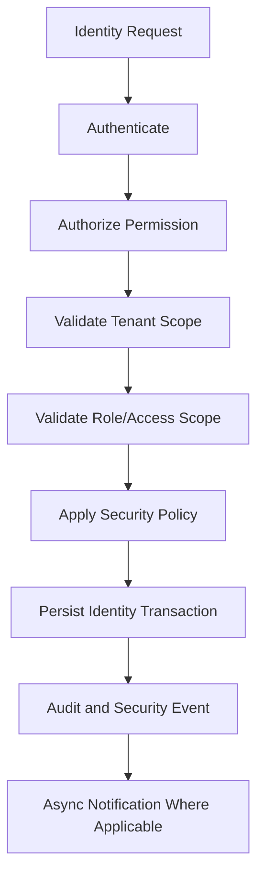

# (status banner removed to preserve metadata `Status: Design Draft`)
# API-03 Identity, User and Role Collection

**Document ID:** API-03  
**Document Name:** Identity, User and Role Collection  
**Company:** OreeOn Technologies Pvt. Ltd.  
**Product:** Digitize  
**Document Type:** API Collection Documentation  
**Backend Technology:** FastAPI  
**Database Engine:** PostgreSQL  
**Authentication:** JWT  
**API Version:** v1  
**Document Version:** 0.1  
**Status:** Design Draft  
**Owner:** API Architecture  
**Reviewer:** Solution Architecture / Security Architecture / Backend Engineering  
**Dependencies:** API-00, FR-06, BA-03, BA-04, DB-11  
**Last Updated:** 2026-07-26

---

# 1. Document Metadata

| Attribute | Value |
|---|---|
| Document ID | API-03 |
| Document Name | Identity, User and Role Collection |
| Output File | API-03_Identity_User_Role_Collection.md |
| API Version | v1 |
| Document Version | 0.1 |
| Status | Design Draft |
| Governing Standard | API-00_API_Collection_Standards.md |

---

# 2. Purpose

This document defines API contracts for identity, staff accounts, role assignment, permissions, access scopes, credential reset, staff lifecycle, activity review, and staff directory access.

---

# 3. Scope

In scope:

- Staff account creation and profile update.
- Role assignment and permission configuration.
- Facility and Site access assignment.
- Staff activation, suspension, credential reset, deactivation.
- Staff activity and directory retrieval.
- Authentication-ready controls supporting login, session, and security event integration.

Out of scope:

- Customer self-service identity.
- MFA implementation beyond readiness.
- Platform security policy mutation, owned by API-01.
- Organization, Facility, and Site resource mutation, owned by API-02.

---

# 4. Business Context

Digitize requires controlled staff access across Organization, Facility, and Site scopes. Identity and role APIs enforce least privilege, role-based access, permission-based authorization, and auditable staff lifecycle management.

---

# 5. Domain Overview

| Capability | Description | Source |
|---|---|---|
| Staff Account | Create and manage user account and staff profile | FR-USR-001, FR-USR-002 |
| Role Assignment | Assign roles to staff | FR-USR-003 |
| Access Scope | Assign Facility and Site access | FR-USR-004, FR-USR-005 |
| Permission Configuration | Configure staff permissions through roles | FR-USR-006 |
| Staff Lifecycle | Activate, suspend, reset credentials, deactivate | FR-USR-007 to FR-USR-010 |
| Staff Activity | View staff activity and directory | FR-USR-011, FR-USR-012 |

---

# 6. Actors and Access Model

| Actor | Access Model |
|---|---|
| Organization Administrator | Organization-scoped user and role administration |
| Facility Manager | Facility-scoped staff visibility and limited access management |
| Site Administrator | Site-scoped staff visibility |
| Platform Administrator | Platform governance and support access where approved |
| Security Administrator | Credential reset, suspension, policy-aligned access review |

---

# 7. API Classification

| Endpoint Group | API Classification | Data Classification |
|---|---|---|
| Staff account mutation | Tenant | Restricted |
| Staff profile read/update | Tenant | Confidential |
| Role and permission assignment | Tenant | Restricted |
| Access scope assignment | Tenant / Facility / Site | Restricted |
| Credential reset | Tenant | Restricted |
| Staff activity | Tenant | Restricted |
| Staff directory | Tenant | Confidential |

---

# 8. Resource Model

| Resource | URL Base | Approved Database Mapping |
|---|---|---|
| User Accounts | `/api/v1/identity/users` | `identity.user_account` |
| Staff Profiles | `/api/v1/identity/staff-profiles` | `identity.staff_profile` |
| Roles | `/api/v1/identity/roles` | `identity.role` |
| Permissions | `/api/v1/identity/permissions` | `identity.permission` |
| Role Permissions | `/api/v1/identity/roles/{role_id}/permissions` | `identity.role_permission` |
| Access Scopes | `/api/v1/identity/access-scopes` | `identity.access_scope` |
| Role Assignments | `/api/v1/identity/role-assignments` | `identity.role_assignment` |
| Sessions | `/api/v1/identity/sessions` | `identity.user_session` |
| Authentication Events | `/api/v1/identity/authentication-events` | `security.authentication_event` |

---

# 9. API Endpoint Catalogue

| Endpoint ID | Method | URL | Endpoint Name | FR Mapping |
|---|---|---|---|---|
| API-03-001 | POST | `/api/v1/identity/staff-accounts` | Create Staff Account | FR-USR-001 |
| API-03-002 | PATCH | `/api/v1/identity/staff-profiles/{staff_profile_id}` | Update Staff Profile | FR-USR-002 |
| API-03-003 | POST | `/api/v1/identity/role-assignments` | Assign Staff Role | FR-USR-003 |
| API-03-004 | POST | `/api/v1/identity/access-scopes/facility` | Assign Facility Access | FR-USR-004 |
| API-03-005 | POST | `/api/v1/identity/access-scopes/site` | Assign Site Access | FR-USR-005 |
| API-03-006 | PATCH | `/api/v1/identity/roles/{role_id}/permissions` | Configure Staff Permissions | FR-USR-006 |
| API-03-007 | POST | `/api/v1/identity/users/{user_id}/activate` | Activate Staff Account | FR-USR-007 |
| API-03-008 | POST | `/api/v1/identity/users/{user_id}/suspend` | Suspend Staff Account | FR-USR-008 |
| API-03-009 | POST | `/api/v1/identity/users/{user_id}/credential-reset` | Reset Staff Credentials | FR-USR-009 |
| API-03-010 | POST | `/api/v1/identity/users/{user_id}/deactivate` | Deactivate Staff Account | FR-USR-010 |
| API-03-011 | GET | `/api/v1/identity/users/{user_id}/activity` | View Staff Activity | FR-USR-011 |
| API-03-012 | GET | `/api/v1/identity/staff-directory` | View Staff Directory | FR-USR-012 |

---

# 10. Common Authentication Requirements

Authenticated staff-management endpoints require JWT. Credential reset APIs require additional security validation, audit, and may require re-authentication or elevated permission.

Login and refresh endpoints are `TBD — Owner: Security Architecture; Action: supply authentication FR and endpoint IDs (login/refresh) or confirm delegated auth.` because FR-06 covers staff/user management rather than a dedicated authentication FRS section.

---

# 11. Common Authorization Requirements

Authorization shall validate Organization scope, Facility scope, Site scope, role, permission, ownership, least privilege, and administrative access policy.

Role and permission assignment shall require elevated permissions and shall not allow users to grant permissions they do not control.

---

# 12. Tenant and Resource Scope Rules

- `X-Organization-ID` is required for tenant staff APIs.
- `X-Facility-ID` is required for Facility access operations.
- `X-Site-ID` is required for Site access operations.
- Access scope shall be validated against Organization > Facility > Site hierarchy.
- A staff user shall not receive cross-tenant role assignments.

---

# 13. Common Header Requirements

| Header | Required | Purpose |
|---|---|---|
| Authorization | Yes | JWT authentication |
| Accept | Yes | Response media type |
| Content-Type | Conditional | Required for request bodies |
| X-Correlation-ID | Required or generated | Traceability |
| X-Organization-ID | Yes | Tenant scope |
| X-Facility-ID | Conditional | Facility scope |
| X-Site-ID | Conditional | Site scope |
| If-Match | Required for protected updates | Concurrency |
| Idempotency-Key | Required for create/lifecycle/security actions | Retry safety |

---

# 14. Request and Data Format Rules

All payloads use snake_case. Passwords, temporary credentials, reset tokens, access tokens, refresh tokens, and secrets shall never be returned in response bodies or logs.

---

# 15. Standard Response Usage

All endpoints use API-00 envelopes. Credential reset responses shall be generic and shall not disclose sensitive account state beyond approved administrative context.

---

# 16. Module Error Codes

| Error Code | HTTP Status | Category | Safe Message | Retryable |
|---|---|---|---|---|
| IDENTITY_AUTHORIZATION_001 | 403 | Authorization | User is not authorized for this identity action. | No |
| IDENTITY_VALIDATION_001 | 422 | Validation | Identity request validation failed. | No |
| IDENTITY_CONFLICT_001 | 409 | Conflict | Identity resource state conflicts with the request. | No |
| IDENTITY_SCOPE_001 | 404 | Authorization | Requested identity resource is unavailable. | No |
| IDENTITY_CONCURRENCY_001 | 412 | Conflict | Identity resource changed before the request completed. | Yes |
| IDENTITY_SECURITY_001 | 403 | Security | Security policy prevents the requested action. | No |

---

# 17. Pagination Profile

Offset pagination applies to staff directory, activity summaries where not high-volume, roles, permissions, and assignments.

Cursor pagination may apply to authentication events and high-volume staff activity histories.

---

# 18. Filtering Rules

Approved filters include `account_status`, `staff_status`, `role_id`, `permission_code`, `facility_id`, `site_id`, `assignment_status`, `from_date`, and `to_date`.

---

# 19. Sorting Rules

Approved sort fields include `created_at`, `updated_at`, `login_identifier`, `staff_code`, `display_name`, `role_name`, `account_status`, and `effective_at`.

---

# 20. Search Rules

Search is limited to staff code, display name, login identifier, role name, and permission code where authorized.

Minimum search length is 2 characters and maximum is 100 characters.

---

# 21. Rate Limiting

Rate limiting shall protect credential reset, activation, suspension, deactivation, permission assignment, and activity queries.

---

# 22. Caching

Permission catalogs may be cached with invalidation on permission or role changes. Permission decisions shall not be cached without a strict invalidation strategy.

---

# 23. Idempotency

Required for create staff account, role assignment, access assignment, activation, suspension, credential reset, and deactivation.

---

# 24. Optimistic Concurrency

Required for staff profile updates, role permission changes, access assignment changes, and lifecycle actions.

---

# 25. Transaction Boundaries

Staff account creation shall atomically create `identity.user_account`, `identity.staff_profile`, role/access records where included, and audit evidence.

Role and access assignment shall atomically validate scope, persist assignment, and audit.

Credential reset shall atomically create reset evidence and audit; credential delivery is asynchronous where applicable.

---

# 26. Asynchronous Operations

Asynchronous processing may be used for credential-reset notification, activation notification, suspension notification, and security event processing.

---

# 27. Bulk Operations

Not Applicable — Bulk identity administration is not approved for v1.

---

# 28. File Handling

Not Applicable — Staff profile document uploads are not defined in FR-06 or DB-11 for this collection.

---

# 29. API Endpoints

Each endpoint inherits API-00 Common Endpoint Documentation Template.

| Endpoint ID | Business Purpose | AuthZ Permission | Success | DB Mapping | Audit Event | Domain Event | Tests |
|---|---|---|---|---|---|---|---|
| API-03-001 | Create user account and staff profile | `staff.create` | 201 with staff account/profile references | `identity.user_account` INSERT, `identity.staff_profile` INSERT, `audit.audit_event` INSERT | STAFF_ACCOUNT_CREATED | staff.account.created | Duplicate login, tenant scope, idempotency |
| API-03-002 | Update staff profile | `staff.update` | 200 with profile | `identity.staff_profile` UPDATE, `audit.audit_event` INSERT | STAFF_PROFILE_UPDATED | staff.profile.updated | Stale ETag, validation, scope |
| API-03-003 | Assign role | `staff.role.assign` | 201 with role assignment | `identity.role_assignment` INSERT, `identity.role` READ, `audit.audit_event` INSERT | STAFF_ROLE_ASSIGNED | staff.role.assigned | Least privilege, duplicate assignment |
| API-03-004 | Assign Facility access | `staff.access.facility.assign` | 201 with access scope | `identity.access_scope` INSERT, `identity.role_assignment` UPDATE/INSERT | FACILITY_ACCESS_ASSIGNED | staff.access.assigned | Facility hierarchy, tenant isolation |
| API-03-005 | Assign Site access | `staff.access.site.assign` | 201 with access scope | `identity.access_scope` INSERT, `identity.role_assignment` UPDATE/INSERT | SITE_ACCESS_ASSIGNED | staff.access.assigned | Site hierarchy, scope validation |
| API-03-006 | Configure role permissions | `role.permissions.update` | 200 with permission set | `identity.role_permission` INSERT/DELETE, `identity.permission` READ | ROLE_PERMISSION_UPDATED | role.permission.updated | Least privilege, cache invalidation |
| API-03-007 | Activate staff account | `staff.activate` | 200 with active account | `identity.user_account` UPDATE, `audit.audit_event` INSERT | STAFF_ACCOUNT_ACTIVATED | staff.account.activated | State transition |
| API-03-008 | Suspend staff account | `staff.suspend` | 200 with suspended account | `identity.user_account` UPDATE, `identity.user_session` UPDATE | STAFF_ACCOUNT_SUSPENDED | staff.account.suspended | Session invalidation |
| API-03-009 | Reset credentials | `staff.credentials.reset` | 202 accepted | `security.authentication_event` INSERT, `audit.audit_event` INSERT | STAFF_CREDENTIAL_RESET_REQUESTED | staff.credential_reset.requested | Security, rate limit, notification |
| API-03-010 | Deactivate staff account | `staff.deactivate` | 200 with deactivated account | `identity.user_account` UPDATE, `identity.role_assignment` UPDATE | STAFF_ACCOUNT_DEACTIVATED | staff.account.deactivated | Active dependency checks |
| API-03-011 | View staff activity | `staff.activity.view` | 200 with activity | `security.authentication_event`, `audit.audit_event` READ | STAFF_ACTIVITY_VIEWED | Not Applicable | Cursor pagination, restricted data |
| API-03-012 | View staff directory | `staff.directory.view` | 200 with staff list | `identity.staff_profile`, `identity.user_account` READ | STAFF_DIRECTORY_VIEWED | Not Applicable | Pagination, scope filtering |

Common endpoint requirements:

- All request/response fields use snake_case.
- Lifecycle/security endpoints require `Idempotency-Key`.
- Protected updates require `If-Match`.
- Cross-tenant user, role, permission, or access-scope attempts may return 404.

---

# 30. Module Sequence Diagrams

---

# 31. Request Flow Diagrams

---

# 32. Database Mapping Summary

| Area | Tables |
|---|---|
| Users and Staff | `identity.user_account`, `identity.staff_profile` |
| Roles and Permissions | `identity.role`, `identity.permission`, `identity.role_permission` |
| Scope and Assignment | `identity.access_scope`, `identity.role_assignment` |
| Sessions and Events | `identity.user_session`, `security.authentication_event`, `security.security_event` |
| Audit | `audit.audit_event`, `audit.audit_entity_reference` |

---

# 33. Domain Event and Outbox Mapping

Outbox table mapping is `integration.outbox_event` from `DB-11_Database_DDL_DML_Scripts.md`.

Events include staff.account.created, staff.profile.updated, staff.role.assigned, staff.access.assigned, staff.account.activated, staff.account.suspended, staff.credential_reset.requested, and staff.account.deactivated.

---

# 34. Audit Mapping

Audit events include STAFF_ACCOUNT_CREATED, STAFF_PROFILE_UPDATED, STAFF_ROLE_ASSIGNED, FACILITY_ACCESS_ASSIGNED, SITE_ACCESS_ASSIGNED, ROLE_PERMISSION_UPDATED, STAFF_ACCOUNT_ACTIVATED, STAFF_ACCOUNT_SUSPENDED, STAFF_CREDENTIAL_RESET_REQUESTED, STAFF_ACCOUNT_DEACTIVATED, STAFF_ACTIVITY_VIEWED, and STAFF_DIRECTORY_VIEWED.

---

# 35. Notification Mapping

Notifications may be triggered asynchronously for staff activation, suspension, deactivation, credential reset, and security-sensitive role/permission changes.

---

# 36. Functional Requirement Mapping

| Source Document | Covered FR IDs |
|---|---|
| FR-06 User and Role Management | FR-USR-001 to FR-USR-012 |

---

# 37. Business Process Mapping

| Process Area | Covered Processes |
|---|---|
| Staff/User and Role Management | BA-03 BP-STA-001 to BP-STA-012 |
| Business Process Flow | BA-04 Section 12 User & Role Management Flow |

---

# 38. UI Screen Mapping

UI screen IDs are unavailable in the current source set.

Mapped screen names: Staff Account, Staff Profile, Role Assignment, Permission Management, Facility Access, Site Access, Credential Reset, Staff Activity, and Staff Directory.

---

# 39. Security Considerations

- Enforce least privilege.
- Prevent privilege escalation.
- Prevent self-granting elevated permissions unless explicitly authorized.
- Mask credential reset details.
- Revoke or expire sessions when accounts are suspended/deactivated.
- Audit every security-sensitive action.

---

# 40. Performance and Scalability

- Use indexes `idx_user_account_org_status`, `idx_role_assignment_user_status`, `idx_user_session_user_status`, and `idx_auth_event_user_time`.
- Paginate staff directory and activity.
- Cache permission catalog only with strict invalidation.

---

# 41. Observability

Track failed logins, credential reset requests, role changes, permission changes, suspension/deactivation events, authorization failures, tenant-scope failures, and session invalidation failures.

---

# 42. Test Coverage Summary

Required coverage: staff create/update, duplicate login, role assignment, permission escalation prevention, Facility/Site scope validation, lifecycle transitions, credential reset security, activity pagination, and audit evidence.

---

# 43. Assumptions and Constraints

[OWNER ACTION REQUIRED — Security/Identity owners: provide login/refresh endpoint mapping or confirm external provider mapping; CHG API-CHG-0011]
- MFA implementation is future-ready but not current endpoint scope.
- UI screen IDs are unavailable.
- Outbox table mapping is `integration.outbox_event`.

---

# 44. Dependencies

| Dependency | Description |
|---|---|
| API-00 | Governing API standard |
| API-02 | Organization, Facility, Site hierarchy |
| API-13 | Audit and security event query |
| API-10 | Notification delivery |
| DB-11 | Identity, security, and audit tables |

---

# 45. Future Enhancements

- MFA enrollment and verification APIs.
- Self-service profile management.
- Delegated administration.
- Bulk role assignment after approval.

---

# 46. Document Acceptance Criteria

This document is acceptable when it follows API-00, maps FR-USR-001 to FR-USR-012, enforces least privilege, preserves tenant and scope validation, and defines audit/security behavior.

---

# 47. Summary

API-03 defines Identity, User, Role, Permission, Access Scope, and Staff lifecycle APIs for Digitize. It establishes secure staff administration and authorization controls required by enterprise multi-tenant operations.
