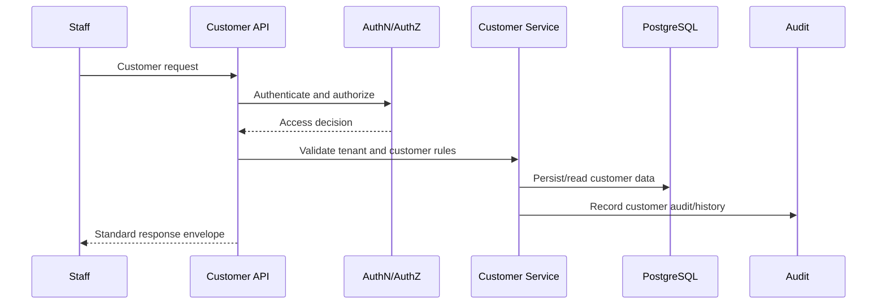
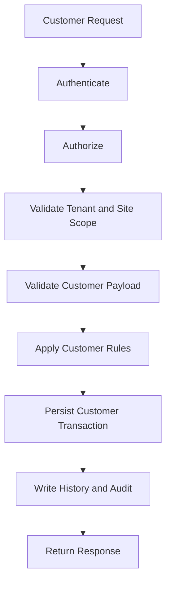

# (status banner removed to preserve metadata `Status: Design Draft`)
# API-04 Customer Management Collection

**Document ID:** API-04  
**Document Name:** Customer Management Collection  
**Company:** OreeOn Technologies Pvt. Ltd.  
**Product:** Digitize  
**Document Type:** API Collection Documentation  
**Backend Technology:** FastAPI  
**Database Engine:** PostgreSQL  
**Authentication:** JWT  
**API Version:** v1  
**Document Version:** 0.1  
**Status:** Design Draft  
**Owner:** API Architecture  
**Reviewer:** Solution Architecture / Security Architecture / Backend Engineering  
**Dependencies:** API-00, FR-07, BA-03, BA-04, DB-11  
**Last Updated:** 2026-07-26

---

# 1. Document Metadata

| Attribute | Value |
|---|---|
| Document ID | API-04 |
| Document Name | Customer Management Collection |
| Output File | API-04_Customer_Management_Collection.md |
| API Version | v1 |
| Document Version | 0.1 |
| Status | Design Draft |
| Governing Standard | API-00_API_Collection_Standards.md |

---

# 2. Purpose

This document defines Customer Management API contracts for customer registration, profile management, identity verification, search, profile viewing, site transfer, suspension, reactivation, archival, documents metadata, emergency contacts, and customer history.

---

# 3. Scope

In scope:

- Customer registration and profile update.
- Customer contact, preference, consent, document metadata, emergency contact, and history management.
- Customer search and profile retrieval.
- Customer lifecycle actions: suspend, reactivate, archive.
- Customer transfer between sites.
- Customer data access controls, audit, and tenant isolation.

Out of scope:

- Membership lifecycle APIs owned by API-05.
- Attendance APIs owned by API-06.
- Billing and payment APIs owned by API-08.
- Notification campaign execution owned by API-10.
- Raw file content upload/download until approved file handling APIs exist.

---

# 4. Business Context

Customers are the central operational entity for memberships, attendance, billing, personal training, support, notifications, and reporting. Customer APIs must protect personal data, enforce Organization/Facility/Site scope, and preserve complete historical traceability.

---

# 5. Domain Overview

| Capability | Description | Source |
|---|---|---|
| Registration | Create customer profile | FR-CUS-001 |
| Profile Management | Update and view customer profile | FR-CUS-002, FR-CUS-005 |
| Identity Verification | Verify identity information | FR-CUS-003 |
| Search | Find customers safely | FR-CUS-004 |
| Transfer | Transfer customer between Sites | FR-CUS-006 |
| Lifecycle | Suspend, reactivate, archive | FR-CUS-007 to FR-CUS-009 |
| Documents and Emergency Contacts | Manage documents and emergency contact records | FR-CUS-010, FR-CUS-011 |
| History | View customer history | FR-CUS-012 |

---

# 6. Actors and Access Model

| Actor | Access Model |
|---|---|
| Organization Administrator | Organization-wide customer administration |
| Facility Manager | Facility-scoped customer management |
| Site Administrator | Site-scoped customer operations |
| Reception Staff | Registration, profile updates, search, and operational support |
| Finance Staff | Restricted customer read access for billing |
| Trainer | Restricted read access where training relationship exists |
| Customer | Future self-service access |

---

# 7. API Classification

| Endpoint Group | API Classification | Data Classification |
|---|---|---|
| Customer registration | Tenant | Confidential |
| Customer profile | Tenant / Facility / Site | Confidential |
| Identity verification | Tenant | Restricted |
| Customer search | Tenant / Facility / Site | Confidential |
| Customer lifecycle | Tenant | Restricted |
| Documents | Tenant | Restricted |
| History | Tenant | Restricted |

---

# 8. Resource Model

| Resource | URL Base | Approved Database Mapping |
|---|---|---|
| Customers | `/api/v1/customers` | `customer.customer` |
| Customer Contacts | `/api/v1/customers/{customer_id}/contacts` | `customer.customer_contact` |
| Customer Preferences | `/api/v1/customers/{customer_id}/preferences` | `customer.customer_preference` |
| Customer Consents | `/api/v1/customers/{customer_id}/consents` | `customer.customer_consent` |
| Customer Documents | `/api/v1/customers/{customer_id}/documents` | `customer.customer_document` |
| Customer History | `/api/v1/customers/{customer_id}/history` | `customer.customer_history` |

---

# 9. API Endpoint Catalogue

| Endpoint ID | Method | URL | Endpoint Name | FR Mapping |
|---|---|---|---|---|
| API-04-001 | POST | `/api/v1/customers` | Register Customer | FR-CUS-001 |
| API-04-002 | PATCH | `/api/v1/customers/{customer_id}` | Update Customer Profile | FR-CUS-002 |
| API-04-003 | POST | `/api/v1/customers/{customer_id}/verify-identity` | Verify Customer Identity | FR-CUS-003 |
| API-04-004 | GET | `/api/v1/customers` | Search Customers | FR-CUS-004 |
| API-04-005 | GET | `/api/v1/customers/{customer_id}` | View Customer Profile | FR-CUS-005 |
| API-04-006 | POST | `/api/v1/customers/{customer_id}/transfer-site` | Transfer Customer Between Sites | FR-CUS-006 |
| API-04-007 | POST | `/api/v1/customers/{customer_id}/suspend` | Suspend Customer | FR-CUS-007 |
| API-04-008 | POST | `/api/v1/customers/{customer_id}/reactivate` | Reactivate Customer | FR-CUS-008 |
| API-04-009 | POST | `/api/v1/customers/{customer_id}/archive` | Archive Customer | FR-CUS-009 |
| API-04-010 | POST | `/api/v1/customers/{customer_id}/documents` | Manage Customer Document Metadata | FR-CUS-010 |
| API-04-011 | POST | `/api/v1/customers/{customer_id}/emergency-contacts` | Manage Emergency Contacts | FR-CUS-011 |
| API-04-012 | GET | `/api/v1/customers/{customer_id}/history` | View Customer History | FR-CUS-012 |

---

# 10. Common Authentication Requirements

All endpoints require JWT authentication unless future customer self-service endpoints are explicitly classified separately.

---

# 11. Common Authorization Requirements

Authorization shall validate Organization, Facility, Site, role, permission, staff/customer relationship where applicable, and data classification.

Restricted data access shall require stronger permission than normal profile read access.

---

# 12. Tenant and Resource Scope Rules

- `X-Organization-ID` is required.
- `X-Facility-ID` and `X-Site-ID` are required where the customer operation is scoped to Facility or Site.
- Customer shall belong to the authenticated Organization.
- Site transfer shall validate source and target Site hierarchy.
- Cross-tenant customer access may return 404.

---

# 13. Common Header Requirements

| Header | Required | Purpose |
|---|---|---|
| Authorization | Yes | JWT authentication |
| Accept | Yes | `application/json` |
| Content-Type | Conditional | Request body format |
| X-Correlation-ID | Required or generated | Traceability |
| X-Organization-ID | Yes | Tenant scope |
| X-Facility-ID | Conditional | Facility context |
| X-Site-ID | Conditional | Site context |
| If-Match | Required for protected updates/actions | Concurrency |
| Idempotency-Key | Required for registration and lifecycle actions | Retry safety |

---

# 14. Request and Data Format Rules

- Names, phone numbers, emails, dates, addresses, preferences, and consents shall use API-00 formats.
- Phone numbers should use E.164 where applicable.
- Email shall be normalized according to approved rules.
- PII fields shall be masked in logs.
- Documents store metadata only unless approved file handling exists.

---

# 15. Standard Response Usage

All endpoints use API-00 envelopes. Search endpoints return arrays with offset pagination. Customer history may use cursor pagination when history volume is high.

---

# 16. Module Error Codes

| Error Code | HTTP Status | Category | Safe Message | Retryable |
|---|---|---|---|---|
| CUSTOMER_AUTHORIZATION_001 | 403 | Authorization | User is not authorized for this customer action. | No |
| CUSTOMER_VALIDATION_001 | 422 | Validation | Customer request validation failed. | No |
| CUSTOMER_DUPLICATE_001 | 409 | Conflict | A matching customer record already exists. | No |
| CUSTOMER_SCOPE_001 | 404 | Authorization | Requested customer is unavailable. | No |
| CUSTOMER_CONCURRENCY_001 | 412 | Conflict | Customer record changed before the request completed. | Yes |
| CUSTOMER_LIFECYCLE_001 | 409 | Business | Customer lifecycle state does not allow this action. | No |

---

# 17. Pagination Profile

Offset pagination applies to customer search and customer document lists.

Cursor pagination may apply to customer history for high-volume lifecycle and operational histories.

---

# 18. Filtering Rules

Approved filters: `customer_status`, `facility_id`, `site_id`, `primary_phone`, `primary_email`, `consent_status`, `from_date`, and `to_date`.

---

# 19. Sorting Rules

Approved sort fields: `created_at`, `updated_at`, `customer_code`, `display_name`, `customer_status`, and lifecycle/history timestamps.

---

# 20. Search Rules

Search supports approved fields: customer code, display name, primary phone, primary email, and permitted document/identity reference fields where authorized.

Minimum length is 2 characters. Sensitive values shall not be exposed through suggestions.

---

# 21. Rate Limiting

Rate limiting protects customer registration, search, identity verification, lifecycle actions, and document metadata operations.

---

# 22. Caching

Customer-sensitive data shall not be cached without explicit approval. Reference values used by customer forms may be cached through API-14.

---

# 23. Idempotency

Required for customer registration, identity verification command, transfer, suspension, reactivation, archival, and document metadata creation.

---

# 24. Optimistic Concurrency

Required for customer profile update, lifecycle actions, document metadata mutation, emergency contact mutation, and transfer operations.

---

# 25. Transaction Boundaries

- Customer registration shall atomically create customer, initial contact/preference/consent records where included, history, and audit evidence.
- Profile update shall atomically update customer and history/audit.
- Transfer shall atomically validate target Site, update customer relationship/history, and audit.
- Lifecycle actions shall atomically update customer status, write history, and audit.

---

# 26. Asynchronous Operations

Asynchronous processing may be used for welcome notifications, document scanning, data export, and downstream reporting projections.

---

# 27. Bulk Operations

Not Applicable — Bulk customer import is not approved for v1.

---

# 28. File Handling

Customer document metadata is supported. Raw file upload/download shall use the S3-compatible object-storage and ClamAV scanning baseline from `DR-014_S3_Compatible_Object_Storage_File_Scanning_Baseline.md` through approved file endpoints or pre-signed URL workflows.

---

# 29. API Endpoints

Each endpoint inherits API-00 Common Endpoint Documentation Template.

| Endpoint ID | Business Purpose | AuthZ Permission | Success | DB Mapping | Audit Event | Domain Event | Tests |
|---|---|---|---|---|---|---|---|
| API-04-001 | Register customer | `customer.create` | 201 with customer | `customer.customer`, optional `customer.customer_contact`, `customer.customer_preference`, `customer.customer_consent`, `customer.customer_history`, `audit.audit_event` | CUSTOMER_REGISTERED | customer.registered | Duplicate, validation, idempotency |
| API-04-002 | Update profile | `customer.update` | 200 with customer | `customer.customer` UPDATE, `customer.customer_history` INSERT, `audit.audit_event` INSERT | CUSTOMER_PROFILE_UPDATED | customer.updated | ETag, PII validation |
| API-04-003 | Verify identity | `customer.identity.verify` | 200/202 with verification state | `customer.customer`, `customer.customer_history`, `audit.audit_event` | CUSTOMER_IDENTITY_VERIFIED | customer.identity.verified | Restricted access, audit |
| API-04-004 | Search customers | `customer.search` | 200 list | `customer.customer` SELECT | CUSTOMER_SEARCHED where configured | Not Applicable | Pagination, tenant isolation |
| API-04-005 | View profile | `customer.view` | 200 with customer profile | `customer.customer`, contacts/preferences/consents | CUSTOMER_PROFILE_VIEWED | Not Applicable | Restricted-field masking |
| API-04-006 | Transfer between Sites | `customer.transfer` | 200 with updated relationship | `customer.customer`, `customer.customer_history`, `audit.audit_event` | CUSTOMER_TRANSFERRED | customer.transferred | Site hierarchy, ETag |
| API-04-007 | Suspend customer | `customer.suspend` | 200 suspended customer | `customer.customer`, `customer.customer_history`, `audit.audit_event` | CUSTOMER_SUSPENDED | customer.suspended | Lifecycle, membership impact |
| API-04-008 | Reactivate customer | `customer.reactivate` | 200 active customer | `customer.customer`, `customer.customer_history`, `audit.audit_event` | CUSTOMER_REACTIVATED | customer.reactivated | Lifecycle, authorization |
| API-04-009 | Archive customer | `customer.archive` | 200 archived customer | `customer.customer`, `customer.customer_history`, `audit.audit_event` | CUSTOMER_ARCHIVED | customer.archived | Retention, active dependency |
| API-04-010 | Manage document metadata | `customer.documents.manage` | 201/200 document metadata | `customer.customer_document`, `audit.audit_event` | CUSTOMER_DOCUMENT_UPDATED | customer.document.updated | File metadata, restricted data |
| API-04-011 | Manage emergency contacts | `customer.emergency_contacts.manage` | 201/200 contact | `customer.customer_contact`, `audit.audit_event` | CUSTOMER_EMERGENCY_CONTACT_UPDATED | customer.emergency_contact.updated | Contact validation |
| API-04-012 | View customer history | `customer.history.view` | 200 history | `customer.customer_history` SELECT | CUSTOMER_HISTORY_VIEWED | Not Applicable | Cursor pagination, restricted access |

Common endpoint requirements:

- Registration and lifecycle endpoints require `Idempotency-Key`.
- Protected mutations require `If-Match`.
- Tenant context shall be validated against JWT scopes.
- Error responses include 401, 403, 404, 409, 412, 422, and 429 as applicable.

---

# 30. Module Sequence Diagrams

---

# 31. Request Flow Diagrams

---

# 32. Database Mapping Summary

| Area | Tables |
|---|---|
| Customer | `customer.customer` |
| Contact | `customer.customer_contact` |
| Preference | `customer.customer_preference` |
| Consent | `customer.customer_consent` |
| Document | `customer.customer_document` |
| History | `customer.customer_history` |
| Audit | `audit.audit_event`, `audit.audit_entity_reference` |

---

# 33. Domain Event and Outbox Mapping

Outbox table mapping is `integration.outbox_event` from `DB-11_Database_DDL_DML_Scripts.md`.

Events include customer.registered, customer.updated, customer.identity.verified, customer.transferred, customer.suspended, customer.reactivated, customer.archived, customer.document.updated, and customer.emergency_contact.updated.

---

# 34. Audit Mapping

Audit events include CUSTOMER_REGISTERED, CUSTOMER_PROFILE_UPDATED, CUSTOMER_IDENTITY_VERIFIED, CUSTOMER_SEARCHED, CUSTOMER_PROFILE_VIEWED, CUSTOMER_TRANSFERRED, CUSTOMER_SUSPENDED, CUSTOMER_REACTIVATED, CUSTOMER_ARCHIVED, CUSTOMER_DOCUMENT_UPDATED, CUSTOMER_EMERGENCY_CONTACT_UPDATED, and CUSTOMER_HISTORY_VIEWED.

---

# 35. Notification Mapping

Asynchronous notifications may be triggered for registration, profile changes where configured, suspension, reactivation, document verification, and transfer.

---

# 36. Functional Requirement Mapping

| Source Document | Covered FR IDs |
|---|---|
| FR-07 Customer Management | FR-CUS-001 to FR-CUS-012 |

---

# 37. Business Process Mapping

| Process Area | Covered Processes |
|---|---|
| Customer Management | BA-03 BP-CUS-001 to BP-CUS-012 |
| Business Process Flow | BA-04 Section 13 Customer Registration & Management Flow |

---

# 38. UI Screen Mapping

UI screen IDs are unavailable in the current source set.

Mapped screen names: Customer Registration, Customer Profile, Customer Search, Customer Documents, Emergency Contacts, Customer History, Customer Transfer, and Customer Lifecycle.

---

# 39. Security Considerations

- Protect PII and restricted customer data.
- Enforce object-level authorization.
- Mask sensitive fields in logs and search results.
- Prevent cross-tenant customer access.
- Audit identity verification and restricted data access.

---

# 40. Performance and Scalability

- Use indexes `idx_customer_org_status`, `idx_customer_email`, `idx_customer_phone`, and `idx_customer_consent_customer`.
- Paginate search results.
- Use cursor pagination for high-volume history.

---

# 41. Observability

Track registration count, duplicate detection conflicts, search volume, restricted profile access, lifecycle changes, validation failures, tenant-scope failures, and document metadata events.

---

# 42. Test Coverage Summary

Required coverage: registration, duplicate detection, profile update, identity verification, search, profile view, site transfer, suspend/reactivate/archive, document metadata, emergency contacts, history, tenant isolation, PII masking, idempotency, and concurrency.

---

# 43. Assumptions and Constraints

- UI screen IDs are unavailable.
- Outbox table mapping is `integration.outbox_event`.
- Raw file content handling is not approved in this collection.
- Customer self-service is future scope.

---

# 44. Dependencies

| Dependency | Description |
|---|---|
| API-00 | Governing standard |
| API-02 | Organization, Facility, Site scope |
| API-05 | Membership lifecycle |
| API-06 | Attendance and walk-in |
| API-08 | Billing and payment |
| API-10 | Notification delivery |
| API-13 | Audit/security queries |
| DB-11 | Customer tables |

---

# 45. Future Enhancements

- Customer self-service APIs.
- Customer data export APIs.
- Approved bulk import.
- Document upload/download APIs.
- Duplicate merge workflow.

---

# 46. Document Acceptance Criteria

This document is acceptable when it follows API-00, maps FR-CUS-001 to FR-CUS-012, protects PII, enforces tenant isolation, and defines customer lifecycle, audit, event, and test behavior.

---

# 47. Summary

API-04 defines Customer Management APIs for Digitize. It supports secure customer registration, profile management, search, lifecycle, documents metadata, emergency contacts, and history while preserving tenant isolation, privacy, auditability, and operational traceability.
