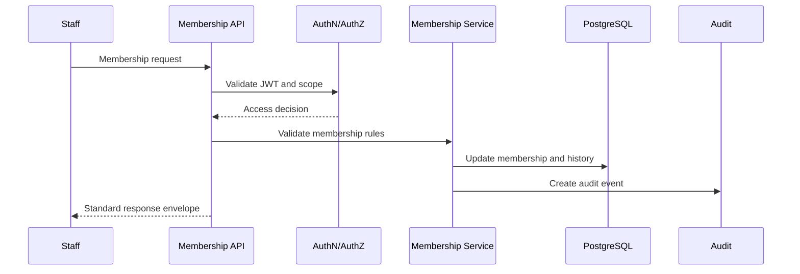
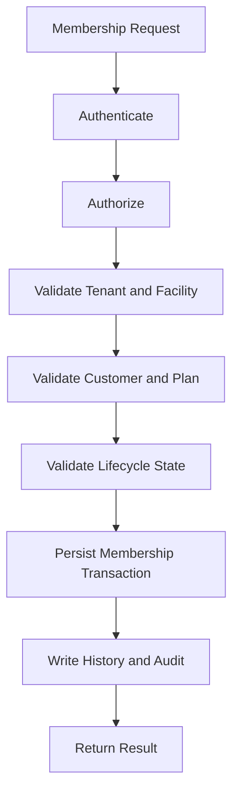

# (status banner removed to preserve metadata `Status: Design Draft`)
# API-05 Membership Management Collection

**Document ID:** API-05  
**Document Name:** Membership Management Collection  
**Company:** OreeOn Technologies Pvt. Ltd.  
**Product:** Digitize  
**Document Type:** API Collection Documentation  
**Backend Technology:** FastAPI  
**Database Engine:** PostgreSQL  
**Authentication:** JWT  
**API Version:** v1  
**Document Version:** 0.1  
**Status:** Design Draft  
**Owner:** API Architecture  
**Reviewer:** Solution Architecture / Security Architecture / Backend Engineering  
**Dependencies:** API-00, FR-08, BA-03, BA-04, DB-11  
**Last Updated:** 2026-07-26

---

# 1. Document Metadata

| Attribute | Value |
|---|---|
| Document ID | API-05 |
| Document Name | Membership Management Collection |
| Output File | API-05_Membership_Management_Collection.md |
| API Version | v1 |
| Document Version | 0.1 |
| Status | Design Draft |
| Governing Standard | API-00_API_Collection_Standards.md |

---

# 2. Purpose

This document defines Membership Management API contracts for membership creation, activation, renewal, upgrade, downgrade, freeze, resume, transfer, cancellation, expiry, details, and history.

---

# 3. Scope

In scope:

- Membership plan retrieval and membership eligibility checks.
- Customer membership creation and activation.
- Renewal, upgrade, downgrade, freeze, resume, transfer, cancellation, and expiry.
- Membership details and history retrieval.
- Membership lifecycle audit and domain events.

Out of scope:

- Payment initiation, payment attempts, refunds, settlement, and reconciliation owned by API-08.
- Subscription and license SaaS commercial control owned by API-09.
- Attendance entry validation owned by API-06.

---

# 4. Business Context

Memberships represent a customer's entitlement to access activities and facilities. Membership APIs must enforce plan ownership, payment-before-activation, validity, lifecycle rules, customer eligibility, tenant isolation, and auditability.

---

# 5. Domain Overview

| Capability | Description | Source |
|---|---|---|
| Membership Creation and Activation | Create and activate customer memberships | FR-MEM-001, FR-MEM-002 |
| Renewal | Extend membership validity | FR-MEM-003 |
| Upgrade/Downgrade | Change membership plan | FR-MEM-004, FR-MEM-005 |
| Freeze/Resume | Suspend and resume membership validity | FR-MEM-006, FR-MEM-007 |
| Transfer | Transfer membership across approved Site context | FR-MEM-008 |
| Cancellation/Expiry | Cancel or expire membership | FR-MEM-009, FR-MEM-010 |
| Details/History | View details and lifecycle history | FR-MEM-011, FR-MEM-012 |

---

# 6. Actors and Access Model

| Actor | Access Model |
|---|---|
| Organization Administrator | Organization-wide membership access |
| Facility Manager | Facility-scoped membership management |
| Reception Staff | Membership purchase, renewal, freeze/resume, cancellation support |
| Finance Staff | Membership financial reference visibility |
| Customer | Future self-service membership access |

---

# 7. API Classification

| Endpoint Group | API Classification | Data Classification |
|---|---|---|
| Membership creation/activation | Tenant / Facility | Confidential |
| Renewal/upgrade/downgrade | Tenant / Facility | Confidential |
| Freeze/resume/cancel/expire | Tenant / Facility | Restricted |
| Membership details/history | Tenant / Facility | Confidential |

---

# 8. Resource Model

| Resource | URL Base | Approved Database Mapping |
|---|---|---|
| Membership Plans | `/api/v1/membership-plans` | `membership.membership_plan` |
| Membership Plan Rules | `/api/v1/membership-plans/{membership_plan_id}/rules` | `membership.membership_plan_rule` |
| Customer Memberships | `/api/v1/memberships` | `membership.customer_membership` |
| Membership Lifecycle History | `/api/v1/memberships/{membership_id}/history` | `membership.membership_lifecycle_history` |
| Membership Freezes | `/api/v1/memberships/{membership_id}/freezes` | `membership.membership_freeze` |
| Membership Renewals | `/api/v1/memberships/{membership_id}/renewals` | `membership.membership_renewal` |

---

# 9. API Endpoint Catalogue

| Endpoint ID | Method | URL | Endpoint Name | FR Mapping |
|---|---|---|---|---|
| API-05-001 | POST | `/api/v1/memberships` | Create Membership | FR-MEM-001 |
| API-05-002 | POST | `/api/v1/memberships/{membership_id}/activate` | Activate Membership | FR-MEM-002 |
| API-05-003 | POST | `/api/v1/memberships/{membership_id}/renewals` | Renew Membership | FR-MEM-003 |
| API-05-004 | POST | `/api/v1/memberships/{membership_id}/upgrade` | Upgrade Membership | FR-MEM-004 |
| API-05-005 | POST | `/api/v1/memberships/{membership_id}/downgrade` | Downgrade Membership | FR-MEM-005 |
| API-05-006 | POST | `/api/v1/memberships/{membership_id}/freeze` | Freeze Membership | FR-MEM-006 |
| API-05-007 | POST | `/api/v1/memberships/{membership_id}/resume` | Resume Membership | FR-MEM-007 |
| API-05-008 | POST | `/api/v1/memberships/{membership_id}/transfer` | Transfer Membership | FR-MEM-008 |
| API-05-009 | POST | `/api/v1/memberships/{membership_id}/cancel` | Cancel Membership | FR-MEM-009 |
| API-05-010 | POST | `/api/v1/memberships/{membership_id}/expire` | Expire Membership | FR-MEM-010 |
| API-05-011 | GET | `/api/v1/memberships/{membership_id}` | View Membership Details | FR-MEM-011 |
| API-05-012 | GET | `/api/v1/memberships/{membership_id}/history` | View Membership History | FR-MEM-012 |

---

# 10. Common Authentication Requirements

All membership endpoints require JWT authentication.

Future customer self-service endpoints shall be separately classified and authorized.

---

# 11. Common Authorization Requirements

Authorization shall validate Organization, Facility, Site where applicable, role, permission, customer relationship, membership ownership, plan ownership, subscription/license/feature access, and lifecycle status.

---

# 12. Tenant and Resource Scope Rules

- `X-Organization-ID` and `X-Facility-ID` are required unless established through the membership resource.
- Membership shall belong to the authenticated Organization and Facility.
- Customer shall belong to the same Organization.
- Plan shall belong to the Facility.
- Cross-tenant membership access may return 404.

---

# 13. Common Header Requirements

| Header | Required | Purpose |
|---|---|---|
| Authorization | Yes | JWT authentication |
| Accept | Yes | `application/json` |
| Content-Type | Conditional | Request body |
| X-Correlation-ID | Required or generated | Traceability |
| X-Organization-ID | Yes | Tenant scope |
| X-Facility-ID | Yes | Facility scope |
| X-Site-ID | Conditional | Site context |
| If-Match | Required for lifecycle actions | Concurrency |
| Idempotency-Key | Required for create/commercial/lifecycle actions | Retry safety |

---

# 14. Request and Data Format Rules

- Membership dates use UTC RFC 3339.
- Monetary values are referenced only; payment processing is handled by API-08.
- Membership status and lifecycle values shall be approved values.
- JSON fields use snake_case.

---

# 15. Standard Response Usage

All endpoints use API-00 response envelopes.

Lifecycle action endpoints return `200 OK` with resulting state. Long-running or externally dependent actions may return `202 Accepted` only when explicitly asynchronous.

---

# 16. Module Error Codes

| Error Code | HTTP Status | Category | Safe Message | Retryable |
|---|---|---|---|---|
| MEMBERSHIP_AUTHORIZATION_001 | 403 | Authorization | User is not authorized for this membership action. | No |
| MEMBERSHIP_VALIDATION_001 | 422 | Validation | Membership request validation failed. | No |
| MEMBERSHIP_ELIGIBILITY_001 | 409 | Business | Membership is not eligible for the requested action. | No |
| MEMBERSHIP_PAYMENT_001 | 409 | Business | Required payment condition is not satisfied. | No |
| MEMBERSHIP_SCOPE_001 | 404 | Authorization | Requested membership is unavailable. | No |
| MEMBERSHIP_CONCURRENCY_001 | 412 | Conflict | Membership changed before the request completed. | Yes |
| MEMBERSHIP_IDEMPOTENCY_001 | 409 | Conflict | Idempotency key conflicts with a previous request. | No |

---

# 17. Pagination Profile

Offset pagination applies to membership lists. Cursor pagination applies to high-volume membership lifecycle history where required.

---

# 18. Filtering Rules

Approved filters: `membership_status`, `customer_id`, `facility_id`, `membership_plan_id`, `starts_from`, `ends_to`, `from_date`, and `to_date`.

---

# 19. Sorting Rules

Approved sort fields: `created_at`, `updated_at`, `starts_at`, `ends_at`, `membership_number`, and `membership_status`.

---

# 20. Search Rules

Search may use membership number, customer code/name projection where approved, and plan code/name where indexed or projected.

---

# 21. Rate Limiting

Rate limiting protects membership create, renewal, cancellation, freeze/resume, transfer, and search endpoints.

---

# 22. Caching

Membership plans may be cached with invalidation. Customer membership state shall not be cached without strict invalidation.

---

# 23. Idempotency

Required for membership creation, activation, renewal, upgrade, downgrade, freeze, resume, transfer, cancellation, and expiry.

---

# 24. Optimistic Concurrency

Required for all membership lifecycle actions and mutable membership updates.

---

# 25. Transaction Boundaries

- Membership creation shall atomically create membership and lifecycle history.
- Activation shall validate payment condition and update membership state atomically.
- Renewal shall atomically create renewal record, update validity, and write lifecycle history.
- Freeze/resume/cancel/expire shall atomically update membership state and lifecycle history.
- Payment-related references shall not execute payment processing inside this collection.

---

# 26. Asynchronous Operations

Asynchronous processing may be used for notifications, reporting projections, and entitlement refresh. Core lifecycle state changes are synchronous unless explicitly approved otherwise.

---

# 27. Bulk Operations

Not Applicable — Bulk membership lifecycle actions are not approved for v1.

---

# 28. File Handling

Not Applicable — Membership document upload/download is not defined for this collection.

---

# 29. API Endpoints

Each endpoint inherits API-00 Common Endpoint Documentation Template.

| Endpoint ID | Business Purpose | AuthZ Permission | Success | DB Mapping | Audit Event | Domain Event | Tests |
|---|---|---|---|---|---|---|---|
| API-05-001 | Create membership | `membership.create` | 201 with membership | `membership.customer_membership`, `membership.membership_lifecycle_history`, `audit.audit_event` | MEMBERSHIP_CREATED | membership.created | Plan ownership, customer eligibility, idempotency |
| API-05-002 | Activate membership | `membership.activate` | 200 active membership | `membership.customer_membership` UPDATE, history INSERT | MEMBERSHIP_ACTIVATED | membership.activated | Payment condition, state transition |
| API-05-003 | Renew membership | `membership.renew` | 200 renewed membership | `membership.membership_renewal`, `membership.customer_membership`, history | MEMBERSHIP_RENEWED | membership.renewed | Renewal eligibility, dates |
| API-05-004 | Upgrade membership | `membership.upgrade` | 200 upgraded membership | `membership.customer_membership`, history | MEMBERSHIP_UPGRADED | membership.upgraded | Plan eligibility, commercial reference |
| API-05-005 | Downgrade membership | `membership.downgrade` | 200 downgraded membership | `membership.customer_membership`, history | MEMBERSHIP_DOWNGRADED | membership.downgraded | Policy, effective date |
| API-05-006 | Freeze membership | `membership.freeze` | 200 frozen membership | `membership.membership_freeze`, `membership.customer_membership`, history | MEMBERSHIP_FROZEN | membership.frozen | Freeze limits, date overlap |
| API-05-007 | Resume membership | `membership.resume` | 200 resumed membership | `membership.membership_freeze`, `membership.customer_membership`, history | MEMBERSHIP_RESUMED | membership.resumed | Freeze existence, validity |
| API-05-008 | Transfer membership | `membership.transfer` | 200 transferred membership | `membership.customer_membership`, history | MEMBERSHIP_TRANSFERRED | membership.transferred | Target Site hierarchy |
| API-05-009 | Cancel membership | `membership.cancel` | 200 cancelled membership | `membership.customer_membership`, history | MEMBERSHIP_CANCELLED | membership.cancelled | Refund dependency, lifecycle |
| API-05-010 | Expire membership | `membership.expire` | 200 expired membership | `membership.customer_membership`, history | MEMBERSHIP_EXPIRED | membership.expired | Expiry job/manual authorization |
| API-05-011 | View details | `membership.view` | 200 membership details | `membership.customer_membership`, `membership.membership_plan` | MEMBERSHIP_VIEWED where configured | Not Applicable | Scope, masking |
| API-05-012 | View history | `membership.history.view` | 200 history | `membership.membership_lifecycle_history` | MEMBERSHIP_HISTORY_VIEWED | Not Applicable | Cursor pagination |

Common endpoint requirements:

- Lifecycle endpoints require `If-Match` and `Idempotency-Key`.
- API-08 is referenced for payments, invoices, refunds, and receipts.
- Errors include 401, 403, 404, 409, 412, 422, and 429.

---

# 30. Module Sequence Diagrams

---

# 31. Request Flow Diagrams

---

# 32. Database Mapping Summary

| Area | Tables |
|---|---|
| Plans | `membership.membership_plan`, `membership.membership_plan_rule` |
| Memberships | `membership.customer_membership` |
| Lifecycle | `membership.membership_lifecycle_history` |
| Freeze | `membership.membership_freeze` |
| Renewal | `membership.membership_renewal` |
| Customer | `customer.customer` |
| Audit | `audit.audit_event`, `audit.audit_entity_reference` |

---

# 33. Domain Event and Outbox Mapping

Outbox mapping is `integration.outbox_event` from `DB-11_Database_DDL_DML_Scripts.md`.

Events include membership.created, membership.activated, membership.renewed, membership.upgraded, membership.downgraded, membership.frozen, membership.resumed, membership.transferred, membership.cancelled, and membership.expired.

---

# 34. Audit Mapping

Audit events include MEMBERSHIP_CREATED, MEMBERSHIP_ACTIVATED, MEMBERSHIP_RENEWED, MEMBERSHIP_UPGRADED, MEMBERSHIP_DOWNGRADED, MEMBERSHIP_FROZEN, MEMBERSHIP_RESUMED, MEMBERSHIP_TRANSFERRED, MEMBERSHIP_CANCELLED, MEMBERSHIP_EXPIRED, MEMBERSHIP_VIEWED, and MEMBERSHIP_HISTORY_VIEWED.

---

# 35. Notification Mapping

Asynchronous notifications may be triggered for purchase, activation, renewal, upgrade, downgrade, freeze, resume, cancellation, and expiry.

---

# 36. Functional Requirement Mapping

| Source Document | Covered FR IDs |
|---|---|
| FR-08 Membership Management | FR-MEM-001 to FR-MEM-012 |

---

# 37. Business Process Mapping

| Process Area | Covered Processes |
|---|---|
| Membership Management | BA-03 BP-MEM-001 to BP-MEM-012 |
| Business Process Flows | BA-04 Sections 14, 15, 16, 17, 18, and 36 |

---

# 38. UI Screen Mapping

UI screen IDs are unavailable in the current source set.

Mapped screen names: Membership Purchase, Membership Details, Membership Renewal, Membership Upgrade/Downgrade, Membership Freeze/Resume, Membership Cancellation, and Membership History.

---

# 39. Security Considerations

- Enforce tenant and Facility isolation.
- Prevent lifecycle action bypass.
- Prevent membership manipulation without payment/commercial validation.
- Audit all lifecycle changes.
- Restrict history visibility.

---

# 40. Performance and Scalability

- Use indexes `idx_membership_customer_status`, `idx_membership_facility_status`, and `idx_membership_plan_facility_status`.
- Cursor pagination may be used for large lifecycle histories.
- Avoid synchronous commercial calculations beyond approved validation.

---

# 41. Observability

Track lifecycle action counts, eligibility failures, concurrency conflicts, idempotency conflicts, membership history insert failures, and cross-tenant access attempts.

---

# 42. Test Coverage Summary

Required coverage: create, activate, renew, upgrade, downgrade, freeze, resume, transfer, cancel, expire, view details, view history, tenant isolation, idempotency, concurrency, audit, and payment-reference dependency.

---

# 43. Assumptions and Constraints

- Payment processing is excluded and delegated to API-08.
- UI screen IDs are unavailable.
- Outbox table mapping is `integration.outbox_event`.
- Family/group membership is only included where approved by source requirements.

---

# 44. Dependencies

| Dependency | Description |
|---|---|
| API-00 | Governing standard |
| API-02 | Organization, Facility, Site hierarchy |
| API-04 | Customer profiles |
| API-06 | Attendance eligibility |
| API-08 | Billing/payment/refund |
| API-10 | Notifications |
| API-13 | Audit/security |
| DB-11 | Membership tables |

---

# 45. Future Enhancements

- Customer self-service membership actions.
- Group/family membership extensions where approved.
- Membership transfer approval workflow.
- Automated expiry job API/status endpoint.

---

# 46. Document Acceptance Criteria

This document is acceptable when it follows API-00, maps FR-MEM-001 to FR-MEM-012, enforces lifecycle and payment-reference rules, preserves tenant isolation, and defines audit/event/test coverage.

---

# 47. Summary

API-05 defines Membership Management APIs for Digitize. It governs customer membership lifecycle behavior while preserving commercial dependencies, tenant isolation, auditability, idempotency, concurrency, and operational traceability.
