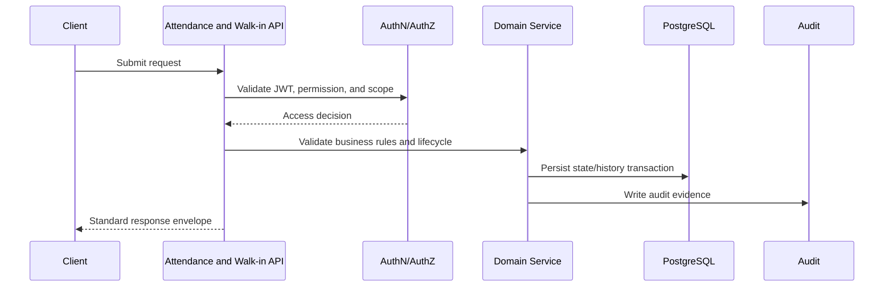
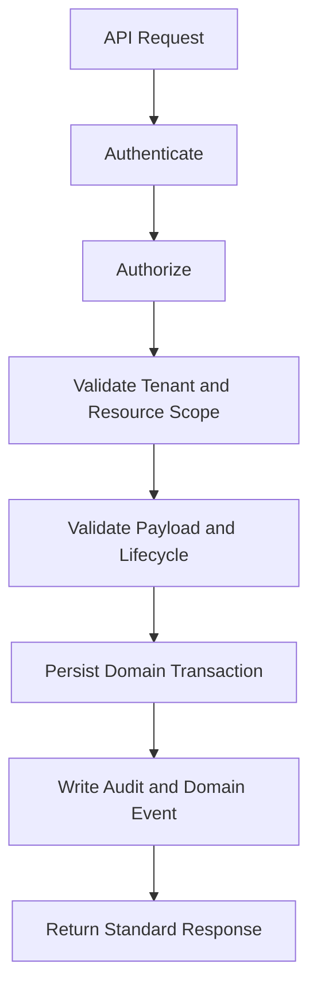

# (status banner removed to preserve metadata `Status: Design Draft`)
# API-06 Attendance and Walk-in Collection

**Document ID:** API-06  
**Document Name:** Attendance and Walk-in Collection  
**Company:** OreeOn Technologies Pvt. Ltd.  
**Product:** Digitize  
**Document Type:** API Collection Documentation  
**Backend Technology:** FastAPI  
**Database Engine:** PostgreSQL  
**Authentication:** JWT  
**API Version:** v1  
**Document Version:** 0.1  
**Status:** Design Draft  
**Owner:** API Architecture  
**Reviewer:** Solution Architecture / Security Architecture / Backend Engineering  
**Dependencies:** API-00, API-02, API-04, API-05, API-08, FR-09, FR-10, BA-03, BA-04, DB-11  
**Last Updated:** 2026-07-26

---

# 1. Document Metadata

| Attribute | Value |
|---|---|
| Document ID | API-06 |
| Document Name | Attendance and Walk-in Collection |
| Output File | API-06_Attendance_Walkin_Collection.md |
| API Version | v1 |
| Document Version | 0.1 |
| Status | Design Draft |
| Governing Standard | API-00_API_Collection_Standards.md |

---

# 2. Purpose

This document defines Attendance and Walk-in API contracts for check-in, eligibility, session attendance, walk-in visits, payment association, check-out, correction, cancellation, history, reports, and audit visibility.

---

# 3. Scope

In scope:

- Endpoint catalogue and REST contract rules for Attendance and Walk-in Collection.
- Tenant-aware authentication, authorization, validation, response, error, audit, event, and test expectations.
- Lifecycle, history, report, and operational controls listed in the endpoint catalogue.
- Database mapping, observability, assumptions, dependencies, and acceptance criteria.

Out of scope:

- FastAPI controller or service implementation.
- OpenAPI JSON/YAML and Postman JSON export.
- Physical database migration changes.
- Capabilities owned by other API collection documents except where explicitly referenced.

---

# 4. Business Context

Attendance is the operational proof of service consumption. The APIs must support high-speed reception workflows while enforcing entitlement, capacity, duplicate-entry prevention, walk-in payment reference, tenant isolation, and audit evidence.

---

# 5. Domain Overview

| Capability | Description | Source |
|---|---|---|
| Attendance and Walk-in | API contracts, validation, lifecycle, audit, events, and tests | FR-ATT-001 to FR-ATT-010, FR-WLK-001 to FR-WLK-007 |

---

# 6. Actors and Access Model

| Actor | Access Model |
|---|---|
| Organization Administrator | Organization-scoped administration and oversight |
| Facility Manager | Facility-scoped operational access |
| Site Administrator | Site-scoped operational access where applicable |
| Staff User | Permission-controlled execution access |
| Support Executive | Restricted support visibility where approved |
| System | Scheduled, asynchronous, event, and audit processing |

---

# 7. API Classification

| Endpoint Group | API Classification | Data Classification |
|---|---|---|
| Create/update/lifecycle endpoints | Tenant / Facility / Site | Confidential |
| History/report/export endpoints | Tenant / Facility / Site | Restricted where sensitive |
| Reference/status endpoints | Tenant / Facility / Site | Confidential |
| Internal callbacks or processing endpoints | Internal / Integration | Restricted |

---

# 8. Resource Model

| Resource | URL Base | Approved Database Mapping |
|---|---|---|
| Attendance | `/api/v1/attendance` | `operations.attendance` |
| Attendance Eligibility | `/api/v1/attendance/eligibility` | `operations.attendance_eligibility` |
| Entry Exit Events | `/api/v1/attendance/{attendance_id}/events` | `operations.entry_exit_event` |
| Walk-in Visits | `/api/v1/walkin-visits` | `operations.walkin_visit` |
| Operational Notes | `/api/v1/attendance/{attendance_id}/notes` | `operations.operational_note` |

---

# 9. API Endpoint Catalogue

| Endpoint ID | Method | URL | Endpoint Name | FR Mapping |
|---|---|---|---|---|
| API-06-001 | POST | `/api/v1/attendance/check-in` | Record Customer Check-in | FR-ATT-001 |
| API-06-002 | POST | `/api/v1/attendance/eligibility` | Validate Attendance Eligibility | FR-ATT-002, FR-WLK-002 |
| API-06-003 | POST | `/api/v1/attendance/session` | Record Session Attendance | FR-ATT-003 |
| API-06-004 | POST | `/api/v1/attendance/walk-in` | Record Walk-in Attendance | FR-ATT-004, FR-WLK-006 |
| API-06-005 | POST | `/api/v1/attendance/{attendance_id}/check-out` | Record Customer Check-out | FR-ATT-005 |
| API-06-006 | PATCH | `/api/v1/attendance/{attendance_id}` | Update Attendance Record | FR-ATT-006 |
| API-06-007 | POST | `/api/v1/attendance/{attendance_id}/cancel` | Cancel Attendance Record | FR-ATT-007 |
| API-06-008 | GET | `/api/v1/customers/{customer_id}/attendance-history` | View Attendance History | FR-ATT-008 |
| API-06-009 | GET | `/api/v1/attendance/reports` | Generate Attendance Report | FR-ATT-009 |
| API-06-010 | GET | `/api/v1/attendance/{attendance_id}/audit` | Audit Attendance Records | FR-ATT-010 |
| API-06-011 | POST | `/api/v1/walkin-visits/identify` | Identify or Register Walk-in Customer | FR-WLK-001 |
| API-06-012 | POST | `/api/v1/walkin-visits` | Create Walk-in Visit | FR-WLK-003 |
| API-06-013 | POST | `/api/v1/walkin-visits/{walkin_visit_id}/charges` | Calculate Walk-in Charges | FR-WLK-004 |
| API-06-014 | POST | `/api/v1/walkin-visits/{walkin_visit_id}/payments` | Associate Walk-in Payment | FR-WLK-005 |
| API-06-015 | GET | `/api/v1/walkin-visits` | View Walk-in History and Reports | FR-WLK-007 |

---

# 10. Common Authentication Requirements

All endpoints require JWT authentication unless explicitly classified as Public, Internal, Integration, or Webhook by API-00.

---

# 11. Common Authorization Requirements

Authorization shall validate Organization, Facility, Site where applicable, role, permission, object ownership, lifecycle status, subscription/license/feature access, and data classification before domain execution.

Approved permission families: attendance.checkIn, attendance.checkOut, attendance.update, attendance.cancel, attendance.override.capacity, attendance.override.eligibility, walkin.visit.create, walkin.payment.associate, attendance.history.view.

---

# 12. Tenant and Resource Scope Rules

- `X-Organization-ID` is required for tenant-scoped operations.
- `X-Facility-ID` is required for Facility-scoped operations unless scope is established through the resource.
- `X-Site-ID` is required for Site-scoped operations where Site is part of the business context.
- Resource ownership shall be validated against the authenticated security context.
- Cross-tenant access may return 404 where resource disclosure is unsafe.

---

# 13. Common Header Requirements

| Header | Required | Purpose |
|---|---|---|
| Authorization | Yes | JWT authentication |
| Accept | Yes | `application/json` |
| Content-Type | Conditional | Request body |
| X-Correlation-ID | Required or generated | Traceability |
| X-Organization-ID | Yes | Tenant scope |
| X-Facility-ID | Conditional | Facility scope |
| X-Site-ID | Conditional | Site scope |
| If-Match | Required for protected updates/actions | Concurrency |
| Idempotency-Key | Required for create, lifecycle, commercial, and retry-prone actions | Retry safety |

---

# 14. Request and Data Format Rules

- JSON fields use snake_case.
- UUID values use canonical lowercase strings.
- Date-time values use UTC RFC 3339.
- Status, type, category, method, and channel fields shall use approved reference values.
- Sensitive payload fields shall be masked in logs and audit details.

---

# 15. Standard Response Usage

All endpoints use API-00 response envelopes. Create endpoints return `201 Created`. Lifecycle actions normally return `200 OK` with the resulting state. Long-running work returns `202 Accepted` with a trackable status reference.

---

# 16. Module Error Codes

| Error Code | HTTP Status | Category | Safe Message | Retryable |
|---|---|---|---|---|
| ATTENDANCE_AUTHORIZATION_001 | 403 | Authorization | User is not authorized for this attendance and walk-in collection action. | No |
| ATTENDANCE_VALIDATION_001 | 422 | Validation | Attendance and Walk-in Collection request validation failed. | No |
| ATTENDANCE_SCOPE_001 | 404 | Authorization | Requested resource is unavailable. | No |
| ATTENDANCE_LIFECYCLE_001 | 409 | Business | Requested lifecycle action is not allowed. | No |
| ATTENDANCE_CONCURRENCY_001 | 412 | Conflict | Resource changed before the request completed. | Yes |
| ATTENDANCE_IDEMPOTENCY_001 | 409 | Conflict | Idempotency key conflicts with a previous request. | No |

---

# 17. Pagination, Filtering, Sorting, and Search

Offset pagination applies to operational list endpoints. Cursor pagination applies to high-volume history, event, audit, delivery, execution, or export-result endpoints.

Approved filters: `attendance_status, customer_id, membership_id, facility_id, site_id, session_id, walkin_visit_id, check_in_from, check_in_to, attendance_method`.

Approved sort fields: `check_in_at, check_out_at, created_at, updated_at, customer_code, attendance_status`.

Search is permitted only on approved business identifiers, display names, reference numbers, and safe projected fields. Sensitive identifiers require explicit permission.

---

# 18. Rate Limiting and Caching

Rate limiting protects create, search, lifecycle, report/export, retry, callback, and sensitive read endpoints.

Reference and configuration responses may be cached with invalidation. Mutable state, financial data, security data, audit data, and customer-sensitive data shall not be cached unless explicit cache-control rules are approved.

---

# 19. Idempotency and Optimistic Concurrency

Idempotency is required for create operations, lifecycle actions, payment-sensitive actions, retry-prone asynchronous commands, and provider callback handling where duplicate submissions are possible.

Optimistic concurrency is required for mutable resources and lifecycle actions where lost updates are possible. Protected requests shall use `If-Match` according to API-00.

---

# 20. Transaction Boundaries and Asynchronous Operations

Each state-changing endpoint shall persist the primary domain change, lifecycle/history record, audit event, and outbox/domain event within a controlled transaction boundary.

Asynchronous processing may be used for notifications, exports, reports, webhook delivery, retries, projection refresh, provider callbacks, and long-running analytics. Asynchronous endpoints return `202 Accepted` with a status reference.

---

# 21. Bulk Operations and File Handling

Bulk operations are not approved unless listed in the endpoint catalogue or explicitly governed by API-00 bulk-operation rules.

File upload/download is not part of this document unless explicitly listed. Attachment or export metadata may be stored, but binary storage and signed URL behavior require approved file-handling design.

---

# 22. API Endpoints

Each endpoint inherits API-00 Common Endpoint Documentation Template.

| Endpoint ID | Business Purpose | AuthZ Permission | Success | DB Mapping | Audit Event | Domain Event | Tests |
|---|---|---|---|---|---|---|---|
| API-06-001 | Record Customer Check-in | `record.customer.check.in` | 201/200 with resulting state | `operations.attendance`, `audit.audit_event` | RECORD_CUSTOMER_CHECK_IN | record.customer.check.in | Scope, validation, audit, and error-path tests |
| API-06-002 | Validate Attendance Eligibility | `validate.attendance.eligibility` | 201/200 with resulting state | `operations.attendance`, `audit.audit_event` | VALIDATE_ATTENDANCE_ELIGIBILITY | validate.attendance.eligibility | Scope, validation, audit, and error-path tests |
| API-06-003 | Record Session Attendance | `record.session.attendance` | 201/200 with resulting state | `operations.attendance`, `audit.audit_event` | RECORD_SESSION_ATTENDANCE | record.session.attendance | Scope, validation, audit, and error-path tests |
| API-06-004 | Record Walk-in Attendance | `record.walk.in.attendance` | 201/200 with resulting state | `operations.attendance`, `audit.audit_event` | RECORD_WALK_IN_ATTENDANCE | record.walk.in.attendance | Scope, validation, audit, and error-path tests |
| API-06-005 | Record Customer Check-out | `record.customer.check.out` | 201/200 with resulting state | `operations.attendance`, `audit.audit_event` | RECORD_CUSTOMER_CHECK_OUT | record.customer.check.out | Scope, validation, audit, and error-path tests |
| API-06-006 | Update Attendance Record | `update.attendance.record` | 201/200 with resulting state | `operations.attendance`, `audit.audit_event` | UPDATE_ATTENDANCE_RECORD | update.attendance.record | Scope, validation, audit, and error-path tests |
| API-06-007 | Cancel Attendance Record | `cancel.attendance.record` | 201/200 with resulting state | `operations.attendance`, `audit.audit_event` | CANCEL_ATTENDANCE_RECORD | cancel.attendance.record | Scope, validation, audit, and error-path tests |
| API-06-008 | View Attendance History | `view.attendance.history` | 200 OK | `operations.attendance`, `audit.audit_event` | VIEW_ATTENDANCE_HISTORY | view.attendance.history | Scope, validation, audit, and error-path tests |
| API-06-009 | Generate Attendance Report | `generate.attendance.report` | 200 OK | `operations.attendance`, `audit.audit_event` | GENERATE_ATTENDANCE_REPORT | generate.attendance.report | Scope, validation, audit, and error-path tests |
| API-06-010 | Audit Attendance Records | `audit.attendance.records` | 200 OK | `operations.attendance`, `audit.audit_event` | AUDIT_ATTENDANCE_RECORDS | audit.attendance.records | Scope, validation, audit, and error-path tests |
| API-06-011 | Identify or Register Walk-in Customer | `identify.or.register.walk.in.customer` | 201/200 with resulting state | `operations.attendance`, `audit.audit_event` | IDENTIFY_OR_REGISTER_WALK_IN_CUSTOMER | identify.or.register.walk.in.customer | Scope, validation, audit, and error-path tests |
| API-06-012 | Create Walk-in Visit | `create.walk.in.visit` | 201/200 with resulting state | `operations.attendance`, `audit.audit_event` | CREATE_WALK_IN_VISIT | create.walk.in.visit | Scope, validation, audit, and error-path tests |
| API-06-013 | Calculate Walk-in Charges | `calculate.walk.in.charges` | 201/200 with resulting state | `operations.attendance`, `audit.audit_event` | CALCULATE_WALK_IN_CHARGES | calculate.walk.in.charges | Scope, validation, audit, and error-path tests |
| API-06-014 | Associate Walk-in Payment | `associate.walk.in.payment` | 201/200 with resulting state | `operations.attendance`, `audit.audit_event` | ASSOCIATE_WALK_IN_PAYMENT | associate.walk.in.payment | Scope, validation, audit, and error-path tests |
| API-06-015 | View Walk-in History and Reports | `view.walk.in.history.and.reports` | 200 OK | `operations.attendance`, `audit.audit_event` | VIEW_WALK_IN_HISTORY_AND_REPORTS | view.walk.in.history.and.reports | Scope, validation, audit, and error-path tests |

---

# 23. Module Sequence Diagram

---

# 24. Request Flow Diagram

---

# 25. Database Mapping Summary

| Area | Tables |
|---|---|
| Primary Domain | `operations.attendance, operations.attendance_eligibility, operations.entry_exit_event, operations.walkin_visit, operations.operational_note` |
| Audit | `audit.audit_event`, `audit.audit_entity_reference` |

---

# 26. Domain Event and Outbox Mapping

Outbox mapping is `integration.outbox_event` from `DB-11_Database_DDL_DML_Scripts.md`.

Events include attendance.checked_in, attendance.checked_out, attendance.updated, attendance.cancelled, walkin.visit_created, walkin.payment_associated.

---

# 27. Audit and Notification Mapping

Audit events include ATTENDANCE_CHECKED_IN, ATTENDANCE_CHECKED_OUT, ATTENDANCE_UPDATED, ATTENDANCE_CANCELLED, ATTENDANCE_OVERRIDE_USED, WALKIN_VISIT_CREATED, WALKIN_PAYMENT_ASSOCIATED.

Asynchronous notifications may be triggered for customer-visible confirmations, operational alerts, approval requests, failures, lifecycle status changes, report/export completion, and compliance/security alerts where applicable.

---

# 28. Functional Requirement Mapping

| Source Document | Covered FR IDs |
|---|---|
| FR-09 Attendance Management / FR-10 Walk-in Customer Management | FR-ATT-001 to FR-ATT-010, FR-WLK-001 to FR-WLK-007 |

---

# 29. Business Process and UI Mapping

| Process Area | Covered Processes |
|---|---|
| Business Process Catalog | BA-03 mappings referenced by the source FR documents |
| Business Process Flows | BA-04 mappings referenced by the source FR documents |

UI screen IDs are unavailable in the current source set. Mapped screen names shall follow the endpoint catalogue and corresponding Functional Requirement workflow names.

---

# 30. Security Considerations

- Enforce tenant, Facility, and Site isolation.
- Restrict sensitive data, financial data, security data, audit data, and customer personal data by permission and data classification.
- Prevent lifecycle bypass and unauthorized override usage.
- Mask secrets, tokens, provider references, and sensitive payload values in logs.
- Audit restricted reads, exports, lifecycle actions, configuration changes, and administrative access.

---

# 31. Performance, Scalability, and Observability

- Index list, lookup, history, status, and date-range access paths.
- Use cursor pagination for high-volume append-only histories.
- Avoid unbounded synchronous report, export, search, or aggregation queries.
- Track request count, latency, validation failures, authorization failures, scope failures, lifecycle conflicts, idempotency conflicts, concurrency conflicts, async job status, audit write failures, and domain event publication failures.

---

# 32. Test Coverage Summary

Required coverage includes authentication, authorization, tenant isolation, validation, success responses, error envelopes, pagination, filtering, sorting, idempotency, concurrency, lifecycle transitions, audit/event creation, notification behavior, and relevant async or export flows.

---

# 33. Assumptions and Constraints

- UI screen IDs are unavailable.
- Outbox table mapping is `integration.outbox_event`.
- Source mappings marked `TBD — Owner: API Architecture / BA; Action: provide FR/source mapping for attendance/walkin.` require future BA/FR/API review.
- These documents define contracts and governance only; they do not generate FastAPI source code.

---

# 34. Dependencies

| Dependency | Description |
|---|---|
| API-00 | Governing standard |
| API-02 | Organization, Facility, and Site hierarchy |
| API-03 | Authentication, user, role, and permission context |
| API-13 | Audit and security |
| DB-11 | Approved database mappings |

---

# 35. Future Enhancements

- Additional query projections after UI screen IDs are finalized.
- Dedicated export status endpoint where report volume requires asynchronous processing.
- Webhook publication where external integration use cases are approved.

---

# 36. Document Acceptance Criteria

This document is acceptable when it follows API-00, uses approved `/api/v1` REST conventions, preserves tenant isolation, maps endpoints to source requirements where available, defines module errors, and documents audit/event/test coverage.

---

# 37. Summary

API-06 defines Attendance and Walk-in Collection for Digitize. It establishes secure, tenant-aware, auditable API contracts aligned with approved functional, database, architecture, and governance source documents.
