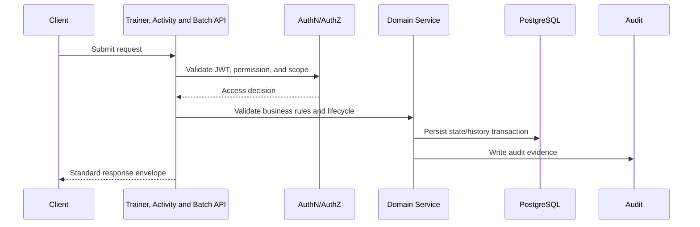
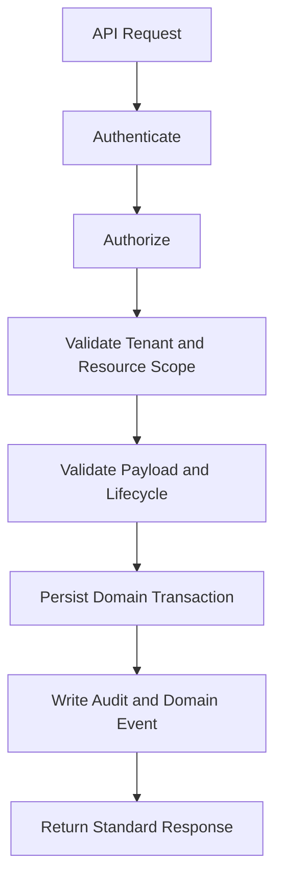

# (status banner removed to preserve metadata `Status: Design Draft`)
# API-07 Trainer, Activity and Batch Collection

**Document ID:** API-07  
**Document Name:** Trainer, Activity and Batch Collection  
**Company:** OreeOn Technologies Pvt. Ltd.  
**Product:** Digitize  
**Document Type:** API Collection Documentation  
**Backend Technology:** FastAPI  
**Database Engine:** PostgreSQL  
**Authentication:** JWT  
**API Version:** v1  
**Document Version:** 0.1  
**Status:** Design Draft  
**Owner:** API Architecture  
**Reviewer:** Solution Architecture / Security Architecture / Backend Engineering  
**Dependencies:** API-00, API-02, API-03, API-04, API-06, FR-11, FR-12, FR-13, BA-03, BA-04, DB-11  
**Last Updated:** 2026-07-26

---

# 1. Document Metadata

| Attribute | Value |
|---|---|
| Document ID | API-07 |
| Document Name | Trainer, Activity and Batch Collection |
| Output File | API-07_Trainer_Activity_Batch_Collection.md |
| API Version | v1 |
| Document Version | 0.1 |
| Status | Design Draft |
| Governing Standard | API-00_API_Collection_Standards.md |

---

# 2. Purpose

This document defines Trainer, Activity, Batch, Class Session, Batch Enrollment, and Personal Training API contracts.

---

# 3. Scope

In scope:

- Endpoint catalogue and REST contract rules for Trainer, Activity and Batch Collection.
- Tenant-aware authentication, authorization, validation, response, error, audit, event, and test expectations.
- Lifecycle, history, report, and operational controls listed in the endpoint catalogue.
- Database mapping, observability, assumptions, dependencies, and acceptance criteria.

Out of scope:

- FastAPI controller or service implementation.
- OpenAPI JSON/YAML and Postman JSON export.
- Physical database migration changes.
- Capabilities owned by other API collection documents except where explicitly referenced.

---

# 4. Business Context

Training operations convert facility offerings into schedulable activities, batches, classes, and personal training sessions. APIs must prevent schedule conflicts, enforce capacity and trainer eligibility, preserve customer enrollment state, and protect training notes.

---

# 5. Domain Overview

| Capability | Description | Source |
|---|---|---|
| Trainer, Activity and Batch | API contracts, validation, lifecycle, audit, events, and tests | FR-TRN-001 to FR-TRN-010, FR-PTR-001 to FR-PTR-012, FR-BAT-001 to FR-BAT-015 |

---

# 6. Actors and Access Model

| Actor | Access Model |
|---|---|
| Organization Administrator | Organization-scoped administration and oversight |
| Facility Manager | Facility-scoped operational access |
| Site Administrator | Site-scoped operational access where applicable |
| Staff User | Permission-controlled execution access |
| Support Executive | Restricted support visibility where approved |
| System | Scheduled, asynchronous, event, and audit processing |

---

# 7. API Classification

| Endpoint Group | API Classification | Data Classification |
|---|---|---|
| Create/update/lifecycle endpoints | Tenant / Facility / Site | Confidential |
| History/report/export endpoints | Tenant / Facility / Site | Restricted where sensitive |
| Reference/status endpoints | Tenant / Facility / Site | Confidential |
| Internal callbacks or processing endpoints | Internal / Integration | Restricted |

---

# 8. Resource Model

| Resource | URL Base | Approved Database Mapping |
|---|---|---|
| Trainers | `/api/v1/trainers` | `training.trainer` |
| Trainer Availability | `/api/v1/trainers/{trainer_id}/availability` | `training.trainer_availability` |
| Activities | `/api/v1/activities` | `training.activity` |
| Activity Rules | `/api/v1/activities/{activity_id}/rules` | `training.activity_rule` |
| Batches | `/api/v1/batches` | `training.batch` |
| Class Sessions | `/api/v1/class-sessions` | `training.class_session` |
| Batch Enrollments | `/api/v1/batches/{batch_id}/enrollments` | `training.batch_enrollment` |
| Personal Training Packages | `/api/v1/personal-training-packages` | `training.personal_training_package` |
| Personal Training Sessions | `/api/v1/personal-training-sessions` | `training.personal_training_session` |
| Training Notes | `/api/v1/personal-training-sessions/{session_id}/notes` | `training.training_note` |
| Customer Progress | `/api/v1/customers/{customer_id}/progress` | `training.customer_progress` |

---

# 9. API Endpoint Catalogue

| Endpoint ID | Method | URL | Endpoint Name | FR Mapping |
|---|---|---|---|---|
| API-07-001 | POST | `/api/v1/trainers` | Register Trainer Profile | FR-TRN-001 |
| API-07-002 | POST | `/api/v1/trainers/{trainer_id}/facility-assignments` | Assign Trainer to Facilities and Sites | FR-TRN-002 |
| API-07-003 | POST | `/api/v1/trainers/{trainer_id}/availability` | Maintain Trainer Availability | FR-TRN-003 |
| API-07-004 | POST | `/api/v1/trainers/{trainer_id}/schedule-conflicts` | Validate Trainer Schedule Conflicts | FR-TRN-004 |
| API-07-005 | POST | `/api/v1/batches/{batch_id}/trainer-assignment` | Assign Trainer to Batch | FR-TRN-005, FR-BAT-007 |
| API-07-006 | POST | `/api/v1/personal-training-sessions/{session_id}/trainer-assignment` | Assign Trainer to Personal Training Session | FR-TRN-006, FR-PTR-003 |
| API-07-007 | POST | `/api/v1/trainers/{trainer_id}/attendance` | Record Trainer Attendance | FR-TRN-007 |
| API-07-008 | POST | `/api/v1/trainers/{trainer_id}/status` | Manage Trainer Status | FR-TRN-008 |
| API-07-009 | GET | `/api/v1/trainers/{trainer_id}/history` | View Trainer History | FR-TRN-009 |
| API-07-010 | GET | `/api/v1/trainers/{trainer_id}/performance-summary` | Generate Trainer Performance Summary | FR-TRN-010 |
| API-07-011 | POST | `/api/v1/activities` | Create Activity | FR-BAT-001 |
| API-07-012 | PATCH | `/api/v1/activities/{activity_id}` | Update Activity | FR-BAT-002 |
| API-07-013 | POST | `/api/v1/activities/{activity_id}/rules` | Configure Activity Rules | FR-BAT-003 |
| API-07-014 | POST | `/api/v1/batches` | Create Batch | FR-BAT-004 |
| API-07-015 | PATCH | `/api/v1/batches/{batch_id}` | Update Batch | FR-BAT-005 |
| API-07-016 | POST | `/api/v1/batches/{batch_id}/schedule` | Schedule Batch | FR-BAT-006 |
| API-07-017 | POST | `/api/v1/batches/{batch_id}/capacity` | Configure Batch Capacity | FR-BAT-008 |
| API-07-018 | POST | `/api/v1/batches/{batch_id}/enrollments` | Enroll Customer into Batch | FR-BAT-009 |
| API-07-019 | POST | `/api/v1/batches/{batch_id}/enrollments/{enrollment_id}/remove` | Remove Customer from Batch | FR-BAT-010 |
| API-07-020 | POST | `/api/v1/class-sessions/{session_id}/start` | Start Session | FR-BAT-011, FR-PTR-007 |
| API-07-021 | POST | `/api/v1/class-sessions/{session_id}/complete` | Complete Session | FR-BAT-012, FR-PTR-008 |
| API-07-022 | POST | `/api/v1/class-sessions/{session_id}/cancel` | Cancel Session | FR-BAT-013, FR-PTR-006 |
| API-07-023 | GET | `/api/v1/batches/{batch_id}/schedule` | View Batch Schedule | FR-BAT-014 |
| API-07-024 | GET | `/api/v1/activities/{activity_id}/performance` | View Activity Performance | FR-BAT-015 |
| API-07-025 | POST | `/api/v1/personal-training-packages` | Create Personal Training Package | FR-PTR-001 |
| API-07-026 | PATCH | `/api/v1/personal-training-packages/{package_id}/configuration` | Configure Training Package | FR-PTR-002 |
| API-07-027 | POST | `/api/v1/personal-training-sessions` | Book Personal Training Session | FR-PTR-004 |
| API-07-028 | POST | `/api/v1/personal-training-sessions/{session_id}/reschedule` | Reschedule Training Session | FR-PTR-005 |
| API-07-029 | POST | `/api/v1/personal-training-sessions/{session_id}/notes` | Record Training Notes | FR-PTR-009 |
| API-07-030 | POST | `/api/v1/customers/{customer_id}/progress` | Record Customer Progress | FR-PTR-010 |
| API-07-031 | GET | `/api/v1/customers/{customer_id}/training-history` | View Training History | FR-PTR-011 |
| API-07-032 | GET | `/api/v1/personal-training/reports/trainer-performance` | Generate Trainer Performance Report | FR-PTR-012 |

---

# 10. Common Authentication Requirements

All endpoints require JWT authentication unless explicitly classified as Public, Internal, Integration, or Webhook by API-00.

---

# 11. Common Authorization Requirements

Authorization shall validate Organization, Facility, Site where applicable, role, permission, object ownership, lifecycle status, subscription/license/feature access, and data classification before domain execution.

Approved permission families: trainer.manage, trainer.availability.manage, trainer.schedule.view, activity.manage, batch.manage, batch.enrollment.manage, session.lifecycle.manage, personal_training.manage, training.notes.manage.

---

# 12. Tenant and Resource Scope Rules

- `X-Organization-ID` is required for tenant-scoped operations.
- `X-Facility-ID` is required for Facility-scoped operations unless scope is established through the resource.
- `X-Site-ID` is required for Site-scoped operations where Site is part of the business context.
- Resource ownership shall be validated against the authenticated security context.
- Cross-tenant access may return 404 where resource disclosure is unsafe.

---

# 13. Common Header Requirements

| Header | Required | Purpose |
|---|---|---|
| Authorization | Yes | JWT authentication |
| Accept | Yes | `application/json` |
| Content-Type | Conditional | Request body |
| X-Correlation-ID | Required or generated | Traceability |
| X-Organization-ID | Yes | Tenant scope |
| X-Facility-ID | Conditional | Facility scope |
| X-Site-ID | Conditional | Site scope |
| If-Match | Required for protected updates/actions | Concurrency |
| Idempotency-Key | Required for create, lifecycle, commercial, and retry-prone actions | Retry safety |

---

# 14. Request and Data Format Rules

- JSON fields use snake_case.
- UUID values use canonical lowercase strings.
- Date-time values use UTC RFC 3339.
- Status, type, category, method, and channel fields shall use approved reference values.
- Sensitive payload fields shall be masked in logs and audit details.

---

# 15. Standard Response Usage

All endpoints use API-00 response envelopes. Create endpoints return `201 Created`. Lifecycle actions normally return `200 OK` with the resulting state. Long-running work returns `202 Accepted` with a trackable status reference.

---

# 16. Module Error Codes

| Error Code | HTTP Status | Category | Safe Message | Retryable |
|---|---|---|---|---|
| TRAINING_AUTHORIZATION_001 | 403 | Authorization | User is not authorized for this trainer, activity and batch collection action. | No |
| TRAINING_VALIDATION_001 | 422 | Validation | Trainer, Activity and Batch Collection request validation failed. | No |
| TRAINING_SCOPE_001 | 404 | Authorization | Requested resource is unavailable. | No |
| TRAINING_LIFECYCLE_001 | 409 | Business | Requested lifecycle action is not allowed. | No |
| TRAINING_CONCURRENCY_001 | 412 | Conflict | Resource changed before the request completed. | Yes |
| TRAINING_IDEMPOTENCY_001 | 409 | Conflict | Idempotency key conflicts with a previous request. | No |

---

# 17. Pagination, Filtering, Sorting, and Search

Offset pagination applies to operational list endpoints. Cursor pagination applies to high-volume history, event, audit, delivery, execution, or export-result endpoints.

Approved filters: `trainer_id, activity_id, batch_id, session_status, customer_id, facility_id, site_id, starts_from, starts_to, trainer_status`.

Approved sort fields: `created_at, updated_at, starts_at, ends_at, trainer_name, activity_name, batch_code, session_status`.

Search is permitted only on approved business identifiers, display names, reference numbers, and safe projected fields. Sensitive identifiers require explicit permission.

---

# 18. Rate Limiting and Caching

Rate limiting protects create, search, lifecycle, report/export, retry, callback, and sensitive read endpoints.

Reference and configuration responses may be cached with invalidation. Mutable state, financial data, security data, audit data, and customer-sensitive data shall not be cached unless explicit cache-control rules are approved.

---

# 19. Idempotency and Optimistic Concurrency

Idempotency is required for create operations, lifecycle actions, payment-sensitive actions, retry-prone asynchronous commands, and provider callback handling where duplicate submissions are possible.

Optimistic concurrency is required for mutable resources and lifecycle actions where lost updates are possible. Protected requests shall use `If-Match` according to API-00.

---

# 20. Transaction Boundaries and Asynchronous Operations

Each state-changing endpoint shall persist the primary domain change, lifecycle/history record, audit event, and outbox/domain event within a controlled transaction boundary.

Asynchronous processing may be used for notifications, exports, reports, webhook delivery, retries, projection refresh, provider callbacks, and long-running analytics. Asynchronous endpoints return `202 Accepted` with a status reference.

---

# 21. Bulk Operations and File Handling

Bulk operations are not approved unless listed in the endpoint catalogue or explicitly governed by API-00 bulk-operation rules.

File upload/download is not part of this document unless explicitly listed. Attachment or export metadata may be stored, but binary storage and signed URL behavior require approved file-handling design.

---

# 22. API Endpoints

Each endpoint inherits API-00 Common Endpoint Documentation Template.

| Endpoint ID | Business Purpose | AuthZ Permission | Success | DB Mapping | Audit Event | Domain Event | Tests |
|---|---|---|---|---|---|---|---|
| API-07-001 | Register Trainer Profile | `register.trainer.profile` | 201/200 with resulting state | `training.trainer`, `audit.audit_event` | REGISTER_TRAINER_PROFILE | register.trainer.profile | Scope, validation, audit, and error-path tests |
| API-07-002 | Assign Trainer to Facilities and Sites | `assign.trainer.to.facilities.and.sites` | 201/200 with resulting state | `training.trainer`, `audit.audit_event` | ASSIGN_TRAINER_TO_FACILITIES_AND_SITES | assign.trainer.to.facilities.and.sites | Scope, validation, audit, and error-path tests |
| API-07-003 | Maintain Trainer Availability | `maintain.trainer.availability` | 201/200 with resulting state | `training.trainer`, `audit.audit_event` | MAINTAIN_TRAINER_AVAILABILITY | maintain.trainer.availability | Scope, validation, audit, and error-path tests |
| API-07-004 | Validate Trainer Schedule Conflicts | `validate.trainer.schedule.conflicts` | 201/200 with resulting state | `training.trainer`, `audit.audit_event` | VALIDATE_TRAINER_SCHEDULE_CONFLICTS | validate.trainer.schedule.conflicts | Scope, validation, audit, and error-path tests |
| API-07-005 | Assign Trainer to Batch | `assign.trainer.to.batch` | 201/200 with resulting state | `training.trainer`, `audit.audit_event` | ASSIGN_TRAINER_TO_BATCH | assign.trainer.to.batch | Scope, validation, audit, and error-path tests |
| API-07-006 | Assign Trainer to Personal Training Session | `assign.trainer.to.personal.training.session` | 201/200 with resulting state | `training.trainer`, `audit.audit_event` | ASSIGN_TRAINER_TO_PERSONAL_TRAINING_SESSION | assign.trainer.to.personal.training.session | Scope, validation, audit, and error-path tests |
| API-07-007 | Record Trainer Attendance | `record.trainer.attendance` | 201/200 with resulting state | `training.trainer`, `audit.audit_event` | RECORD_TRAINER_ATTENDANCE | record.trainer.attendance | Scope, validation, audit, and error-path tests |
| API-07-008 | Manage Trainer Status | `manage.trainer.status` | 201/200 with resulting state | `training.trainer`, `audit.audit_event` | MANAGE_TRAINER_STATUS | manage.trainer.status | Scope, validation, audit, and error-path tests |
| API-07-009 | View Trainer History | `view.trainer.history` | 200 OK | `training.trainer`, `audit.audit_event` | VIEW_TRAINER_HISTORY | view.trainer.history | Scope, validation, audit, and error-path tests |
| API-07-010 | Generate Trainer Performance Summary | `generate.trainer.performance.summary` | 200 OK | `training.trainer`, `audit.audit_event` | GENERATE_TRAINER_PERFORMANCE_SUMMARY | generate.trainer.performance.summary | Scope, validation, audit, and error-path tests |
| API-07-011 | Create Activity | `create.activity` | 201/200 with resulting state | `training.trainer`, `audit.audit_event` | CREATE_ACTIVITY | create.activity | Scope, validation, audit, and error-path tests |
| API-07-012 | Update Activity | `update.activity` | 201/200 with resulting state | `training.trainer`, `audit.audit_event` | UPDATE_ACTIVITY | update.activity | Scope, validation, audit, and error-path tests |
| API-07-013 | Configure Activity Rules | `configure.activity.rules` | 201/200 with resulting state | `training.trainer`, `audit.audit_event` | CONFIGURE_ACTIVITY_RULES | configure.activity.rules | Scope, validation, audit, and error-path tests |
| API-07-014 | Create Batch | `create.batch` | 201/200 with resulting state | `training.trainer`, `audit.audit_event` | CREATE_BATCH | create.batch | Scope, validation, audit, and error-path tests |
| API-07-015 | Update Batch | `update.batch` | 201/200 with resulting state | `training.trainer`, `audit.audit_event` | UPDATE_BATCH | update.batch | Scope, validation, audit, and error-path tests |
| API-07-016 | Schedule Batch | `schedule.batch` | 201/200 with resulting state | `training.trainer`, `audit.audit_event` | SCHEDULE_BATCH | schedule.batch | Scope, validation, audit, and error-path tests |
| API-07-017 | Configure Batch Capacity | `configure.batch.capacity` | 201/200 with resulting state | `training.trainer`, `audit.audit_event` | CONFIGURE_BATCH_CAPACITY | configure.batch.capacity | Scope, validation, audit, and error-path tests |
| API-07-018 | Enroll Customer into Batch | `enroll.customer.into.batch` | 201/200 with resulting state | `training.trainer`, `audit.audit_event` | ENROLL_CUSTOMER_INTO_BATCH | enroll.customer.into.batch | Scope, validation, audit, and error-path tests |
| API-07-019 | Remove Customer from Batch | `remove.customer.from.batch` | 201/200 with resulting state | `training.trainer`, `audit.audit_event` | REMOVE_CUSTOMER_FROM_BATCH | remove.customer.from.batch | Scope, validation, audit, and error-path tests |
| API-07-020 | Start Session | `start.session` | 201/200 with resulting state | `training.trainer`, `audit.audit_event` | START_SESSION | start.session | Scope, validation, audit, and error-path tests |
| API-07-021 | Complete Session | `complete.session` | 201/200 with resulting state | `training.trainer`, `audit.audit_event` | COMPLETE_SESSION | complete.session | Scope, validation, audit, and error-path tests |
| API-07-022 | Cancel Session | `cancel.session` | 201/200 with resulting state | `training.trainer`, `audit.audit_event` | CANCEL_SESSION | cancel.session | Scope, validation, audit, and error-path tests |
| API-07-023 | View Batch Schedule | `view.batch.schedule` | 200 OK | `training.trainer`, `audit.audit_event` | VIEW_BATCH_SCHEDULE | view.batch.schedule | Scope, validation, audit, and error-path tests |
| API-07-024 | View Activity Performance | `view.activity.performance` | 200 OK | `training.trainer`, `audit.audit_event` | VIEW_ACTIVITY_PERFORMANCE | view.activity.performance | Scope, validation, audit, and error-path tests |
| API-07-025 | Create Personal Training Package | `create.personal.training.package` | 201/200 with resulting state | `training.trainer`, `audit.audit_event` | CREATE_PERSONAL_TRAINING_PACKAGE | create.personal.training.package | Scope, validation, audit, and error-path tests |
| API-07-026 | Configure Training Package | `configure.training.package` | 201/200 with resulting state | `training.trainer`, `audit.audit_event` | CONFIGURE_TRAINING_PACKAGE | configure.training.package | Scope, validation, audit, and error-path tests |
| API-07-027 | Book Personal Training Session | `book.personal.training.session` | 201/200 with resulting state | `training.trainer`, `audit.audit_event` | BOOK_PERSONAL_TRAINING_SESSION | book.personal.training.session | Scope, validation, audit, and error-path tests |
| API-07-028 | Reschedule Training Session | `reschedule.training.session` | 201/200 with resulting state | `training.trainer`, `audit.audit_event` | RESCHEDULE_TRAINING_SESSION | reschedule.training.session | Scope, validation, audit, and error-path tests |
| API-07-029 | Record Training Notes | `record.training.notes` | 201/200 with resulting state | `training.trainer`, `audit.audit_event` | RECORD_TRAINING_NOTES | record.training.notes | Scope, validation, audit, and error-path tests |
| API-07-030 | Record Customer Progress | `record.customer.progress` | 201/200 with resulting state | `training.trainer`, `audit.audit_event` | RECORD_CUSTOMER_PROGRESS | record.customer.progress | Scope, validation, audit, and error-path tests |
| API-07-031 | View Training History | `view.training.history` | 200 OK | `training.trainer`, `audit.audit_event` | VIEW_TRAINING_HISTORY | view.training.history | Scope, validation, audit, and error-path tests |
| API-07-032 | Generate Trainer Performance Report | `generate.trainer.performance.report` | 200 OK | `training.trainer`, `audit.audit_event` | GENERATE_TRAINER_PERFORMANCE_REPORT | generate.trainer.performance.report | Scope, validation, audit, and error-path tests |

---

# 23. Module Sequence Diagram

---

# 24. Request Flow Diagram

---

# 25. Database Mapping Summary

| Area | Tables |
|---|---|
| Primary Domain | `training.trainer, training.trainer_availability, training.activity, training.activity_rule, training.batch, training.class_session, training.batch_enrollment, training.personal_training_package, training.personal_training_session, training.training_note, training.customer_progress` |
| Audit | `audit.audit_event`, `audit.audit_entity_reference` |

---

# 26. Domain Event and Outbox Mapping

Outbox mapping is `integration.outbox_event` from `DB-11_Database_DDL_DML_Scripts.md`.

Events include trainer.created, trainer.assigned, trainer.availability_updated, batch.created, batch.scheduled, batch.enrolled, session.started, session.completed, personal_training.booked, training.note_recorded.

---

# 27. Audit and Notification Mapping

Audit events include TRAINER_CREATED, TRAINER_ASSIGNED, TRAINER_AVAILABILITY_UPDATED, TRAINER_STATUS_CHANGED, ACTIVITY_CREATED, BATCH_CREATED, BATCH_SCHEDULED, BATCH_ENROLLMENT_CREATED, SESSION_STARTED, SESSION_COMPLETED, TRAINING_NOTE_RECORDED.

Asynchronous notifications may be triggered for customer-visible confirmations, operational alerts, approval requests, failures, lifecycle status changes, report/export completion, and compliance/security alerts where applicable.

---

# 28. Functional Requirement Mapping

| Source Document | Covered FR IDs |
|---|---|
| FR-11 Trainer Management / FR-12 Personal Training / FR-13 Batch Class Management | FR-TRN-001 to FR-TRN-010, FR-PTR-001 to FR-PTR-012, FR-BAT-001 to FR-BAT-015 |

---

# 29. Business Process and UI Mapping

| Process Area | Covered Processes |
|---|---|
| Business Process Catalog | BA-03 mappings referenced by the source FR documents |
| Business Process Flows | BA-04 mappings referenced by the source FR documents |

UI screen IDs are unavailable in the current source set. Mapped screen names shall follow the endpoint catalogue and corresponding Functional Requirement workflow names.

---

# 30. Security Considerations

- Enforce tenant, Facility, and Site isolation.
- Restrict sensitive data, financial data, security data, audit data, and customer personal data by permission and data classification.
- Prevent lifecycle bypass and unauthorized override usage.
- Mask secrets, tokens, provider references, and sensitive payload values in logs.
- Audit restricted reads, exports, lifecycle actions, configuration changes, and administrative access.

---

# 31. Performance, Scalability, and Observability

- Index list, lookup, history, status, and date-range access paths.
- Use cursor pagination for high-volume append-only histories.
- Avoid unbounded synchronous report, export, search, or aggregation queries.
- Track request count, latency, validation failures, authorization failures, scope failures, lifecycle conflicts, idempotency conflicts, concurrency conflicts, async job status, audit write failures, and domain event publication failures.

---

# 32. Test Coverage Summary

Required coverage includes authentication, authorization, tenant isolation, validation, success responses, error envelopes, pagination, filtering, sorting, idempotency, concurrency, lifecycle transitions, audit/event creation, notification behavior, and relevant async or export flows.

---

# 33. Assumptions and Constraints

- UI screen IDs are unavailable.
- Outbox table mapping is `integration.outbox_event`.
- Source mappings marked `TBD — Owner: API Architecture / BA; Action: provide event/table/test IDs for trainer/activity/batch.` require future BA/FR/API review.
- These documents define contracts and governance only; they do not generate FastAPI source code.

---

# 34. Dependencies

| Dependency | Description |
|---|---|
| API-00 | Governing standard |
| API-02 | Organization, Facility, and Site hierarchy |
| API-03 | Authentication, user, role, and permission context |
| API-13 | Audit and security |
| DB-11 | Approved database mappings |

---

# 35. Future Enhancements

- Additional query projections after UI screen IDs are finalized.
- Dedicated export status endpoint where report volume requires asynchronous processing.
- Webhook publication where external integration use cases are approved.

---

# 36. Document Acceptance Criteria

This document is acceptable when it follows API-00, uses approved `/api/v1` REST conventions, preserves tenant isolation, maps endpoints to source requirements where available, defines module errors, and documents audit/event/test coverage.

---

# 37. Summary

API-07 defines Trainer, Activity and Batch Collection for Digitize. It establishes secure, tenant-aware, auditable API contracts aligned with approved functional, database, architecture, and governance source documents.
