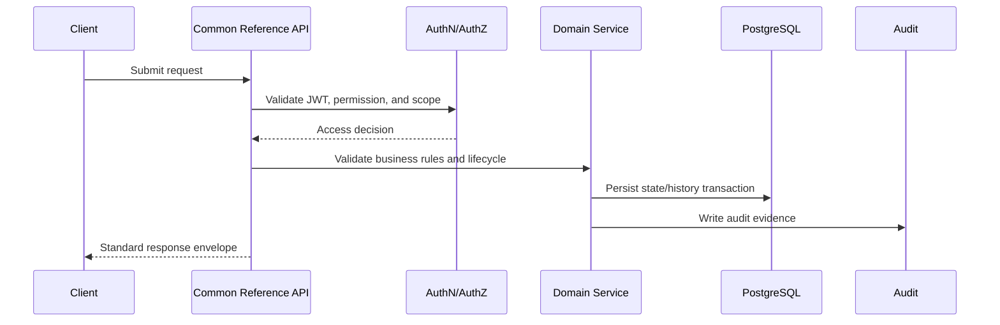
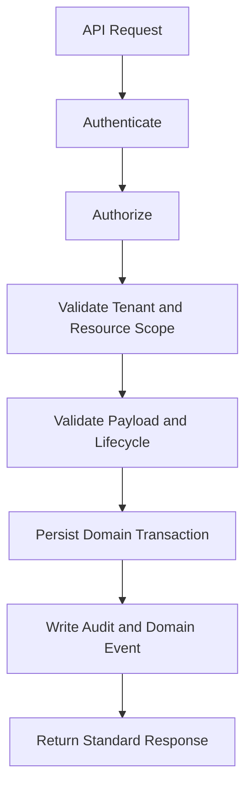

# (status banner removed to preserve metadata `Status: Design Draft`)
# API-14 Common Reference Collection

**Document ID:** API-14  
**Document Name:** Common Reference Collection  
**Company:** OreeOn Technologies Pvt. Ltd.  
**Product:** Digitize  
**Document Type:** API Collection Documentation  
**Backend Technology:** FastAPI  
**Database Engine:** PostgreSQL  
**Authentication:** JWT  
**API Version:** v1  
**Document Version:** 0.1  
**Status:** Design Draft  
**Owner:** API Architecture  
**Reviewer:** Solution Architecture / Security Architecture / Backend Engineering  
**Dependencies:** API-00, API-01, API-02, API-03, DB-11  
**Last Updated:** 2026-07-26

---

# 1. Document Metadata

| Attribute | Value |
|---|---|
| Document ID | API-14 |
| Document Name | Common Reference Collection |
| Output File | API-14_Common_Reference_Collection.md |
| API Version | v1 |
| Document Version | 0.1 |
| Status | Design Draft |
| Governing Standard | API-00_API_Collection_Standards.md |

---

# 2. Purpose

This document defines Common Reference API contracts for countries, states/regions, currencies, languages, timezones, facility types, activity types, status values, payment methods, communication channels, lookup values, localization, and shared reference projections.

---

# 3. Scope

In scope:

- Endpoint catalogue and REST contract rules for Common Reference Collection.
- Tenant-aware authentication, authorization, validation, response, error, audit, event, and test expectations.
- Lifecycle, history, report, and operational controls listed in the endpoint catalogue.
- Database mapping, observability, assumptions, dependencies, and acceptance criteria.

Out of scope:

- FastAPI controller or service implementation.
- OpenAPI JSON/YAML and Postman JSON export.
- Physical database migration changes.
- Capabilities owned by other API collection documents except where explicitly referenced.

---

# 4. Business Context

Common reference APIs provide stable, cacheable lists used across forms, validation, filters, and UI rendering. They must distinguish platform-owned master data from tenant-configured reference values.

---

# 5. Domain Overview

| Capability | Description | Source |
|---|---|---|
| Common Reference | API contracts, validation, lifecycle, audit, events, and tests | TBD — Owner: API Architecture / BA; Action: provide common reference authoritative source table names and master data IDs. |

---

# 6. Actors and Access Model

| Actor | Access Model |
|---|---|
| Organization Administrator | Organization-scoped administration and oversight |
| Facility Manager | Facility-scoped operational access |
| Site Administrator | Site-scoped operational access where applicable |
| Staff User | Permission-controlled execution access |
| Support Executive | Restricted support visibility where approved |
| System | Scheduled, asynchronous, event, and audit processing |

---

# 7. API Classification

| Endpoint Group | API Classification | Data Classification |
|---|---|---|
| Create/update/lifecycle endpoints | Tenant / Facility / Site | Confidential |
| History/report/export endpoints | Tenant / Facility / Site | Restricted where sensitive |
| Reference/status endpoints | Tenant / Facility / Site | Confidential |
| Internal callbacks or processing endpoints | Internal / Integration | Restricted |

---

# 8. Resource Model

| Resource | URL Base | Approved Database Mapping |
|---|---|---|
| Primary Resources | `/api/v1/reference` | `platform.global_master_data` |
| History and Reports | `/api/v1/reference/history` | `platform.global_master_data` |

---

# 9. API Endpoint Catalogue

| Endpoint ID | Method | URL | Endpoint Name | FR Mapping |
|---|---|---|---|---|
| API-14-001 | GET | `/api/v1/reference/countries` | List Countries | FR-PLT-002 |
| API-14-002 | GET | `/api/v1/reference/states-regions` | List States and Regions | FR-PLT-002 |
| API-14-003 | GET | `/api/v1/reference/currencies` | List Currencies | FR-PLT-002 |
| API-14-004 | GET | `/api/v1/reference/languages` | List Languages | FR-PLT-002 |
| API-14-005 | GET | `/api/v1/reference/timezones` | List Timezones | FR-PLT-002 |
| API-14-006 | GET | `/api/v1/reference/facility-types` | List Facility Types | FR-PLT-002 |
| API-14-007 | GET | `/api/v1/reference/activity-types` | List Activity Types | FR-PLT-002 |
| API-14-008 | GET | `/api/v1/reference/status-values` | List Status Values | FR-PLT-002 |
| API-14-009 | GET | `/api/v1/reference/payment-methods` | List Payment Methods | FR-PLT-002 |
| API-14-010 | GET | `/api/v1/reference/communication-channels` | List Communication Channels | FR-PLT-002 |
| API-14-011 | GET | `/api/v1/reference/lookup-values/{reference_group}` | List Lookup Values | FR-PLT-002 |
| API-14-012 | GET | `/api/v1/reference/localization` | List Localization Values | FR-PLT-002 |

---

# 10. Common Authentication Requirements

All endpoints require JWT authentication unless explicitly classified as Public, Internal, Integration, or Webhook by API-00.

---

# 11. Common Authorization Requirements

Authorization shall validate Organization, Facility, Site where applicable, role, permission, object ownership, lifecycle status, subscription/license/feature access, and data classification before domain execution.

Approved permission families: reference.create, reference.update, reference.view, reference.lifecycle.manage, reference.history.view, reference.report.view.

---

# 12. Tenant and Resource Scope Rules

- `X-Organization-ID` is required for tenant-scoped operations.
- `X-Facility-ID` is required for Facility-scoped operations unless scope is established through the resource.
- `X-Site-ID` is required for Site-scoped operations where Site is part of the business context.
- Resource ownership shall be validated against the authenticated security context.
- Cross-tenant access may return 404 where resource disclosure is unsafe.

---

# 13. Common Header Requirements

| Header | Required | Purpose |
|---|---|---|
| Authorization | Yes | JWT authentication |
| Accept | Yes | `application/json` |
| Content-Type | Conditional | Request body |
| X-Correlation-ID | Required or generated | Traceability |
| X-Organization-ID | Yes | Tenant scope |
| X-Facility-ID | Conditional | Facility scope |
| X-Site-ID | Conditional | Site scope |
| If-Match | Required for protected updates/actions | Concurrency |
| Idempotency-Key | Required for create, lifecycle, commercial, and retry-prone actions | Retry safety |

---

# 14. Request and Data Format Rules

- JSON fields use snake_case.
- UUID values use canonical lowercase strings.
- Date-time values use UTC RFC 3339.
- Status, type, category, method, and channel fields shall use approved reference values.
- Sensitive payload fields shall be masked in logs and audit details.

---

# 15. Standard Response Usage

All endpoints use API-00 response envelopes. Create endpoints return `201 Created`. Lifecycle actions normally return `200 OK` with the resulting state. Long-running work returns `202 Accepted` with a trackable status reference.

---

# 16. Module Error Codes

| Error Code | HTTP Status | Category | Safe Message | Retryable |
|---|---|---|---|---|
| REFERENCE_AUTHORIZATION_001 | 403 | Authorization | User is not authorized for this common reference collection action. | No |
| REFERENCE_VALIDATION_001 | 422 | Validation | Common Reference Collection request validation failed. | No |
| REFERENCE_SCOPE_001 | 404 | Authorization | Requested resource is unavailable. | No |
| REFERENCE_LIFECYCLE_001 | 409 | Business | Requested lifecycle action is not allowed. | No |
| REFERENCE_CONCURRENCY_001 | 412 | Conflict | Resource changed before the request completed. | Yes |
| REFERENCE_IDEMPOTENCY_001 | 409 | Conflict | Idempotency key conflicts with a previous request. | No |

---

# 17. Pagination, Filtering, Sorting, and Search

Offset pagination applies to operational list endpoints. Cursor pagination applies to high-volume history, event, audit, delivery, execution, or export-result endpoints.

Approved filters: `status, organization_id, facility_id, site_id, customer_id, from_date, to_date, and module-specific identifiers`.

Approved sort fields: `created_at, updated_at, status, effective_at, and module-specific display codes`.

Search is permitted only on approved business identifiers, display names, reference numbers, and safe projected fields. Sensitive identifiers require explicit permission.

---

# 18. Rate Limiting and Caching

Rate limiting protects create, search, lifecycle, report/export, retry, callback, and sensitive read endpoints.

Reference and configuration responses may be cached with invalidation. Mutable state, financial data, security data, audit data, and customer-sensitive data shall not be cached unless explicit cache-control rules are approved.

---

# 19. Idempotency and Optimistic Concurrency

Idempotency is required for create operations, lifecycle actions, payment-sensitive actions, retry-prone asynchronous commands, and provider callback handling where duplicate submissions are possible.

Optimistic concurrency is required for mutable resources and lifecycle actions where lost updates are possible. Protected requests shall use `If-Match` according to API-00.

---

# 20. Transaction Boundaries and Asynchronous Operations

Each state-changing endpoint shall persist the primary domain change, lifecycle/history record, audit event, and outbox/domain event within a controlled transaction boundary.

Asynchronous processing may be used for notifications, exports, reports, webhook delivery, retries, projection refresh, provider callbacks, and long-running analytics. Asynchronous endpoints return `202 Accepted` with a status reference.

---

# 21. Bulk Operations and File Handling

Bulk operations are not approved unless listed in the endpoint catalogue or explicitly governed by API-00 bulk-operation rules.

File upload/download is not part of this document unless explicitly listed. Attachment or export metadata may be stored, but binary storage and signed URL behavior require approved file-handling design.

---

# 22. API Endpoints

Each endpoint inherits API-00 Common Endpoint Documentation Template.

| Endpoint ID | Business Purpose | AuthZ Permission | Success | DB Mapping | Audit Event | Domain Event | Tests |
|---|---|---|---|---|---|---|---|
| API-14-001 | List Countries | `list.countries` | 200 OK | `platform.global_master_data, tenant.facility_type`, `audit.audit_event` | LIST_COUNTRIES | list.countries | Scope, validation, audit, and error-path tests |
| API-14-002 | List States and Regions | `list.states.and.regions` | 200 OK | `platform.global_master_data, tenant.facility_type`, `audit.audit_event` | LIST_STATES_AND_REGIONS | list.states.and.regions | Scope, validation, audit, and error-path tests |
| API-14-003 | List Currencies | `list.currencies` | 200 OK | `platform.global_master_data, tenant.facility_type`, `audit.audit_event` | LIST_CURRENCIES | list.currencies | Scope, validation, audit, and error-path tests |
| API-14-004 | List Languages | `list.languages` | 200 OK | `platform.global_master_data, tenant.facility_type`, `audit.audit_event` | LIST_LANGUAGES | list.languages | Scope, validation, audit, and error-path tests |
| API-14-005 | List Timezones | `list.timezones` | 200 OK | `platform.global_master_data, tenant.facility_type`, `audit.audit_event` | LIST_TIMEZONES | list.timezones | Scope, validation, audit, and error-path tests |
| API-14-006 | List Facility Types | `list.facility.types` | 200 OK | `platform.global_master_data, tenant.facility_type`, `audit.audit_event` | LIST_FACILITY_TYPES | list.facility.types | Scope, validation, audit, and error-path tests |
| API-14-007 | List Activity Types | `list.activity.types` | 200 OK | `platform.global_master_data, tenant.facility_type`, `audit.audit_event` | LIST_ACTIVITY_TYPES | list.activity.types | Scope, validation, audit, and error-path tests |
| API-14-008 | List Status Values | `list.status.values` | 200 OK | `platform.global_master_data, tenant.facility_type`, `audit.audit_event` | LIST_STATUS_VALUES | list.status.values | Scope, validation, audit, and error-path tests |
| API-14-009 | List Payment Methods | `list.payment.methods` | 200 OK | `platform.global_master_data, tenant.facility_type`, `audit.audit_event` | LIST_PAYMENT_METHODS | list.payment.methods | Scope, validation, audit, and error-path tests |
| API-14-010 | List Communication Channels | `list.communication.channels` | 200 OK | `platform.global_master_data, tenant.facility_type`, `audit.audit_event` | LIST_COMMUNICATION_CHANNELS | list.communication.channels | Scope, validation, audit, and error-path tests |
| API-14-011 | List Lookup Values | `list.lookup.values` | 200 OK | `platform.global_master_data, tenant.facility_type`, `audit.audit_event` | LIST_LOOKUP_VALUES | list.lookup.values | Scope, validation, audit, and error-path tests |
| API-14-012 | List Localization Values | `list.localization.values` | 200 OK | `platform.global_master_data, tenant.facility_type`, `audit.audit_event` | LIST_LOCALIZATION_VALUES | list.localization.values | Scope, validation, audit, and error-path tests |

---

# 23. Module Sequence Diagram

---

# 24. Request Flow Diagram

---

# 25. Database Mapping Summary

| Area | Tables |
|---|---|
| Primary Domain | `platform.global_master_data, tenant.facility_type` |
| Audit | `audit.audit_event`, `audit.audit_entity_reference` |

---

# 26. Domain Event and Outbox Mapping

Outbox mapping is `integration.outbox_event` from `DB-11_Database_DDL_DML_Scripts.md`.

Events include reference.value_viewed, reference.cache_refreshed.

---

# 27. Audit and Notification Mapping

Audit events include REFERENCE_VIEWED, REFERENCE_CACHE_REFRESHED.

Asynchronous notifications may be triggered for customer-visible confirmations, operational alerts, approval requests, failures, lifecycle status changes, report/export completion, and compliance/security alerts where applicable.

---

# 28. Functional Requirement Mapping

| Source Document | Covered FR IDs |
|---|---|
| [OWNER ACTION REQUIRED — provide authoritative source and mapping; CHG API-CHG-0020] | [OWNER ACTION REQUIRED — provide authoritative mapping; CHG API-CHG-0020] |

---

# 29. Business Process and UI Mapping

| Process Area | Covered Processes |
|---|---|
| Business Process Catalog | BA-03 mappings referenced by the source FR documents |
| Business Process Flows | BA-04 mappings referenced by the source FR documents |

UI screen IDs are unavailable in the current source set. Mapped screen names shall follow the endpoint catalogue and corresponding Functional Requirement workflow names.

---

# 30. Security Considerations

- Enforce tenant, Facility, and Site isolation.
- Restrict sensitive data, financial data, security data, audit data, and customer personal data by permission and data classification.
- Prevent lifecycle bypass and unauthorized override usage.
- Mask secrets, tokens, provider references, and sensitive payload values in logs.
- Audit restricted reads, exports, lifecycle actions, configuration changes, and administrative access.

---

# 31. Performance, Scalability, and Observability

- Index list, lookup, history, status, and date-range access paths.
- Use cursor pagination for high-volume append-only histories.
- Avoid unbounded synchronous report, export, search, or aggregation queries.
- Track request count, latency, validation failures, authorization failures, scope failures, lifecycle conflicts, idempotency conflicts, concurrency conflicts, async job status, audit write failures, and domain event publication failures.

---

# 32. Test Coverage Summary

Required coverage includes authentication, authorization, tenant isolation, validation, success responses, error envelopes, pagination, filtering, sorting, idempotency, concurrency, lifecycle transitions, audit/event creation, notification behavior, and relevant async or export flows.

---

# 33. Assumptions and Constraints

- UI screen IDs are unavailable.
- Outbox table mapping is `integration.outbox_event`.
[NOTE — owners must review TBD mappings and replace with authoritative IDs; CHG API-CHG-0020]
- These documents define contracts and governance only; they do not generate FastAPI source code.

---

# 34. Dependencies

| Dependency | Description |
|---|---|
| API-00 | Governing standard |
| API-02 | Organization, Facility, and Site hierarchy |
| API-03 | Authentication, user, role, and permission context |
| API-13 | Audit and security |
| DB-11 | Approved database mappings |

---

# 35. Future Enhancements

- Additional query projections after UI screen IDs are finalized.
- Dedicated export status endpoint where report volume requires asynchronous processing.
- Webhook publication where external integration use cases are approved.

---

# 36. Document Acceptance Criteria

This document is acceptable when it follows API-00, uses approved `/api/v1` REST conventions, preserves tenant isolation, maps endpoints to source requirements where available, defines module errors, and documents audit/event/test coverage.

---

# 37. Summary

API-14 defines Common Reference Collection for Digitize. It establishes secure, tenant-aware, auditable API contracts aligned with approved functional, database, architecture, and governance source documents.
