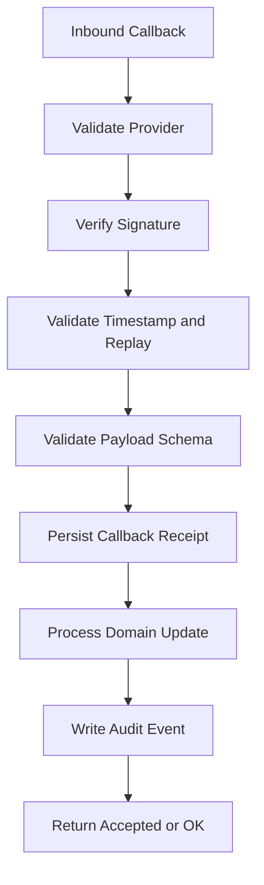
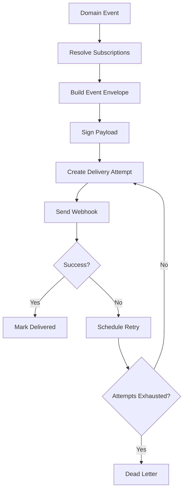

# (status banner removed to preserve metadata `Status: Design Draft`)
# API-18 Webhook Specifications

**Document ID:** API-18  
**Document Name:** Webhook Specifications  
**Company:** OreeOn Technologies Pvt. Ltd.  
**Product:** Digitize  
**Document Type:** API Collection Documentation  
**Backend Technology:** FastAPI  
**Database Engine:** PostgreSQL  
**Authentication:** JWT / Provider Signature / Webhook Signature  
**API Version:** v1  
**Document Version:** 0.1  
**Status:** Design Draft  
**Owner:** API Architecture  
**Reviewer:** Solution Architecture / Security Architecture / Backend Engineering / Integration Architecture / DevOps  
**Dependencies:** API-00, API-08, API-10, API-13, API-15, API-16, API-17, API-19, API-20, TA-04, DB-22  
**Last Updated:** 2026-07-26

---

# 1. Document Metadata

| Attribute | Value |
|---|---|
| Document ID | API-18 |
| Document Name | Webhook Specifications |
| Output File | API-18_Webhook_Specifications.md |
| API Version | v1 |
| Document Version | 0.1 |
| Status | Design Draft |
| Governing Standard | API-00_API_Collection_Standards.md |

---

# 2. Purpose

This document defines inbound callback and outbound webhook standards for Digitize.

It covers webhook classification, endpoint conventions, event envelope, payload versioning, signature verification, replay protection, idempotency, retry, dead-letter handling, tenant isolation, audit mapping, observability, security controls, test scenarios, and lifecycle governance.

---

# 3. Scope

In scope:

- Inbound payment, refund, settlement, and notification-provider callbacks.
- Outbound Digitize domain webhooks for approved integration consumers.
- Webhook signing, verification, timestamp tolerance, and replay protection.
- Webhook delivery attempts, retry, terminal failure, and dead-letter behavior.
- Event envelope and versioning rules.
- Audit, observability, and API-16 test mappings.

Out of scope:

- Vendor-specific payment gateway payload documentation.
- Provider secret values.
- External partner onboarding workflow.
- Event streaming platforms.
- Real-time socket APIs.

---

# 4. Webhook Classification

| Classification | Direction | Auth Standard | Purpose |
|---|---|---|---|
| Inbound Provider Callback | External to Digitize | Provider signature validation | Payment, refund, settlement, notification status |
| Outbound Tenant Webhook | Digitize to tenant endpoint | Digitize webhook signature | Notify approved tenant systems |
| Outbound Platform Webhook | Digitize to platform integration | Digitize webhook signature or service identity | Internal/platform integrations |
| Internal Event Callback | Service to service | Service identity | Internal async processing |

---

# 5. URL Standards

Inbound callbacks shall use provider-specific resource names:

```text
POST /api/v1/webhooks/payment-provider/{provider_code}/callbacks
POST /api/v1/webhooks/refund-provider/{provider_code}/callbacks
POST /api/v1/webhooks/notification-provider/{provider_code}/delivery-status
```

Outbound webhook management endpoints, when approved, shall use tenant-scoped resources:

```text
POST /api/v1/webhook-subscriptions
PATCH /api/v1/webhook-subscriptions/{webhook_subscription_id}
POST /api/v1/webhook-subscriptions/{webhook_subscription_id}/activate
POST /api/v1/webhook-subscriptions/{webhook_subscription_id}/suspend
GET /api/v1/webhook-deliveries
GET /api/v1/webhook-deliveries/{webhook_delivery_id}
```

---

# 6. Inbound Callback Catalogue

| Callback ID | Method | URL | Source Provider Area | Owning API | Expected Response |
|---|---|---|---|---|---|
| WHK-IN-001 | POST | `/api/v1/webhooks/payment-provider/{provider_code}/callbacks` | Payment status | API-08 | `202 Accepted` or `200 OK` |
| WHK-IN-002 | POST | `/api/v1/webhooks/refund-provider/{provider_code}/callbacks` | Refund status | API-08 | `202 Accepted` or `200 OK` |
| WHK-IN-003 | POST | `/api/v1/webhooks/settlement-provider/{provider_code}/callbacks` | Settlement status | API-08 | `202 Accepted` or `200 OK` |
| WHK-IN-004 | POST | `/api/v1/webhooks/notification-provider/{provider_code}/delivery-status` | Notification delivery | API-10 | `202 Accepted` or `200 OK` |
| WHK-IN-005 | POST | `/api/v1/webhooks/integration/{integration_code}/callbacks` | Approved integration | API-18 | `202 Accepted` |

---

# 7. Outbound Event Catalogue

| Event Type | Producer | Consumer | Trigger |
|---|---|---|---|
| `customer.created` | API-04 | Approved tenant systems | Customer registration |
| `membership.activated` | API-05 | Approved tenant systems | Membership activation |
| `membership.renewed` | API-05 | Approved tenant systems | Membership renewal |
| `attendance.checked_in` | API-06 | Approved tenant systems | Customer check-in |
| `payment.collected` | API-08 | Approved tenant systems | Payment success |
| `refund.processed` | API-08 | Approved tenant systems | Refund completion |
| `subscription.activated` | API-09 | Approved tenant systems | Subscription activation |
| `license.suspended` | API-09 | Approved tenant systems | License suspension |
| `campaign.launched` | API-10 | Approved tenant systems | Campaign launch |
| `notification.failed` | API-10 | Approved tenant systems | Terminal delivery failure |
| `report.export_completed` | API-11 | Approved tenant systems | Export completion |
| `support_ticket.created` | API-12 | Approved tenant systems | Support ticket creation |
| `audit.export_requested` | API-13 | Approved security systems | Audit export request |

Final event availability requires product and integration approval per tenant.

---

# 8. Outbound Event Envelope

Outbound webhook payloads shall use this envelope:

```json
{
  "event_id": "uuid",
  "event_type": "membership.activated",
  "event_version": "1.0",
  "occurred_at": "2026-07-24T10:30:00Z",
  "organization_id": "uuid",
  "facility_id": "uuid",
  "site_id": "uuid",
  "resource_type": "membership",
  "resource_id": "uuid",
  "correlation_id": "uuid",
  "api_version": "v1",
  "data": {}
}
```

Envelope rules:

- `event_id` is globally unique and immutable.
- `event_type` uses lowercase dot-separated naming.
- `event_version` changes when payload structure changes.
- `organization_id` is required for tenant events.
- `facility_id` and `site_id` are included when applicable.
- `data` shall contain only approved safe payload fields.
- Secrets, tokens, raw payment data, and excessive PII shall not be included.

---

# 9. Header Standards

| Header | Direction | Required | Purpose |
|---|---|---|---|
| `Content-Type` | Both | Yes | `application/json` |
| `X-Digitize-Event-ID` | Outbound | Yes | Event identity |
| `X-Digitize-Delivery-ID` | Outbound | Yes | Delivery attempt identity |
| `X-Digitize-Signature` | Outbound | Yes | Payload signature |
| `X-Digitize-Timestamp` | Outbound | Yes | Replay protection |
| `X-Digitize-Webhook-Version` | Outbound | Yes | Signature/envelope version |
| `X-Correlation-ID` | Both | Required or generated | Traceability |
| Provider signature header | Inbound | Yes | Provider-specific verification |
| Provider event ID header | Inbound | Conditional | Idempotency where provider supports it |

---

# 10. Signature Standard

Digitize outbound webhook signatures shall be calculated from:

```text
timestamp + "." + raw_request_body
```

The default algorithm is HMAC-SHA256 unless Security Architecture approves asymmetric signing.

Signature format:

```text
v1=<hex_encoded_signature>
```

Verification rules:

- Compare signatures with constant-time comparison.
- Reject missing signatures.
- Reject unsupported signature versions.
- Reject timestamps outside the replay window.
- Reject modified payloads.
- Rotate secrets through approved webhook subscription lifecycle.

---

# 11. Replay Protection

| Control | Requirement |
|---|---|
| Timestamp tolerance | Default 5 minutes unless Security Architecture changes it |
| Event ID uniqueness | `event_id` shall not be processed twice |
| Delivery ID uniqueness | Each delivery attempt has a unique delivery ID |
| Provider event ID | Used for inbound callback deduplication |
| Idempotency storage | Callback/event dedupe state shall be persisted before side effects complete |

---

# 12. Inbound Callback Processing Flow



---

# 13. Outbound Delivery Flow



---

# 14. Retry Policy

| Attempt | Delay Guidance | Notes |
|---|---|---|
| 1 | Immediate | Initial delivery |
| 2 | 1 minute | Transient failures |
| 3 | 5 minutes | Backoff |
| 4 | 15 minutes | Backoff |
| 5 | 1 hour | Final retry before terminal handling unless policy extends |

Retryable responses:

- HTTP 408.
- HTTP 409 where receiver documents retry safety.
- HTTP 425.
- HTTP 429 after `Retry-After`.
- HTTP 500, 502, 503, 504.
- Network timeout or connection failure.

Non-retryable responses:

- HTTP 400.
- HTTP 401.
- HTTP 403.
- HTTP 404 unless endpoint activation is pending and approved.
- HTTP 410.
- Invalid receiver TLS.
- Signature rejection by receiver.

---

# 15. Dead-letter Handling

When delivery reaches terminal failure:

- Mark delivery status as `dead_lettered`.
- Preserve request metadata, response status, safe response body summary, attempt count, and timestamps.
- Emit operational alert where configured.
- Make failure visible to authorized support users.
- Do not expose webhook secrets or full sensitive payloads.
- Allow approved manual replay only when payload version and endpoint are still valid.

---

# 16. Webhook Subscription Model

| Field | Required | Description |
|---|---|---|
| `webhook_subscription_id` | Yes | Unique subscription identifier |
| `organization_id` | Yes | Tenant owner |
| `facility_id` | Conditional | Facility scope |
| `event_types` | Yes | Approved event list |
| `target_url` | Yes | HTTPS receiver URL |
| `secret_reference` | Yes | Secret store reference, not raw secret |
| `status` | Yes | Draft, Active, Suspended, Retired |
| `created_by` | Yes | Actor |
| `last_delivery_at` | Conditional | Most recent delivery |

---

# 17. Database Mapping

Webhook-specific database mapping is `TBD — Owner: Integration / Security; Action: provide webhook DB mapping and signature mapping details.`.

Related approved mappings:

| Area | Tables |
|---|---|
| Payment callbacks | `commercial.payment`, `commercial.payment_attempt` |
| Refund callbacks | `commercial.refund`, `commercial.refund_attempt` |
| Settlement callbacks | `commercial.settlement`, `commercial.reconciliation` |
| Notification callbacks | `communication.notification_delivery`, `communication.notification_attempt`, `communication.notification_failure` |
| Audit | `audit.audit_event`, `audit.audit_entity_reference` |
| Integration architecture | [OWNER ACTION REQUIRED — provide integration architecture mapping or reference; CHG API-CHG-0022] |

---

# 18. Error Codes

| Error Code | HTTP Status | Category | Safe Message | Retryable |
|---|---|---|---|---|
| WEBHOOK_SIGNATURE_001 | 401 | Authentication | Webhook signature validation failed. | No |
| WEBHOOK_REPLAY_001 | 409 | Conflict | Webhook event was already processed. | No |
| WEBHOOK_TIMESTAMP_001 | 401 | Authentication | Webhook timestamp is outside the accepted window. | No |
| WEBHOOK_PAYLOAD_001 | 422 | Validation | Webhook payload validation failed. | No |
| WEBHOOK_PROVIDER_001 | 403 | Authorization | Webhook provider is not authorized. | No |
| WEBHOOK_DELIVERY_001 | 503 | Integration | Webhook delivery failed and will be retried. | Yes |
| WEBHOOK_DEADLETTER_001 | 500 | Integration | Webhook delivery reached terminal failure. | No |

---

# 19. Security Considerations

- Inbound callbacks shall verify provider identity and signature before processing.
- Outbound webhooks shall use HTTPS target URLs only.
- Secrets shall be stored as references and never returned in API responses.
- Payloads shall minimize PII and exclude raw payment data.
- Signature verification shall use constant-time comparison.
- Administrative webhook replay shall require explicit permission and audit.
- Receiver error bodies shall be stored only in safe summarized form.

---

# 20. Observability

Required metrics:

- Inbound callbacks received, accepted, rejected, duplicated.
- Signature validation failures.
- Replay rejections.
- Delivery attempts by event type.
- Delivery success rate.
- Delivery latency.
- Retry count.
- Dead-letter count.
- Manual replay count.

Required log fields:

- `correlation_id`.
- `event_id`.
- `delivery_id`.
- `organization_id`.
- `event_type`.
- Safe provider code.
- Delivery status.

---

# 21. Audit Mapping

| Audit Event | Trigger |
|---|---|
| WEBHOOK_CALLBACK_RECEIVED | Valid inbound callback accepted |
| WEBHOOK_CALLBACK_REJECTED | Invalid callback rejected |
| WEBHOOK_DELIVERY_CREATED | Outbound delivery created |
| WEBHOOK_DELIVERY_SUCCEEDED | Receiver accepted delivery |
| WEBHOOK_DELIVERY_FAILED | Delivery attempt failed |
| WEBHOOK_DELIVERY_DEAD_LETTERED | Delivery reached terminal failure |
| WEBHOOK_DELIVERY_REPLAYED | Authorized manual replay |
| WEBHOOK_SUBSCRIPTION_CHANGED | Subscription configuration changed |

---

# 22. API-16 Test Mapping

| Webhook Area | Required API-16 Scenarios |
|---|---|
| Inbound signature validation | API-16-WHK-001, API-16-WHK-002 |
| Replay protection | API-16-WHK-003, API-16-WHK-004 |
| Outbound delivery | API-16-WHK-005 |
| Retry | API-16-WHK-006 |
| Dead-letter | API-16-WHK-007 |
| Security and masking | API-16-SEC-001, API-16-SEC-004 |
| Audit | API-16-AUD-001 |

---

# 23. Change Governance

Webhook changes require API-20 entries when they alter:

- Event type.
- Event envelope.
- Payload schema.
- Signature version.
- Retry policy.
- Dead-letter policy.
- Target subscription behavior.
- Error code behavior.

Breaking webhook changes require a new `event_version`.

---

# 24. Assumptions and Constraints

- Final webhook storage tables are pending DB-22/DB-11 mapping.
- Provider-specific callback payloads require provider integration design.
- Tenant webhook subscription UI is not defined in the current UI source set.
- Production webhook replay is restricted to approved operational users.

---

# 25. Document Acceptance Criteria

This document is acceptable when:

- Inbound and outbound webhook classifications are defined.
- Event envelope and header standards are explicit.
- Signature, replay, idempotency, retry, and dead-letter rules are documented.
- Error codes and audit events are defined.
- API-16 tests can validate webhook behavior.
- API-20 can govern webhook changes.

---

# 26. Summary

API-18 defines secure, tenant-aware webhook behavior for Digitize. It gives implementation teams a governed baseline for callbacks, outbound events, payload versioning, signatures, retry safety, dead-letter handling, auditability, and observability.
