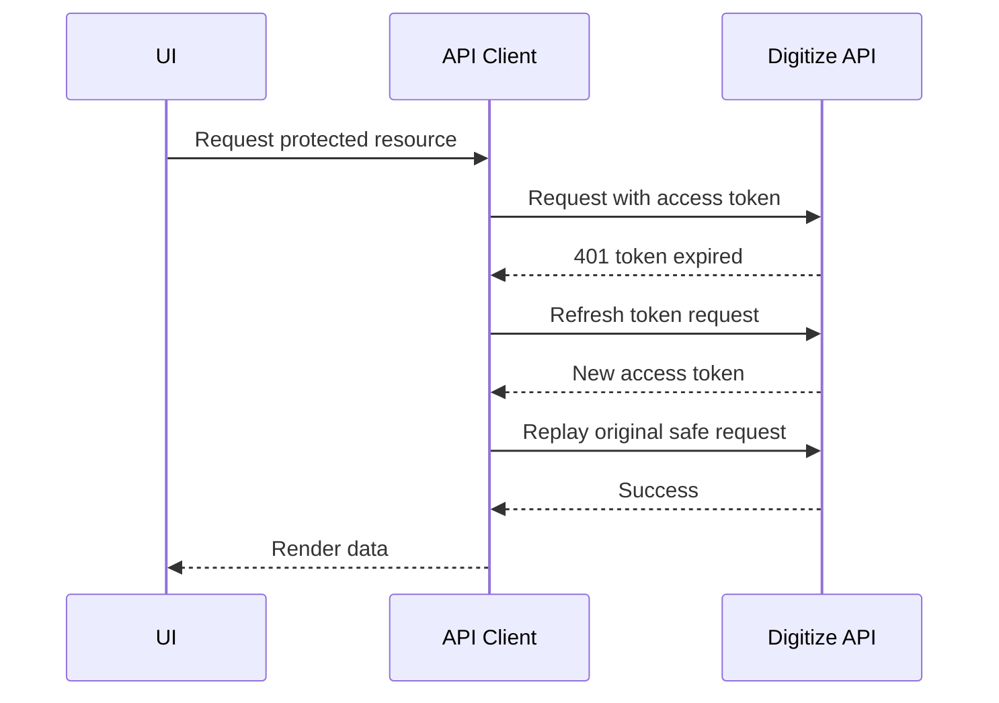

> **Status:** Frozen — 2026-07-26 — 2026-07-26

# API-22 Frontend API Consumption Standards

**Document ID:** API-22  
**Document Name:** Frontend API Consumption Standards  
**Company:** OreeOn Technologies Pvt. Ltd.  
**Product:** Digitize  
**Document Type:** API Consumer Governance Documentation  
**Frontend Targets:** Flutter / Web  
**Backend Technology:** FastAPI  
**Authentication:** JWT  
**API Version:** v1  
**Document Version:** 0.1  
**Status:** Design Draft  
**Owner:** API Architecture / Frontend Architecture  
**Reviewer:** Solution Architecture / Security Architecture / UI/UX / Backend Engineering / QA  
**Dependencies:** API-00 to API-21, API-23, API-24, API-25, API-26  
**Last Updated:** July 2026

---

# 1. Document Metadata

| Attribute | Value |
|---|---|
| Document ID | API-22 |
| Document Name | Frontend API Consumption Standards |
| Output File | API-22_Frontend_API_Consumption_Standards.md |
| API Version | v1 |
| Document Version | 0.1 |
| Status | Design Draft |
| Governing Standard | API-00_API_Collection_Standards.md |

---

# 2. Purpose

This document defines how Flutter and web clients shall consume Digitize APIs.

It provides the bridge between API contracts and UI/UX design by defining API client architecture, authentication handling, tenant context propagation, loading states, retries, timeouts, errors, pagination, search, idempotency, concurrency, caching, file handling, async polling, and offline behavior.

---

# 3. Scope

In scope:

- Frontend API client architecture.
- JWT access-token and refresh-token handling.
- Correlation ID and tenant context propagation.
- Organization, Facility, and Site switching behavior.
- Request cancellation, loading states, retry, timeout, and error handling.
- Form validation mapping.
- Pagination, filtering, sorting, and search debouncing.
- Idempotency-key generation and optimistic concurrency.
- Offline behavior and cached reference data.
- File upload/download usage.
- Async-operation polling.
- Webhook limitations for frontend clients.

Out of scope:

- UI visual design.
- Component library implementation.
- Backend service implementation.
- Native mobile secure-storage package selection.
- Real production credentials.

---

# 4. Frontend Consumption Principles

| Principle | Standard |
|---|---|
| API contract aligned | UI flows shall follow API-00 through API-24 |
| Secure by default | Tokens and tenant context shall be protected |
| Scope explicit | Current Organization, Facility, and Site shall be explicit in API calls |
| Error-code driven | UI behavior shall use API-19 error codes |
| State-driven | Buttons and actions shall follow API-24 states |
| Permission-driven | Visibility and action controls shall follow API-23 |
| Retry-safe | Automatic retries shall not duplicate state changes |
| Responsive | Loading, empty, error, and offline states shall be designed |

---

# 5. API Client Architecture

Frontend clients shall use a layered API client:

```text
UI Screen
  -> View Model / Controller
  -> Domain API Client
  -> HTTP Client
  -> Interceptors
  -> API-00 Response Parser
```

Responsibilities:

| Layer | Responsibility |
|---|---|
| UI Screen | Render state, collect input, trigger actions |
| View Model / Controller | Manage screen state, validation, loading, errors |
| Domain API Client | Expose typed methods per API document |
| HTTP Client | Execute HTTP requests |
| Interceptors | Attach auth, tenant, correlation, idempotency, retry controls |
| Response Parser | Normalize API-00 success/error envelopes |

---

# 6. Authentication Token Handling

| Token | Storage | Rule |
|---|---|---|
| Access token | Secure memory and approved secure storage | Short-lived, attached to requests |
| Refresh token | Secure storage only | Rotated and never logged |
| Session ID | Secure storage or memory | Used for logout/session tracking |

Rules:

- Tokens shall not be stored in plain local storage where avoidable.
- Tokens shall not be logged.
- Access token expiry shall trigger refresh flow.
- Failed refresh shall return user to login.
- Logout shall clear access token, refresh token, selected tenant context, and cached restricted data.

---

# 7. Refresh-token Flow



Replay after refresh is allowed for safe reads. For state-changing operations, replay requires idempotency support.

---

# 8. Correlation ID Handling

- Generate one `X-Correlation-ID` per user action or workflow step.
- Reuse the same correlation ID across retries of the same user action.
- Show support-facing correlation IDs for terminal errors where appropriate.
- Do not expose internal trace IDs in normal UI copy.

---

# 9. Tenant Context Propagation

Every tenant API request shall include the selected tenant context:

| Context | Header | UI Source |
|---|---|---|
| Organization | `X-Organization-ID` | Current organization selector |
| Facility | `X-Facility-ID` | Current facility selector |
| Site | `X-Site-ID` | Current site selector |

The UI shall never assume that changing a header grants access. Unauthorized responses shall be handled through API-19 error rules.

---

# 10. Organization, Facility, and Site Switching

When the user switches Organization, Facility, or Site:

1. Cancel in-flight requests tied to the previous context.
2. Clear context-sensitive screen state.
3. Clear cached tenant-scoped data unless cache is explicitly keyed by scope.
4. Reload permissions and feature access where needed.
5. Refresh reference data if scope-specific.
6. Navigate away from screens unavailable in the new context.

---

# 11. Request Cancellation

Request cancellation is required for:

- Typeahead search.
- Rapid filter changes.
- Route/navigation changes.
- Tenant context switching.
- Long-running report polling when user leaves the screen.

Cancellation shall not be used to assume backend transaction rollback after a request has been accepted.

---

# 12. Loading, Empty, and Error States

| State | UI Requirement |
|---|---|
| Initial loading | Show non-blocking loading indicator or skeleton |
| Submit loading | Disable duplicate submit and show progress |
| Empty result | Show domain-specific empty state |
| Validation error | Highlight fields using API error details |
| Authorization error | Hide or disable action where permission is known |
| Terminal error | Show safe message and support correlation where helpful |
| Retryable error | Offer retry where safe |
| Async pending | Show pending/progress state |

---

# 13. Retry Rules

| Request Type | Automatic Retry |
|---|---|
| GET safe read | Allowed with backoff |
| Search | Allowed only for network/transient failures |
| POST create | Only with idempotency key |
| POST lifecycle action | Only with idempotency key |
| Payment action | Only when API-08 marks retry-safe |
| File upload | Only when resumable/idempotent behavior is approved |
| Webhook | Not consumed directly by frontend |

Do not retry validation, authorization, business lifecycle, or non-retryable API-19 errors automatically.

---

# 14. Timeout Handling

| Request Type | UI Behavior |
|---|---|
| Normal read | Show retryable error |
| Search | Keep prior results if still relevant |
| Submit action | Check operation result before allowing duplicate submit |
| Payment | Verify payment status before retry |
| Report export | Switch to async polling where available |

---

# 15. Error-code Interpretation

Frontend clients shall branch on `error.error_code` and `error.category`.

| Error Category | UI Behavior |
|---|---|
| AUTHENTICATION | Refresh token or redirect to login |
| AUTHORIZATION | Hide/disable action or show access message |
| VALIDATION | Map details to form fields |
| BUSINESS | Show safe business rule message |
| CONCURRENCY | Ask user to refresh and retry |
| IDEMPOTENCY | Show duplicate/conflict guidance |
| RATE_LIMIT | Disable retry until backoff window |
| PROVIDER | Show provider-safe pending/failure state |
| INTERNAL/UNAVAILABLE | Show retry or support path |

---

# 16. Form-validation Mapping

Field-level API validation details shall map to UI fields by `field`.

Rules:

- Preserve server validation messages when safe.
- Do not replace API validation with inconsistent client-only rules.
- Client validation may prevent obvious invalid submits but server remains authoritative.
- Unknown field-level errors shall appear in a form-level error summary.

---

# 17. Pagination Handling

| Pagination Type | UI Pattern |
|---|---|
| Offset | Tables, admin lists, manageable data sets |
| Cursor | High-volume histories, audit logs, delivery logs |
| Infinite scroll | Only where UX approves and accessibility is preserved |
| Export | Use API-11 async export for large result sets |

UI shall preserve filters and sort while moving pages.

---

# 18. Search Debouncing

| Search Type | Minimum Behavior |
|---|---|
| Customer/member search | Debounce and cancel prior request |
| Reference lookup | Cache where allowed |
| Sensitive search | Require permission and avoid suggestions where restricted |
| Empty query | Do not call API unless endpoint explicitly supports it |

Recommended debounce is 300 to 500 ms unless product-specific UX decides otherwise.

---

# 19. Idempotency-key Generation

Frontend clients shall generate idempotency keys for:

- Create customer.
- Create membership.
- Membership lifecycle actions.
- Attendance check-in/check-out where required.
- Invoice creation.
- Payment initiation.
- Refund initiation.
- Subscription/license lifecycle actions.
- Campaign launch.
- Support ticket creation.

One user submit action equals one idempotency key.

---

# 20. Optimistic Concurrency

For protected resources:

- Store ETag from GET/create response.
- Include `If-Match` on PATCH/lifecycle requests.
- On `412`, refresh the resource and ask the user to review changes.
- Do not overwrite server state silently.

---

# 21. Offline Behavior

| Capability | Offline Rule |
|---|---|
| Reference data | May use cached copy with freshness indicator |
| Customer search | Offline not supported unless approved |
| Attendance | Offline queue only if conflict reconciliation is approved |
| Payments | Offline payment processing not approved |
| Support draft | Draft may be saved locally without submission |
| Reports | Offline not supported |

Offline queues require idempotency, conflict handling, and audit recovery.

---

# 22. Cached Reference Data

Cacheable data:

- Countries.
- Currencies.
- Languages.
- Timezones.
- Facility types.
- Status values.
- Communication channels.
- Static lookup values.

Tenant-sensitive data shall be cached only with explicit scope keys and invalidation rules.

---

# 23. File Upload and Download

File upload/download shall follow approved API file-handling rules when available.

Frontend requirements:

- Show upload progress.
- Validate file type and size before upload where rules are available.
- Use signed URLs only when approved.
- Never expose storage internals.
- Handle expired download links safely.
- Audit sensitive export/download requests where API requires it.

---

# 24. Asynchronous-operation Polling

Async operations include reports, exports, notifications, and selected provider operations.

Polling rules:

- Poll status endpoint at controlled intervals.
- Stop polling on success, failure, cancellation, timeout, or navigation away.
- Use exponential or bounded backoff for long jobs.
- Display safe progress states.
- Do not start duplicate jobs without user intent.

---

# 25. Webhook Limitations for Frontend Clients

Frontend clients do not receive provider webhooks directly.

Frontend shall:

- Poll API status endpoints for payment/report/export state.
- Listen to approved app notification channels where available.
- Never expose webhook secrets.
- Never validate provider signatures in UI code.
- Treat webhook-driven changes as backend state updates surfaced through APIs.

---

# 26. Security Requirements

- Do not log tokens, secrets, raw payment data, or full PII payloads.
- Clear restricted data on logout and tenant switch.
- Use permission and feature-access results to control UI actions.
- Treat API authorization as authoritative even when UI hides controls.
- Protect local cache according to data classification.

---

# 27. UI/UX Handoff Requirements

Before screen design begins, UI/UX shall have:

- API-19 error categories and safe-message behavior.
- API-22 loading, retry, timeout, and form-validation rules.
- API-23 access matrix for screen/action visibility.
- API-24 state/action rules.
- API-25 mock and sandbox strategy for clickable prototypes and frontend development.

---

# 28. Acceptance Criteria

This document is acceptable when frontend and UI/UX teams can determine how APIs affect authentication, context switching, loading states, errors, validation, retries, pagination, caching, offline behavior, file handling, and async workflows.

---

# 29. Summary

API-22 defines how Flutter and web clients shall consume Digitize APIs. It is the primary bridge between backend API contracts and UI/UX behavior.
