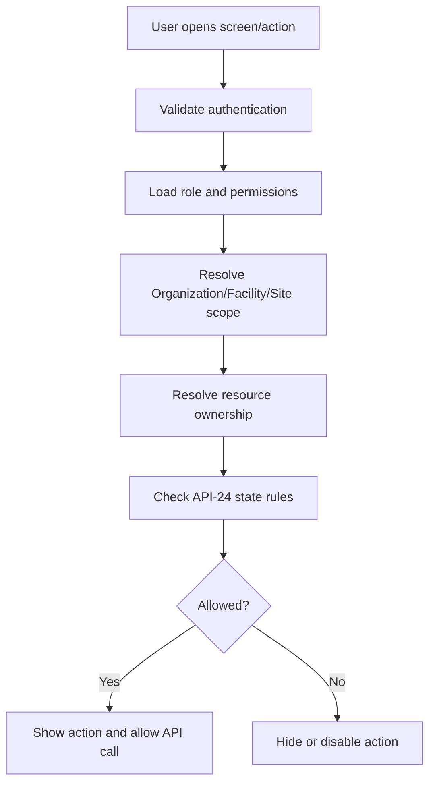
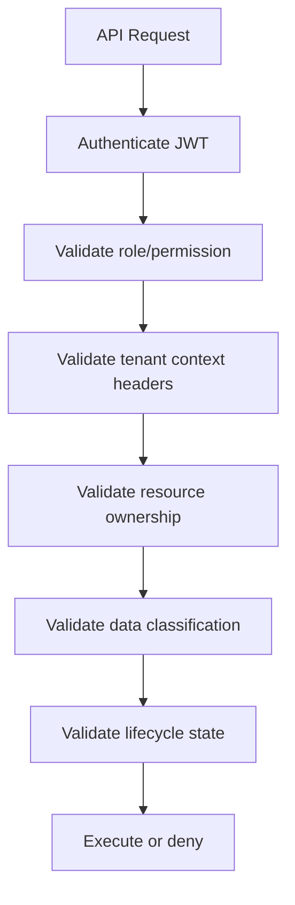

> **Status:** Frozen — 2026-07-26 — 2026-07-26

# API-23 API Access Control Matrix

**Document ID:** API-23  
**Document Name:** API Access Control Matrix  
**Company:** OreeOn Technologies Pvt. Ltd.  
**Product:** Digitize  
**Document Type:** API Security and UI Authorization Documentation  
**Backend Technology:** FastAPI  
**Authentication:** JWT / RBAC / Tenant Scope  
**API Version:** v1  
**Document Version:** 0.1  
**Status:** Design Draft  
**Owner:** Security Architecture / API Architecture  
**Reviewer:** Solution Architecture / Product Management / UI/UX / Backend Engineering / QA  
**Dependencies:** API-00, API-02, API-03, API-04 to API-14, API-17, API-22, API-24  
**Last Updated:** July 2026

---

# 1. Document Metadata

| Attribute | Value |
|---|---|
| Document ID | API-23 |
| Document Name | API Access Control Matrix |
| Output File | API-23_API_Access_Control_Matrix.md |
| API Version | v1 |
| Document Version | 0.1 |
| Status | Design Draft |
| Governing Standard | API-00_API_Collection_Standards.md |

---

# 2. Purpose

This document defines the API access control matrix used to map roles, permissions, scopes, endpoints, allowed operations, and UI action visibility.

It is more detailed than API-17 traceability and shall guide frontend screen visibility, button visibility, menu availability, route guards, and backend authorization tests.

---

# 3. Scope

In scope:

- Role-to-permission-to-endpoint access mapping.
- Organization, Facility, and Site scope interpretation.
- View, create, update, delete/archive, approve, export, override, and lifecycle operation rules.
- UI visibility rules based on permissions and resource state.
- Access examples for API-01 through API-14.
- QA and traceability expectations.

Out of scope:

- Identity provider configuration.
- Role assignment UI design.
- Final customer self-service roles not approved in v1.
- Hard-coded authorization implementation.

---

# 4. Access Model Principles

| Principle | Standard |
|---|---|
| Deny by default | Missing permission means action is unavailable |
| Scope required | Permission alone does not grant cross-tenant access |
| Backend authoritative | UI hiding controls is not a security boundary |
| Least privilege | Roles receive only required capabilities |
| Data classification aware | Restricted data requires stronger permission |
| State aware | Allowed actions depend on API-24 lifecycle state |
| Auditable | Sensitive access and overrides are audited |

---

# 5. Role Catalogue

| Role | Description | Typical Scope |
|---|---|---|
| Platform Administrator | OreeOn platform governance user | Platform |
| Organization Administrator | Tenant owner/admin | Organization |
| Facility Manager | Facility operational manager | Facility |
| Site Administrator | Site/branch administrator | Site |
| Reception Staff | Front-desk operational user | Facility/Site |
| Finance Staff | Billing and payment user | Organization/Facility |
| Trainer | Trainer user | Assigned Facility/Site/Session |
| Support Executive | Controlled support user | Support-approved scope |
| Auditor | Read-only audit/compliance user | Organization/Platform as approved |
| System | Scheduled or internal service actor | Internal |

---

# 6. Operation Definitions

| Operation | Meaning |
|---|---|
| View | Read list, details, history, or safe summary |
| Create | Create new resource |
| Update | Modify mutable fields |
| Delete | Soft delete, archive, deactivate, or cancel where permitted |
| Approve | Approve governed workflow or exception |
| Override | Bypass approved business rule with reason |
| Export | Generate downloadable/report output |
| Lifecycle | Activate, suspend, cancel, close, reopen, etc. |
| Admin | Platform/security-sensitive administration |

Physical deletion is not approved for audit, financial, compliance, or lifecycle records unless explicitly documented.

---

# 7. Scope Definitions

| Scope | Meaning |
|---|---|
| Platform | Applies across the SaaS platform |
| Organization | Applies within one tenant Organization |
| Facility | Applies within one Facility belonging to an Organization |
| Site | Applies within one Site belonging to a Facility |
| Assigned Only | Applies only to records assigned to the actor |
| Self | Applies only to the actor's own profile/session |
| Support Approved | Requires support/admin access record |

---

# 8. General Access Matrix

| Role | API Area | View | Create | Update | Delete/Archive | Approve | Export | Scope |
|---|---|---|---|---|---|---|---|---|
| Platform Administrator | Platform Administration | Yes | Yes | Yes | Yes | Yes | Yes | Platform |
| Platform Administrator | Organizations | Yes | Yes | Yes | Yes | Yes | Yes | Platform |
| Organization Administrator | Organizations | Yes | No | Limited | No | Limited | Yes | Organization |
| Organization Administrator | Facilities/Sites | Yes | Yes | Yes | Limited | Yes | Yes | Organization |
| Facility Manager | Customers | Yes | Yes | Yes | Limited | No | Limited | Facility |
| Reception Staff | Customers | Yes | Yes | Limited | No | No | No | Facility/Site |
| Reception Staff | Memberships | Yes | Yes | Limited | No | No | No | Facility/Site |
| Reception Staff | Attendance | Yes | Yes | Limited | Limited | No | No | Facility/Site |
| Finance Staff | Billing/Payment | Yes | Yes | Limited | Limited | No | Yes | Organization/Facility |
| Trainer | Training Sessions | Assigned only | No | Limited | No | No | No | Assigned Only |
| Support Executive | Support Tickets | Yes | Yes | Yes | No | No | Limited | Support Approved |
| Auditor | Audit/Security | Yes | No | No | No | No | Yes | Approved Audit Scope |

---

# 9. API Area Matrix

| API Document | Area | Primary Permissions | Restricted Permissions |
|---|---|---|---|
| API-01 | Platform Administration | `platform.view`, `platform.manage` | `platform.override`, `platform.release.manage` |
| API-02 | Organization Facility Site | `tenant.view`, `tenant.manage` | `tenant.lifecycle.manage` |
| API-03 | Identity User Role | `identity.view`, `identity.manage` | `role.manage`, `permission.manage`, `session.revoke` |
| API-04 | Customer Management | `customer.view`, `customer.manage` | `customer.restricted.view`, `customer.lifecycle.manage` |
| API-05 | Membership Management | `membership.view`, `membership.create` | `membership.lifecycle.manage`, `membership.override` |
| API-06 | Attendance Walk-in | `attendance.view`, `attendance.checkIn` | `attendance.override`, `walkin.payment.associate` |
| API-07 | Trainer Activity Batch | `training.view`, `batch.manage` | `training.notes.manage`, `trainer.schedule.override` |
| API-08 | Billing Payment | `billing.view`, `payment.collect` | `refund.process`, `reconciliation.manage`, `financial.export` |
| API-09 | Subscription License | `subscription.view`, `license.view` | `license.manage`, `entitlement.override` |
| API-10 | Notification Campaign | `notification.view`, `campaign.manage` | `campaign.approve`, `notification.retry` |
| API-11 | Reports Analytics | `report.view` | `report.export`, `analytics.admin` |
| API-12 | Support Ticket | `support.view`, `support.manage` | `support.internal_note`, `support.escalate` |
| API-13 | Audit Security | `audit.view` | `audit.export`, `security.investigate`, `admin.access` |
| API-14 | Common Reference | `reference.view` | `reference.manage` |

---

# 10. Endpoint Access Template

| Endpoint ID | API | Operation | Required Permission | Organization Scope | Facility Scope | Site Scope | Role Examples | UI Visibility |
|---|---|---|---|---|---|---|---|---|
| API-XX-001 | Example | Create | `example.create` | Required | Conditional | Conditional | Admin | Show create action |

---

# 11. Sample Endpoint Matrix

| Endpoint ID | API | Operation | Required Permission | Organization Scope | Facility Scope | Site Scope | Role Examples | UI Visibility |
|---|---|---|---|---|---|---|---|---|
| API-02-001 | Organizations | Create | `tenant.organization.create` | Platform | Not Applicable | Not Applicable | Platform Administrator | Show only in platform admin |
| API-04-001 | Customers | Create | `customer.create` | Required | Conditional | Conditional | Facility Manager, Reception Staff | Show register customer |
| API-05-006 | Memberships | Lifecycle | `membership.freeze` | Required | Required | Conditional | Reception Staff, Facility Manager | Show freeze only when API-24 allows |
| API-06-001 | Attendance | Create | `attendance.checkIn` | Required | Required | Conditional | Reception Staff | Show check-in |
| API-07-029 | Training Notes | Create | `training.notes.manage` | Required | Required | Conditional | Trainer | Show notes for assigned sessions only |
| API-08-013 | Refunds | Lifecycle | `refund.process` | Required | Conditional | Not Applicable | Finance Staff | Show refund with finance permission |
| API-10-005 | Campaigns | Approve | `campaign.approve` | Required | Conditional | Conditional | Organization Administrator | Show approve for pending campaigns |
| API-11-009 | Reports | Export | `report.export` | Required | Conditional | Conditional | Manager, Finance Staff, Auditor | Show export button |
| API-13-009 | Audit | Export | `audit.export` | Required | Conditional | Conditional | Auditor | Show only in audit context |

---

# 12. UI Visibility Rules

| UI Element | Visibility Rule |
|---|---|
| Navigation item | Show when user has at least one view permission in area |
| List screen | Require view permission and scope |
| Create button | Require create permission and compatible scope |
| Edit button | Require update permission, compatible scope, and mutable state |
| Delete/archive button | Require lifecycle/delete permission and allowed state |
| Approve button | Require approve permission and pending approval state |
| Override action | Require override permission, allowed policy, and reason capture |
| Export button | Require export permission and data classification access |
| Restricted fields | Mask or hide without restricted read permission |

---

# 13. Permission Evaluation Flow

---

# 14. Backend Authorization Flow

---

# 15. Restricted Data Rules

| Data Area | Additional Control |
|---|---|
| Customer PII | Restricted read permission and masking |
| Financial records | Finance permission and audit where required |
| Payment references | No raw card data; provider refs masked |
| Training notes | Assigned trainer or manager permission |
| Support internal notes | Internal support permission |
| Audit records | Audit permission; export separately controlled |
| Security events | Security/investigation permission |

---

# 16. Override and Approval Rules

Override actions require:

- Explicit override permission.
- Business policy allows override.
- Reason is captured.
- Audit event is recorded.
- Notification is triggered where configured.
- UI marks action as exceptional.

Approval actions require:

- Approver permission.
- Pending approval state.
- No self-approval where policy restricts it.
- Decision and reason recorded.

---

# 17. API-24 State Dependency

Access depends on lifecycle state. Example:

| Resource | State | Action | Permission | UI Rule |
|---|---|---|---|---|
| Membership | ACTIVE | Freeze | `membership.freeze` | Show |
| Membership | CANCELLED | Freeze | `membership.freeze` | Hide |
| Invoice | PAID | Cancel | `invoice.cancel` | Hide |
| Ticket | RESOLVED | Reopen | `support.reopen` | Show |
| Campaign | DRAFT | Approve | `campaign.approve` | Hide until submitted |

---

# 18. Test Mapping

| Access Area | API-16 Scenario |
|---|---|
| Missing permission | API-16-AZ-001 |
| Wrong scope | API-16-AZ-002, API-16-TEN-001 |
| Cross-tenant header | API-16-TEN-002 |
| Restricted read | API-16-SEC-002 |
| Export permission | API-16-SEC-005 |
| Override audit | API-16-AUD-001 |

---

# 19. Traceability Requirements

Every protected endpoint shall map:

- Role.
- Permission.
- Scope.
- Endpoint ID.
- Allowed operations.
- UI visibility rule.
- API-16 authorization tests.
- API-17 traceability row.

---

# 20. Governance Controls

- New endpoints require access matrix entries before Frozen — 2026-07-26.
- New roles require Product and Security review.
- New restricted permissions require Security Architecture review.
- UI/UX shall not define action visibility that conflicts with this matrix.
- Backend implementation shall remain authoritative.

---

# 21. Assumptions and Constraints

- Final permission codes may be refined during identity implementation.
- Customer self-service access is future scope unless explicitly approved.
- UI screen IDs are pending; screen names may be used until UI baseline exists.

---

# 22. Acceptance Criteria

This document is acceptable when it gives UI/UX, frontend, backend, QA, and security teams a shared source for role, permission, scope, endpoint, operation, and UI action visibility decisions.

---

# 23. Summary

API-23 defines the access control bridge between Digitize API authorization and UI behavior. It prevents screens and actions from drifting away from backend security rules.
