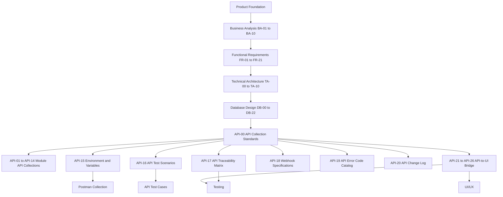

# API Collections

**Owner:** TBD

This folder contains the controlled API Collection documentation set for Digitize, the enterprise multi-tenant SaaS platform developed by OreeOn Technologies Pvt. Ltd.

The API Collection documentation defines how Digitize business capabilities shall be exposed through secure, tenant-aware, RESTful service interfaces implemented using FastAPI and PostgreSQL-backed persistence.

---

# 1. Purpose

The purpose of this folder is to provide a governed API documentation baseline for Digitize.

The API documentation translates approved Product Foundation, Business Analysis, Functional Requirements, Technical Architecture, Commercial Strategy, Database Design, UI/UX, and Testing artifacts into implementation-ready API specifications for architecture, development, testing, security, DevOps, support, and implementation teams.

---

# 2. API Documentation Objectives

The API Collection documentation shall:

- Define a consistent enterprise REST API contract.
- Preserve approved Digitize terminology and platform hierarchy.
- Support Platform, Organization, Facility, and Site scope.
- Enforce tenant awareness and tenant isolation.
- Distinguish authentication, authorization, and tenant-context validation.
- Align endpoints with Functional Requirements, Business Processes, UI screens, database tables, audit events, domain events, and test scenarios.
- Standardize URL naming, request models, response models, error handling, pagination, filtering, sorting, search, rate limiting, caching, idempotency, concurrency, asynchronous processing, bulk operations, file handling, webhook security, audit, logging, observability, and lifecycle governance.
- Support FastAPI implementation without generating application source code.
- Support API testing, contract testing, automation, traceability, and API governance.

---

# 3. API Design Principles

All API Collection documents shall follow these principles:

- APIs shall be resource-oriented and RESTful.
- APIs shall use `/api/v1` URL versioning.
- URL resources shall use lowercase kebab-case.
- Path parameters, query parameters, request JSON fields, and response JSON fields shall use snake_case.
- APIs shall be stateless.
- APIs shall use JWT authentication unless explicitly classified as public, authentication, internal, integration, or webhook.
- APIs shall enforce authorization before domain execution.
- Context headers shall identify requested operating scope but shall never grant access.
- APIs shall validate Organization, Facility, and Site hierarchy where applicable.
- APIs shall use the frozen standard response contract.
- APIs shall use stable error codes.
- APIs shall implement one approved pagination profile per endpoint.
- APIs shall support idempotency for retry-prone critical operations.
- APIs shall use optimistic concurrency where lost updates are possible.
- APIs shall separate business transactions from notification and integration delivery through audit, domain event, and outbox patterns where applicable.
- APIs shall avoid exposing internal database implementation details to consumers.

---

# 4. Source Documents

| Source Area | Documents | Usage |
|---|---|---|
| Product Foundation | Product Vision, Product Glossary, Domain Model | Terminology, product boundaries, platform hierarchy, and domain concepts |
| Business Analysis | BA-01 to BA-10 | Business requirements, rules, processes, actors, personas, journeys, traceability, assumptions, constraints, and risks |
| Functional Requirements | FR-01 to FR-21 | API behavior, validation, permissions, workflows, requirement IDs, notifications, audit events, and acceptance criteria |
| Technical Architecture | TA-00 to TA-10 | API architecture, security, integration, deployment, observability, platform architecture, and ADR alignment |
| Commercial Strategy | Subscription, licensing, pricing, billing, discount, and payment policies | Commercial API behavior, commercial controls, and financial processing constraints |
| Database Design | DB-00 to DB-22 | PostgreSQL schemas, tables, relationships, constraints, indexes, tenant model, metadata, audit, reporting, and integration architecture |
| UI/UX Design | UI Navigation and screen specifications | Screen-to-API mapping and user interaction alignment |
| Testing | Test standards and module test documents | API test coverage, contract testing, automation, and acceptance validation |

When a source identifier is unavailable, API documents shall use `TBD — Owner: API Architecture; Action: update guidance once TBDs are resolved in individual docs (refer to API-CHG drafts).` and identify the missing source artifact.

---

# 5. Folder Structure

```text
07_API_Collections/

README.md

API-00_API_Collection_Standards.md
API-01_Platform_Administration_Collection.md
API-02_Organization_Facility_Site_Collection.md
API-03_Identity_User_Role_Collection.md
API-04_Customer_Management_Collection.md
API-05_Membership_Management_Collection.md
API-06_Attendance_Walkin_Collection.md
API-07_Trainer_Activity_Batch_Collection.md
API-08_Billing_Payment_Collection.md
API-09_Subscription_License_Collection.md
API-10_Notification_Campaign_Collection.md
API-11_Reports_Analytics_Collection.md
API-12_Support_Ticket_Collection.md
API-13_Audit_Security_Collection.md
API-14_Common_Reference_Collection.md
API-15_API_Environment_and_Variables.md
API-16_API_Test_Scenarios.md
API-17_API_Traceability_Matrix.md
API-18_Webhook_Specifications.md
API-19_API_Error_Code_Catalog.md
API-20_API_Change_Log.md
API-21_OpenAPI_Specification_Governance.md
API-22_Frontend_API_Consumption_Standards.md
API-23_API_Access_Control_Matrix.md
API-24_API_State_and_Workflow_Contract.md
API-25_API_Mocking_and_Sandbox_Strategy.md
API-26_API_Release_and_Consumer_Readiness_Checklist.md
API_Test_Cases.md
Postman_Collection.md
```

This folder structure (API-00 through API-26, test cases, Postman) is frozen. New files, removed files, renamed files, merged files, split files, reordered documents, or changed numbering of that baseline require formal Architecture Review.

**Supplemental implementation reports** (not part of the frozen API-00..26 numbering; do not invent new numbered product APIs):

| File | Role |
|---|---|
| [API-12_Support_Implementation_Report.md](API-12_Support_Implementation_Report.md) | Support Center implementation / readiness checkpoint |
| [API-12_Support_Center_Contract_Extension_Proposal.md](API-12_Support_Center_Contract_Extension_Proposal.md) | Support contract extension proposal |
| [API-12_008_Escalate_Migration_Proposal.md](API-12_008_Escalate_Migration_Proposal.md) | API-12-008 escalate persistence migration **proposal** (awaiting authorization) |
| API-10 phase / completion reports | Notification delivery phase evidence (see folder) |
| [API-08_Phase1_Membership_Billing.md](API-08_Phase1_Membership_Billing.md) | Facility membership billing phase notes |

---

# 6. Document Register

| Document | Name | Status | Purpose |
|---|---|---|---|
| API-00 | API Collection Standards | Design Draft | Defines the governing API standards, common endpoint template, module document template, response contract, security rules, lifecycle governance, and traceability expectations |
| API-01 | Platform Administration Collection | Design Draft | Defines platform configuration, global system parameters, platform master data, feature definitions, feature flags, localization, currency, country/region, maintenance, releases, platform notices, administrative overrides, and system-owned lookup APIs |
| API-02 | Organization, Facility & Site Collection | Design Draft | Defines Organization, Facility, Site, hierarchy, settings, policies, documents, operational configuration, capacity, address, contact, and onboarding-state APIs |
| API-03 | Identity, User & Role Collection | Design Draft | Defines login, token refresh, logout, password recovery, user management, staff identity, role, permission, access scope, session, security policy, lock/unlock, MFA-ready, and administrative access APIs |
| API-04 | Customer Management Collection | Design Draft | Defines customer registration, profile, contact, emergency contact, preference, consent, document, note, status, search, history, duplicate detection, and restricted data access APIs |
| API-05 | Membership Management Collection | Design Draft | Defines membership plan, eligibility, purchase, activation, renewal, upgrade, downgrade, freeze, resume, cancellation, expiry, lifecycle history, entitlement, and eligibility-check APIs |
| API-06 | Attendance & Walk-in Collection | Design Draft | Defines attendance eligibility, check-in, check-out, entry/exit events, correction, override, walk-in registration, walk-in visit, payment association, capacity validation, and occupancy APIs |
| API-07 | Trainer, Activity & Batch Collection | Design Draft | Defines trainer, availability, schedule, activity, batch, class session, enrollment, attendance association, personal training, trainer assignment, notes, progress, capacity, cancellation, and calendar APIs |
| API-08 | Billing & Payment Collection | Design Draft | Defines billing account, invoice, invoice item, invoice finalization, payment initiation, attempts, receipt, refund, settlement, reconciliation, gateway callback, financial status, GST-ready metadata, and failure recovery APIs |
| API-09 | Subscription & License Collection | Design Draft | Defines subscription plan, pricing, purchase, activation, terms, renewal, cancellation, suspension, expiry, license, assignment, release, entitlement, feature access, paywall, and commercial eligibility APIs |
| API-10 | Notification & Campaign Collection | Design Draft | Defines campaign, audience, schedule, activation, pause, cancellation, notification templates, preferences, consent, delivery, attempts, failures, retry, channels, analytics references, and outbox APIs |
| API-11 | Reports & Analytics Collection | Design Draft | Defines report definition, parameters, execution, scheduling, status, export, dashboard, KPI, projections, organization/facility/platform reports, commercial reports, and asynchronous large-report APIs |
| API-12 | Support Ticket Collection | Design Draft | Defines ticket creation, category, priority, assignment, status, comments, attachments, escalation, SLA, internal notes, customer-visible notes, search, history, closure, and reopening APIs |
| API-13 | Audit & Security Collection | Design Draft | Defines audit events, entity references, compliance records, investigations, administrative access, authentication events, authorization failures, security events, data export audit, sensitive access, audit export, and investigation lifecycle APIs |
| API-14 | Common Reference Collection | Design Draft | Defines countries, states/regions, currencies, languages, timezones, facility types, activity types, status references, payment methods, communication channels, lookup values, localization, and shared configuration projection APIs |
| API-15 | API Environment and Variables | Design Draft | Defines API environment strategy, variables, authentication variables, tenant context variables, idempotency variables, pagination variables, secrets handling, pre-request processing, and CI/CD execution guidance |
| API-16 | API Test Scenarios | Design Draft | Defines reusable API test scenario templates across authentication, authorization, tenant isolation, validation, response contracts, pagination, idempotency, concurrency, lifecycle, async, bulk, file, rate limiting, caching, audit, events, security, performance, and resilience |
| API-17 | API Traceability Matrix | Design Draft | Maps endpoints to business requirements, functional requirements, business processes, UI screens, database tables, audit events, domain events, notifications, security controls, tests, and owners |
| API-18 | Webhook Specifications | Design Draft | Defines inbound provider callback and outbound Digitize webhook architecture, classification, event envelope, payload versioning, signatures, replay protection, delivery, retry, dead-letter, idempotency, tenant isolation, audit, observability, and event catalogue |
| API-19 | API Error Code Catalog | Design Draft | Defines centralized API error code format, categories, severity, retry classification, HTTP mappings, domain error codes, localization, sensitive handling, observability, ownership, lifecycle, and traceability |
| API-20 | API Change Log | Design Draft | Tracks API additions, modifications, deprecations, retirements, schema changes, webhook changes, error code changes, approvals, release mapping, and migration guidance |
| API-21 | OpenAPI Specification Governance | Design Draft | Defines how Markdown API documentation is converted into governed FastAPI/OpenAPI contracts, including operation IDs, schemas, tags, reusable components, security schemes, publication, and breaking-change detection |
| API-22 | Frontend API Consumption Standards | Design Draft | Defines how Flutter and web clients consume APIs, including token handling, tenant context, retries, loading states, error interpretation, validation mapping, pagination, idempotency, concurrency, caching, offline behavior, and async polling |
| API-23 | API Access Control Matrix | Design Draft | Maps roles, permissions, Organization/Facility/Site scope, endpoints, allowed operations, restricted data controls, and UI action visibility |
| API-24 | API State and Workflow Contract | Design Draft | Centralizes resource lifecycle states, allowed and forbidden API actions, permissions, business conditions, resulting states, UI visibility, audit events, and notifications |
| API-25 | API Mocking and Sandbox Strategy | Design Draft | Defines mock server, mock response, sandbox, seed data, payment simulation, webhook simulation, async simulation, mock-data privacy, and contract synchronization strategy |
| API-26 | API Release and Consumer Readiness Checklist | Design Draft | Defines readiness gates for UI/UX, frontend integration, QA, OpenAPI publication, security, tenant isolation, mocks, performance, observability, support, release, and consumer use |
| API Test Cases | API Test Cases | Design Draft | Defines executable test case groups derived from API-16 scenarios for authentication, authorization, tenant isolation, validation, lifecycle, idempotency, concurrency, async, webhook, error, and release-readiness coverage |
| Postman Collection | Postman Collection | Design Draft | Defines the governed Postman/Newman collection blueprint for API-01 through API-26 execution, variables, scripts, tests, CI usage, and export controls |

---

# 7. Recommended Generation Order

| Order | Document | Reason |
|---|---|---|
| 1 | API-00 API Collection Standards | Establishes the universal API contract and reusable documentation templates |
| 2 | API-01 Platform Administration Collection | Establishes platform-owned governance APIs and global configuration behavior |
| 3 | API-02 Organization, Facility & Site Collection | Establishes tenant hierarchy and operating-location APIs |
| 4 | API-03 Identity, User & Role Collection | Establishes authentication, authorization, RBAC, permissions, sessions, and security controls |
| 5 | API-04 Customer Management Collection | Establishes customer master data and restricted customer access APIs |
| 6 | API-05 Membership Management Collection | Establishes membership lifecycle APIs |
| 7 | API-06 Attendance & Walk-in Collection | Establishes high-volume operational entry and visit APIs |
| 8 | API-07 Trainer, Activity & Batch Collection | Establishes trainer, activity, batch, class, and personal training APIs |
| 9 | API-08 Billing & Payment Collection | Establishes commercial transaction and gateway integration APIs |
| 10 | API-09 Subscription & License Collection | Establishes SaaS commercial control and entitlement APIs |
| 11 | API-10 Notification & Campaign Collection | Establishes communication, campaign, and delivery APIs |
| 12 | API-11 Reports & Analytics Collection | Establishes reporting, dashboard, KPI, export, and analytics APIs |
| 13 | API-12 Support Ticket Collection | Establishes support operations and SLA APIs |
| 14 | API-13 Audit & Security Collection | Establishes audit, compliance, investigation, and security event APIs |
| 15 | API-14 Common Reference Collection | Establishes common lookup and reference APIs |
| 16 | API-15 API Environment and Variables | Establishes collection execution and environment variable standards |
| 17 | API-16 API Test Scenarios | Establishes reusable QA and automation coverage |
| 18 | API-17 API Traceability Matrix | Consolidates traceability across all endpoint documentation |
| 19 | API-18 Webhook Specifications | Establishes callback and outbound webhook governance |
| 20 | API-19 API Error Code Catalog | Centralizes stable error codes after domain APIs are defined |
| 21 | API-20 API Change Log | Tracks endpoint lifecycle changes after API documents begin evolving |
| 22 | API-21 OpenAPI Specification Governance | Establishes governed OpenAPI generation and publication rules |
| 23 | API-22 Frontend API Consumption Standards | Establishes frontend/API integration behavior before UI/UX design |
| 24 | API-23 API Access Control Matrix | Establishes role, permission, scope, endpoint, and UI action access rules |
| 25 | API-24 API State and Workflow Contract | Establishes state-driven workflow actions and UI visibility rules |
| 26 | API-25 API Mocking and Sandbox Strategy | Establishes mock and sandbox readiness for frontend and QA parallel work |
| 27 | API-26 API Release and Consumer Readiness Checklist | Establishes readiness gates before UI implementation, release, and consumer use |
| 28 | API Test Cases | Establishes executable test case coverage derived from API-16 scenarios |
| 29 | Postman Collection | Establishes Postman/Newman execution structure for the API documentation set |

---

# 8. Status Definitions

| Status | Meaning |
|---|---|
| Planned | Content not yet generated |
| Design Draft | Initial architecture content generated |
| Frozen — 2026-07-26 | Architecture corrections incorporated |
| Frozen | Approved implementation baseline |
| Deprecated | No longer authoritative |

Only these statuses shall be used in API Collection documents.

---

# 9. Governance and Ownership

API documentation governance is owned by API Architecture in collaboration with Solution Architecture, Security Architecture, Backend Engineering, Database Engineering, QA, DevOps, Product Management, Business Analysis, and Implementation teams.

Governance rules:

- API-00 governs all API Collection documents.
- Module API documents shall inherit API-00 and document only module-specific rules, endpoint contracts, mappings, diagrams, tests, and exceptions.
- Every endpoint shall have an owning domain or service.
- Every endpoint shall identify API classification and data classification.
- Every endpoint shall define authentication, authorization, tenant scope, transaction boundary, idempotency, concurrency, database mapping, audit behavior, domain event behavior, and test coverage.
- Source mappings shall not be invented.
[GUIDANCE — Missing source mappings recorded as TBD. Owners must replace with authoritative mapping before Freeze; see docs/07_API_Collections/issues/ and CHG records.]
- Frozen documents shall not contain incomplete content markers.
- Changes to frozen standards require Architecture Review.

---

# 10. Freeze Rule

API-00 shall be finalized before API-01 through API-26 and API support artifacts are frozen.

After API-00 is frozen:

- Do not add mandatory document sections.
- Do not remove mandatory document sections.
- Do not rename mandatory document sections.
- Do not reorder mandatory document sections.
- Do not change endpoint template sections.
- Do not change URL naming standards.
- Do not change JSON naming standards.
- Do not change response envelope standards.
- Do not change error standards.
- Do not change tenant-context trust rules.
- Do not change authentication, authorization, pagination, idempotency, optimistic concurrency, asynchronous operation, bulk operation, file handling, audit, domain event, notification, observability, lifecycle, deprecation, webhook, callback, or traceability standards without formal Architecture Review.

---

# 11. Document Dependency Diagram



---

# 12. Summary

The API Collection documentation set defines the governed REST API contract for Digitize.

API-00 establishes the enterprise API standard. API-01 through API-14 define module-specific API collections. API-15 through API-26 define API execution governance, reusable test scenarios, traceability, webhook specifications, centralized error codes, lifecycle change governance, OpenAPI publication, frontend consumption, access control, state-driven workflows, mocking/sandbox readiness, and consumer release readiness before UI/UX design begins. API_Test_Cases.md and Postman_Collection.md provide the executable validation and collection-execution support artifacts for the complete API baseline.
