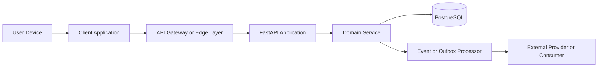

# IC-00 Integration Contract Standards

**Document ID:** IC-00  
**Document Name:** Integration Contract Standards  
**Company:** OreeOn Technologies Pvt. Ltd.  
**Product:** Digitize  
**Document Type:** Integration Contract  
**Backend Technology:** FastAPI  
**Database Engine:** PostgreSQL  
**Client Technology:** Flutter  
**Authentication:** JWT  
**Version:** 0.1  
**Status:** Review Draft  
**Owner:** Integration Architecture  
**Reviewer:** Solution Architecture / Security Architecture / API Architecture / Engineering  
**Dependencies:** API-00 to API-26, TA-00 to TA-10, DB-00 to DB-22  
**Last Updated:** 2026-07-26

---

# 1. Document Metadata

| Attribute | Value |
|---|---|
| Document ID | IC-00 |
| Output File | IC-00_Integration_Contract_Standards.md |
| Status | Review Draft |
| Governs | IC-01 through IC-17 |

---

# 2. Purpose

This document defines the common standards for all Digitize integration contracts.

---

# 3. Scope

In scope: client-to-API, provider API, provider callback, outbound webhook, event, file, batch, reporting, service-to-service, and administrative integrations.

Out of scope: application source code, real credentials, provider-specific SDK implementation, infrastructure provisioning scripts, and OpenAPI JSON/YAML generation.

---

# 4. Business Context

Digitize is a configurable multi-tenant SaaS platform for activity-based businesses. Integrations must support Swimming Pool Management initially and remain extensible to gyms, studios, academies, recreation businesses, and future facility types without redesign.

---

# 5. Integration Principles

| Principle | Standard |
|---|---|
| Contract first | Producer, consumer, transport, payload, acknowledgement, security, and support behavior shall be explicit |
| Secure by default | Authentication, authorization, tenant validation, encryption, secrets control, and audit shall be mandatory where applicable |
| Tenant isolated | Organization, Facility, Site, user/service identity, entitlement, and resource ownership shall be validated |
| Reliable | Timeout, retry, backoff, circuit breaker, dead-letter, replay, and reconciliation shall be defined |
| Idempotent | Retry-prone commands and callbacks shall prevent duplicate business effects |
| Observable | Logs, metrics, traces, correlation IDs, alerts, and runbook ownership shall be defined |
| Backward compatible | Additive changes are preferred; breaking changes require versioning or migration |

---

# 6. Integration Classification

| Classification | Meaning |
|---|---|
| Client-to-API | Flutter or web client calling Digitize APIs |
| Service-to-Service | Internal trusted component communication |
| Provider API | Digitize calling an external provider |
| Provider Callback | External provider calling Digitize |
| Outbound Webhook | Digitize notifying an external consumer |
| Event Integration | Asynchronous domain event delivery |
| File Integration | Upload, scan, download, retention, or archival |
| Batch Integration | Scheduled or bulk transfer |
| Reporting Integration | Report generation, export, or analytics transfer |
| Administrative Integration | Controlled support or operational integration |

---

# 7. Trust Boundary Standard

Each contract shall state where authentication, authorization, tenant validation, payload validation, encryption, secrets use, audit, retries, and sensitive data storage occur.

---

# 8. Contract Ownership

Every integration shall identify an owning domain, technical owner, support owner, producer owner, consumer owner, and escalation path.

---

# 9. Data Ownership

Every contract shall define system of record, source of truth, data owner, data processor, replicated data, cached data, derived data, correction authority, retention owner, and deletion owner.

---

# 10. System-of-Record Rules

- The system of record shall be explicit.
- External provider status shall not overwrite Digitize records without validation.
- Derived or cached records shall include refresh, expiry, and reconciliation behavior.
- Conflicting records shall route to reconciliation, not silent overwrite.

---

# 11. Authentication Standard

| Context | Standard |
|---|---|
| Client-to-API | JWT bearer token |
| Provider callback | Signature, timestamp, replay control, and provider registration |
| Provider API | Secret reference, API key, OAuth-ready token, or certificate as approved |
| Service-to-service | Service identity with least privilege |

---

# 12. Authorization Standard

Authorization shall be evaluated after identity verification and before domain execution. Role, permission, scope, entitlement, subscription, license, and resource ownership checks shall be separated from authentication.

---

# 13. Tenant Context Standard

Tenant-scoped contracts shall validate Organization, Facility, Site, actor/service identity, subscription, license, feature entitlement, and resource ownership. Context headers are claims to validate, not authority by themselves.

---

# 14. Transport Standard

HTTPS is required for API, callback, webhook, file, and provider integrations. Queue, topic, storage, or batch transports shall use encrypted channels and authenticated producers/consumers.

---

# 15. Header and Metadata Standard

| Header or Metadata | Required | Purpose |
|---|---|---|
| `Authorization` | Conditional | Client or service identity |
| `X-Correlation-ID` | Yes | Request and trace correlation |
| `X-Request-ID` | Yes | Unique identifier for a single HTTP request or integration attempt |
| `X-Organization-ID` | Conditional | Organization context |
| `X-Facility-ID` | Conditional | Facility context |
| `X-Site-ID` | Conditional | Site context |
| `Idempotency-Key` | Conditional | Duplicate command prevention |
| `X-Signature` | Conditional | Webhook or callback integrity |
| `X-Timestamp` | Conditional | Replay prevention |

---

# 16. Payload Standard

Payloads shall use snake_case JSON properties for API-style contracts and stable event fields for event-style contracts.

Payloads shall:

- Remain backward compatible wherever possible.
- Avoid nullable fields where optional fields are sufficient.
- Avoid leaking internal database identifiers.
- Avoid transport-specific metadata inside business payloads.
- Maintain stable field names across versions.
- Include explicit data classification.
- Exclude internal database implementation details unless explicitly approved.

---

# 17. Data Format Standard

Dates and times shall use ISO 8601. Monetary amounts shall include currency. Identifiers shall be opaque. Booleans shall not encode multi-state lifecycle. File sizes shall use bytes.

---

# 18. Response and Acknowledgement Standard

Synchronous integrations shall return success, validation failure, authorization failure, conflict, retryable failure, or accepted-for-processing states. Asynchronous integrations shall define acknowledgement, status tracking, dead-letter, and reconciliation outcomes.

---

# 19. Validation Standard

Contracts shall define schema validation, required fields, type checks, enum values, range limits, resource ownership, tenant hierarchy, business state, duplicate detection, and provider response validation.

---

# 20. Idempotency Standard

Retry-prone commands shall define key source, key scope, key retention, request fingerprint, duplicate handling, concurrent execution handling, conflict response, and replay response.

---

# 21. Ordering Standard

Contracts shall state whether ordering is strict, partitioned, best effort, or not guaranteed. Ordered event streams shall identify partition key and replay behavior.

---

# 22. Transaction Boundary Standard

Contracts shall define what is committed atomically, when provider delivery occurs, whether outbox is used, and how post-commit failures are recovered.

---

# 23. Timeout Standard

Each external call shall define connection timeout, read timeout, total timeout, user-visible timeout behavior, and operational timeout alerting.

---

# 24. Retry Standard

Retries shall be allowed only for explicitly retryable technical failures, timeouts, throttling, and provider temporary unavailability. Validation, authorization, conflict, and business-rule failures shall not be retried automatically.

---

# 25. Backoff and Jitter Standard

Retry policies shall use bounded exponential backoff with jitter unless an approved provider contract requires otherwise.

---

# 26. Circuit-Breaker Standard

Circuit breakers shall define failure threshold, open state behavior, half-open test behavior, recovery conditions, alerting, and user-safe degradation.

---

# 27. Failure Handling Standard

Failures shall be classified as business, validation, authentication, authorization, tenant, provider, network, timeout, conflict, duplicate, unavailable, or unknown.

---

# 28. Dead-Letter Standard

Asynchronous failures that exceed retry limits shall be retained in a dead-letter mechanism with reason, payload reference, correlation ID, tenant context, owner, retention, and replay eligibility.

---

# 29. Reconciliation Standard

Contracts shall define how missing, duplicate, delayed, inconsistent, or provider-disputed records are detected and corrected.

---

# 30. Compensation Standard

Where rollback is impossible, contracts shall define reversal, refund, cancellation, retry, correction, or manual operations.

---

# 31. Audit Standard

Security, financial, tenant, lifecycle, administrative, and integration-state changes shall produce audit events with actor, tenant context, resource, outcome, correlation ID, and timestamp.

---

# 32. Logging Standard

Logs shall be structured and redact credentials, tokens, signatures, OTPs, payment secrets, PII beyond safe references, and sensitive payload bodies.

Logs shall be immutable once written unless approved retention policies require archival or deletion.

---

# 33. Metrics Standard

Metrics shall include request count, success count, failure count, latency, timeout count, retry count, circuit state, queue depth, dead-letter count, callback delay, and reconciliation mismatch where applicable.

---

# 34. Distributed Tracing Standard

`X-Correlation-ID` shall propagate across client, API, domain service, outbox, provider request, callback, webhook, and reconciliation flows where technically possible.

---

# 35. Alerting Standard

Alerts shall be defined for provider outage, callback failure spike, queue backlog, dead-letter growth, reconciliation mismatch, elevated latency, credential expiry, signature failure spike, and tenant isolation failure.

---

# 36. Security Standard

Integrations shall use least privilege, encrypted transport, approved secret storage, secret rotation, payload validation, replay protection, audit, administrative access control, and incident escalation.

Security controls shall follow the principle of defense in depth.

---

# 37. Data Retention Standard

Contracts shall define retention for requests, responses, provider references, files, exported reports, events, outbox records, dead-letter records, logs, metrics, traces, and audit records.

---

# 38. Performance and Capacity Standard

Contracts shall define expected rate, burst rate, payload size, file size, concurrency, timeout budget, provider quotas, queue depth limits, and degradation behavior.

---

# 39. Versioning Standard

Contracts shall distinguish additive changes, non-breaking behavioral changes, breaking schema changes, deprecated fields, deprecated events, retired versions, migration windows, sunset periods, deprecation notifications, and consumer migration periods.

---

# 40. Environment Configuration Standard

Environment configuration shall use secret references and environment-specific URLs without exposing real credentials. Production shall not reuse sandbox credentials or test tenants.

---

# 41. Testing Standard

Each contract shall include positive, negative, timeout, retry, duplicate, idempotency, tenant-isolation, security, failure-recovery, reconciliation, and observability test coverage.

Each contract shall also include contract compatibility and backward compatibility testing where payloads, APIs, events, files, callbacks, or external consumers may evolve across versions.

---

# 42. Traceability Standard

Contracts shall map to business requirements, functional requirements, API endpoints, database tables, UI workflows, events, audit events, test cases, owners, and release readiness.

---

# 43. Common Integration Contract Template

Each individual integration contract shall include: metadata, purpose, scope, preconditions, trigger, producer responsibilities, consumer responsibilities, transport, authentication, authorization, tenant validation, headers, payload, example, response, processing sequence, validation, business rules, idempotency, ordering, transaction boundary, timeout, retry, circuit breaker, failure handling, dead-letter, reconciliation, compensation, audit, events, logging, metrics, tracing, alerts, retention, security, performance, versioning, environment configuration, tests, traceability, assumptions, acceptance criteria, and summary.

---

# 44. Document Template

Documents shall use the folder-specific template from README or the document-level template defined in the master prompt. Sections marked not applicable shall use `Not Applicable — <specific reason>`.

---

# 45. Freeze Rule

IC-00 shall be frozen before IC-01 through IC-17. Frozen contracts shall not contain unresolved behavior, unowned support paths, or unreviewed security controls.

---

# 46. Acceptance Criteria

- Integration classifications are defined.
- Trust boundaries are defined.
- Authentication and authorization are separated.
- Tenant validation is mandatory for tenant-scoped integrations.
- Timeout, retry, circuit breaker, dead-letter, reconciliation, and compensation standards are defined.
- Security, observability, testing, traceability, and release readiness standards are defined.
- All subsequent IC documents conform to this standard without redefining common integration behavior.

---

# 47. Summary

IC-00 establishes the governing integration standards for Digitize. It controls how all integration contracts define ownership, trust boundaries, tenant isolation, security, reliability, observability, testing, traceability, and release readiness.
