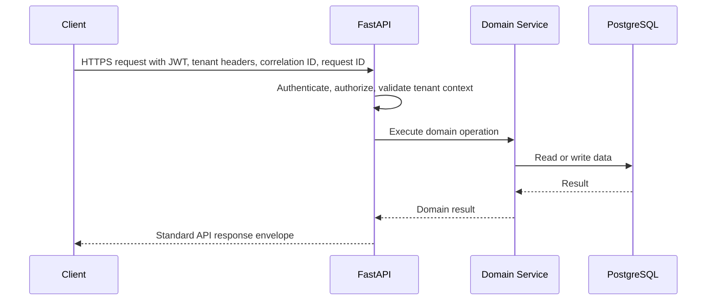
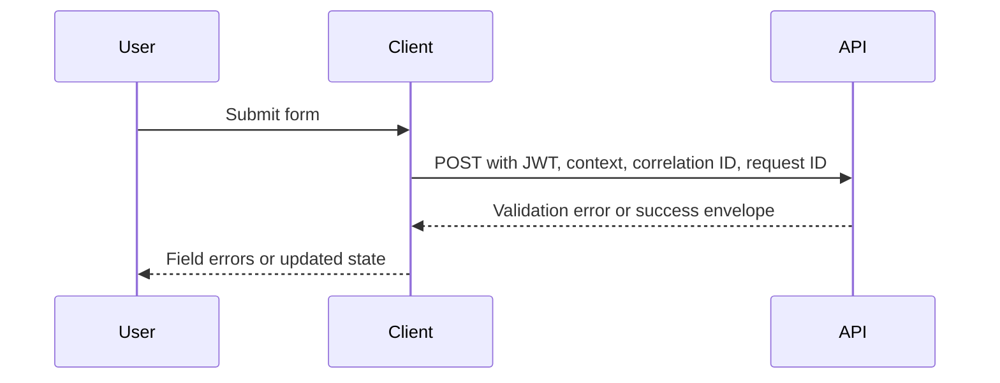
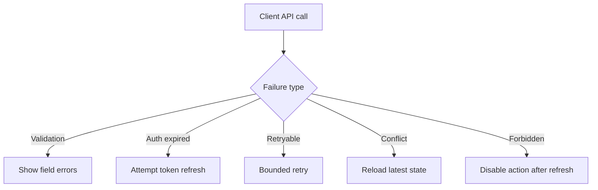

# IC-01 Frontend Backend Integration Contract

**Document ID:** IC-01  
**Document Name:** Frontend Backend Integration Contract  
**Company:** OreeOn Technologies Pvt. Ltd.  
**Product:** Digitize  
**Document Type:** Integration Contract  
**Backend Technology:** FastAPI  
**Database Engine:** PostgreSQL  
**Client Technology:** Flutter  
**Authentication:** JWT  
**Version:** 0.1  
**Status:** Design Draft  
**Owner:** Integration Architecture  
**Reviewer:** Solution Architecture / Security Architecture / API Architecture / Engineering  
**Dependencies:** IC-00, API-00 to API-26  
**Last Updated:** 2026-07-26

---

# 1. Document Metadata

| Attribute | Value |
|---|---|
| Integration ID | IC-01 |
| Producer | Flutter / Web Client |
| Consumer | FastAPI API |
| Classification | Client-to-API |
| System of Record | Digitize backend and PostgreSQL |

---

# 2. Purpose

This document defines how Digitize Flutter and web clients interact with FastAPI APIs.

---

# 3. Scope

In scope: base URL, headers, token handling, tenant context, retries, cancellation, error mapping, form validation, loading states, pagination, search debounce, idempotency, optimistic concurrency, cache invalidation, offline behavior, file transfer, async polling, telemetry, and compatibility.

Out of scope: UI layouts, widget source code, generated API client source code, and provider SDK implementation.

---

# 4. Business Context

Frontend clients execute user workflows for platform, organization, facility, site, customer, membership, attendance, billing, reporting, support, and administrative operations.

---

# 5. Integration Objectives

- Provide predictable API invocation behavior across mobile and web.
- Keep authentication and tenant context consistent.
- Convert API error contracts into client-safe states.
- Support responsive UI workflows for synchronous and asynchronous operations.

---

# 6. Architecture Context

---

# 7. Actors and Systems

| Actor or System | Responsibility |
|---|---|
| Flutter Client | Native mobile user interaction |
| Web Client | Browser user interaction |
| FastAPI API | Contract validation, authorization, tenant checks, domain orchestration |
| PostgreSQL | System of record |

---

# 8. Integration Classification

Client-to-API.

---

# 9. Trust Boundaries

The client is untrusted. API gateway and FastAPI shall validate identity, authorization, tenant context, payload, idempotency, and concurrency before domain execution.

---

# 10. Data Ownership

Digitize backend is the source of truth. Clients may cache non-sensitive, authorized data for usability only.

---

# 11. Authentication

Clients shall send JWT bearer tokens in the `Authorization` header. Token storage shall use platform-secure storage where available. Tokens shall not be logged.

---

# 12. Authorization

The backend shall enforce role, permission, scope, subscription, license, and resource ownership. The frontend may hide unavailable actions but shall not be trusted as the authorization authority.

---

# 13. Tenant Context

Clients shall send selected Organization, Facility, and Site context headers when required. Backend validation remains authoritative.

---

# 14. Transport Standards

All calls shall use HTTPS. API base URLs shall come from IC-16 environment configuration.

---

# 15. Payload Standards

Requests and responses shall follow API-00 snake_case JSON and standard response envelope conventions.

---

# 16. Response and Acknowledgement Standards

Clients shall handle success, validation failure, authorization failure, tenant failure, conflict, accepted asynchronous processing, retryable technical failure, and unavailable states.

---

# 17. Validation

Client-side validation improves usability. Backend validation is authoritative and shall return field-level error details where supported.

---

# 18. Idempotency

Clients shall generate idempotency keys for retry-prone create, payment, refund, import, export, and mutation commands.

---

# 19. Ordering

Client calls are not globally ordered. State-changing workflows shall rely on backend state and optimistic concurrency rather than client ordering assumptions.

---

# 20. Timeout

Clients shall define connection, read, and total timeout values per environment. Long-running work shall use asynchronous operations and polling.

---

# 21. Retry

Automatic retry is allowed only for retryable network, timeout, throttling, and temporary server failures. Validation, authorization, conflict, and business failures shall not be retried automatically.

---

# 22. Circuit Breaker

Clients may temporarily suppress repeated failing provider-backed actions and show user-safe recovery states. Backend circuit breakers remain authoritative for provider protection.

---

# 23. Failure Handling

API-19 error codes shall map to user-safe UI messages and actionable states. Raw backend details shall not be shown to users.

---

# 24. Dead-Letter Handling

Not Applicable — frontend clients do not own dead-letter queues. They shall display accepted, failed, or retry-pending states returned by backend APIs.

---

# 25. Reconciliation

Clients shall refresh authoritative backend state after payment, async report, file upload, callback, or retry-sensitive workflows.

---

# 26. Compensation

Clients shall initiate backend-supported cancellation, reversal, refund, or correction operations only through approved APIs.

---

# 27. Audit

Auditable user actions shall include actor identity, tenant context, correlation ID, and action outcome.

---

# 28. Logging

Client telemetry shall not log JWTs, refresh tokens, secrets, OTPs, payment secrets, signatures, or sensitive payload bodies.

---

# 29. Metrics

Track API latency, error rate, timeout rate, retry count, cancellation count, and key workflow completion rates.

---

# 30. Tracing

Clients shall generate or propagate `X-Correlation-ID` for user workflows and `X-Request-ID` for each individual HTTP request or retry attempt.

---

# 31. Alerts

Operational alerts shall be backend-owned. Client telemetry may feed crash, API failure spike, and version compatibility alerts.

---

# 32. Security

Clients shall use secure token storage, TLS, certificate validation where supported, least data caching, local session timeout, and redaction.

---

# 33. Performance and Capacity

Clients shall debounce search, use pagination, cancel superseded requests, avoid duplicate submissions, and avoid unbounded polling.

---

# 34. Versioning

Clients shall be compatible with API v1 and shall tolerate additive response fields.

---

# 35. Integration Contracts

| Contract Area | Governing Document |
|---|---|
| Authentication | IC-02 |
| Tenant context | IC-03 |
| Error and retry | IC-11 |
| Security | IC-12 |
| Environment | IC-16 |

---

# 36. Sequence Diagrams

---

# 37. Failure Flow Diagrams

---

# 38. Traceability

| Area | Mapping |
|---|---|
| API Standards | API-00, API-22 |
| Errors | API-19, IC-11 |
| Access | API-23, IC-12 |
| Tests | API_Test_Cases.md, IC-14 |

---

# 39. Test Coverage

Positive, validation, authorization, tenant, expired token, retry, timeout, duplicate submit, pagination, search, file transfer, async polling, offline recovery, and compatibility tests are required.

---

# 40. Assumptions and Constraints

- Flutter is the primary client technology.
- Web client behavior shall follow the same API contract where applicable.
- UI screen IDs remain `[TBD — Source mapping pending — see BE traceability mappings](docs/10_Backend_Engineering/BE-TRACEABILITY_MAPPINGS.md)` until UI/UX documents are approved.

---

# 41. Dependencies

IC-00, IC-02, IC-03, IC-11, IC-12, IC-16, API-00, API-19, API-22, API-23, API-24, API-26.

---

# 42. Future Enhancements

Offline-first workflows, background sync, biometric local unlock, generated clients, and consumer-driven contract testing may be added after baseline approval.

---

# 43. Acceptance Criteria

- Client calls include authentication, tenant context, correlation ID, and request ID where required.
- Error handling maps to API-19.
- Retry behavior follows IC-11.
- Sensitive data is not logged.
- UI workflows can consume this contract before UI/UX design finalization.

---

# 44. Summary

IC-01 defines the client-to-API behavior required for Digitize Flutter and web clients to consume backend APIs consistently, securely, and observably.
