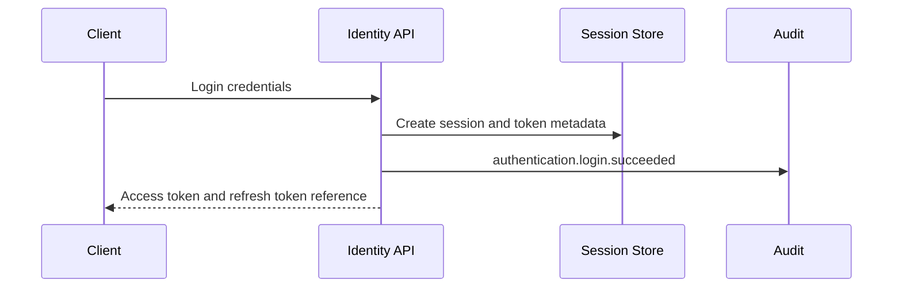
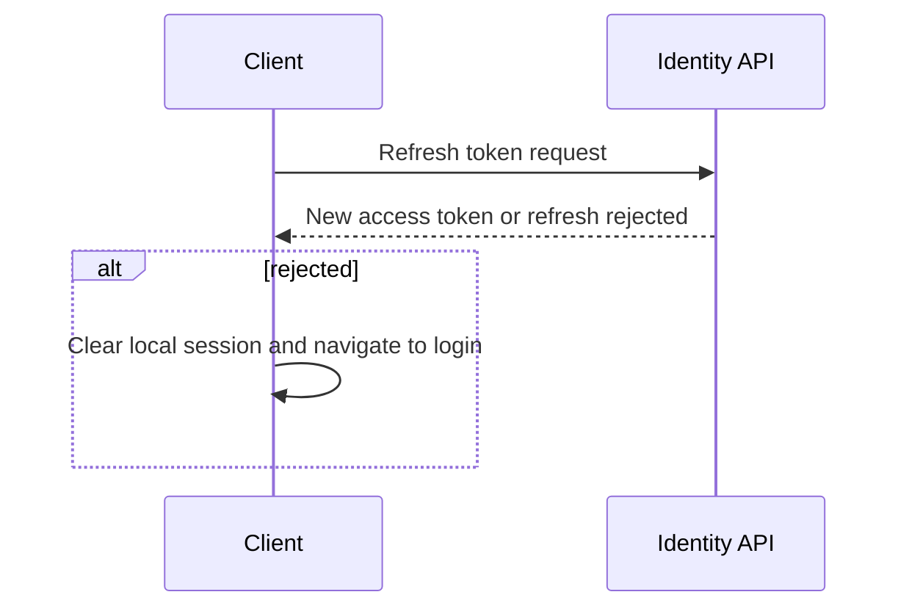
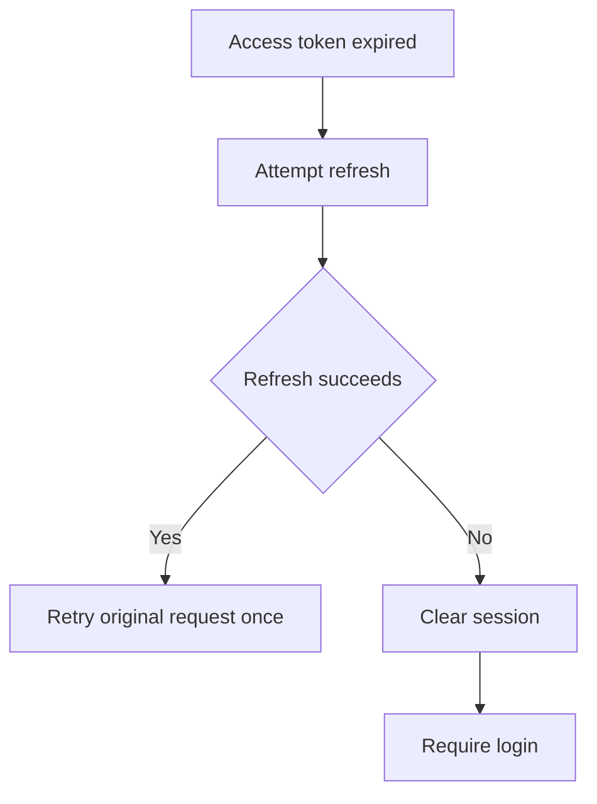

# IC-02 Authentication Session Integration Contract

**Document ID:** IC-02  
**Document Name:** Authentication Session Integration Contract  
**Company:** OreeOn Technologies Pvt. Ltd.  
**Product:** Digitize  
**Document Type:** Integration Contract  
**Backend Technology:** FastAPI  
**Database Engine:** PostgreSQL  
**Client Technology:** Flutter  
**Authentication:** JWT  
**Version:** 0.1  
**Status:** Design Draft  
**Owner:** Integration Architecture  
**Reviewer:** Solution Architecture / Security Architecture / API Architecture / Engineering  
**Dependencies:** IC-00, IC-01, IC-03, IC-11, IC-12, API-03, API-19, API-23  
**Last Updated:** July 2026

---

# 1. Document Metadata

| Attribute | Value |
|---|---|
| Integration ID | IC-02 |
| Producer | Client Application |
| Consumer | Identity API |
| Classification | Client-to-API |
| System of Record | Identity and security stores |

---

# 2. Purpose

This document defines login, token issuance, refresh, logout, revocation, expiry, recovery, lockout, device session, and permission invalidation behavior.

---

# 3. Scope

In scope: login, JWT issuance, refresh rotation, logout, session expiry, account lock, password reset, forced logout, role and permission change invalidation, organization access change, security events, and recovery behavior.

Out of scope: identity-provider vendor selection and MFA provider implementation.

---

# 4. Business Context

Users access Digitize according to approved role, permission, tenant, subscription, license, and feature-entitlement controls.

---

# 5. Integration Objectives

- Establish secure authentication and session continuity.
- Prevent stale permission and tenant access.
- Provide clear client recovery behavior for expired or revoked sessions.
- Produce security audit events.

---

# 6. Architecture Context

---

# 7. Actors and Systems

| Actor or System | Responsibility |
|---|---|
| User | Provides credentials and owns session intent |
| Client | Stores tokens securely and handles refresh |
| Identity API | Authenticates and issues tokens |
| Session Store | Tracks active, expired, revoked, and forced-logout sessions |
| Audit | Records security events |

---

# 8. Integration Classification

Client-to-API with security-sensitive authentication behavior.

---

# 9. Trust Boundaries

Credentials cross from user device to Identity API over HTTPS. The client is untrusted and shall not decide authentication state without backend confirmation.

---

# 10. Data Ownership

Identity API is the source of truth for sessions, revocation, lockout, and password recovery state.

---

# 11. Authentication

Login validates credentials and returns a short-lived access token and refresh capability. Refresh shall rotate or invalidate refresh material according to the approved security policy.

---

# 12. Authorization

Authentication confirms identity only. Authorization for APIs is evaluated separately using roles, permissions, scope, subscription, license, and resource ownership.

---

# 13. Tenant Context

Token claims may include allowed organizations and scopes. Selected Organization, Facility, and Site context must still be validated by IC-03 behavior.

---

# 14. Transport Standards

Authentication traffic shall use HTTPS only.

---

# 15. Payload Standards

Authentication payloads shall not expose password hashes, token internals, session secrets, or raw security policy values.

---

# 16. Response and Acknowledgement Standards

Responses shall distinguish successful login, invalid credentials, locked account, expired token, revoked token, refresh required, refresh failed, and forced logout.

---

# 17. Validation

Credential format, account status, tenant access, lockout state, password reset state, and device/session policy shall be validated.

---

# 18. Idempotency

Logout and revocation operations shall be idempotent. Duplicate logout requests shall not return a false failure.

---

# 19. Ordering

Refresh rotation and revocation shall be serialized per session to prevent token replay races.

---

# 20. Timeout

Login and refresh timeouts shall be short and user-safe. Long-running identity checks are not allowed in the login path.

---

# 21. Retry

Automatic retry is not allowed for invalid credentials. Retry may be allowed for transient network failures without reusing stale refresh tokens incorrectly.

---

# 22. Circuit Breaker

Identity provider outage shall trigger degraded login behavior and operational alerts. Existing valid sessions may continue until policy-defined expiry unless revoked.

---

# 23. Failure Handling

Clients shall clear local session state on revoked token, forced logout, password reset completion, role invalidation, or unrecoverable refresh failure.

---

# 24. Dead-Letter Handling

Not Applicable — authentication is synchronous. Security event delivery may use IC-09 outbox where implemented.

---

# 25. Reconciliation

Session records, audit records, and security events shall be reconcilable by correlation ID and user ID.

---

# 26. Compensation

Compensation includes revocation, forced logout, account unlock, password reset cancellation, and administrative correction.

---

# 27. Audit

Audit events shall include login success, login failure, refresh success, refresh failure, logout, revocation, forced logout, lock, unlock, password reset requested, and password reset completed.

---

# 28. Logging

Logs shall redact credentials, tokens, OTPs, password reset values, device fingerprints, and security secrets.

---

# 29. Metrics

Track login success/failure, refresh success/failure, lockout count, forced logout count, invalid token count, and revocation count.

---

# 30. Tracing

Authentication requests shall propagate correlation IDs without logging credential payloads.

---

# 31. Alerts

Alert on credential failure spikes, refresh failure spikes, account lock spikes, suspicious tenant access failures, and session-store outage.

---

# 32. Security

Security controls include TLS, secure token storage, token expiry, refresh rotation, revocation, lockout, least privilege, replay prevention, and audit.

---

# 33. Performance and Capacity

Authentication services shall support peak shift-start and check-in traffic without increasing credential retry risk.

---

# 34. Versioning

Token shape changes shall be backward compatible or require coordinated client rollout.

---

# 35. Integration Contracts

This contract is consumed by IC-01, IC-03, IC-11, IC-12, and IC-17.

---

# 36. Sequence Diagrams

---

# 37. Failure Flow Diagrams

---

# 38. Traceability

| Area | Mapping |
|---|---|
| API | API-03 |
| Errors | API-19 |
| Access | API-23 |
| Tests | API_Test_Cases.md, IC-14 |

---

# 39. Test Coverage

Login, invalid login, refresh, refresh reuse, logout, revoked token, expired token, account lock, forced logout, role change, permission change, organization access change, and recovery tests are required.

---

# 40. Assumptions and Constraints

Dedicated authentication source mappings remain `[TBD — Source mapping pending — see BE traceability mappings](docs/10_Backend_Engineering/BE-TRACEABILITY_MAPPINGS.md)` where FR documents do not define separate authentication IDs.

---

# 41. Dependencies

IC-00, IC-01, IC-03, IC-11, IC-12, API-03, API-19, API-23.

---

# 42. Future Enhancements

MFA, SSO, biometric local unlock, device trust, OAuth provider federation, and risk-based authentication may be added after baseline approval.

---

# 43. Acceptance Criteria

- Token expiry and refresh behavior are defined.
- Logout and revocation are idempotent.
- Client recovery from expired, revoked, and forced logout states is defined.
- Security events are auditable.

---

# 44. Summary

IC-02 defines secure authentication and session behavior for Digitize clients and backend identity services.
