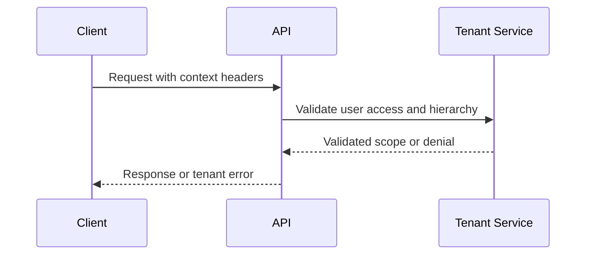
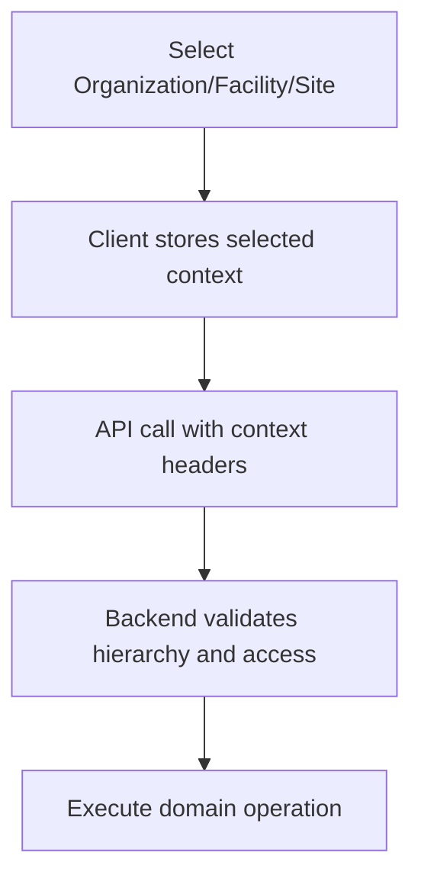
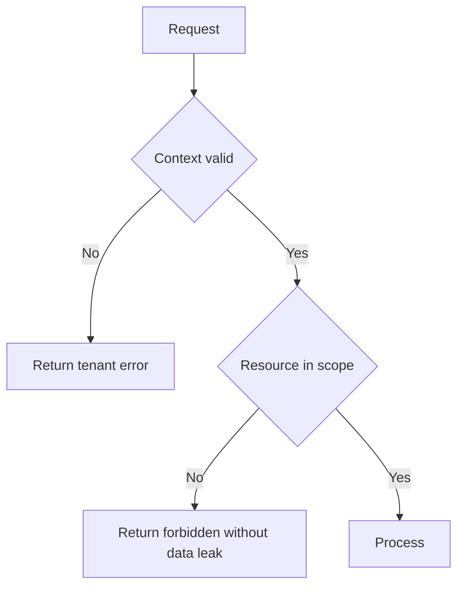

# IC-03 Tenant Context Integration Contract

**Document ID:** IC-03  
**Document Name:** Tenant Context Integration Contract  
**Company:** OreeOn Technologies Pvt. Ltd.  
**Product:** Digitize  
**Document Type:** Integration Contract  
**Backend Technology:** FastAPI  
**Database Engine:** PostgreSQL  
**Client Technology:** Flutter  
**Authentication:** JWT  
**Version:** 0.1  
**Status:** Design Draft  
**Owner:** Integration Architecture  
**Reviewer:** Solution Architecture / Security Architecture / API Architecture / Engineering  
**Dependencies:** IC-00, IC-01, IC-02, IC-12, API-02, API-03, API-23, API-24  
**Last Updated:** July 2026

---

# 1. Document Metadata

| Attribute | Value |
|---|---|
| Integration ID | IC-03 |
| Producer | Client or Service |
| Consumer | FastAPI API |
| Classification | Client-to-API / Service-to-Service |
| System of Record | Tenant and identity data |

---

# 2. Purpose

This document defines how Organization, Facility, and Site context is selected, propagated, validated, cached, invalidated, and audited.

---

# 3. Scope

In scope: context headers, JWT scope, context switching, hierarchy validation, cross-tenant prevention, platform administrator context, multi-organization users, context caching, context invalidation, tenant audit, and tenant-isolation tests.

Out of scope: UI layout for context pickers.

---

# 4. Business Context

Digitize uses Platform, Organization, Facility, and Site hierarchy. Tenant context controls data visibility, actions, reporting, billing, operational workflows, and support behavior.

---

# 5. Integration Objectives

- Prevent cross-tenant data exposure.
- Make context switching explicit.
- Ensure backend validation is authoritative.
- Support UI workflows with predictable context state.

---

# 6. Architecture Context

---

# 7. Actors and Systems

| Actor or System | Responsibility |
|---|---|
| User | Selects allowed context |
| Client | Propagates selected context |
| API | Validates context before domain execution |
| Tenant Service | Confirms hierarchy and access |

---

# 8. Integration Classification

Client-to-API and Service-to-Service.

---

# 9. Trust Boundaries

Context headers are untrusted inputs. JWT claims and backend tenant records determine allowed access.

---

# 10. Data Ownership

Tenant hierarchy is owned by Organization, Facility, and Site domain data.

---

# 11. Authentication

JWT identity is required for tenant-scoped operations unless explicitly public or provider-callback behavior is approved elsewhere.

---

# 12. Authorization

Authorization shall validate role, permission, scope, resource ownership, subscription, license, and feature entitlement in the selected context.

---

# 13. Tenant Context

Headers:

| Header | Required When | Rule |
|---|---|---|
| `X-Organization-ID` | Tenant-scoped requests | Must be allowed for actor |
| `X-Facility-ID` | Facility-scoped requests | Must belong to Organization |
| `X-Site-ID` | Site-scoped requests | Must belong to Facility |

---

# 14. Transport Standards

Tenant context travels over HTTPS headers and may also appear in signed events where applicable.

---

# 15. Payload Standards

Payload tenant IDs shall match validated context or be rejected. Internal tenant partition keys shall not be exposed as authority.

---

# 16. Response and Acknowledgement Standards

Tenant failures shall use stable API-19 error codes and shall not reveal unauthorized tenant existence.

---

# 17. Validation

Validate context presence, hierarchy, actor access, resource ownership, subscription, license, feature entitlement, and lifecycle state.

---

# 18. Idempotency

Idempotency keys shall be scoped by tenant context to avoid cross-tenant collision.

---

# 19. Ordering

Context switching is client-local. Backend operations are authorized against the context included in each request.

---

# 20. Timeout

Tenant validation shall be fast and cache-aware. Cache misses shall fail safely if tenant authority cannot be confirmed.

---

# 21. Retry

Tenant validation failures are not retryable unless caused by transient infrastructure failures.

---

# 22. Circuit Breaker

Tenant authority service failure shall block tenant-scoped mutations and may allow only approved read-only degraded behavior.

---

# 23. Failure Handling

Invalid, missing, unauthorized, suspended, expired, or mismatched context shall return safe tenant error codes.

---

# 24. Dead-Letter Handling

Tenant-scoped async events that cannot validate tenant context shall be dead-lettered under IC-09 rules.

---

# 25. Reconciliation

Tenant context mismatches discovered after processing shall trigger security investigation and data correction workflow.

---

# 26. Compensation

Incorrect-context writes require administrative correction, audit review, and incident handling.

---

# 27. Audit

Context-sensitive actions shall audit actor, selected context, validated scope, resource, decision, and correlation ID.

---

# 28. Logging

Logs may include opaque tenant IDs but shall not expose unauthorized tenant names or sensitive tenant data.

---

# 29. Metrics

Track context validation success, failure, cache hit/miss, cross-tenant prevention, and hierarchy mismatch counts.

---

# 30. Tracing

Correlation IDs shall connect context selection, API request, tenant validation, and downstream events.

---

# 31. Alerts

Alert on cross-tenant attempt spikes, tenant validation outage, hierarchy mismatch spikes, and unauthorized platform-admin context attempts.

---

# 32. Security

Tenant validation is a security boundary and shall be enforced server-side for every tenant-scoped operation.

---

# 33. Performance and Capacity

Tenant validation may use approved caches with strict invalidation after role, permission, organization, facility, site, subscription, or license changes.

---

# 34. Versioning

Tenant context header names are stable for API v1.

---

# 35. Integration Contracts

IC-03 is consumed by frontend/backend, payment, notification, file, report, event, webhook, security, testing, and readiness contracts.

---

# 36. Sequence Diagrams

---

# 37. Failure Flow Diagrams

---

# 38. Traceability

API-02, API-03, API-23, API-24, API_Test_Cases.md, and IC-14 govern traceability.

---

# 39. Test Coverage

Tests shall cover valid context, missing context, wrong hierarchy, unauthorized organization, unauthorized facility, unauthorized site, platform admin context, multi-organization switching, context cache invalidation, and cross-tenant prevention.

---

# 40. Assumptions and Constraints

UI screen IDs remain `[TBD — Source mapping pending — see BE traceability mappings](docs/10_Backend_Engineering/BE-TRACEABILITY_MAPPINGS.md)` until UI/UX approval.

---

# 41. Dependencies

IC-00, IC-01, IC-02, IC-12, API-02, API-03, API-23, API-24.

---

# 42. Future Enhancements

Delegated administration, temporary access grants, and context-aware offline work may be added later.

---

# 43. Acceptance Criteria

- Context headers and validation rules are explicit.
- Backend authority is clear.
- Cross-tenant prevention is testable.
- Context switching behavior is usable by UI/UX design.

---

# 44. Summary

IC-03 defines tenant context propagation and validation across Digitize integrations.
