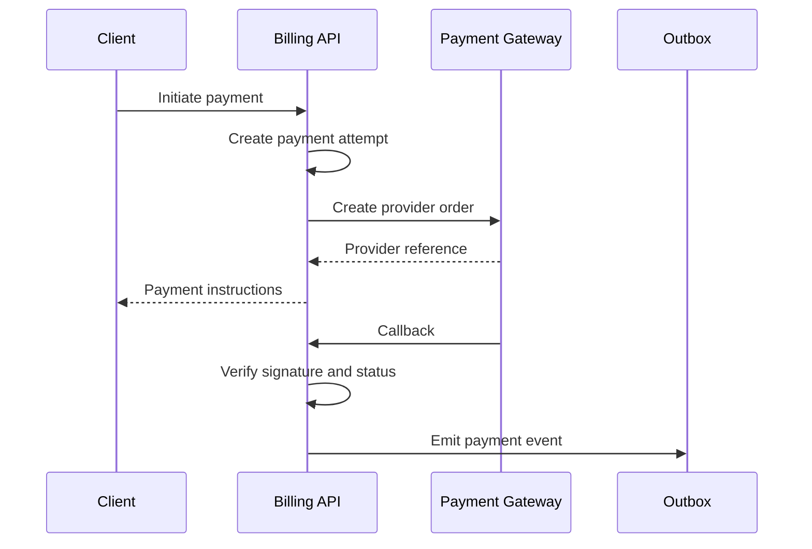
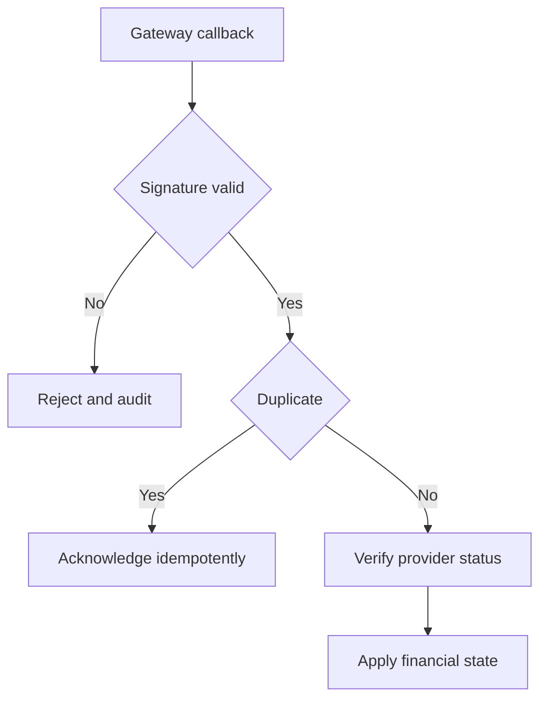

# IC-04 Payment Gateway Integration Contract

**Document ID:** IC-04  
**Document Name:** Payment Gateway Integration Contract  
**Company:** OreeOn Technologies Pvt. Ltd.  
**Product:** Digitize  
**Document Type:** Integration Contract  
**Backend Technology:** FastAPI  
**Database Engine:** PostgreSQL  
**Client Technology:** Flutter  
**Authentication:** JWT  
**Version:** 0.1  
**Status:** Design Draft  
**Owner:** Integration Architecture  
**Reviewer:** Solution Architecture / Security Architecture / API Architecture / Engineering  
**Dependencies:** IC-00, IC-03, IC-11, IC-12, API-08, API-09, API-18, API-19  
**Last Updated:** July 2026

---

# 1. Document Metadata

| Attribute | Value |
|---|---|
| Integration ID | IC-04 |
| Producer | Digitize Billing API |
| Consumer | Payment Gateway |
| Classification | Provider API / Provider Callback |
| System of Record | Digitize commercial records with provider reference validation |

---

# 2. Purpose

This document defines provider-neutral payment gateway integration behavior for payment initiation, callback, verification, refund, settlement, reconciliation, and failure handling.

---

# 3. Scope

In scope: payment order creation, provider request, redirect or SDK flow, UPI-ready and online payment behavior, callback, signature validation, verification, duplicate callback, delayed callback, payment status, failed payment, refund, refund callback, settlement, reconciliation, idempotency, financial transaction boundaries, provider outage, manual correction, GST and invoice references, security, and audit.

Out of scope: choosing a specific payment gateway.

---

# 4. Business Context

Payments support invoices, memberships, subscriptions, licenses, walk-ins, renewals, refunds, and settlement reconciliation.

---

# 5. Integration Objectives

- Prevent duplicate charges and duplicate financial posting.
- Preserve invoice, tax, receipt, and settlement traceability.
- Validate gateway callbacks securely.
- Support delayed and inconsistent provider responses.

---

# 6. Architecture Context

---

# 7. Actors and Systems

Billing API, Payment Gateway, Client, Commercial database, Outbox processor, Finance operations, and Support.

---

# 8. Integration Classification

Provider API and Provider Callback.

---

# 9. Trust Boundaries

Gateway requests leave Digitize. Callbacks re-enter from an external provider and require signature, timestamp, replay, and provider-reference validation.

---

# 10. Data Ownership

Digitize owns invoice, payment, receipt, refund, settlement, and customer entitlement state. The gateway owns payment processing references and provider transaction status.

---

# 11. Authentication

Digitize-to-provider authentication shall use approved secret references. Provider callbacks shall use signature validation and replay prevention.

---

# 12. Authorization

Only authorized users or services may initiate payment, refund, verification, and reconciliation actions.

---

# 13. Tenant Context

Payment records shall validate Organization, Facility, Site, billing account, invoice, subscription/license, and customer ownership.

---

# 14. Transport Standards

All provider calls and callbacks shall use HTTPS.

---

# 15. Payload Standards

Payment payloads shall include opaque provider references, amount, currency, invoice reference, attempt ID, tenant context, and safe customer reference. Sensitive payment data shall not be stored unless explicitly approved.

---

# 16. Response and Acknowledgement Standards

Provider order creation returns payment instructions. Callback acknowledgement confirms receipt only, not business success, until verification is complete.

---

# 17. Validation

Validate amount, currency, invoice state, payment attempt state, provider signature, provider reference, duplicate callback, tenant scope, and gateway status.

---

# 18. Idempotency

Payment initiation, verification, refund initiation, and callback processing shall be idempotent.

---

# 19. Ordering

Provider callbacks may arrive out of order. Digitize shall use state transition rules from API-24.

---

# 20. Timeout

Gateway request timeouts shall not mark payment failed without verification. Client-visible state may be pending.

---

# 21. Retry

Provider API retries are allowed for retryable transport failures using bounded backoff. Callback retries are provider-driven and must be idempotent.

---

# 22. Circuit Breaker

Provider outage shall open a gateway circuit and prevent new online payment initiation where appropriate while preserving reconciliation.

---

# 23. Failure Handling

Failures shall move payment attempts to pending verification, failed, cancelled, refunded, or reconciliation-required states according to API-08.

---

# 24. Dead-Letter Handling

Unprocessable callbacks shall be dead-lettered with provider reference, signature validation outcome, tenant context if known, and reason.

---

# 25. Reconciliation

Daily and incident-triggered reconciliation shall compare Digitize payment, refund, settlement, and provider status records.

---

# 26. Compensation

Compensation may include refund, receipt reversal, entitlement correction, invoice reopening, manual settlement correction, or support workflow.

---

# 27. Audit

Payment initiation, callback receipt, verification, success, failure, refund, settlement, reconciliation, and manual correction shall be audited.

---

# 28. Logging

Logs shall redact payment secrets, signatures, tokens, card/payment instrument details, and raw provider secrets.

---

# 29. Metrics

Track initiation count, success rate, failure rate, pending verification count, callback delay, duplicate callback count, refund success, settlement mismatch, and provider outage.

---

# 30. Tracing

Correlation IDs shall connect invoice, payment attempt, provider reference, callback, event, and receipt.

---

# 31. Alerts

Alert on gateway outage, callback failure spike, settlement mismatch, stuck pending payments, refund failure, and signature failure spike.

---

# 32. Security

Controls include TLS, signature validation, replay prevention, secret references, least privilege, PCI boundary minimization, audit, and restricted payment data handling.

---

# 33. Performance and Capacity

Payment initiation shall handle peak enrollment and renewal periods. Callback processing shall not block provider acknowledgement on slow downstream notifications.

---

# 34. Versioning

Provider payload changes require contract review and backward-compatible parsing where possible.

---

# 35. Integration Contracts

Payment behavior depends on IC-03 tenant context, IC-11 error/retry, IC-12 security, IC-13 observability, IC-14 tests, and IC-17 readiness.

---

# 36. Sequence Diagrams

See section 6.

---

# 37. Failure Flow Diagrams

---

# 38. Traceability

API-08, API-09, API-18, API-19, DB-07, DB-22, IC-14, and IC-15 govern detailed traceability.

---

# 39. Test Coverage

Payment success, failed payment, pending payment, duplicate callback, delayed callback, invalid signature, verification timeout, refund success, refund failure, settlement mismatch, provider outage, and manual correction tests are required.

---

# 40. Assumptions and Constraints

Specific gateway field mappings are `[TBD — Source mapping pending — see BE traceability mappings](docs/10_Backend_Engineering/BE-TRACEABILITY_MAPPINGS.md)` until a provider is approved.

---

# 41. Dependencies

IC-00, IC-03, IC-11, IC-12, API-08, API-09, API-18, API-19.

---

# 42. Future Enhancements

Multiple gateway routing, saved instruments, autopay, mandate flows, and advanced fraud signals may be added later.

---

# 43. Acceptance Criteria

- No duplicate financial posting occurs.
- Callback verification and idempotency are defined.
- Refund, settlement, and reconciliation flows are defined.
- No provider-specific assumptions are embedded.

---

# 44. Summary

IC-04 defines provider-neutral payment gateway integration behavior for Digitize.
