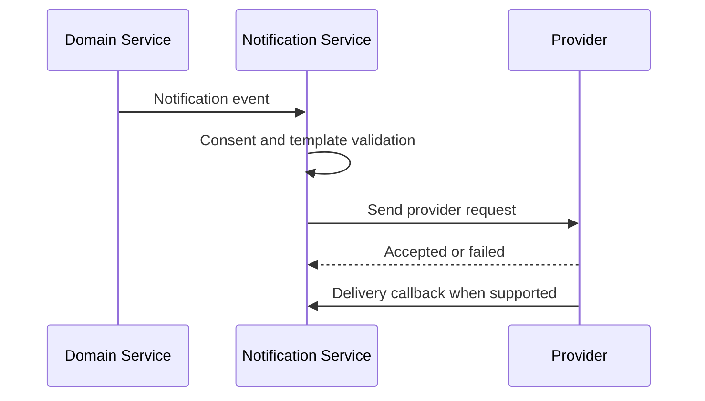
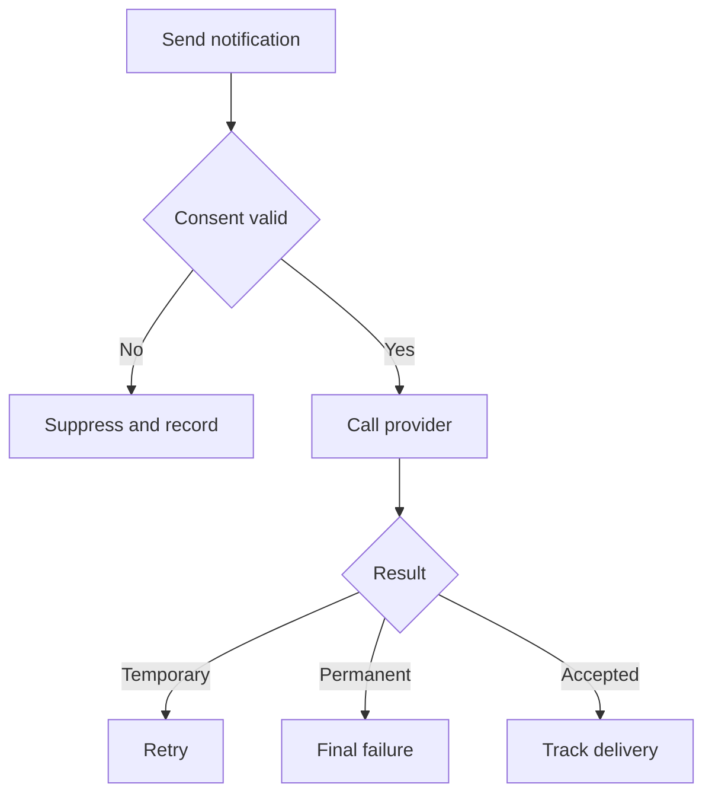

# IC-05 Notification Provider Integration Contract

**Document ID:** IC-05  
**Document Name:** Notification Provider Integration Contract  
**Company:** OreeOn Technologies Pvt. Ltd.  
**Product:** Digitize  
**Document Type:** Integration Contract  
**Backend Technology:** FastAPI  
**Database Engine:** PostgreSQL  
**Client Technology:** Flutter  
**Authentication:** JWT  
**Version:** 0.1  
**Status:** Design Draft  
**Owner:** Integration Architecture  
**Reviewer:** Solution Architecture / Security Architecture / API Architecture / Engineering  
**Dependencies:** IC-00, IC-03, IC-09, IC-11, IC-12, API-10, API-18, API-19  
**Last Updated:** July 2026

---

# 1. Document Metadata

| Attribute | Value |
|---|---|
| Integration ID | IC-05 |
| Producer | Notification Service |
| Consumer | Notification Provider |
| Classification | Provider API / Provider Callback |
| System of Record | Digitize notification records |

---

# 2. Purpose

This document defines provider-neutral notification integration behavior for email, SMS, push, WhatsApp-ready providers, delivery callbacks, retry, suppression, fallback, and delivery audit.

---

# 3. Scope

In scope: template mapping, consent, preferences, provider requests, delivery acknowledgement, callback, failure, retry, suppression, rate limits, provider fallback, template version, sensitive-data restrictions, campaign integration, and audit.

Out of scope: choosing a provider or writing provider SDK code.

---

# 4. Business Context

Digitize uses notifications for membership, billing, attendance, campaigns, support, security, and operational communications.

---

# 5. Integration Objectives

- Respect consent and preferences.
- Prevent duplicate or unauthorized notifications.
- Track provider delivery and failures.
- Protect sensitive customer and business data.

---

# 6. Architecture Context

---

# 7. Actors and Systems

Notification Service, Provider, Campaign Service, Domain Services, Outbox Processor, Customer, Staff, Support, and Audit.

---

# 8. Integration Classification

Provider API and Provider Callback.

---

# 9. Trust Boundaries

Provider requests leave Digitize. Delivery callbacks re-enter and require provider validation where supported.

---

# 10. Data Ownership

Digitize owns notification intent, templates, consent, preference, and delivery record. Providers own transport delivery status.

---

# 11. Authentication

Provider calls use approved secret references. Provider callbacks use configured callback validation where supported.

---

# 12. Authorization

Only authorized domains may request notifications. Administrative resend and suppression changes require permission checks.

---

# 13. Tenant Context

Notification events shall carry Organization, Facility, Site, recipient, template, and communication-purpose context.

---

# 14. Transport Standards

Provider APIs and callbacks shall use HTTPS. Internal notification dispatch may use IC-09 outbox.

---

# 15. Payload Standards

Payloads shall include recipient reference, channel, template ID, template version, locale, safe variables, correlation ID, and tenant context.

---

# 16. Response and Acknowledgement Standards

Provider accepted means delivery attempted, not user receipt. Delivery status updates shall be processed separately.

---

# 17. Validation

Validate channel eligibility, recipient, consent, preferences, template, variables, rate limits, tenant scope, and suppression status.

---

# 18. Idempotency

Notification send requests shall prevent duplicate delivery for the same event, recipient, channel, and template version where required.

---

# 19. Ordering

Ordering is best effort unless a campaign or lifecycle rule requires sequence control.

---

# 20. Timeout

Provider send timeouts shall leave delivery in retry-pending or unknown state, not silently failed.

---

# 21. Retry

Retry transient provider, timeout, throttling, and temporary network failures. Do not retry invalid recipient, consent failure, template failure, or permanent provider rejection.

---

# 22. Circuit Breaker

Provider outage may trigger fallback provider or suppress non-critical delivery until recovery.

---

# 23. Failure Handling

Failures shall be categorized as validation, consent, provider permanent, provider temporary, throttled, timeout, duplicate, or suppressed.

---

# 24. Dead-Letter Handling

Notifications exceeding retry policy shall be dead-lettered with delivery reason and replay eligibility.

---

# 25. Reconciliation

Provider delivery reports shall reconcile with Digitize notification records where provider data is available.

---

# 26. Compensation

Compensation may include resend, alternate channel, campaign pause, suppression correction, or support notification.

---

# 27. Audit

Template changes, consent decisions, send requests, delivery outcomes, failures, suppression, and administrative resends shall be auditable.

---

# 28. Logging

Logs shall redact OTPs, credentials, raw message bodies with sensitive data, and provider secrets.

---

# 29. Metrics

Track send count, accepted count, delivery count, failure count, retry count, suppression count, callback delay, channel rate, and provider availability.

---

# 30. Tracing

Correlation ID shall connect originating domain event, notification record, provider request, callback, and campaign analytics.

---

# 31. Alerts

Alert on provider outage, delivery failure spike, callback failure spike, template rendering failure, consent validation failure spike, and retry backlog.

---

# 32. Security

Least privilege, provider secret references, consent enforcement, sensitive data minimization, audit, and callback validation are required.

---

# 33. Performance and Capacity

Campaign and bulk notification delivery shall use asynchronous dispatch, batching, throttling, and provider quota controls.

---

# 34. Versioning

Templates and provider payload mappings shall be versioned.

---

# 35. Integration Contracts

Notification behavior depends on IC-03, IC-09, IC-11, IC-12, IC-13, IC-14, and IC-17.

---

# 36. Sequence Diagrams

See section 6.

---

# 37. Failure Flow Diagrams

---

# 38. Traceability

Traceability maps to API-10, API-18, API-19, DB-08, DB-22, IC-14, and IC-15.

---

# 39. Test Coverage

Email, SMS, push, WhatsApp-ready abstraction, consent denial, preference denial, template failure, provider timeout, retry, fallback, duplicate event, callback, campaign rate limit, and audit tests are required.

---

# 40. Assumptions and Constraints

Specific provider mappings are `[TBD — Source mapping pending — see BE traceability mappings](docs/10_Backend_Engineering/BE-TRACEABILITY_MAPPINGS.md)` until providers are approved.

---

# 41. Dependencies

IC-00, IC-03, IC-09, IC-11, IC-12, API-10, API-18, API-19.

---

# 42. Future Enhancements

Provider failover, A/B templates, advanced campaign analytics, and user preference center enhancements may be added later.

---

# 43. Acceptance Criteria

- Consent and preference validation are mandatory.
- Provider retry and failure behavior are defined.
- Sensitive data restrictions are defined.
- Delivery audit and observability are defined.

---

# 44. Summary

IC-05 defines notification provider integration behavior for Digitize.
