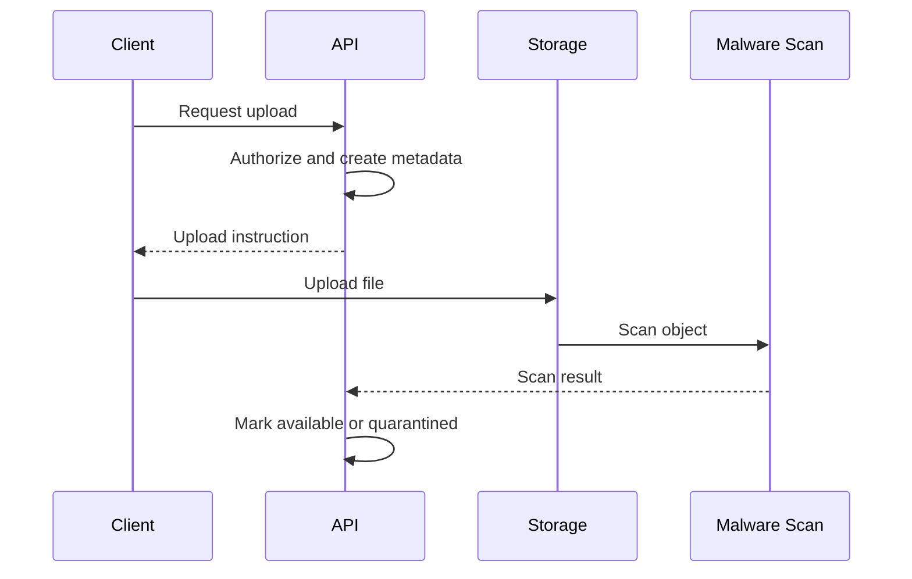
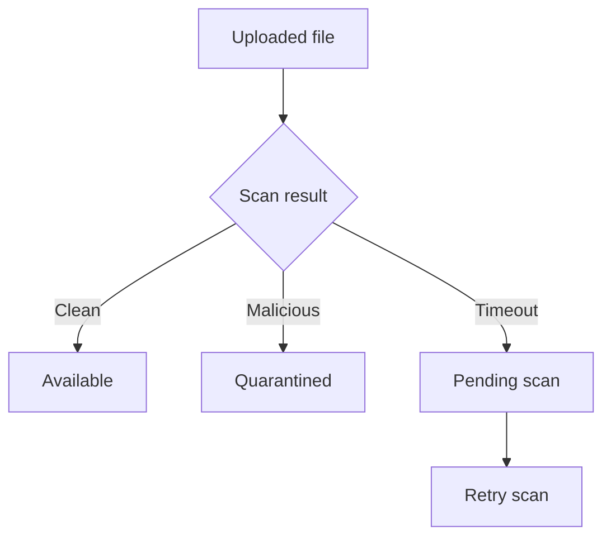

# IC-06 File Storage Integration Contract

**Document ID:** IC-06  
**Document Name:** File Storage Integration Contract  
**Company:** OreeOn Technologies Pvt. Ltd.  
**Product:** Digitize  
**Document Type:** Integration Contract  
**Backend Technology:** FastAPI  
**Database Engine:** PostgreSQL  
**Client Technology:** Flutter  
**Authentication:** JWT  
**Version:** 0.1  
**Status:** Design Draft  
**Owner:** Integration Architecture  
**Reviewer:** Solution Architecture / Security Architecture / API Architecture / Engineering  
**Dependencies:** IC-00, IC-01, IC-03, IC-11, IC-12, API-02, API-04, API-12, API-19  
**Last Updated:** July 2026

---

# 1. Document Metadata

| Attribute | Value |
|---|---|
| Integration ID | IC-06 |
| Producer | Client or Backend Service |
| Consumer | File Storage Service |
| Classification | File Integration |
| System of Record | Digitize metadata; storage service for object content |

---

# 2. Purpose

This document defines upload, validation, malware scanning, object storage, download authorization, retention, deletion, legal hold, and audit behavior for Digitize files.

---

# 3. Scope

In scope: upload initiation, direct or API-mediated upload, temporary URL, file validation, MIME validation, extension validation, malware scanning, metadata, encryption, download authorization, temporary download URL, retention, deletion, legal hold, customer documents, organization documents, ticket attachments, report exports, audit, and size limits.

Out of scope: selecting a specific cloud provider.

---

# 4. Business Context

Digitize handles organization documents, customer documents, support attachments, report exports, and operational evidence.

---

# 5. Integration Objectives

- Prevent unauthorized file access.
- Validate and scan file content before trusted use.
- Separate metadata ownership from object storage implementation.
- Support retention and deletion controls.

---

# 6. Architecture Context

---

# 7. Actors and Systems

Client, File API, Storage Service, Malware Scanner, PostgreSQL metadata, Audit, Support, and Operations.

---

# 8. Integration Classification

File Integration.

---

# 9. Trust Boundaries

Files originate from untrusted clients or generated backend processes. Content shall not be trusted until validation and scanning complete.

---

# 10. Data Ownership

Digitize owns metadata, access rules, lifecycle state, retention, and audit. The storage provider owns object persistence mechanics.

---

# 11. Authentication

Upload and download operations require authenticated user or service identity unless explicitly approved as public temporary access.

---

# 12. Authorization

Authorization shall validate actor permission, tenant scope, resource ownership, file classification, and lifecycle state.

---

# 13. Tenant Context

Each file metadata record shall include Organization and optional Facility/Site context where applicable.

---

# 14. Transport Standards

Upload and download shall use HTTPS. Temporary URLs shall be short-lived and scoped.

---

# 15. Payload Standards

Metadata shall include file ID, owner resource, original filename, MIME type, size, checksum where available, classification, scan status, retention policy, and storage reference.

---

# 16. Response and Acknowledgement Standards

Upload initiation returns upload instructions. File availability depends on upload completion and scan result.

---

# 17. Validation

Validate file size, extension, MIME type, tenant scope, resource ownership, upload intent, checksum where available, and malware scan status.

---

# 18. Idempotency

Upload initiation shall prevent duplicate metadata records for repeated requests where an idempotency key is supplied.

---

# 19. Ordering

Scan completion may occur after upload completion. Download shall be blocked until file is available.

---

# 20. Timeout

Upload and download URL expiry shall be environment-specific. Long uploads shall use client-visible progress and retry-safe behavior.

---

# 21. Retry

Retry upload initiation for transient failures. File object upload retries follow storage provider capabilities and idempotent metadata handling.

---

# 22. Circuit Breaker

Storage or scanner outage shall block new sensitive uploads or mark files pending scan according to policy.

---

# 23. Failure Handling

Failures shall result in pending_upload, uploaded_pending_scan, quarantined, failed, deleted, expired, or unavailable states.

---

# 24. Dead-Letter Handling

Scan callbacks or storage events that cannot be processed shall be dead-lettered under IC-09 behavior.

---

# 25. Reconciliation

Metadata shall be reconciled against storage objects to detect orphaned metadata, orphaned objects, missing scans, and expired files.

---

# 26. Compensation

Compensation includes object deletion, metadata cancellation, quarantine, access revocation, retention correction, and support review.

---

# 27. Audit

Upload initiation, upload completion, scan result, download, delete, retention change, legal hold, and access denial shall be audited.

---

# 28. Logging

Logs shall not include file content, raw temporary URLs, or sensitive document content.

---

# 29. Metrics

Track upload count, upload failures, scan latency, quarantine count, download count, authorization failures, storage errors, and orphan detection.

---

# 30. Tracing

Correlation IDs shall connect upload initiation, object storage event, scan result, metadata update, and download.

---

# 31. Alerts

Alert on scanner outage, storage outage, quarantine spike, orphan objects, expired temporary URL failures, and unauthorized access spikes.

---

# 32. Security

Controls include encryption, temporary URLs, least privilege, malware scanning, content-type validation, retention controls, legal hold, and audit.

---

# 33. Performance and Capacity

File size limits, concurrent uploads, scan queue depth, and download throughput shall be defined per environment.

---

# 34. Versioning

Metadata schema changes shall be backward compatible. Storage provider changes require migration and reconciliation plan.

---

# 35. Integration Contracts

File behavior depends on IC-01, IC-03, IC-11, IC-12, IC-13, IC-14, and IC-17.

---

# 36. Sequence Diagrams

See section 6.

---

# 37. Failure Flow Diagrams

---

# 38. Traceability

Traceability maps to API-02, API-04, API-12, API-19, DB file metadata mappings where approved, IC-14, and IC-15.

---

# 39. Test Coverage

Upload, invalid type, invalid size, malware detected, scan timeout, unauthorized download, temporary URL expiry, delete, legal hold, retention cleanup, and orphan reconciliation tests are required.

---

# 40. Assumptions and Constraints

Storage shall use S3-compatible object storage and ClamAV-based scanning per `DR-014_S3_Compatible_Object_Storage_File_Scanning_Baseline.md`. File metadata and tenant ownership remain stored in PostgreSQL.

---

# 41. Dependencies

IC-00, IC-01, IC-03, IC-11, IC-12, API-02, API-04, API-12, API-19.

---

# 42. Future Enhancements

Content preview, OCR, versioned documents, external document sharing, and provider migration tooling may be added later.

---

# 43. Acceptance Criteria

- File upload, scan, download, retention, and deletion behavior are defined.
- Unauthorized downloads are prevented.
- Storage provider is not assumed.
- Audit and reconciliation are defined.

---

# 44. Summary

IC-06 defines provider-neutral file storage integration behavior for Digitize.
