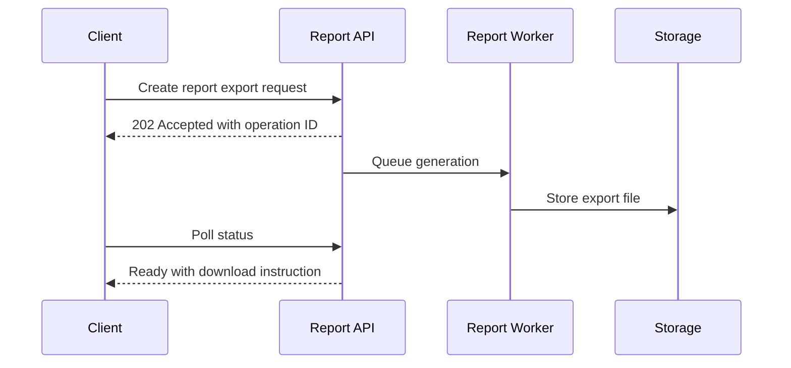
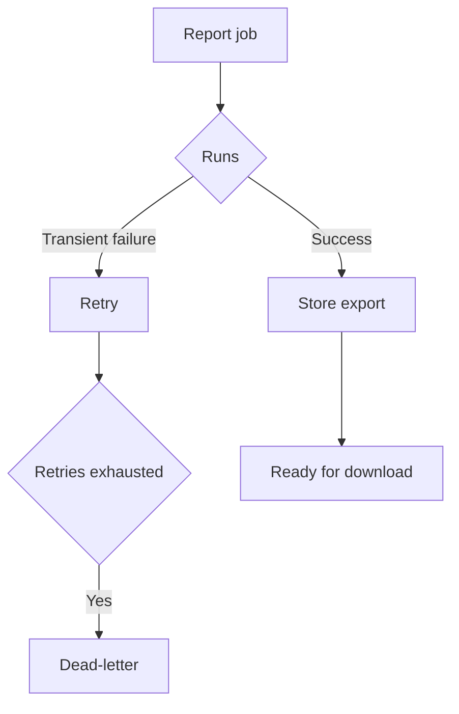

# IC-07 Report Export Integration Contract

**Document ID:** IC-07  
**Document Name:** Report Export Integration Contract  
**Company:** OreeOn Technologies Pvt. Ltd.  
**Product:** Digitize  
**Document Type:** Integration Contract  
**Backend Technology:** FastAPI  
**Database Engine:** PostgreSQL  
**Client Technology:** Flutter  
**Authentication:** JWT  
**Version:** 0.1  
**Status:** Design Draft  
**Owner:** Integration Architecture  
**Reviewer:** Solution Architecture / Security Architecture / API Architecture / Engineering  
**Dependencies:** IC-00, IC-01, IC-03, IC-06, IC-11, IC-12, API-11, API-19  
**Last Updated:** July 2026

---

# 1. Document Metadata

| Attribute | Value |
|---|---|
| Integration ID | IC-07 |
| Producer | Report API / Report Worker |
| Consumer | Client / Storage Service |
| Classification | Reporting Integration / File Integration |
| System of Record | Reporting data and export metadata |

---

# 2. Purpose

This document defines asynchronous report execution, export generation, secure storage, temporary download, expiry, cancellation, retry, masking, retention, and cleanup behavior.

---

# 3. Scope

In scope: report request, parameter validation, async execution, status tracking, generation, storage, export formats, download authorization, URL expiry, cancellation, failure, retry, large report thresholds, tenant isolation, audit, data masking, retention, and cleanup.

Out of scope: report visual design and BI vendor selection.

---

# 4. Business Context

Reports support operational, commercial, platform, facility, customer, attendance, membership, billing, support, and audit workflows.

---

# 5. Integration Objectives

- Avoid blocking UI workflows for large reports.
- Protect exported data.
- Provide clear status and recovery behavior.
- Clean up temporary exports safely.

---

# 6. Architecture Context

---

# 7. Actors and Systems

Client, Report API, Report Worker, PostgreSQL, Storage Service, Audit, Operations, and Support.

---

# 8. Integration Classification

Reporting Integration and File Integration.

---

# 9. Trust Boundaries

Report requests originate from users and shall be authorized before execution. Export files cross into storage and require controlled download authorization.

---

# 10. Data Ownership

Digitize owns report definitions, execution metadata, export metadata, and access policy. Storage owns object persistence mechanics.

---

# 11. Authentication

Authenticated user or service identity is required.

---

# 12. Authorization

Authorization shall validate report permission, tenant scope, data classification, export format, and restricted data visibility.

---

# 13. Tenant Context

Report filters and output shall be constrained to validated Organization, Facility, Site, and actor scope.

---

# 14. Transport Standards

Report APIs and temporary download URLs shall use HTTPS.

---

# 15. Payload Standards

Report requests shall include report ID, parameters, format, tenant context, timezone, locale, and correlation ID.

---

# 16. Response and Acknowledgement Standards

Long-running exports shall return accepted status and operation ID. Ready state shall expose a short-lived download instruction.

---

# 17. Validation

Validate report ID, parameters, date ranges, export format, data classification, tenant scope, and report availability.

---

# 18. Idempotency

Duplicate export requests may reuse an active operation when request fingerprint and context match.

---

# 19. Ordering

Report generation is independent unless explicitly scheduled. Latest status wins for each operation ID.

---

# 20. Timeout

Large report generation shall use worker timeouts and status states rather than long client requests.

---

# 21. Retry

Retry worker execution for transient database, queue, or storage failures. Do not retry invalid report parameters.

---

# 22. Circuit Breaker

Report export may be temporarily disabled when database, queue, or storage health is degraded.

---

# 23. Failure Handling

Failed exports shall expose user-safe failure states and retain operational evidence.

---

# 24. Dead-Letter Handling

Export jobs that exceed retries shall be dead-lettered with operation ID, tenant context, failure reason, and replay eligibility.

---

# 25. Reconciliation

Reconcile export metadata, worker jobs, storage objects, and expired download links.

---

# 26. Compensation

Compensation includes cancellation, cleanup, retry, regenerated export, or support correction.

---

# 27. Audit

Report request, parameter use, export completion, download, failure, cancellation, and deletion shall be audited.

---

# 28. Logging

Logs shall not include exported report content or sensitive parameter values where restricted.

---

# 29. Metrics

Track report count, generation latency, failure count, queue depth, export size, download count, and cleanup count.

---

# 30. Tracing

Correlation IDs shall connect request, worker execution, storage write, status polling, and download.

---

# 31. Alerts

Alert on export failure spike, queue backlog, storage outage, cleanup failure, and unusually large exports.

---

# 32. Security

Controls include authorization, masking, temporary URLs, retention, audit, encryption, redaction, and least privilege.

---

# 33. Performance and Capacity

Define thresholds for synchronous reports, asynchronous exports, maximum date ranges, file sizes, and concurrent jobs.

---

# 34. Versioning

Report definitions and export schemas shall be versioned when consumed externally.

---

# 35. Integration Contracts

This contract depends on IC-06 file behavior and IC-11 retry behavior.

---

# 36. Sequence Diagrams

See section 6.

---

# 37. Failure Flow Diagrams

---

# 38. Traceability

Traceability maps to API-11, API-19, DB-21, IC-06, IC-14, and IC-15.

---

# 39. Test Coverage

Parameter validation, async status, successful export, cancellation, timeout, retry, dead-letter, download authorization, expiry, masking, cleanup, and tenant isolation tests are required.

---

# 40. Assumptions and Constraints

Approved report export storage mapping is `[TBD — Source mapping pending — see BE traceability mappings](docs/10_Backend_Engineering/BE-TRACEABILITY_MAPPINGS.md)`.

---

# 41. Dependencies

IC-00, IC-01, IC-03, IC-06, IC-11, IC-12, API-11, API-19.

---

# 42. Future Enhancements

Scheduled reports, external delivery, dashboard snapshots, and analytics warehouse exports may be added later.

---

# 43. Acceptance Criteria

- Large reports are asynchronous.
- Download authorization and expiry are defined.
- Masking and retention are defined.
- Failure, retry, dead-letter, and cleanup behavior are testable.

---

# 44. Summary

IC-07 defines secure, asynchronous report export behavior for Digitize.
