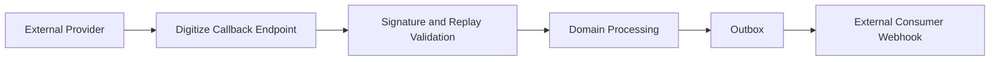
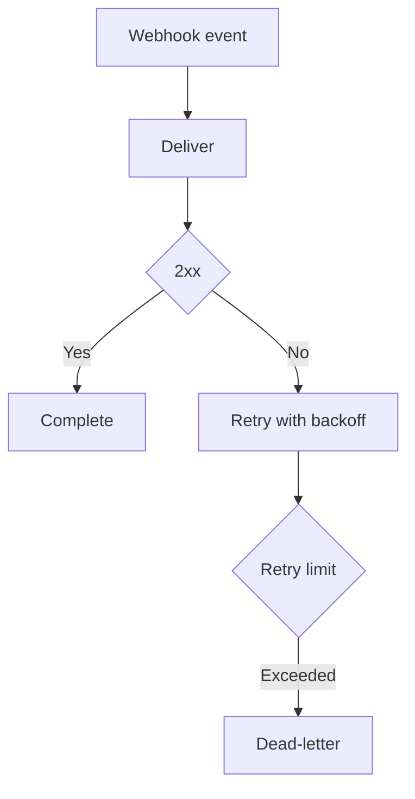

# IC-08 Webhook Callback Integration Contract

**Document ID:** IC-08  
**Document Name:** Webhook Callback Integration Contract  
**Company:** OreeOn Technologies Pvt. Ltd.  
**Product:** Digitize  
**Document Type:** Integration Contract  
**Backend Technology:** FastAPI  
**Database Engine:** PostgreSQL  
**Client Technology:** Flutter  
**Authentication:** JWT  
**Version:** 0.1  
**Status:** Design Draft  
**Owner:** Integration Architecture  
**Reviewer:** Solution Architecture / Security Architecture / API Architecture / Engineering  
**Dependencies:** IC-00, IC-09, IC-11, IC-12, API-18, API-19  
**Last Updated:** July 2026

---

# 1. Document Metadata

| Attribute | Value |
|---|---|
| Integration ID | IC-08 |
| Producer | External Provider or Digitize |
| Consumer | Digitize Callback API or External Consumer |
| Classification | Provider Callback / Outbound Webhook |
| System of Record | Source domain event or provider event |

---

# 2. Purpose

This document defines inbound provider callbacks and outbound Digitize webhook behavior.

---

# 3. Scope

In scope: endpoint registration, verification, secret management, signature validation, timestamp validation, replay prevention, duplicate delivery, retry, timeout, ordering, payload versioning, subscription management, failure, dead-letter, delivery audit, and consumer suspension.

Out of scope: assuming a specific provider signature algorithm unless approved.

---

# 4. Business Context

Callbacks and webhooks allow payment gateways, notification providers, partners, and external consumers to exchange event outcomes with Digitize.

---

# 5. Integration Objectives

- Validate inbound callbacks safely.
- Deliver outbound webhooks reliably.
- Prevent replay and duplicate business effects.
- Provide audit and operational recovery.

---

# 6. Architecture Context

---

# 7. Actors and Systems

External provider, Digitize callback API, webhook subscription store, outbox publisher, external consumer, audit, and operations.

---

# 8. Integration Classification

Provider Callback and Outbound Webhook.

---

# 9. Trust Boundaries

Inbound callbacks cross from external providers into Digitize. Outbound webhooks cross from Digitize to external consumers.

---

# 10. Data Ownership

Inbound event truth depends on provider verification and Digitize domain state. Outbound event truth is the Digitize domain event.

---

# 11. Authentication

Callbacks and webhooks shall use signatures, timestamps, registered endpoints, secret references, and replay controls.

---

# 12. Authorization

Only registered providers or consumers may send or receive webhook traffic.

---

# 13. Tenant Context

Tenant context shall be derived from verified provider references or event metadata, not trusted from raw callback payload alone.

---

# 14. Transport Standards

HTTPS is mandatory.

---

# 15. Payload Standards

Payloads shall include event ID, event type, event version, timestamp, producer, tenant reference when safe, resource reference, and correlation ID.

---

# 16. Response and Acknowledgement Standards

Callback acknowledgement means payload received and queued or processed. Webhook delivery acknowledgement comes from consumer HTTP response.

---

# 17. Validation

Validate signature, timestamp, replay window, event type, version, provider reference, subscription, endpoint status, tenant mapping, and payload schema.

---

# 18. Idempotency

Event ID and provider reference shall prevent duplicate processing and duplicate delivery effects.

---

# 19. Ordering

Ordering is not guaranteed unless a contract explicitly defines partitioned ordering by aggregate ID.

---

# 20. Timeout

Callbacks shall respond quickly. Outbound webhook calls shall use bounded timeout budgets.

---

# 21. Retry

Retry outbound delivery for transient consumer failures. Do not retry permanent schema, authentication, or subscription failures without correction.

---

# 22. Circuit Breaker

Consumer endpoints with repeated failures may be suspended or circuit-opened.

---

# 23. Failure Handling

Failures shall be classified as invalid signature, replay, unknown event, invalid schema, tenant mismatch, consumer timeout, consumer unavailable, or permanent rejection.

---

# 24. Dead-Letter Handling

Events that exceed retry policy shall be dead-lettered with event ID, endpoint, reason, and replay eligibility.

---

# 25. Reconciliation

Provider callbacks and outbound deliveries shall be reconcilable by event ID, provider reference, subscription ID, and correlation ID.

---

# 26. Compensation

Compensation may include replay, endpoint suspension, subscription correction, provider verification, manual processing, or domain-state correction.

---

# 27. Audit

Callback receipt, validation result, duplicate detection, delivery attempt, failure, suspension, replay, and subscription changes shall be audited.

---

# 28. Logging

Logs shall redact secrets, signatures, tokens, and sensitive payload fields.

---

# 29. Metrics

Track callback count, validation failure count, replay rejection, delivery success, delivery failure, retry count, dead-letter count, latency, and endpoint suspension.

---

# 30. Tracing

Correlation ID and event ID shall connect inbound callback, domain processing, outbox, outbound delivery, and replay.

---

# 31. Alerts

Alert on signature failure spikes, replay spikes, endpoint failure spikes, callback latency, dead-letter growth, and consumer suspension.

---

# 32. Security

Controls include signature validation, replay prevention, endpoint registration, secret rotation, least privilege, payload minimization, and audit.

---

# 33. Performance and Capacity

Callback endpoints shall acknowledge quickly and offload slow work asynchronously.

---

# 34. Versioning

Webhook payloads shall include event version and support additive changes.

---

# 35. Integration Contracts

This contract aligns with API-18 and IC-09.

---

# 36. Sequence Diagrams

See section 6.

---

# 37. Failure Flow Diagrams

---

# 38. Traceability

Traceability maps to API-18, API-19, DB-22, IC-09, IC-14, and IC-15.

---

# 39. Test Coverage

Valid callback, invalid signature, replay, duplicate event, delayed event, unsupported version, outbound success, outbound timeout, retry, dead-letter, suspension, replay, and tenant mapping tests are required.

---

# 40. Assumptions and Constraints

Provider-specific signature fields are `[TBD — Source mapping pending — see BE traceability mappings](docs/10_Backend_Engineering/BE-TRACEABILITY_MAPPINGS.md)`.

---

# 41. Dependencies

IC-00, IC-09, IC-11, IC-12, API-18, API-19.

---

# 42. Future Enhancements

Partner self-service webhook portals and event subscription filters may be added later.

---

# 43. Acceptance Criteria

- Inbound and outbound webhook paths are defined.
- Signature, timestamp, replay, idempotency, retry, and dead-letter behavior are defined.
- Audit and observability are defined.

---

# 44. Summary

IC-08 defines secure callback and webhook integration behavior for Digitize.
