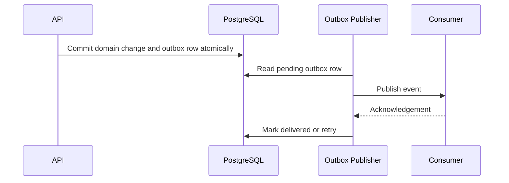
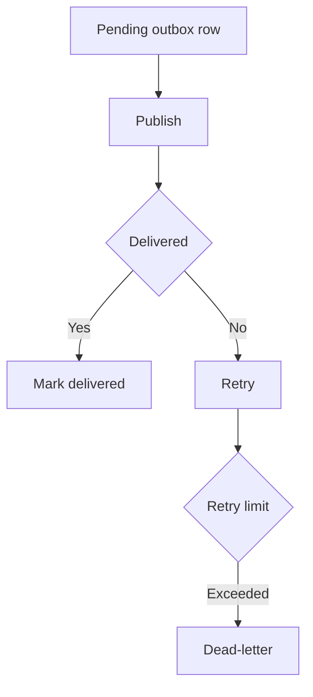

# IC-09 Event Outbox Integration Contract

**Document ID:** IC-09  
**Document Name:** Event Outbox Integration Contract  
**Company:** OreeOn Technologies Pvt. Ltd.  
**Product:** Digitize  
**Document Type:** Integration Contract  
**Backend Technology:** FastAPI  
**Database Engine:** PostgreSQL  
**Client Technology:** Flutter  
**Authentication:** JWT  
**Version:** 0.1  
**Status:** Design Draft  
**Owner:** Integration Architecture  
**Reviewer:** Solution Architecture / Security Architecture / API Architecture / Engineering  
**Dependencies:** IC-00, IC-03, IC-11, IC-12, DB-22, API-18  
**Last Updated:** July 2026

---

# 1. Document Metadata

| Attribute | Value |
|---|---|
| Integration ID | IC-09 |
| Producer | Domain Services |
| Consumer | Outbox Publisher / Event Consumers |
| Classification | Event Integration |
| System of Record | Domain tables plus transactional outbox |

---

# 2. Purpose

This document defines domain event and transactional outbox behavior for reliable asynchronous processing.

---

# 3. Scope

In scope: domain event, event schema, event ID, aggregate ID, tenant context, correlation ID, causation ID, event version, outbox write, transaction commit, publisher, consumer, idempotent consumer, retry, ordering, partitioning, dead-letter, replay, retention, event observability, and schema evolution.

Out of scope: selecting a specific queue or broker provider.

---

# 4. Business Context

Digitize uses asynchronous processing for notifications, integrations, report generation, payment follow-up, audit propagation, and external delivery.

---

# 5. Integration Objectives

- Decouple business transaction from downstream delivery.
- Prevent lost events.
- Support retry, replay, and dead-letter recovery.
- Preserve tenant and correlation traceability.

---

# 6. Architecture Context

---

# 7. Actors and Systems

Domain Service, PostgreSQL, Outbox Publisher, Event Consumer, Dead-Letter Store, Audit, Operations.

---

# 8. Integration Classification

Event Integration.

---

# 9. Trust Boundaries

Events move from transactional domain storage into asynchronous processors and consumers. Consumers shall not assume event trust without schema, tenant, and idempotency validation.

---

# 10. Data Ownership

Domain tables are the system of record. Events are immutable facts or integration messages derived from committed domain changes.

---

# 11. Authentication

Internal publishers and consumers shall use approved service identity.

---

# 12. Authorization

Consumers shall be authorized for the event type and tenant scope they process.

---

# 13. Tenant Context

Events shall include Organization ID and optional Facility/Site IDs where tenant-scoped.

---

# 14. Transport Standards

Outbox is persisted in PostgreSQL using `integration.outbox_event` from `DB-11_Database_DDL_DML_Scripts.md`. Publishing execution shall use Celery with Redis broker per `DR-009_Celery_Background_Worker_Baseline.md`.

---

# 15. Payload Standards

Events shall include event_id, event_type, event_version, occurred_at, producer, aggregate_id, tenant_context, correlation_id, causation_id, and payload.

---

# 16. Response and Acknowledgement Standards

Consumers shall acknowledge successful processing. Failed processing shall return retryable or non-retryable outcome.

---

# 17. Validation

Validate schema, event version, tenant context, event type, aggregate reference, idempotency state, and consumer authorization.

---

# 18. Idempotency

Consumers shall record processed event IDs and handle duplicates safely.

---

# 19. Ordering

Ordering may be partitioned by aggregate ID where required. Global ordering is not guaranteed.

---

# 20. Timeout

Publisher and consumer processing shall use bounded execution time and heartbeat or retry state where applicable.

---

# 21. Retry

Retry transient consumer failures with bounded backoff and retry budget.

---

# 22. Circuit Breaker

Repeated consumer or provider failure may pause delivery for that consumer or event type.

---

# 23. Failure Handling

Failures shall be classified as schema, tenant, duplicate, consumer, provider, timeout, unavailable, or unknown.

---

# 24. Dead-Letter Handling

Events exceeding retry policy shall move to dead-letter with event ID, payload reference, reason, owner, and replay eligibility.

---

# 25. Reconciliation

Outbox records shall be reconciled against domain commits, delivery status, dead-letter counts, and consumer processed-event records.

---

# 26. Compensation

Compensation may include replay, skip with approval, correction event, manual repair, or downstream reconciliation.

---

# 27. Audit

Event creation, publish success, publish failure, dead-letter, replay, and skip decisions shall be auditable.

---

# 28. Logging

Logs shall include event ID and correlation ID but redact sensitive payload values.

---

# 29. Metrics

Track pending outbox count, publish latency, retry count, dead-letter count, consumer failure rate, and replay count.

---

# 30. Tracing

Correlation and causation IDs shall connect API request, domain commit, outbox row, published event, and consumer action.

---

# 31. Alerts

Alert on outbox backlog, dead-letter growth, consumer outage, replay failure, and event schema rejection spikes.

---

# 32. Security

Controls include service identity, least privilege, payload minimization, tenant validation, immutable audit, and replay control.

---

# 33. Performance and Capacity

Outbox publisher shall support peak transaction volumes without blocking domain transactions.

---

# 34. Versioning

Event schemas shall include event_version and support additive changes.

---

# 35. Integration Contracts

IC-09 supports IC-04, IC-05, IC-07, IC-08, IC-10, and IC-13.

---

# 36. Sequence Diagrams

See section 6.

---

# 37. Failure Flow Diagrams

---

# 38. Traceability

Traceability maps to DB-22, API-18, API-19, IC-14, and IC-15.

---

# 39. Test Coverage

Atomic write, publish success, duplicate event, consumer idempotency, retry, ordering, dead-letter, replay, schema version, tenant validation, and backlog alert tests are required.

---

# 40. Assumptions and Constraints

Broker execution uses Celery task queues backed by Redis per `DR-009_Celery_Background_Worker_Baseline.md`. Durable event type naming is stored in `integration.outbox_event.event_type`; task queue names shall use module-oriented names such as `integration.outbox`, `notification.dispatch`, `report.export`, and `provider.callback`.

---

# 41. Dependencies

IC-00, IC-03, IC-11, IC-12, DB-22, API-18.

---

# 42. Future Enhancements

Schema registry, event catalog portal, and external event marketplace support may be added later.

---

# 43. Acceptance Criteria

- Domain commit and outbox write are atomic.
- Consumers are idempotent.
- Retry, dead-letter, replay, and reconciliation are defined.
- Tenant and correlation context are present.

---

# 44. Summary

IC-09 defines Digitize domain event and transactional outbox integration behavior.
