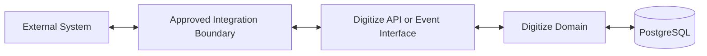

# IC-10 External System Integration Contract

**Document ID:** IC-10  
**Document Name:** External System Integration Contract  
**Company:** OreeOn Technologies Pvt. Ltd.  
**Product:** Digitize  
**Document Type:** Integration Contract  
**Backend Technology:** FastAPI  
**Database Engine:** PostgreSQL  
**Client Technology:** Flutter  
**Authentication:** JWT  
**Version:** 0.1  
**Status:** Design Draft  
**Owner:** Integration Architecture  
**Reviewer:** Solution Architecture / Security Architecture / API Architecture / Engineering  
**Dependencies:** IC-00, IC-03, IC-09, IC-11, IC-12, IC-14, IC-16, IC-17  
**Last Updated:** July 2026

---

# 1. Document Metadata

| Attribute | Value |
|---|---|
| Integration ID | IC-10 |
| Producer | Digitize or External System |
| Consumer | External System or Digitize |
| Classification | External System Integration |
| System of Record | Contract-specific |

---

# 2. Purpose

This document defines reusable standards for future integrations with accounting, ERP, CRM, access-control devices, biometric systems, external membership systems, government or tax systems, partner marketplaces, and third-party reporting systems.

---

# 3. Scope

In scope: onboarding, credentials, tenant mapping, data ownership, synchronization, conflict resolution, versioning, sandbox, certification, support, and decommissioning.

Out of scope: declaring any future external integration as part of MVP without approval.

---

# 4. Business Context

Digitize shall remain extensible for partner and operational integrations without compromising tenant isolation or platform reliability.

---

# 5. Integration Objectives

- Provide a repeatable external integration onboarding model.
- Prevent provider-specific assumptions in core architecture.
- Define certification, support, and decommissioning controls.

---

# 6. Architecture Context

---

# 7. Actors and Systems

External partner, Digitize integration owner, security owner, tenant administrator, support owner, and operations owner.

---

# 8. Integration Classification

External System Integration. Specific implementations may also be Provider API, Provider Callback, Event Integration, File Integration, or Batch Integration.

---

# 9. Trust Boundaries

All external systems are outside the Digitize trust boundary and require explicit authentication, authorization, tenant mapping, rate limits, and audit.

---

# 10. Data Ownership

Each external integration shall define source of truth, replicated data, cached data, derived data, correction owner, retention owner, and deletion owner.

---

# 11. Authentication

Authentication method shall be approved per integration using service identity, API keys, OAuth-ready credentials, signatures, certificates, or mTLS-ready architecture.

---

# 12. Authorization

Each partner shall receive least-privilege access to approved tenants, endpoints, events, files, and data classifications.

---

# 13. Tenant Context

Tenant mapping shall define external tenant identifier, Digitize Organization, Facility/Site scope, mapping owner, and revocation process.

---

# 14. Transport Standards

Approved transports include HTTPS APIs, callbacks, webhooks, events, files, or batch interfaces.

---

# 15. Payload Standards

Payload schemas shall be versioned, documented, classified, and validated. Data minimization is required.

---

# 16. Response and Acknowledgement Standards

Each integration shall define success, rejection, partial success, accepted, retryable failure, and permanent failure responses.

---

# 17. Validation

Validate schema, identity, authorization, tenant mapping, business state, duplicate references, and version compatibility.

---

# 18. Idempotency

External commands and callbacks shall support duplicate detection.

---

# 19. Ordering

Ordering requirements shall be explicit; absence of ordering guarantee must be stated.

---

# 20. Timeout

Provider and partner timeouts shall follow IC-11.

---

# 21. Retry

Retry policy shall be contract-specific and bounded.

---

# 22. Circuit Breaker

Partner failure shall not degrade unrelated tenants or core workflows.

---

# 23. Failure Handling

Failures shall identify owner, user impact, retry eligibility, support path, and reconciliation requirement.

---

# 24. Dead-Letter Handling

Async failures shall use dead-letter handling when retry budget is exhausted.

---

# 25. Reconciliation

Each integration shall define reconciliation source, cadence, mismatch detection, correction owner, and evidence.

---

# 26. Compensation

Compensation may include reversal, correction, replay, partner ticket, or manual repair.

---

# 27. Audit

Partner access, data transfer, failures, corrections, credential changes, and decommissioning shall be audited.

---

# 28. Logging

Logs shall redact credentials, secrets, sensitive PII, financial data, and partner tokens.

---

# 29. Metrics

Track request volume, failure rate, latency, retry count, mismatch count, certification status, and partner availability.

---

# 30. Tracing

Correlation IDs shall be shared with partners where feasible.

---

# 31. Alerts

Alert on partner outage, high failure rates, tenant mapping failures, credential expiry, and reconciliation mismatch.

---

# 32. Security

Security review is mandatory before external access. Data processing, trust boundary, and incident response ownership shall be defined.

---

# 33. Performance and Capacity

Rate limits, quotas, batch size, file size, concurrency, and tenant-level isolation shall be defined per integration.

---

# 34. Versioning

External contracts shall define supported versions, deprecation window, migration path, and breaking-change approval.

---

# 35. Integration Contracts

External integrations shall compose IC-03, IC-09, IC-11, IC-12, IC-13, IC-14, IC-16, and IC-17.

---

# 36. Sequence Diagrams

Sequence diagrams shall be created per approved external integration.

---

# 37. Failure Flow Diagrams

Failure flow diagrams shall be created per approved external integration.

---

# 38. Traceability

IC-15 shall map each approved external integration to requirements, APIs, DB tables, events, UI workflows, tests, and owners.

---

# 39. Test Coverage

Sandbox, contract, security, tenant mapping, failure, retry, duplicate, reconciliation, certification, decommissioning, and support handoff tests are required.

---

# 40. Assumptions and Constraints

Specific external partner mappings are `[TBD — Source mapping pending — see BE traceability mappings](docs/10_Backend_Engineering/BE-TRACEABILITY_MAPPINGS.md)` until approved.

---

# 41. Dependencies

IC-00, IC-03, IC-09, IC-11, IC-12, IC-14, IC-16, IC-17.

---

# 42. Future Enhancements

Partner portal, integration marketplace, partner certification automation, and integration analytics may be added later.

---

# 43. Acceptance Criteria

- Future integrations have onboarding, security, tenant, support, testing, and decommissioning controls.
- MVP scope is not expanded by assumption.

---

# 44. Summary

IC-10 defines reusable external system integration standards for future Digitize partner and enterprise integrations.
