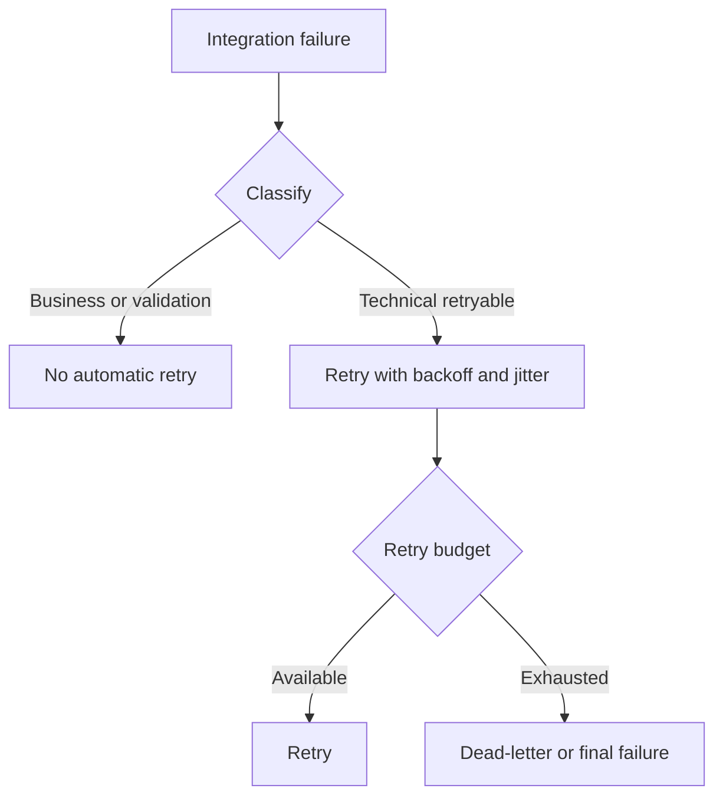

# IC-11 Integration Error Retry Contract

**Document ID:** IC-11  
**Document Name:** Integration Error Retry Contract  
**Company:** OreeOn Technologies Pvt. Ltd.  
**Product:** Digitize  
**Document Type:** Integration Contract  
**Backend Technology:** FastAPI  
**Database Engine:** PostgreSQL  
**Client Technology:** Flutter  
**Authentication:** JWT  
**Version:** 0.1  
**Status:** Design Draft  
**Owner:** Integration Architecture  
**Reviewer:** Solution Architecture / Security Architecture / API Architecture / Engineering  
**Dependencies:** IC-00, API-19, API-20  
**Last Updated:** July 2026

---

# 1. Document Metadata

| Attribute | Value |
|---|---|
| Integration ID | IC-11 |
| Producer | Any Digitize integration component |
| Consumer | Any Digitize integration component |
| Classification | Cross-cutting Integration Governance |
| System of Record | Integration execution records |

---

# 2. Purpose

This document defines shared integration error classification, retry, timeout, throttling, backoff, circuit breaker, dead-letter, replay, escalation, and user-safe error behavior.

---

# 3. Scope

In scope: business versus technical errors, retryable versus non-retryable errors, HTTP errors, provider errors, network errors, timeout, throttling, backoff, jitter, retry budget, circuit breaker, bulkhead isolation, dead-letter, manual replay, ownership, correlation, user-safe errors, alerts, and escalation.

Out of scope: provider-specific status mapping unless approved.

---

# 4. Business Context

Reliable integration behavior prevents duplicate financial effects, lost notifications, stuck reports, incorrect tenant access, and unclear support outcomes.

---

# 5. Integration Objectives

- Standardize retry safety.
- Prevent repeated invalid requests.
- Protect providers and Digitize during outages.
- Make failures observable and supportable.

---

# 6. Architecture Context

---

# 7. Actors and Systems

API, client, provider adapter, outbox publisher, worker, external provider, operations, support, and security.

---

# 8. Integration Classification

Cross-cutting Integration Governance.

---

# 9. Trust Boundaries

Failures crossing trust boundaries shall be normalized before being exposed to users or downstream consumers.

---

# 10. Data Ownership

Each integration owns its execution record and failure evidence. API-19 owns stable API-facing error codes.

---

# 11. Authentication

Authentication failures are normally non-retryable until credentials or tokens are refreshed through approved flow.

---

# 12. Authorization

Authorization failures are non-retryable and shall not be hidden by retries.

---

# 13. Tenant Context

Tenant validation failures are non-retryable except during verified transient tenant authority outage.

---

# 14. Transport Standards

Transport failures include DNS, TLS, connection timeout, read timeout, connection reset, throttling, and unavailable provider states.

---

# 15. Payload Standards

Error payloads shall expose safe code, message, retry classification, correlation ID, and field errors where applicable.

---

# 16. Response and Acknowledgement Standards

Errors shall distinguish validation, authentication, authorization, tenant, conflict, duplicate, rate limited, timeout, unavailable, provider failed, dead-lettered, and unknown.

---

# 17. Validation

Validation errors are non-retryable until input changes.

---

# 18. Idempotency

Retries for mutations require idempotency or proven duplicate-safe processing.

---

# 19. Ordering

Retry may break order unless partitioned ordering is defined.

---

# 20. Timeout

Each integration shall define connection, read, total, job, callback, and user-visible timeout behavior where applicable.

---

# 21. Retry

Retries shall use bounded attempts, backoff, jitter, retry budget, and exclusions.

---

# 22. Circuit Breaker

Circuit breakers shall open on repeated failures, fail fast during open state, probe during half-open state, and close only after recovery.

---

# 23. Failure Handling

Each failure shall have owner, severity, retryability, support visibility, user-safe message, and escalation path.

---

# 24. Dead-Letter Handling

Dead-letter records shall include reason, correlation ID, tenant context, payload reference, owner, retry history, retention, and replay eligibility.

---

# 25. Reconciliation

Reconciliation is required for unknown outcome, partial success, delayed callback, duplicate, provider mismatch, and manual correction cases.

---

# 26. Compensation

Compensation shall be explicit for financial, membership, license, notification, file, and report workflows.

---

# 27. Audit

Audit shall record business-impacting failures, manual replay, skip, compensation, and security-sensitive failures.

---

# 28. Logging

Logs shall include error code, classification, provider code where safe, retry count, correlation ID, and owner.

---

# 29. Metrics

Track failure count by classification, retry count, retry success, retry exhaustion, circuit state, dead-letter count, and manual replay.

---

# 30. Tracing

Traces shall show failed span, retry spans, provider call, callback, and compensation where applicable.

---

# 31. Alerts

Alert on circuit open, retry exhaustion, dead-letter growth, provider outage, elevated latency, timeout spike, and unknown outcome spike.

---

# 32. Security

Error responses shall not leak internal stack traces, secrets, tenant existence, provider credentials, or sensitive payloads.

---

# 33. Performance and Capacity

Retry storms shall be prevented through jitter, budgets, circuit breakers, and rate limits.

---

# 34. Versioning

Error classification changes require API-19 and IC-11 review.

---

# 35. Integration Contracts

IC-11 governs retry behavior for IC-01 through IC-10 and IC-13 through IC-17.

---

# 36. Sequence Diagrams

See section 6.

---

# 37. Failure Flow Diagrams

See section 6.

---

# 38. Traceability

Traceability maps to API-19, API-20, IC-14, and IC-15.

---

# 39. Test Coverage

Business error, validation error, auth error, tenant error, network timeout, throttling, retry success, retry exhaustion, circuit open, dead-letter, manual replay, and user-safe error tests are required.

---

# 40. Assumptions and Constraints

Provider-specific retry requirements are `[TBD — Source mapping pending — see BE traceability mappings](docs/10_Backend_Engineering/BE-TRACEABILITY_MAPPINGS.md)` until providers are approved.

---

# 41. Dependencies

IC-00, API-19, API-20.

---

# 42. Future Enhancements

Adaptive retry, provider health scoring, automated replay approval, and chaos testing may be added later.

---

# 43. Acceptance Criteria

- Retryable and non-retryable failures are separated.
- Timeouts, backoff, jitter, retry budget, circuit breaker, and dead-letter behavior are defined.
- User-safe error handling is defined.

---

# 44. Summary

IC-11 defines shared integration error and retry behavior for Digitize.
