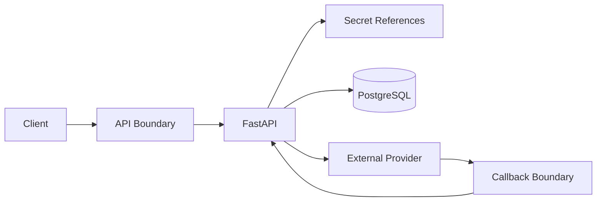
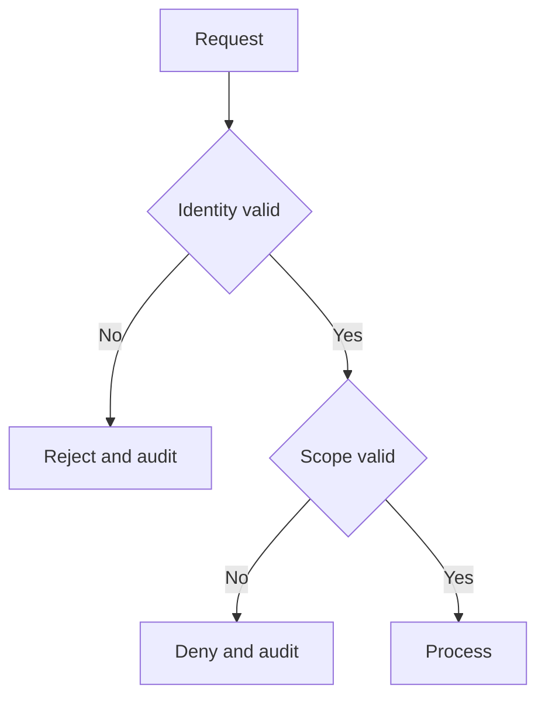

# IC-12 Integration Security Contract

**Document ID:** IC-12  
**Document Name:** Integration Security Contract  
**Company:** OreeOn Technologies Pvt. Ltd.  
**Product:** Digitize  
**Document Type:** Integration Contract  
**Backend Technology:** FastAPI  
**Database Engine:** PostgreSQL  
**Client Technology:** Flutter  
**Authentication:** JWT  
**Version:** 0.1  
**Status:** Design Draft  
**Owner:** Integration Architecture  
**Reviewer:** Solution Architecture / Security Architecture / API Architecture / Engineering  
**Dependencies:** IC-00, IC-02, IC-03, TA-05, API-13, API-23  
**Last Updated:** July 2026

---

# 1. Document Metadata

| Attribute | Value |
|---|---|
| Integration ID | IC-12 |
| Producer | Any Digitize or external integration component |
| Consumer | Any Digitize or external integration component |
| Classification | Cross-cutting Integration Security |
| System of Record | Security policy, identity, audit, and secret stores |

---

# 2. Purpose

This document defines integration security controls for trust boundaries, service identity, OAuth-ready integrations, API keys, JWT, mTLS-ready architecture, webhook signatures, secrets, encryption, least privilege, data minimization, replay protection, audit, and incident response.

---

# 3. Scope

In scope: trust boundaries, service identity, OAuth-ready integration, API keys, JWT, mTLS-ready architecture, webhook signatures, secret storage, rotation, encryption in transit, encryption at rest, certificate management, least privilege, data minimization, PII handling, payment-data boundaries, replay protection, administrative access, audit, threat scenarios, and incident response.

Out of scope: selecting a secret manager or certificate authority vendor.

---

# 4. Business Context

Integration security protects customers, tenants, payment flows, support data, operational data, provider credentials, and platform trust.

---

# 5. Integration Objectives

- Make trust boundaries explicit.
- Enforce least privilege and tenant isolation.
- Protect secrets and sensitive payloads.
- Support detection, audit, and incident response.

---

# 6. Architecture Context

---

# 7. Actors and Systems

Client, API, service identity provider, secret store, provider, webhook consumer, audit, security operations, and support.

---

# 8. Integration Classification

Cross-cutting Integration Security.

---

# 9. Trust Boundaries

Boundaries include device, client app, API edge, backend service, database, event processor, provider API, provider callback, storage service, and external consumer.

---

# 10. Data Ownership

Security policy owns secrets, credentials, certificates, token policy, and incident evidence. Domain owners own protected business data.

---

# 11. Authentication

Approved mechanisms include JWT, service identity, API key references, OAuth-ready credentials, signatures, certificate-based identity, and mTLS-ready controls.

---

# 12. Authorization

All authenticated identities shall be authorized using least privilege, tenant scope, operation, data classification, and support/admin boundaries.

---

# 13. Tenant Context

Tenant context validation is mandatory for tenant-scoped integrations and shall be enforced server-side.

---

# 14. Transport Standards

TLS is mandatory for external traffic. Internal transports shall use encrypted and authenticated channels where available.

---

# 15. Payload Standards

Payloads shall minimize PII, financial data, and restricted data. Sensitive fields shall be masked, tokenized, encrypted, or omitted according to classification.

---

# 16. Response and Acknowledgement Standards

Security failures shall return safe error codes without leaking internal policy, tenant existence, credential details, or provider secrets.

---

# 17. Validation

Validate signatures, timestamps, replay windows, certificates, token claims, scope, payload schema, and data classification.

---

# 18. Idempotency

Security-sensitive retries shall preserve idempotency and replay protection.

---

# 19. Ordering

Secret rotation and credential revocation shall be ordered to avoid unplanned downtime.

---

# 20. Timeout

Security checks shall fail closed when authority cannot be verified.

---

# 21. Retry

Authentication and signature failures are not retryable without new credentials or corrected payloads.

---

# 22. Circuit Breaker

Provider or secret authority outage shall trigger fail-closed or approved degraded behavior depending on data sensitivity.

---

# 23. Failure Handling

Security failures shall be classified, audited, and escalated based on severity and suspected abuse.

---

# 24. Dead-Letter Handling

Security-failed events shall not be replayed until reviewed and approved.

---

# 25. Reconciliation

Secret rotation, access grants, partner credentials, and callback registration shall be reconcilable against approved configuration.

---

# 26. Compensation

Compensation includes credential revocation, token invalidation, endpoint suspension, tenant access removal, and incident correction.

---

# 27. Audit

Audit credential creation, rotation, revocation, access grant, signature failure, replay rejection, administrative access, and security incident actions.

---

# 28. Logging

Never log secrets, tokens, credentials, signatures, OTPs, private keys, full PII payloads, or payment instrument data.

---

# 29. Metrics

Track auth failures, signature failures, replay rejections, secret expiry, credential use, administrative access, and endpoint suspension.

---

# 30. Tracing

Trace security decisions without exposing sensitive values.

---

# 31. Alerts

Alert on signature failure spike, replay spike, credential expiry, unauthorized tenant attempts, secret retrieval failures, and suspicious admin access.

---

# 32. Security

This section is the governing control set: least privilege, encryption, secret references, rotation, replay prevention, audit, incident response, and data minimization.

---

# 33. Performance and Capacity

Security controls shall be efficient but shall not be bypassed for performance.

---

# 34. Versioning

Security contract changes require Security Architecture review.

---

# 35. Integration Contracts

IC-12 governs security behavior for IC-01 through IC-17.

---

# 36. Sequence Diagrams

See section 6.

---

# 37. Failure Flow Diagrams

---

# 38. Traceability

Traceability maps to TA-05, API-13, API-23, IC-14, and IC-15.

---

# 39. Test Coverage

Token, service identity, API key reference, signature, replay, tenant isolation, least privilege, secret rotation, redaction, encryption, admin access, and incident tests are required.

---

# 40. Assumptions and Constraints

Provider credentials and integration secrets shall be managed through HashiCorp Vault per `DR-011_HashiCorp_Vault_Secrets_Management_Baseline.md`. Certificate authority selection remains owned by Security and Deployment governance where environment-specific certificates are provisioned.

---

# 41. Dependencies

IC-00, IC-02, IC-03, TA-05, API-13, API-23.

---

# 42. Future Enhancements

mTLS rollout, external identity federation, advanced threat detection, and automated credential rotation may be added later.

---

# 43. Acceptance Criteria

- Trust boundaries and identity methods are defined.
- Secrets, signatures, replay protection, encryption, and least privilege are defined.
- Security audit and incident controls are defined.

---

# 44. Summary

IC-12 defines the shared integration security contract for Digitize.
